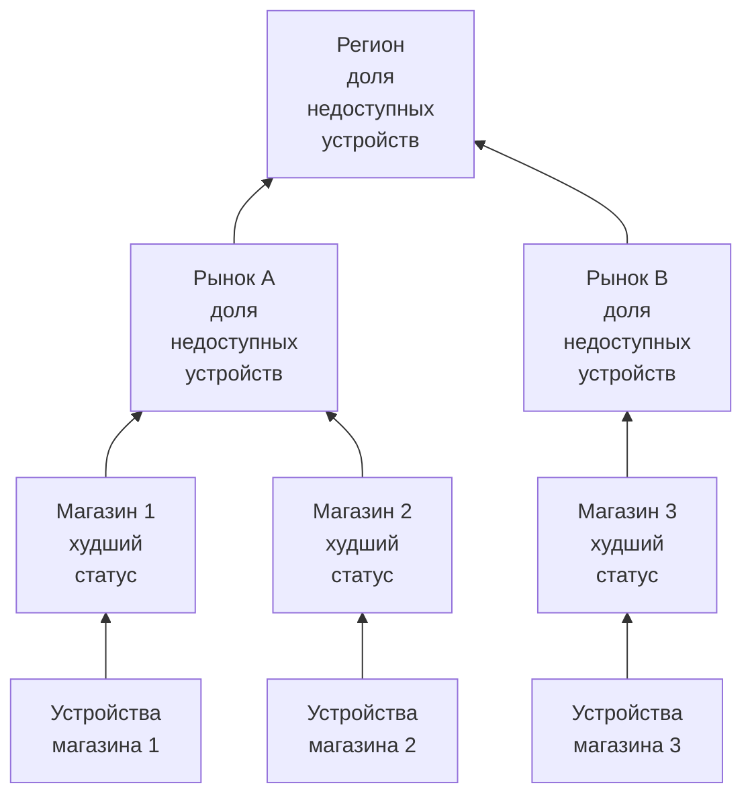

# Сетевые площадки (сводка состояния и доступность)

Сетевая площадка — это место: регион, рынок, франчайзи, распределительный центр, один магазин. Площадки вкладываются друг в друга, сетевые устройства привязываются к ним, а OneUptime сводит состояние устройств вверх по дереву, так что один статус региона отвечает на вопрос «где-то что-то не так?».

Найдите их в **Сеть → Площадки**, а на карте — в **Сеть → Map**. Эта страница точно описывает, как статус площадки вычисляется из того, что находится под ней, что означает её доступность и как плановое обслуживание меняет и то, и другое.

:::cards
- [Добавить площадку](#добавление-площадки): Три шага или CSV-файл для целого парка.
- [Задать параметры мониторинга по умолчанию](#параметры-мониторинга-по-умолчанию): Зонд и учётные данные для каждого устройства на площадке.
- [Выбрать способ сводки состояния](#как-вычисляется-состояние-родителя): Худший статус для магазина, доля для региона.
- [Читать доступность](#доступность): Что считают проценты, день за днём.
:::

## Как это работает



Статус каждой площадки складывается из всех устройств её поддерева, оценённых по собственной [политике сводки](#как-вычисляется-состояние-родителя) площадки. Доступность площадки берётся из её собственной хронологии статуса, а [окно обслуживания](#плановое-обслуживание-для-сетевых-площадок) на площадке исключает её устройства из голосования выше неё.

## Иерархия

Площадки образуют дерево. У каждой площадки есть **Site Type** и, по желанию, родительская площадка. Типы площадок — это собственный список проекта в **Сеть → Настройки → Site Types**, и новый проект начинается с Account Type, Region, Franchisee, Market и Unit в этом порядке сверху вниз, а также Data Center и Other. Типы образуют собственную иерархию (**Parent Site Type**), которая определяет, какие площадки могут быть родителем площадки. Тип, отмеченный как **Is Unit Level**, — это нижний уровень вашего парка, отдельный магазин или филиал: его площадки содержат устройства, а не другие площадки.

Тип, имя, описание, родитель и расположение площадки редактируются в одном месте: на карточке **Site Settings** на странице **Настройки** площадки. Обзор площадки показывает их со ссылкой **Изменить в настройках**, а список **Площадки** добавляет площадки, но не редактирует их.

Каждое устройство привязано к одной площадке. Поддерево площадки — это сама площадка плюс все площадки под ней, и именно из устройств поддерева сводится её состояние, поэтому у региона без собственных устройств всё равно есть статус — он есть у площадок под ним.

> [!NOTE]
> Сводка пересчитывается, когда меняется статус устройства, когда устройство переходит на другую площадку, когда площадка перемещается в дереве, а также проходом каждые пять минут, который подхватывает случаи, когда ответ изменился лишь из-за течения времени.

## Добавление площадки

:::steps
### Начните новую площадку
Перейдите в **Сеть → Площадки** и нажмите **Добавить: Site**.

### Укажите, что это за площадка
На шаге **Site Details** выберите **Site Type** (что это за место: регион, магазин, центр обработки данных) и введите **Имя**. Описание, почтовый адрес, а также широта и долгота, которые закрепляют площадку на карте, свёрнуты в **Дополнительные поля**: заполните их сейчас или позже.

### Поместите её в дерево
На шаге **Hierarchy** выберите **Parent Site**, если площадка находится под другой. Оставьте пустым, чтобы площадка была на верхнем уровне.

### Задайте её параметры по умолчанию
На шаге **Monitoring Defaults** выберите [зонд и профиль учётных данных по умолчанию](#параметры-мониторинга-по-умолчанию) для устройств, добавляемых на площадку, и нажмите **Добавить: Site**.
:::

На собственной странице **Child Sites** площадки **Добавить: Дочерняя площадка** спрашивает только тип и имя, на одной странице со свёрнутым расположением, и помещает новую площадку под текущую.

### Импорт площадок из CSV-файла

Чтобы загрузить целый парк сразу, откройте меню вверху списка **Площадки** и нажмите **Import from CSV**. Файлу нужна строка заголовков; столбцы могут идти в любом порядке, а их имена не зависят от регистра:

```csv title="sites.csv"
name,siteType,parentName,address,latitude,longitude
North,Region,,,,
Leeds,Market,North,,,
Store 0660,Unit,Leeds,"1 High Street, Leeds",53.7997,-1.5492
```

- `name` и `siteType` обязательны. `siteType` должен быть одним из типов площадок проекта.
- `parentName` называет родительскую площадку, которая может быть в том же файле: строки без родителя или с уже существующим родителем идут первыми, затем их дочерние. Оставьте пустым для площадки верхнего уровня.
- Строка, родитель которой не найден, пропускается, а результаты её перечисляют. **Preview Import** показывает, что создаст файл, прежде чем что-либо будет записано.

## Карта

**Сеть → Map** показывает ваши площадки на карте, масштабированной туда, где они находятся; нажмите на площадку, чтобы перейти в неё. Площадка с площадками под ней показывает их — на карте и в виде графа связей между ними. Площадка без площадок под ней, но со своими устройствами, или площадка, тип которой находится на уровне единицы, открывает живую топологию этих устройств.

У проекта, где площадок ещё нет, карта всё равно есть: Map показывает вместо этого топологию его устройств, а группировка устройств по площадкам размещает их на карте по расположению.

## Параметры мониторинга по умолчанию

Площадка — это ещё и место, где вы один раз говорите, как отслеживаются её устройства. **Изменить настройки** на карточке **Site Settings** содержит шаг **Monitoring Defaults** с двумя полями:

| Параметр | Действие |
| --- | --- |
| **Default Probe** | Зонд, который пингует устройства этой площадки и обходит их по SNMP, когда у них есть учётные данные. Устройство, созданное на площадке без собственного зонда, получает его, как и устройство, перенесённое на площадку без зонда. |
| **Default SNMP Credential Profile** | [Профиль учётных данных](/docs/monitor/network-device-monitor#учётные-данные-snmp-и-профили-учётных-данных), с которым обходятся устройства этой площадки, когда учётных данных нет ни у самого устройства, ни в его собственном профиле. |

Задайте оба на площадке, и новое устройство там можно добавить по одному адресу: оно пингуется с первого опроса и обходится с первого опроса.

Они ведут себя по-разному, и это сделано намеренно:

- Зонд копируется на устройство, когда устройство создаётся на площадке или переносится на неё. Изменение зонда площадки по умолчанию позже не переносит устройства, у которых зонд уже есть: какой зонд может достучаться до устройства — это факт о сети, а не предпочтение, которое нужно массово переписывать из формы площадки.
- Профиль учётных данных читается вживую, при каждом опросе. Задайте его на площадке, и каждое её устройство без учётных данных начнёт обходиться при следующем опросе без правки отдельных устройств; уберите его, и они снова будут только пинговаться.

Они также доходят до разной глубины дерева:

- Зонд проходит по всему дереву. Устройство, попавшее на площадку без зонда по умолчанию, получает зонд ближайшего предка, поэтому один зонд, заданный на регионе, покрывает каждый рынок и каждую единицу под ним, а рынок, указавший свой зонд, переопределяет его для своего поддерева.
- Профиль учётных данных читается только с собственной площадки устройства. Устройство в Unit не берёт профиль, заданный на его Region, поэтому задавайте его на тех площадках, к которым устройства действительно привязаны.

## Как вычисляется состояние родителя

Каждая площадка выбирает одну из двух политик сводки на карточке **Health Rollup** своей страницы **Настройки** (**Rollup Policy**).

### Худший статус любого устройства (по умолчанию)

Худший статус, о котором сообщает любое устройство поддерева, становится статусом площадки. Тяжесть статуса определяется его приоритетом как статуса монитора: у нового проекта это Operational (1), Degraded (2) и Offline (3), и чем больше, тем хуже. Одно недоступное устройство делает площадку недоступной, сколько бы исправных устройств ни стояло рядом.

Для Unit это правильный ответ. Четыре коммутатора и межсетевой экран в одном здании не независимы: если один из них погас, это проблема по этому адресу, а усреднение скрывает настоящий сбой.

Для региона, стоящего над четырьмястами магазинами, это обычно неправильный ответ. Один погасший коммутатор в магазине 12 000 окрашивает весь регион в Offline: правда в самом узком смысле и бесполезность в любом практическом, потому что регион тогда красный каждый раз, когда у любого магазина где-либо проблема, и перестаёт вам что-либо сообщать.

### Процент недоступных устройств

Статус площадки определяется долей сообщающих устройств поддерева, которые не находятся в рабочем статусе:

| Доля недоступных устройств | Статус площадки |
| --- | --- |
| 0% | Operational |
| Больше 0%, ниже порога | Degraded: статус проекта, который не является ни рабочим, ни Offline, либо Offline, если такого у проекта нет |
| На пороге или выше | Offline |

Порог задаётся для каждой площадки как **Offline Threshold (%)** и по умолчанию равен 50.

Когда ничего не упало, площадка Operational при любом пороге: порог 0 означает «любое недоступное устройство делает её Offline», а не «исправный регион — Offline».

### Какие устройства голосуют

Здесь обе политики согласны, и это важнее, чем кажется:

- Архивные устройства никогда не голосуют. Они выведены из эксплуатации: сохраняют свою площадку, но не учитываются.
- Устройства, которые ещё ни разу ничего не сообщили, никогда не голосуют. Устройство, ожидающее первого опроса, не доказывает сбой, поэтому оно исключается из обеих частей доли, а регион, наполовину прошедший подключение, оценивается по ответившей половине.
- Устройство, опрашиваемое зондом, — обычный случай — голосует результатом своего последнего опроса: доступно ли по ping или SNMP, а не как давно был последний успех. Устройство, которое отвечает на ping, пока его SNMP-обход завершается ошибкой, доступно и голосует соответственно; площадка говорит, что оно в сети, а строка устройства показывает **SNMP failing**, чтобы кто-то исправил учётные данные.
- Устройство с привязанным монитором — переведённое на переопределение с привязанным монитором на своей странице «Настройки» — голосует статусом привязанного к нему монитора, потому что его никто не опрашивает. Если ничего не привязано, оно ни разу не сообщало, поэтому не голосует вовсе.

Монитор сетевого устройства на устройстве, опрашиваемом зондом, не меняет то, как устройство голосует. Монитор с критерием «интерфейс отключён, значит Offline» ставил бы Offline коммутатору, который отвечает на каждый ping, и один погасший порт окрашивал бы в красный целую площадку, пока каждая строка устройств под ней показывает Up: площадка противоречила бы списку, который она сводит. Для опрашиваемого устройства источник его состояния — опрос; монитор нужен, чтобы создавать инциденты.

### Выбор политики

Разумная отправная точка для франчайзингового парка:

| Уровень | Политика | Почему |
| --- | --- | --- |
| Unit или магазин | Худший статус | Одно недоступное устройство — одна площадка с проблемой. |
| Рынок | Процент, порог около 50% | Рынок, где недоступна половина магазинов, недоступен. |
| Регион | Процент, порог от 25% до 50% | Сбой одного магазина переводит регион в Degraded, а не в Offline, а в Offline он переходит, когда происходит что-то системное. |

Политика задаётся для каждой площадки, поэтому можно дать строкам регионов процентную политику, а всё ниже оставить на политике по умолчанию.

## Доступность

У каждой площадки есть хронология статуса: по одной строке на каждое изменение её сводного статуса, открываемой при смене статуса и закрываемой при следующей смене. Доступность вычисляется из неё:

- Время в статусе, не отмеченном как рабочий, — это простой.
- Перекрывающиеся строки объединяются, поэтому ни одна секунда не считается дважды.
- Время, не покрытое ни одной строкой, считается доступным. Хронология получает строки только после того, как сработала сводка, а отсутствие данных — не сбой.
- Ещё открытая строка тянется до конца измеряемого окна.

Degraded не является рабочим статусом, поэтому тоже считается простоем. Значит, при любой политике доступность площадки — это доля времени, когда ни одно сообщающее устройство под ней не было недоступно: политика меняет статус, который показывает частичный сбой, — Degraded или Offline, — но не то, учитывается ли он.

Площадка без единой строки хронологии показывает `—` вместо 100%: площадка, для которой ни разу ничего не сводилось, не отслеживается, а не идеальна.

### Доступность по дням

Рядом с показателем за 30 дней обзор каждой площадки показывает **Uptime (24h)**, а её страница **Хронология статуса** показывает последние 24 часа, 7, 30 и 90 дней и по столбцу на каждый из последних 30 дней.

Среднее за 30 дней не может показать плохой день. Целый день сбоя в 30-дневном окне стоит 3,3 пункта, поэтому площадка, которая была тёмной весь вторник, всё равно показывает за месяц 96,7% — число, похожее на округление. Столбцы по дням размещают те же данные так, что один плохой день — это один плохой столбец.

Дни — это скользящие 24-часовые отрезки, заканчивающиеся сейчас, а не календарные дни: устройства, смотрящий и сервер могут находиться в разных часовых поясах, и нет единого «дня», о котором они бы договорились.

### Доступность родителя — не среднее доступности дочерних

Доступность родителя берётся из собственной хронологии родителя, которую построила его политика сводки, а не из среднего процентов его дочерних площадок.

Среднее по дочерним придаёт магазину с двумя устройствами тот же вес, что и распределительному центру с двумя сотнями. Собственная хронология родителя вместо этого даёт показатель, который можно сформулировать одним предложением: доля времени, когда в регионе вообще ничего не было недоступно. Он строгий намеренно, поэтому для большого региона читайте его вместе со столбцами по дням и со статусом, который говорит, был ли частичный сбой Degraded или Offline.

## Плановое обслуживание для сетевых площадок

Привяжите площадки к событию планового обслуживания в **Другие затронутые ресурсы** на шаге **Затронутые ресурсы** события — так же, как узел. Собственная страница **Плановое обслуживание** площадки перечисляет привязанные к ней события, а её **Создать событие планового обслуживания** открывает форму с уже выбранной площадкой.

Окно на родителе покрывает всё под ним: окно на регионе покрывает каждый рынок и каждую единицу в нём, включая площадки, созданные после планирования окна, поэтому для смены регионального оператора не нужно перечислять четыреста магазинов.

Покрытие распространяется только вниз. Окно на одной Unit не переводит её регион в обслуживание: регион по-прежнему должен быть в сети, а настоящий сбой в другой единице в те же часы по-прежнему засчитывается против него.

### Что меняет окно обслуживания

| Во время окна | Что происходит |
| --- | --- |
| Текущий статус площадки | Не меняется. Единица, выключенная для плановых работ, по-прежнему показывает Offline на карте и в дереве со значком «На обслуживании» рядом: тому, кто на неё смотрит, нужно знать, что она выключена. |
| Доступность площадки | Окно исключается и из простоя, и из измеряемого периода. Два часа обслуживания делают сутки длиной 22 часа, и ничего внутри этих двух часов не засчитывается ни в одну сторону. |
| Сводка состояния её предков | Устройства обслуживаемого поддерева перестают голосовать, поэтому регион не краснеет из-за переключения, которое было в календаре. |
| Доступность её предков | Не затрагивается, исправлять нечего, потому что плановый сбой так и не попал в их хронологии. |

Последняя строка объясняет, почему предки обрабатываются удержанием голосов, а не исключением окна из их доступности: исключение его из периода региона стёрло бы и настоящий сбой в другой части региона в те же часы.

Доступность корректируется по объявленным началу и концу события, а не по моменту, когда процесс перевёл его между состояниями, поэтому число можно проверить вручную по календарю. День, целиком попадающий в окно, рисуется в столбцах по дням как обслуживание, а не как идеальный день, и ничего не добавляет к среднему.

### Взаимодействие с мониторами

Привязка монитора к тому же событию по-прежнему делает то, что делала всегда: активный мониторинг этого монитора приостанавливается на время окна. Это независимые вещи: привяжите площадку, чтобы исключить её из сводки и из её доступности, и привяжите мониторы, чтобы они перестали оповещать.

## Оповещения по площадке

На карточке **Alerting** страницы **Настройки** площадки есть **Alert When Unhealthy**: оповещение открывается, когда сводка площадки переходит в статус, который не является рабочим, и закрывается само, когда площадка восстанавливается. **Серьёзность оповещения** задаёт его серьёзность; если оставить пустым, это самая высокая серьёзность проекта.

Оно оповещает только об изменении: включение для площадки, которая уже неисправна, взводит его на следующее изменение, а не оповещает о прошлом. Degraded не является рабочим статусом, поэтому площадка с процентной политикой оповещает, как только недоступно одно из её сообщающих устройств, так же как площадка с политикой худшего статуса; оповещение остаётся открытым, без второго, пока площадка переходит между Degraded и Offline, а его заголовок называет статус, которого площадка достигла первым.

## Устранение неполадок

:::details Регион всегда красный
Площадка использует политику худшего статуса, поэтому одно недоступное устройство где угодно под ней делает её Offline. Переключите регион на **Percentage of devices down** на его карточке **Health Rollup**, с порогом, соответствующим тому, какая часть региона должна быть недоступна, чтобы вы считали его недоступным.
:::

:::details Площадка показывает — вместо доступности
Для площадки ни разу не выполнялась сводка, поэтому у неё нет строк хронологии: она не отслеживается, а не идеальна. Добавьте устройства на площадку или на площадки под ней, и следующая сводка начнёт её хронологию.
:::

:::details Устройство не учитывается для своей площадки
Архивные устройства и устройства, которые ещё ничего не сообщили, никогда не голосуют. Устройство с привязанным монитором без привязанного монитора тоже ни разу не сообщало. Проверьте статус устройства: устройство в статусе **Ожидание** начинает голосовать после первого опроса.
:::

:::details Оповещение площадки не сработало
**Alert When Unhealthy** срабатывает при переходе из рабочего статуса в любой другой, поэтому площадка, которая уже была неисправна, когда вы его включили, оповестит при следующем изменении, после восстановления. Проверьте также, что её устройства голосуют: архивные устройства и устройства, ожидающие первого опроса, никогда этого не делают, а устройства площадки на обслуживании не голосуют в сводках над ней.
:::

## Дальнейшие шаги

:::cards
- [Мониторинг сетевых устройств](/docs/monitor/network-device-monitor): Добавляйте, опрашивайте и получайте оповещения по устройствам, привязанным к этим площадкам.
- [Сетевой трафик](/docs/monitor/network-traffic): Смотрите трафик площадки по записям потоков её устройств.
- [Инвентаризация](/docs/inventory/overview): Сетевые устройства рядом со всеми остальными вашими активами.
:::
