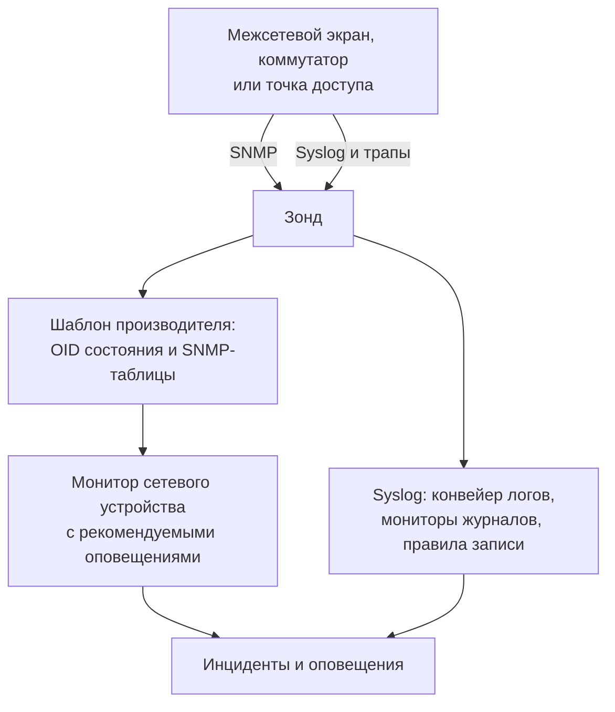

# Руководства по сетевым вендорам (Sophos, Extreme, Cambium)

Как с помощью OneUptime от начала до конца отслеживать три распространённых парка: Sophos Firewall (XGS, SFOS) с его туннелями IPsec, WAN-каналами и SD-WAN; коммутаторы Extreme Networks (EXOS / Switch Engine и Fabric Engine / VOSS) с их фабрикой; а также коммутаторы cnMatrix и корпоративные точки доступа Wi-Fi Cambium Networks — вплоть до канала и мощности передачи каждого радиомодуля.

:::cards
- [Sophos Firewall](#sophos-firewall-xgs-sfos): Туннели, WAN-каналы, шлюзы и SD-WAN.
- [Extreme Networks](#extreme-networks-exos-switch-engine-и-fabric-engine-voss): Коммутаторы, фабрика и её оборудование.
- [Cambium Networks](#cambium-networks-корпоративный-wi-fi-и-cnmatrix): Точки доступа вплоть до каждого радиомодуля и коммутаторы cnMatrix.
:::

## Как это работает

Каждое руководство использует одни и те же элементы:

- По одному [сетевому устройству](/docs/monitor/network-device-monitor) на каждый аппарат, опрашиваемому зондом, который может до него достучаться, с шаблоном производителя, приносящим нужные OID состояния и [SNMP-таблицы](/docs/monitor/network-device-monitor#snmp-таблицы).
- По одному монитору сетевого устройства на устройство для оповещений. Создавайте его со страницы устройства, чтобы [рекомендуемые оповещения](/docs/monitor/network-device-monitor#рекомендуемый-набор-оповещений), включая по одному оповещению на строку для каждой таблицы, которая знает, как выглядит норма, заполнились за вас. Для парка [политика оповещений](/docs/monitor/network-device-monitor#политики-оповещений) поддерживает такой монитор на каждом устройстве.
- Для того, о чём производитель сообщает только в журналах: syslog на зонд, [конвейер логов](/docs/telemetry/log-pipelines), превращающий каждую строку в атрибуты, [мониторы журналов с Group By](/docs/monitor/logs-monitor#оповещения-по-группам-group-by), чтобы оповещать один раз на туннель или шлюз, и [правила записи журналов](/docs/telemetry/log-recording-rules), чтобы строить графики по числам из этих журналов.

## Sophos Firewall (XGS / SFOS)

| Что вы хотите видеть | Откуда это берётся |
| --- | --- |
| Состояние межсетевого экрана: память, диск, swap, состояние HA, служба IPsec, CPU по ядрам | SNMP с шаблоном производителя **Sophos Firewall (SFOS / XGS)** |
| Статус каждого туннеля IPsec по имени | SNMP-таблица `ipsec_tunnels` (SFOS v20 и новее) |
| Статус, пропускная способность, загрузка и ошибки каждого WAN-канала | Обход интерфейсов WAN-портов |
| Задержка, потеря пакетов и джиттер каждого WAN-канала | Ping-мониторы и опросы устройства с зондов OneUptime |
| Шлюзы в сети и недоступные, SLA SD-WAN выполнен или нет, изменения маршрутов SD-WAN | Syslog межсетевого экрана |
| Задержка, джиттер и потеря пакетов SD-WAN по шлюзам в виде графиков | Правила записи журналов по журналам SLA SD-WAN |

Sophos не сообщает состояние шлюзов и SD-WAN по SNMP ни в одной версии SFOS: оно есть только в журналах межсетевого экрана и в оповещениях Sophos Central, поэтому последние три строки идут через syslog.

### Регистрация межсетевого экрана

:::steps
1. На межсетевом экране включите SNMP в **Administration → SNMP**: добавьте пользователя SNMPv3 или community v2c и разрешите адресу зонда опрашивать его.
2. В OneUptime перейдите в **Сеть → Devices** и нажмите **Add Device**. Введите адрес управления межсетевого экрана, выберите зонд, который может до него достучаться, и добавьте учётные данные SNMP в разделе **SNMP**.
3. На странице **Настройки** устройства в разделе **Polling & Data Collection** примените шаблон **Sophos Firewall (SFOS / XGS)** из **Vendor Health Template** и добавьте его таблицы через **Add a Vendor's Tables**. Или включите **Auto-Apply Vendor Health Template**, и первый опрос сделает и то, и другое.
:::

После следующего опроса страница **SNMP Tables** устройства перечисляет каждое подключение IPsec с его статусом (active, inactive, partially active) и ядра CPU. SFOS нумерует свои ядра начиная с 196608, поэтому CPU берётся из таблицы, а не из одного `hrProcessorLoad.1`.

### Оповещения по каждому туннелю IPsec

На странице устройства нажмите **Создать монитор**. Рекомендуемые оповещения включают **IPsec Tunnels: row unhealthy** — критерий **SNMP Table Row Is Unhealthy** по таблице `ipsec_tunnels` с Row `*`: он открывает по инциденту на каждый неактивный туннель, называя его по туннелю, и закрывает каждый, когда его туннель возвращается.

У туннеля, который Sophos считает активным, подняты лишь ассоциации безопасности. Чтобы доказать, что трафик через него проходит, добавьте [Ping-монитор](/docs/monitor/ping-monitor) с зонда на одной площадке до узла на другой стороне каждого туннеля и нарисуйте туннель как связь между площадками в **Сеть → Топология → Site Links** между двумя [площадками](/docs/monitor/network-sites), привязав её к этому монитору: связь на карте тогда принимает цвет монитора.

### WAN-каналы

- **Состояние портов.** Обход интерфейсов уже измеряет статус, входящие и исходящие биты, загрузку и ошибки каждого WAN-порта. В мониторе межсетевого экрана критерий **SNMP Interface Is Down** или **SNMP Interface Utilization (in %)** с **Интерфейс**, равным имени WAN-порта, или `*` для каждого порта оповещает по каждому каналу.
- **Качество пути.** Задержка, потеря пакетов и джиттер каждого канала измеряются снаружи межсетевого экрана: Ping-монитор с облачных зондов OneUptime на публичный адрес каждого WAN-канала и Ping-монитор с зонда на площадке на шлюз каждого провайдера. Критерии потери пакетов и джиттера на этих мониторах оповещают по каждому каналу, а **Сеть → Топология → Latency Matrix** с одного взгляда показывает каждый зонд относительно каждого монитора.
- **Трафик.** SFOS экспортирует NetFlow v5. Отправляйте его на зонд по UDP 2055, где по умолчанию слушает сборщик потоков зонда, и страница **Traffic** устройства покажет, кто с кем общается по каждому WAN-каналу; подробности — в разделе [Сетевой трафик](/docs/monitor/network-traffic).

### Шлюзы и SD-WAN из syslog

:::steps
1. Включите приёмник syslog зонда: задайте `PROBE_SYSLOG_RECEIVER_ENABLED=true` на зонде. По умолчанию он слушает UDP 5140 (`PROBE_SYSLOG_RECEIVER_PORT` меняет порт); если зонд работает в Docker, опубликуйте порт. Сообщения сопоставляются с сетевым устройством, у которого имя хоста или один из **Другие адреса** совпадает с адресом отправителя, и появляются на странице **Журналы** устройства.
2. На межсетевом экране в **System services → Log settings** добавьте сервер syslog, указывающий на зонд и этот порт, и отметьте типы журналов **Event** для IPsec и шлюзов и тип журнала **SD-WAN**: журналы SLA остаются выключенными, пока он не отмечен.
3. В **Журналы → Настройки → Пайплайны** создайте конвейер, фильтр которого совпадает с журналами межсетевого экрана, например `attributes.networkDevice.name = 'hq-firewall'`, и добавьте **Key=Value Parser** с **Target Prefix** `sophos`. Вставьте строку из межсетевого экрана в его тестер, чтобы увидеть точные имена атрибутов, которые выдаёт ваша версия SFOS; [пример Sophos](/docs/telemetry/log-pipelines#пример-межсетевой-экран-sophos-xgs) разбирает это по шагам.
4. Создайте [мониторы журналов](/docs/monitor/logs-monitor) по журналам межсетевого экрана, каждый с **Group by Attributes**, чтобы каждый туннель или шлюз оповещал отдельно, и критерием **Log Count** **Greater Than** `0` за несколько минут. Строки ниже — три, с которых стоит начать.
5. Постройте графики качества SD-WAN: при включённом журналировании SD-WAN межсетевой экран пишет сводку SLA по каждому профилю и шлюзу (`latency`, `jitter`, `packet_loss`). В **Журналы → Настройки → Правила записи** создайте по правилу на каждое число, например среднее `sophos.latency` с группировкой по `sophos.gw_name` и `sophos.profile_name`, затем постройте графики результатов или оповещайте по ним [монитором метрик](/docs/monitor/metrics-monitor) с группировкой по шлюзу. [Правила записи журналов](/docs/telemetry/log-recording-rules) разбирают этот пример.
:::

| Оповещение | Какие журналы считать | Группировать по |
| --- | --- | --- |
| Туннель IPsec завершён | Атрибут `sophos.log_component` = `IPSec`, тело содержит `terminated` | `sophos.con_name` |
| Шлюз недоступен | Атрибут `sophos.log_component` = `Gateway`, тело содержит `is Down` | `sophos.gatewayname` |
| SLA SD-WAN не выполнен | Атрибут `sophos.log_type` = `SD-WAN`, тело содержит `SLA not met` | `sophos.gw_name` |

События syslog дополняют SNMP-таблицу: они приходят в момент падения туннеля, а таблица ловит ещё и туннель, который так и не поднялся.

### Трапы

Каждое уведомление Sophos — это один и тот же трап `sfosNotification` (`1.3.6.1.4.1.2604.5.1.8.1.1`) с событием в виде текста в `sfosTrapMessage` (`1.3.6.1.4.1.2604.5.1.8.1.2`). Чтобы оповещать об одном виде событий, объедините **SNMP Trap Received (Trap OID)** Equal To `1.3.6.1.4.1.2604.5.1.8.1.1` с **SNMP Trap Varbind Value** по этой varbind, например Contains `IPSec`. Задайте получателя трапов межсетевого экрана с SNMP v2c: приёмник трапов зонда принимает трапы v1 и v2c.

## Extreme Networks (EXOS / Switch Engine и Fabric Engine / VOSS)

| Что вы хотите видеть | Откуда это берётся |
| --- | --- |
| EXOS: CPU, температура и её авария, состояние питания, блоки питания, вентиляторы, память по слотам, члены стека | Шаблон **Extreme Networks EXOS / Switch Engine** |
| Fabric Engine: CPU и память по слотам, датчики температуры, вентиляторы, блоки питания, сессия vIST, число I-SID | Шаблон **Extreme Networks Fabric Engine / VOSS** |
| Каждая смежность Fabric Connect (IS-IS) с именем соседа | Таблица `isis_adjacencies` шаблона Fabric Engine |
| Порты, соседи LLDP, карта сети | Обход интерфейсов, у обоих |

### Какой шаблон

Fabric Engine на универсальном оборудовании Extreme (серии 5000 и 7000) сообщает тот же enterprise-номер, что и EXOS: только его системное описание (`7520-48Y-8C-FabricEngine (9.0.4.0)`) говорит, какая операционная система запущена. OneUptime читает оба, поэтому автоприменение и подсказка на странице устройства выбирают правильный шаблон, а старые коммутаторы VSP сообщают ветку Avaya/Nortel и сразу распознаются как Fabric Engine.

### Оповещения по фабрике и оборудованию

Рекомендуемые оповещения на коммутаторе Fabric Engine включают **Fabric Adjacencies (IS-IS): row unhealthy** — инцидент на каждого соседа, чья смежность не поднята. Fabric Engine также отправляет трап при изменении смежности — `rcnIsisPlsbAdjStateTrap` (`1.3.6.1.4.1.2272.1.21.0.281`), — и критерий **SNMP Trap Received (Trap OID)** по нему оповещает за секунды, до следующего опроса.

Блоки питания, вентиляторы, датчики температуры и члены стека — это таблицы, объявляющие свои нормальные значения, поэтому каждая получает оповещение на строку в рекомендуемых оповещениях.

### Потоки и Wi-Fi

EXOS и Fabric Engine экспортируют потоки как sFlow и IPFIX. Отправляйте sFlow на зонд по UDP 6343 или IPFIX по UDP 4739, и страница **Traffic** устройства покажет его трафик; см. [Сетевой трафик](/docs/monitor/network-traffic).

У точек доступа IQ Engine (HiveOS) и ExtremeCloud IQ Controller есть собственные шаблоны производителя, заполняющие страницу **Wi-Fi** устройства. О них рассказывает раздел [Поддерживаемые производители Wi-Fi](/docs/monitor/network-device-monitor#поддерживаемые-производители-wi-fi) — вместе с Ubiquiti UniFi, HPE Aruba, TP-Link Omada и Juniper Mist.

## Cambium Networks (корпоративный Wi-Fi и cnMatrix)

### Точки доступа

:::steps
1. Включите SNMP на точках доступа. В cnMaestro SNMP задаётся для группы AP: **Configuration → Wi-Fi Profiles → AP Groups → Management → SNMP**. Включите его с community v2c на чтение или пользователем SNMPv3.
2. Добавьте каждую точку доступа с её адресом управления и этими учётными данными и примените шаблон **Cambium Networks Enterprise Wi-Fi (cnPilot, XV, XE, XH)** или включите автоприменение.
3. Откройте страницу **Wi-Fi** устройства. Она показывает, сколько радиомодулей включено, клиентов и SSID, затем для каждого радиомодуля диапазон, канал, частоту, ширину канала, мощность передачи, клиентов, уровень шума и эфирное время, а также каждый SSID с его клиентами. Частота вычисляется по диапазону и каналу; точка доступа её не сообщает.
:::

Полезные оповещения, все по таблице `wifi_radios` с Row `*`, чтобы каждый радиомодуль оповещал отдельно:

| Оповещение | Критерий |
| --- | --- |
| Радиомодуль выключен | **SNMP Table Row Is Unhealthy**, входит в рекомендуемые оповещения |
| Изменилась мощность передачи | **SNMP Table Value**, столбец TX Power, Not Equal To запланированной вами мощности |
| Перегруженный радиомодуль | **SNMP Table Value**, столбец Clients, Greater Than вашего лимита |
| Зашумлённый канал | **SNMP Table Value**, столбец Noise Floor, Greater Than `-80` |

Каждое числовое значение радиомодуля — это ещё и метрика (`oneuptime.monitor.snmp.table.value`, по серии на радиомодуль и столбец), поэтому канал, мощность и клиентов можно выводить на дашборд во времени; канал, который постоянно меняется, — это работа DFS.

Cambium сообщает общее число клиентов только начиная с прошивки 6.5.3; более ранние прошивки возвращают 0.

### Коммутаторы cnMatrix

Шаблон **Cambium Networks cnMatrix** собирает CPU, RAM, флеш-память, температуру и напряжение питания, а в виде таблиц — вентиляторы, резервный блок питания и потребление PoE каждого порта. Порты и соседи LLDP берутся из обхода интерфейсов, как на любом коммутаторе.

### Аварии cnMaestro

cnMaestro может отправлять свои аварии, например уход точки доступа из сети, на HTTPS-вебхук. Направьте его на [монитор входящих запросов](/docs/monitor/incoming-request-monitor), чтобы превращать эти аварии в инциденты OneUptime рядом с данными SNMP.

## Устранение неполадок

:::details У таблицы IPsec Tunnels нет статуса
Для статуса туннелей нужна SFOS v20 или новее. Проверьте также, что представление SNMP для ваших учётных данных включает enterprise-дерево Sophos (`1.3.6.1.4.1.2604`): ограниченный пользователь v3 часто видит только системную группу и IF-MIB.
:::

:::details Syslog от межсетевого экрана не приходит
Приёмник syslog зонда по умолчанию выключен: задайте `PROBE_SYSLOG_RECEIVER_ENABLED=true` и опубликуйте UDP 5140 или ваш `PROBE_SYSLOG_RECEIVER_PORT` до зонда. Сообщения сопоставляются с устройством по адресу отправителя, поэтому имя хоста межсетевого экрана в OneUptime или один из его **Другие адреса** должны совпадать с адресом, с которого он отправляет syslog.
:::

:::details Коммутатор Fabric Engine получил шаблон EXOS
Шаблон выбирается по системному описанию коммутатора. Проверьте, что обзор устройства показывает описание, в котором упоминается Fabric Engine (например, `7520-48Y-8C-FabricEngine (9.0.4.0)`); если да, удалите OID и таблицы EXOS и примените **Extreme Networks Fabric Engine / VOSS** из **Vendor Health Template**.
:::

:::details Точки доступа Cambium сообщают 0 клиентов
Для общего числа клиентов нужна прошивка 6.5.3 или новее. На более старой прошивке радиомодули по-прежнему сообщают свой канал, мощность и уровень шума.
:::

## Дальнейшие шаги

:::cards
- [Мониторинг сетевых устройств](/docs/monitor/network-device-monitor): Всё, что собирает устройство, и каждый критерий, по которому оно может оповещать.
- [Конвейеры логов](/docs/telemetry/log-pipelines): Разбирайте журналы межсетевого экрана на атрибуты.
- [Мониторинг журналов](/docs/monitor/logs-monitor): Оповещайте один раз на туннель или шлюз.
:::
