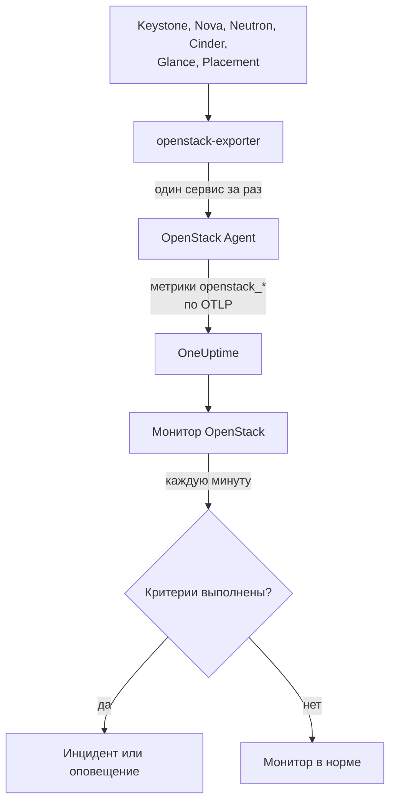

# Мониторинг OpenStack

Монитор OpenStack следит за одним облаком - его API, воркерами за ними, гипервизорами, инстансами, сетями, пулами хранилища и квотами проектов - и сообщает, когда API перестаёт отвечать, воркер падает, на гипервизоре не остаётся места или пул заполняется. Он читает серии `openstack_*`, которые OneUptime OpenStack Agent собирает из openstack-exporter, или зонд собирает из API облака.

:::cards
- [Создание монитора](#создание-монитора-openstack): Шесть шагов в дашборде.
- [Шаблоны](#готовые-шаблоны-оповещений): Готовые оповещения, один инцидент на воркер, инстанс, сеть или регион.
- [Проверки извне](#проверки-извне): Может ли кто-нибудь на самом деле загрузить инстанс, с пробы за пределами облака.
- [Атрибуты идентификации](#атрибуты-идентификации): Как нацелиться на один регион, хост или проект.
- [Метрики](#собираемые-метрики): Все серии, по которым монитор может оповещать.
:::

## Как это работает

Агент - это OpenTelemetry Collector и openstack-exporter, которые вы запускаете на машине, имеющей доступ к API облака. Он читает каждый сервис OpenStack отдельным сбором, поэтому сбой Nova стоит только серий Nova, и читает бережно: compute, network, volume и placement каждые 2 минуты, identity и image каждые 5.

Каждая серия помечена именем облака, `openstack.cloud.name`, а каждая точка данных - атрибутами `openstack.region.name` и `openstack_service`. Облако - это один Keystone, и монитор OpenStack привязан к одному облаку. Каждую минуту он выполняет свой запрос по метрикам этого облака и сравнивает результат со своими критериями.



## Перед началом

- **Соберите метрики облака** с помощью OpenStack Agent или [зонда](/docs/telemetry/openstack-agentless). **Документация** в разделе **Продукты → Инфраструктура → OpenStack** проведёт вас через установку агента.
- **Убедитесь, что облако зарегистрировано.** После первого сбора оно появляется в разделе **Продукты → Инфраструктура → OpenStack** под именем из `OPENSTACK_CLOUD_NAME` агента.

## Создание монитора OpenStack

:::steps
### Начните новый монитор

Откройте **Мониторы** и нажмите **Создать монитор**.

### Выберите OpenStack

В поле **Тип монитора** нажмите **Другие типы мониторов** и выберите **OpenStack** в разделе **Инфраструктура**, или введите `openstack` в строке поиска. Введите **Имя** - оно используется в заголовках инцидентов и оповещений - и нажмите **Далее**.

### Выберите облако

В разделе **OpenStack Monitor Configuration** выберите облако в поле **Облако OpenStack**. В списке есть все облака, приславшие данные. После выбора строка под полем сообщает, поступают ли данные.

### Выберите, за чем следить

Новый монитор начинает с **Cloud Stopped Reporting** в поле **О чём оповещать**. Чтобы следить за чем-то другим:

- **Изменить** - выберите другой [шаблон](#готовые-шаблоны-оповещений). Он задаёт метрику, фильтры по атрибутам, агрегацию, диапазон времени, группировку и пороги, и заменяет критерии ниже своими. **Диапазон времени** по-прежнему можно изменить.
- **Custom Metric** (в разделе **Дополнительные поля**) - выберите одну метрику в поле **Метрика OpenStack**, затем задайте **Агрегация** и **Диапазон времени** и сузьте выбор [фильтрами](#настройки-монитора).
- **Расширенный** (в разделе **Дополнительные поля**) - постройте запросы и формулы сами в разделе **Выберите метрики**, с фильтрами по атрибутам вроде `status`, `adminState` или `resourcetype`. Используйте **Группировать по** [атрибуту идентификации](#атрибуты-идентификации), чтобы оценивать каждую часть отдельно.

### Проверьте критерии

Откройте каждый критерий в разделе **Критерии** и проверьте его **Метрика**, **Агрегация**, **Условие** и **Порог**. Шаблон заполняет их сам. С **Custom Metric** или **Расширенный** монитор начинает с критериев по умолчанию, которые замечают только отсутствие данных у метрики, поэтому задайте свой порог.

### Создайте монитор

Нажмите **Создать монитор**. OneUptime откроет страницу монитора и будет оценивать его каждую минуту. Инциденты и оповещения, которые он создаёт, также перечислены на страницах **Инциденты** и **Оповещения** облака.
:::

> [!TIP]
> Чтобы настроить сразу несколько шаблонов, откройте облако в разделе **Продукты → Инфраструктура → OpenStack** и перейдите в **Рекомендации**. Выберите нужные шаблоны, укажите, кого вызывать, и OneUptime создаст по одному монитору на шаблон.

## Настройки монитора

| Поле | Вкладка | Что делает |
| --- | --- | --- |
| **Облако OpenStack** | Все | Обязательное. Ограничивает каждый запрос значением `resource.openstack.cloud.name`. |
| **Регион** | Custom Metric, Расширенный | Необязательное. Один регион: `openstack.region.name`. Есть у каждой серии. |
| **Зона доступности** | Custom Metric, Расширенный | Необязательное. Одна зона: `availability_zone` у гипервизоров, инстансов, томов и агентов Neutron, `zone` у воркеров Nova и Cinder. |
| **Гипервизор** | Custom Metric, Расширенный | Необязательное. Один хост: `hostname` у воркеров, гипервизоров и Placement, `hypervisor_hostname` у инстансов. Воркеры Nova указывают короткое имя хоста, а гипервизоры, Placement и инстансы - полное, поэтому используйте то, которое указано в серии. |
| **Сервис** | Custom Metric, Расширенный | Необязательное. Бинарник одного воркера, например `nova-compute`: `service`. |
| **Идентификатор проекта** | Custom Metric, Расширенный | Необязательное. Один проект: `tenant_id` у серий Nova и Cinder, сетей и подсетей, `project_id` у плавающих IP, маршрутизаторов и доступности адресов. |
| **Метрика OpenStack** | Custom Metric | Одна метрика из [каталога](#собираемые-метрики). |
| **Агрегация** | Custom Metric | Как объединяются выборки: **Среднее**, **Максимум**, **Минимум**, **Сумма** или **Количество**. Начинается с обычной агрегации метрики. |
| **Диапазон времени** | Все | Скользящее окно, которое читает запрос, от **Past 1 Minute** до **Past 365 Days**. Новый монитор начинает с **Последние 15 минут**; шаблоны задают своё. |
| **Выберите метрики** | Расширенный | Конструктор запросов: **Метрика**, **Aggregate by**, **Filter by attributes**, **Группировать по**, а также **Добавить метрику** и **Добавить формулу** для объединения запросов. |

Фильтр сужает только ту серию, у которой есть его метка: у `openstack_nova_up` нет проекта, поэтому фильтр по проекту оставляет её как есть.

Держите окно не меньше трёх сборов того, что вы читаете: 6 минут для compute, network, volume и placement, 15 для identity и image. В более коротком окне недостаточно сборов, чтобы вариант **Все значения** означал длительность.

## Атрибуты идентификации

Каждая серия несёт `openstack.cloud.name` как **атрибут ресурса**, а `openstack.region.name` и `openstack_service` - как атрибуты точек данных. Остальное сообщают собственные метки экспортёра:

| Часть | Серии | Метки, которые её определяют |
| --- | --- | --- |
| API | `openstack_*_up` | `openstack.region.name`, `openstack_service` |
| Воркер | `openstack_nova_agent_state`, `openstack_neutron_agent_state`, `openstack_cinder_agent_state` | `hostname`, `service`. `adminState` сообщает, оставил ли его включённым оператор. Никогда не группируйте по `uuid` у Cinder: экспортёр выдумывает его заново при каждом сборе |
| Гипервизор | `openstack_placement_resource_*`, `openstack_nova_vcpus_*` | `hostname` (его полное имя), `resourcetype` у Placement |
| Инстанс | `openstack_nova_server_status` | `uuid`, `name`, `tenant_id`, `hypervisor_hostname`, `status`. Значение - это код: фильтруйте по слову в `status` |
| Том | `openstack_cinder_volume_gb` | `id`, `name`, `tenant_id`, `status` |
| Пул хранилища | `openstack_cinder_pool_capacity_*` | `name`, `volume_backend_name` |
| Сеть | `openstack_neutron_network_ip_availabilities_*` | `network_id`, `network_name`, `cidr`, `ip_version` |
| Маршрутизатор | `openstack_neutron_l3_agent_of_router` | `router_id`, `agent_host`, `ha_state`, `agent_alive`, `agent_admin_up` |
| Проект | `openstack_nova_limits_*`, `openstack_cinder_limits_*` | `tenant_id`, `tenant` |

В фильтрах монитора и ключах группировки атрибут ресурса начинается с `resource.` (`resource.openstack.cloud.name`), а атрибут точки данных - нет (`openstack.region.name`, `hostname`, `status`). Пустая метка до OneUptime не доходит, поэтому `disabledReason` есть только у воркера, которого кто-то отключил.

## Готовые шаблоны оповещений

OneUptime поставляется со 120 шаблонами для типичных проблем OpenStack, и список **О чём оповещать** предлагает их. Страница «Рекомендации» облака предлагает шаблон для Heat, Magnum, Ironic, Manila, Octavia, Trove, Designate, Gnocchi или Swift только облаку, где этот сервис работает, шаблон по серии, которую шлёт только проба, - только облаку, которое собирает проба, а шаблон по [проверке извне](#проверки-извне) - только облаку с включённой такой проверкой: в любом другом облаке этих серий нет, и шаблон никогда не сработал бы. Каждый строит готовый монитор: запрос метрики, фильтры по атрибутам, группировку по тому, о чём один инцидент, критерий, который срабатывает, и критерий, который снимает срабатывание. Пороги - те же линии, что рисуют собственные страницы облака; это отправные точки, которые можно менять.

Каждый шаблон читает не меньше трёх сборов того, за чем следит, и срабатывает, только если условие держится всё окно. Порог по доле снимается на 10% за своей линией, чтобы значение у границы не дребезжало.

| Шаблон | Категория | Серьёзность | Следит за | Срабатывает, когда | Восстанавливается, когда |
| --- | --- | --- | --- | --- | --- |
| Cloud Stopped Reporting | Доступность | Критическая | `openstack_identity_up`, Count по всему облаку, **последние 15 минут** | Нет данных за всё окно: агент остановился или не может достучаться до OneUptime, либо экспортёр не может войти в Keystone | Данные снова поступают |
| Identity API Down | Доступность | Критическая | `openstack_identity_up` и `scrape_samples_scraped` для `identity`, Min по региону, **последние 15 минут** | Все вызовы не удались, или сбор вернулся пустым, потому что экспортёр не смог войти | Оба показывают 1 или больше |
| Compute API Down | Доступность | Критическая | `openstack_nova_up` и `scrape_samples_scraped` для `compute`, Min по региону, **последние 10 минут** | Все вызовы не удались, или сбор вернулся пустым, потому что экспортёр не смог достучаться до API Nova | Оба показывают 1 или больше |
| Network API Down | Доступность | Критическая | `openstack_neutron_up` и `up` для `network`, Min по региону, **последние 10 минут** | Все вызовы не удались, или экспортёр не ответил | Оба показывают 1 |
| Block Storage API Down | Доступность | Критическая | `openstack_cinder_up` и `up` для `volume`, Min по региону, **последние 10 минут** | Все вызовы не удались, или экспортёр не ответил | Оба показывают 1 |
| Image API Down | Доступность | Критическая | `openstack_glance_up` и `up` для `image`, Min по региону, **последние 15 минут** | Все вызовы не удались, или экспортёр не ответил | Оба показывают 1 |
| Placement API Down | Доступность | Критическая | `openstack_placement_up` и `up` для `placement`, Min по региону, **последние 10 минут** | Все вызовы не удались, или экспортёр не ответил | Оба показывают 1 |
| Compute Service Down | Плоскость управления | Критическая | `openstack_nova_agent_state` с фильтром `service = nova-compute` и `adminState = enabled`, Min по хосту, **последние 10 минут** | Ниже 1: включённый nova-compute не работает. Отключённый кем-то никогда не срабатывает | Работает или отключён |
| Compute Service Disabled | Плоскость управления | Предупреждение | `openstack_nova_agent_state` с фильтром `service = nova-compute` и `adminState = disabled`, Count по хосту, **последние 10 минут** | Выше 0: `nova-compute` отключили, и ни одно идущее событие обслуживания не охватывает его хост, зону доступности или облако. Тот, что отключился сам из-за падения libvirt (его причина начинается с `AUTO:`), молчит, пока открыт libvirt Service Down. Проекты о нём не уведомляются | Он снова включён, или его охватывает событие |
| Scheduler or Conductor Down | Плоскость управления | Предупреждение | `openstack_nova_agent_state` с фильтром `nova-scheduler` или `nova-conductor` и `adminState = enabled`, Min по хосту и бинарнику, **последние 10 минут** | Ниже 1. Остальные продолжают работать, пока хоть один жив | Работает или отключён |
| Every Scheduler or Conductor Down | Плоскость управления | Критическая | То же, Max по региону и бинарнику, **последние 10 минут** | Ниже 1: не жив ни один, поэтому ничего нового не загрузится | Один работает |
| Network Agent Down | Плоскость управления | Критическая | `openstack_neutron_agent_state` с фильтром `adminState = up`, Min по хосту и бинарнику, **последние 10 минут** | Ниже 1: включённый агент не жив. Выключенный кем-то никогда не срабатывает | Жив или выключен |
| Block Storage Service Down | Плоскость управления | Критическая | `openstack_cinder_agent_state` с фильтром `adminState = enabled`, Min по хосту и бинарнику, **последние 10 минут** | Ниже 1: включённая служба Cinder не работает. Отключённая кем-то никогда не срабатывает | Работает или отключена |
| vCPU Allocation High | Вычисления | Предупреждение | `openstack_placement_resource_*` с фильтром `resourcetype = VCPU`, использовано / ((всего - зарезервировано) x коэффициент), по гипервизору, **последние 10 минут** | Выше 90%: это выделение, а не нагрузка | 81% или ниже |
| Memory Allocation High | Вычисления | Предупреждение | То же, `resourcetype = MEMORY_MB` | Выше 90% | 81% или ниже |
| Local Disk Allocation High | Вычисления | Предупреждение | То же, `resourcetype = DISK_GB` | Выше 90% | 81% или ниже |
| Hypervisor CPU Saturated | Вычисления | Предупреждение | `openstack.hypervisor.instances.cpu.utilization`, по гипервизору, **последние 15 минут**. Нужен экспортёр libvirt или Ceilometer | Выше 90% его потоков CPU: это нагрузка, а не выделение. Его страница называет ответственные инстансы | 81% или ниже |
| Hypervisor Memory Pressure | Вычисления | Предупреждение | `openstack.hypervisor.instances.memory.utilization`, по гипервизору, **последние 15 минут**. Нужен экспортёр libvirt или опрос `memory.resident` в Ceilometer | Выше 90% его памяти: используется, а не обещана | 81% или ниже |
| Instance CPU Saturated | Вычисления | Предупреждение | `openstack.instance.cpu.utilization`, Max по инстансу, **последние 15 минут**. Нужен экспортёр libvirt или Ceilometer | Выше 95% его vCPU | 85,5% или ниже |
| Instance Disk Latency High | Вычисления | Предупреждение | `openstack.instance.disk.read.latency` и `openstack.instance.disk.write.latency`, Max по инстансу и диску, **последние 15 минут**. Нужен экспортёр libvirt или опрос `disk.device.read.latency` и `disk.device.write.latency` в Ceilometer | Выше 50 мс на запрос. У диска без запросов нет задержки, поэтому простаивающий никогда не срабатывает | 45 мс или ниже, либо диск перестаёт использоваться |
| Instances in Error | Вычисления | Предупреждение | `openstack_nova_server_status` с фильтром `status = ERROR`, Count по региону, **последние 10 минут** | Выше 0 | Не осталось ни одного |
| Instance Stuck Building | Вычисления | Предупреждение | `openstack_nova_server_status` с фильтром `status = BUILD` или `BUILD(spawning)`, Max по инстансу, **последний 1 час** | В этом статусе при каждом сборе в течение часа | Вышел из него |
| Instance Stuck Transitioning | Вычисления | Предупреждение | То же для `REBUILD`, `RESIZE`, `REVERT_RESIZE`, `MIGRATING`, `REBOOT`, `HARD_REBOOT` и `PASSWORD`, **последний 1 час** | В одном из них при каждом сборе в течение часа | Вышел из него |
| Instance Stuck in Verify Resize | Вычисления | Предупреждение | То же для `VERIFY_RESIZE`, **последний 1 час** | Ждёт, пока кто-нибудь подтвердит или отменит, в течение часа | Подтверждён или отменён |
| Router Not Active | Сеть | Предупреждение | `openstack_neutron_routers_not_active`, Max по региону, **последние 10 минут** | Выше 0 | Равно 0 |
| Floating IP Not Active | Сеть | Предупреждение | `openstack_neutron_floating_ips_associated_not_active`, Max по региону, **последние 10 минут** | Выше 0: используемый не в статусе ACTIVE. Запасной и должен быть выключен | Равно 0 |
| External IP Pool Nearly Full | Сеть | Предупреждение | `openstack_neutron_network_ip_availabilities_*` для `ip_version = 4`, рядом с `is_external = true` у `openstack_neutron_network`, по сети, **последние 10 минут** | Выше 90% IPv4-адресов внешней сети. Сеть арендатора никогда не срабатывает | 81% или ниже |
| Network Out of IPs | Сеть | Критическая | То же | 100%: свободных адресов не осталось | Ниже 90% |
| Router Without Active Agent | Сеть | Критическая | `openstack_neutron_l3_agent_of_router` с фильтром `agent_admin_up = true`, Max по маршрутизатору, **последние 10 минут** | Ниже 1: ни один держащий его агент не жив. Молчит на OVN, где таких агентов нет | Один жив |
| Router With Two Active Agents | Сеть | Критическая | То же с фильтром `ha_state = active` и `agent_alive = true`, Count по маршрутизатору, **последние 10 минут** | Выше 1: split brain. Молчит на OVN | 1 или ниже |
| Storage Pool Warning | Хранилище | Предупреждение | `openstack_cinder_pool_capacity_*`, (всего - свободно) / всего, по пулу, **последние 10 минут** | Выше 85% | 76,5% или ниже |
| Storage Pool Critical | Хранилище | Критическая | То же | Выше 95% | 85,5% или ниже |
| Volumes in Error | Хранилище | Предупреждение | `openstack_cinder_volume_status_counter` для каждого слова ошибки, Max по региону и слову, **последние 10 минут** | Выше 0 | Равно 0 |
| Volume Stuck | Хранилище | Предупреждение | `openstack_cinder_volume_gb` для каждого проходного слова статуса, Max по тому, **последние 30 минут** | В этом статусе при каждом сборе в течение 30 минут | Вышел из него |
| Image Stuck | Хранилище | Предупреждение | `openstack_glance_image_created_at` для каждого проходного слова статуса, Max по образу, **последний 1 час** | В этом статусе при каждом сборе в течение часа | Вышел из него или удалён |
| Orchestration API Down | Доступность | Критическая | `openstack_heat_up` и `up` для `orchestration`, Min по региону, **последние 15 минут** | Все вызовы не удались - так читается и остановленный `heat-engine` - или экспортёр не ответил | Оба показывают 1 |
| Kubernetes Clusters API Down | Доступность | Критическая | `openstack_container_infra_up` и `up` для `container-infra`, Min по региону, **последние 15 минут** | Все вызовы не удались, или экспортёр не ответил | Оба показывают 1 |
| Rating API Down | Доступность | Критическая | `openstack_cloudkitty_up` и `up` для `rating`, Min по региону, **последние 15 минут**. Это шлёт только проба | API CloudKitty не отвечает, поэтому оценка каждого проекта перестаёт двигаться | Оба показывают 1 |
| Heat Engine Down | Плоскость управления | Предупреждение | `openstack_heat_agent_state`, Min по хосту, **последние 15 минут**. Это шлёт только проба | Heat показывает `heat-engine` как не работающий. Когда остановлены все движки, Heat не может их перечислить, и срабатывает Orchestration API Down | Показывает 1, или Heat удаляет его запись |
| Magnum Conductor Down | Плоскость управления | Критическая | `openstack_container_infra_agent_state` с `adminState=enabled`, Min по хосту, **последние 15 минут**. Это шлёт только проба | Magnum показывает включённый `magnum-conductor` как не работающий. API Magnum продолжает отвечать, поэтому больше об этом ничто не говорит | Показывает 1, или кто-то его отключает |
| Stack Failed | Оркестрация | Предупреждение | `openstack_heat_stack_status` с каждым статусом `*_FAILED`, по стеку, **последние 15 минут** | Стек держит статус ошибки всё окно | Его обновляют или удаляют |
| Stack Stuck In Progress | Оркестрация | Предупреждение | `openstack_heat_stack_status` с каждым статусом `*_IN_PROGRESS`, по стеку, **последние 2 часа** | Стек держит статус выполнения всё окно, дольше часа, который Heat отводит, если кто-то не выбрал больше | Он переходит в следующий статус или удаляется |
| Kubernetes Cluster Failed | Оркестрация | Предупреждение | `openstack_container_infra_cluster_status` с каждым статусом `*_FAILED`, по кластеру, **последние 15 минут** | Кластер держит статус ошибки всё окно | Его обновляют или удаляют |
| Kubernetes Cluster Stuck | Оркестрация | Предупреждение | `openstack_container_infra_cluster_status` с каждым статусом `*_IN_PROGRESS`, по кластеру, **последние 2 часа** | Кластер держит статус выполнения всё окно. Двигает его дальше только conductor Magnum | Он переходит в следующий статус или удаляется |
| Shared File Systems API Down | Доступность | Критическая | `openstack_sharev2_up` и `up` для `sharev2`, Min по региону, **последние 15 минут** | Все вызовы не удались, или экспортёр не ответил. Любой учётной записи, которая может войти, соответствует 1, поэтому причиной не может быть отказ в учётных данных | Оба показывают 1 |
| Manila Service Down | Плоскость управления | Предупреждение | `openstack_sharev2_agent_state` с `adminState=enabled`, Min по хосту и сервису, **последние 15 минут**. Это шлёт только проба | Manila показывает включённую службу как остановленную или не работающую. Её API продолжает отвечать, поэтому больше об этом ничто не говорит | Показывает 1, или кто-то её отключает |
| Share in Error | Хранилище | Предупреждение | `openstack_sharev2_share_gb` с каждым статусом ошибки, по общему ресурсу, **последние 15 минут** | Общий ресурс держит статус ошибки всё окно | Его исправляют или удаляют |
| Share Stuck | Хранилище | Предупреждение | `openstack_sharev2_share_gb` с каждым проходным статусом, по общему ресурсу, **последний 1 час** | Общий ресурс держит проходной статус всё окно. У Manila нет собственного тайм-аута для медленного бэкенда. Мигрирующий или копируемый ресурс не отслеживается | Он переходит в следующий статус или удаляется |
| Load Balancers API Down | Балансировщики нагрузки | Критическая | `openstack_loadbalancer_up`, Min по региону, **последние 15 минут** | Ниже 1. Остановленный API Octavia даёт экспортёру агента пустой ответ, а не 0, как и облако без Octavia, поэтому в облаке агента это молчит, а страницы облака сообщают, когда Octavia в последний раз выходила на связь | Показывает 1 или исчез |
| Load Balancer in Error | Балансировщики нагрузки | Критическая | `openstack_loadbalancer_loadbalancer_status` с `provisioning_status=ERROR`, Count по балансировщику, **последние 15 минут** | Балансировщик держит provisioning ERROR всё окно. Octavia не повторяет попытку ни для одного из них | Он снова ACTIVE или удалён |
| Load Balancer Stuck Pending | Балансировщики нагрузки | Предупреждение | `openstack_loadbalancer_loadbalancer_status` с каждым статусом `PENDING_*`, Count по балансировщику, **последний 1 час** | Балансировщик держит статус PENDING всё окно: воркер Octavia остановлен или потерял запрос | Он достигает ACTIVE или ERROR, либо удалён |
| Load Balancer With Two Masters | Балансировщики нагрузки | Критическая | `openstack_loadbalancer_amphora_status` с `role=MASTER` и `status=ALLOCATED`, Count по балансировщику, **последние 15 минут**. Нужна учётная запись, которой разрешено перечислять амфоры | Больше одной выделенной амфоры сообщает MASTER для одного балансировщика | Так говорит только одна |
| Amphora in Error | Балансировщики нагрузки | Критическая | `openstack_loadbalancer_amphora_status` с `status=ERROR`, Count по амфоре, **последние 15 минут**. Нужна учётная запись, которой разрешено перечислять амфоры | Амфора держит ERROR всё окно: health manager не смог её заменить | Её заменяют |
| Pool Has No Healthy Members | Балансировщики нагрузки | Критическая | `openstack_loadbalancer_pool_status` с `operating_status=ERROR`, Count по пулу, **последние 15 минут** | Все участники пула не проходят проверку здоровья, а пул и его балансировщик по-прежнему развёрнуты в статусе ACTIVE | Участник снова здоров |
| DNS API Down | Доступность | Критическая | `openstack_designate_up`, Min по региону, **последние 15 минут**. Предлагается только для пробы | Ниже 1. Остановленный Designate даёт экспортёру агента пустой ответ, как и облако без Designate, поэтому облако, которое собирает агент, может сообщить лишь о том, что замолчало | Показывает 1 |
| DNS Zone in Error | Сеть | Предупреждение | Количество `openstack_designate_zone_status` с `status=ERROR`, по зоне, **последние 15 минут** | Зона показывает `ERROR` всё окно: её воркер перестал пытаться записать её на DNS-сервер | Показывает что-то другое |
| DNS Zone Stuck Pending | Сеть | Предупреждение | Количество `openstack_designate_zone_status` с `status=PENDING`, по зоне, **последние 30 минут** | Зона показывает `PENDING` всё окно. Её воркер сдаётся через несколько минут, поэтому над ней никто не работает | Показывает что-то другое |
| DNS Recordset in Error | Сеть | Предупреждение | Количество `openstack_designate_recordsets_status` с `status=ERROR` и каждым запрошенным типом, по зоне, **последние 15 минут** | Набор записей, кроме SOA и NS самой зоны, показывает `ERROR`. Эти две показывают `ERROR` вместе со своей зоной, так что об этом говорит DNS Zone in Error | Показывает что-то другое |
| Metrics API Down | Доступность | Критическая | `openstack_gnocchi_up` и `up` для `gnocchi`, Min по региону, **последние 15 минут** | Чтение Gnocchi экспортёром не удалось, или экспортёр не ответил. Учётная запись, которую Gnocchi отвергает, читается так же, поэтому облаку, чья учётная запись ни разу не читала Gnocchi, это не предлагается | Оба показывают 1 |
| Gnocchi No Processors | Метрики | Критическая | `openstack_gnocchi_status_metricd_processors`, Max по региону, **последние 15 минут** | Статус Gnocchi не называет ни одного процессора. Его API продолжает отвечать и принимать измерения, поэтому **Metrics API Down** об этом ничего не говорит | Он называет один |
| Gnocchi Backlog Growing | Метрики | Предупреждение | `openstack_gnocchi_status_measures_to_process`, линия через **последние 2 часа** | Линия пересекает 10 000 измерений в ближайший час. Отставание выше этого, но уменьшающееся, не срабатывает | Линия больше не доходит до 9 000 |
| Object Storage API Down | Доступность | Критическая | `openstack_object_store_up` и `up` для `object-store`, Min по региону, **последние 15 минут** | Чтение Swift экспортёром не удалось, или экспортёр не ответил. Учётная запись, которую Swift отвергает, читается так же, поэтому облаку, чья учётная запись ни разу не читала Swift, это не предлагается | Оба показывают 1 |
| Object Container Growth Forecast | Хранилище | Предупреждение | `openstack_object_store_bytes`, линия через **последние 7 дней**, по контейнеру | Линия пересекает 1 TiB в ближайшую неделю. Измените значение на то, о чём вашему облаку нужно сообщать | Линия больше не доходит до 90% от этого |
| Key Manager API Down | Доступность | Критическая | `openstack_barbican_up`, Min по региону, **последние 15 минут**. Предлагается только для пробы | Ниже 1. У экспортёра вообще нет чтения для Barbican | Показывает 1 |
| Swift Storage Server Not Answering | Хранилище | Предупреждение | `openstack_object_store_recon_up`, Min по серверу, **последние 15 минут**. Предлагается только для пробы, где настройки облака называют его серверы хранения | Сервер не отвечает на `/recon`. Прокси Swift продолжает отвечать без него | Он отвечает |
| Swift Rings Differ | Хранилище | Предупреждение | `openstack_object_store_recon_rings_differ`, Min по кольцу, **последние 15 минут**. Предлагается только для пробы | Названные серверы сообщают разные контрольные суммы кольца | Они совпадают |
| Swift Replication Stale | Хранилище | Предупреждение | `openstack_object_store_recon_replication_age_seconds`, Min по серверу и кольцу, **последние 15 минут**. Предлагается только для пробы | Сервер в последний раз закончил проход больше 6 часов назад | Один заканчивает |
| Databases API Down | Доступность | Критическая | `openstack_trove_up` и `up` для `database`, Min по региону, **последние 15 минут** | Чтение Trove экспортёром не удалось, или экспортёр не ответил. Он читает mgmt API Trove, поэтому отвергнутая учётная запись читается так же, как остановленный API, а облаку, чья учётная запись ни разу не читала Trove, это не предлагается | Оба показывают 1 |
| Database Instance in Error | Базы данных | Предупреждение | Количество `openstack_trove_instance_status` с каждым статусом ошибки, по инстансу, **последние 15 минут** | Инстанс держит статус ошибки всё окно | Его исправляют или удаляют |
| Database Instance Stuck | Базы данных | Предупреждение | Количество `openstack_trove_instance_status` с каждым проходным статусом, по инстансу, **последний 1 час** | Инстанс держит проходной статус всё окно. У Trove нет списка своих воркеров, поэтому именно это сообщает, что `trove-taskmanager` остановился | Он переходит в следующий статус или удаляется |
| Database Volume Nearly Full | Базы данных | Предупреждение | `openstack_trove_instance_volume_used_gb` к `openstack_trove_instance_volume_size_gb`, по инстансу, **последние 15 минут** | 85% или больше. Неработающий инстанс показывает 0 использовано. Записи о работающем нет | Размер увеличен или данные уменьшились |
| Bare Metal API Down | Bare Metal | Критическая | `openstack_ironic_up`, Min по региону, **последние 15 минут** | Ниже 1. Говорит только там, где чтение Ironic может об этом сказать: проба или экспортёр 1.7.0. Остановленный Ironic не даёт экспортёру агента ничего прочитать, как и облако без Ironic, поэтому там это молчит, а страницы облака сообщают, когда Ironic в последний раз выходил на связь | Показывает 1 или исчез |
| Bare Metal Conductor Down | Bare Metal | Предупреждение | `openstack_ironic_agent_state`, Min по хосту, **последние 15 минут**. Это шлёт только проба, и только там, где политика облака позволяет её учётной записи читать conductor Ironic: по умолчанию она отказывает учётной записи проекта | Ironic показывает conductor как не живой. Его API продолжает отвечать, а каждый узел читается как прежде, поэтому больше об этом ничто не говорит | Показывает 1, или Ironic удаляет его запись |
| Bare Metal Node in Error | Bare Metal | Предупреждение | `openstack_ironic_node` для каждого ошибочного `provision_state`, Max по узлу, **последние 15 минут** | В этом состоянии при каждом сборе в течение 15 минут, на обслуживании или нет | Вышел из него или удалён |
| Bare Metal Node Stuck Transitioning | Bare Metal | Предупреждение | `openstack_ironic_node` для каждого проходного `provision_state` с `maintenance = false`, Max по узлу, **последние 2 часа** | В этом состоянии при каждом сборе в течение 2 часов. Долгая очистка диска вполне может занять столько времени, что видно на странице узла, но не здесь | Вышел из него или удалён |
| Bare Metal Node in Maintenance Too Long | Bare Metal | Предупреждение | `openstack_ironic_node` с `maintenance = true`, Max по узлу, **последние 7 дней** | На обслуживании при каждом сборе в течение 7 дней. Нужно хранить метрики так долго | Вышел с обслуживания или удалён |
| Bare Metal Power State Unexpected | Bare Metal | Предупреждение | `openstack_ironic_node` с `provision_state = active`, `power_state = power off` и `maintenance = false`, Max по узлу, **последние 15 минут** | При каждом сборе в течение 15 минут. Инстанс, остановленный владельцем, читается так же, что видно на странице узла, но не здесь | Включён или больше не развёрнут |
| Project Quota Nearly Reached | Проекты | Предупреждение | `openstack_nova_limits_*` и `openstack_cinder_limits_volume_*`, использовано / максимум по проекту, **последние 3 часа** | Выше 90% его квоты vCPU, памяти, инстансов или томов. Нужно [включить серии лимитов](#включение-серий-лимитов) | 81% или ниже |
| Token Issue Failing | Доступность | Критическая | `openstack_check_token_success`, Min по региону, **последние 5 минут**. Нужны включённые проверки API | Ниже 1: Keystone не выдал пробе токен | Токен выдан |
| Service API Check Failing | Доступность | Критическая | `openstack_check_api_success`, Min по региону и `service_type`, **последние 5 минут**. Нужны включённые проверки API | Ниже 1: этот сервис не ответил, для любого сервиса в каталоге | Он отвечает или уходит из каталога |
| Public Certificate Expiring in 30 Days | Доступность | Предупреждение | `openstack_check_certificate_expiry_days`, Min по региону, хосту и порту, **последние 5 минут**. Нужны включённые проверки API | Осталось меньше 30 дней | Осталось 33 дня или больше, либо эндпоинт уходит из каталога |
| Public Certificate Expiring in 7 Days | Доступность | Критическая | То же | Осталось меньше 7 дней | Осталось 7,7 дня или больше, либо эндпоинт уходит из каталога |
| Instance Boot Failing | Вычисления | Критическая | `openstack_check_lifecycle_phase_success` с фильтром `phase = boot`, Min по региону, **последние 5 минут**. Нужна включённая проверка жизненного цикла | Ниже 1: последний прогон не смог загрузить инстанс | Прогон загружает его |
| Instance Boot Slow | Вычисления | Предупреждение | `openstack_check_lifecycle_step_duration_seconds` с фильтром `step = server_active`, Max по региону, **последние 5 минут**. Нужна включённая проверка жизненного цикла | Выше 300 секунд, собственный `build_timeout` Tempest | 270 секунд или ниже, либо прогон, который не загрузился, о чём говорит Instance Boot Failing |
| Volume Attach Failing | Хранилище | Критическая | `openstack_check_lifecycle_phase_success` с фильтром `phase = volume`, Min по региону, **последние 5 минут**. Нужна включённая часть проверки с томом | Ниже 1: последний прогон не смог создать или подключить том | Прогон подключает его |
| Floating IP Unreachable | Сеть | Критическая | `openstack_check_lifecycle_phase_success` с фильтром `phase = floating_ip`, Min по региону, **последние 5 минут**. Нужна включённая часть проверки с плавающим IP | Ниже 1: последний прогон не смог достучаться до своего сервера через плавающий IP | Прогон достукивается до него |
| Flavor Can No Longer Be Placed | Ёмкость | Предупреждение | `openstack_capacity_flavor_fits`, **по флейвору и региону** | Ни на одном хосте нет места ещё для одного, в течение 10 минут. Только флейворы, которые можно запросить, и никогда не слишком большой для всех хостов или такой, чьё единственное место на хосте, отключённом кем-то | На хосте есть место, или флейвор больше не отслеживается |
| Capacity Forecast Under 14 Days | Ёмкость | Предупреждение | `openstack_capacity_days_until_full`, **по зоне и классу ресурса, внешней сети или пулу хранилища** | Меньше 14 дней до заполнения при его росте за последнюю неделю, в течение 10 минут. Молчит при истории короче суток или когда рост отсутствует | Больше 15,4 дня или прогноза больше нет |
| Reserved Headroom Gone | Ёмкость | Предупреждение | `openstack_capacity_can_lose_a_host`, **по зоне** | Она не смогла бы потерять самый большой хост и всё же вместить то, что на ней работает, в течение 10 минут. Молчит на зоне из одного хоста или при хосте, отключённом кем-то | Смогла бы, или зона больше не оценивается |

**Серьёзность** - это метка, которую показывает выбор. Инцидент и оповещение, которые создаёт шаблон, начинаются с самой высокой серьёзности инцидента и оповещения вашего проекта; меняйте её в критериях.

- **Серии up, alive и state используют Min**, поэтому любой упавший даёт 0. **Счётчики и информационные серии используют Max.** Sum не используется нигде, потому что монитор читает минутные корзины по сериям и сборам, а Sum их складывает.
- **Каждый шаблон, кроме Cloud Stopped Reporting, группирует по тому, о чём один инцидент:** хост и бинарник воркера, регион API, инстанс, маршрутизатор, сеть, пул, проект. Инцидент называет его вместе с [командами для следующего шага](#команды-для-следующего-шага).
- **Значение серии статуса - это код**, а не количество: `openstack_nova_server_status` читается как 4 для инстанса в ERROR. Шаблоны фильтруют по слову в `status`.
- **Только что появившаяся серия ждёт полного окна,** поэтому инстанс, том или образ, замеченный один раз на пути к чему-то другому, ничего не вызывает. Каждый шаблон знает, как часто собирается его сервис, по собственной серии `_up` этого сервиса.
- **Исчезнувшая серия считается восстановившейся:** отключённый кем-то воркер, удалённый последний инстанс в ERROR, убранный пул. Каждый шаблон читает собственную серию `_up` своего сервиса рядом со своей, поэтому отличает исчезнувшую часть от замолчавшего облака. Когда не приходит вообще ничего, его инциденты остаются открытыми, а говорит **Cloud Stopped Reporting**.
- **Когда API недоступен, пропадают и его собственные серии**, поэтому остальные шаблоны этого сервиса закрываются и срабатывают снова через окно после его возвращения, если неисправность осталась. Если все API недоступны разом, сначала посмотрите на экспортёр.
- **Облако без такого сервиса молчит.** Для сервиса, которого нет в каталоге облака, экспортёр отвечает пустотой, и **Сеть**, **Block Storage**, **Образ** и **Placement API Down** не считают это сбоем. **Идентификация** и **Compute API Down** считают, потому что именно так экспортёр сообщает и о полной остановке API Keystone или Nova, а они есть в каждом облаке.

### Когда шаблон срабатывает

Когда `nova-compute` остановлен, его строка на странице облака **Службы** переходит в состояние down в течение нескольких минут:


Когда это длится всё окно шаблона, **Compute Service Down** открывает один инцидент, который называет хост и закрывается сам, когда служба возвращается:


### Что говорят сервисы

Ещё семь шаблонов читают логи облака, а не его метрики, поэтому это мониторы логов, и им нужен [профиль логов](/docs/telemetry/openstack#журналы-служб) агента. Каждый читает только логи этого облака, считает то, что ищет, и закрывается сам, когда счёт падает.

| Шаблон | Категория | Серьёзность | Читает | Срабатывает, когда | Восстанавливается, когда |
| --- | --- | --- | --- | --- | --- |
| No Valid Host | Логи сервисов | Предупреждение | Строки, записанные сервисом на уровне `WARNING` или хуже и содержащие `No valid host was found`, **последние 15 минут** | Одна или больше | В окне не осталось ни одной |
| RabbitMQ Connection Lost | Логи сервисов | Критическая | `AMQP server on <host> is unreachable`, `Unable to connect to AMQP server`, `Connection failed` или `MessagingTimeout` из oslo.messaging, **последние 5 минут** | 5 или больше | Меньше 5 |
| Database Connection Lost | Логи сервисов | Критическая | `DBConnectionError`, `SQL connection failed`, а также `Lost connection` и `Can't connect` из MySQL, **последние 5 минут** | 5 или больше | Меньше 5 |
| Too Many Errors from a Service | Логи сервисов | Предупреждение | Строки `ERROR` и `CRITICAL`, по сервису и машине, **последние 5 минут** | 50 или больше | Меньше 50 |
| Token Validation Failing | Логи сервисов | Критическая | `Authorization failed for token` от сервиса, **последние 5 минут** | 10 или больше. Одна - это чья-то устаревшая сессия. Контроллер, ключи Fernet которого отличаются от остальных, читается так же, и ни одна строка не говорит больше, поэтому сравните `/etc/keystone/fernet-keys` на каждом | Меньше 10 |
| Instance Action Failed | События | Предупреждение | `compute.exception` и любые `instance.*.error`, по инстансу, событию и причине, **последние 15 минут**. Нужны [уведомления](/docs/telemetry/openstack#включите-уведомления) или проба | Одно или больше | В окне не осталось ни одного |
| Scheduling Failed | События | Предупреждение | Ошибка задачи compute с `NoValidHost`, например `compute_task.build_instances.error`, которую и шлёт Nova. А также `scheduler.create_volume` из Cinder и `scheduler.select_destinations.error`, который называет документация Nova и который наши тестовые облака ни разу не присылали. По инстансу, событию и причине, **последние 15 минут**. Нужно то же | Одно или больше | В окне не осталось ни одного |

### На чём стоит облако

Эти шаблоны читают то, что [агент читает под облаком](/docs/telemetry/openstack#на-чём-стоит-облако), после того как вы это назвали. Окно читает не меньше трёх сборов. Sum не используется нигде, а исчезнувшая серия считается восстановившейся. Каждый написан по тому, что говорили настоящие кластеры, когда их ломали нарочно.

| Шаблон | Серьёзность | Следит за | Срабатывает, когда | Один инцидент на |
| --- | --- | --- | --- | --- |
| RabbitMQ Down | Критическая | `up`, **последние 5 минут** | Не отвечает ни один узел | Регион |
| RabbitMQ Node Down | Предупреждение | `up`, **последние 10 минут** | Узел не отвечает | Машину |
| RabbitMQ Partition Detected | Критическая | `erlang_vm_dist_node_state`, **последние 5 минут** | Отвечают все узлы, а связь между двумя не установлена | Регион |
| RabbitMQ Memory Alarm | Критическая | `rabbitmq_alarms_memory_used_watermark`, **последние 5 минут** | Выше 0: он перестал принимать сообщения | Машину |
| RabbitMQ Disk Alarm | Критическая | `rabbitmq_alarms_free_disk_space_watermark`, **последние 5 минут** | Выше 0: он перестал принимать сообщения | Машину |
| RabbitMQ File Descriptors High | Предупреждение | Открыто относительно разрешённого, **последние 5 минут** | Больше 90% | Машину |
| RabbitMQ Messages Unacknowledged | Предупреждение | `rabbitmq_queue_messages_unacked`, **последние 10 минут** | Больше 1000 | Машину |
| RabbitMQ Queue Without Consumers | Предупреждение | Каждая очередь из `/metrics/detailed`, **последние 10 минут** | Есть готовые сообщения, а читать некому. Очередь ответов или fanout пропускается | Очередь |
| MariaDB Cluster Down | Критическая | `up`, `mysql_up` и `wsrep_cluster_status`, **последние 5 минут** | Не отвечает ни один узел, или ни один узел не входит в компонент Primary | Регион |
| Galera Cluster Size Dropped | Предупреждение | Узлы относительно `wsrep_cluster_size`, **последние 10 минут** | Galera насчитывает меньше узлов, чем вы указали | Регион |
| Galera Node Not Ready | Предупреждение | `wsrep_ready`, **последние 10 минут** | Ниже 1 при включённой Galera | Машину |
| Galera Node Out of Sync | Предупреждение | `wsrep_local_state`, **последние 10 минут** | Не Synced, если только `wsrep_desync` не говорит, что об этом попросили, как при резервном копировании | Машину |
| MariaDB Too Many Connections | Предупреждение | Подключено относительно разрешённого, **последние 5 минут** | Больше 80% | Машину |
| MariaDB Slow Queries | Предупреждение | `mysql_slow_queries_increase`, **последние 10 минут** | Больше 10 в минуту | Машину |
| Memcached Cluster Down | Предупреждение | `memcached_up`, **последние 5 минут** | Не отвечает ни один. Ничего не останавливается, а API замедляются | Регион |
| Memcached No Connections | Предупреждение | `memcached_current_connections` и команды, **последние 15 минут** | Меньше 10 подключений и никто не обращается. Показатель никогда не равен 0: несколько держат собственные слушатели и экспортёр | Регион |
| Memcached Evictions High | Предупреждение | `memcached_items_evicted_increase`, **последние 10 минут** | Больше 100 в минуту | Машину |
| HAProxy Down | Критическая | `up`, **последние 5 минут** | Не отвечает ни один | Регион |
| HAProxy Backend Down | Критическая | `haproxy_backend_status` для `DOWN`, **последние 5 минут** | Недоступен на каждом отвечающем балансировщике | Бэкенд |
| HAProxy Server Down | Предупреждение | `haproxy_server_status` для `DOWN`, **последние 10 минут** | Сервер недоступен, а у его бэкенда есть другие | Бэкенд |
| API 5xx Rate High | Критическая | `haproxy_backend_http_responses_increase`, **последние 5 минут** | Больше 5%, при том что остаются серверы, способные ответить | Бэкенд |
| API 4xx Rate High | Предупреждение | То же, **последние 5 минут** | Больше 25%. HAProxy считает по классам, поэтому здесь виден всплеск 401 | Бэкенд |
| OVN Controller Not Running | Критическая | `ovnc_encap_ip` и `ovnc_rconn_queued`, **последние 5 минут** | У шасси, у которого он был, его больше нет | Машину |
| Northbound or Southbound Database Without a Leader | Критическая | `ovn_raft_cluster_leader`, **последние 5 минут** | Ни один участник не заявляет, что он лидер | База данных |
| OVN Northd Not Active | Критическая | `ovn_northd_status`, **последние 10 минут** | Ни один не активен - так читается и остановка всех баз OVN | Регион |
| Geneve Transmit Errors | Предупреждение | `ovs_interface_tx_errors_increase` для `type = geneve`, **последние 10 минут** | Ошибки в каждую минуту | Машину |
| Open vSwitch Service Down | Критическая | `ovs_memory_rules_total`, **последние 5 минут** | Пропала с машины, где была, при отвечающем экспортёре | Машину |
| Exporter Lost Open vSwitch's Database | Предупреждение | `ovs_build_info`, **последние 10 минут** | Пропала с машины, где была, при отвечающем Open vSwitch. Перезапустите экспортёр | Машину |
| Network Exporter Target Down | Предупреждение | `up`, **последние 10 минут** | openstack-network-exporter не отвечает | Машину |
| libvirt Service Down | Критическая | `libvirt_up`, **последние 5 минут** | Ниже 1. nova-compute отключает себя сам, поэтому Compute Service Down и Compute Service Disabled молчат | Машину |
| libvirt Exporter Target Down | Предупреждение | `up`, **последние 10 минут** | prometheus-libvirt-exporter не отвечает | Машину |

**Один сбой открывает один инцидент.** Остановленный RabbitMQ тянет за собой `nova-compute` и, на ML2/OVS, агентов Neutron, у каждого из которых свой шаблон. Поэтому то, что идёт вместе с чем-то, ждёт дольше, чем оно, а его монитор связан с тем, чего он ждёт: это зависимость мониторов, которая создаётся для вас, когда оба монитора из этих шаблонов, какой бы вы ни создали первым. Пока в регионе открыт RabbitMQ Down, зависящее от него ничего там не открывает и на своей странице читается как недоступное. Оно продолжает ждать ещё 10 минут после закрытия RabbitMQ Down, потому что агент читает этих воркеров раз в 2-5 минут, и воркер, всё ещё недоступный после этого, страдает от чего-то другого.

| Что отказывает | Что его ждёт |
| --- | --- |
| RabbitMQ Down | RabbitMQ Node Down, все шаблоны воркеров и API, а также RabbitMQ Connection Lost и Too Many Errors from a Service из логов |
| MariaDB Cluster Down | Шаблоны узлов и размера Galera, все шаблоны воркеров и API, Cloud Stopped Reporting, а также Database Connection Lost, Token Validation Failing и Too Many Errors from a Service из логов |
| HAProxy Down | Остальные шаблоны HAProxy, все шаблоны API и Cloud Stopped Reporting |
| OVN Controller Not Running, Open vSwitch Service Down | Network Agent Down, для `ovn-controller`, `neutron-ovn-agent` и `neutron-openvswitch-agent` и ни для каких других, в этом регионе |
| Northbound or Southbound Database Without a Leader | OVN Northd Not Active |

Экспортёр называет машину по адресу, по которому до неё достаёт, а Neutron - по имени хоста, поэтому эти два имени нельзя сопоставить по машине. Пока ovn-controller одной машины не работает, агент `ovn-controller`, недоступный на другой машине региона, ждёт вместе с ним.

Инцидент говорит, что он тянет за собой, а оповещение о воркере, пока его зависимость недоступна, говорит, чем оно, вероятно, вызвано.

### Включение серий лимитов

Три шаблона **Ёмкость** читают серии, которые OneUptime пишет сам из инвентаря облака, каждые две минуты, пока облако присылает отчёты. Ни в одной серии экспортёра нет зоны или количества флейворов. О том, что они означают, см. [Ёмкость](/docs/telemetry/openstack#ёмкость). Все три говорят о выделении, то есть о том, что обещано, и ни один - о нагрузке.

**Project Quota Nearly Reached** читает `openstack_nova_limits_*` и `openstack_cinder_limits_*`, которые по умолчанию выключены, потому что стоят вызовов API на каждый проект. Шаблон молчит, пока вы их не включите: запустите `install.sh` агента ещё раз с `OPENSTACK_COLLECT_QUOTAS=true`. Тогда второй экспортёр читает их раз в час, и шаблон ждёт трёх таких чтений. В облаке, которое читает проба, включите **Лимиты проекта** в разделе **Сбор данных** на странице **Настройки** облака.

### Команды для следующего шага

Инцидент, который открывает шаблон, подсказывает, что запустить для названной им части, всегда только на чтение и для своего региона. Например:

| Инцидент называет | Он предлагает |
| --- | --- |
| nova-compute | `openstack compute service list --host <host> --service nova-compute --long`, `openstack server list --all-projects --host <host>` |
| Агент Neutron | `openstack network agent list --host <host> --long` |
| Службу Cinder | `openstack volume service list --host <host> --service <binary> --long` |
| Гипервизор | `openstack hypervisor show <hypervisor>` |
| Инстанс | `openstack server show <instance>`, `openstack server event list <instance> --long` |
| Маршрутизатор | `openstack router show <router>`, `openstack network agent list --router <router> --long` |
| Сеть | `openstack ip availability show <network>`, `openstack floating ip list --network <network> --long` |
| Проект | `openstack limits show --absolute --project <project>` |
| Узел bare metal | `openstack baremetal node show <node>`, `openstack baremetal node maintenance unset <node>`, когда с ним закончено |

## Собираемые метрики

Метрики ниже - это каталог, который предлагает форма монитора. **Чтения** - обычная агрегация метрики, с которой начинает форма. Размеры в GiB и MiB - это то, что хранят собственные поля OpenStack `_gb` и `_mb`.

### Доступность

| Метрика | Единица | Читает | Описание |
| --- | --- | --- | --- |
| `up` | - | Min | Ответил ли экспортёр на этот сбор вообще (1) или нет (0): он был остановлен, превысил время ожидания или ответил ошибкой. 1 ничего не говорит о самом API, потому что экспортёр отвечает, даже когда не смог до него достучаться. Сообщается коллектором агента, одна серия на сервис на регион. |
| `scrape_samples_scraped` | `count` | Min | Сколько серий экспортёр вернул в ответ на сбор. 0 значит, что ему нечего было сказать: он не смог войти в Keystone или достучаться до API Nova, чтобы согласовать микроверсию, а такие сбои не оставляют ни одной серии экспортёра. Сообщается коллектором агента, одна серия на сервис на регион. |
| `openstack_identity_up` | - | Min | Ответил ли API Keystone на вызовы экспортёра (1) или все они не удались (0). Когда в Keystone вообще нельзя войти, экспортёр отвечает пустотой, поэтому эта серия пропадает, а не читается как 0. |
| `openstack_nova_up` | - | Min | Ответил ли API Nova на вызовы экспортёра (1) или все они не удались (0). Когда до API Nova вообще нельзя достучаться, экспортёр отвечает пустотой, поэтому эта серия пропадает, а не читается как 0. |
| `openstack_neutron_up` | - | Min | Ответил ли API Neutron на вызовы экспортёра (1) или все они не удались (0). |
| `openstack_cinder_up` | - | Min | Ответил ли API Cinder на вызовы экспортёра (1) или все они не удались (0). |
| `openstack_glance_up` | - | Min | Ответил ли API Glance на вызовы экспортёра (1) или все они не удались (0). |
| `openstack_placement_up` | - | Min | Ответил ли API Placement на вызовы экспортёра (1) или все они не удались (0). |

### Плоскость управления

| Метрика | Единица | Читает | Описание |
| --- | --- | --- | --- |
| `openstack_nova_agent_state` | - | Min | Работает ли воркер Nova (nova-compute, nova-scheduler, nova-conductor) (1) или нет (0), одна серия на воркер. adminState сообщает enabled или disabled, а отключённый - это плановая работа, причина которой лежит в disabledReason. hostname - короткое имя хоста в Nova, тогда как серии гипервизора и Placement говорят полное. forced_down сообщает, что оператор сказал Nova, что он не работает: это шлёт только проба. |
| `openstack_neutron_agent_state` | - | Min | Жив ли агент Neutron (1) или нет (0), одна серия на хост и бинарник. adminState сообщает up или down, а выключенный - это плановая работа. dhcp_network_count сообщает, скольким сетям служит агент DHCP: это шлёт только проба. |
| `openstack_cinder_agent_state` | - | Min | Работает ли служба Cinder (cinder-volume, cinder-scheduler, cinder-backup) (1) или нет (0), одна серия на хост и бинарник. adminState сообщает enabled или disabled, а отключённая - это плановая работа. Метка uuid выдумывается заново при каждом сборе, поэтому никогда не группируйте по ней. |

### RabbitMQ

| Метрика | Единица | Читает | Описание |
| --- | --- | --- | --- |
| `erlang_vm_dist_node_state` | - | Min | Состояние связи этого узла с другим: 3 - установлена, 1 - ожидает, так читается пир, отрезанный разделением сети. У остановившегося пира серии нет вообще. |
| `rabbitmq_alarms_memory_used_watermark` | - | Max | 1, пока этот узел превышает свою границу памяти. Пока это длится, RabbitMQ останавливает всех издателей в кластере. |
| `rabbitmq_alarms_free_disk_space_watermark` | - | Max | 1, пока у этого узла свободного диска меньше его предела. Пока это длится, RabbitMQ останавливает всех издателей в кластере. |
| `rabbitmq_process_open_fds` | `count` | Max | Файловые дескрипторы, открытые этим узлом. Каждое соединение держит один. |
| `rabbitmq_process_max_fds` | `count` | Max | Сколько файловых дескрипторов этот узел может открыть. |
| `rabbitmq_queue_messages_unacked` | `count` | Max | Сообщения, которые очереди этого узла доставили и по которым не получили подтверждения. Счёт, который только растёт, - это потребитель, который перестал работать, не отпустив их. |
| `rabbitmq_queue_messages` | `count` | Max | Сообщения в очередях этого узла, готовые или неподтверждённые. |
| `rabbitmq_connections` | `count` | Max | Соединения, которые держит этот узел. |
| `rabbitmq_detailed_queue_messages_ready` | `count` | Max | Сообщения, ожидающие в одной очереди, из подробной конечной точки RabbitMQ. Очереди ответов и fanout пропускаются. |
| `rabbitmq_detailed_queue_consumers` | `count` | Max | Потребители одной очереди, из подробной конечной точки RabbitMQ. Очереди ответов и fanout пропускаются. |

### MariaDB и Galera

| Метрика | Единица | Читает | Описание |
| --- | --- | --- | --- |
| `mysql_up` | - | Min | Ответил ли MariaDB своему экспортёру (1) или нет (0). Экспортёр стоит рядом с ней, поэтому остановленная MariaDB оставляет эту серию равной 0, а не убирает её. |
| `mysql_global_status_wsrep_cluster_status` | - | Max | 1, пока этот узел входит в компонент Primary, иначе 0. MariaDB, которую никто не кластеризовал, тоже читается как 0, поэтому читайте её рядом с Galera On. |
| `mysql_global_variables_wsrep_on` | - | Max | 1, где Galera включена. Пакеты MariaDB собираются с Galera, поэтому сервер, который никто не кластеризовал, тоже сообщает остальные из этих серий, а эта равна 0. |
| `mysql_global_status_wsrep_cluster_size` | `count` | Min | Сколько узлов в кластере, по словам этого узла. |
| `mysql_global_status_wsrep_ready` | - | Min | 1, пока этот узел принимает запросы, 0, пока отказывает. |
| `mysql_global_status_wsrep_local_state` | - | Min | Где находится этот узел, кодом, а не количеством: 4 - Synced, 3 - Joined, 2 - Donor или Desynced, 1 - Joining, а 0 - вне компонента Primary. |
| `mysql_global_variables_wsrep_desync` | - | Max | 1, пока кто-то велел этому узлу выпасть из синхронизации, обычно ради резервной копии. Это плановая работа, и оповещение по ней не срабатывает. |
| `mysql_global_status_threads_connected` | `count` | Max | Соединения, которые держит этот узел. |
| `mysql_global_variables_max_connections` | `count` | Max | Сколько соединений принимает этот узел. |
| `mysql_slow_queries_increase` | `count` | Max | Сколько запросов дольше long_query_time насчитал этот узел с прошлого сбора: на сколько вырос mysql_global_status_slow_queries. |

### Memcached

| Метрика | Единица | Читает | Описание |
| --- | --- | --- | --- |
| `memcached_up` | - | Min | Ответил ли Memcached своему экспортёру (1) или нет (0). Экспортёр стоит рядом с ним, поэтому остановленный Memcached оставляет эту серию равной 0, а не убирает её. |
| `memcached_current_connections` | `count` | Max | Соединения, которые держит этот Memcached. Показатель никогда не равен 0, потому что несколько держат собственные слушатели и экспортёр. |
| `memcached_commands_increase` | `count` | Max | Сколько раз этот Memcached получал каждую из команд с прошлого сбора: на сколько вырос memcached_commands_total. |
| `memcached_items_evicted_increase` | `count` | Max | Сколько элементов этот Memcached досрочно выбросил ради места с прошлого сбора: на сколько вырос memcached_items_evicted_total. |

### HAProxy

| Метрика | Единица | Читает | Описание |
| --- | --- | --- | --- |
| `haproxy_backend_status` | - | Max | Одна серия на каждое состояние, в котором мог бы быть бэкенд, с 1 на том, в котором он находится. Метка state - это слово. |
| `haproxy_server_status` | - | Max | Одна серия на каждое состояние, в котором мог бы быть сервер бэкенда, с 1 на том, в котором он находится. Метка state - это слово. Обслуживание читается ни как up, ни как down. |
| `haproxy_backend_active_servers` | `count` | Min | Сколько серверов у каждого бэкенда работает. Секция без серверов вечно читается как 0, поэтому одно это никогда не говорит, что бэкенд недоступен. |
| `haproxy_backend_http_responses_increase` | `count` | Max | Сколько ответов дал каждый бэкенд с прошлого сбора, по классам: 2xx, 3xx, 4xx и 5xx. HAProxy считает их не мельче, поэтому 401 - это 4xx. |

### OVN и Open vSwitch

| Метрика | Единица | Читает | Описание |
| --- | --- | --- | --- |
| `ovnc_encap_ip` | - | Min | 1 на машине, настроенной как шасси OVN, с меткой её туннельного адреса. Она читается из Open vSwitch, поэтому остаётся, пока ovn-controller остановлен, и пропадает вместе с Open vSwitch. |
| `ovnc_rconn_queued` | `count` | Max | Сколько сообщений OpenFlow ovn-controller поставил в очередь с момента запуска. Эта серия есть только у работающего ovn-controller, ради чего её здесь и читают. |
| `ovn_raft_cluster_leader` | - | Max | 1 у участника базы OVN, который ею руководит, и 0 у остальных. openstack-network-exporter читает Southbound на машине с сокетами обеих баз, поэтому Northbound виден только там, где у машины нет Southbound для чтения. |
| `ovn_northd_status` | - | Max | 1 у активного ovn-northd и 0 у резервного. Читается как 0 везде, когда базы OVN остановлены. |
| `ovs_memory_rules_total` | `count` | Max | Сколько правил OpenFlow держит ovs-vswitchd. Её спрашивают через собственный сокет ovs-vswitchd, поэтому серия пропадает, когда он останавливается, и сразу возвращается, когда он запускается. |
| `ovs_build_info` | - | Max | 1, пока openstack-network-exporter может читать базу Open vSwitch, с меткой её версии. Версия 0.3.0 подключается к этой базе один раз, поэтому после перезапуска Open vSwitch серия остаётся пропавшей, пока не перезапустится и экспортёр. |
| `ovs_interface_tx_errors_increase` | `count` | Max | Сколько ошибок передачи сообщили туннели Geneve машины с прошлого сбора. Агент оставляет интерфейсы Geneve и никакие другие, потому что на машине по одному интерфейсу на порт. |

### libvirt

| Метрика | Единица | Читает | Описание |
| --- | --- | --- | --- |
| `libvirt_up` | - | Min | Ответил ли libvirt своему экспортёру (1) или нет (0). Экспортёр стоит рядом с ним, поэтому остановленный libvirt оставляет экспортёр отвечающим с этой серией, равной 0. |

### Вычисления

| Метрика | Единица | Читает | Описание |
| --- | --- | --- | --- |
| `openstack_placement_resource_total` | - | Max | Сколько ресурса есть у гипервизора до любого коэффициента выделения: vCPU для VCPU, MiB для MEMORY_MB, GiB для DISK_GB, по метке resourcetype. hostname - полное имя гипервизора. |
| `openstack_placement_resource_reserved` | - | Max | Сколько ресурса Placement удерживает от инстансов на гипервизоре, в тех же единицах, что и Placement Capacity. |
| `openstack_placement_resource_allocation_ratio` | `ratio` | Max | Во сколько раз больше Placement готов пообещать ресурса гипервизора. Пообещать он готов (ёмкость - резерв) x этот коэффициент. |
| `openstack_placement_resource_usage` | - | Max | Сколько ресурса Placement пообещал инстансам на гипервизоре. Это выделение, а не нагрузка: простаивающий инстанс держит всё это. |
| `openstack_placement_resource_generation` | `count` | Max | Сколько раз изменился инвентарь гипервизора, как его считает Placement. Растёт при каждом изменении, поэтому говорит, что что-то изменилось, но не что. |
| `openstack_placement_resource_provider_allocations` | - | Max | Сколько ресурса держит на гипервизоре один потребитель, его uuid. |
| `openstack_placement_flavor_fits` | `count` | Max | Сколько ещё флейвора, по словам Placement, поместилось бы, считая хост за хостом, из `GET /allocation_candidates`: одна серия на регион и по одной на каждую зону и агрегат. Читается по очереди, по несколько флейворов за сбор, а между чтениями отправляется последнее прочитанное. Это спрашивает только проба. |
| `openstack_nova_vcpus_available` | `count` | Max | vCPU, которые есть у гипервизора, что бы ни говорило имя, до любого коэффициента выделения. Nova перестала сообщать это с микроверсии 2.88, поэтому доверять стоит сериям Placement. |
| `openstack_nova_vcpus_used` | `count` | Max | vCPU, которые Nova пообещала инстансам на гипервизоре. Выделение, а не нагрузка. |
| `openstack_nova_memory_available_bytes` | `bytes` | Max | Память, которая есть у гипервизора, что бы ни говорило имя, до любого коэффициента выделения. |
| `openstack_nova_memory_used_bytes` | `bytes` | Max | Память, которую Nova пообещала инстансам на гипервизоре. Выделение, а не нагрузка. |
| `openstack_nova_local_storage_available_bytes` | `bytes` | Max | Локальный диск, который есть у гипервизора, что бы ни говорило имя, до любого коэффициента выделения. |
| `openstack_nova_local_storage_used_bytes` | `bytes` | Max | Локальный диск, который Nova пообещала инстансам на гипервизоре. Выделение, а не использование. |
| `openstack_nova_free_disk_bytes` | `bytes` | Min | Локальный диск, который Nova считает свободным на гипервизоре. Может стать отрицательным, когда гипервизор пообещал больше, чем имеет. |
| `openstack_nova_current_workload` | `count` | Max | Сколько операций сборки, изменения размера, снимка, миграции и спасения идёт на гипервизоре. Это не нагрузка на CPU. |
| `openstack_nova_running_vms` | `count` | Max | Сколько инстансов ACTIVE у гипервизора. hostname - полное имя гипервизора. |
| `openstack_nova_server_status` | - | Max | Одна серия на инстанс, значение которой - числовой код его статуса: ACTIVE - 0, BUILD - 1, ERROR - 4. Читайте слово из метки status и фильтруйте по нему: код - не количество и не серьёзность. Экспортёр агента оставляет address_ipv4 и address_ipv6 пустыми в настоящем облаке, а проба заполняет их из адресов, которые перечисляет Nova. hypervisor_hostname, host_id и availability_zone пусты, пока инстанс не размещён планировщиком. image_id называет образ, из которого он загружен: его шлёт только проба, и не для инстанса, загруженного с тома. network_names перечисляет сети, в которых у него есть адрес, в виде JSON-массива их имён: его шлёт только проба. |
| `openstack_nova_server_local_gb` | `GiB` | Max | Локальный диск, который держит один инстанс. _Выключена по умолчанию:_ удалите `--disable-metric=nova-server_local_gb` из экспортёра. |
| `openstack_nova_total_vms` | `count` | Max | Сколько инстансов в регионе, в любом статусе. |
| `openstack_nova_instances_by_status` | `count` | Max | Сколько инстансов в каждом статусе, одна серия на статус в каждом регионе. Облако, превысившее размер сводки, держит её вместо серии на каждый инстанс. Другие облака её не шлют. |
| `openstack_nova_instances_by_project` | `count` | Max | Сколько инстансов у каждого проекта, одна серия на проект в каждом регионе. Облако, превысившее размер сводки, держит её вместо серии на каждый инстанс. Другие облака её не шлют. |
| `openstack_nova_flavors` | `count` | Max | Сколько флейворов в регионе. |
| `openstack_nova_flavor` | `count` | Max | Одна серия на флейвор, всегда 1, с его размером в метках vcpus, ram (MiB) и disk (GiB). |
| `openstack_nova_availability_zones` | `count` | Max | Сколько зон доступности у Nova в регионе. |
| `openstack_nova_security_groups` | `count` | Max | Сколько групп безопасности сообщает Nova в регионе. Агент пропускает её с `--disable-metric=nova-security_groups`, потому что у Nova больше нет этого маршрута. |
| `openstack.instance.cpu.usage` | `{cpu}` | Max | Сколько потоков CPU своего гипервизора использует этот инстанс, вычислено из его накопленного процессорного времени. Сообщается только там, где читается экспортёр libvirt или Ceilometer. |
| `openstack.instance.cpu.utilization` | `%` | Max | Этот CPU как доля собственных vCPU инстанса. 100 - все vCPU заняты, и значение может быть выше 100, пока на него работают собственные потоки QEMU. Сообщается только там, где читается экспортёр libvirt или Ceilometer. |
| `openstack.instance.cpu.contention` | `%` | Max | Какую часть времени vCPU инстанса хотели работать, а гипервизор заставлял их ждать, как долю его vCPU: гость называет это steal. Говорит, что проблема в соседе, а не в инстансе. Из экспортёра libvirt. Ни в одном выпущенном Ceilometer пока нет метра `cpu.delay`, и он будет прочитан, когда появится. |
| `openstack.instance.memory.usage` | `By` | Max | Сколько, по словам гостя, он использует, из его balloon-драйвера. У гостя без него такого значения нет. Сообщается только там, где читается экспортёр libvirt или Ceilometer. |
| `openstack.instance.memory.resident` | `By` | Max | Сколько памяти гипервизора инстанс действительно держит, что бы ни говорил гость о своём использовании; это больше размера его флейвора, потому что в нём сидит и сам QEMU. Сообщается там, где читается экспортёр libvirt или Ceilometer опрашивает `memory.resident`. |
| `openstack.instance.disk.read.rate` | `By/s` | Max | Байт в секунду, которые этот инстанс читает с одного диска, его `device`. Сообщается только там, где читается экспортёр libvirt или Ceilometer. |
| `openstack.instance.disk.write.rate` | `By/s` | Max | Байт в секунду, которые этот инстанс пишет на один диск. Сообщается только там, где читается экспортёр libvirt или Ceilometer. |
| `openstack.instance.disk.read.operations` | `{operation}/s` | Max | Запросов чтения в секунду на одном диске этого инстанса. Сообщается только там, где читается экспортёр libvirt или Ceilometer. |
| `openstack.instance.disk.write.operations` | `{operation}/s` | Max | Запросов записи в секунду на одном диске этого инстанса. Сообщается только там, где читается экспортёр libvirt или Ceilometer. |
| `openstack.instance.disk.read.latency` | `ms` | Max | Сколько в среднем длилось чтение на одном диске этого инстанса. У диска без чтений значения нет, а не 0. Сообщается только там, где читается экспортёр libvirt или Ceilometer. |
| `openstack.instance.disk.write.latency` | `ms` | Max | Сколько в среднем длилась запись на одном диске этого инстанса. У диска без записей значения нет, а не 0. Сообщается только там, где читается экспортёр libvirt или Ceilometer. |
| `openstack.instance.network.receive.rate` | `By/s` | Max | Байт в секунду, приходящих на этот инстанс через один сетевой интерфейс, его `device`. Сообщается только там, где читается экспортёр libvirt или Ceilometer. |
| `openstack.instance.network.transmit.rate` | `By/s` | Max | Байт в секунду, уходящих с этого инстанса через один сетевой интерфейс. Сообщается только там, где читается экспортёр libvirt или Ceilometer. |
| `openstack.hypervisor.instances.cpu.usage` | `{cpu}` | Max | Сколько потоков CPU этого гипервизора используют его инстансы вместе. Собственных процессов хоста здесь нет: они есть в продукте Host, где на нём работает агент OneUptime. Сообщается только там, где читается экспортёр libvirt или Ceilometer. |
| `openstack.hypervisor.instances.cpu.utilization` | `%` | Max | Это как доля потоков CPU, которые есть у этого гипервизора, до любого коэффициента выделения. 100 - все потоки заняты. Сообщается только там, где читается экспортёр libvirt или Ceilometer, и когда инвентарь знает, что есть у гипервизора. |
| `openstack.hypervisor.instances.memory.resident` | `By` | Max | Сколько памяти этого гипервизора инстансы действительно держат вместе, что бы им ни пообещали. Сообщается только там, где читается экспортёр libvirt или Ceilometer. |
| `openstack.hypervisor.instances.memory.utilization` | `%` | Max | Это как доля памяти, которая есть у этого гипервизора, до любого коэффициента выделения. Сообщается только там, где читается экспортёр libvirt или Ceilometer, и когда инвентарь знает, что есть у гипервизора. |
| `openstack.hypervisor.instances.reporting` | `{instance}` | Max | Сколько инстансов в сумме дают эти серии, чтобы можно было отличить полный итог от итога, в котором некоторых не хватает. Сообщается только там, где читается экспортёр libvirt или Ceilometer. |

### Сеть

| Метрика | Единица | Читает | Описание |
| --- | --- | --- | --- |
| `openstack_neutron_routers_not_active` | `count` | Max | Сколько маршрутизаторов региона имеют статус, отличный от ACTIVE. Равно 0, когда всё хорошо. |
| `openstack_neutron_floating_ips_associated_not_active` | `count` | Max | Сколько плавающих IP региона привязаны к чему-то и не в статусе ACTIVE. Запасной и должен быть выключен, поэтому здесь не учитывается. Равно 0, когда всё хорошо. |
| `openstack_neutron_l3_agent_of_router` | - | Max | Одна серия на маршрутизатор и агент L3, который его держит: 1, пока агент жив, 0, когда нет, с метками ha_state (active или standby) и agent_admin_up. Маршрутизатор в порядке, пока жив любой агент, поэтому читайте с Max по маршрутизатору. В облаке на OVN таких агентов нет, а значит нет и таких серий. |
| `openstack_neutron_network_ip_availabilities_total` | `count` | Max | Сколько адресов в подсети, одна серия на подсеть каждой сети. |
| `openstack_neutron_network_ip_availabilities_used` | `count` | Max | Сколько адресов подсети занято, одна серия на подсеть каждой сети. |
| `openstack_neutron_network` | - | Max | Одна серия на сеть, значение которой - числовой код её статуса: ACTIVE - 0, BUILD - 1, DOWN - 2, ERROR - 3. Внешняя ли она, указано в метке is_external. |
| `openstack_neutron_networks` | `count` | Max | Сколько сетей в регионе. |
| `openstack_neutron_subnet` | `count` | Max | Одна серия на подсеть, всегда 1, с подробностями в метках. |
| `openstack_neutron_subnets` | `count` | Max | Сколько подсетей в регионе. |
| `openstack_neutron_subnets_total` | `count` | Max | Сколько подсетей с префиксом данной длины мог бы вместить пул подсетей. _Выключена по умолчанию:_ удалите `--disable-metric=neutron-subnets_total` из экспортёра. |
| `openstack_neutron_subnets_used` | `count` | Max | Сколько подсетей с префиксом данной длины выдал пул подсетей. _Выключена по умолчанию:_ удалите `--disable-metric=neutron-subnets_total` из экспортёра. |
| `openstack_neutron_subnets_free` | `count` | Min | Сколько подсетей с префиксом данной длины пулу подсетей осталось выдать. _Выключена по умолчанию:_ удалите `--disable-metric=neutron-subnets_total` из экспортёра. |
| `openstack_neutron_router` | `count` | Max | Одна серия на маршрутизатор, всегда 1, с метками status и admin_state_up. |
| `openstack_neutron_routers` | `count` | Max | Сколько маршрутизаторов в регионе. |
| `openstack_neutron_floating_ip` | `count` | Max | Одна серия на плавающий IP, всегда 1, с его статусом и маршрутизатором, через который он идёт, в метках. Запасной читается как DOWN без router_id. |
| `openstack_neutron_floating_ips` | `count` | Max | Сколько плавающих IP в регионе. |
| `openstack_neutron_security_groups` | `count` | Max | Сколько групп безопасности у Neutron в регионе. |
| `openstack_neutron_port` | `count` | Max | Одна серия на порт, всегда 1, с метками status и binding_vif_type. Агент держит её выключенной, потому что перечисление всех портов с учётной записью администратора может перегрузить Neutron в большом облаке. _Выключена по умолчанию:_ удалите `--disable-metric=neutron-port` из экспортёра. |
| `openstack_neutron_ports` | `count` | Max | Сколько портов в регионе. Агент держит её выключенной, потому что перечисление всех портов с учётной записью администратора может перегрузить Neutron в большом облаке. _Выключена по умолчанию:_ удалите `--disable-metric=neutron-ports` из экспортёра. |
| `openstack_neutron_ports_no_ips` | `count` | Max | Сколько портов ACTIVE не имеют адреса. Агент держит её выключенной, как и остальные серии портов. _Выключена по умолчанию:_ удалите `--disable-metric=neutron-ports_no_ips` из экспортёра. |
| `openstack_neutron_ports_lb_not_active` | `count` | Max | Сколько портов балансировщиков нагрузки не в статусе ACTIVE. Агент держит её выключенной, как и остальные серии портов. _Выключена по умолчанию:_ удалите `--disable-metric=neutron-ports_lb_not_active` из экспортёра. |
| `openstack_neutron_vpn_endpoint_groups` | `count` | Max | Сколько групп конечных точек VPN в регионе. |
| `openstack_neutron_vpn_ike_policies` | `count` | Max | Сколько политик VPN IKE в регионе. |
| `openstack_neutron_vpn_ipsec_policies` | `count` | Max | Сколько политик VPN IPsec в регионе. |
| `openstack_neutron_vpn_services` | `count` | Max | Сколько служб VPN в регионе. |
| `openstack_neutron_vpn_service` | - | Max | Одна серия на службу VPN, значение которой - числовой код её статуса: ACTIVE - 0, DOWN - 1, BUILD - 2, ERROR - 3. |
| `openstack_neutron_vpn_siteconnections` | `count` | Max | Сколько соединений между площадками VPN в регионе. |
| `openstack_neutron_vpn_siteconnection` | - | Max | Одна серия на соединение между площадками VPN, значение которой - числовой код его статуса: ACTIVE - 0, DOWN - 1, BUILD - 2, ERROR - 3. |

### Хранилище

| Метрика | Единица | Читает | Описание |
| --- | --- | --- | --- |
| `openstack_cinder_pool_capacity_total_gb` | `GiB` | Max | Сколько вмещает пул хранилища Cinder, по словам его бэкенда. |
| `openstack_cinder_pool_capacity_free_gb` | `GiB` | Min | Сколько в пуле хранилища Cinder свободно, по словам его бэкенда. |
| `openstack_cinder_volume_status_counter` | `count` | Max | Сколько томов в каждом статусе, одна серия на слово статуса в метке status. Известный статус без томов читается как 0. |
| `openstack_cinder_volume_gb` | `GiB` | Max | Одна серия на том, значение которой - его размер, со словом статуса в метке status. В облаке, которое собирает проба, метка pool сообщает, какой пул его держит, для учётной записи, которую Cinder считает администраторской. |
| `openstack_cinder_volume_status` | - | Max | Одна серия на том, значение которой - числовой код его статуса. Экспортёр объявил её устаревшей: читайте метку status у Volume Size или Volumes by Status. |
| `openstack_cinder_volumes` | `count` | Max | Сколько томов в регионе. |
| `openstack_cinder_snapshots` | `count` | Max | Сколько снимков томов в регионе. |
| `openstack_cinder_snapshot_gb` | `GiB` | Max | Одна серия на снимок тома, значение которой - его размер, со словом статуса в метке status. Это шлёт только проба: экспортёр агента лишь считает снимки. |
| `openstack_cinder_backup_gb` | `GiB` | Max | Одна серия на резервную копию тома, значение которой - её размер, со словом статуса в метке status, чтобы было видно копию, которая постоянно не удаётся. Это шлёт только проба: у экспортёра агента нет резервных копий. |

### Ёмкость

OneUptime пишет их сам, из инвентаря облака, каждые две минуты, пока облако присылает отчёты. Их никто не собирает. Каждая - это выделение, то есть обещанное, и ни одна не говорит о нагрузке.

| Метрика | Единица | Читает | Что в ней |
| --- | --- | --- | --- |
| `openstack_capacity_allocated` | - | Max | Что выделено из того, что заполняется: класс ресурса зоны, IPv4-адреса внешней сети или байты пула хранилища. `capacity_scope`, `capacity_name` и `resourcetype` говорят, что именно. Учитывает то, что держат потерянные и отключённые хосты, потому что эти инстансы существуют. |
| `openstack_capacity_total` | - | Max | Сколько из этого можно выделить на хостах, способных дать: (всего - резерв) x коэффициент выделения, для зоны. |
| `openstack_capacity_days_until_full` | `d` | Max | Через сколько дней оно заполнится при росте за последнюю неделю, и 0, когда уже заполнено. Нет серии при истории короче суток или когда рост отсутствует. |
| `openstack_capacity_flavor_fits` | `count` | Max | Сколько ещё флейвора помещается, считая хост за хостом, в каждом регионе. `source` говорит, ответил ли Placement или сложены инвентари. Только флейворы, которые можно запросить, и ни один не слишком большой для всех хостов. |
| `openstack_capacity_can_lose_a_host` | - | Min | 1, когда зона могла бы потерять самый большой хост и всё же вместить то, что на ней работает, и 0, когда не могла бы, по классу ресурса. Нет серии для зоны из одного хоста или при хосте, отключённом кем-то. |

### Образы

| Метрика | Единица | Читает | Описание |
| --- | --- | --- | --- |
| `openstack_glance_images` | `count` | Max | Сколько образов в регионе. |
| `openstack_glance_image_bytes` | `bytes` | Max | Одна серия на образ, значение которой - его размер. |
| `openstack_glance_image_created_at` | `seconds` | Max | Одна серия на образ, значение которой - время его создания в формате Unix time. |

### Идентификация

| Метрика | Единица | Читает | Описание |
| --- | --- | --- | --- |
| `openstack_identity_project_info` | `count` | Max | Одна серия на проект, всегда 1, с метками name, domain и enabled. |
| `openstack_identity_projects` | `count` | Max | Сколько проектов в облаке. |
| `openstack_identity_domain_info` | `count` | Max | Одна серия на домен, всегда 1, с метками name и enabled. |
| `openstack_identity_domains` | `count` | Max | Сколько доменов в облаке. |
| `openstack_identity_users` | `count` | Max | Сколько пользователей в облаке. |
| `openstack_identity_groups` | `count` | Max | Сколько групп в облаке. |
| `openstack_identity_regions` | `count` | Max | Сколько регионов знает Keystone. |

### Оркестрация

Эти метрики есть у облака, где работает Heat или Magnum. У облака без них нет ни одной, и ни его страницы, ни рекомендации их не упоминают.

| Метрика | Единица | Читает | Описание |
| --- | --- | --- | --- |
| `openstack_heat_up` | | Min | Ответил ли API Heat. Остановленный `heat-engine` тоже читается как 0, потому что API Heat запрашивает свои списки у движка. |
| `openstack_heat_stack_status` | | Max | Одна серия на стек, с `id`, `name`, `project_id` и `status`. Её значение - код, поэтому читайте метку `status`. `project_id` пуст для всего, что ниже администратора. |
| `openstack_heat_stack_status_counter` | `count` | Max | Сколько стеков держат каждый статус, по регионам. |
| `openstack_heat_agent_state` | | Min | Перечисляет ли Heat каждый `heat-engine` как работающий. Это шлёт только проба. |
| `openstack_container_infra_up` | | Min | Ответил ли API Magnum. Остановленный `magnum-conductor` оставляет её равной 1. |
| `openstack_cloudkitty_up` | | Min | Ответил ли API CloudKitty, в облаке, где он работает. Это шлёт только проба. |
| `openstack_cloudkitty_rated` | | Max | Во сколько CloudKitty оценил проект за месяц, раз в час, по проекту и месяцу. Число в тех единицах, в которых заданы его тарифы. Это шлёт только проба. |
| `openstack_container_infra_total_clusters` | `count` | Max | Сколько кластеров Magnum перечислил для этой учётной записи. |
| `openstack_container_infra_cluster_status` | | Max | Одна серия на кластер, с `uuid`, `name`, `stack_id`, `status`, `node_count`, `master_count` и `project_id`. Её значение - код, поэтому читайте метку `status`. `project_id` пуст от экспортёра. |
| `openstack_container_infra_cluster_masters` | `count` | Max | Сколько узлов плоскости управления запрошено для каждого кластера. |
| `openstack_container_infra_cluster_nodes` | `count` | Max | Сколько рабочих узлов запрошено для каждого кластера. |
| `openstack_container_infra_agent_state` | | Min | Перечисляет ли Magnum каждый `magnum-conductor` как работающий. Это шлёт только проба. |

### Общие файловые системы

Эти метрики шлёт только облако, где работает Manila, а у облака без неё нет никаких следов.

| Метрика | Единица | Читает | Описание |
| --- | --- | --- | --- |
| `openstack_sharev2_up` | | Min | Ответил ли API Manila. Остановленный API читается как 0, а любая учётная запись, которая может войти, - как 1. Остановленный `manila-share` оставляет её равной 1. |
| `openstack_sharev2_share_gb` | `GiB` | Max | Одна серия на общий ресурс, с `id`, `name`, `project_id`, `availability_zone`, `share_proto`, `share_type` и `status`. Её значение никогда не равно 0, поэтому она говорит, что ресурс какое-то время держит статус. |
| `openstack_sharev2_share_status` | | Max | Одна серия на общий ресурс. Её значение - код, а у `creating` он равен 0, поэтому читайте метку `status`. |
| `openstack_sharev2_share_status_counter` | `count` | Max | Сколько общих ресурсов держат каждый статус, по регионам. |
| `openstack_sharev2_shares_counter` | `count` | Max | Сколько общих ресурсов Manila перечислила для этой учётной записи, по регионам. |
| `openstack_sharev2_agent_state` | | Min | Перечисляет ли Manila каждую службу как работающую, где `state` говорит `stopped` для корректно остановленной и `down` для упавшей. Это шлёт только проба. |

### Балансировщики нагрузки

Эти метрики шлёт только облако, где работает Octavia, а у облака без неё нет никаких следов. Серии Octavia несут статус в метках, а код в значении, и у здорового он равен 0, поэтому шаблон читает, какие серии есть, и никогда не значение.

| Метрика | Единица | Читает | Описание |
| --- | --- | --- | --- |
| `openstack_loadbalancer_up` | | Min | Дошло ли чтение Octavia достаточно далеко, чтобы что-то сказать. Остановленный API даёт не 0, а лишь пустой ответ. |
| `openstack_loadbalancer_loadbalancer_status` | | Max | Одна серия на балансировщик, с `provisioning_status`, `operating_status`, `provider`, `vip_address` и `project_id`. Её значение - код рабочего статуса: читайте слова. |
| `openstack_loadbalancer_pool_status` | | Max | Одна серия на пул, с `provisioning_status`, `operating_status`, `protocol` и `lb_algorithm`. Пул, все участники которого недоступны, всё равно читается как 0: читайте `operating_status`. |
| `openstack_loadbalancer_amphora_status` | | Max | Одна серия на амфору, с `status`, `role`, `compute_id`, `loadbalancer_id` и `cert_expiration`, текстом, а не числом. Перечислять амфоры может только администратор. |
| `openstack_loadbalancer_listener_status` | | Max | Одна серия на слушатель, всегда 1, с `provisioning_status`, `operating_status`, `protocol`, `protocol_port` и `loadbalancer_id`. Это шлёт только проба. |
| `openstack_loadbalancer_member_status` | | Max | Одна серия на участника пула, всегда 1, с `operating_status` прежде всего, `pool_id`, `address`, `protocol_port` и `weight`. Это шлёт только проба. |
| `openstack_loadbalancer_stats_active_connections` | `{connection}` | Max | Соединения, открытые на момент чтения, по балансировщику. Это шлёт только проба: она читает API Octavia. |
| `openstack_loadbalancer_stats_connections_per_second` | `{connection}/s` | Max | Соединения, открываемые каждую секунду, по балансировщику, между двумя чтениями. Это шлёт только проба. |
| `openstack_loadbalancer_stats_bytes_in_per_second` | `By/s` | Max | Байты, приходящие каждую секунду, по балансировщику. Это шлёт только проба. |
| `openstack_loadbalancer_stats_bytes_out_per_second` | `By/s` | Max | Байты, отправляемые каждую секунду, по балансировщику. Это шлёт только проба. |
| `openstack_loadbalancer_stats_request_errors_per_second` | `{request}/s` | Max | Запросы, завершающиеся ошибкой каждую секунду, по балансировщику. Это шлёт только проба. |
| `openstack_loadbalancer_listener_stats_active_connections` | `{connection}` | Max | То же, по слушателю. Это шлёт только проба. |
| `openstack_loadbalancer_listener_stats_connections_per_second` | `{connection}/s` | Max | То же, по слушателю. Это шлёт только проба. |
| `openstack_loadbalancer_listener_stats_bytes_in_per_second` | `By/s` | Max | То же, по слушателю. Это шлёт только проба. |
| `openstack_loadbalancer_listener_stats_bytes_out_per_second` | `By/s` | Max | То же, по слушателю. Это шлёт только проба. |
| `openstack_loadbalancer_listener_stats_request_errors_per_second` | `{request}/s` | Max | То же, по слушателю. Это шлёт только проба. |
| `openstack_loadbalancer_total_loadbalancers` | `count` | Max | Сколько балансировщиков Octavia перечислила для этой учётной записи, по регионам. |
| `openstack_loadbalancer_total_pools` | `count` | Max | Сколько пулов Octavia перечислила для этой учётной записи, по регионам. |
| `openstack_loadbalancer_total_amphorae` | `count` | Max | Сколько амфор Octavia перечислила для этой учётной записи, по регионам. |

### DNS

Эти метрики шлёт только облако, где работает Designate, а у облака без него нет никаких следов.

| Метрика | Единица | Читает | Описание |
| --- | --- | --- | --- |
| `openstack_designate_up` | | Min | 1, когда экспортёр прочитал зоны Designate. Остановленный API не говорит ничего, поэтому серия замолкает, а не читается как 0. Значит, 0 означает, что Designate ответил и отказал в зонах, что получает любая учётная запись ниже администратора. |
| `openstack_designate_zones` | `count` | Max | Сколько зон Designate перечислил, по регионам. |
| `openstack_designate_zone_status` | | Max | Одна серия на зону, с `id`, `name`, `tenant_id`, `type` и `status`. Её значение - код, а у `PENDING` он равен 0, поэтому читайте метку `status`. |
| `openstack_designate_recordsets` | `count` | Max | Сколько наборов записей держит каждая зона. Чтобы это сказать, экспортёр делает по одному вызову на зону при каждом сборе. |
| `openstack_designate_recordsets_status` | | Max | Одна серия на набор записей, с `id`, `name`, `type`, `zone_id`, `zone_name` и `status`. Её значение - код, а у `PENDING` он равен 0, поэтому читайте метку `status`. |
| `openstack_designate_agent_state` | | Min | Перечисляет ли Designate каждую свою службу как работающую. Это шлёт только проба. |

### Метрики

Эти метрики шлёт только облако, где работает Gnocchi, а у облака без него нет никаких следов.

| Метрика | Единица | Читает | Описание |
| --- | --- | --- | --- |
| `openstack_gnocchi_up` | | Min | Ответило ли чтение Gnocchi экспортёром. Оно читает статус Gnocchi, что разрешено только администратору, поэтому любая учётная запись ниже него читается как 0, как и остановленный API. |
| `openstack_gnocchi_status_measures_to_process` | `count` | Max | Сколько измерений `gnocchi-metricd` ещё предстоит обработать. |
| `openstack_gnocchi_status_metric_having_measures_to_process` | `count` | Max | У скольких метрик ждут измерения. |
| `openstack_gnocchi_status_metricd_processors` | `count` | Max | Сколько процессоров называет статус Gnocchi. |

### Объектное хранилище

Эти метрики шлёт только облако, где работает Swift, а у облака без него нет никаких следов.

| Метрика | Единица | Читает | Описание |
| --- | --- | --- | --- |
| `openstack_object_store_up` | | Min | Ответило ли чтение Swift экспортёром. Учётная запись, которую Swift отвергает, читается как 0, как и остановленный прокси. |
| `openstack_object_store_bytes` | `bytes` | Max | Сколько держит контейнер, с `container_name`. Только контейнеры проекта самой учётной записи, без метки проекта. |
| `openstack_object_store_recon_servers` | `count` | Max | Сколько серверов хранения Swift настройки облака называют для `/recon`. Это шлёт только проба. |
| `openstack_object_store_recon_up` | | Min | Ответил ли названный сервер на `/recon`, с `address`. Это шлёт только проба. |
| `openstack_object_store_recon_servers_not_answering` | `count` | Max | Сколько из названных серверов не отвечает. Это шлёт только проба. |
| `openstack_object_store_recon_replication_age_seconds` | `s` | Min | Как давно сервер в последний раз закончил проход репликации, с `address` и `ring`. Это шлёт только проба. |
| `openstack_object_store_recon_replication_failures` | `count` | Max | Сколько попыток этого прохода не удалось, с `address` и `ring`. Это шлёт только проба. |
| `openstack_object_store_recon_oldest_replication_seconds` | `s` | Max | Самое долгое ожидание среди них. Это шлёт только проба. |
| `openstack_object_store_recon_unmounted_drives` | `count` | Max | Сколько дисков сервер называет не смонтированными, с `address`. Это шлёт только проба. |
| `openstack_object_store_recon_rings_differ` | | Min | Сообщают ли названные серверы разные контрольные суммы кольца, с `ring`. Это шлёт только проба. |
| `openstack_object_store_recon_rings_differing` | `count` | Max | Для скольких колец это так. Это шлёт только проба. |
| `openstack_object_store_objects` | `count` | Max | Сколько объектов держит контейнер, с `container_name`. Только контейнеры проекта самой учётной записи, без метки проекта. |

### Менеджер ключей

Эти метрики шлёт только проба, в облаке, чей каталог называет Barbican: у экспортёра нет для него чтения. У облака без него нет никаких следов, как и у облака, которое собирает агент.

| Метрика | Единица | Читает | Описание |
| --- | --- | --- | --- |
| `openstack_barbican_up` | | Min | Ответил ли API Barbican. Учётная запись, которой он отказывает, читается как 1, потому что он ответил. Это шлёт только проба. |
| `openstack_barbican_secrets` | `count` | Max | Сколько секретов держит проект самой учётной записи. Это шлёт только проба. |
| `openstack_barbican_orders` | `count` | Max | Сколько заказов держит проект самой учётной записи. Это шлёт только проба. |
| `openstack_barbican_containers` | `count` | Max | Сколько контейнеров секретов держит проект самой учётной записи. Это шлёт только проба. |

### Базы данных

Эти метрики шлёт только облако, где работает Trove, а у облака без него нет никаких следов.

| Метрика | Единица | Читает | Описание |
| --- | --- | --- | --- |
| `openstack_trove_up` | | Min | Ответило ли чтение Trove экспортёром. Оно читает mgmt API Trove, что разрешено только администратору, поэтому любая учётная запись ниже него читается как 0, как и остановленный API. Остановленный `trove-taskmanager` оставляет её равной 1. |
| `openstack_trove_total_instances` | `count` | Max | Сколько инстансов баз данных Trove перечислил, по регионам. |
| `openstack_trove_instance_status` | | Max | Одна серия на инстанс, с `id`, `name`, `tenant_id`, `datastore_type`, `datastore_version` и `status`. Её значение - код, поэтому читайте метку `status`. |
| `openstack_trove_instance_volume_size_gb` | `GiB` | Max | Сколько GiB вмещает том каждого инстанса. |
| `openstack_trove_instance_volume_used_gb` | `GiB` | Max | Сколько GiB тома каждого инстанса использовала его база данных. Неработающий инстанс читается как 0, что бы в нём ни лежало. |

### Bare Metal

Эти метрики шлёт только облако, где работает Ironic, а у облака без него нет никаких следов.

| Метрика | Единица | Читает | Описание |
| --- | --- | --- | --- |
| `openstack_ironic_up` | | Min | 1, когда чтение Ironic дошло достаточно далеко, чтобы что-то сказать. Когда он остановлен, экспортёр, который запускает OpenStack Agent, отвечает пустым 200, как для облака без Ironic, поэтому серия замолкает, а не читается как 0: проба и экспортёр 1.7.0 могут сказать 0. |
| `openstack_ironic_node` | | Max | Одна серия на узел, который Ironic показывает этой учётной записи, всегда 1: что он говорит, лежит в его метках - состояние развёртывания, состояние питания и находится ли он на обслуживании. Проекту Ironic показывает только принадлежащие ему узлы. |
| `openstack_ironic_node_provision_updated_at` | `seconds` | Max | Когда Ironic в последний раз видел, как менялось состояние развёртывания этого узла, в формате Unix time. Его двигают и heartbeat агента развёртывания, поэтому долгая очистка - это не застрявший узел. У узла, который ни разу не менялся, такой серии нет. |
| `openstack_ironic_node_updated_at` | `seconds` | Max | Когда запись этого узла в последний раз менялась, в формате Unix time. У узла, который ни разу не менялся, такой серии нет. |
| `openstack_ironic_agent_state` | | Min | 1, пока Ironic считает conductor живым, 0, когда его heartbeat устарел. Это шлёт только проба: у экспортёра такой серии нет, а учётной записи, ограниченной проектом, список не отдаётся. |

### Проекты

| Метрика | Единица | Читает | Описание |
| --- | --- | --- | --- |
| `openstack_nova_limits_vcpus_max` | `count` | Max | Сколько vCPU может использовать проект, и -1 для отсутствия лимита. _Выключена по умолчанию:_ запустите `install.sh` агента с `OPENSTACK_COLLECT_QUOTAS=true`, чтобы читать её раз в час. |
| `openstack_nova_limits_vcpus_used` | `count` | Max | Сколько vCPU держат инстансы проекта. _Выключена по умолчанию:_ запустите `install.sh` агента с `OPENSTACK_COLLECT_QUOTAS=true`, чтобы читать её раз в час. |
| `openstack_nova_limits_memory_max` | `MiB` | Max | Сколько памяти, в MiB, может использовать проект, и -1 для отсутствия лимита. _Выключена по умолчанию:_ запустите `install.sh` агента с `OPENSTACK_COLLECT_QUOTAS=true`, чтобы читать её раз в час. |
| `openstack_nova_limits_memory_used` | `MiB` | Max | Сколько памяти, в MiB, держат инстансы проекта. _Выключена по умолчанию:_ запустите `install.sh` агента с `OPENSTACK_COLLECT_QUOTAS=true`, чтобы читать её раз в час. |
| `openstack_nova_limits_instances_max` | `count` | Max | Сколько инстансов может иметь проект, и -1 для отсутствия лимита. _Выключена по умолчанию:_ запустите `install.sh` агента с `OPENSTACK_COLLECT_QUOTAS=true`, чтобы читать её раз в час. |
| `openstack_nova_limits_instances_used` | `count` | Max | Сколько инстансов у проекта. _Выключена по умолчанию:_ запустите `install.sh` агента с `OPENSTACK_COLLECT_QUOTAS=true`, чтобы читать её раз в час. |
| `openstack_cinder_limits_volume_max_gb` | `GiB` | Max | Сколько места под тома может использовать проект, и -1 для отсутствия лимита. _Выключена по умолчанию:_ запустите `install.sh` агента с `OPENSTACK_COLLECT_QUOTAS=true`, чтобы читать её раз в час. |
| `openstack_cinder_limits_volume_used_gb` | `GiB` | Max | Сколько места под тома держит проект. _Выключена по умолчанию:_ запустите `install.sh` агента с `OPENSTACK_COLLECT_QUOTAS=true`, чтобы читать её раз в час. |
| `openstack_cinder_limits_backup_max_gb` | `GiB` | Max | Сколько места под резервные копии может использовать проект, и -1 для отсутствия лимита. _Выключена по умолчанию:_ запустите `install.sh` агента с `OPENSTACK_COLLECT_QUOTAS=true`, чтобы читать её раз в час. |
| `openstack_cinder_limits_backup_used_gb` | `GiB` | Max | Сколько места под резервные копии держит проект. _Выключена по умолчанию:_ запустите `install.sh` агента с `OPENSTACK_COLLECT_QUOTAS=true`, чтобы читать её раз в час. |
| `openstack_cinder_volume_type_quota_gigabytes` | `GiB` | Max | Сколько одного типа томов может использовать проект. _Выключена по умолчанию:_ запустите `install.sh` агента с `OPENSTACK_COLLECT_QUOTAS=true`, чтобы читать её раз в час. |
| `openstack_nova_quota_cores` | `count` | Max | Квота vCPU проекта. Метка type говорит, какое это число: in_use, reserved или limit. _Выключена по умолчанию:_ удалите `--disable-metric=nova-quota_cores` из экспортёра. |
| `openstack_nova_quota_instances` | `count` | Max | Квота инстансов проекта. Метка type говорит, какое это число: in_use, reserved или limit. _Выключена по умолчанию:_ удалите `--disable-metric=nova-quota_cores` из экспортёра. |
| `openstack_nova_quota_ram` | `MiB` | Max | Квота памяти проекта в MiB. Метка type говорит, какое это число: in_use, reserved или limit. _Выключена по умолчанию:_ удалите `--disable-metric=nova-quota_cores` из экспортёра. |
| `openstack_nova_quota_key_pairs` | `count` | Max | Квота пар ключей проекта. Метка type говорит, какое это число: in_use, reserved или limit. _Выключена по умолчанию:_ удалите `--disable-metric=nova-quota_cores` из экспортёра. |
| `openstack_nova_quota_metadata_items` | `count` | Max | Квота элементов метаданных проекта на инстанс. Метка type говорит, какое это число: in_use, reserved или limit. _Выключена по умолчанию:_ удалите `--disable-metric=nova-quota_cores` из экспортёра. |
| `openstack_nova_quota_server_groups` | `count` | Max | Квота групп серверов проекта. Метка type говорит, какое это число: in_use, reserved или limit. _Выключена по умолчанию:_ удалите `--disable-metric=nova-quota_cores` из экспортёра. |
| `openstack_nova_quota_server_group_members` | `count` | Max | Квота участников проекта на группу серверов. Метка type говорит, какое это число: in_use, reserved или limit. _Выключена по умолчанию:_ удалите `--disable-metric=nova-quota_cores` из экспортёра. |
| `openstack_nova_quota_fixed_ips` | `count` | Max | Квота фиксированных IP проекта в Nova, которую современные облака оставляют Neutron. Метка type говорит, какое это число: in_use, reserved или limit. _Выключена по умолчанию:_ удалите `--disable-metric=nova-quota_cores` из экспортёра. |
| `openstack_nova_quota_floating_ips` | `count` | Max | Квота плавающих IP проекта в Nova, которую современные облака оставляют Neutron. Метка type говорит, какое это число: in_use, reserved или limit. _Выключена по умолчанию:_ удалите `--disable-metric=nova-quota_cores` из экспортёра. |
| `openstack_nova_quota_security_groups` | `count` | Max | Квота групп безопасности проекта в Nova, которую современные облака оставляют Neutron. Метка type говорит, какое это число: in_use, reserved или limit. _Выключена по умолчанию:_ удалите `--disable-metric=nova-quota_cores` из экспортёра. |
| `openstack_nova_quota_security_group_rules` | `count` | Max | Квота правил групп безопасности проекта в Nova, которую современные облака оставляют Neutron. Метка type говорит, какое это число: in_use, reserved или limit. _Выключена по умолчанию:_ удалите `--disable-metric=nova-quota_cores` из экспортёра. |
| `openstack_nova_quota_injected_files` | `count` | Max | Квота внедряемых файлов проекта на инстанс. Метка type говорит, какое это число: in_use, reserved или limit. _Выключена по умолчанию:_ удалите `--disable-metric=nova-quota_cores` из экспортёра. |
| `openstack_nova_quota_injected_file_content_bytes` | `bytes` | Max | Квота проекта на размер внедряемого файла. Метка type говорит, какое это число: in_use, reserved или limit. _Выключена по умолчанию:_ удалите `--disable-metric=nova-quota_cores` из экспортёра. |
| `openstack_nova_quota_injected_file_path_bytes` | `bytes` | Max | Квота проекта на длину пути внедряемого файла. Метка type говорит, какое это число: in_use, reserved или limit. _Выключена по умолчанию:_ удалите `--disable-metric=nova-quota_cores` из экспортёра. |
| `openstack_neutron_quota_network` | `count` | Max | Квота сетей проекта. Метка type говорит, какое это число: used, reserved или limit. _Выключена по умолчанию:_ запустите `install.sh` агента с `OPENSTACK_COLLECT_QUOTAS=true`, чтобы читать её раз в час. |
| `openstack_neutron_quota_subnet` | `count` | Max | Квота подсетей проекта. Метка type говорит, какое это число: used, reserved или limit. _Выключена по умолчанию:_ запустите `install.sh` агента с `OPENSTACK_COLLECT_QUOTAS=true`, чтобы читать её раз в час. |
| `openstack_neutron_quota_subnetpool` | `count` | Max | Квота пулов подсетей проекта. Метка type говорит, какое это число: used, reserved или limit. _Выключена по умолчанию:_ запустите `install.sh` агента с `OPENSTACK_COLLECT_QUOTAS=true`, чтобы читать её раз в час. |
| `openstack_neutron_quota_port` | `count` | Max | Квота портов проекта. Метка type говорит, какое это число: used, reserved или limit. _Выключена по умолчанию:_ запустите `install.sh` агента с `OPENSTACK_COLLECT_QUOTAS=true`, чтобы читать её раз в час. |
| `openstack_neutron_quota_router` | `count` | Max | Квота маршрутизаторов проекта. Метка type говорит, какое это число: used, reserved или limit. _Выключена по умолчанию:_ запустите `install.sh` агента с `OPENSTACK_COLLECT_QUOTAS=true`, чтобы читать её раз в час. |
| `openstack_neutron_quota_floatingip` | `count` | Max | Квота плавающих IP проекта. Метка type говорит, какое это число: used, reserved или limit. _Выключена по умолчанию:_ запустите `install.sh` агента с `OPENSTACK_COLLECT_QUOTAS=true`, чтобы читать её раз в час. |
| `openstack_neutron_quota_security_group` | `count` | Max | Квота групп безопасности проекта. Метка type говорит, какое это число: used, reserved или limit. _Выключена по умолчанию:_ запустите `install.sh` агента с `OPENSTACK_COLLECT_QUOTAS=true`, чтобы читать её раз в час. |
| `openstack_neutron_quota_security_group_rule` | `count` | Max | Квота правил групп безопасности проекта. Метка type говорит, какое это число: used, reserved или limit. _Выключена по умолчанию:_ запустите `install.sh` агента с `OPENSTACK_COLLECT_QUOTAS=true`, чтобы читать её раз в час. |
| `openstack_neutron_quota_rbac_policy` | `count` | Max | Квота политик RBAC проекта. Метка type говорит, какое это число: used, reserved или limit. _Выключена по умолчанию:_ запустите `install.sh` агента с `OPENSTACK_COLLECT_QUOTAS=true`, чтобы читать её раз в час. |

### Проверки

Что проба находит снаружи облака: см. [Проверки извне](#проверки-извне). Их никто не собирает, поэтому они пусты, пока кто-нибудь не включит проверки. Каждая несёт `openstack.region.name`.

| Метрика | Единица | Читает | Описание |
| --- | --- | --- | --- |
| `openstack_check_token_success` | - | Min | Выдал ли Keystone токен пробе, проверяющей это облако снаружи: 1, если выдал, 0, если нет. |
| `openstack_check_token_duration_seconds` | `s` | Max | Сколько Keystone выдавал этот токен. |
| `openstack_check_api_success` | - | Min | Ответил ли сервис из каталога на чтение одной строки: 1, когда ответил или отказал этой учётной записи, потому что тогда его API работает, и 0, когда он дал сбой, превысил время ожидания или был недоступен. Метки `service_type`, `service_name`, `outcome`. |
| `openstack_check_api_duration_seconds` | `s` | Max | Сколько этот сервис отвечал. Метки `service_type`, `service_name`. |
| `openstack_check_certificate_expiry_days` | `d` | Min | Дни до истечения сертификата на эндпоинте, который называет каталог, отрицательные после истечения. Метки `host`, `port`. |
| `openstack_check_lifecycle_success` | - | Min | Прошёл ли последний завершившийся в регионе прогон жизненного цикла все шаги: 1 или 0. Повторяется каждую минуту до завершения следующего прогона, поэтому его среднее за месяц показывает, какую долю месяца кто-то мог загрузить инстанс. |
| `openstack_check_lifecycle_phase_success` | - | Min | Чем в последний раз закончилась каждая часть проверки жизненного цикла: метка `phase`, одно из `credential`, `boot`, `floating_ip`, `volume` и `cleanup`. Часть, до которой прогон не дошёл, сохраняет прошлый результат. |
| `openstack_check_lifecycle_step_success` | - | Min | Прошёл ли каждый шаг последнего прогона: метка `step`. У шагов, до которых прогон не дошёл, серий нет. |
| `openstack_check_lifecycle_step_duration_seconds` | `s` | Max | Сколько длился каждый шаг последнего прогона, для шагов, которые прошли: метка `step`. `server_active` - это сама загрузка. |
| `openstack_check_lifecycle_run_duration_seconds` | `s` | Max | Сколько длился последний прогон, от первого запроса до последнего. |
| `openstack_check_lifecycle_run_age_seconds` | `s` | Max | Как давно закончился последний прогон. |
| `openstack_check_lifecycle_leftovers` | `count` | Max | Сколько объектов последний прогон не смог удалить. |
| `openstack_check_lifecycle_janitor_removed` | `count` | Max | Сколько объектов уборщик удалил в начале последнего прогона: то, что оставил прогон, который умер. |
| `openstack_check_lifecycle_refused` | - | Max | 1, пока проверка отказывается писать со своей учётной записью, так что ни у одного прогона нет вердикта. |

## Проверки извне

Каждый сервис может сообщать, что здоров, пока никто не может загрузить инстанс. `/healthcheck` из `oslo.middleware` показывает лишь, что сервис доступен, поэтому вернейшая проверка - делать то, что делают пользователи. Проба делает это снаружи облака, потому что проверка внутри упавшего облака ничего не говорит. Включите их на странице облака **Проверки**. [Руководство](/docs/telemetry/openstack#проверка-облака-снаружи) объясняет как и что именно создаёт проверка жизненного цикла и чего может касаться.

- **Проверки API** по умолчанию выполняются каждую минуту и только читают. Keystone выдаёт токен, каждый сервис из каталога отвечает на аутентифицированное чтение одной строки, а сертификат каждого эндпоинта читается ради срока его истечения. Списка вести не нужно: сервис, который кто-то добавил в каталог, проверяется с этого момента.
- **Проверка жизненного цикла** по умолчанию выполняется каждые 30 минут и только если вы согласились. В проекте, который принадлежит только ей, она должна: создать сервер, дождаться `ACTIVE`, при желании подключить плавающий IP и пропинговать его, при желании создать и подключить том, а затем удалить всё. Длительность каждого шага - это серия.

### Один инцидент на регион, от неудачного прогона до удачного

Прогон жизненного цикла сообщает раз в 30 минут, а шаблон читает несколько сборов. Поэтому то, что нашёл последний прогон, повторяется с проверкой API каждую минуту, пока он остаётся последним. Инцидент открывается в течение минут после неудачного прогона и закрывается в течение минут после следующего прогона, который прошёл, каким бы ни был интервал. Инцидент неудачного прогона называет шаг и неисправность, которую сообщили Nova или Cinder, прочитанную из того, что сообщил прогон. Неисправность - это свободный текст, поэтому она не метка: загрузка, которая в следующий раз упадёт иначе, всё равно тот же инцидент.

Тишина - это не восстановление. Вердикт старше двух с половиной интервалов больше не повторяется, как и всё остальное после остановки пробы, поэтому открытый инцидент остаётся открытым, а не читается как закрытый.

### Опора на эти серии

Эти имена и метки стабильны, и на них могут опираться SLO и страницы статуса.

- `openstack_check_lifecycle_success` - вернейший сигнал того, что регион работает. В любой момент он читается как прошёл ли последний прогон, поэтому его среднее за месяц - это доля месяца, когда кто-то мог загрузить инстанс.
- `openstack_check_api_success` и `openstack_check_token_success` отвечают на то же для каждого API раз в минуту.
- Проверка, которой отказала её собственная учётная запись или которая пропущена, потому что мог идти другой прогон, ничего не говорит об облаке и оставляет эти серии как были.

## Критерии мониторинга

Критерий сравнивает один из запросов или формул монитора с порогом. У критериев монитора OpenStack нет **Тип фильтра**: каждое правило проверяет значение метрики, с этими полями.

| Поле | Что делает |
| --- | --- |
| **Метрика** | Запрос или формула для проверки, по имени её переменной. |
| **Агрегация** | Как значения в окне превращаются в один ответ: **Среднее**, **Сумма**, **Максимальное значение**, **Минимальное значение**, **Все значения** (каждое значение должно подойти, по всему окну) или **Любое значение** (достаточно одного). |
| **Условие** | **Больше**, **Меньше**, **Больше или равно**, **Меньше или равно** или **Равно** - либо условие аномалии: **Аномально высоко**, **Аномально низко** или **Аномально**. **Нет данных** срабатывает, когда запрос ничего не прислал в окне, **Есть данные** - когда прислал хоть что-то. **Прогноз: выше** и **Прогноз: ниже** срабатывают, когда тренд метрики за окно к концу **Горизонт прогноза** окажется за порогом. |
| **Порог** | Значение для сравнения. Рядом стоит список единиц, когда у метрики есть единица. Для условий аномалии не показывается. |
| **Чувствительность** | Только условия аномалии. **Низкий** (4σ), **Средний** (3σ, по умолчанию) или **Высокий** (2σ). |
| **Окно базовой линии** | Только условия аномалии. 14 дней (по умолчанию), 28, 60 или 90 дней истории. |
| **Если нет данных** | В разделе **Дополнительные поля**. Что происходит, когда в окне нет выборок: **Ignore** (по умолчанию), **Treat As Zero** или **Триггер**. |

Условия аномалии сравнивают каждое значение с тем же часом недели в базовой линии. Они остаются в состоянии «Learning» и ничего не вызывают, пока окно базовой линии не накопит достаточно истории. Этот монитор фильтрует запросы по атрибутам, поэтому каждый запрос и каждая серия сгруппированного сравниваются со своей историей, насколько далеко хранятся ваши метрики. Если это меньше двух недель, Sum, Count или запрос по гистограмме остаётся в этом состоянии навсегда, а всё остальное сравнивается со всеми сериями метрики. Перцентиль гистограммы всегда остаётся в этом состоянии.

Несколько критериев для начала:

- **nova-compute зоны не работает:** `openstack_nova_agent_state` с фильтром `service = nova-compute`, `adminState = enabled` и `zone = nova`, Минимум, группировка по `hostname`, **Меньше** `1`, за последние 10 минут.
- **На хосте слишком много инстансов:** `openstack_nova_running_vms`, Максимум, группировка по `hostname`, **Больше** числа, которое должен нести хост.
- **В пуле хранилища мало места:** `openstack_cinder_pool_capacity_free_gb`, Минимум, группировка по `name`, **Меньше** `100`.
- **Слишком много инстансов собирается одновременно:** `openstack_nova_server_status` с фильтром `status = BUILD`, Количество, группировка по `openstack.region.name`, **Больше** `20`.

### Критерии по умолчанию

Монитор, который вы не строите из шаблона, начинается с двух критериев:

| Порядок | Критерий | Срабатывает, когда | Тогда |
| --- | --- | --- | --- |
| 1 | Check if _monitor name_ is offline | У первого запроса нет данных за всё окно | Помечает монитор как **Не в сети** и объявляет инцидент «_monitor name_ is offline», который закрывается сам, когда монитор восстанавливается. |
| 2 | Check if _monitor name_ is online | У первого запроса есть данные | Помечает монитор как **Работает**. |

> [!IMPORTANT]
> Значение `0` - это данные, поэтому метрика, которая часто равна нулю, например перезапуски или ошибки, не делает монитор не в сети. Чтобы оповещать по значению, начните с шаблона или добавьте критерий с порогом. Когда данные не приходят вообще и ни один критерий не подходит, монитор сохраняет статус, а открытые инциденты остаются открытыми: тишина - это не восстановление. Время, когда сам OneUptime не получал данные, никогда не считается отсутствием данных: проверка, чьё окно его содержит, ждёт, как объясняет [Когда OneUptime не получает данные](/docs/monitor/when-oneuptime-is-not-receiving).

## Terraform

[Провайдер Terraform для OneUptime](/docs/terraform/monitor-steps) хранит конфигурацию шага монитора OpenStack в атрибуте `openstack_monitor`: это сырой JSON конфигурации `openstackMonitor` (`cloudIdentifier`, `resourceFilters`, `metricViewConfig`, `rollingTime`).

```hcl title="main.tf"
monitor_steps = [{
  openstack_monitor = jsonencode({
    cloudIdentifier = "production"
    resourceFilters = { regionName = "RegionOne" }
    rollingTime     = "Past 10 Minutes"
    metricViewConfig = {
      queryConfigs = [{
        metricAliasData = { metricVariable = "compute_service_up", title = "Compute Service", description = "", legend = "" }
        metricQueryData = {
          filterData = {
            metricName     = "openstack_nova_agent_state"
            attributes     = { service = "nova-compute", adminState = "enabled" }
            aggegationType = "Min"
            aggregateBy    = {}
          }
          groupByAttributeKeys = ["openstack.region.name", "hostname", "service"]
        }
      }]
      formulaConfigs = []
    }
  })
  criteria = [ /* ... */ ]
}]
```

`cloudIdentifier` - это `openstack.cloud.name` облака, то есть `OPENSTACK_CLOUD_NAME`, с которым был запущен агент, а не его ID в OneUptime.

## Устранение неполадок

:::details Облака нет в списке облаков
Облако регистрируется само по данным агента. Проверьте, что контейнеры агента запущены и что он может достучаться до OneUptime со своим токеном.
:::

:::details Project Quota Nearly Reached никогда не срабатывает
Его серии выключены по умолчанию. См. [Включение серий лимитов](#включение-серий-лимитов).
:::

:::details Router Without Active Agent никогда не срабатывает
В облаке на OVN нет агентов L3, поэтому `openstack_neutron_l3_agent_of_router` там не существует, и два шаблона агентов маршрутизатора молчат.
:::

:::details Block Storage API Down не сработал, когда Keystone упал
Без Keystone экспортёр ничего не может прочитать ни для одного сервиса и отвечает на каждый сбор пустотой. Срабатывают **Identity API Down** и **Cloud Stopped Reporting**.
:::

:::details Отключённый мной воркер всё ещё виден на графике
Шаблоны фильтруют воркер по `adminState`, поэтому отключённый кем-то никогда не срабатывает, но график без фильтра всё равно его рисует. Его `disabledReason` говорит, почему он отключён.
:::

:::details Фильтр по хосту ничего не находит
Воркеры Nova указывают в `hostname` короткое имя хоста, а гипервизоры, Placement и инстансы - полное. Используйте то имя, которое указано в серии.
:::

## Дальнейшие шаги

:::cards
- [Монитор Proxmox](/docs/monitor/proxmox-monitor): Такой же монитор для Proxmox VE.
- [Монитор VMware](/docs/monitor/vmware-monitor): Такой же монитор для vCenter.
- [Инциденты](/docs/incidents/index): Что происходит после того, как критерий объявляет инцидент.
:::
