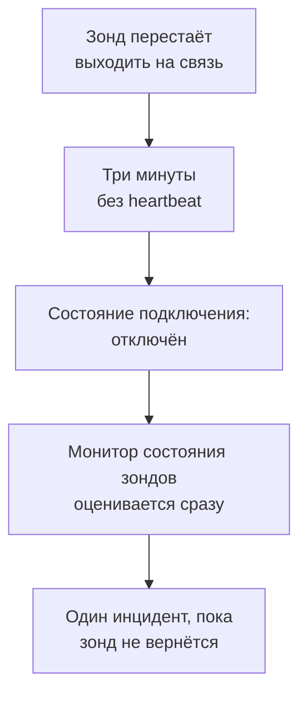

# Мониторинг состояния зондов

Монитор состояния зондов сообщает, когда зонд перестаёт выходить на связь: один инцидент, когда он отключается, который закрывается сам, когда зонд возвращается. Направьте его на свои пользовательские зонды или, в самостоятельно размещённом OneUptime, на глобальный зонд, на котором работает каждый монитор, чтобы замолчавший зонд никогда не оставлял свои мониторы без проверок незаметно для всех.

:::cards
- [Создать монитор](#создание-монитора-состояния-зондов): Выберите зонды и оставьте критерии по умолчанию.
- [Критерии](#критерии): Считайте подключённые или отключённые зонды сейчас или за окно времени.
- [Метрики](#метрики): Сколько зондов было подключено, минута за минутой.
:::

## Как это работает

OneUptime оценивает каждый монитор состояния зондов раз в минуту и ещё раз в тот момент, когда один из его зондов подключается или отключается. Он читает состояние подключения каждого зонда, то же, что показывает страница зонда: зонд считается отключённым, если от него ничего не было слышно три минуты. Если сам OneUptime был недоступен или не принимал данные, он ждёт полные три минуты, прежде чем считать какой-либо зонд отключённым, поэтому обновление OneUptime никогда не открывает инцидент.

Зонд, который остаётся недоступным, — это один инцидент, а не по одному в минуту. Монитор остаётся в офлайне с открытым инцидентом, пока все зонды, за которыми он следит, снова не подключатся; тогда инцидент закрывается сам.

Монитор может следить за зондами своего проекта и за глобальными зондами. Удалённый зонд не учитывается ни в одну сторону. Если ни одного из зондов, за которыми следит монитор, не осталось, он сохраняет своё состояние, а его обзор сообщает об этом через день.

## Создание монитора состояния зондов

:::steps
### Начните новый монитор

Перейдите в **Мониторы** и нажмите **Создать монитор**.

### Выберите состояние зондов

В разделе **Тип монитора** нажмите **Другие типы мониторов** и выберите **Статус зонда** в группе **Другое**. Заполните **Имя** и нажмите **Далее**.

### Выберите зонды

В разделе **Отслеживаемые зонды** выберите зонды. Новый монитор начинает с собственных зондов вашего проекта. Самостоятельно размещённый OneUptime без собственных зондов начинает со своих глобальных зондов; в OneUptime Cloud глобальными зондами управляет OneUptime, поэтому проект выбирает их сам, если хочет за ними следить.

### Создайте монитор

Оставьте критерии по умолчанию, описанные ниже, и нажмите **Создать монитор**. Монитор оценивается сразу, а его обзор показывает каждый отслеживаемый зонд, сначала отключённые.
:::

> [!TIP]
> **Отслеживать этот зонд** на странице зонда и в меню его строки в разделе **Мониторы → Настройки → Зонды** открывает **Создать монитор** с монитором состояния зондов, который следит за этим зондом и назван по его имени.

## Критерии

Фильтры монитора состояния зондов считают зонды:

| Фильтр | Что он считает |
| --- | --- |
| **Disconnected Probes** | Отслеживаемые зонды, которые отключены. |
| **Connected Probes** | Отслеживаемые зонды, которые подключены. |

Оба — целые числа, которые сравниваются с помощью **Больше**, **Меньше**, **Равно** и остальных сравнений. Новый монитор начинает с двух критериев:

| Критерий | Фильтр | Что он делает |
| --- | --- | --- |
| Check if a probe is disconnected | **Disconnected Probes** больше `0` | Переводит монитор в офлайн и объявляет инцидент с заголовком `Probe disconnected: {{disconnectedProbeNames}}`, который закрывается сам. |
| Check if every probe is connected | **Disconnected Probes** равно `0` | Переводит монитор в рабочее состояние. |

**Connected Probes** подходит монитору, который следит за несколькими зондами и может обойтись без одного: **Connected Probes** меньше `2` объявляет инцидент, только когда их осталось меньше двух.

### Подождать дольше перед инцидентом

Зонд считается отключённым только после трёх минут тишины, поэтому быстрый перезапуск ничего не открывает. Чтобы подождать дольше, отметьте **Оценивать этот критерий в течение определённого периода времени** под фильтром, выберите **All Values** в поле **Оценить** и окно в поле **За последние (в минутах)**. С окном в пять минут зонд должен оставаться отключённым ещё пять минут, прежде чем будет объявлен инцидент.

## Метрики

Каждая оценка записывает в монитор два ряда: `oneuptime.monitor.probes.connected` и `oneuptime.monitor.probes.disconnected` — число отслеживаемых зондов, которые были подключены и отключены. Они отображаются на странице **Метрики** монитора, а дашборд или монитор метрик читает их как любой другой ряд.

## Переменные шаблонов

Шаблоны инцидентов и оповещений монитора состояния зондов могут использовать эти переменные в дополнение к тем, что есть у любого монитора:

| Переменная | Значение |
| --- | --- |
| `{{disconnectedProbeNames}}` | Названия отключённых зондов через запятую. |
| `{{disconnectedProbeCount}}` | Сколько зондов отключено. |
| `{{connectedProbeNames}}` | Названия подключённых зондов через запятую. |
| `{{connectedProbeCount}}` | Сколько зондов подключено. |
| `{{probeStatusSummary}}` | Одно предложение с названиями отключённых зондов, например `1 of 3 probes is disconnected: EU Probe.`, или сообщением, что все зонды подключены. |
| `{{probes}}` | Каждый зонд с полями `probeName`, `isConnected`, `isGlobalProbe` и `lastAliveAt`. |

## Устранение неполадок

:::details Монитор пишет, что ждёт данных
Новый монитор показывает первую оценку через минуту-две. Если он не следит ни за одним зондом, вместо этого он показывает **Not set up**: выберите зонды в разделе **Критерии**.
:::

:::details Зонд отключился, но инцидент не был объявлен
Зонд считается отключённым через три минуты без heartbeat, а после недоступности самого OneUptime — ещё позже. Проверьте, что монитор не отключён и не находится в окне обслуживания и что его критерии по-прежнему объявляют инцидент.
:::

## Что дальше

:::cards
- [Пользовательские зонды](/docs/probe/custom-probe): Запустите зонд в своей сети.
- [Критерии и состояния монитора](/docs/monitor/criteria-and-statuses): Как критерии определяют состояние монитора.
- [Шаблоны инцидентов и оповещений](/docs/monitor/incident-alert-templating): Сформулируйте инцидент, который объявляет монитор.
:::
