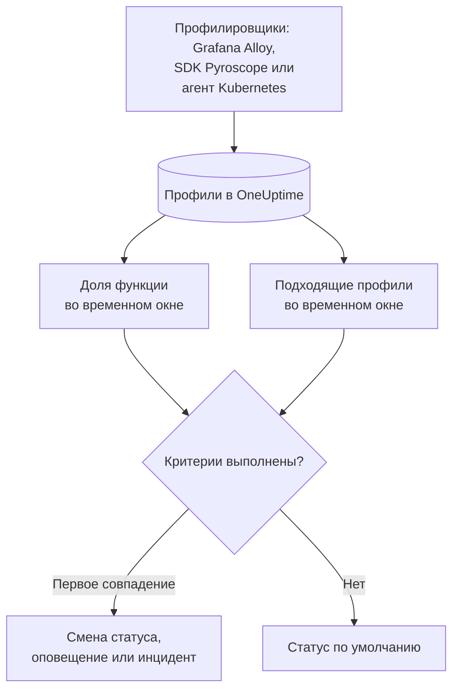

# Мониторинг профилей

Монитор профилей читает непрерывные профили, которые ваши сервисы отправляют в OneUptime, и предупреждает о двух вещах: функция занимает большую долю времени, чем должна, — например, парсер стал тяжелее после деплоя, — и профили перестают приходить от сервиса. Каждую минуту он измеряет, какая часть его временного окна прошла через указанную вами функцию, считает профили, подходящие под его фильтры, и меняет статус монитора, создаёт оповещение или объявляет инцидент, когда выполняются ваши критерии.

:::cards
- [Создание монитора](#создание-монитора-профилей): Из функции в профилировщике или через Создать монитор.
- [Что он запрашивает](#что-он-запрашивает): Функция, тип профиля, сервисы и окно.
- [Критерии](#критерии): Доля функции в окне или количество профилей.
- [Функция становится тяжелее](#разобранный-пример-функция-становится-тяжелее): Оповещение, когда доля функции резко растёт.
:::

## Как это работает



Каждую минуту OneUptime читает профили, которые подходят под фильтры монитора и начались в пределах его временного окна. Он их считает и, если монитор указывает функцию, измеряет долю времени этого окна, прошедшую через функцию. Эти числа он сверяет с критериями монитора сверху вниз, и первый совпавший критерий решает, что произойдёт. Если не совпал ни один, монитор возвращается к статусу по умолчанию.

## Перед началом

- Ваши сервисы отправляют данные непрерывного профилирования в OneUptime через Grafana Alloy (eBPF), SDK Pyroscope или агент OneUptime для Kubernetes. См. [Непрерывное профилирование](/docs/telemetry/profiles).
- Чтобы следить за функцией, вы знаете её имя или часть пути к её файлу или пакету — так, как их показывает профилировщик.

## Создание монитора профилей

:::steps
### Начните из профилировщика или через Создать монитор

Быстрее всего начать с самой функции: в **Профили производительности** откройте функцию и нажмите ссылку, которая предлагает оповещение о её доле. Откроется **Создать монитор** с монитором, уже заполненным для этой функции и её сервиса, с порогом выше того, что она занимает сегодня, — как описано в разделе [Разобранный пример: функция становится тяжелее](#разобранный-пример-функция-становится-тяжелее). Иначе перейдите в **Мониторы** и нажмите **Создать монитор**.

### Выберите Profiles

В **Тип монитора** нажмите **Другие типы мониторов** и выберите **Профили** в **Телеметрия** или введите `profiles` в поле поиска. Укажите **Имя** и нажмите **Далее**.

### Выберите, что он читает

В **Настройка монитора профилей** задайте в **Функция** функцию, за которой нужно следить, в **Что анализировать** — тип профиля, а в **Отслеживать профили за (время)** — окно. Новый монитор читает **Время CPU** за **Последние 5 минут**. **Что этот монитор читает сейчас** под полями показывает, сколько профилей подходит и какую часть окна функция занимает сегодня, чтобы вы могли задать порог выше. Откройте **Дополнительные поля**, чтобы фильтровать по сервису телеметрии или объекту инфраструктуры.

### Задайте критерии

У монитора, созданного через **Создать монитор**, два критерия: «не в сети» с инцидентом, когда **Количество профилей** равно 0, и «в сети», когда оно больше 0. Чтобы получать оповещения о функции, добавьте фильтр **Доля функции (в %)**: см. [Критерии](#критерии).

### Создайте монитор

Нажмите **Создать монитор**. Монитор откроется на странице **Обзор**, и его первая оценка выполнится в течение минуты.
:::

### Создание через API или Terraform

Шаг монитора содержит те же настройки, что и его конфигурация `profileMonitor`. Эта конфигурация следит за `parseOrder` в профилях CPU одного сервиса за последние пять минут:

```json
{
  "profileMonitor": {
    "telemetryServiceIds": [],
    "profileTypes": ["cpu"],
    "profileType": "",
    "functionName": "parseOrder",
    "attributes": {},
    "lastXSecondsOfProfiles": 300
  }
}
```

Укажите ID сервиса в `telemetryServiceIds` или оставьте список пустым, чтобы читать профили всех сервисов, и оставьте `functionName` пустым, чтобы только считать профили. Создайте монитор с типом монитора `Profiles` и шагом, который содержит эту конфигурацию и хотя бы один критерий, через [API](/docs/api-reference/api-reference) или [Terraform](/docs/terraform/monitor-steps). В Terraform передайте конфигурацию как атрибут шага `profile_monitor`, записанный с помощью `jsonencode()`.

## Что он запрашивает

| Поле | Что подходит | По умолчанию |
| --- | --- | --- |
| `profileTypes` | Профили любого из этих типов, сравниваемые точно, например `cpu`. | Пусто: любой тип |
| `profileType` | Профили, тип которых содержит этот текст, без учёта регистра. Если поле задано, `profileTypes` игнорируется. | Пусто |
| `functionName` | Код, долю которого измеряет **Доля функции (в %)**: кадры стека, имя функции или путь к файлу которых содержит этот текст, без учёта регистра. | Пусто: доля не измеряется |
| `telemetryServiceIds` | Профили любого из этих сервисов телеметрии. | Пусто: любой сервис |
| `entityKeys` | Профили любого из этих хостов, подов, контейнеров и других объектов инфраструктуры. | Пусто: любой объект |
| `attributes` | Профили, атрибуты которых имеют эти значения. | Пусто: без условия |
| `lastXSecondsOfProfiles` | Профили, начавшиеся за это число секунд до оценки. | Нет: всегда задавайте его, иначе считается каждый сохранённый профиль и число никогда не падает до 0 |

Чтобы профиль был прочитан, должны совпасть все заданные вами фильтры. В форме **Функция** задаёт `functionName`, **Что анализировать** задаёт `profileTypes` (**Любой тип профиля** оставляет его пустым), **Отслеживать профили за (время)** задаёт `lastXSecondsOfProfiles`, а **Фильтровать по сервису телеметрии** и **Фильтровать по объекту инфраструктуры** задают `telemetryServiceIds` и `entityKeys`.

## Как он оценивается

- **Каждую минуту.** Монитор профилей не проверяется зондами, поэтому у него нет интервала для настройки и нет страницы **Зонды и интервал**.
- **Два числа на оценку.** Монитор считает профили, которые соответствуют всем фильтрам и начались в пределах `lastXSecondsOfProfiles`, и измеряет долю функции в этих же профилях. Профилировщик выгружает данные с постоянным интервалом, поэтому дайте окну место для нескольких выгрузок.
- **Одна единица за раз.** Доля складывает сэмплы одной единицы: если читаемые типы смешивают единицы, например время CPU в наносекундах из SDK и число сэмплов из eBPF, он читает единицу, у которой больше всего сэмплов в окне.
- **Отсутствие профилей — это число 0 и никакой доли.** Сервис, профилировщик которого перестал выгружать данные, даёт число 0, а критерий **Доля функции (в %)** не совпадает с пустым окном: настройте оповещение по **Количество профилей**, чтобы узнать, что профилирование остановилось.
- **Простой самого OneUptime — это не тишина.** Пока окно времени содержит период, когда сам OneUptime не получал данные (перезапускался, обновлялся или догонял отставание), проверка ждёт: статус не меняется, и ни один инцидент или оповещение не открывается и не закрывается. См. [Когда OneUptime не получает данные](/docs/monitor/when-oneuptime-is-not-receiving).
- **Критерии сверху вниз.** Решает первый совпавший критерий, поэтому ставьте самый серьёзный первым.

Каждая смена статуса вместе с причиной записывается в **Хронология статуса** монитора.

## Критерии

Критерии монитора профилей сравнивают одно из двух чисел со значением.

**Доля функции (в %)** — это доля времени окна, от 0 до 100, прошедшая через функцию монитора: каждый стек с кадром, подходящим под `functionName`, считается один раз, на любой глубине, поэтому в неё входят и собственный код функции, и всё, что она вызывает.

| Условие фильтра | Совпадает, когда доля функции… |
| --- | --- |
| **Больше** | выше значения |
| **Больше или равно** | равна значению или выше |
| **Меньше** | ниже значения |
| **Меньше или равно** | равна значению или ниже |

**Количество профилей** — это число профилей, совпавших в окне:

| Условие фильтра | Совпадает, когда число профилей… |
| --- | --- |
| **Больше** | выше значения |
| **Больше или равно** | равно значению или выше |
| **Меньше** | ниже значения |
| **Меньше или равно** | равно значению или ниже |
| **Равно** | точно равно значению |
| **Не равно** | любое, кроме значения |

У числа профилей нет условий аномалий: нет базовой линии, с которой их можно было бы сравнить.

## Разобранный пример: функция становится тяжелее

В сервисе оформления заказов `parseOrder` занимает 18 % его времени CPU. Деплой, который разбирает более крупные данные, не должен пройти незамеченным:

1. В **Профили производительности** выберите сервис оформления заказов и откройте `parseOrder`.
2. Нажмите ссылку, которая предлагает оповещение о её доле. Профилировщик предлагает 30 %: в полтора раза больше сегодняшней доли, но не меньше чем на 10 п. п. выше, с округлением вверх до числа, кратного 5.
3. Откроется **Создать монитор** с монитором профилей сервиса оформления заказов, который читает **Время CPU** за **Последние 5 минут**, с двумя критериями: **Доля функции (в %)** **Больше** `30` создаёт оповещение, которое устраняется само, и переводит монитор в состояние «снижена работоспособность»; **Меньше или равно** `30` переводит его в состояние «работает». Инцидент заполнен, но выключен: включите его, чтобы вызывать дежурного.
4. Нажмите **Создать монитор**.

Когда после деплоя `parseOrder` занимает 45 % времени CPU, следующая оценка создаёт оповещение. Когда исправление возвращает долю ниже 30 %, оповещение устраняется само.

## Разобранный пример: профили перестают приходить

Сервис оформления заказов использует SDK Pyroscope, который выгружает профили CPU. Вам нужен инцидент, когда они перестают приходить на пять минут:

- `profileTypes`: `["cpu"]`, `telemetryServiceIds`: сервис оформления заказов, `lastXSecondsOfProfiles`: `300`
- Критерий 1: **Количество профилей** **Равно** `0`: перевести монитор в состояние «не в сети» и объявить инцидент
- Критерий 2: **Количество профилей** **Больше** `0`: перевести монитор в состояние «в сети»

Пока SDK выгружает данные, каждая оценка насчитывает несколько профилей, и критерий 2 держит монитор в сети. Когда сервис развёртывают без SDK, через пять минут после последней выгрузки число падает до 0, совпадает критерий 1, и объявляется инцидент. Первая выгрузка после исправления снова поднимает число выше 0, и инцидент устраняется сам, если для него включено **Автоустранение инцидента**.

## Устранение неполадок

:::details Монитор считает 0, но профили видны в OneUptime
Сравните фильтры с профилями, которые вы видите: `profileTypes` должен точно совпадать с типом, а `telemetryServiceIds` — содержать правильные ID сервисов. Короткое `lastXSecondsOfProfiles` также может попадать между двумя выгрузками.
:::

:::details Доля функции остаётся на 0 %
Ни один кадр в окне не содержит текст функции. Откройте функцию в профилировщике и скопируйте её имя так, как оно там показано; подойдёт и часть имени, а регистр не важен. Затем проверьте, что сервис отправляет тот тип профиля, который читает **Что анализировать**.
:::

## Что дальше

:::cards
- [Непрерывное профилирование](/docs/telemetry/profiles): Отправляйте профили и читайте их в профилировщике.
- [Шаги монитора](/docs/terraform/monitor-steps): Передавайте конфигурацию шага из Terraform.
- [Мониторинг трассировок](/docs/monitor/traces-monitor): Оповещения о неудачных спанах.
- [Мониторинг метрик](/docs/monitor/metrics-monitor): Оповещения о CPU, памяти и других метриках.
:::
