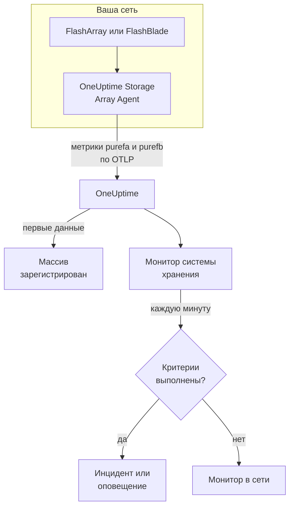

# Мониторинг систем хранения данных

Монитор системы хранения следит за одним массивом хранения и сообщает, когда массив сам поднимает оповещение, у него заканчивается место, он замедляется, теряет оборудование или путь к хосту либо отстаёт с репликацией. Он работает с Pure Storage FlashArray и Pure Storage FlashBlade и читает метрики, которые экспортирует сам массив, — серии Pure `purefa_*` и `purefb_*`, — а собирает их OneUptime Storage Array Agent.

:::cards
- [Создайте монитор](#создание-монитора-системы-хранения): Шесть шагов в панели управления.
- [Шаблоны](#готовые-шаблоны-оповещений): Восемнадцать готовых оповещений, по инциденту на том, хост или компонент.
- [Как устроены серии Pure](#как-устроены-серии-pure): Одно имя метрики, много показателей.
- [Метрики](#собираемые-метрики): Все серии, по которым монитор может создавать оповещения.
:::

## Как это работает

OneUptime Storage Array Agent работает на машине, которая может достучаться до интерфейса управления массива. Он читает метрики массива с помощью API-токена только для чтения, помечает их именем массива, `storage.array.name`, и его платформой, `storage.system`, и отправляет их в OneUptime по OTLP. Первые данные регистрируют массив.

Монитор системы хранения привязан к одному массиву. Каждую минуту он выполняет свой запрос по метрикам этого массива и сравнивает результат со своими критериями.



## Перед началом работы

- **Установите Storage Array Agent** там, откуда он может достучаться до массива по HTTPS, с API-токеном пользователя, у которого есть роль массива **readonly**. [Руководство по Storage Array Agent](/docs/telemetry/storage-arrays) описывает пользователя, токен и установку через `ONEUPTIME_URL`, `ONEUPTIME_TELEMETRY_INGESTION_KEY`, `STORAGE_ARRAY_NAME` и адрес и токен массива (`PURE_FA_ENDPOINT` и `PURE_FA_API_TOKEN` или `PURE_FB_ENDPOINT` и `PURE_FB_API_TOKEN`).
- **Убедитесь, что массив зарегистрирован.** Он появляется в разделе **Продукты → Инфраструктура → Storage Arrays → All Storage Arrays** под именем из `STORAGE_ARRAY_NAME` агента примерно через минуту после первого считывания.

## Создание монитора системы хранения

:::steps
### Создайте новый монитор

Перейдите в **Мониторы** и нажмите **Создать монитор**.

### Выберите «Система хранения»

В разделе **Тип монитора** нажмите **Другие типы мониторов** и выберите **Система хранения** в группе **Инфраструктура** или введите `storage` в поле поиска. Введите **Имя** — оно используется в заголовках инцидентов и оповещений — и нажмите **Далее**.

### Выберите массив

В разделе **Storage Array Monitor Configuration** выберите массив в поле **Система хранения**. В списке есть каждый массив, который отправлял данные. От его платформы зависит, какие метрики и шаблоны предлагает форма.

### Выберите, что отслеживать

Выберите одну из трёх вкладок:

- **Quick Setup** — нажмите на [шаблон](#готовые-шаблоны-оповещений). Он задаёт метрику, фильтры по меткам, агрегацию, диапазон времени и пороги и заменяет критерии ниже своими. **Диапазон времени** по-прежнему можно изменить.
- **Custom Metric** — выберите одну метрику в **Storage Array Metric**, затем задайте **Агрегация** и **Диапазон времени**. [Фильтры](#настройки-монитора) сужают её до одного тома, хоста, пода, компонента, файловой системы или бакета.
- **Расширенный** — стройте запросы и формулы сами в разделе **Выберите метрики**, например занятую ёмкость как `purefa_array_space_bytes` с фильтром `space=capacity` минус ту же метрику с фильтром `space=empty`. Используйте **Group by** по метке объекта, чтобы оценивать каждый объект отдельно.

### Проверьте критерии

Откройте каждый критерий в разделе **Критерии монитора** и проверьте поля **Метрика**, **Агрегация**, **Условие** и **Threshold**. Шаблон заполняет их сам. С **Custom Metric** или **Расширенный** монитор начинает с [критериев по умолчанию](#критерии-по-умолчанию), которые замечают только падение метрики до нуля, поэтому задайте свой порог.

### Создайте монитор

Нажмите **Создать монитор**. OneUptime открывает страницу монитора и оценивает его каждую минуту. Инциденты и оповещения, которые он поднимает, также видны на страницах массива **Инциденты** и **Оповещения**.
:::

> [!TIP]
> Чтобы настроить сразу несколько шаблонов, откройте массив из **Продукты → Инфраструктура → Storage Arrays** и перейдите в **Recommendations**. Выберите нужные шаблоны, укажите, кого вызывать, и OneUptime создаст по монитору на каждый шаблон.

## Настройки монитора

| Поле | Вкладка | Что делает |
| --- | --- | --- |
| **Система хранения** | Все | Обязательно. Ограничивает каждый запрос атрибутом `resource.storage.array.name`, поэтому два массива, у которых есть том с именем `vol-01`, никогда не смешиваются. |
| **Том** | Custom Metric, Расширенный | Только FlashArray. Один том по метке `name`, например `vol-db-01`. Том в поде или группе томов называется `pod::volume` или `group/volume`. |
| **Хост** | Custom Metric, Расширенный | Только FlashArray. Один хост, как его знает массив, по метке `host`, например `esxi-01`. |
| **Под** | Custom Metric, Расширенный | Только FlashArray. Один под ActiveCluster или ActiveDR по метке `name` или по `local_pod` в сериях связей реплик. |
| **Hardware Component** | Custom Metric, Расширенный | Один аппаратный компонент, например `CH0.BAY1` или `CT0`: метка `component_name` на FlashArray, `name` на FlashBlade. |
| **File System** | Custom Metric, Расширенный | Только FlashBlade. Одна файловая система по метке `name`. |
| **Bucket** | Custom Metric, Расширенный | Только FlashBlade. Один бакет объектного хранилища по метке `name`. |
| **Storage Array Metric** | Custom Metric | Одна метрика из [каталога](#собираемые-метрики). Форма добавляет фильтр по метке, который придаёт ей смысл, и группирует её по объекту, который она описывает, поэтому каждый том, хост или компонент оценивается отдельно. |
| **Агрегация** | Custom Metric | Как объединяются выборки: **Среднее**, **Максимум**, **Минимум**, **Сумма** или **Количество**. Начинается с обычной агрегации метрики. |
| **Диапазон времени** | Все | Скользящее окно, которое читает запрос, от **Past 1 Minute** до **Past 365 Days**. Новый монитор начинается с **Past 5 Minutes**; пользовательская метрика файловой системы или бакета — с **Past 15 Minutes**; шаблоны задают своё. |
| **Выберите метрики** | Расширенный | Конструктор запросов: **Метрика**, **Aggregate by**, **Filter by attributes**, **Group by**, а также **Добавить метрику** и **Добавить формулу** для объединения запросов. |

Агент читает конечную точку массива каждые 60 секунд, а тома, хосты и поды — каждые 2 минуты, поэтому в 5-минутном окне всегда есть выборка. Файловые системы и бакеты FlashBlade он читает каждые 5 минут, отсюда 15, а каталоги FlashArray — каждые 30 минут: дайте монитору каталогов окно в 60 минут.

## Как устроены серии Pure

Pure помещает несколько показателей в **одно** имя метрики и различает их меткой:

- **`dimension`** в сериях производительности. `purefa_array_performance_latency_usec` несёт задержку чтения (`usec_per_read_op`), задержку записи (`usec_per_write_op`), задержку зеркалированной записи, а также время SAN, очереди, QoS и обслуживания для каждой из них. Всегда фильтруйте по одному `dimension`: среднее по ним смешивает задержку чтения 200 мкс с показателем очереди.
- **`space`** в сериях ёмкости: `capacity`, `empty`, `snapshots`, `total_provisioned`, `total_physical`, `available_ratio` и другие.

Некоторые серии несут своё состояние в **метке**, со значением, которое всегда равно 1:

| Серия | Метка состояния | Одна серия на |
| --- | --- | --- |
| `purefa_alerts_open` | `severity`, с `summary`, `code` и `component_type` | Открытое оповещение |
| `purefa_hw_component_status` | `component_status` | Аппаратный компонент |
| `purefa_host_connectivity_info` | `status`, с `details` | Хост |
| `purefa_drive_capacity_bytes` | `component_status` (значение — ёмкость диска) | Диск |

Серия, отфильтрованная до плохого состояния, существует, только пока что-то находится в этом состоянии, поэтому отсутствие серии означает, что всё в порядке. Поэтому **Max выше 0 срабатывает, а 0 восстанавливает** — правильная форма для таких серий, и так построены шаблоны: их критерии восстановления считают отсутствующую серию нулём.

В фильтрах монитора и ключах группировки атрибуты агента начинаются с `resource.` (`resource.storage.array.name`, `resource.storage.system`), а собственные метки Pure — нет (`name`, `host`, `component_name`, `dimension`, `space`, `severity`).

## Готовые шаблоны оповещений

OneUptime поставляет 18 шаблонов — 11 для FlashArray и 7 для FlashBlade, — и **Quick Setup** предлагает те, что подходят для платформы массива. Каждый строит полный монитор: запрос метрики, её фильтры по меткам, группировку по собственной метке объекта, критерий, который срабатывает, и критерий, который восстанавливает. Пороги — это отправные точки, которые можно изменить.

Критерий срабатывает, только когда условие выполняется для **каждого** значения в его окне. Монитор, сработавший на пороге ёмкости, задержки, отставания или коэффициента, восстанавливается только на 10 % дальше этого порога, поэтому значение, колеблющееся у порога, не переключает состояние туда и обратно; шаблоны оповещений и оборудования восстанавливаются, как только состояние исчезает.

### FlashArray

| Шаблон | Категория | Серьёзность | Что отслеживает | Срабатывает, когда |
| --- | --- | --- | --- | --- |
| Critical Array Alert | Array Health | Критический | `purefa_alerts_open` с фильтром `severity=critical`, Max по `summary`, последние 5 минут | > 0 — у массива есть открытое критическое оповещение (отказавший компонент, критическая нехватка ёмкости, сбой репликации). Один инцидент на оповещение; восстанавливается, когда оповещение закрывается |
| Warning Array Alert | Array Health | Warning | `purefa_alerts_open` с фильтром `severity=warning`, Max по `summary`, последние 5 минут | > 0 — у массива есть открытое оповещение уровня warning. Один инцидент на оповещение; восстанавливается, когда оповещение закрывается |
| Capacity Above 80% | Ёмкость | Warning | `purefa_array_space_utilization`, Max, последние 15 минут | > 80 — собственный первый порог ёмкости Pure; восстанавливается при ≤ 72 |
| Capacity Above 90% | Ёмкость | Критический | `purefa_array_space_utilization`, Max, последние 5 минут | > 90 — массив близок к отказу в записи; восстанавливается при ≤ 81 |
| High Read Latency | Performance | Warning | `purefa_array_performance_latency_usec` с фильтром `dimension=usec_per_read_op`, Avg, последние 10 минут | > 5000 мкс (5 мс) — чтение на FlashArray обычно занимает намного меньше 1 мс; восстанавливается при ≤ 4500 |
| High Write Latency | Performance | Warning | `purefa_array_performance_latency_usec` с фильтром `dimension=usec_per_write_op`, Avg, последние 10 минут | > 5000 мкс (5 мс); восстанавливается при ≤ 4500 |
| Hardware Component Failed | Hardware | Критический | `purefa_hw_component_status` с фильтром `component_status=critical`, Max по `component_name`, последние 5 минут | > 0 — контроллер, блок питания, вентилятор, отсек или порт в критическом состоянии, и резервирования больше нет. Один инцидент на компонент; восстанавливается, когда он сообщает ok |
| Hardware Component Degraded | Hardware | Warning | `purefa_hw_component_status` с фильтром `component_status=degraded`, Max по `component_name`, последние 5 минут | > 0 — компонент деградировал. Один инцидент на компонент; восстанавливается, когда он сообщает ok |
| Drive Failed | Hardware | Критический | `purefa_drive_capacity_bytes` с фильтром `component_status=failed`, Max по `component_name`, последние 5 минут | > 0 — модуль DirectFlash или SSD отказал, и массив перестраивается на остальные. Один инцидент на диск; восстанавливается, когда диск заменят |
| Host Lost Redundant Paths | Хосты | Warning | `purefa_host_connectivity_info` с фильтром `status=critical`, Max по `host`, последние 5 минут | > 0 — хост достигает массива через один контроллер или ни через какой; переключение контроллеров отключило бы его хранилище. Один инцидент на хост; восстанавливается, когда пути вернутся |
| Replication Lag Above 1 Minute | Replication | Warning | `purefa_pod_replica_links_lag_max_msec`, Max по `local_pod`, последние 10 минут | > 60000 мс (60 с) — переключение сейчас потеряло бы больше недавних записей, чем запланировано. Один инцидент на под; восстанавливается при ≤ 54000 |

### FlashBlade

| Шаблон | Категория | Серьёзность | Что отслеживает | Срабатывает, когда |
| --- | --- | --- | --- | --- |
| Critical Array Alert | Array Health | Критический | `purefb_alerts_open` с фильтром `severity=critical`, Max по `summary`, последние 5 минут | > 0 — у FlashBlade есть открытое критическое оповещение. Один инцидент на оповещение; восстанавливается, когда оповещение закрывается |
| Warning Array Alert | Array Health | Warning | `purefb_alerts_open` с фильтром `severity=warning`, Max по `summary`, последние 5 минут | > 0 — у FlashBlade есть открытое оповещение уровня warning. Один инцидент на оповещение; восстанавливается, когда оповещение закрывается |
| Capacity Above 80% | Ёмкость | Warning | `purefb_array_space_utilization` с фильтром `type=array`, Max, последние 15 минут | > 80; восстанавливается при ≤ 72 |
| Capacity Above 90% | Ёмкость | Критический | `purefb_array_space_utilization` с фильтром `type=array`, Max, последние 5 минут | > 90 — когда он заполнится, запись перестанет работать для всех клиентов; восстанавливается при ≤ 81 |
| Hardware Component Unhealthy | Hardware | Критический | `purefb_hardware_health`, Min по `name`, последние 5 минут | < 1 — блейд, модуль фабрики, блок питания или вентилятор неисправен (неиспользуемый слот сообщает 2). Один инцидент на компонент; восстанавливается при ≥ 1 |
| High Read Latency | Performance | Warning | `purefb_array_performance_latency_usec` с фильтром `dimension=usec_per_read_op` и `protocol=all`, Avg, последние 10 минут | > 10000 мкс (10 мс) по всем протоколам; восстанавливается при ≤ 9000 |
| File System Near Full | File Systems | Warning | `purefb_file_systems_space_bytes` с фильтром `space=available_ratio`, Min по `name`, последние 15 минут | < 0.1 — осталось меньше 10 % выделенного размера файловой системы. Один инцидент на файловую систему; восстанавливается при ≥ 0.11 |

**Серьёзность** — это метка, которую показывает список выбора. Инцидент и оповещение, которые создаёт шаблон, начинаются с самой высокой серьёзности инцидентов и оповещений вашего проекта; измените их в критерии.

- **Открытые оповещения и состояния оборудования используют Max** серии, которая существует, только пока оповещение открыто или компонент находится в этом состоянии, поэтому одно считывание, которое её показывает, пересекает порог.
- **Каждый шаблон для объектов группирует по собственной метке объекта** (`summary`, `component_name`, `host`, `local_pod`, `name`), поэтому срабатывает по одному инциденту на затронутый объект, и инцидент называет этот объект.
- **Шаблоны задержки используют Avg** собственного среднего массива на операцию, а шаблоны ёмкости — **Max** его собственного процента использования. Задержки зафиксированы в микросекундах, а ёмкость — в процентах.
- **Hardware Component Unhealthy использует Min** по компоненту: его состояние равно 1, когда он исправен, и падает до 0, когда нет.

Шаблона для задержки каждого тома нет, потому что правильный порог зависит от нагрузки: постройте его из каталога с группировкой по `name`. Прогнозу ёмкости нужен тренд роста, а не порог, а для износа дисков нет серии, по которой можно было бы создавать оповещения.

## Собираемые метрики

Агент отправляет всё, что экспортирует массив; серии ниже — это каталог, который предлагает форма монитора. Каждое значение — это gauge, который вычисляет сам массив, — задержки в микросекундах на операцию, пропускная способность в секунду, — поэтому вычислять скорость не нужно. **Фильтр** — это фильтр по метке, который придаёт серии смысл, указанный в её строке; форма применяет его за вас.

### Array Health

| Метрика | Фильтр | Платформа | Единица | Описание |
| --- | --- | --- | --- | --- |
| `purefa_alerts_open` | — | FlashArray | `count` | Одна серия на каждое открытое оповещение массива (значение 1) с метками `severity` (`critical`, `warning`, `info`, `hidden`), `category`, `code`, `component_type` и `summary` |
| `purefb_alerts_open` | — | FlashBlade | `count` | Одна серия на каждое открытое оповещение FlashBlade (значение 1) с метками `severity` (`info`, `warning`, `critical`), `code`, `component_name`, `component_type`, `summary` и `kburl` (статья базы знаний Pure) |

### Capacity

| Метрика | Фильтр | Платформа | Единица | Описание |
| --- | --- | --- | --- | --- |
| `purefa_array_space_utilization` | — | FlashArray | `%` | Доля полезной ёмкости массива, которая используется. Pure сам поднимает оповещения о ёмкости на 80 %, 90 % и 100 % |
| `purefa_array_space_bytes` | `space=capacity` | FlashArray | `bytes` | Полезная ёмкость массива |
| `purefa_array_space_bytes` | `space=empty` | FlashArray | `bytes` | Неиспользуемая ёмкость — следите за трендом, чтобы предсказать, когда массив заполнится |
| `purefa_array_space_bytes` | `space=snapshots` | FlashArray | `bytes` | Физическое место, занятое только снимками; быстрый рост обычно означает, что группа защиты хранит больше снимков, чем планировалось |
| `purefa_array_space_data_reduction_ratio` | — | FlashArray | `ratio` | Дедупликация и сжатие по всему массиву, например 4.2 для 4.2:1. Устойчивое падение означает, что новые данные плохо сокращаются |
| `purefb_array_space_utilization` | `type=array` | FlashBlade | `%` | Доля полезной ёмкости FlashBlade, которая используется |
| `purefb_array_space_bytes` | `type=array`, `space=empty` | FlashBlade | `bytes` | Неиспользуемая ёмкость FlashBlade |
| `purefb_array_space_data_reduction_ratio` | `type=array` | FlashBlade | `ratio` | Сокращение данных по всему FlashBlade |

### Performance

| Метрика | Фильтр | Платформа | Единица | Описание |
| --- | --- | --- | --- | --- |
| `purefa_array_performance_latency_usec` | `dimension=usec_per_read_op` | FlashArray | `µs` | Средняя задержка чтения, как её видят хосты; чтение на FlashArray обычно занимает намного меньше 1 мс |
| `purefa_array_performance_latency_usec` | `dimension=usec_per_write_op` | FlashArray | `µs` | Средняя задержка записи, как её видят хосты |
| `purefa_array_performance_latency_usec` | `dimension=usec_per_mirrored_write_op` | FlashArray | `µs` | Средняя задержка записи в растянутый под ActiveCluster, включая путь до массива-партнёра и обратно |
| `purefa_array_performance_latency_usec` | `dimension=san_usec_per_read_op` | FlashArray | `µs` | Время, которое чтение проводит в SAN; высокая задержка SAN при низкой задержке обслуживания указывает на фабрику или хост |
| `purefa_array_performance_throughput_iops` | `dimension=reads_per_sec` | FlashArray | `ops/s` | Операций чтения в секунду |
| `purefa_array_performance_throughput_iops` | `dimension=writes_per_sec` | FlashArray | `ops/s` | Операций записи в секунду |
| `purefa_array_performance_bandwidth_bytes` | `dimension=read_bytes_per_sec` | FlashArray | `bytes/s` | Байт прочитано в секунду |
| `purefa_array_performance_bandwidth_bytes` | `dimension=write_bytes_per_sec` | FlashArray | `bytes/s` | Байт записано в секунду |
| `purefa_array_performance_queue_depth_ops` | — | FlashArray | `ops` | Операции в очереди на массиве; растущая очередь при растущей задержке означает, что хосты отправляют больше, чем массив успевает обслужить |
| `purefa_array_performance_average_bytes` | `dimension=bytes_per_op` | FlashArray | `bytes` | Средний размер операции — крупный ввод-вывод увеличивает задержку, хотя ничего не сломано |
| `purefb_array_performance_latency_usec` | `dimension=usec_per_read_op`, `protocol=all` | FlashBlade | `µs` | Средняя задержка чтения по всем протоколам |
| `purefb_array_performance_latency_usec` | `dimension=usec_per_write_op`, `protocol=all` | FlashBlade | `µs` | Средняя задержка записи по всем протоколам |
| `purefb_array_performance_throughput_iops` | `dimension=reads_per_sec`, `protocol=all` | FlashBlade | `ops/s` | Операций чтения в секунду по всем протоколам |
| `purefb_array_performance_throughput_iops` | `dimension=writes_per_sec`, `protocol=all` | FlashBlade | `ops/s` | Операций записи в секунду по всем протоколам |
| `purefb_array_performance_bandwidth_bytes` | `dimension=read_bytes_per_sec`, `protocol=all` | FlashBlade | `bytes/s` | Байт прочитано в секунду по всем протоколам |
| `purefb_array_performance_bandwidth_bytes` | `dimension=write_bytes_per_sec`, `protocol=all` | FlashBlade | `bytes/s` | Байт записано в секунду по всем протоколам |

### Volumes

| Метрика | Фильтр | Платформа | Единица | Описание |
| --- | --- | --- | --- | --- |
| `purefa_volume_performance_latency_usec` | `dimension=usec_per_read_op` | FlashArray | `µs` | Средняя задержка чтения каждого тома — группируйте по `name` |
| `purefa_volume_performance_latency_usec` | `dimension=usec_per_write_op` | FlashArray | `µs` | Средняя задержка записи каждого тома |
| `purefa_volume_performance_throughput_iops` | `dimension=reads_per_sec` | FlashArray | `ops/s` | Операций чтения в секунду для каждого тома |
| `purefa_volume_performance_throughput_iops` | `dimension=writes_per_sec` | FlashArray | `ops/s` | Операций записи в секунду для каждого тома |
| `purefa_volume_performance_bandwidth_bytes` | `dimension=read_bytes_per_sec` | FlashArray | `bytes/s` | Байт в секунду, прочитанных из каждого тома |
| `purefa_volume_performance_bandwidth_bytes` | `dimension=write_bytes_per_sec` | FlashArray | `bytes/s` | Байт в секунду, записанных в каждый том |
| `purefa_volume_space_bytes` | `space=total_provisioned` | FlashArray | `bytes` | Размер каждого тома, как его видят хосты |
| `purefa_volume_space_bytes` | `space=total_physical` | FlashArray | `bytes` | Физическое место, которое занимает каждый том после сокращения данных |
| `purefa_volume_space_data_reduction_ratio` | — | FlashArray | `ratio` | Коэффициент сокращения данных каждого тома |

### Hosts

| Метрика | Фильтр | Платформа | Единица | Описание |
| --- | --- | --- | --- | --- |
| `purefa_host_connectivity_info` | — | FlashArray | `count` | Одна серия на хост (значение 1) с меткой подключения `status` (`healthy`, `critical`, `unused`) и `details` (`Redundant`, `Single Controller`, `None`, ...) |
| `purefa_host_performance_latency_usec` | `dimension=usec_per_read_op` | FlashArray | `µs` | Средняя задержка чтения, которую видит каждый хост, — группируйте по `host` |
| `purefa_host_performance_latency_usec` | `dimension=usec_per_write_op` | FlashArray | `µs` | Средняя задержка записи, которую видит каждый хост |
| `purefa_host_performance_throughput_iops` | `dimension=reads_per_sec` | FlashArray | `ops/s` | Операций чтения в секунду для каждого хоста |
| `purefa_host_performance_throughput_iops` | `dimension=writes_per_sec` | FlashArray | `ops/s` | Операций записи в секунду для каждого хоста |

### Replication

| Метрика | Фильтр | Платформа | Единица | Описание |
| --- | --- | --- | --- | --- |
| `purefa_pod_replica_links_lag_max_msec` | — | FlashArray | `ms` | Наибольшее отставание репликации каждой связи реплик пода (ActiveDR / асинхронная) с метками `local_pod`, `remote_pod`, `remote`, `direction` и `status` — группируйте по `local_pod` |
| `purefa_pod_replica_links_lag_average_msec` | — | FlashArray | `ms` | Среднее отставание репликации каждой связи реплик пода |
| `purefa_pod_performance_replication_bandwidth_bytes` | — | FlashArray | `bytes/s` | Трафик репликации каждого пода с метками `direction` и `dimension` |
| `purefa_pod_performance_latency_usec` | `dimension=usec_per_mirrored_write_op` | FlashArray | `µs` | Средняя задержка зеркалированной записи каждого пода ActiveCluster |

### Hardware

| Метрика | Фильтр | Платформа | Единица | Описание |
| --- | --- | --- | --- | --- |
| `purefa_hw_component_status` | — | FlashArray | `count` | Одна серия на аппаратный компонент (значение 1) — шасси, контроллеры, отсеки дисков и NVRAM, блоки питания, вентиляторы, датчики температуры, порты Ethernet и Fibre Channel — с меткой `component_status` (`ok`, `critical`, `degraded`, `device_off`, `identifying`, `not_installed`, `unknown`) |
| `purefa_hw_component_temperature_celsius` | — | FlashArray | `°C` | Температура каждого датчика — группируйте по `component_name` |
| `purefa_drive_capacity_bytes` | — | FlashArray | `bytes` | Сырая ёмкость каждого диска с меткой его `component_status` (`healthy`, `failed`, `missing`, `recovering`, `unhealthy`, `empty`, ...) и типом |
| `purefa_network_interface_performance_errors` | `dimension=total_errors_per_sec` | FlashArray | `errors/s` | Ошибок в секунду на каждом интерфейсе Ethernet и Fibre Channel — постоянные ошибки обычно означают плохой кабель, оптику или порт коммутатора |
| `purefb_hardware_health` | — | FlashBlade | — | Состояние каждого аппаратного компонента (блейды, модули фабрики, блоки питания, вентиляторы, ...): 1 = исправен, 2 = не используется, 0 = неисправен. Берите минимум по `name` |

### File Systems

| Метрика | Фильтр | Платформа | Единица | Описание |
| --- | --- | --- | --- | --- |
| `purefb_file_systems_performance_latency_usec` | `dimension=usec_per_read_op` | FlashBlade | `µs` | Средняя задержка чтения каждой файловой системы — группируйте по `name` |
| `purefb_file_systems_performance_latency_usec` | `dimension=usec_per_write_op` | FlashBlade | `µs` | Средняя задержка записи каждой файловой системы |
| `purefb_file_systems_space_bytes` | `space=total_physical` | FlashBlade | `bytes` | Физическое место, которое занимает каждая файловая система |
| `purefb_file_systems_space_bytes` | `space=available_ratio` | FlashBlade | `ratio` | Доля выделенного размера каждой файловой системы, которая ещё свободна, от 0 до 1 — около 0 файловая система вот-вот исчерпает свою квоту |

### Buckets

| Метрика | Фильтр | Платформа | Единица | Описание |
| --- | --- | --- | --- | --- |
| `purefb_buckets_performance_latency_usec` | `dimension=usec_per_read_op` | FlashBlade | `µs` | Средняя задержка чтения каждого бакета — группируйте по `name` |
| `purefb_buckets_space_bytes` | `space=total_physical` | FlashBlade | `bytes` | Физическое место, которое занимает каждый бакет |
| `purefb_buckets_object_count` | — | FlashBlade | `count` | Количество объектов в каждом бакете |

## Критерии мониторинга

Критерий сравнивает один из запросов или формул монитора с порогом. У критериев монитора системы хранения нет поля **Тип фильтра**: каждое правило проверяет значение метрики с помощью этих полей.

| Поле | Что делает |
| --- | --- |
| **Метрика** | Запрос или формула для проверки, по имени переменной. |
| **Агрегация** | Как значения в окне превращаются в один ответ: **Среднее**, **Сумма**, **Maximum Value**, **Minimum Value**, **All Values** (каждое значение должно совпасть) или **Any Value** (достаточно одного). |
| **Условие** | **Greater Than**, **Less Than**, **Greater Than Or Equal To**, **Less Than Or Equal To** или **Equal To** — или условие аномалии: **Anomalously High**, **Anomalously Low** или **Anomalous**. |
| **Threshold** | Значение, с которым идёт сравнение. Рядом есть список единиц, если у метрики есть единица. Не показывается для условий аномалии. |
| **Чувствительность** | Только условия аномалии. **Низкий** (4σ), **Средний** (3σ, по умолчанию) или **Высокий** (2σ). |
| **Окно базовой линии** | Только условия аномалии. 14 дней (по умолчанию), 28, 60 или 90 дней истории. |
| **Если нет данных** | В разделе **Дополнительные поля**. Что происходит, когда в окне нет выборок: **Ignore** (по умолчанию), **Treat As Zero** или **Триггер**. |

Условия аномалии сравнивают каждое значение с тем же часом недели в базовой линии. Они остаются в состоянии "Learning" и ничего не поднимают, пока в окне базовой линии не накопится достаточно истории.

Несколько критериев для начала:

- **Том работает медленно:** `purefa_volume_performance_latency_usec` с фильтром `dimension=usec_per_read_op`, Среднее, с группировкой по `name`, **Greater Than** `2000`, за последние 10 минут.
- **Массив заполняется:** `purefa_array_space_utilization`, Максимум, **Greater Than** `85`, за последние 15 минут.
- **Хост работает через один контроллер:** `purefa_host_connectivity_info` с фильтром `status=critical`, Максимум, с группировкой по `host`, **Greater Than** `0`.
- **Файловая система FlashBlade почти заполнена:** `purefb_file_systems_space_bytes` с фильтром `space=available_ratio`, Минимум, с группировкой по `name`, **Less Than** `0.05`.

### Критерии по умолчанию

Монитор, который вы строите не из шаблона, начинает с двух критериев:

| Порядок | Критерий | Совпадает, когда | Затем |
| --- | --- | --- | --- |
| 1 | Check if _monitor name_ is offline | Любое значение первого запроса равно `0` | Помечает монитор как **Не в сети** и объявляет инцидент "_monitor name_ is offline", который разрешается сам, когда монитор восстанавливается. |
| 2 | Check if _monitor name_ is online | Любое значение больше `0` | Помечает монитор как **Работает**. |

> [!IMPORTANT]
> Тишина не совпадает ни с одним из критериев: массив, который перестаёт отправлять данные, оставляет монитор в прежнем состоянии. Чтобы узнавать, когда данные перестают поступать, задайте в критерии для **Если нет данных** значение **Триггер**. Время, когда сам OneUptime ничего не получал, никогда не считается отсутствием данных: проверка, в окно которой оно попадает, вместо этого ждёт, как объясняется в разделе [Когда OneUptime не получает данные](/docs/monitor/when-oneuptime-is-not-receiving).

## Terraform

[Terraform-провайдер OneUptime](/docs/terraform/monitor-steps) передаёт конфигурацию шага монитора системы хранения в атрибуте `storage_array_monitor`: сырой JSON конфигурации `storageArrayMonitor` (`arrayIdentifier`, `storageSystem`, `resourceFilters`, `metricViewConfig`, `rollingTime`), записанный с помощью `jsonencode()`:

```hcl title="main.tf"
monitor_steps = [{
  storage_array_monitor = jsonencode({
    arrayIdentifier = "my-storage-array"
    storageSystem   = "purestorage.flasharray"
    resourceFilters = {}
    rollingTime     = "Past 15 Minutes"
    metricViewConfig = {
      queryConfigs = [{
        metricAliasData = { metricVariable = "capacity_used_percent", title = "Capacity Used", description = "", legend = "" }
        metricQueryData = {
          filterData = {
            metricName     = "purefa_array_space_utilization"
            attributes     = {}
            aggegationType = "Max"
            aggregateBy    = {}
          }
        }
      }]
      formulaConfigs = []
    }
  })
  criteria = [ /* ... */ ]
}]
```

`arrayIdentifier` — это `storage.array.name` массива, то есть `STORAGE_ARRAY_NAME`, с которым был запущен агент, а не его ID в OneUptime. `storageSystem` — это `purestorage.flasharray` или `purestorage.flashblade`. От него зависит, какой каталог и какие шаблоны показывает форма и читает ли фильтр оборудования `component_name` или `name`.

## Устранение неполадок

:::details Массива нет в списке «Система хранения»
Массивы регистрируются сами по данным агента. Проверьте, что агент работает и отправляет данные (см. [руководство по Storage Array Agent](/docs/telemetry/storage-arrays)) и что задан `STORAGE_ARRAY_NAME`.
:::

:::details Шаблон оповещений или оборудования никогда не срабатывает
Это нормальный, здоровый случай. `purefa_alerts_open`, `purefa_hw_component_status`, `purefa_drive_capacity_bytes` и `purefa_host_connectivity_info` несут своё состояние в метке, а серия, отфильтрованная до плохого состояния (`severity=critical`, `component_status=failed`), существует, только пока что-то находится в этом состоянии. Чтобы увидеть серию, стоящую за шаблоном, выполните его запрос без фильтра на странице **Метрики**.
:::

:::details Монитор задержки показывает неверные значения
Pure помещает значения чтения, записи, зеркалированной записи, SAN, очереди и QoS в одно имя метрики, различая их только меткой `dimension`, а запрос без фильтра по `dimension` усредняет их все. Фильтруйте по одному измерению, как это делают шаблоны и каталог формы. Серии по томам и по хостам сохраняют только `usec_per_read_op`, `usec_per_write_op` и `usec_per_mirrored_write_op`: агент отбрасывает остальные, чтобы сэкономить серии, и только общая для массива `purefa_array_performance_latency_usec` сохраняет все.
:::

:::details Окно в 1 минуту не показывает данных
Агент читает тома, хосты и поды каждые 2 минуты, файловые системы и бакеты FlashBlade — каждые 5, а каталоги FlashArray — каждые 30, поэтому в окне в 1 минуту может не оказаться ни одной выборки. Используйте 5 минут или больше: 15 для файловых систем и бакетов, 60 для каталогов.
:::

:::details Инциденты срабатывают один раз для всего массива, а не по одному на том
Группируйте запрос по метке объекта: `name` для томов, подов, каталогов, файловых систем и бакетов, `host` для хостов и `component_name` для оборудования FlashArray. У меток Pure нет префикса, поэтому `resource.name` ни с чем не совпадает.
:::

## Дальнейшие шаги

:::cards
- [Агент для систем хранения данных](/docs/telemetry/storage-arrays): Установите агент, который отправляет метрики.
- [Мониторинг Ceph](/docs/monitor/ceph-monitor): Такой же вид монитора для кластеров хранения Ceph.
- [Мониторинг метрик](/docs/monitor/metrics-monitor): Оповещения по любой метрике из любого источника.
- [Обзор инцидентов](/docs/incidents/index): Что происходит после того, как критерий объявил инцидент.
:::
