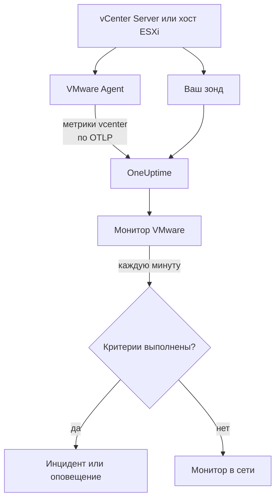

# Мониторинг VMware

Монитор VMware следит за одним vCenter — его центрами обработки данных, кластерами, хостами ESXi, виртуальными машинами, хранилищами данных, пулами ресурсов и vSAN — и сообщает, когда хост перегружен, ВМ не хватает CPU или памяти, хранилище данных заполняется или vSphere поднимает тревогу. Он читает метрики `vcenter.*`, которые собирает OneUptime VMware Agent или один из ваших зондов без агента.

:::cards
- [Создайте монитор](#создание-монитора-vmware): Шесть шагов в панели управления.
- [Шаблоны](#готовые-шаблоны-оповещений): Двадцать три готовых оповещения, по инциденту на хост, ВМ или хранилище данных.
- [Атрибуты идентификации](#атрибуты-идентификации): Как нацелиться на один хост, одну ВМ или одно хранилище данных.
- [Метрики](#собираемые-метрики): Все серии `vcenter.*`, по которым монитор может создавать оповещения.
:::

## Как это работает

Метрики приходят из API vCenter и читаются учётной записью только для чтения одним из двух способов:

- **VMware Agent** — OpenTelemetry Collector с receiver-ом `vcenter`, который вы запускаете на машине с доступом к vCenter. См. [Агент VMware](/docs/telemetry/vmware).
- **Зонд**, без установки чего-либо: вы подключаете vCenter в OneUptime и выбираете зонд, у которого есть к нему доступ. См. [VMware без агента](/docs/telemetry/vmware-agentless).

Оба отправляют одни и те же серии каждый интервал сбора (по умолчанию 2 минуты) с именем vCenter, `vmware.vcenter.name`. vCenter — это одна конечная точка vSphere: vCenter Server или отдельный хост ESXi. Монитор VMware привязан к одному vCenter. Каждую минуту он выполняет свой запрос по метрикам этого vCenter и сравнивает результат со своими критериями.



## Перед началом работы

- **Соберите метрики vCenter** с помощью [VMware Agent](/docs/telemetry/vmware) или [без агента](/docs/telemetry/vmware-agentless). Оба способа используют пользователя vSphere с ролью **Read-Only** на объекте vCenter верхнего уровня с отмеченным флажком **Propagate to children**. Агент читает `ONEUPTIME_URL`, `ONEUPTIME_TELEMETRY_INGESTION_KEY`, `VMWARE_VCENTER_NAME`, `VCENTER_ENDPOINT`, `VCENTER_USERNAME` и `VCENTER_PASSWORD`.
- **Убедитесь, что vCenter зарегистрирован.** Он появляется в разделе **Продукты → Инфраструктура → VMware → Все vCenter**: через агент — под именем из его `VMWARE_VCENTER_NAME` после первого полного сбора; без агента — с момента подключения.

## Создание монитора VMware

:::steps
### Создайте новый монитор

Перейдите в **Мониторы** и нажмите **Создать монитор**.

### Выберите VMware

В разделе **Тип монитора** нажмите **Другие типы мониторов** и выберите **VMware** в группе **Инфраструктура** или введите `vmware` в поле поиска. Введите **Имя** — оно используется в заголовках инцидентов и оповещений — и нажмите **Далее**.

### Выберите vCenter

В разделе **VMware Monitor Configuration** выберите vCenter в поле **vCenter**. В списке есть каждый vCenter, который отправлял данные или который вы подключили без агента.

### Выберите, что отслеживать

Выберите одну из трёх вкладок:

- **Quick Setup** — нажмите на [шаблон](#готовые-шаблоны-оповещений). Он задаёт метрику, фильтры по атрибутам, агрегацию, диапазон времени, группировку и пороги и заменяет критерии ниже своими. **Диапазон времени** по-прежнему можно изменить.
- **Custom Metric** — выберите одну метрику в **VMware Metric**, затем задайте **Агрегация** и **Диапазон времени**. Форма группирует её по объекту, который она описывает, поэтому каждый хост, каждая ВМ и каждое хранилище данных оцениваются отдельно, а [фильтры](#настройки-монитора) сужают её до одного центра обработки данных, кластера, хоста, ВМ, хранилища данных или пула ресурсов.
- **Расширенный** — стройте запросы и формулы сами в разделе **Выберите метрики** с фильтрами по атрибутам вроде `disk_state`, `power_state` или `status`. Используйте **Group by** по [атрибуту идентификации](#атрибуты-идентификации), чтобы оценивать каждый объект отдельно.

### Проверьте критерии

Откройте каждый критерий в разделе **Критерии монитора** и проверьте поля **Метрика**, **Агрегация**, **Условие** и **Threshold**. Шаблон заполняет их сам. С **Custom Metric** или **Расширенный** монитор начинает с [критериев по умолчанию](#критерии-по-умолчанию), которые замечают только падение метрики до нуля, поэтому задайте свой порог.

### Создайте монитор

Нажмите **Создать монитор**. OneUptime открывает страницу монитора и оценивает его каждую минуту. Инциденты и оповещения, которые он поднимает, также видны на страницах vCenter **Инциденты** и **Оповещения**.
:::

> [!TIP]
> Чтобы настроить сразу несколько шаблонов, откройте vCenter из **Продукты → Инфраструктура → VMware** и перейдите в **Recommendations**. Выберите нужные шаблоны, укажите, кого вызывать, и OneUptime создаст по монитору на каждый шаблон.

## Настройки монитора

| Поле | Вкладка | Что делает |
| --- | --- | --- |
| **vCenter** | Все | Обязательно. Ограничивает каждый запрос атрибутом `resource.vmware.vcenter.name`. |
| **Datacenter** | Custom Metric, Расширенный | Необязательно. Один центр обработки данных: `resource.vcenter.datacenter.name`. Его несёт каждая серия. |
| **Кластер** | Custom Metric, Расширенный | Необязательно. Один кластер: `resource.vcenter.cluster.name`. Совпадает с собственными сериями кластера и сериями хостов, ВМ и пулов ресурсов в нём; у отдельного хоста ESXi кластера нет. |
| **ESXi Host** | Custom Metric, Расширенный | Необязательно. Один хост ESXi: `resource.vcenter.host.name`. Совпадает с собственными сериями хоста **и** сериями каждой ВМ, которую он запускает, потому что ВМ несёт имя своего хоста. |
| **Virtual Machine** | Custom Metric, Расширенный | Необязательно. Одна ВМ: `resource.vcenter.vm.name`. Имена ВМ не обязаны быть уникальными: добавьте хост или кластер, если у двух ВМ одинаковое имя. |
| **Datastore** | Custom Metric, Расширенный | Необязательно. Одно хранилище данных: `resource.vcenter.datastore.name`. |
| **Resource Pool Path** | Custom Metric, Расширенный | Необязательно. Один пул ресурсов по его пути в инвентаре (`/DC/host/Cluster/Resources/pool`): `resource.vcenter.resource_pool.inventory_path`. Именно путь, потому что имена пулов уникальны только в пределах родительского объекта. |
| **VMware Metric** | Custom Metric | Одна метрика из [каталога](#собираемые-метрики). |
| **Агрегация** | Custom Metric | Как объединяются выборки: **Среднее**, **Максимум**, **Минимум**, **Сумма** или **Количество**. Начинается с обычной агрегации метрики. |
| **Диапазон времени** | Все | Скользящее окно, которое читает запрос, от **Past 1 Minute** до **Past 365 Days**. Новый монитор начинается с **Past 5 Minutes**; шаблоны задают своё. |
| **Выберите метрики** | Расширенный | Конструктор запросов: **Метрика**, **Aggregate by**, **Filter by attributes**, **Group by**, а также **Добавить метрику** и **Добавить формулу** для объединения запросов. |

vCenter читается один раз за интервал сбора, по умолчанию 2 минуты, поэтому в окне в 1 минуту может вообще не оказаться выборки. Держите окно 5 минут или больше и ещё длиннее, если вы увеличили интервал сбора для большого инвентаря.

## Атрибуты идентификации

Receiver `vcenter` отправляет один ресурс OpenTelemetry на каждый объект vSphere и называет его с помощью **атрибутов ресурса**. По тому, какие из них несёт серия, понятно, какой объект она описывает:

| Объект vSphere | Атрибуты ресурса для идентификации |
| --- | --- |
| Центр обработки данных | `vcenter.datacenter.name` |
| Кластер | `vcenter.datacenter.name`, `vcenter.cluster.name` |
| Хост ESXi | `vcenter.datacenter.name`, `vcenter.host.name` (+ `vcenter.cluster.name`, если хост в кластере) |
| Виртуальная машина | `vcenter.datacenter.name`, `vcenter.host.name`, `vcenter.vm.name`, `vcenter.vm.id` (+ `vcenter.cluster.name`; `vcenter.resource_pool.*` или `vcenter.virtual_app.*`) |
| Шаблон ВМ | `vcenter.datacenter.name`, `vcenter.host.name`, `vcenter.vm_template.name`, `vcenter.vm_template.id` |
| Хранилище данных | `vcenter.datacenter.name`, `vcenter.datastore.name` |
| Пул ресурсов | `vcenter.datacenter.name`, `vcenter.resource_pool.name`, `vcenter.resource_pool.inventory_path` (+ `vcenter.cluster.name` или `vcenter.host.name`) |

В фильтрах монитора и ключах группировки атрибуты ресурса начинаются с `resource.` (`resource.vcenter.host.name`), а атрибуты точек данных — нет (`disk_state`, `power_state`, `status`, `effective`, `direction`, `object`, `type`). Логический атрибут `effective` хранится как текст `"true"` или `"false"`, поэтому фильтруйте его по тексту. Фильтруйте по атрибуту идентификации, чтобы нацелиться на один объект, и группируйте по нему, чтобы оценивать каждый объект отдельно.

## Готовые шаблоны оповещений

OneUptime поставляет 23 шаблона для типичных проблем VMware, и **Quick Setup** предлагает их все. Каждый строит полный монитор: запрос метрики, её фильтры по атрибутам, группировку по собственному атрибуту идентификации объекта, критерий, который срабатывает, и критерий, который восстанавливает. Пороги — это отправные точки, которые можно изменить.

Шаблоны читают последние 5 минут, если в таблице не указано иное. Критерий срабатывает, только когда условие выполняется для каждой минуты его окна, а пороговый критерий восстанавливается на 10 % дальше своего порога, поэтому значение, колеблющееся у этой границы, не переключает состояние туда и обратно.

| Шаблон | Категория | Серьёзность | Что отслеживает | Срабатывает, когда | Восстанавливается, когда |
| --- | --- | --- | --- | --- | --- |
| Host CPU Saturation | Хост | Warning | `vcenter.host.cpu.utilization`, Avg по `resource.vcenter.host.name` | Выше 90 %: каждая ВМ на хосте конкурирует за ядра и показывает время CPU ready | 81 % или ниже |
| Host Memory Saturation | Хост | Warning | `vcenter.host.memory.utilization`, Avg по хосту | Выше 90 %: хост начинает забирать память с помощью ballooning, сжатия и подкачки | 81 % или ниже |
| Host Disk Latency High | Хост | Warning | `vcenter.host.disk.latency.max`, Max по хосту | Выше 50 мс: каждая ВМ, чьи диски находятся на этом пути, ждёт хранилища. Нужен уровень счётчиков производительности 3 | 45 мс или ниже |
| Host Network Packet Errors | Хост | Warning | `vcenter.host.network.packet.error.rate`, Max по хосту | Выше 0: почти всегда неисправность кабеля, SFP или порта коммутатора | Равно 0 |
| Host Network Packet Drops | Хост | Warning | `vcenter.host.network.packet.drop.rate`, Max по хосту | Выше 0: перегруженный аплинк или переполняющиеся кольцевые буферы сетевой карты | Равно 0 |
| VM CPU Saturation | Virtual Machine | Warning | `vcenter.vm.cpu.utilization`, Avg по `resource.vcenter.vm.name`, **последние 15 минут** | Выше 90 % vCPU ВМ все 15 минут: ВМ может использовать то, что ей выделено, поэтому вызывает только та, у которой загрузка не снижается | 81 % или ниже |
| VM CPU Ready Contention | Virtual Machine | Warning | `vcenter.vm.cpu.readiness`, Avg по ВМ | Выше 10 %: ВМ была готова к работе, но у хоста не было для неё физического ядра. Изнутри гостевой ОС этого не видно | 9 % или ниже |
| VM Memory Saturation | Virtual Machine | Warning | `vcenter.vm.memory.utilization`, Avg по ВМ | Выше 90 % её памяти: гостевая ОС вот-вот начнёт использовать подкачку | 81 % или ниже |
| VM Memory Ballooning | Virtual Machine | Warning | `vcenter.vm.memory.ballooned`, Max по ВМ | Выше 0: хосту не хватает памяти, и он забирает её у этой гостевой ОС | Равно 0 |
| VM Memory Swapping | Virtual Machine | Критический | `vcenter.vm.memory.swapped`, Max по ВМ | Выше 0: хост выгружает память ВМ в подкачку — крайняя мера после ballooning и сжатия | Равно 0 |
| VM Disk Latency High | Virtual Machine | Warning | `vcenter.vm.disk.latency.max`, Max по ВМ | Выше 50 мс: у приложений в гостевой ОС истекает время ожидания ввода-вывода | 45 мс или ниже |
| VM Disk Usage High | Virtual Machine | Warning | `vcenter.vm.disk.utilization`, Avg по ВМ | Выше 90 % выделенного хранилища занято: ВМ с тонким выделением вот-вот займёт весь свой размер | 81 % или ниже |
| Datastore Capacity Warning | Datastore | Warning | `vcenter.datastore.disk.utilization`, Avg по `resource.vcenter.datastore.name` | Выше 80 %: раннее предупреждение, поскольку тонкие диски и снимки быстро расходуют остаток | 72 % или ниже |
| Datastore Capacity Critical | Datastore | Критический | `vcenter.datastore.disk.utilization`, Avg по хранилищу данных | Выше 90 %: заполненное хранилище данных приостанавливает каждую ВМ, у которой на нём есть диск | 81 % или ниже |
| Cluster Host Not Effective | Кластер | Критический | `vcenter.cluster.host.count` с фильтром `effective = false`, Max по `resource.vcenter.cluster.name` | Выше 0: хост в режиме обслуживания, отключён или не отвечает, поэтому кластер работает с меньшей ёмкостью, чем рассчитан | Равно 0 |
| Datacenter Hosts Unhealthy | Datacenter | Критический | `vcenter.datacenter.host.count` с фильтром `status = red`, Max по `resource.vcenter.datacenter.name` | Выше 0: у хоста критическая тревога, например от аппаратного датчика, из-за потерянного пути к хранилищу или ошибки агента HA | Равно 0 |
| Datacenter Hosts Degraded | Datacenter | Warning | `vcenter.datacenter.host.count` с фильтром `status = yellow`, Max по центру обработки данных | Выше 0: у хоста тревога уровня предупреждения | Равно 0 |
| Datacenter Hosts Powered Off | Datacenter | Warning | `vcenter.datacenter.host.count` с фильтром `power_state = off`, Max по центру обработки данных | Выше 0: хост выключен — он упал, потерял питание или был переведён DPM в режим ожидания | Равно 0 |
| Datacenter VMs Unhealthy | Datacenter | Warning | `vcenter.datacenter.vm.count` с фильтром `status = red`, Max по центру обработки данных | Выше 0: у ВМ критическая тревога, например неудачный перезапуск HA, потерянное хранилище данных или потерянный сигнал Tools heartbeat | Равно 0 |
| Datacenter Clusters Unhealthy | Datacenter | Критический | `vcenter.datacenter.cluster.count` с фильтром `status = red`, Max по центру обработки данных | Выше 0: у кластера критическая тревога, например слишком мало ресурсов для отработки отказа HA, неудачные выборы HA или критическая проверка работоспособности vSAN | Равно 0 |
| vSAN Latency High | vSAN | Warning | `vcenter.cluster.vsan.latency.avg`, Avg по кластеру | Выше 20 000 мкс (20 мс): хранилище замедляется для каждой ВМ в хранилище данных vSAN. На кластерах без vSAN молчит | 18 000 мкс или ниже |
| vSAN Congestion | vSAN | Warning | `vcenter.cluster.vsan.congestions`, Max по кластеру | Выше 0: дисковая группа не справляется, и vSAN замедляет ввод-вывод своих клиентов | Равно 0 |
| Resource Pool Memory Swapped | Кластер | Warning | `vcenter.resource_pool.memory.swapped`, Max по `resource.vcenter.resource_pool.inventory_path` | Выше 0: ВМ пула берут память из подкачки хоста, обычно потому что лимит памяти или доли пула слишком малы | Равно 0 |

**Серьёзность** — это метка, которую показывает список выбора. Инцидент и оповещение, которые создаёт шаблон, начинаются с самой высокой серьёзности инцидентов и оповещений вашего проекта; измените их в критерии.

- **Шаблоны использования применяют Avg:** receiver сообщает настоящий процент от 0 до 100 для каждого объекта, поэтому среднее за минуту — это устойчивое использование.
- **Шаблоны задержки применяют Max:** метрика уже является худшей задержкой по дискам объекта, поэтому её наибольшая выборка — честная.
- **Шаблоны счётчиков и состояний применяют Max**, поэтому их вызывает один сбор, показывающий условие: ошибки пакетов, ballooning, подкачка, красный и жёлтый статус, неэффективные хосты, перегрузка.
- **Каждый шаблон группирует по собственному атрибуту идентификации объекта**, поэтому срабатывает по одному инциденту на затронутый объект, и инцидент называет этот объект.
- **Пороги закреплены за своей единицей** (`%`, `ms`, `us`), поэтому сохраняют смысл, какую бы единицу ни показывал график.

## Собираемые метрики

Метрики ниже — это каталог, который предлагает форма монитора. Единицы — собственные единицы receiver-а: `MHz`, `%`, `MiBy` (мебибайты), `By` (байты), `KiBy`, `ms`, `us` (микросекунды), `{KiBy/s}`, `By/s` и количества. Метрика с пометкой _выключена по умолчанию_ не собирается, пока вы не включите её в `otel-collector-config.yaml` агента; поставляемая конфигурация уже включает `vcenter.host.memory.capacity`.

### Центр обработки данных

| Метрика | Единица | Описание |
| --- | --- | --- |
| `vcenter.datacenter.cluster.count` | `{clusters}` | Кластеры в центре обработки данных с разбивкой по `status` (`red` / `yellow` / `green` / `gray`). Суммируйте для общего числа; фильтруйте `status = red`, чтобы найти кластеры с критической тревогой |
| `vcenter.datacenter.cpu.limit` | `MHz` | Общий CPU, доступный центру обработки данных, по всем хостам ESXi |
| `vcenter.datacenter.datastore.count` | `{datastores}` | Хранилища данных в центре обработки данных |
| `vcenter.datacenter.disk.space` | `By` | Место в хранилищах данных по всему центру обработки данных с разбивкой по `disk_state` (`used` / `available`). used ÷ (used + available) — это использование хранилища по всему центру обработки данных |
| `vcenter.datacenter.host.count` | `{hosts}` | Хосты ESXi в центре обработки данных с разбивкой по `status` и `power_state` (`on` / `off` / `standby` / `unknown`). Фильтруйте `status = red` или `power_state = off` |
| `vcenter.datacenter.memory.limit` | `By` | Общая физическая память, доступная центру обработки данных, по всем хостам ESXi |
| `vcenter.datacenter.vm.count` | `{virtual_machines}` | Виртуальные машины в центре обработки данных с разбивкой по `status` и `power_state` (`on` / `off` / `suspended` / `unknown`). Фильтруйте `power_state = on`, чтобы найти работающие ВМ |

### Кластер

| Метрика | Единица | Описание |
| --- | --- | --- |
| `vcenter.cluster.cpu.effective` | `MHz` | CPU, который кластер реально может планировать, — без хостов в режиме обслуживания и не отвечающих хостов. Сравните с `vcenter.cluster.cpu.limit`, чтобы увидеть выведенную из работы ёмкость |
| `vcenter.cluster.cpu.limit` | `MHz` | Общий CPU всех хостов ESXi в кластере независимо от состояния хоста |
| `vcenter.cluster.host.count` | `{hosts}` | Хосты ESXi в кластере с разбивкой по `effective` (`"true"` / `"false"`). Хост неэффективен, пока он в режиме обслуживания, отключён или не отвечает |
| `vcenter.cluster.memory.effective` | `By` | Память, которую кластер реально может выделить ВМ, — без хостов в режиме обслуживания или не отвечающих и без собственной зарезервированной памяти ESXi |
| `vcenter.cluster.memory.limit` | `By` | Общая физическая память всех хостов ESXi в кластере |
| `vcenter.cluster.vm.count` | `{virtual_machines}` | Виртуальные машины в кластере с разбивкой по `power_state`. Суммируйте для общего числа; фильтруйте `power_state = on`, чтобы найти работающие ВМ |
| `vcenter.cluster.vm_template.count` | `{virtual_machine_templates}` | Шаблоны виртуальных машин в кластере |

### Хост (ESXi)

| Метрика | Единица | Описание |
| --- | --- | --- |
| `vcenter.host.cpu.capacity` | `MHz` | Общая ёмкость CPU хоста ESXi (ядра × частота) — знаменатель для `vcenter.host.cpu.usage` |
| `vcenter.host.cpu.reserved` | `MHz` | CPU, зарезервированный для виртуальных машин, с разбивкой по `cpu_reservation_type` (`total` / `used`). Когда `used` приближается к `total`, новые резервирования не пройдут контроль допуска |
| `vcenter.host.cpu.usage` | `MHz` | CPU, потребляемый на хосте сейчас всеми ВМ и самим гипервизором |
| `vcenter.host.cpu.utilization` | `%` | Использование CPU хоста в процентах (0–100) от его ёмкости |
| `vcenter.host.disk.latency.avg` | `ms` | Средняя задержка диска (время устройства + ядра) с разбивкой по `direction` (`read` / `write`) и `object` (дисковое устройство). Требует уровня счётчиков производительности 2 |
| `vcenter.host.disk.latency.max` | `ms` | Наибольшая задержка по всем дискам, которые использует хост, по `object`, за последний интервал в 20 с. Требует уровня счётчиков производительности 3 |
| `vcenter.host.disk.throughput` | `{KiBy/s}` | Килобайт в секунду, прочитанных с дисков хоста или записанных на них, по `direction` и `object`. Требует уровня счётчиков производительности 4 |
| `vcenter.host.memory.active` | `MiBy` | Память, которую активно затрагивают включённые ВМ хоста. _Выключена по умолчанию_ — включите `vcenter.host.memory.active` в конфигурации агента |
| `vcenter.host.memory.ballooned` | `MiBy` | Гостевая память, которую balloon-драйвер забрал у ВМ хоста; значение выше 0 означает нехватку памяти на хосте. _Выключена по умолчанию_ |
| `vcenter.host.memory.capacity` | `MiBy` | Общая физическая память хоста — знаменатель для `vcenter.host.memory.usage`. В исходной версии выключена по умолчанию; поставляемая конфигурация агента её включает |
| `vcenter.host.memory.granted` | `MiBy` | Машинная память, выделенная включённым ВМ на хосте. _Выключена по умолчанию_ |
| `vcenter.host.memory.usage` | `MiBy` | Память, потребляемая на хосте сейчас, включая собственные накладные расходы гипервизора |
| `vcenter.host.memory.utilization` | `%` | Использование памяти хоста в процентах (0–100) от его физической ёмкости |
| `vcenter.host.network.packet.drop.rate` | `{packets/s}` | Пакетов в секунду, отброшенных на каждой физической сетевой карте, по `direction` (`transmitted` / `received`) и `object` (например, `vmnic0`) — перегруженный аплинк или отказывающая сетевая карта |
| `vcenter.host.network.packet.error.rate` | `{errors/s}` | Ошибок пакетов в секунду на физических сетевых картах хоста по `direction` и `object` — почти всегда неисправность кабеля, SFP или порта коммутатора |
| `vcenter.host.network.packet.rate` | `{packets/s}` | Пакетов в секунду, отправленных или полученных на каждой физической сетевой карте, по `direction` и `object` |
| `vcenter.host.network.throughput` | `{KiBy/s}` | Килобайт в секунду, отправленных или полученных хостом, по `direction` и `object` |
| `vcenter.host.network.usage` | `{KiBy/s}` | Суммарная скорость передачи и приёма по сетевым картам хоста, по `object` |

### Виртуальная машина

| Метрика | Единица | Описание |
| --- | --- | --- |
| `vcenter.vm.cpu.readiness` | `%` | Доля времени, когда ВМ была готова к работе, но не могла быть запланирована на физический CPU (CPU ready). Выше 5 % гостевая ОС работает вяло; выше 10 % хост перегружен. Только для включённых ВМ |
| `vcenter.vm.cpu.time` | `%` | Время, которое vCPU ВМ провели в каждом состоянии, по `cpu_state` (`idle` / `ready` / `wait`) и `object` (vCPU). _Выключена по умолчанию_ — включите `vcenter.vm.cpu.time` |
| `vcenter.vm.cpu.usage` | `MHz` | CPU, потребляемый ВМ. Только для включённых ВМ — по наличию этой метрики OneUptime определяет состояние питания ВМ |
| `vcenter.vm.cpu.utilization` | `%` | Использование CPU ВМ в процентах (0–100) от её настроенных vCPU. Только для включённых ВМ |
| `vcenter.vm.disk.latency.avg` | `ms` | Средняя задержка диска по `direction` (`read` / `write`), `disk_type` (`virtual` / `physical`) и `object` (виртуальный диск). Требует уровня счётчиков производительности 2 |
| `vcenter.vm.disk.latency.max` | `ms` | Наибольшая общая задержка (время устройства + ядра), которую ВМ видела на каком-либо диске за интервал в 20 с, по `object` |
| `vcenter.vm.disk.throughput` | `{KiBy/s}` | Килобайт в секунду, прочитанных с дисков ВМ или записанных на них, по `direction` и `object`. Требует уровня счётчиков производительности 2 |
| `vcenter.vm.disk.usage` | `By` | Место в хранилище данных, занятое файлами ВМ, с разбивкой по `disk_state` (`used` / `available`). Также отправляется для шаблонов ВМ. Фильтруйте `disk_state = used`, чтобы получить занятый размер |
| `vcenter.vm.disk.utilization` | `%` | Процент (0–100) выделенного ВМ хранилища, который занят в хранилище данных, — ВМ с тонким выделением, приближающаяся к 100 %, вот-вот займёт весь свой размер |
| `vcenter.vm.memory.ballooned` | `MiBy` | Гостевая память, которую balloon-драйвер (VMware Tools) забрал у ВМ. Значение выше 0 означает, что хосту ESXi не хватает памяти |
| `vcenter.vm.memory.granted` | `MiBy` | Машинная память, выделенная ВМ хостом. _Выключена по умолчанию_ — включите `vcenter.vm.memory.granted` |
| `vcenter.vm.memory.swapped` | `MiBy` | Память, выделенная ВМ из файла подкачки хоста, — крайняя мера после ballooning и сжатия; любое значение выше 0 означает, что ВМ расплачивается задержкой диска за RAM |
| `vcenter.vm.memory.swapped_ssd` | `KiBy` | Память ВМ, выгруженная в флеш-кеш подкачки хоста, — менее болезненно, чем файл подкачки, но всё равно нехватка памяти |
| `vcenter.vm.memory.usage` | `MiBy` | Память, активно используемая гостевой ОС ВМ. Отправляется как для включённых, так и для выключенных ВМ (0, когда ВМ выключена) |
| `vcenter.vm.memory.utilization` | `%` | Использование памяти ВМ в процентах (0–100) от её настроенной памяти |
| `vcenter.vm.network.broadcast.packet.rate` | `{packets/s}` | Широковещательных пакетов в секунду на vNIC по `direction` и `object`. _Выключена по умолчанию_ |
| `vcenter.vm.network.multicast.packet.rate` | `{packets/s}` | Многоадресных пакетов в секунду на vNIC по `direction` и `object`. _Выключена по умолчанию_ |
| `vcenter.vm.network.packet.drop.rate` | `{packets/s}` | Пакетов в секунду, отброшенных каждым vNIC, по `direction` и `object`. Потери на стороне приёма обычно означают, что гостевая ОС недостаточно быстро освобождает свой кольцевой буфер |
| `vcenter.vm.network.packet.rate` | `{packets/s}` | Пакетов в секунду, отправленных или полученных каждым vNIC, по `direction` и `object` |
| `vcenter.vm.network.throughput` | `By/s` | Байт в секунду, отправленных или полученных по сети ВМ, по `direction` и `object` |
| `vcenter.vm.network.usage` | `{KiBy/s}` | Суммарная скорость передачи и приёма ВМ по `object` |

### Хранилище данных

| Метрика | Единица | Описание |
| --- | --- | --- |
| `vcenter.datastore.disk.usage` | `By` | Место в хранилище данных с разбивкой по `disk_state` (`used` / `available`). used + available — это ёмкость хранилища данных |
| `vcenter.datastore.disk.utilization` | `%` | Процент (0–100) используемой ёмкости хранилища данных. Заполненное хранилище данных приостанавливает каждую ВМ, которая в него пишет, поэтому создавайте оповещения задолго до 100 % |

### Пул ресурсов

| Метрика | Единица | Описание |
| --- | --- | --- |
| `vcenter.resource_pool.cpu.shares` | `{shares}` | Доли CPU, настроенные для пула, — его относительный приоритет перед соседними пулами, когда родитель перегружен |
| `vcenter.resource_pool.cpu.usage` | `MHz` | CPU, потребляемый всеми ВМ в пуле (и в его дочерних пулах) |
| `vcenter.resource_pool.memory.ballooned` | `MiBy` | Память, которую balloon-драйвер забрал у всех ВМ в пуле |
| `vcenter.resource_pool.memory.granted` | `MiBy` | Память хоста, выделенная ВМ пула, с разбивкой по `type` (`private` / `shared` — общие страницы дедуплицируются механизмом transparent page sharing) |
| `vcenter.resource_pool.memory.shares` | `{shares}` | Доли памяти, настроенные для пула |
| `vcenter.resource_pool.memory.swapped` | `MiBy` | Память, выделенная ВМ пула из пространства подкачки хостов ESXi, — любое значение выше 0 означает, что хост выгружает в подкачку хотя бы одну ВМ пула |
| `vcenter.resource_pool.memory.usage` | `MiBy` | Память, используемая пулом, с разбивкой по `type` (`guest` / `host` / `overhead`) в свежих сборках коллектора; старые сборки отправляют одну серию без типа. Фильтруйте `type = guest` |

### vSAN

Отправляется только для кластеров с vSAN, хостов в них и ВМ в хранилище данных vSAN. Задержки указаны в **микросекундах** (`us`), в отличие от задержек хостов и ВМ в миллисекундах:

| Метрика | Единица | Описание |
| --- | --- | --- |
| `vcenter.cluster.vsan.congestions` | `{congestions/s}` | Событий перегрузки в секунду, поднятых против ввода-вывода от каждого клиента vSAN в кластере, — собственный сигнал противодавления vSAN |
| `vcenter.cluster.vsan.latency.avg` | `us` | Средняя задержка, которую кластер видит при доступе к хранилищу vSAN, по `type` (`read` / `write`). 20 000 мкс = 20 мс |
| `vcenter.cluster.vsan.operations` | `{operations/s}` | Операций ввода-вывода vSAN в секунду по всему кластеру, по `type` (`read` / `write` / `unmap`) |
| `vcenter.cluster.vsan.throughput` | `By/s` | Пропускная способность vSAN кластера по `direction` (`read` / `write`) |
| `vcenter.host.vsan.cache.hit_rate` | `%` | Доля операций чтения vSAN хоста, обслуженных из его локального клиентского кеша за последний интервал в 5 мин, — падающая доля означает, что чтения доходят до уровня ёмкости |
| `vcenter.host.vsan.congestions` | `{congestions/s}` | Событий перегрузки в секунду, поднятых против ввода-вывода vSAN от хоста |
| `vcenter.host.vsan.latency.avg` | `us` | Средняя задержка, которую хост видит при доступе к хранилищу vSAN, по `type` |
| `vcenter.host.vsan.operations` | `{operations/s}` | Операций ввода-вывода vSAN в секунду, выполненных хостом, по `type` |
| `vcenter.host.vsan.throughput` | `By/s` | Пропускная способность vSAN хоста по `direction` |
| `vcenter.vm.vsan.latency.avg` | `us` | Средняя задержка, которую ВМ видит при доступе к хранилищу vSAN, по `type` |
| `vcenter.vm.vsan.operations` | `{operations/s}` | Операций ввода-вывода vSAN в секунду, выполненных ВМ, по `type` |
| `vcenter.vm.vsan.throughput` | `By/s` | Пропускная способность vSAN ВМ по `direction` |

> [!NOTE]
> Состояние питания ВМ — это не метрика. Receiver отправляет `vcenter.vm.cpu.*` только для включённых ВМ, поэтому OneUptime отличает **Powered on** от **Powered off** по тому, пришли ли данные CPU в том же сборе, что и данные памяти и дисков ВМ; результат показывает страница vCenter **Virtual Machines**. Чтобы создавать оповещения о выключенных хостах или о количестве работающих ВМ, используйте атрибут `power_state` метрик `vcenter.datacenter.host.count`, `vcenter.datacenter.vm.count` или `vcenter.cluster.vm.count`.

## Критерии мониторинга

Критерий сравнивает один из запросов или формул монитора с порогом. У критериев монитора VMware нет поля **Тип фильтра**: каждое правило проверяет значение метрики с помощью этих полей.

| Поле | Что делает |
| --- | --- |
| **Метрика** | Запрос или формула для проверки, по имени переменной. |
| **Агрегация** | Как значения в окне превращаются в один ответ: **Среднее**, **Сумма**, **Maximum Value**, **Minimum Value**, **All Values** (каждое значение должно совпасть) или **Any Value** (достаточно одного). |
| **Условие** | **Greater Than**, **Less Than**, **Greater Than Or Equal To**, **Less Than Or Equal To** или **Equal To** — или условие аномалии: **Anomalously High**, **Anomalously Low** или **Anomalous**. |
| **Threshold** | Значение, с которым идёт сравнение. Рядом есть список единиц, если у метрики есть единица. Не показывается для условий аномалии. |
| **Чувствительность** | Только условия аномалии. **Низкий** (4σ), **Средний** (3σ, по умолчанию) или **Высокий** (2σ). |
| **Окно базовой линии** | Только условия аномалии. 14 дней (по умолчанию), 28, 60 или 90 дней истории. |
| **Если нет данных** | В разделе **Дополнительные поля**. Что происходит, когда в окне нет выборок: **Ignore** (по умолчанию), **Treat As Zero** или **Триггер**. |

Условия аномалии сравнивают каждое значение с тем же часом недели в базовой линии. Они остаются в состоянии "Learning" и ничего не поднимают, пока в окне базовой линии не накопится достаточно истории.

Несколько критериев для начала:

- **Хост перегружен:** `vcenter.host.cpu.utilization`, Среднее, с группировкой по `resource.vcenter.host.name`, **Greater Than** `90`, за последние 5 минут.
- **Хранилище данных заполняется:** `vcenter.datastore.disk.utilization`, Среднее, с группировкой по `resource.vcenter.datastore.name`, **Greater Than** `80`.
- **Кластер потерял хост:** `vcenter.cluster.host.count` с фильтром `effective = false`, Максимум, с группировкой по `resource.vcenter.cluster.name`, **Greater Than** `0`.
- **Работает меньше ВМ, чем ожидалось:** `vcenter.cluster.vm.count` с фильтрами `power_state = on` и `resource.vcenter.cluster.name = Production`, Сумма, **Less Than** ожидаемое вами число.
- **Хост выгружает ВМ в подкачку:** `vcenter.vm.memory.swapped`, Максимум, с группировкой по `resource.vcenter.vm.name`, **Greater Than** `0`.

### Критерии по умолчанию

Монитор, который вы строите не из шаблона, начинает с двух критериев:

| Порядок | Критерий | Совпадает, когда | Затем |
| --- | --- | --- | --- |
| 1 | Check if _monitor name_ is offline | Любое значение первого запроса равно `0` | Помечает монитор как **Не в сети** и объявляет инцидент "_monitor name_ is offline", который разрешается сам, когда монитор восстанавливается. |
| 2 | Check if _monitor name_ is online | Любое значение больше `0` | Помечает монитор как **Работает**. |

> [!IMPORTANT]
> Тишина не совпадает ни с одним из критериев: vCenter, который перестаёт отправлять данные, оставляет монитор в прежнем состоянии. Чтобы узнавать, когда данные перестают поступать, задайте в критерии для **Если нет данных** значение **Триггер**. Время, когда сам OneUptime ничего не получал, никогда не считается отсутствием данных: проверка, в окно которой оно попадает, вместо этого ждёт, как объясняется в разделе [Когда OneUptime не получает данные](/docs/monitor/when-oneuptime-is-not-receiving).

## Terraform

[Terraform-провайдер OneUptime](/docs/terraform/monitor-steps) передаёт конфигурацию шага монитора VMware в атрибуте `vmware_monitor`: сырой JSON конфигурации `vmwareMonitor` (`vcenterIdentifier`, `resourceFilters`, `metricViewConfig`, `rollingTime`), записанный с помощью `jsonencode()`:

```hcl title="main.tf"
monitor_steps = [{
  vmware_monitor = jsonencode({
    vcenterIdentifier = "prod-vcenter"
    resourceFilters   = { clusterName = "Production" }
    rollingTime       = "Past 5 Minutes"
    metricViewConfig = {
      queryConfigs = [{
        metricAliasData = { metricVariable = "host_cpu", title = "Host CPU", description = "", legend = "" }
        metricQueryData = {
          filterData = {
            metricName     = "vcenter.host.cpu.utilization"
            attributes     = {}
            aggegationType = "Avg"
            aggregateBy    = {}
          }
          groupByAttributeKeys = ["resource.vcenter.host.name"]
        }
      }]
      formulaConfigs = []
    }
  })
  criteria = [ /* ... */ ]
}]
```

`vcenterIdentifier` — это `vmware.vcenter.name` vCenter, то есть `VMWARE_VCENTER_NAME`, с которым был запущен агент, а не его ID в OneUptime.

## Устранение неполадок

:::details vCenter нет в списке vCenter
vCenter, с которого собирает данные агент, регистрируется сам по данным агента. Проверьте, что агент работает и отправляет данные (см. [Проверка установки](/docs/telemetry/vmware#проверьте-установку)), что задан `VMWARE_VCENTER_NAME` и что прошёл один интервал сбора: ничего не отправляется, пока не завершится первый полный обход инвентаря.
:::

:::details У хостов есть метрики, а у ВМ, хранилищ данных или кластеров нет
Пользователь vSphere только для чтения получил свою роль без **Propagate to children** или на объекте ниже корня vCenter. Объекты, которые пользователь не видит, просто отсутствуют в метриках. Задайте разрешение на объекте vCenter верхнего уровня с отмеченным распространением.
:::

:::details Host CPU Saturation никогда не срабатывает
Шаблон усредняет `vcenter.host.cpu.utilization` по `resource.vcenter.host.name`, поэтому каждый хост проверяется отдельно. Если вы строили свой запрос, группируйте его по атрибуту идентификации с префиксом `resource.`: просто `vcenter.host.name` ни с чем не совпадает, а среднее по всем хостам снижают простаивающие.
:::

:::details Шаблоны vSAN никогда не срабатывают
`vcenter.cluster.vsan.*`, `vcenter.host.vsan.*` и `vcenter.vm.vsan.*` отправляются только для кластеров с vSAN, хостов в них и ВМ в хранилище данных vSAN. Без vSAN этих серий нет, и шаблоны молчат.
:::

:::details Критерий с фильтром по effective ни с чем не совпадает
Логический атрибут receiver-а `effective` хранится как текст `"true"` или `"false"`. Фильтруйте его по тексту, а не по логическому значению.
:::

:::details Нет метрик задержки или пропускной способности дисков
`vcenter.host.disk.latency.avg` и `vcenter.vm.disk.*` требуют уровня статистики vCenter 2, `vcenter.host.disk.latency.max` — уровня 3, а `vcenter.host.disk.throughput` — уровня 4. Повысьте уровень статистики для 5-минутного интервала в _vCenter → Configure → General → Statistics_.
:::

:::details Окно в 1 минуту не показывает данных
vCenter читается один раз за интервал сбора, по умолчанию 2 минуты, а для большого инвентаря часто дольше, поэтому в окне в 1 минуту может не оказаться ни одной выборки. Используйте 5 минут или больше.
:::

## Дальнейшие шаги

:::cards
- [Агент VMware](/docs/telemetry/vmware): Установите агент, который собирает данные с vCenter.
- [VMware без агента](/docs/telemetry/vmware-agentless): Пусть данные собирает зонд.
- [Мониторинг Proxmox](/docs/monitor/proxmox-monitor): Такой же вид монитора для Proxmox VE.
- [Обзор инцидентов](/docs/incidents/index): Что происходит после того, как критерий объявил инцидент.
:::
