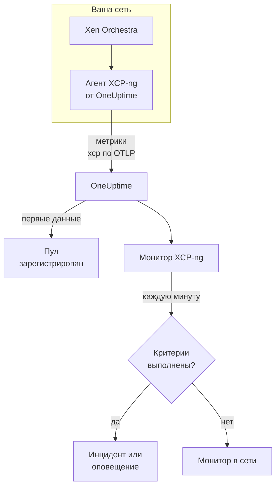

# Мониторинг XCP-ng

Монитор XCP-ng следит за одним пулом XCP-ng – его хостами, ВМ, репозиториями хранения и виртуальными дисками – и сообщает, когда Xen Orchestra теряет пул, хост уходит в офлайн или остаётся отключённым, работавшая ВМ останавливается или ей не хватает CPU, либо репозиторий хранения заполняется или замедляется. Он читает ряды `xcp_*` плагина OpenMetrics Xen Orchestra, которые собирает агент XCP-ng от OneUptime, и ряды состояния, которые OneUptime выводит из них, так что ничего не опрашивается снаружи.

:::cards
- [Создание монитора](#создание-монитора-xcp-ng): Шесть шагов в панели управления.
- [Шаблоны](#готовые-шаблоны-оповещений): Десять готовых оповещений, по одному инциденту на хост, ВМ или репозиторий хранения.
- [Идентификация ресурсов](#идентификация-ресурсов): Как выбрать один хост, ВМ или репозиторий хранения.
- [Метрики](#собираемые-метрики): Все серии, по которым монитор может создавать оповещения.
:::

## Как это работает

Агент XCP-ng от OneUptime работает на машине, с которой доступна Xen Orchestra. Каждые 60 секунд он читает плагин OpenMetrics Xen Orchestra, который читает каждый хост каждого пула, которым управляет Xen Orchestra, и отправляет ряды в OneUptime по OTLP, по одному ресурсу на пул, помеченному UUID пула, `xcp_ng.pool.id`. Первые данные регистрируют каждый пул.

Монитор XCP-ng привязан к одному пулу. Каждую минуту он выполняет свой запрос по метрикам этого пула и сравнивает результат со своими критериями.



## Перед началом работы

- **Установите агент XCP-ng** там, откуда доступна Xen Orchestra, с секретом плагина OpenMetrics Xen Orchestra. [Руководство по агенту XCP-ng](/docs/telemetry/xcp-ng) описывает плагин, сертификат Xen Orchestra и установку.
- **Убедитесь, что пул зарегистрирован.** Он появляется в разделе **Продукты → Инфраструктура → XCP-ng → Все пулы** под именем, которое ему даёт Xen Orchestra, примерно через минуту после первого опроса.

## Создание монитора XCP-ng

:::steps
### Начните новый монитор

Перейдите в **Мониторы** и нажмите **Создать монитор**.

### Выберите XCP-ng

В разделе **Тип монитора** нажмите **Другие типы мониторов** и выберите **XCP-ng** в группе **Инфраструктура** или введите `xcp` в поле поиска. Введите **Имя** – оно используется в заголовках инцидентов и оповещений – и нажмите **Далее**.

### Выберите пул

В разделе **XCP-ng Monitor Configuration** выберите пул в поле **Пул XCP-ng**. В списке есть каждый пул, который присылал данные. После выбора строка под полем показывает, поступают ли данные. **Добавить пул XCP-ng** открывает шаги настройки с уже подставленными ключами, которые ждут первых данных.

### Выберите, что отслеживать

Новый монитор начинается с **Pool Disconnected** в разделе **О чём оповещать**. Чтобы следить за другим:

- **Изменить** – выберите другой [шаблон](#готовые-шаблоны-оповещений). Он задаёт метрики, фильтры, агрегацию, диапазон времени и пороги и заменяет критерии ниже своими. Поле **Диапазон времени** по-прежнему можно изменить.
- **Custom Metric** (в разделе **Дополнительные поля**) – выберите одну метрику в поле **XCP-ng Metric**, затем задайте **Агрегация** и **Диапазон времени**. [Фильтры](#настройки-монитора) сужают её до вида объекта или до одного объекта.
- **Расширенный** (в разделе **Дополнительные поля**) – сами постройте запросы и формулы в разделе **Выберите метрики**, например занятую долю репозитория хранения из `xcp_sr_physical_usage_bytes / xcp_sr_physical_size_bytes`. Используйте **Группировать по** `xcp_ng.id`, чтобы оценивать каждый объект отдельно.

### Проверьте критерии

Откройте каждый критерий в разделе **Критерии** и проверьте его поля **Метрика**, **Агрегация**, **Условие** и **Порог**. Шаблон заполняет их. С **Custom Metric** или **Расширенный** монитор начинает со [стандартных критериев](#стандартные-критерии), которые замечают только отсутствие данных от метрики, поэтому задайте собственный порог.

### Создайте монитор

Нажмите **Создать монитор**. OneUptime откроет страницу монитора и будет оценивать его каждую минуту. Инциденты и оповещения, которые он открывает, также видны на страницах пула **Инциденты** и **Оповещения**.
:::

> [!TIP]
> Чтобы настроить сразу несколько шаблонов, откройте пул через **Продукты → Инфраструктура → XCP-ng** и перейдите в **Рекомендации**. Выберите нужные шаблоны и тех, кого вызывать, и OneUptime создаст по одному монитору на шаблон.

## Настройки монитора

| Поле | Вкладка | Что делает |
| --- | --- | --- |
| **Пул XCP-ng** | Все | Обязательно. Ограничивает каждый запрос значением `resource.xcp_ng.pool.id`, UUID пула, поэтому два пула с одинаковым именем никогда не смешиваются. |
| **Область ресурса** | Custom Metric, Расширенный | Необязательно. **Хост**, **ВМ**, **Репозиторий хранения**, **Виртуальный диск**, **XOSTOR** или **Пул XCP-ng** – точное совпадение с `xcp_ng.scope`. |
| **UUID** | Custom Metric, Расширенный | Необязательно. Точное совпадение с `xcp_ng.id`: UUID одного хоста, ВМ, репозитория хранения или виртуального диска, как его показывает Xen Orchestra. Сочетайте его с областью, чтобы выбрать один объект. |
| **Имя хоста** | Custom Metric, Расширенный | Необязательно. Точное совпадение с меткой `host_name` Xen Orchestra: собственные ряды хоста и ряды ВМ, работающих на нём. |
| **XCP-ng Metric** | Custom Metric | Одна метрика из [каталога](#собираемые-метрики). |
| **Агрегация** | Custom Metric | Как объединяются замеры: **Среднее**, **Максимум**, **Минимум**, **Сумма** или **Количество**. Начинается с обычной агрегации метрики. |
| **Диапазон времени** | Все | Скользящее окно, которое читает запрос, от **Past 1 Minute** до **Past 365 Days**. Новый монитор начинает с **Past 1 Minute**; шаблоны задают свой. |
| **Выберите метрики** | Расширенный | Конструктор запросов: **Метрика**, **Агрегировать по**, **Фильтровать по атрибутам**, **Группировать по**, а также **Добавить метрику** и **Добавить формулу** для объединения запросов. |

Агент читает Xen Orchestra каждые 60 секунд, а Xen Orchestra читает свои хосты с разрешением 60 секунд, поэтому окно в 1 минуту содержит примерно одно значение; шаблоны читают 5 минут или больше.

## Идентификация ресурсов

Xen Orchestra называет хост или ВМ меткой `uuid`, репозиторий хранения — `sr_uuid`, а виртуальный диск — `vdi_uuid`. OneUptime ставит на каждую точку данных при поступлении два атрибута, чтобы один фильтр читал каждый ряд объекта, какой бы меткой он ни был назван. Шаблоны опираются на них:

| Атрибут | Значения | Для ВМ |
| --- | --- | --- |
| `xcp_ng.scope` | `pool`, `host`, `vm`, `sr` (репозиторий хранения), `vdi` (виртуальный диск), `xostor` | `vm` |
| `xcp_ng.id` | UUID объекта в нижнем регистре: `uuid` хоста или ВМ, `sr_uuid` репозитория хранения или кластера XOSTOR, `vdi_uuid` виртуального диска и собственный UUID пула на рядах пула | `5c6d7e8f-1a2b-4c3d-9e8f-0a1b2c3d4e5f` |

Фильтруйте по `xcp_ng.scope` для одного вида объектов, по `xcp_ng.id` для одного объекта и группируйте по `xcp_ng.id`, чтобы оценивать каждый объект отдельно. Собственные метки Xen Orchestra остаются такими, какими она их отправляет: `host_name` называет хост на его рядах и хост ВМ на рядах ВМ, `vm_name`, `sr_name` и `vdi_name` называют остальное, `power_state` и `enabled` несут состояние хоста или ВМ на рядах состояния, а `is_control_domain` равно `true` на рядах ВМ управляющего домена.

Сам пул — это ресурс, с которым приходят ряды, поэтому его атрибуты в фильтрах и ключах группировки получают префикс `resource.`: `resource.xcp_ng.pool.id` (его UUID), `resource.xcp_ng.pool.name` (его имя в Xen Orchestra) и `resource.xen_orchestra.name` (Xen Orchestra, из которой он читается).

## Готовые шаблоны оповещений

Список **О чём оповещать** предлагает 12 шаблонов. Каждый строит полный монитор – запросы, фильтры по атрибутам, группировку, критерий, который срабатывает, и критерий, который восстанавливает. Большинство группирует по `xcp_ng.id`, поэтому каждый хост, ВМ или репозиторий хранения получает свой инцидент и своё оповещение. Пороги — это отправные точки, которые можно менять.

Критерий срабатывает, только когда условие выполняется в каждую минуту его окна, а пороговый критерий восстанавливается на 10 % за своим порогом, чтобы значение, колеблющееся у границы, не переключалось туда-сюда. Ряд 0/1 восстанавливается на другом значении.

| Шаблон | Категория | Серьёзность | Что отслеживает | Срабатывает, когда | Восстанавливается, когда |
| --- | --- | --- | --- | --- | --- |
| Pool Disconnected | Доступность | Критический | `xcp_pool_connected`, Count по всему пулу, последние 10 минут | Нет данных за всё окно | Данные снова поступают |
| Host Offline | Доступность | Критический | `xcp_ng.host.running` для `xcp_ng.scope = host`, Min по `xcp_ng.id`, последние 5 минут | Меньше 1 | Равно 1 |
| HA Cannot Tolerate a Host Failure | Доступность | Критический | `xcp_ng.pool.ha.can_tolerate_host_failure` для `xcp_ng.scope = pool`, Max по всему пулу, последние 5 минут | Меньше 1 | Равно 1 |
| VM Stopped | ВМ | Предупреждение | `xcp_ng.vm.stopped_after_running` для `xcp_ng.scope = vm`, Min по `xcp_ng.id`, последние 5 минут | Больше 0 | Равно 0 |
| VM Not Backed Up | ВМ | Предупреждение | `xcp_ng.vm.backup_overdue` для `xcp_ng.scope = vm`, Min по `xcp_ng.id`, последние 10 минут | Больше 0 | Равно 0 |
| Storage Repository Near Full | Хранилище | Критический | `xcp_sr_physical_usage_bytes` ÷ `xcp_sr_physical_size_bytes` × 100 для `xcp_ng.scope = sr` (оба Сумма), по `xcp_ng.id`, последние 5 минут | Выше 90 % | 81 % или ниже |
| Host Disabled | Хост | Предупреждение | `xcp_ng.host.enabled` для `xcp_ng.scope = host`, Max по `xcp_ng.id`, последние 30 минут | Меньше 1 | Равно 1 |
| Host Restarted | Хост | Предупреждение | `xcp_host_uptime_seconds` и `xcp_ng.host.running` для `xcp_ng.scope = host`, Min по `xcp_ng.id`, последние 5 минут | `xcp_host_uptime_seconds` меньше 900 (15 минут), пока `xcp_ng.host.running` равно 1 | `xcp_host_uptime_seconds` равно 990 или больше, или `xcp_ng.host.running` равно 0 |
| High Host CPU Usage | Хост | Предупреждение | `xcp_host_cpu_average` для `xcp_ng.scope = host`, Avg по `xcp_ng.id`, последние 10 минут | Выше 0,9 (90 % CPU хоста) | 0,81 или ниже |
| High Host Memory Usage | Хост | Предупреждение | (`xcp_host_memory_total_bytes` − `xcp_host_memory_free_bytes`) ÷ `xcp_host_memory_total_bytes` × 100 для `xcp_ng.scope = host` (оба Сумма), по `xcp_ng.id`, последние 10 минут | Выше 95 % | 85,5 % или ниже |
| VM Starved of CPU | ВМ | Предупреждение | `xcp_vm_runstate_full_contention` для `xcp_ng.scope = vm`, Avg по `xcp_ng.id`, последние 15 минут | Выше 0,1 (10 % времени) | 0,09 или ниже |
| Storage Repository Slow | Хранилище | Предупреждение | `xcp_host_disk_latency_seconds` для `xcp_ng.scope = host`, Avg по `sr`, последние 15 минут | Выше 0,05 (50 мс) | 0,045 или ниже |

**Серьёзность** – это метка, которую показывает список выбора. Инцидент и оповещение, которые создаёт шаблон, начинаются с самого серьёзного уровня инцидентов и оповещений вашего проекта; измените их в критериях.

- **Pool Disconnected** срабатывает, когда `xcp_pool_connected` перестаёт поступать на десять минут. Xen Orchestra отправляет его при каждом опросе, пока подключена к пулу, и перестаёт его отправлять, а не шлёт 0, когда теряет мастер пула; он также пропадает, когда останавливается Xen Orchestra, её плагин или агент XCP-ng либо агент теряет маршрут до OneUptime. Он восстанавливается, когда ряд возвращается. Когда данные перестают поступать, другим шаблонам нечего сравнивать и они сохраняют свой последний статус, поэтому именно этот шаблон вам об этом скажет.
- **Host Offline** читает `xcp_ng.host.running`, который OneUptime выводит из `xcp_host_status`: 0, пока Xen Orchestra сообщает, что хост Halted, или его состояние Unknown, потому что мастер пула потерял с ним связь. ВМ, работавшие на хосте, тоже недоступны, если только HA не перезапустила их в другом месте.
- **HA Cannot Tolerate a Host Failure** читает `xcp_ng.pool.ha.can_tolerate_host_failure`. При чтении напрямую из XAPI это собственный план HA: он перегружен или покрывает меньше отказов хостов, чем HA должна выдерживать. При чтении через Xen Orchestra, REST API которой план не сообщает, это меньше двух работающих и включённых хостов, на которых можно перезапустить ВМ, так что достаточно отключить один хост в HA-пуле из двух хостов. Пока HA выключена, шаблон не срабатывает.
- **VM Stopped** читает `xcp_ng.vm.stopped_after_running`: 1, пока ВМ, работавшая за последние 24 часа, находится в состоянии Halted или Paused. ВМ, выключенная больше суток, считается выключенной намеренно и перестаёт вызывать оповещения, приостановленная ВМ никогда их не вызывает, а управляющие домены и шаблоны ВМ не учитываются.
- **VM Not Backed Up** читает `xcp_ng.vm.backup_overdue`, полученный из журналов резервного копирования Xen Orchestra: 1, пока у ВМ, которую включает запланированное задание резервного копирования, нет успешной резервной копии за её интервал (самый длинный промежуток между двумя запусками по расписаниям её заданий) плюс четверть его, но не меньше часа. ВМ ночного задания срабатывает через 30 часов, а ВМ, не входящая ни в одно запланированное задание, не срабатывает никогда.
- **Host Disabled** срабатывает для хоста, который остаётся отключённым 30 минут: в режиме обслуживания или оставленным отключённым после эвакуации. XAPI не запускает на нём ни одной ВМ, и HA не может переключиться на него. Тридцать минут позволяют плановой перезагрузке или обновлению пройти, никого не вызывая.
- **Host Restarted** срабатывает для хоста, который работает, но меньше 15 минут: он перезагрузился или упал и вернулся. Он восстанавливается, когда хост проработает 16,5 минуты, на 10 % дольше порога; для недоступного хоста вместо этого срабатывает **Host Offline**.
- **Формулы соотношений** берут **Сумма** обеих частей. Обе приходят из одного опроса, поэтому результат – настоящий процент. Репозиторий хранения, который сообщает размер 0, как некоторые библиотеки ISO и съёмные носители, никогда не срабатывает.
- **VM Starved of CPU** читает полную конкуренцию: долю времени, когда все vCPU ВМ были готовы к работе, но ждали физический CPU. У её хоста больше готовых к работе vCPU, чем потоков CPU, поэтому ВМ работает медленнее, чем можно подумать по её собственному использованию CPU.
- **Storage Repository Slow** группирует по `sr`, короткому идентификатору репозитория хранения в Xen Orchestra на каждом ряду дисков хоста, поэтому каждый репозиторий хранения получает один инцидент, а его задержка усредняется по хостам, которые читают и пишут в него.

**HA Cannot Tolerate a Host Failure** и **VM Not Backed Up** читают ряды, которые добавляет чтение пула зондом, поэтому им нужен пул, подключённый через зонд: плагин, который читает агент XCP-ng, не сообщает ни о состоянии HA, ни о резервных копиях. Пул, который читает зонд, также может оповещать о своих сообщениях и аварийных сигналах XAPI, например об аварийно завершившейся ВМ или хосте, потерянном HA, и о сбоях заданий резервного копирования: включите эти шаблоны в разделе **Рекомендации** пула, как объясняет [XCP-ng без агента](/docs/telemetry/xcp-ng-agentless).

## Собираемые метрики

Агент читает каждый ряд плагина OpenMetrics Xen Orchestra каждые 60 секунд; ряды ниже — это каталог, который предлагает форма монитора. Xen Orchestra уже переводит КиБ, МиБ/с и микросекунды XAPI в байты, байты в секунду и секунды. Восемь рядов, которые она называет `_total` и объявляет счётчиками, содержат скорости в секунду, и OneUptime хранит их как скорости, которыми они и являются, как объясняет [руководство по агенту XCP-ng](/docs/telemetry/xcp-ng#что-собирает-агент). Ряды `xcp_ng.*` — собственные ряды OneUptime: четыре выводятся из рядов состояния Xen Orchestra по мере поступления, а шесть — из того, что зонд считывает помимо метрик; у пула, который читает только агент XCP-ng, их нет.

### Доступность

| Метрика | Единица | Описание |
| --- | --- | --- |
| `xcp_pool_connected` | — | 1, пока Xen Orchestra подключена к пулу. Xen Orchestra перестаёт его отправлять, когда теряет пул, а не шлёт 0: следите за тем, чтобы он не пропал. |
| `xcp_ng.host.running` | — | 1, пока Xen Orchestra сообщает, что хост Running, 0, пока он Halted или его состояние Unknown. Выводится OneUptime из состояния хоста. |
| `xcp_ng.host.enabled` | — | 1, пока хост включён, 0, пока он в режиме обслуживания или эвакуируется, когда XAPI не запускает на нём ни одной ВМ. Выводится OneUptime из состояния хоста. |
| `xcp_ng.vm.running` | — | 1, пока ВМ Running, 0, пока она Halted, Paused или Suspended. Управляющие домены не учитываются. Выводится OneUptime из состояния ВМ. |
| `xcp_ng.vm.stopped_after_running` | — | 1, пока ВМ, работавшая за последние 24 часа, находится в состоянии Halted или Paused, иначе 0. ВМ, которую никто не видел работающей сутки, считается выключенной намеренно, а приостановленная ВМ никогда не учитывается. Выводится OneUptime. |
| `xcp_ng.pool.ha.enabled` | — | 1, пока высокая доступность пула включена, иначе 0. Считывается зондом через REST API Xen Orchestra или напрямую из XAPI; агент XCP-ng его не считывает. |
| `xcp_ng.pool.ha.can_tolerate_host_failure` | — | Пока HA включена: 1, пока она ещё выдержит отказ хоста, 0, как только перестанет. Напрямую из XAPI это собственный план HA; через Xen Orchestra, которая не сообщает план, - есть ли работающий и включённый хост помимо отказавшего. Вычисляется OneUptime. |
| `xcp_ng.pool.ha.host_failures_to_tolerate` | — | Сколько отказов хостов должна выдерживать HA. Считывается только напрямую из XAPI: REST API Xen Orchestra этого не сообщает. |
| `xcp_ng.pool.ha.plan_exists_for` | — | Сколько отказов хостов ещё выдержит план HA с перезапуском каждой защищённой ВМ. Считывается только напрямую из XAPI. |
| `xcp_host_status` | count | Всегда 1 для каждого хоста, работает он или нет; состояние хоста — в метках `power_state` (Running, Halted, Unknown) и `enabled`. |
| `xcp_vm_status` | count | Всегда 1 для каждой ВМ, кроме управляющих доменов и шаблонов ВМ; состояние ВМ — в метке `power_state` (Running, Halted, Paused, Suspended). |
| `xcp_host_uptime_seconds` | seconds | Сколько хост работает с момента загрузки. |
| `xcp_vm_uptime_seconds` | seconds | Сколько работающая ВМ работает с момента запуска. Сообщается только пока ВМ работает. |

### Хост

| Метрика | Единица | Описание |
| --- | --- | --- |
| `xcp_ng.host.missing_patches` | — | Сколько исправлений не хватает хосту, по последнему списку Xen Orchestra (проверяется каждые шесть часов). |
| `xcp_host_cpu_average` | ratio | Использование CPU хоста, усреднённое по его ядрам, как доля от 0 до 1. |
| `xcp_host_cpu_core_usage` | ratio | Использование одного потока CPU на хосте, как доля от 0 до 1; метка `core` говорит, какого. |
| `xcp_host_load` | — | vCPU, которые работают или ждут запуска на хосте, на один физический CPU. Выше 1 ВМ ждут CPU. |
| `xcp_host_load_average` | — | Средняя нагрузка (load average) управляющего домена хоста (dom0). |
| `xcp_host_memory_total_bytes` | bytes | Физическая память хоста. |
| `xcp_host_memory_free_bytes` | bytes | Память хоста, не отданная ни одной ВМ. Сравните её с `xcp_host_memory_total_bytes`, чтобы увидеть, насколько хост заполнен. |
| `xcp_host_memory_reclaimed_bytes` | bytes | Память, которую динамическое управление памятью забрало у ВМ хоста. |
| `xcp_host_memory_reclaimed_max_bytes` | bytes | Наибольший объём памяти, который динамическое управление памятью могло забрать у ВМ хоста. |
| `xcp_host_running_vcpus` | count | vCPU работающих на хосте ВМ, в сумме. |
| `xcp_host_power_consumption_watts` | W | Потребляемая мощность хоста, прочитанная с его датчика DCMI. Там, где Xen Orchestra читает её через IPMI, она отправляет это значение без его пула, поэтому агент его не сохраняет; оценочная доля каждой ВМ в ней сохраняется. |

### ВМ

| Метрика | Единица | Описание |
| --- | --- | --- |
| `xcp_ng.vm.backup_overdue` | — | Для ВМ в запланированном задании резервного копирования Xen Orchestra: 1, пока у неё нет ни одной успешной резервной копии за интервал её заданий плюс четверть этого интервала (не меньше часа), иначе 0. Вычисляется OneUptime по журналам резервного копирования. |
| `xcp_vm_cpu_usage` | ratio | Использование CPU ВМ, усреднённое по её vCPU, как доля от 0 до 1. |
| `xcp_vm_cpu_core_usage` | ratio | Использование одного vCPU, как доля от 0 до 1; метка `core` говорит, какого. |
| `xcp_vm_runstate_full_contention` | ratio | Доля времени, когда все vCPU ВМ были готовы к работе, но ждали физический CPU, от 0 до 1. Высокое значение означает, что соседи лишают ВМ CPU. |
| `xcp_vm_runstate_partial_contention` | ratio | Доля времени, когда часть vCPU ВМ ждала физический CPU, а остальные были заблокированы, от 0 до 1. |
| `xcp_vm_runstate_concurrency_hazard` | ratio | Доля времени, когда часть vCPU ВМ работала, а другие ждали физический CPU, от 0 до 1. |
| `xcp_vm_runstate_fullrun` | ratio | Доля времени, когда работали все vCPU ВМ, от 0 до 1. |
| `xcp_vm_runstate_partial_run` | ratio | Доля времени, когда часть vCPU ВМ работала, а остальные были заблокированы, от 0 до 1. |
| `xcp_vm_runstate_blocked` | ratio | Доля времени, когда все vCPU ВМ были заблокированы — без работы или в ожидании ввода-вывода, от 0 до 1. |
| `xcp_vm_memory_bytes` | bytes | Память, выделенная ВМ. |
| `xcp_vm_memory_target_bytes` | bytes | Память, которую динамическое управление памятью стремится выделить ВМ. |
| `xcp_vm_memory_internal_free_bytes` | bytes | Память, которую гостевая система считает свободной. Нужны гостевые инструменты в ВМ. |
| `xcp_vm_power_consumption_watts` | W | Оценка Xen Orchestra доли ВМ в потребляемой мощности её хоста, распределённой по нагрузке CPU. Её метка `data_complete` равна `false`, когда не хватало значения CPU для ВМ. |

### Хранилище

| Метрика | Единица | Описание |
| --- | --- | --- |
| `xcp_sr_physical_size_bytes` | bytes | Физический размер репозитория хранения. Некоторые библиотеки ISO и съёмные носители сообщают 0. |
| `xcp_sr_physical_usage_bytes` | bytes | Занятое место в репозитории хранения. Разделите его на размер, чтобы увидеть, насколько он заполнен. |
| `xcp_sr_virtual_size_bytes` | bytes | Виртуальный размер всех дисков в репозитории хранения, в сумме. Если он больше размера репозитория, через thin provisioning выделено больше, чем репозиторий может вместить. |
| `xcp_vdi_virtual_size_bytes` | bytes | Размер виртуального диска, каким его видит ВМ. |
| `xcp_vdi_physical_usage_bytes` | bytes | Место, которое виртуальный диск занимает в своём репозитории хранения. |
| `xcp_host_disk_iops_read` | ops/s | Операции чтения в секунду от хоста к репозиторию хранения; метка `sr_name` говорит, к какому. |
| `xcp_host_disk_iops_write` | ops/s | Операции записи в секунду от хоста к репозиторию хранения. |
| `xcp_host_disk_iops_total` | ops/s | Операции чтения и записи в секунду от хоста к репозиторию хранения. |
| `xcp_host_disk_throughput_read_bytes` | bytes/s | Байты в секунду, которые хост читает из репозитория хранения. |
| `xcp_host_disk_throughput_write_bytes` | bytes/s | Байты в секунду, которые хост записывает в репозиторий хранения. |
| `xcp_host_disk_throughput_total_bytes` | bytes/s | Байты в секунду, которые хост читает из репозитория хранения и записывает в него. |
| `xcp_host_disk_read_latency_seconds` | seconds | Сколько длится чтение хоста из репозитория хранения. |
| `xcp_host_disk_write_latency_seconds` | seconds | Сколько длится запись хоста в репозиторий хранения. |
| `xcp_host_disk_latency_seconds` | seconds | Сколько длятся чтение и запись хоста в репозитории хранения. |
| `xcp_host_disk_iowait` | ratio | Доля времени, когда хост ждал репозиторий хранения, от 0 до 1. |
| `xcp_vm_disk_read_bytes_total` | bytes/s | Байты в секунду, которые ВМ читает с одного из своих дисков; метка `device` говорит, с какого. Скорость, хотя Xen Orchestra называет её `_total` и объявляет счётчиком. |
| `xcp_vm_disk_write_bytes_total` | bytes/s | Байты в секунду, которые ВМ записывает на один из своих дисков. Скорость, хотя Xen Orchestra называет её `_total` и объявляет счётчиком. |
| `xcp_vm_disk_iops_read` | ops/s | Операции чтения в секунду на диске ВМ. |
| `xcp_vm_disk_iops_write` | ops/s | Операции записи в секунду на диске ВМ. |
| `xcp_vm_disk_iops_total` | ops/s | Операции чтения и записи в секунду на диске ВМ. |
| `xcp_vm_disk_throughput_read_bytes` | bytes/s | Байты в секунду, прочитанные с диска ВМ. |
| `xcp_vm_disk_throughput_write_bytes` | bytes/s | Байты в секунду, записанные на диск ВМ. |
| `xcp_vm_disk_throughput_total_bytes` | bytes/s | Байты в секунду, прочитанные с диска ВМ и записанные на него. |
| `xcp_vm_disk_read_latency_seconds` | seconds | Сколько длится чтение с диска ВМ. |
| `xcp_vm_disk_write_latency_seconds` | seconds | Сколько длится запись на диск ВМ. |
| `xcp_vm_disk_latency_seconds` | seconds | Сколько в среднем длятся чтение и запись на диске ВМ. |
| `xcp_vm_disk_iowait` | ratio | Доля времени, когда ВМ ждала один из своих дисков, от 0 до 1. |
| `xcp_vm_disk_inflight` | count | Запросы к диску ВМ, на которые ещё нет ответа. |
| `xcp_vm_disk_queue_size` | count | Средняя очередь запросов к диску ВМ. |

### Сеть

| Метрика | Единица | Описание |
| --- | --- | --- |
| `xcp_host_network_receive_bytes_total` | bytes/s | Байты в секунду, которые хост получает на одном физическом интерфейсе; метка `interface` говорит, на каком. Скорость, хотя Xen Orchestra называет её `_total` и объявляет счётчиком. |
| `xcp_host_network_transmit_bytes_total` | bytes/s | Байты в секунду, которые хост отправляет с одного физического интерфейса. Скорость, хотя Xen Orchestra называет её `_total` и объявляет счётчиком. |
| `xcp_host_network_aggregated_receive_bytes` | bytes/s | Байты в секунду, которые хост получает на всех своих физических интерфейсах. |
| `xcp_host_network_aggregated_transmit_bytes` | bytes/s | Байты в секунду, которые хост отправляет со всех своих физических интерфейсов. |
| `xcp_vm_network_receive_bytes_total` | bytes/s | Байты в секунду, которые ВМ получает на одном из своих сетевых интерфейсов; метка `vif` говорит, на каком. Скорость, хотя Xen Orchestra называет её `_total` и объявляет счётчиком. |
| `xcp_vm_network_transmit_bytes_total` | bytes/s | Байты в секунду, которые ВМ отправляет с одного из своих сетевых интерфейсов. Скорость, хотя Xen Orchestra называет её `_total` и объявляет счётчиком. |
| `xcp_vm_network_receive_errors_total` | errors/s | Ошибки приёма в секунду на одном из сетевых интерфейсов ВМ. Скорость, хотя Xen Orchestra объявляет её счётчиком. |
| `xcp_vm_network_transmit_errors_total` | errors/s | Ошибки отправки в секунду на одном из сетевых интерфейсов ВМ. Скорость, хотя Xen Orchestra объявляет её счётчиком. |

### XOSTOR

Отправляется только для пулов с XOSTOR — реплицируемым хранилищем Vates на основе LINSTOR.

| Метрика | Единица | Описание |
| --- | --- | --- |
| `xcp_xostor_up` | — | 1, когда Xen Orchestra смогла прочитать состояние кластера XOSTOR, 0, когда не смогла. |
| `xcp_xostor_node_status` | count | Всегда 1 для каждого узла кластера XOSTOR; его роль и состояние — в метках `role` и `state`. |
| `xcp_xostor_resource_total` | count | Ресурсы LINSTOR, которые определяет кластер XOSTOR. |
| `xcp_xostor_resource_state_count` | count | Реплики ресурсов кластера XOSTOR в каждом состоянии диска; метка `state` говорит, в каком. |
| `xcp_xostor_alarms_up` | — | 1, когда Xen Orchestra смогла прочитать тревоги кластера XOSTOR, 0, когда не смогла. |
| `xcp_xostor_alarms_count` | count | Активные тревоги XAPI на репозитории хранения XOSTOR или его хостах, по `alarm_name` и `target_type`. Отсутствует, когда тревог нет. |
| `xcp_xostor_smart_up` | — | 1, когда Xen Orchestra смогла прочитать данные SMART хоста для XOSTOR, 0, когда не смогла. |
| `xcp_xostor_disk_smart_status` | count | Всегда 1 для каждого диска хоста XOSTOR; его состояние SMART — в метке `status`. |
| `xcp_xostor_updates_up` | — | 1, когда проверка обновлений XOSTOR на хосте ответила, 0, когда она не удалась. |
| `xcp_xostor_package_update_available` | count | 1 для каждого пакета XOSTOR, для которого на хосте ждёт обновление; метка `package` говорит, для какого. |

## Критерии мониторинга

Критерий сравнивает один из запросов или формул монитора с порогом. У критериев монитора XCP-ng нет поля **Тип фильтра**: каждое правило проверяет значение метрики с такими полями.

| Поле | Что делает |
| --- | --- |
| **Метрика** | Запрос или формула для проверки, по имени переменной. |
| **Агрегация** | Как значения в окне превращаются в один ответ: **Среднее**, **Сумма**, **Максимальное значение**, **Минимальное значение**, **Все значения** (совпасть должно каждое значение, на протяжении всего окна) или **Любое значение** (достаточно одного). |
| **Условие** | **Больше**, **Меньше**, **Больше или равно**, **Меньше или равно**, **Равно** или **Не равно** – или условие аномалии: **Аномально высоко**, **Аномально низко** или **Аномально**. **Нет данных** срабатывает, когда запрос ничего не вернул за окно, **Есть данные** — когда вернул хоть что-то. **Прогноз: выше** и **Прогноз: ниже** срабатывают, когда тренд метрики в окне окажется за порогом к концу срока из поля **Горизонт прогноза**. |
| **Порог** | Значение для сравнения. Рядом стоит список единиц, если у метрики есть единица. Не показывается для условий аномалий. |
| **Чувствительность** | Только для условий аномалий. **Низкий** (4σ), **Средний** (3σ, по умолчанию) или **Высокий** (2σ). |
| **Окно базовой линии** | Только для условий аномалий. 14 дней (по умолчанию), 28, 60 или 90 дней истории. |
| **Если нет данных** | В разделе **Дополнительные поля**. Что происходит, когда в окне нет замеров: **Ignore** (по умолчанию), **Treat As Zero** или **Триггер**. |

Условия аномалий сравнивают каждое значение с тем же часом недели в базовой линии. Они остаются в состоянии «Learning» и ничего не создают, пока окно базовой линии не накопит достаточно истории. Этот монитор фильтрует запросы по атрибутам, поэтому каждый запрос и каждая серия сгруппированного запроса сравниваются с собственной историей настолько далеко, насколько хранятся ваши метрики. Если это меньше двух недель, сумма, количество или запрос к гистограмме остаются в этом состоянии навсегда, а всё остальное сравнивается со всеми сериями метрики. Перцентиль гистограммы всегда остаётся в этом состоянии.

Каждый критерий также указывает, что делать при совпадении: изменить статус монитора, создать оповещение или объявить инцидент. Критерии проверяются сверху вниз, и решает первый совпавший.

### Стандартные критерии

Монитор, который вы создаёте не из шаблона, начинает с двух критериев:

| Порядок | Критерий | Срабатывает, когда | Затем |
| --- | --- | --- | --- |
| 1 | Проверить, что _имя монитора_ не в сети | У первого запроса нет данных за всё окно | Помечает монитор как **Не в сети** и объявляет инцидент «_имя монитора_ не в сети», который закрывается сам, когда монитор восстанавливается. |
| 2 | Проверить, в сети ли _имя монитора_ | У первого запроса есть данные | Помечает монитор как **Работает**. |

> [!IMPORTANT]
> Значение `0` — это данные, поэтому метрика, которая часто равна нулю, например сетевые ошибки ВМ, не переводит монитор в офлайн. Чтобы получать оповещения по значению, начните с шаблона или добавьте критерий с порогом. Пока данные не приходят совсем и ни один критерий не совпадает, монитор сохраняет свой статус, а открытые инциденты остаются открытыми: тишина — это не восстановление. Время, когда сам OneUptime не получал данные, никогда не считается отсутствием данных: проверка, чьё окно его включает, ждёт, как объясняет [Когда OneUptime не получает данные](/docs/monitor/when-oneuptime-is-not-receiving).

## Terraform

[Terraform-провайдер OneUptime](/docs/terraform/monitor-steps) передаёт конфигурацию шага монитора XCP-ng в атрибуте `xcp_ng_monitor`: сырой JSON конфигурации `xcpNgMonitor` (`poolIdentifier`, `resourceFilters`, `metricViewConfig`, `rollingTime`), записанный с помощью `jsonencode()`:

```hcl title="main.tf"
monitor_steps = [{
  xcp_ng_monitor = jsonencode({
    poolIdentifier  = "b7569d99-30f8-178a-7d94-801de3e29b5b"
    resourceFilters = { scope = "host" }
    rollingTime     = "Past 10 Minutes"
    metricViewConfig = {
      queryConfigs = [{
        metricAliasData = { metricVariable = "host_cpu", title = "Host CPU", description = "", legend = "" }
        metricQueryData = {
          filterData = {
            metricName     = "xcp_host_cpu_average"
            attributes     = {}
            aggegationType = "Avg"
            aggregateBy    = {}
          }
          groupByAttributeKeys = ["xcp_ng.id"]
        }
      }]
      formulaConfigs = []
    }
  })
  criteria = [ /* ... */ ]
}]
```

`poolIdentifier` — это UUID пула, его `xcp_ng.pool.id`, как его показывают **Настройки** пула, а не его ID в OneUptime. `resourceFilters` содержит [фильтры](#настройки-монитора), которые форма называет **Область ресурса**, **UUID** и **Имя хоста**: `scope` (`host`, `vm`, `sr`, `vdi`, `xostor` или `pool`), `xcpNgId` и `hostName`.

## Устранение неполадок

:::details Пула нет в списке «Пул XCP-ng»
Пулы регистрируются сами по данным агента. Убедитесь, что агент работает и отправляет данные (см. [руководство по агенту XCP-ng](/docs/telemetry/xcp-ng)), и что Xen Orchestra подключена к пулу: пул, о котором Xen Orchestra не сообщает, никогда не попадает в OneUptime.
:::

:::details Host Offline или VM Stopped никогда не срабатывает
Они читают `xcp_ng.host.running` и `xcp_ng.vm.stopped_after_running`, которые OneUptime выводит из `xcp_host_status` и `xcp_vm_status`. Оба ряда состояния приходят из плагина OpenMetrics Xen Orchestra 6.9 или новее: обновите более старую Xen Orchestra. **VM Stopped** также молчит для ВМ, которую никто не видел работающей за последние 24 часа, и для приостановленной.
:::

:::details Инциденты срабатывают один раз на весь пул, а не по одному на хост
Сгруппируйте запрос по `xcp_ng.id`, как это делают шаблоны. Без группировки запрос читает каждый хост, ВМ или репозиторий хранения пула как один ряд, и среднее по ним скрывает тот, у которого проблемы.
:::

:::details График пропускной способности показывает слишком много или уходит ниже нуля
Восемь рядов `_total`, содержащих скорости, хранятся как gauge в байтах или ошибках в секунду — значения, которые отдаёт Xen Orchestra. Читайте их как есть, с **Среднее** или **Максимум**: **Перевести в скорость в секунду** в конструкторе запросов взял бы скорость от скорости. Коллектор, который вы настроили сами, тоже должен превращать их в gauge, как это делает процессор агента `transform/xcp-ng-rates`; OneUptime также преобразует любые, которые всё ещё приходят как счётчики.
:::

:::details Pool Disconnected срабатывает сразу для всех пулов одной Xen Orchestra
Агент, Xen Orchestra или её плагин OpenMetrics остановились, либо агент потерял маршрут до OneUptime: все пулы этой Xen Orchestra замолчали одновременно. `troubleshoot.sh` агента называет шаг, который не проходит, как объясняет [руководство по агенту XCP-ng](/docs/telemetry/xcp-ng#устранение-неполадок).
:::

## Дальнейшие шаги

:::cards
- [Агент XCP-ng](/docs/telemetry/xcp-ng): Установите агент, который отправляет метрики.
- [Мониторинг Proxmox](/docs/monitor/proxmox-monitor): Такой же вид монитора для Proxmox VE.
- [Мониторинг VMware](/docs/monitor/vmware-monitor): Монитор того же типа для vSphere.
- [Обзор инцидентов](/docs/incidents/index): Что происходит после того, как критерий объявил инцидент.
:::
