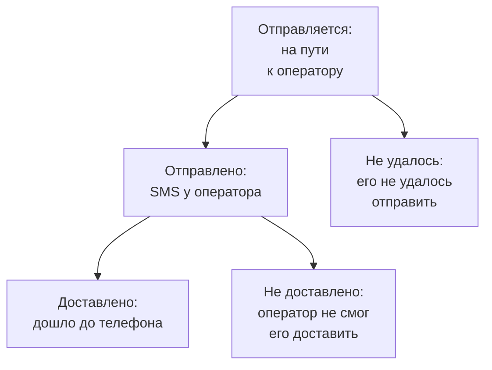

# Журналы уведомлений

Журналы уведомлений показывают каждое сообщение, которое OneUptime отправил для вашего проекта, по вкладке на канал, и что с ним стало: ушло ли оно, дошло ли и, если нет, почему. Откройте их в **Настройки проекта → Уведомления → Журналы уведомлений** или в **Журналы уведомлений** инцидента, оповещения, события обслуживания, страницы статуса или политики дежурства, чтобы увидеть, что было отправлено о нём.

:::cards
- [Как читать статус](#как-читать-статус): Цвет показывает, где сообщение, а наведя на статус, вы узнаете, что он значит.
- [SMS](#sms): Отправляется, затем Отправлено, затем Доставлено, как сообщает оператор.
- [Звонки](#звонки): Идёт вызов, а затем то, чем закончился звонок.
- [WhatsApp и Telegram](#whatsapp-и-telegram): Что сообщает каждое приложение, приняв сообщение.
- [Почта, push, вебхуки и рабочие пространства](#почта-push-вебхуки-и-рабочие-пространства): Успешно или Ошибка, и почему.
- [Когда SMS остаётся в статусе Отправлено](#когда-sms-остаётся-в-статусе-отправлено): Операторы, которые не сообщают результат, и отчёты, которые не доходят.
:::

## Как читать статус

Каждый статус — это метка, цвет которой показывает, где сообщение:

| Цвет | Где сообщение |
| --- | --- |
| Серый | Передано дальше, и ответа пока нет, как у статуса **Отправляется**. |
| Синий | Оно у провайдера, и он ещё не сообщил, чем всё закончилось, как у статуса **Отправлено** для SMS или **Идёт вызов** для звонка. |
| Зелёный | Оно дошло до человека, как у статуса **Доставлено**, или это его последний статус. |
| Жёлтый | Оно дошло до телефона, но никто не ответил, как у статуса **Пропущенный звонок**, или ушло с предупреждением. |
| Красный | Оно не дошло до человека, как у статусов **Не доставлено**, **Не удалось**, **Ошибка** или **Недостаточно средств**. |

Наведите на статус, коснитесь его или перейдите к нему клавишей Tab, и он скажет, что значит и что будет дальше. **Просмотреть сообщение о статусе** в меню строки показывает, что ответил провайдер, например ID сообщения или причину сбоя. Фильтр **Статус** на каждой вкладке перечисляет все статусы, которые может показать вкладка, в том порядке, в котором их проходит сообщение.

## SMS

| Статус | Что он значит |
| --- | --- |
| **Отправляется** | OneUptime передал SMS в Twilio, который передаёт его оператору. |
| **Отправлено** | Оператор принял SMS. Статус сменится на **Доставлено** или **Не доставлено**, как только оператор сообщит результат. |
| **Доставлено** | Оператор подтвердил, что SMS дошло до телефона. Это последний статус SMS, которое дошло. |
| **Не доставлено** | Оператор не смог его доставить. **Код ошибки** указывает причину: `30003` — телефон выключен или вне зоны сети, `30005` — номер не существует, `30006` — стационарный телефон, а `30007` — сообщение, которое отфильтровал оператор. |
| **Не удалось** | Twilio не смог его отправить. **Код ошибки** указывает причину. |
| **Ошибка** | Оно не отправлено, например потому что SMS отключены для проекта или Twilio отклонил номер. **Просмотреть сообщение о статусе** указывает причину. |
| **Недостаточно средств** | Оно не отправлено: баланса проекта не хватило на оплату. |
| **Успешно** | Оно отправлено до того, как OneUptime начал отслеживать доставку, и Twilio его принял. |

SMS, которое принял собственный шлюз SMS и звонков сервера, остаётся в статусе **Отправлено**, зелёным: шлюз не сообщает о доставке, поэтому это его последний статус.

Twilio сообщает OneUptime о каждом изменении сразу, подписывая сообщение токеном авторизации аккаунта, с которого ушло SMS, а OneUptime отклоняет любой отчёт, который пришёл не от Twilio. Для этого Twilio должен иметь доступ к вашему серверу: см. [Интеграция с Twilio](/docs/self-hosted/twilio-integration).

## Звонки

| Статус | Что он значит |
| --- | --- |
| **Идёт вызов** | Twilio совершил звонок. Статус изменится, как только Twilio сообщит, чем закончился звонок. |
| **Успешно** | На звонок ответили, и **Просмотреть сообщение о статусе** показывает, сколько он длился. Звонок, который принял собственный шлюз SMS и звонков сервера, получает статус **Успешно**, как только шлюз его принимает. |
| **Пропущенный звонок** | Звонок остался без ответа: никто не взял трубку. |
| **Занят** | Линия была занята, или звонок отклонили. |
| **Голосовая почта** | На дежурный звонок ответила голосовая почта. **Просмотреть сообщение о статусе** показывает, было ли оставлено сообщение. |
| **Ошибка** | Не удалось совершить или соединить звонок. |
| **Недостаточно средств** | Он не совершён: баланса проекта не хватило на оплату. |

## WhatsApp и Telegram

Сообщение WhatsApp находится **В очереди**, пока OneUptime его передаёт, получает статус **Отправлено**, когда WhatsApp его принимает, **Доставлено**, когда оно доходит до телефона, и **Прочитано**, когда его открывают, если человек делится отчётами о прочтении. **Не удалось** — это сообщение, которое WhatsApp не смог доставить, а **Предупреждение** — сообщение, которое он отправил с предупреждением: **Просмотреть сообщение о статусе** показывает, что сообщил WhatsApp. **Ошибка** и **Недостаточно средств** означают, что оно не отправлено, как и для SMS.

Telegram ничего не сообщает после того, как принял сообщение, поэтому статус **Отправлено** у сообщения Telegram зелёный: Telegram опубликовал его в чате, и это его последний статус.

## Почта, push, вебхуки и рабочие пространства

На этих вкладках статус **Успешно** или **Ошибка**. **Успешно** — последний статус: почтовый сервер принял письмо, push-сервис принял уведомление, адрес вебхука ответил, что принял запрос, или рабочее пространство сделало то, о чём его просили. OneUptime не отслеживает письмо после того, как почтовый сервер его принял, а push-уведомление получает статус **Ошибка**, если push-сервис позже сообщит, что оно не доставлено. **Просмотреть сообщение о статусе** показывает, почему у сообщения статус **Ошибка**, как это делает **Причина** на вкладке **Рабочее пространство**.

## Когда SMS остаётся в статусе Отправлено

**Отправлено** значит, что SMS у оператора и он ещё не сообщил результат. Большинство операторов сообщают его за секунды или минуты, но некоторые не сообщают никогда: тогда и Twilio оставляет SMS в статусе `sent`, как видно в его журналах сообщений, и OneUptime не может знать, дошло ли оно.

SMS, которое остаётся в статусе **Отправляется**, — другое дело: отчёты Twilio не доходят до OneUptime. Проверьте, что Twilio может достучаться до вашего сервера, и найдите в журнале сервера строки, которые начинаются с `Twilio callback refused`: см. [Интеграция с Twilio](/docs/self-hosted/twilio-integration).

## Дальнейшие шаги

:::cards
- [Интеграция с Twilio](/docs/self-hosted/twilio-integration): Подключите Twilio, чтобы его отчёты о доставке доходили до OneUptime.
- [Шлюз SMS и звонков](/docs/self-hosted/sms-and-call-gateway): Отправляйте SMS и звонки через собственный шлюз.
- [Метрики доставки уведомлений](/docs/self-hosted/notification-delivery-metrics): Считайте, что было доставлено во всей установке.
:::
