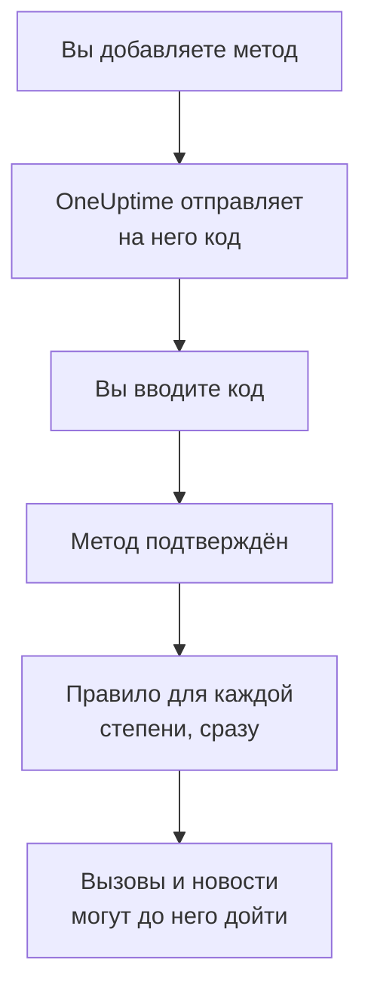

# Методы уведомлений

Метод уведомлений — это адрес, по которому OneUptime может связаться с вами в одном проекте: адрес почты, номер телефона для SMS или звонков, номер WhatsApp, аккаунт Telegram, ваш аккаунт Slack или Microsoft Teams, телефон или браузер для push-уведомлений или вебхук. Вы добавляете их в **Настройки пользователя → Методы уведомлений**, подтверждаете, и OneUptime сразу начинает использовать их для ваших вызовов.

:::cards
- [Выберите метод](#выберите-метод): Что нужно каждому методу и как он подтверждается.
- [Добавьте и подтвердите метод](#добавьте-и-подтвердите-метод): Почта, SMS, звонки и WhatsApp, с кодом из 6 цифр.
- [Вебхуки](#вебхуки): Отправляйте вызовы на собственный endpoint, с подписью, если нужно.
- [Включите канал для проекта](#включите-канал-для-проекта): Почему SMS, звонков, WhatsApp или Telegram может не быть.
:::

## Как метод начинает работать



Метод, который вы не подтвердили, никогда не используется. Push-устройствам, Slack, Microsoft Teams и вебхукам код не нужен: регистрация устройства или привязка аккаунта доказывает, что он ваш, а вебхуку доказательство не нужно. Подтверждение метода сразу добавляет для него ваши [правила по умолчанию](/docs/notifications/on-call-rules#правила-с-которыми-вы-начинаете), поэтому новый номер телефона вызывает вас при любой степени серьёзности, пока вы не измените его правила.

## Выберите метод

Каждая вкладка **Методы уведомлений** содержит одну или несколько карточек, по одной на вид метода:

| Карточка | Вкладка | Что вы добавляете | Как он подтверждается |
| --- | --- | --- | --- |
| **Emails для уведомлений** | **Direct Contact** | Адрес почты | Код по почте |
| **Номера телефонов для SMS-уведомлений** | **Direct Contact** | Номер телефона | Код по SMS |
| **Номера телефонов для уведомлений по звонку** | **Direct Contact** | Номер телефона | Код, который зачитывают в звонке, или никакого для номера, подтверждённого для SMS |
| **Номера WhatsApp для уведомлений** | **Direct Contact** | Номер WhatsApp | Код в WhatsApp |
| **Аккаунты Telegram для уведомлений** | **Direct Contact** | Ваш аккаунт Telegram | Сообщение боту OneUptime |
| **Slack Account for Notifications** | **Workspace Apps** | Ваш аккаунт Slack | Привязка вашего аккаунта к рабочему пространству проекта |
| **Microsoft Teams Account for Notifications** | **Workspace Apps** | Ваш аккаунт Microsoft Teams | Привязка вашего аккаунта к рабочему пространству проекта |
| **Устройства для push-уведомлений** | **Push Notifications** | Телефон с приложением OneUptime On-Call или браузер | Регистрация устройства |
| **Вебхуки для уведомлений** | **Webhooks** | Собственный HTTPS-endpoint | Никак |

**Workspace Apps** появляется, только если проект подключил Slack или Microsoft Teams, и содержит только подключённые. SMS, звонки, WhatsApp и Telegram могут быть выключены для всего проекта; см. [Включите канал для проекта](#включите-канал-для-проекта).

## Добавьте и подтвердите метод

Адреса почты, номера для SMS, номера для звонков и номера WhatsApp подтверждаются кодом из 6 цифр.

:::steps
### Откройте свои методы

Перейдите в **Настройки пользователя → Методы уведомлений**. **Direct Contact** — первая вкладка.

### Добавьте адрес

В карточке метода нажмите его кнопку добавления, например **Добавить: Номер телефона для SMS-уведомлений**. Введите **Электронная почта** или **Номер телефона** в международном формате, например `+11234567890`, и сохраните.

### Введите код

Окно подтверждения открывается само и сообщает, куда ушёл код и до какого времени он действует. Введите код в поле **Код подтверждения** и нажмите **Подтвердить**.

### Проверьте строку

Теперь строка отмечена как **Подтверждено**. Закрыли окно слишком рано? Нажмите **Подтвердить** в строке, чтобы открыть его снова.
:::

- Код действует 15 минут. Пять неверных попыток аннулируют его, и понадобится новый.
- **Send a new code** или, для номера звонков, **Call me with a new code** находится в окне. Новый код можно запросить через минуту после предыдущего.
- Номер, подтверждённый для SMS, подтверждён и для звонков. Его добавление в **Номера телефонов для уведомлений по звонку** не требует кода, а подтверждение SMS-номера подтверждает и номер для звонков, добавленный для него.
- Ваша почта для входа уже здесь, подтверждённая, со дня вашего вступления в проект.

## Подключите Telegram

:::steps
### Добавьте аккаунт

В **Аккаунты Telegram для уведомлений** нажмите **Добавить: Аккаунт Telegram**. **Имя пользователя Telegram (необязательно)** — лишь метка для вас, его можно оставить пустым.

### Напишите боту

Нажмите **Подтвердить** в новой строке. Окно **Подтвердить аккаунт Telegram** предлагает три способа связаться с ботом OneUptime: отсканировать QR-код телефоном, нажать **Open in Telegram** или найти бота в Telegram и отправить ему команду `/start`, которую показывает окно.

### Подтвердите

Вернувшись в OneUptime, нажмите **I've sent the message — check**. Как только бот получит ваше сообщение, аккаунт будет подтверждён.
:::

**Сменить код** создаёт новый код для аккаунта, который ещё не подтверждён. QR-код и ссылка, открытые раньше, перестают работать. В самостоятельно размещённом OneUptime администратор сервера подключает Telegram-бота, прежде чем кто-либо сможет привязать аккаунт.

## Slack и Microsoft Teams

1. Привяжите свой аккаунт к рабочему пространству проекта: **Настройки пользователя → Рабочее пространство → Slack** или **Microsoft Teams**. См. [Slack](/docs/workspace-connections/slack) и [Microsoft Teams](/docs/workspace-connections/microsoft-teams).
2. На вкладке **Workspace Apps** нажмите **Add Slack Account** или **Add Microsoft Teams Account**. Аккаунт подтверждается сразу при добавлении.
3. Нажмите **Send Test Message** в его строке. Вызовы приходят личными сообщениями от приложения OneUptime.

## Push-уведомления

Вкладка **Push Notifications** показывает ваши **Устройства для push-уведомлений**.

- **Телефон.** Установите приложение OneUptime On-Call, подключите его к своему OneUptime, войдите и разрешите уведомления: телефон сам появится в этом списке. См. [Обзор приложений](/docs/mobile-desktop-apps/index).
- **Этот браузер.** Нажмите **Зарегистрировать устройство**, заполните **Имя устройства** и разрешите уведомления, когда браузер спросит.
- **Тестовое уведомление** в строке устройства сразу отправляет на него push.
- **Критические оповещения** показывает, пробиваются ли вызовы телефона сквозь беззвучный режим и «Не беспокоить». Это включается в приложении, а не здесь, и браузер так не умеет. См. [Критические оповещения дежурства](/docs/self-hosted/push-notifications#критические-вызовы-дежурных-в-обход-беззвучного-режима).
- На устройство с отметкой **Уведомления не приходят** ничего не отправляется. Откройте приложение на этом телефоне или зарегистрируйте браузер заново, и оно вернётся.

## Вебхуки

Вебхук отправляет каждый вызов в виде JSON на ваш HTTPS-endpoint, чтобы с ним мог работать ваш собственный инструмент.

:::steps
### Добавьте вебхук

На вкладке **Webhooks** нажмите **Добавить: Вебхук**. Заполните **Имя** узнаваемым названием, затем **URL webhook** и **Секрет подписи (необязательно)**.

### Отправьте тест

Нажмите **Отправить тест** в его строке. Ваш endpoint получит событие, у которого `eventType` равен `test`.

### Проверьте, что приходит

Вызов — это JSON-запрос `POST`, как показано ниже. Ответьте любым статусом `2xx` в течение 10 секунд; перенаправления не выполняются.
:::

```json title="A page, as your endpoint receives it"
{
  "eventType": "on-call.incident.created",
  "timestamp": "2026-10-15T09:30:00.000Z",
  "projectId": "6a3f0d2e-1c4b-4e8a-9b7d-2f5c8e1a0b3c",
  "userId": "0c9e8d7f-6b5a-4c3d-8e2f-1a0b9c8d7e6f",
  "incident": {
    "id": "5b4a3c2d-1e0f-4a9b-8c7d-6e5f4a3b2c1d",
    "title": "Checkout API is down",
    "description": "Health check failed from 3 probes.",
    "incidentNumber": 42,
    "incidentNumberWithPrefix": "INC-42",
    "severity": "Critical Incident",
    "state": "Identified"
  },
  "onCallPolicyId": "7d6c5b4a-3e2f-4d1c-9b8a-7f6e5d4c3b2a",
  "onCallPolicyEscalationRuleId": "8e7d6c5b-4a3f-4e2d-8c1b-9a8f7e6d5c4b"
}
```

| `eventType` | Отправляется для | Ключ записи |
| --- | --- | --- |
| `on-call.incident.created` | Инцидента | `incident` |
| `on-call.alert.created` | Оповещения | `alert` |
| `on-call.incidentEpisode.created` | Эпизода инцидентов | `incidentEpisode` |
| `on-call.alertEpisode.created` | Эпизода оповещений | `alertEpisode` |

Новости, которые вы включаете для Webhook в **Настройки уведомлений**, приходят на тот же endpoint, с событием настройки в `eventType` и кратким описанием в `subject` и `message`.

Каждый запрос содержит `X-OneUptime-Event`, тип события. С секретом подписи он также содержит `X-OneUptime-Signature`: `sha256=`, за которым следует HMAC-SHA256 необработанного тела в шестнадцатеричном виде. Проверьте её, прежде чем доверять запросу:

```javascript title="verify-signature.js"
const crypto = require("crypto");

// rawBody: the request body exactly as it arrived, before any JSON parsing.
function isFromOneUptime(rawBody, signatureHeader, secret) {
  const expected =
    "sha256=" + crypto.createHmac("sha256", secret).update(rawBody).digest("hex");
  const received = Buffer.from(signatureHeader || "");
  const wanted = Buffer.from(expected);
  return received.length === wanted.length && crypto.timingSafeEqual(received, wanted);
}
```

Вебхуку не нужно подтверждение, поэтому при его добавлении его правила добавляются сразу. Частные и внутренние адреса отклоняются, если их не разрешил администратор самостоятельно размещённого сервера: см. [Доступ к частной сети](/docs/self-hosted/private-network-access#вебхуки-и-рабочие-процессы).

## Включите канал для проекта

**SMS**, **Телефонные звонки**, **WhatsApp** и **Telegram** выключены в каждом новом проекте, потому что каждое сообщение стоит денег: в OneUptime Cloud оно оплачивается с баланса проекта, а SMS и звонки идут через собственный аккаунт Twilio проекта, если их отправляет его аккаунт по умолчанию. Почта, push, Slack, Microsoft Teams и вебхуки всегда включены.

Пока канал выключен, никто в проекте не может добавить на нём метод: на его карточке нет кнопки добавления, и она сообщает, кто может его включить. Включает его владелец проекта, **Администратор биллинга** или кто-то с правом **Manage Billing** — в карточке **Каналы уведомлений** в **Настройки проекта → Уведомления → Настройки уведомлений**. Администратор проекта этого не может. В самостоятельно размещённом OneUptime для SMS и звонков нужен ещё и аккаунт Twilio, а для Telegram — бот, которого подключает администратор сервера; см. [Интеграция с Twilio](/docs/self-hosted/twilio-integration).

## Удалите метод

Нажмите **Удалить** в строке метода. Удаление метода удаляет все правила дежурства, которые его используют, поэтому окно сначала подсчитывает эти правила и называет каждую степень серьёзности, которая после удаления осталась бы совсем без правила.

## Устранение неполадок

:::details На карточке нет кнопки добавления
Этот канал выключен в этом проекте. Карточка сообщает, кто может его включить; см. [Включите канал для проекта](#включите-канал-для-проекта).
:::

:::details Код так и не пришёл
Письма могут идти несколько минут и иногда попадают в спам; SMS может идти минуту. Подождите минуту, затем нажмите **Send a new code** в окне. **Настройки проекта → Уведомления → Журналы уведомлений** показывает, что произошло с сообщением.
:::

:::details Не получается добавить мой аккаунт Slack
Сначала привяжите аккаунт в **Настройки пользователя → Рабочее пространство → Slack**, затем снова нажмите **Add Slack Account**. В окне ошибки есть кнопка, которая ведёт туда.
:::

:::details На мой телефон не приходят push-уведомления
Проверьте, что телефон есть в списке **Устройства для push-уведомлений**, и отправьте ему **Тестовое уведомление**. См. [Часто задаваемые вопросы и устранение неполадок](/docs/mobile-desktop-apps/faq-troubleshooting#уведомления).
:::

## Дальнейшие шаги

:::cards
- [Личные правила дежурства](/docs/notifications/on-call-rules): Решите, какой метод пробует каждый вызов и когда.
- [Настройки уведомлений](/docs/notifications/notification-settings): Выберите новости, о которых вы узнаёте, и каналы для них.
- [Обзор приложений](/docs/mobile-desktop-apps/index): Получайте вызовы на телефоне или компьютере.
- [Как OneUptime связывается с вами](/docs/notifications/index): Как связаны методы, правила и настройки.
:::
