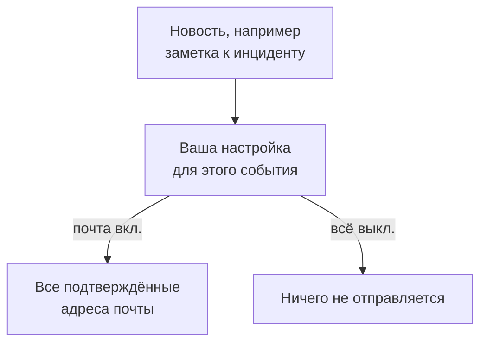

# Настройки уведомлений

Настройки уведомлений решают, какие новости до вас доходят о записях, которыми вы владеете, например об инциденте, мониторе или странице статуса, и о ваших собственных дежурных сменах, и по каким каналам. Они никогда вас не вызывают: вызывать — задача ваших правил дежурства. Вы настраиваете их в **Настройки пользователя → Настройки уведомлений**, по одному переключателю на событие и канал.

:::cards
- [Как работают настройки](#как-работают-настройки): Один переключатель на событие и канал, отправка на каждый подтверждённый метод.
- [Измените настройку](#измените-настройку): Три щелчка, сохранение сразу.
- [Что включено для нового участника](#что-включено-для-нового-участника): Значения по умолчанию, вкладка за вкладкой.
- [Меньше писем](#меньше-писем): Объединяйте всплески или отключите рутинные письма.
:::

## Как работают настройки

- Каждая строка — это событие, а каждый столбец — канал: Электронная почта, SMS, Звонок, Push, WhatsApp, Telegram, Slack и Microsoft Teams, а также Webhook. Slack и Microsoft Teams становятся столбцами, только если проект их подключил.
- Включённый канал отправляет на каждый подтверждённый метод этого канала в этом проекте, а не на один.
- Включённый канал без подтверждённого метода за ним ничего не отправляет. **Your setup checklist** сообщает об этом в разделе **Staying informed**.
- Новость уходит владельцам записи: людям, указанным как владельцы, и участникам её команд-владельцев. Если у записи нет владельцев, новость уходит владельцам проекта. Событие о том, что вас добавили владельцем, уходит только добавленному человеку.
- У кейсов безопасности нет владельцев. Новый кейс уходит всем, кто может видеть кейсы проекта, начиная с приоритета, который выбрал каждый из них, а назначенный кейс — тем, кому он назначен. См. [Кейсы безопасности](/docs/telemetry/security-cases#уведомления).
- Каждое письмо владельцам заканчивается ссылкой "Manage notification preferences", которая ведёт обратно на эту страницу.

## Измените настройку

:::steps
### Откройте свои настройки

Перейдите в **Настройки пользователя → Настройки уведомлений**. Вкладки: **Инциденты**, **Оповещения**, **Мониторинг**, **Страницы состояния**, **Плановое обслуживание**, **Дежурство** и **Безопасность**.

### Найдите событие

На каждой вкладке есть одна или несколько карточек, например **Инцидент Эпизоды** на вкладке **Инциденты**. Каждая строка — это событие, со строкой о том, когда оно отправляется.

### Нажмите на канал

Нажмите на кружок канала, чтобы включить его, и ещё раз, чтобы выключить. Галочка означает «включено». Изменения сохраняются автоматически.
:::

## Что включено для нового участника

Когда вы вступаете в проект, эти события включены, по почте. Всё остальное сначала выключено и ничего не отправляет, пока вы не включите канал.

| Вкладка | Включены по почте | Выключены, пока вы их не включите |
| --- | --- | --- |
| **Инциденты** | **Инцидент создан**, **Состояние инцидента изменено**, **Incident reminder**, **Эпизод инцидента создан**, **Состояние эпизода инцидента изменено**, **Инцидент добавлен в эпизод инцидента** | **Заметка к инциденту опубликована**, **Добавлен как владелец инцидента**, **Назначен на инцидент**, **Заметка к эпизоду инцидента опубликована**, **Добавлен как владелец эпизода инцидента** |
| **Оповещения** | **Оповещение создано**, **Состояние оповещения изменено**, **Alert reminder**, **Эпизод оповещения создан**, **Состояние эпизода оповещения изменено**, **Оповещение добавлено в эпизод оповещения** | **Заметка к оповещению опубликована**, **Добавлен как владелец оповещения**, **Заметка к эпизоду оповещения опубликована**, **Добавлен как владелец эпизода оповещения** |
| **Мониторинг** | **Статус зонда изменён для вашего монитора**, **У монитора нет активных зондов**, **SLO status changed**, **Added as SLO owner**, **Статус зонда изменён**, **Добавлен как владелец зонда** | **Монитор создан**, **Статус монитора изменён**, **Добавлен как владелец монитора**, **Статус AI-агента изменён**, **Добавлен как владелец AI-агента** |
| **Страницы состояния** | Нет | **Страница статуса создана**, **Объявление на странице статуса опубликовано**, **Добавлен как владелец страницы статуса** |
| **Плановое обслуживание** | **Maintenance reminder** | **Событие обслуживания создано**, **Состояние обслуживания изменено**, **Заметка об обслуживании опубликована**, **Добавлен как владелец обслуживания** |
| **Дежурство** | **Вы заступаете на дежурство**, **Вы следующий на дежурстве**, **Вы выходите с дежурства**, **Добавлен в политику дежурства**, **Удалён из политики дежурства**, **Пропущенный звонок**, а также по push: **Перед началом моей дежурной смены**, **Моя ближайшая дежурная смена переназначена** | Нет |
| **Безопасность** | Также по push: **Новый кейс безопасности** (кейсы с приоритетом High и Critical), **Кейс безопасности, назначенный мне**, **Шаг плейбука ждёт моего одобрения** | Нет |

> [!IMPORTANT]
> **Статус монитора изменён** сначала выключено. Чтобы узнавать, когда ваш монитор падает или восстанавливается, включите это событие на вкладке **Мониторинг**.

## Ваши смены

Вкладка **Дежурство** — о вас, а не о ваших записях:

- **Вы заступаете на дежурство**, **Вы следующий на дежурстве** и **Вы выходите с дежурства** следуют вашей очереди в расписаниях дежурств, в которых вы состоите.
- **Добавлен в политику дежурства** и **Удалён из политики дежурства** сообщают, когда политика дежурства начинает или перестаёт называть вас.
- **Перед началом моей дежурной смены** присылает напоминания в моменты, которые вы выбираете в **Настройки пользователя → Календарь → Календарная лента**, а **Моя ближайшая дежурная смена переназначена** сообщает, когда смену, о которой вам напоминали, берёт кто-то другой. См. [Календарные ленты](/docs/on-call/calendar-feeds#напоминания-и-уведомления-о-переназначении).
- **Пропущенный звонок**, на карточке **Политики входящих звонков**, сообщает владельцам политики входящих звонков, что звонивший никого не застал. См. [Политика входящих вызовов](/docs/on-call/incoming-call-policy#пропущенные-звонки).

## Кейсы безопасности

Вкладка **Безопасность** — о кейсах безопасности, которые вы можете видеть:

- Под названием события **Новый кейс безопасности** указан приоритет: самый низкий приоритет кейса, о котором вас уведомляют. Это **Высокий и выше**, если только вы не выберете **Только Критический**, **Средний и выше**, **Низкий и выше** или **Все кейсы**.
- **Кейс безопасности, назначенный мне** сообщает о кейсах, назначенных вам и командам, в которых вы состоите.
- **Шаг плейбука ждёт моего одобрения** просит вас одобрить или отклонить шаг плейбука в кейсе, где вы можете одобрять шаги.

См. [Кейсы безопасности](/docs/telemetry/security-cases#уведомления).

## Меньше писем

Эти переключатели решают, какие новости до вас доходят, а не во сколько писем они складываются. В **Настройки пользователя → Настройки электронной почты** для этого есть две карточки, обе только для вас и только в этом проекте:

- **Email Rollup** собирает всплеск новостей в одно письмо: первые по-прежнему приходят по одной, а остальные вместе через несколько минут.
- **Fewer routine emails** кнопкой **Reduce routine emails** выключает письма о заметках, новых владельцах, новых мониторах и страницах статуса, добавлениях в эпизоды и изменениях в политиках дежурства.

См. [Сводка уведомлений](/docs/emails/notification-rollup).

## Устранение неполадок

:::details Переключатель включён, но ничего не приходит
Проверьте, что у вас есть подтверждённый метод на этом канале в **Настройки пользователя → Методы уведомлений**. Для SMS, звонков, WhatsApp и Telegram канал также должен быть включён в проекте.
:::

:::details Я владею монитором, но никогда не узнаю, когда он падает
**Статус монитора изменён** сначала выключено. Включите для него канал на вкладке **Мониторинг**.
:::

:::details Мне всё ещё приходят письма, хотя я всё выключил
Вызовы следуют вашим правилам дежурства, а не этим переключателям, а письма о входе, безопасности и оплате — не новости о записях. У каждого проекта свои настройки, поэтому проверьте проект, из которого пришло письмо. См. [Личные правила дежурства](/docs/notifications/on-call-rules).
:::

## Дальнейшие шаги

:::cards
- [Методы уведомлений](/docs/notifications/notification-methods): Добавьте методы, на которые отправляют ваши настройки.
- [Личные правила дежурства](/docs/notifications/on-call-rules): Решите, как до вас доходит вызов.
- [Сводка уведомлений](/docs/emails/notification-rollup): Меньше писем, но полнее, во время всплеска.
- [Как OneUptime связывается с вами](/docs/notifications/index): Как связаны методы, правила и настройки.
:::
