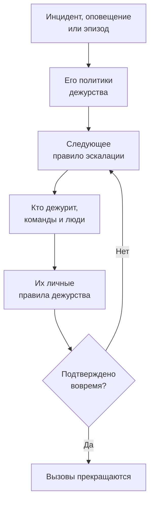

# Обзор дежурств

Дежурство — это то, как OneUptime в любое время суток приводит человека к проблеме. Когда инциденту, оповещению или эпизоду кто-то нужен, его политики дежурства вызывают людей уровень за уровнем, пока кто-нибудь не подтвердит, и с каждым связываются так, как он сам выбрал: push-уведомлением, SMS, звонком, письмом или сообщением в чате. На этой странице показано, как связаны части и где находится каждая из них.

:::cards
- [Как вызов доходит до человека](#как-вызов-доходит-до-человека): От нового инцидента до человека, который отвечает.
- [Составные части](#составные-части): Политики, правила эскалации, расписания, переопределения и личные правила.
- [Настройка дежурства](#настройка-дежурства): С нуля до команды, которую вызывают, за пять шагов.
- [Где находится дежурство](#где-находится-дежурство): Меню Дежурство, раздел за разделом.
:::

## Как вызов доходит до человека

1. Новый инцидент, оповещение или эпизод сразу запускает свои политики дежурства: выбранные в нём и те, что добавляют его правила дежурства. Каждая политика выполняется отдельно. Правило дежурства в режиме **Только в рабочие часы** заставляет добавленные им политики ждать начала этих часов.
2. Первое правило эскалации политики вызывает сразу: тех, кто сейчас дежурит по её расписаниям, всех участников её команд и людей, которых оно называет.
3. Если кто-то из них отсутствует, пользовательское переопределение направляет его вызов тому, кто его заменяет, или пропускает его.
4. С каждым связываются по его личным правилам дежурства: какой из его методов пробуется и через какое время. Вызов без правила всё равно доходит до человека через методы, которые он подтвердил.
5. Если никто не подтвердит до истечения ожидания правила, вызывает следующее правило. После последнего политика начинается заново, если она повторяется, а иначе останавливается.

Подтверждение или устранение инцидента, оповещения или эпизода останавливает все политики, которые всё ещё вызывают по нему. OneUptime продвигает выполняющиеся политики каждую минуту и записывает каждое выполнение, правило за правилом, в **Журналы выполнения**.

Когда вызов впервые доходит до человека, OneUptime записывает это в инциденте, оповещении или эпизоде как `First Paged At`. От этого момента может отсчитываться измерение: **Время до подтверждения после вызова** показывает, сколько времени людям понадобилось, чтобы ответить после вызова, а не сколько прошло, прежде чем кого-то вызвали. См. [Время до подтверждения после вызова](/docs/incidents/settings#время-до-подтверждения-после-вызова).

> [!NOTE]
> Инцидент, оповещение или эпизод, созданные уже подтверждёнными или устранёнными, не запускают ни одной своей политики, и их лента сообщает об этом. См. [Созданное уже подтверждённым или устранённым](/docs/alerts/index#созданное-уже-подтверждённым-или-устранённым).

## Составные части

| Часть | Что она определяет | Подробнее |
| --- | --- | --- |
| Политика дежурства | Кого вызывают по инциденту или оповещению, уровень за уровнем | [Политики дежурств](/docs/on-call/policies) |
| Правило эскалации | Один уровень политики: кого он вызывает и сколько ждёт подтверждения | [Правила эскалации](/docs/on-call/escalation-rules) |
| Расписание дежурств | Кто дежурит в каждый момент, по мере того как люди сменяют друг друга | [Расписания дежурств](/docs/on-call/schedules) |
| Пользовательское переопределение | Кто заменяет человека, пока он отсутствует | [Пользовательские переопределения](/docs/on-call/user-overrides) |
| Личные правила дежурства | Как связываются с одним человеком: каким методом и через какое время | [Личные правила дежурства](/docs/notifications/on-call-rules) |
| Политика входящих вызовов | Номер телефона, который звонит дежурному | [Политика входящих вызовов](/docs/on-call/incoming-call-policy) |

Политики, правила эскалации, расписания и переопределения принадлежат проекту и находятся в разделе **Дежурство**. Методы уведомлений и личные правила дежурства принадлежат каждому человеку и находятся в разделе **Настройки пользователя**: администратор может посмотреть чужие настройки, но подтвердить свой телефон или почту может только сам человек. См. [Как OneUptime связывается с вами](/docs/notifications/index).

## Настройка дежурства

:::steps
### Создайте расписание

Откройте **Дежурство** в меню **Продукты** и перейдите в **Расписания дежурств**. Нажмите **Создать расписание дежурств**, дайте ему имя и в поле **Кто дежурит по очереди?** выберите людей в том порядке, в котором они сменяют друг друга. См. [Расписания дежурств](/docs/on-call/schedules).

### Создайте политику

Перейдите в **Политики дежурств** и нажмите **Создать: Политика дежурства**. В поле **Кого оповестить первым?** выберите расписание. Оно станет первым правилом эскалации политики, **Level 1**, которое ждёт подтверждения 30 минут.

### Добавьте следующие уровни

На странице **Правила эскалации** политики нажимайте **Добавить правило эскалации** для каждого уровня после первого: следующий в ротации того же расписания, руководитель команды, менеджер. См. [Правила эскалации](/docs/on-call/escalation-rules).

### Запускайте политику автоматически

Первая политика проекта может сделать это уже при создании: оставьте включённым **Срабатывать при каждом новом инциденте и оповещении**. Для любой другой политики перейдите в **Инциденты → Правила → Правила дежурства** или **Оповещения → Правила → Правила дежурства** и добавьте правило, которое запускает её для подходящих инцидентов или оповещений, например для всех критических. См. [Что запускает политику](/docs/on-call/policies#что-запускает-политику).

### Проверьте, что со всеми можно связаться

Откройте **Дежурство → Готовность**. Все, кого могут вызвать ваши политики, перечислены со статусом **Готов**, **Требует настройки** или **Недоступно** и с тем, чего не хватает. См. [Готовность и отчеты](/docs/on-call/readiness).
:::

> [!NOTE]
> В OneUptime Cloud политики дежурства и правила эскалации доступны на всех тарифах. Расписания дежурств, пользовательские переопределения, журналы выполнения и отчёт о времени дежурства требуют тарифа **Growth**.

## Где находится дежурство

Откройте **Дежурство** в меню **Продукты** на верхней панели. Оно открывается на странице **Политики дежурств**, по адресу `/dashboard/{projectId}/on-call-duty/policies`, а остальное находится в боковом меню:

| Раздел | Страницы |
| --- | --- |
| **Политики** | **Политики дежурств** и **Готовность**: с кем ваши политики действительно могут связаться |
| **Расписания** | **Расписания дежурств**, **Хронология дежурств** и **Календарные ленты** |
| **Входящие звонки** | **Политики входящих звонков**: номер телефона, который звонит дежурному |
| **Расширенный** | **Пользовательские переопределения**, **Журналы выполнения** и **Архивированные политики** |
| **Отчеты** | **Время дежурства пользователя**: сколько дежурил каждый человек |
| **Рабочее пространство** | **Slack** и **Microsoft Teams**: правила, которые публикуют события дежурства в канал |
| **Настройки** | **Пользовательские поля**, **Правила меток** и **Правила владельца** |
| **Для разработчиков** | **Terraform**, **API** и **ИИ-ассистенты**: дежурство, настроенное из кода |

**Политики**, **Расписания** и **Входящие звонки** открыты; остальные разделы сначала свёрнуты, и раздел раскрывается сам, когда вы находитесь на одной из его страниц. **Рабочее пространство** показывает чат-инструменты, подключённые к проекту, или **Подключить Slack или Teams**, если их нет.

Когда вы дежурите по политике, об этом сообщает колокольчик в правом верхнем углу. Нажмите на него, чтобы открыть **Мои политики дежурства**: все политики, по которым вы дежурите, во всех ваших проектах, и указаны ли вы в них напрямую, через команду или через расписание.

## Устранение неполадок

:::details Никого не вызвали по новому инциденту
Откройте страницу **Выполнения дежурств** инцидента. Если она пуста, у инцидента не было политики дежурства: её не выбрали в нём, и ни одно правило дежурства ему не подошло. Выполнение со статусом **Execution Completed - No One Notified** прошло все правила эскалации и никого не нашло: обычно это расписание, в котором никто не дежурит. См. [Журналы выполнения](/docs/on-call/policies#журналы-выполнения). Выполнение со статусом **Ожидание** ждёт рабочих часов по правилу дежурства в режиме **Только в рабочие часы** и никого не вызывает, пока они не начнутся.
:::

:::details Человека вызвали не по тому каналу или не вызвали вовсе
Откройте **Дежурство → Готовность** и нажмите **Coverage** в его строке. Там видны методы, которые он подтвердил, и все уровни серьёзности, для которых у него нет правила. Исправить это может только он сам, в разделе **Настройки пользователя**: отправьте ему напоминание о настройке с той же страницы. См. [Готовность и отчеты](/docs/on-call/readiness). В OneUptime Cloud телефон, который блокирует неизвестных абонентов, может заглушить вызов: добавьте [номера OneUptime](/docs/on-call/phone-number-whitelist) в его список разрешённых.
:::

:::details Человека в отпуске всё ещё вызывают
Добавьте пользовательское переопределение, указав его в поле **Кто отсутствует?**. Переопределение в **Дежурство → Расширенный → Пользовательские переопределения** действует для всех политик; переопределение на странице **Пользовательские переопределения** самой политики действует только для неё. См. [Пользовательские переопределения](/docs/on-call/user-overrides).
:::

## Дальнейшие шаги

:::cards
- [Политики дежурств](/docs/on-call/policies): Создайте политику, решите, что её запускает, и посмотрите, что она сделала.
- [Правила эскалации](/docs/on-call/escalation-rules): Вызывайте людей уровень за уровнем, пока кто-то не ответит.
- [Расписания дежурств](/docs/on-call/schedules): Ротации, слои и передача смен.
- [Как OneUptime связывается с вами](/docs/notifications/index): Методы и правила, которые решают, как связываются с каждым человеком.
:::
