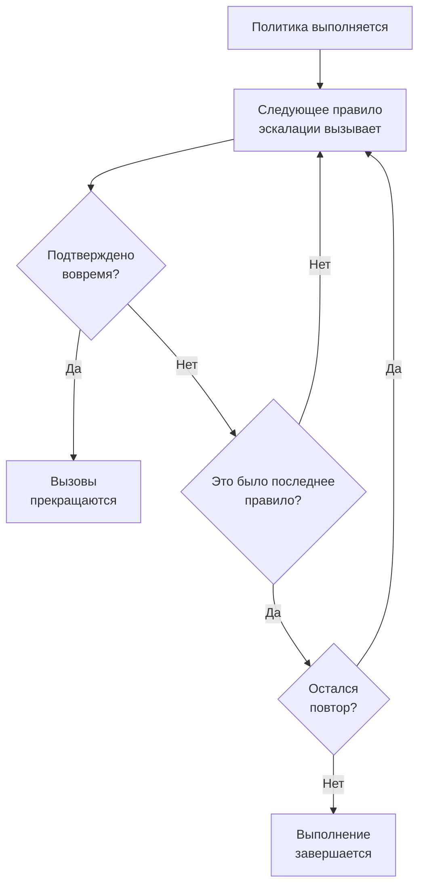

# Политики дежурств

Политика дежурства решает, кого вызывают по инциденту или оповещению и кто следующий, если никто не подтверждает. Её правила эскалации — это её уровни, а инциденты, оповещения и эпизоды, которые её используют, запускают её. На этой странице описано, как создать политику, что её запускает, что показывают её страницы и как записывается каждое выполнение.

:::cards
- [Создание политики](#создание-политики): Имя и тот, кого вызывают первым.
- [Что запускает политику](#что-запускает-политику): Правила, шаблоны, мониторы, чат и вы сами.
- [Журналы выполнения](#журналы-выполнения): Каждое выполнение, правило за правилом, и почему оно остановилось.
- [Архивирование и удаление политики](#архивирование-и-удаление-политики): Как вывести политику из работы.
:::

## Создание политики

:::steps
1. Перейдите в **Дежурство → Политики дежурств** и нажмите **Создать политику дежурства**.
2. Введите **Имя**, например «Платежи, основная». Имя, которое уже носит другая политика проекта, в том числе архивированная, отклоняется без учёта регистра и пробелов, поэтому политики можно различить в любом поле выбора.
3. В поле **Кого оповестить первым?** нажмите **Добавить получателя** и выберите расписания дежурств, команды и людей, которых нужно вызвать первыми.
4. Нажмите **Создать политику дежурства**. Политика откроется на своей странице **Правила эскалации**, где уже есть **Level 1**.
:::

Поле **Кого оповестить первым?** необязательное, и его видят только те, кто может добавлять правила эскалации: если оставить его пустым, политика никого не вызывает, пока у неё нет правила. **Описание** и **Метки** находятся в разделе **Дополнительные поля**. Как добавить следующие уровни, см. [Правила эскалации](/docs/on-call/escalation-rules).

Форма также спрашивает **Срабатывать при каждом новом инциденте и оповещении** у тех, кто может добавлять правила дежурства. Он добавляет правило в **Инциденты → Правила → Правила дежурства** и ещё одно в **Оповещения → Правила → Правила дежурства**: каждое подходит подо всё и запускает эту политику. Для первой политики проекта, пока в проекте нет ни одной политики дежурства и ни одного правила дежурства, переключатель сначала включён, а для следующих выключен: запускать две политики при каждом новом инциденте и оповещении — осознанный выбор. Если он выключен, политика никого не вызывает, пока её не запустит правило, монитор или человек.

Чтобы пройти настройку вызовов шаг за шагом, от телефона до тестового вызова, нажмите **Пошаговая настройка**: в пустом списке **Политики дежурств** или в окне **Как это работает**. См. [Получать оповещения звонком, SMS или push](/docs/guides/paging).

Список **Политики дежурств** показывает для каждой политики **Имя**, **Оповещаются первыми**, **Описание**, **Метки** и **Владельцы**. **Оповещаются первыми** — это те, кого вызывает первое правило эскалации политики: его расписания, каждое с тем, кто сейчас по нему дежурит, его команды и люди, которых оно называет, либо **Нет правил эскалации** или **Нет получателей**, если политика никого не вызывает. Выберите политики, чтобы применить **Добавить метки**, **Удалить метки**, **Добавить владельца**, **Удалить владельца**, **Архивировать** или **Экспорт в JSON**, или чтобы удалить их. **Импорт из JSON** создаёт политики из экспорта: экспорт содержит собственные настройки политики, но не её правила эскалации и не владельцев. Политика, у которой то же имя, что у другой политики, со времён, когда имена ещё могли совпадать, помечена надписью **Совпадает с названием другой политики**, а список показывает, сколько таких: сравните их правила эскалации, затем переименуйте одну из них кнопкой **Переименовать** в её строке.

## Что запускает политику

Политика никого не вызывает, пока её что-нибудь не запустит. Каждый инцидент, оповещение и эпизод запускает свои политики сразу после создания:

| Что | Как добавляется политика | Подробнее |
| --- | --- | --- |
| Сама запись | Поле **Политика дежурства** при создании инцидента или оповещения, шаблон инцидента или свёрнутый блок **Дежурство** в критериях монитора | [Объявление инцидента](/docs/incidents/declaring-incidents) |
| Правила дежурства | **Инциденты → Правила → Правила дежурства** и **Оповещения → Правила → Правила дежурства** добавляют политики каждого подходящего правила | [Правила дежурства по инцидентам](/docs/incidents/settings#правила-дежурства-по-инцидентам) |
| Правила группировки | Правило группировки запускает свои политики, когда открывает эпизод | [Эпизоды оповещений и правила группировки](/docs/alerts/episodes) |
| Вручную | **Выполнить политику дежурства** в меню **Действия** ленты или в сообщении в Slack или Microsoft Teams | [Лента инцидента](/docs/incidents/notes-owners-and-feed#лента-инцидента) |
| Чат и рабочие процессы | `/oneuptime page` в Slack или Microsoft Teams и шаг **Page an On-Call Policy** рабочего процесса | [Paging](/docs/workflows/components#paging) |

Политика, которую добавляют несколько правил, выполняется один раз. Серьёзность сама по себе никогда не запускает политику: это делает правило дежурства, подходящее под эту серьёзность. Инцидент или оповещение, созданные уже подтверждёнными или устранёнными, не запускают ни одной своей политики. Правило дежурства в режиме **Только в рабочие часы** заставляет добавленные им политики ждать начала этих часов.

## Страницы политики

Откройте политику из списка. В её боковом меню собрано всё о ней:

| Раздел | Страницы |
| --- | --- |
| **Базовый** | **Обзор**, **Правила эскалации** и **Владельцы** |
| **Журналы** | **Журналы выполнения** и **Журналы уведомлений** |
| **Для разработчиков** | **Terraform**, **Crossplane**, **API**, **CLI** и **ИИ-ассистенты** |
| **Расширенный** | **Пользовательские переопределения**, **Пользовательские поля**, **Настройки**, **Журналы аудита** и **Удалить политику** |

Раздел **Базовый** открыт; остальные разделы свёрнуты, пока вы на них не нажмёте.

- **Обзор** показывает **Сведения о политике дежурства**, затем **Политика вкратце**: сколько у политики уровней и получателей, сколько времени проходит до её последнего уровня и как часто она повторяется. **Готовность получателей** сообщает, можно ли сейчас связаться со всеми, кого она может вызвать, а **Лента политики дежурства** показывает, что изменилось: добавленные или удалённые люди, команды и расписания, переопределения и передачи смен. Её правила для Slack, Microsoft Teams и Mattermost публикуют их в ваши каналы, передачу смены — одной строкой: см. [Сообщения о дежурстве](/docs/workspace-connections/slack#сообщения-о-дежурстве).
- **Владельцы** — это люди и команды, отвечающие за политику. Если её вызов не находит правила для кого-то или не может быть доставлен, они получают письмо; политика без владельцев вместо этого пишет Владельцам проекта.
- **Журналы уведомлений** показывают каждое сообщение, отправленное политикой, с вкладкой для каждого канала.
- **Пользовательские переопределения** заменяют людей только в этой политике. См. [Пользовательские переопределения](/docs/on-call/user-overrides).
- **Настройки** содержат **Экспорт: Политика дежурства** и карточку, которая архивирует политику.

**Что запускает эту политику** на странице **Обзор** перечисляет правила дежурства, мониторы, критерии которых запускают политику, шаблоны и другие правила, которые её запускают, и рабочие процессы, которые это делают, каждый со ссылкой. Выключенное правило отмечено как **Выключено**. Если политику ничто не запускает, карточка так и говорит: она никого не вызывает, пока её что-то не запустит. Удаление или архивация политики сначала показывает то же самое. То, что вам нельзя открывать, считается, но не называется.

## Повтор политики

Когда ожидание последнего уровня истекает, а никто не подтвердил, политика останавливается, если она не повторяется. Чтобы выбрать, откройте страницу **Правила эскалации** политики и нажмите **Редактировать** на карточке **Политика повтора** под правилами. **Редактировать политику повтора** спрашивает **Если никто не подтвердит после последнего уровня**:

| Ответ | Что он делает |
| --- | --- |
| **Прекратить оповещения** | Больше никто не оповещается, так что политика выполняется один раз. Новая политика начинается с этого ответа. |
| **Начать заново с Level 1** | Каждый уровень оповещается снова, по порядку. **Сколько ещё раз?** задаёт, сколько раз: 1 или больше. |

Политика, которая начинает заново ещё три раза, проходит свои уровни четыре раза. Проход, в котором ни одному уровню некого было оповестить, не повторяется: следующий тоже никого бы не оповестил, поэтому политика останавливается. Строка **После последнего уровня** на карточке говорит, что делает политика, а **Политика вкратце** на странице **Обзор** говорит то же самое словами.

## Оповестить повторно, если не устранено

Подтверждение окончательно прекращает оповещения политики, даже если потом никто не устраняет инцидент или оповещение. Вместо этого политика может оповестить повторно: откройте её страницу **Правила эскалации**, откройте внизу **Дополнительные настройки** и нажмите **Редактировать** на карточке **Тайм-аут после подтверждения**. **Редактировать тайм-аут после подтверждения** спрашивает **Если подтверждено, но не устранено**:

| Ответ | Что он делает |
| --- | --- |
| **Не оповещать повторно** | Подтверждение окончательно прекращает оповещения. Новая политика начинается с этого ответа. |
| **Оповестить повторно** | Оповещает того, кто подтвердил, и того, кто дежурит сейчас. **Через сколько минут?** задаёт когда: от 5 до 1440, сначала 30. |

Минуты отсчитываются от каждого подтверждения, и политика повторно оповещает об одном инциденте, оповещении или эпизоде не более 5 раз. Повторное оповещение начинается с уровня, который оповещал в момент подтверждения, оповещает того, кто сейчас дежурит на этом уровне, и дальше проходит уровни, как первое выполнение. Инцидент или оповещение остаётся подтверждённым: повторное оповещение — это отдельное выполнение, в его ленте и в журналах выполнения политики, где его **Статус** показывает «Повторное оповещение (1 из 5)».

Тот, кого оповестили повторно, подтверждает его из сообщения или кнопкой **Подтвердить снова** на странице инцидента или оповещения, и отсчёт минут начинается заново; **Эскалировать** передаёт его следующему уровню. Его останавливает устранение или удаление инцидента или оповещения, архивирование или удаление политики либо выбор **Не оповещать повторно**. Строка **После подтверждения** на карточке говорит, что делает политика, а **Дополнительные настройки** показывают минуты, пока раздел свёрнут. **Политика вкратце** на странице **Обзор** и **Сводка эскалации** говорят то же самое словами.

## Когда вызывают несколько политик

Инцидент, оповещение или эпизод запускает каждую из своих политик отдельно и одновременно.

- Тот, кто дежурит в двух из них, получает один вызов. Когда уровень политики доходит до человека, которого другая политика уже вызывает по тому же поводу, она не вызывает его ещё раз: в её журнале выполнения он отмечен как **Уже вызван**, а лента инцидента и сообщение политики в Slack и Microsoft Teams называют политику, которая его вызывает. Уровень всё равно ждёт положенные минуты до следующего уровня, как и для любого, кого он вызвал. Ответ на этот единственный вызов засчитывается обеим политикам. В пределах одной политики человека, которого уровень называет дважды, лично и через команду или расписание, вызывают один раз.
- Вызов, отправленный людям напрямую, тоже считается. Когда уровень политики доходит до человека, которого вызов из Slack или Microsoft Teams или блок вызова рабочего процесса уже вызывает по тому же поводу, она не вызывает его ещё раз: в её журнале выполнения указано, кто отправил этот вызов, или рабочий процесс. Блок вызова рабочего процесса тоже не вызывает ещё раз того, кого уже вызывает политика или другой вызов.
- Подтверждение инцидента или оповещения в течение минуты останавливает все политики, выполняющиеся для него, где бы его ни подтвердили: из любого вызова о нём, на его собственной странице, в мобильном приложении или в Slack или Microsoft Teams. Следующий уровень не вызывается, а звонки и SMS, которые ещё ждут отправки, не отправляются. Уже отправленные уведомления остаются отправленными.

Никто не пропускает вызов из-за того, что его вызывают один раз. Вызов может закончиться без ответа: человек эскалирует его из одного из сообщений вызова, и тогда эскалируется только этот вызов; вызов не удаётся отправить; или он останавливается. Тогда другая политика (или блок рабочего процесса) в течение минуты сама вызывает этого человека, не отправляя заново то, что до него уже дошло. **Эскалировать** на странице инцидента или в мобильном приложении эскалирует обе. Повторное оповещение, политика, запущенная вручную, и вызов, который кто-то отправил из Slack или Microsoft Teams, всегда вызывают своих людей сами, даже того, кого вызывает другая политика. Вызов наблюдателя и вызов получателя никогда не объединяются.

Некоторые вызовы продолжаются после подтверждения, пока не ответит кто-то из тех, кого они вызвали, или пока его не устранят: повторное оповещение, вызов наблюдателей, вызов, который кто-то отправил людям из Slack или Microsoft Teams, и политика, запущенная вручную.

Политика, запущенная вручную, — это политика, запущенная кнопкой **Выполнить политику дежурства** или вызовом из Slack или Microsoft Teams, который её называет. Она вызывает уровень за уровнем, как любое выполнение, со звонками и повторяющимися push-уведомлениями, и то, что инцидент подтвердил кто-то другой, её не останавливает: так вы вызываете ещё одну команду к инциденту, которым уже кто-то занимается. Тот, кого она вызвала, отвечает из сообщения своего вызова, звонком или SMS либо сам подтвердив инцидент; когда инцидент подтверждён, его страница предлагает ему **Подтвердить снова**. **Эскалировать** передаёт её следующему уровню. Для устранённого инцидента, оповещения или эпизода ничего не запускается, и вам сообщают почему: панель отключает **Выполнить политику дежурства** и показывает причину. Её уведомления сообщают, кто запустил какую политику, и содержат сообщение, отправленное с вызовом из Slack или Microsoft Teams.

## Проверка политики

**Проверить эту политику** в правилах эскалации политики вызывает её первый уровень в качестве проверки, без инцидента за ней: в каждом сообщении сказано TEST, и ни страница статуса, ни подписчики, ни каналы не узнают. Включите **Пройти все уровни эскалации**, чтобы вызывать уровни по очереди, не больше чем через 2 минуты друг за другом, пока кто-нибудь не подтвердит. Прежде чем что-то отправить, диалог показывает, кого и как вызывает проверка и сколько она стоит в OneUptime Cloud.

**Отправить тестовый вызов** остаётся выключенной, пока проверка никого бы не достигла: каждый, кого она вызывает, отказался от вызовов этой серьёзности, не имеет для неё правила и запасного способа или имеет только неподтверждённые способы либо способы, выключенные в проекте. Строка под списком объясняет почему. Когда достичь можно только более поздний уровень, строка предлагает **Пройти все уровни эскалации** одним нажатием.

Вызванный человек подтверждает проверку из любого её сообщения: по ссылке в письме, SMS или сообщении чата, нажатием 1 во время звонка или из push-уведомления в приложении OneUptime On-Call в версиях новее 1.6.0. Политику можно проверять раз в 5 минут, а проект отправляет не больше 20 проверок в час.

### Учебная тревога для монитора

**Провести учебную тревогу** на карточке **Когда он упадёт** монитора репетирует один из его сбоев: инцидент или оповещение, которое открывает один из его критериев, или инцидент, который правило инцидентов для оповещений объявляет из такого оповещения. Она проверяет каждую политику дежурства, которую вызвал бы этот сбой, каждую так, как её проверяет **Проверить эту политику**, и ничего публичного не происходит: ни инцидент, ни оповещение не создаются, и ни страница статуса, ни подписчики, ни каналы не узнают. Прежде чем что-то отправить, диалог называет сбой, каждую политику и тех, кого эта политика вызывает сейчас. Для объявленного инцидента он называет и правило, и то, сколько оповещение сначала остаётся открытым: учебная тревога проверяет политики инцидента сразу, без этого ожидания.

Учебная тревога вызывает первый уровень каждой политики. В разделе **Дополнительные поля** включите **Пройти все уровни эскалации**, чтобы вызывать уровни каждой политики по очереди, не больше чем через 2 минуты друг за другом, пока кто-нибудь не подтвердит: тогда диалог показывает каждый уровень, до которого доходит каждая политика, и сколько проход стоит самое большее. Когда никого на первых уровнях достичь нельзя, а на более позднем можно, строка под списком предлагает **Пройти все уровни эскалации** одним нажатием.

**Начать учебную тревогу** остаётся выключенной, пока среди этих политик есть такая, которую вы не можете проверить, потому что не можете её изменять, или пока никого из тех, кого они вызывают, нельзя достичь. Каждая политика учебной тревоги считается отдельной проверкой: политика, проверенная за последние 5 минут, останавливает всю тревогу, а тревога из трёх политик занимает три из 20 проверок проекта в час.

Когда диалог закрыт, **Последняя учебная тревога** на карточке говорит, какой сбой репетировала последняя учебная тревога монитора, когда и кем она была начата и сколько её проверок подтверждено. **Показать подробности** показывает проверку каждой политики: подтверждена ли она, кем, каким способом и как быстро. Каждая проверка остаётся в журналах выполнения своей политики с пометкой, что это учебная тревога монитора. Результаты учебной тревоги видит тот, кто может читать монитор и каждый из этих журналов выполнения.

## Журналы выполнения

Каждый раз, когда политика выполняется, она пишет журнал выполнения, и журнал проходит свои статусы по ходу выполнения:

| Статус | Что он означает |
| --- | --- |
| **Ожидание** | Правило дежурства в режиме **Только в рабочие часы** заставляет выполнение ждать начала этих часов: оно сообщает, когда начнётся вызов, и до тех пор никого не вызывает. Оно завершается без вызова, если инцидент или оповещение подтвердят или устранят раньше. Оно тут же начинает вызов, если инцидент или оповещение изменится и теперь подойдёт правилу дежурства, которое вызывает сразу. |
| **Запланировано**, **Началось** | Выполнение подготавливается. Если оно остаётся в этом статусе через 5 минут, его запуск не завершился: оно переходит в **Выполняется** и вызывает с того места, где остановился запуск. Прямой или тестовый вызов, оставшийся в этом статусе, останавливают со статусом **Ошибка**. |
| **Выполняется** | Выполнение вызывает людей. OneUptime продвигает его каждую минуту. Шаг, который ненадолго не удался, например потому что база данных была недоступна, повторяется через минуту, затем через 2 и 4 минуты, а потом каждые 5 минут. |
| **Выполнение завершено** | Кто-то подтвердил, инцидент или оповещение устранены, все правила и повторы использованы или политика архивирована. |
| **Выполнение завершено - никто не уведомлён** | Выполнение прошло все правила и никого не вызвало: обычно это расписание, в котором никто не дежурит, или уровень без получателей. |
| **Ошибка** | Выполнение не удалось: шаг не удался так, что повторная попытка этого не исправит, например правило эскалации было удалено, или шаг не удался 10 раз подряд, примерно за 37 минут. **Просмотреть сообщение о статусе** объясняет почему. |

Журналы выполнения можно найти в трёх местах:

- на странице **Журналы выполнения** самой политики, в разделе **Журналы**;
- в **Дежурство → Расширенный → Журналы выполнения**, для всех политик, где прямые вызовы из рабочих процессов и чата показаны как **Прямой вызов**;
- на странице **Выполнения дежурств** инцидента или оповещения.

В каждой строке видно, что запустило выполнение, когда, его **Статус** и кто его подтвердил. **Просмотреть хронологию** открывает **Хронология выполнения**: каждое правило эскалации, кого оно вызвало, через какое расписание и чем закончился каждый вызов. **Способ уведомления** показывает, как каждый вызов дошёл до человека: телефонный звонок, SMS, электронная почта, push-уведомление и так далее. Расписание, в котором никто не дежурит, показывает **Никто не дежурил** вместо человека. Уровень, который никого не вызвал, объясняет почему, с пометкой **Продолжено без ожидания** под ним: политика его не ждала. Для человека, которого уже вызывала другая политика или прямой вызов, показано **Уже вызван**: см. [Когда вызывают несколько политик](#когда-вызывают-несколько-политик). В OneUptime Cloud журналы выполнения требуют тарифа **Growth**.

## Архивирование и удаление политики

Архивирование выводит политику из работы и сохраняет всё: откройте **Настройки** политики и нажмите **Архивировать** на её карточке архивации или отметьте политики в списке и выберите **Архивировать**.

- Архивированная политика никого не вызывает. Инциденты и оповещения, которые её используют, пропускают её, а выполнение, которое ещё эскалирует, останавливается на следующем шаге.
- Она уходит из списка **Политики дежурств** в **Дежурство → Расширенный → Архивированные политики**, где **Извлечь из архива** возвращает её в работу. Она сохраняет своё имя: при создании новой политики с этим именем вам предложат вместо этого извлечь из архива эту политику.

**Удалить политику** в разделе **Расширенный** удаляет политику вместе с её правилами эскалации и пользовательскими переопределениями. Удаление из списка сначала спрашивает подтверждение и предлагает вместо этого архивировать.

## Кто может изменять политику

**Владелец проекта**, **Администратор проекта**, **Участник проекта**, **Администратор дежурств** и **Участник дежурств** могут создавать, изменять и удалять политики; **Зритель** и **Зритель дежурств** могут их просматривать. В пользовательской роли разрешения называются **Create On-Call Policy**, **Edit On-Call Policy**, **Delete On-Call Policy** и **Read On-Call Policy**, а роль, ограниченная некоторыми метками, видит только политики с этими метками. Добавление владельцев и пользовательских полей в OneUptime Cloud требует тарифа **Growth**.

## API и Terraform

Политики дежурства — это ресурс `/api/on-call-duty-policy` и ресурс `oneuptime_on_call_policy` в Terraform:

| Настройка | Поле API |
| --- | --- |
| **Имя** | `name` |
| **Описание** | `description` |
| **Если никто не подтвердит после последнего уровня** | `repeatPolicyIfNoOneAcknowledges` |
| **Сколько ещё раз?** | `repeatPolicyIfNoOneAcknowledgesNoOfTimes` |
| **Через сколько минут?** | `acknowledgementTimeoutInMinutes` |
| Архивирована | `isArchived` |

`repeatPolicyIfNoOneAcknowledges` равно `false` для **Прекратить оповещения** и `true` для **Начать заново с Level 1**. При `true` значение `repeatPolicyIfNoOneAcknowledgesNoOfTimes` должно быть целым числом от 1: OneUptime отклоняет `0`. Старая политика, сохранённая с `0`, никогда не повторяется, и панель показывает её как **Прекратить оповещения**.

`acknowledgementTimeoutInMinutes` равно `null` для **Не оповещать повторно** и целому числу минут от 5 до 1440 для **Оповестить повторно**. Любое другое значение OneUptime отклоняет.

Как создать политику с первым уровнем одним запросом, см. [Создание правил через API или Terraform](/docs/on-call/escalation-rules#создание-правил-через-api-или-terraform).

## Устранение неполадок

:::details Политика выполнилась, но никого не вызвали
Её выполнение показывает **Выполнение завершено - никто не уведомлён**. Откройте **Просмотреть хронологию**: строка **Никто не дежурил** указывает на расписание с пробелом, а сообщение о статусе строки **Пропущено** объясняет причину, например человек отсутствовал и его некому было заменить. **Дежурство → Готовность** показывает, с кем не удалось связаться.
:::

:::details Следующий уровень вызвали через минуту после его ожидания
OneUptime продвигает выполняющиеся политики раз в минуту, поэтому уровень вызывается при первой проверке после истечения его ожидания.
:::

:::details Следующий уровень вызвали сразу, без ожидания
Предыдущему уровню некого было вызвать: ни одного получателя, никого на дежурстве в его расписаниях или никого, с кем можно связаться. У уровня, который никого не вызывает, нет ожидания, поэтому следующий уровень вызывается, как только политика до него доходит. **Просмотреть хронологию** показывает, почему этот уровень никого не вызвал.
:::

:::details Инцидент показывает политику, которая никого не вызвала
Политика архивирована: архивированная политика остаётся в инцидентах и оповещениях, которые её используют, никого не вызывает, а её журнал выполнения сообщает, что она не выполнялась. Извлеките её из архива в **Дежурство → Расширенный → Архивированные политики**.
:::

:::details Человека вызвали дважды по одному инциденту
Тот, кто дежурит в двух политиках, которые запускает инцидент, получает один вызов — от первой политики, которая до него доходит; так же и тот, до кого доходят и политика, и вызов из Slack, Microsoft Teams или рабочего процесса. Вторая тоже вызывает его, если это повторное оповещение, политика, запущенная вручную, вызов, отправленный из Slack или Microsoft Teams, или вызов наблюдателей (они вызывают своих людей сами), либо если его первый вызов закончился раньше, чем она до него дошла: он его эскалировал или он остановился. **Просмотреть хронологию** второго вызова показывает того, кого она не стала вызывать ещё раз, как **Уже вызван**.
:::

:::details Политика продолжала вызывать после того, как инцидент подтвердили
Её запустили вручную, или это повторное оповещение: она продолжается, пока не ответит кто-то из тех, кого она вызвала, или пока инцидент не устранят. См. [Когда вызывают несколько политик](#когда-вызывают-несколько-политик).
:::

## Дальнейшие шаги

:::cards
- [Правила эскалации](/docs/on-call/escalation-rules): Добавьте уровни, которые вызывает политика, и сколько ждёт каждый из них.
- [Пользовательские переопределения](/docs/on-call/user-overrides): Направляйте вызовы человека коллеге, пока он отсутствует.
- [Готовность и отчеты](/docs/on-call/readiness): Проверьте, что со всеми, кого вызывает политика, можно связаться.
:::
