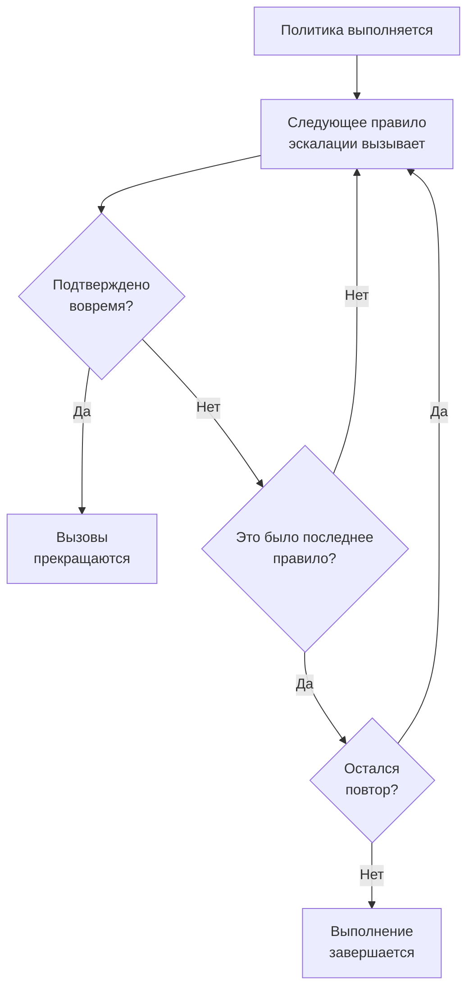

# Политики дежурств

Политика дежурства решает, кого вызывают по инциденту или оповещению и кто следующий, если никто не подтверждает. Её правила эскалации — это её уровни, а инциденты, оповещения и эпизоды, которые её используют, запускают её. На этой странице описано, как создать политику, что её запускает, что показывают её страницы и как записывается каждое выполнение.

:::cards
- [Создание политики](#создание-политики): Имя и тот, кого вызывают первым.
- [Что запускает политику](#что-запускает-политику): Правила, шаблоны, мониторы, чат и вы сами.
- [Журналы выполнения](#журналы-выполнения): Каждое выполнение, правило за правилом, и почему оно остановилось.
- [Архивирование и удаление политики](#архивирование-и-удаление-политики): Как вывести политику из работы.
:::

## Создание политики

:::steps
1. Перейдите в **Дежурство → Политики дежурств** и нажмите **Создать: Политика дежурства**.
2. Введите **Имя**, например «Платежи, основная».
3. В поле **Кого оповестить первым?** нажмите **Добавить получателя** и выберите расписания дежурств, команды и людей, которых нужно вызвать первыми.
4. Нажмите **Создать: Политика дежурства**. Политика откроется на своей странице **Правила эскалации**, где уже есть **Level 1**.
:::

Поле **Кого оповестить первым?** необязательное, и его видят только те, кто может добавлять правила эскалации: если оставить его пустым, политика никого не вызывает, пока у неё нет правила. **Описание** и **Метки** находятся в разделе **Дополнительные поля**. Как добавить следующие уровни, см. [Правила эскалации](/docs/on-call/escalation-rules).

Список **Политики дежурства** показывает для каждой политики **Имя**, **Описание**, **Метки** и **Владельцы**. Выберите политики, чтобы применить **Add Labels**, **Remove Labels**, **Add Owner**, **Remove Owner**, **Архивировать** или **Экспорт: JSON**, или чтобы удалить их. **Import JSON** создаёт политики из экспорта: экспорт содержит собственные настройки политики, но не её правила эскалации и не владельцев.

## Что запускает политику

Политика никого не вызывает, пока её что-нибудь не запустит. Каждый инцидент, оповещение и эпизод запускает свои политики сразу после создания:

| Что | Как добавляется политика | Подробнее |
| --- | --- | --- |
| Сама запись | Поле **Политика дежурства** при создании инцидента или оповещения, шаблон инцидента или свёрнутый блок **Дежурство** в критериях монитора | [Объявление инцидента](/docs/incidents/declaring-incidents) |
| Правила дежурства | **Инциденты → Правила → Правила дежурства** и **Оповещения → Правила → Правила дежурства** добавляют политики каждого подходящего правила | [Правила дежурства по инцидентам](/docs/incidents/settings#правила-дежурства-по-инцидентам) |
| Правила группировки | Правило группировки запускает свои политики, когда открывает эпизод | [Эпизоды оповещений и правила группировки](/docs/alerts/episodes) |
| Вручную | **Выполнить политику дежурства** в меню **Действия** ленты или в сообщении в Slack или Microsoft Teams | [Лента инцидента](/docs/incidents/notes-owners-and-feed#лента-инцидента) |
| Чат и рабочие процессы | `/oneuptime page` в Slack или Microsoft Teams и шаг **Page an On-Call Policy** рабочего процесса | [Paging](/docs/workflows/components#paging) |

Политика, которую добавляют несколько правил, выполняется один раз. Серьёзность сама по себе никогда не запускает политику: это делает правило дежурства, подходящее под эту серьёзность. Инцидент или оповещение, созданные уже подтверждёнными или устранёнными, не запускают ни одной своей политики. Правило дежурства в режиме **Только в рабочие часы** заставляет добавленные им политики ждать начала этих часов.

## Страницы политики

Откройте политику из списка. В её боковом меню собрано всё о ней:

| Раздел | Страницы |
| --- | --- |
| **Базовый** | **Обзор**, **Правила эскалации** и **Владельцы** |
| **Журналы** | **Журналы выполнения** и **Журналы уведомлений** |
| **Для разработчиков** | **Terraform**, **API** и **ИИ-ассистенты** |
| **Расширенный** | **Пользовательские переопределения**, **Пользовательские поля**, **Настройки**, **Журналы аудита** и **Удалить политику** |

Раздел **Базовый** открыт; остальные разделы свёрнуты, пока вы на них не нажмёте.

- **Обзор** показывает **Сведения о политике дежурства**, затем **Policy at a glance**: сколько у политики уровней и получателей, сколько времени проходит до её последнего уровня и как часто она повторяется. **Responder readiness** сообщает, можно ли сейчас связаться со всеми, кого она может вызвать, а **Лента политики дежурства** показывает, что изменилось: добавленные или удалённые люди, команды и расписания, переопределения и передачи смен.
- **Владельцы** — это люди и команды, отвечающие за политику. Если её вызов не находит правила для кого-то или не может быть доставлен, они получают письмо; политика без владельцев вместо этого пишет владельцам проекта.
- **Журналы уведомлений** показывают каждое сообщение, отправленное политикой, с вкладкой для каждого канала.
- **Пользовательские переопределения** заменяют людей только в этой политике. См. [Пользовательские переопределения](/docs/on-call/user-overrides).
- **Настройки** содержат **Экспорт: Политика дежурства** и карточку, которая архивирует политику.

## Повтор политики

Когда ожидание последнего уровня истекает, а никто не подтвердил, политика останавливается, если она не повторяется. Чтобы выбрать, откройте страницу **Правила эскалации** политики и нажмите **Редактировать** на карточке **Политика повтора** под правилами. **Редактировать политику повтора** спрашивает **Если никто не подтвердит после последнего уровня**:

| Ответ | Что он делает |
| --- | --- |
| **Прекратить оповещения** | Больше никто не оповещается, так что политика выполняется один раз. Новая политика начинается с этого ответа. |
| **Начать заново с Level 1** | Каждый уровень оповещается снова, по порядку. **Сколько ещё раз?** задаёт, сколько раз: 1 или больше. |

Политика, которая начинает заново ещё три раза, проходит свои уровни четыре раза. Строка **После последнего уровня** на карточке говорит, что делает политика, а **Policy at a glance** на странице **Обзор** говорит то же самое словами.

## Оповестить повторно, если не устранено

Подтверждение окончательно прекращает оповещения политики, даже если потом никто не устраняет инцидент или оповещение. Вместо этого политика может оповестить повторно: откройте её страницу **Правила эскалации**, откройте внизу **Дополнительные настройки** и нажмите **Редактировать** на карточке **Тайм-аут после подтверждения**. **Редактировать тайм-аут после подтверждения** спрашивает **Если подтверждено, но не устранено**:

| Ответ | Что он делает |
| --- | --- |
| **Не оповещать повторно** | Подтверждение окончательно прекращает оповещения. Новая политика начинается с этого ответа. |
| **Оповестить повторно** | Оповещает того, кто подтвердил, и того, кто дежурит сейчас. **Через сколько минут?** задаёт когда: от 5 до 1440, сначала 30. |

Минуты отсчитываются от каждого подтверждения, и политика повторно оповещает об одном инциденте, оповещении или эпизоде не более 5 раз. Повторное оповещение начинается с уровня, который оповещал в момент подтверждения, оповещает того, кто сейчас дежурит на этом уровне, и дальше проходит уровни, как первое выполнение. Инцидент или оповещение остаётся подтверждённым: повторное оповещение — это отдельное выполнение, в его ленте и в журналах выполнения политики, где его **Статус** показывает «Повторное оповещение (1 из 5)».

Тот, кого оповестили повторно, подтверждает его из сообщения или кнопкой **Подтвердить снова** на странице инцидента или оповещения, и отсчёт минут начинается заново; **Эскалировать** передаёт его следующему уровню. Его останавливает устранение или удаление инцидента или оповещения, архивирование или удаление политики либо выбор **Не оповещать повторно**. Строка **После подтверждения** на карточке говорит, что делает политика, а **Дополнительные настройки** показывают минуты, пока раздел свёрнут. **Policy at a glance** на странице **Обзор** и **Escalation summary** говорят то же самое словами.

## Журналы выполнения

Каждый раз, когда политика выполняется, она пишет журнал выполнения, и журнал проходит свои статусы по ходу выполнения:

| Статус | Что он означает |
| --- | --- |
| **Ожидание** | Правило дежурства в режиме **Только в рабочие часы** заставляет выполнение ждать начала этих часов: оно сообщает, когда начнётся вызов, и до тех пор никого не вызывает. Оно завершается без вызова, если инцидент или оповещение подтвердят или устранят раньше. Оно тут же начинает вызов, если инцидент или оповещение изменится и теперь подойдёт правилу дежурства, которое вызывает сразу. |
| **Запланировано**, **Началось** | Выполнение подготавливается. Если оно остаётся в этом статусе через 5 минут, его останавливают со статусом **Ошибка**. |
| **Executing** | Выполнение вызывает людей. OneUptime продвигает его каждую минуту. |
| **Execution Completed** | Кто-то подтвердил, инцидент или оповещение устранены, все правила и повторы использованы или политика архивирована. |
| **Execution Completed - No One Notified** | Выполнение прошло все правила и никого не вызвало: обычно это расписание, в котором никто не дежурит. |
| **Ошибка** | Выполнение не удалось. **Просмотреть сообщение о статусе** объясняет почему. |

Журналы выполнения можно найти в трёх местах:

- на странице **Журналы выполнения** самой политики, в разделе **Журналы**;
- в **Дежурство → Расширенный → Журналы выполнения**, для всех политик, где прямые вызовы из рабочих процессов и чата показаны как **Прямой вызов**;
- на странице **Выполнения дежурств** инцидента или оповещения.

В каждой строке видно, что запустило выполнение, когда, его **Статус** и кто его подтвердил. **View Timeline** открывает **Хронология выполнения**: каждое правило эскалации, кого оно вызвало, через какое расписание и чем закончился каждый вызов. Расписание, в котором никто не дежурит, показывает **No one was on call** вместо человека. В OneUptime Cloud журналы выполнения требуют тарифа **Growth**.

## Архивирование и удаление политики

Архивирование выводит политику из работы и сохраняет всё: откройте **Настройки** политики и нажмите **Архивировать** на её карточке архивации или отметьте политики в списке и выберите **Архивировать**.

- Архивированная политика никого не вызывает. Инциденты и оповещения, которые её используют, пропускают её, а выполнение, которое ещё эскалирует, останавливается на следующем шаге.
- Она уходит из списка **Политики дежурств** в **Дежурство → Расширенный → Архивированные политики**, где **Извлечь из архива** возвращает её в работу.

**Удалить политику** в разделе **Расширенный** удаляет политику вместе с её правилами эскалации и пользовательскими переопределениями. Удаление из списка сначала спрашивает подтверждение и предлагает вместо этого архивировать.

## Кто может изменять политику

**Project Owner**, **Project Admin**, **Project Member**, **On-Call Admin** и **On-Call Member** могут создавать, изменять и удалять политики; **Viewer** и **On-Call Viewer** могут их просматривать. В пользовательской роли разрешения называются **Create On-Call Duty Policy**, **Edit On-Call Duty Policy**, **Delete On-Call Duty Policy** и **Read On-Call Duty Policy**, а роль, ограниченная некоторыми метками, видит только политики с этими метками. Добавление владельцев и пользовательских полей в OneUptime Cloud требует тарифа **Growth**.

## API и Terraform

Политики дежурства — это ресурс `/api/on-call-duty-policy` и ресурс `oneuptime_on_call_policy` в Terraform:

| Настройка | Поле API |
| --- | --- |
| **Имя** | `name` |
| **Описание** | `description` |
| **Если никто не подтвердит после последнего уровня** | `repeatPolicyIfNoOneAcknowledges` |
| **Сколько ещё раз?** | `repeatPolicyIfNoOneAcknowledgesNoOfTimes` |
| **Через сколько минут?** | `acknowledgementTimeoutInMinutes` |
| Архивирована | `isArchived` |

`repeatPolicyIfNoOneAcknowledges` равно `false` для **Прекратить оповещения** и `true` для **Начать заново с Level 1**. При `true` значение `repeatPolicyIfNoOneAcknowledgesNoOfTimes` должно быть целым числом от 1: OneUptime отклоняет `0`. Старая политика, сохранённая с `0`, никогда не повторяется, и панель показывает её как **Прекратить оповещения**.

`acknowledgementTimeoutInMinutes` равно `null` для **Не оповещать повторно** и целому числу минут от 5 до 1440 для **Оповестить повторно**. Любое другое значение OneUptime отклоняет.

Как создать политику с первым уровнем одним запросом, см. [Создание правил через API или Terraform](/docs/on-call/escalation-rules#создание-правил-через-api-или-terraform).

## Устранение неполадок

:::details Политика выполнилась, но никого не вызвали
Её выполнение показывает **Execution Completed - No One Notified**. Откройте **View Timeline**: строка **No one was on call** указывает на расписание с пробелом, а сообщение о статусе строки **Пропущено** объясняет причину, например человек отсутствовал и его некому было заменить. **Дежурство → Готовность** показывает, с кем не удалось связаться.
:::

:::details Следующий уровень вызвали через минуту после его ожидания
OneUptime продвигает выполняющиеся политики раз в минуту, поэтому уровень вызывается при первой проверке после истечения его ожидания.
:::

:::details Инцидент показывает политику, которая никого не вызвала
Политика архивирована: архивированная политика остаётся в инцидентах и оповещениях, которые её используют, никого не вызывает, а её журнал выполнения сообщает, что она не выполнялась. Извлеките её из архива в **Дежурство → Расширенный → Архивированные политики**.
:::

## Дальнейшие шаги

:::cards
- [Правила эскалации](/docs/on-call/escalation-rules): Добавьте уровни, которые вызывает политика, и сколько ждёт каждый из них.
- [Пользовательские переопределения](/docs/on-call/user-overrides): Направляйте вызовы человека коллеге, пока он отсутствует.
- [Готовность и отчеты](/docs/on-call/readiness): Проверьте, что со всеми, кого вызывает политика, можно связаться.
:::
