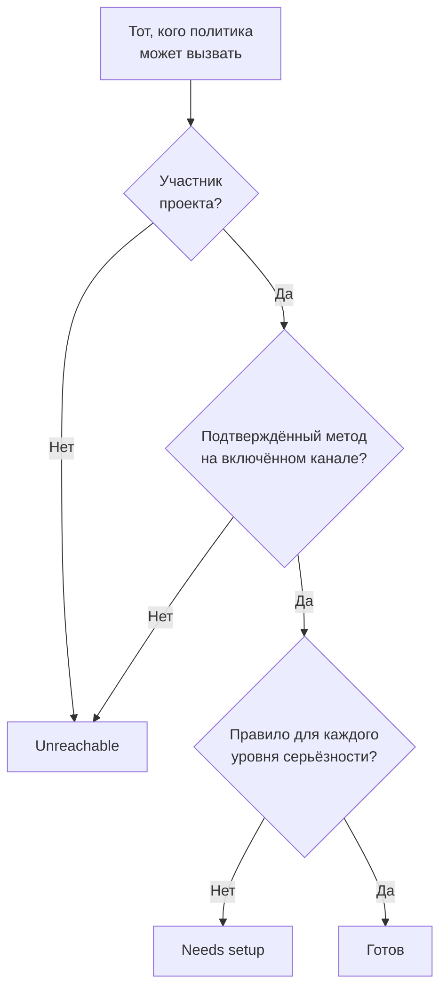

# Готовность и отчеты

Готовность отвечает на вопрос раньше, чем это сделает инцидент: если бы что-то сработало прямо сейчас, удалось бы связаться со всеми, кого вызывают ваши политики дежурства? Страница перечисляет всех получателей в проекте, показывает, кто готов, а кто нет, и позволяет напомнить людям завершить настройку. Отчёт **Время дежурства пользователя** затем показывает, сколько дежурил каждый человек.

:::cards
- [Как определяется статус](#как-определяется-статус): Готов, Needs setup или Unreachable, и почему.
- [Страница Готовность](#страница-готовность): Все получатели в проекте в одном списке.
- [Напомните людям завершить настройку](#напомните-людям-завершить-настройку): Письмо, в котором сказано, чего не хватает.
- [Время дежурства пользователя](#время-дежурства-пользователя): Сколько дежурил каждый человек.
:::

## Как определяется статус

Получатель — это любой, кого может вызвать политика дежурства: человек, указанный в правиле эскалации, участник команды, которую вызывает правило, человек в слое расписания, которое вызывает правило, и заменяющий в пользовательском переопределении, которое ещё не закончилось. Расписание, которое не вызывает ни одна политика, никого не добавляет.

| Статус | Что он означает |
| --- | --- |
| **Готов** | У человека есть подтверждённый метод на канале, который включён в проекте, и правило для каждого уровня серьёзности на каждой вкладке его правил дежурства. |
| **Требует настройки** | С человеком можно связаться, но для некоторых уровней серьёзности нет правила. В строке указано число этих пробелов. |
| **Недоступно** | До человека ничего не доходит: нет подтверждённого метода, все подтверждённые методы на каналах, которые в проекте выключены, или он не участник проекта. |

Пробел — это уровень серьёзности без правила на вкладке инцидентов, эпизодов инцидентов, оповещений или эпизодов оповещений. Правило, которое намеренно выключает уровень серьёзности, пробелом не считается. Вызов, попавший в пробел, всё равно доходит до человека через его подтверждённые методы, если только проект не выключил этот запасной путь: см. [Когда ни одно правило не подходит](/docs/notifications/index#когда-ни-одно-правило-не-подходит).

## Страница Готовность

Откройте **Дежурство → Готовность**. Карточка **On-call readiness** перечисляет всех, с кем может связаться любая политика дежурства в проекте, и сначала тех, кому что-то нужно. Открыть её может любой участник проекта.

Над списком плитки показывают число **Получатели**, **Готов**, **Требует настройки** и **Недоступно**. Нажмите **Готов**, **Требует настройки** или **Недоступно**, чтобы показать только этих получателей, и нажмите ещё раз, чтобы показать всех.

| Столбец | Что он показывает |
| --- | --- |
| **Получатель** | Человек и его адрес электронной почты. |
| **Статус** | **Готов**, **Недоступно** или сколько у человека пробелов. |
| **Команды** | Команды, которые вызывают человека через правило эскалации. |
| **Каналы** | По сегменту на канал: заполненный для подтверждённого метода, пустой для ещё не подтверждённого. |
| **Coverage** | Для скольких уровней серьёзности есть правило на каждой вкладке, из всех. |
| **Reached via** | Как политики связываются с человеком: `Direct`, `Team`, `Schedule` или `Override`. |

**Coverage** в строке показывает методы уведомлений человека, почему у него такой статус, и сетку всех уровней серьёзности с правилом или без него. Воронка фильтрует список по **Получатель**, **Статус**, **Команда** или **Reached via**. Ответ может быть минутной давности: **Обновить** определяет его заново.

## Напомните людям завершить настройку

Добавить и подтвердить свои методы уведомлений и правила может только сам человек, поэтому решение — попросить его об этом.

:::steps
1. На странице Готовность отметьте получателей, которым нужно напомнить. Готовых получателей отметить нельзя: напоминать им не о чем.
2. Нажмите **Отправить напоминание о настройке**. В подтверждении перечислены все, кому сейчас будет отправлено письмо.
3. Подтвердите. Каждый человек получит одно письмо о том, чего не хватает в его собственной настройке, со ссылкой на страницу, где это исправляется.
:::

Затем баннер сообщает, сколько напоминаний отправлено, пропущено или не удалось отправить, и почему для каждого неотправленного. Никому не напоминают чаще одного раза за 24 часа, а за один раз можно напомнить не более чем 250 людям. Для отправки напоминаний нужна роль **Владелец проекта**, **Администратор проекта** или **Администратор дежурств** либо разрешение **Edit On-Call Duty Policy** в пользовательской роли.

## Готовность на других страницах

- На странице **Обзор** политики блок **Готовность получателей** перечисляет всех, кого эта политика может вызвать и кому нужно внимание, а **Проверить снова** проверяет это заново. В вашей собственной строке есть кнопка на страницу, где это исправляется; строка другого человека открывает письмо ему в вашем почтовом клиенте с исправлением внутри.
- На странице **Правила эскалации** политики уровень сообщает на своей карточке, если вызвать всех его получателей нельзя. См. [Сводка эскалации](/docs/on-call/escalation-rules#сводка-эскалации).
- В разделе **Пользователи** откройте участника, затем **Готовность** в разделе **Дежурство**: его статус, методы и сетка покрытия.
- Для вашей собственной настройки **Настройки пользователя → Контрольный список настройки** проведёт вас по шагам. См. [Контрольный список настройки](/docs/notifications/index#контрольный-список-настройки).

## Еженедельное письмо о готовности

Раз в неделю OneUptime проверяет каждый проект, в котором есть политика дежурства. Если кто-то в нём **Недоступно** или **Требует настройки**, владельцы проекта получают одно письмо, где эти люди перечислены в двух группах — кого нельзя вызвать вообще и с кем можно связаться с пробелами, — до 20 имён в каждой, со ссылкой на страницу Готовность.

Если за неделю все готовы, ничего не отправляется, поэтому письмо всегда означает, что что-то нужно исправить. Если кого-то нельзя вызвать вообще, тема письма начинается с `[Action Required]`.

## Время дежурства пользователя

**Дежурство → Отчеты → Время дежурства пользователя** показывает, сколько дежурил каждый человек за выбранный вами период: для начала **Последний месяц**.

| Столбец | Что он показывает |
| --- | --- |
| **Пользователь** | Человек. |
| **Время, когда пользователь был на дежурстве** | Время его дежурства за период, в часах и минутах. |

Время записывается по мере того, как люди заступают на дежурство и сменяются: с момента, когда расписание, которое вызывает правило, передаёт им смену или их добавляют в правило напрямую или через команду, до передачи смены или до того, как их убирают. Дежурство сразу по двум политикам считается один раз, а продолжающееся время считается до текущего момента.

**Хронология дежурств** и календарные ленты показывают прошлые смены так, как ротация настроена сегодня. Этот отчёт записывается по ходу событий, поэтому используйте его для справедливого распределения и оплаты дежурств.

> [!NOTE]
> В OneUptime Cloud отчёт требует тарифа **Growth**, а время, которое закончилось более 200 дней назад, удаляется. Самостоятельно размещённая установка хранит всё.

## Устранение неполадок

:::details Человек недоступен, хотя у него есть подтверждённый номер телефона
Возможно, все его методы на каналах, которые в проекте выключены: SMS, звонки, WhatsApp и Telegram в новом проекте выключены. См. [Включите канал для проекта](/docs/notifications/notification-methods#включите-канал-для-проекта).
:::

:::details Кого-то нет в списке
В списке только те, кого может вызвать политика дежурства. Участник команды, который не принял приглашение, человек в расписании, которое не вызывает ни одна политика, и заменяющий, чьё переопределение закончилось, в него не попадают.
:::

:::details Владельцы никогда не получают еженедельное письмо
Оно отправляется только в ту неделю, когда кто-то **Недоступно** или **Требует настройки**, и только владельцам проекта.
:::

## Дальнейшие шаги

:::cards
- [Как OneUptime связывается с вами](/docs/notifications/index): Методы, правила и запасной путь, стоящие за каждым статусом.
- [Методы уведомлений](/docs/notifications/notification-methods): Добавьте и подтвердите способы, которыми OneUptime связывается с человеком.
- [Личные правила дежурства](/docs/notifications/on-call-rules): Закройте пробелы, уровень серьёзности за уровнем.
:::
