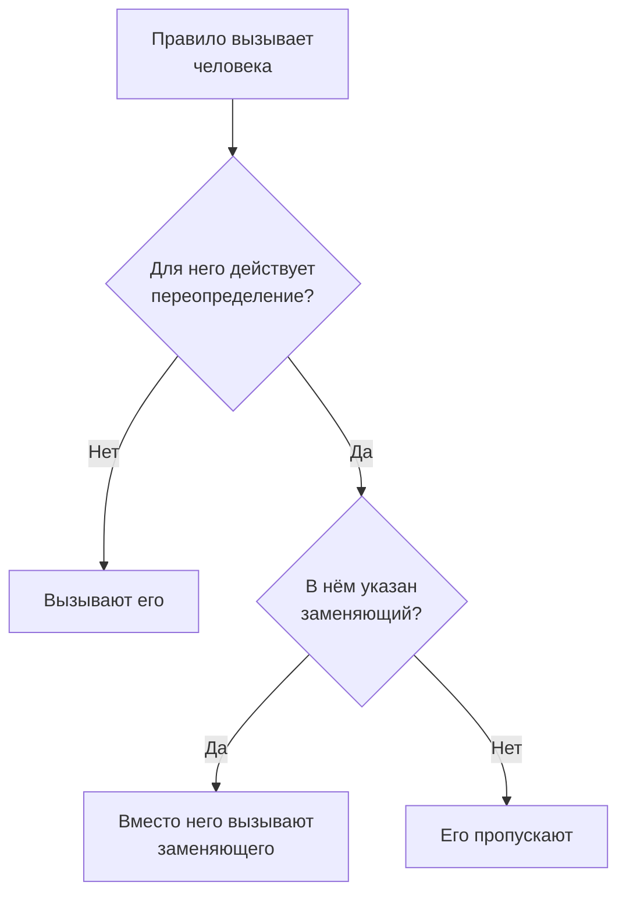

# Пользовательские переопределения

Пока человек отсутствует, пользовательское переопределение на заданное время направляет вызовы, которые дошли бы до него, тому, кто его заменяет. Если заменяющий не указан, переопределение вместо этого пропускает человека: каждая его смена в расписании дежурств переходит к следующему в ротации. Используйте его для отпуска, больничного или обмена сменами.

:::cards
- [Как переопределение меняет вызов](#как-переопределение-меняет-вызов): Кого вызывают вместо человека и когда.
- [Добавление переопределения](#добавление-переопределения): Кто отсутствует, кто заменяет, с какого и до какого времени.
- [Все политики или одна](#все-политики-или-одна): Где добавить переопределение и какое из них главнее.
- [Другие способы добавить его](#другие-способы-добавить-его): Из расписания и из ваших предстоящих смен.
:::

## Как переопределение меняет вызов



Пока переопределение действует, от его начала до конца:

- Если в поле **Кто заменяет?** кто-то указан, этот человек получает все вызовы отсутствующего из каждого расписания, команды и правила, к которым относится переопределение. Вызов доходит до него по его собственным личным правилам дежурства.
- Если заменяющего нет, человека пропускают. В расписании дежурств каждая его смена переходит к следующему в ротации, кто не отсутствует; если отсутствуют все в слое, дежурство берут на себя слои под ним. Правило, которое называет человека напрямую или через команду, его не вызывает, а выполнение политики показывает, что он отсутствует и до какого времени.
- Переопределения не образуют цепочек. Если заменяющий тоже отсутствует, вызывают всё равно его — за того, кого он заменяет.

Когда переопределение заканчивается, вызовы снова достаются самому человеку. **Хронология дежурств**, слои расписания и календарные ленты показывают, у кого каждая замещённая смена.

## Добавление переопределения

:::steps
### Откройте переопределения

Перейдите в **Дежурство → Расширенный → Пользовательские переопределения**, чтобы заменить человека во всех политиках дежурства, или на страницу **Пользовательские переопределения** самой политики в разделе **Расширенный**, чтобы заменить его только в этой политике. Нажмите **Добавить: Пользовательское переопределение**.

### Укажите, кто отсутствует

В поле **Кто отсутствует?** сначала указаны вы, потому что чаще всего оформляют собственный отгул. Выберите другого человека, чтобы найти замену для него.

### Укажите, кто заменяет

Оставьте в поле **Кто заменяет?** значение **Следующий в ротации**, чтобы пропустить человека, или выберите коллегу, который примет все его вызовы. Отсутствующего человека в списке нет.

### Задайте время

**Начинается** — сейчас, если вы не выберете другое время. Задайте в **Заканчивается** момент, когда человек вернётся: он должен быть позже начала. Нажмите **Добавить: Пользовательское переопределение**.
:::

Каждое переопределение — это строка: **Отсутствует**, **Замещающий**, **Начинается** и **Заканчивается**, с фильтрами по началу и концу. Для пропуска в столбце **Замещающий** указано **Следующий в ротации**. Переопределение нельзя изменить: удалите его и добавьте новое или удалите его, чтобы вернуть человека раньше.

## Все политики или одна

| Где добавлено | Карточка | Действует для |
| --- | --- | --- |
| **Дежурство → Расширенный → Пользовательские переопределения** | **Глобальные пользовательские переопределения** | Всех политик дежурства в проекте |
| **Пользовательские переопределения** политики | **Пользовательские переопределения политики дежурства** | Только этой политики |

Если два переопределения для одного человека пересекаются, собственное переопределение политики главнее глобального, а переопределение с заменяющим главнее пропуска. Вызов без политики, из рабочего процесса или из чата, учитывает только глобальные переопределения.

## Другие способы добавить его

- Из расписания: на странице **Слои** расписания раскройте слой и нажмите **Пропускать до…** рядом с человеком. Откроется та же форма, где он указан как отсутствующий, а заменяет ротация, как глобальное переопределение. См. [Когда кто-то отсутствует](/docs/on-call/schedules#когда-кто-то-отсутствует).
- Из ваших предстоящих смен: **Найти замену** у одной из ваших смен в **Настройки пользователя → Календарь → Календарная лента** открывает форму, где вы отсутствуете на время этой смены, так что остаётся только **Кто заменяет?**. См. [Предстоящие смены и замена](/docs/on-call/calendar-feeds#предстоящие-смены-и-замена).

Когда человек покидает проект, все ещё не закончившиеся переопределения, в которых он указан, удаляются, с любой стороны.

## Кто может добавлять переопределения

**Владелец проекта**, **Администратор проекта**, **Участник проекта**, **Администратор дежурств** и **Участник дежурств** могут добавлять и удалять переопределения; **Зритель** и **Зритель дежурств** могут их просматривать. В пользовательской роли разрешения называются **Create On-Call Duty Policy User Override**, **Delete On-Call Duty Policy User Override** и **Read On-Call Duty Policy User Override**. На странице **Хронология дежурств** только те, кто может читать переопределения, видят, чью смену замещают.

В OneUptime Cloud пользовательские переопределения требуют тарифа **Growth**.

## API

Пользовательские переопределения — это ресурс `/api/on-call-duty-policy-user-override`:

| Поле | Что в нём |
| --- | --- |
| `overrideUserId` | Человек, который отсутствует. Обязательное. |
| `routeAlertsToUserId` | Человек, который заменяет. Не указывайте его, чтобы вместо этого пропустить человека. |
| `startsAt`, `endsAt` | Когда переопределение начинается и заканчивается. Оба обязательны, и конец наступает после начала. |
| `onCallDutyPolicyId` | Политика, к которой оно относится. Не указывайте его для глобального переопределения. |

```bash
curl -X POST https://oneuptime.com/api/on-call-duty-policy-user-override \
  -H "apikey: $ONEUPTIME_API_KEY" \
  -H "Content-Type: application/json" \
  -d '{
    "data": {
      "projectId": "<project-id>",
      "overrideUserId": "<away-user-id>",
      "routeAlertsToUserId": "<cover-user-id>",
      "startsAt": "2026-12-22T09:00:00Z",
      "endsAt": "2027-01-05T09:00:00Z"
    }
  }'
```

Переопределение, в котором отсутствующий и заменяющий — один и тот же человек, отклоняется, как и переопределение, которое заканчивается раньше, чем начинается.

## Устранение неполадок

:::details Человека в отпуске всё равно вызвали
Проверьте, где было добавлено переопределение. Переопределение на странице **Пользовательские переопределения** политики действует только для этой политики, и другие политики продолжают его вызывать: добавьте его в **Дежурство → Расширенный → Пользовательские переопределения**, чтобы охватить все политики. Проверьте также **Начинается** и **Заканчивается**: время показано в вашем часовом поясе.
:::

:::details Заменяющего тоже не вызвали
С ним связываются по его собственным личным правилам дежурства и подтверждённым методам. Найдите его в **Дежурство → Готовность** и проверьте выполнение на странице **Журналы выполнения** политики.
:::

:::details Я не могу добавить переопределение
Для этого нужна одна из ролей выше, а в OneUptime Cloud — тариф **Growth**.
:::

## Дальнейшие шаги

:::cards
- [Расписания дежурств](/docs/on-call/schedules): Ротации, слои и пропуск человека в слое.
- [Хронология дежурств](/docs/on-call/schedule-timeline): Все замещённые смены во всех расписаниях.
- [Календарные ленты](/docs/on-call/calendar-feeds): Найдите замену для одной из своих смен.
:::
