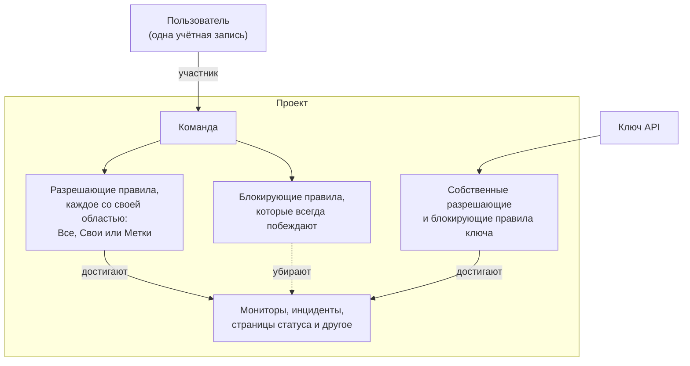
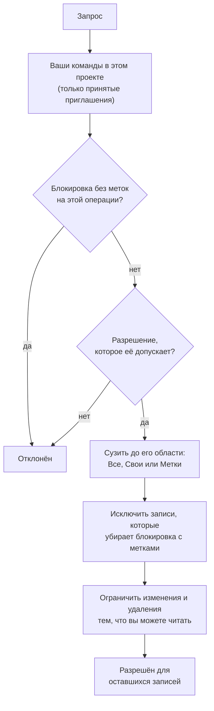

# Пользователи, команды и разрешения

Всё в OneUptime находится внутри **проекта**. Кто и что может делать внутри проекта, определяют три вещи: **пользователи** в нём, **команды**, к которым эти пользователи принадлежат, и **разрешения**, выданные этим командам.

> [!IMPORTANT]
> **У пользователей никогда не бывает разрешений напрямую.** Доступ пользователя — это объединение разрешений всех команд, в которых он состоит в данном проекте. Чтобы изменить то, что человек может делать, вы меняете его членство в команде либо разрешения этой команды.

**Владельцы** — отдельная идея. Владелец — это тот, кто отвечает за конкретный ресурс: монитор, инцидент, дашборд. Владельцам приходят уведомления об их ресурсах, а разрешения при желании можно сузить до «только то, что принадлежит мне».

## Как устроен доступ

| Понятие | Что это |
| --- | --- |
| Пользователь | Одна учётная запись OneUptime. Один вход, сколько угодно проектов. |
| Проект | Граница арендатора. Мониторы, инциденты, команды и данные принадлежат ровно одному проекту. |
| Команда | Именованная группа внутри проекта, которая несёт разрешения. |
| Участник команды | Пользователь, приглашённый в команду и принявший приглашение. |
| Разрешение | Одна возможность, например `CreateProjectMonitor`, или роль, объединяющая многие, например `MonitorAdmin`. |
| Область | Насколько широко действует разрешающее правило: на все ресурсы, только на свои или только на помеченные. |
| Владелец | Пользователь или команда, отмеченные ответственными за конкретный ресурс. |
| Метка | Пометка на ресурсах, используемая для ограничения разрешений и для организации. |

## Пользователи

Учётная запись пользователя глобальна для установки OneUptime — один и тот же вход работает во всех проектах, куда пользователя пригласили.

Пользователь находится «в» проекте, когда он состоит **хотя бы в одной команде** этого проекта. Отдельного шага «добавить пользователя в проект» нет: пригласить кого-то в проект — значит пригласить его в команду.

:::steps
1. Откройте **Пользователи** в меню **Продукты**, в разделе **Настройки**, и нажмите **Пригласить пользователя**. В списке показаны все, кто есть в проекте, и статус их приглашений.
2. Введите адрес в поле **Электронная почта**. У того, у кого ещё нет учётной записи OneUptime, также спрашивается **Имя**.
3. Выберите **Команда**, которая определяет, что человек может делать, и нажмите **Пригласить**.
4. Человек принимает приглашение через колокольчик в правом верхнем углу, на странице **Приглашения в проект**, и с этого момента состоит в проекте.
:::

- Приглашение создаёт участника команды в состоянии ожидания. Пользователь считается участником проекта — и получает хоть какие-то разрешения — **только после того, как принял приглашение.**
- **Пригласить пользователя** начинает с команды участников проекта: команды, у которой есть `ProjectMember` на весь проект, то есть **Members**, если вы её не переименовали. Выберите другую команду, чтобы дать человеку больше или меньше доступа. Ничего не выбрано, если вы сами не можете приглашать в эту команду — приглашение передаёт человеку разрешения команды, а передать можно только те разрешения, которые есть у вас самих, — или если в проекте нет такой команды. Панель администратора начинает с той же команды везде, где администратор экземпляра добавляет кого-то в проект: **Пригласить пользователя** в проекте, **Добавить в проект** у пользователя и у нескольких пользователей сразу, а также в проектах, привязанных к [глобальному поставщику SSO](/docs/identity/global-sso).
- Удаление пользователя из всех команд проекта лишает его доступа к проекту начиная со следующего запроса — даже пока он остаётся в системе. Его учётная запись и другие проекты не затрагиваются. Его убирают из графиков дежурств, правил эскалации и переопределений проекта, из ролей открытых инцидентов и эпизодов проекта и из владельцев его ресурсов; решённые инциденты сохраняют сведения о том, кто ими владел и кто их вёл.
- Тот, кто покидает проект, перестаёт получать его уведомления. Его собственные способы, правила и настройки уведомлений для проекта удаляются вместе с последней командой — электронная почта, SMS, звонки, WhatsApp, Telegram, push, вебхуки, Slack и Microsoft Teams, сводка по электронной почте и ещё не отправленное письмо, номер для входящих звонков и напоминания о дежурствах, — поэтому при повторном вступлении всё начинается с настроек по умолчанию. То, что по-прежнему его упоминает, например пользователь, которому звонит правило входящих звонков, или владелец, сохранённый в решённом инциденте, больше не отправляет ему уведомлений: от имени проекта ничего не отправляется тому, кто не является его участником, а ожидающее приглашение ещё не означает участия. В этих местах рядом с именем отображается **Больше не участник**, чтобы вы могли назначить кого-то другого. Для приглашённого, который ещё не принял приглашение, вместо этого отображается **Приглашение ещё не принято**. Если переопределение направляет чьи-то вызовы человеку, который покинул проект, вместо него вызывается тот, кого оно замещает. Уход также отключает MCP-клиенты, которые человек подключил к проекту, а его личная ссылка на дежурный календарь с этого момента показывает пустой календарь. В OneUptime Cloud тот, кто возвращается через единый вход (SSO) проекта, снова подтверждает его из своей почты.
- Если проект требует SSO, а пользователь ещё не прошёл проверку через поставщика удостоверений, он считается неавторизованным SSO-пользователем и ничего не видит, пока не пройдёт. См. [SSO](/docs/identity/sso).
- При настроенном SCIM ваш поставщик удостоверений может автоматически создавать, обновлять и удалять пользователей и их членство в командах. См. [SCIM](/docs/identity/scim).

## Команды

Команды — это путь, которым разрешения доходят до людей. Каждый новый проект начинается с трёх:

| Команда | Её разрешение | Редактируется |
| --- | --- | --- |
| Owners | `ProjectOwner` | Нет. Всегда содержит хотя бы одного участника. |
| Admin | `ProjectAdmin` | Нет |
| Members | `ProjectMember` | Да — это отправная точка, меняйте свободно |

Команды **Owners** и **Admin** намеренно заблокированы: их разрешения нельзя изменить, а сами команды нельзя удалить или переименовать. Именно это не даёт проекту случайно закрыть доступ самому себе. В команде Owners всегда должен оставаться хотя бы один участник.

`ProjectOwner` — высший уровень доступа: биллинг, удаление проекта и всё, что может администратор. `ProjectAdmin` покрывает всё, кроме биллинга и удаления проекта.

Включение и выключение SMS, телефонных звонков, WhatsApp или Telegram для проекта относится к биллингу, потому что каждое сообщение стоит денег. Менять эти переключатели в разделе **Настройки проекта > Уведомления > Настройки уведомлений** могут только `ProjectOwner`, роль `BillingAdmin` (**Billing Admin**) и разрешение `ManageProjectBilling` (**Manage Billing**), но не `ProjectAdmin`.

Пополнение предоплаченных балансов проекта тоже относится к биллингу. В OneUptime Cloud SMS, телефонные звонки, WhatsApp и Telegram оплачиваются с баланса в разделе **Настройки проекта > Уведомления > Настройки уведомлений**, а ИИ — из кредитов ИИ в разделе **Настройки проекта > ИИ > Кредиты ИИ**. Пополнять их и менять их **Автопополнение** может только владелец проекта или пользователь с разрешением **Manage Billing**, но не администратор проекта. В сообщении о том, что баланс заканчивается, сказано, кто может его пополнить, и только эти люди видят рабочую кнопку **Пополнить баланс** или ссылку на страницу.

Создавайте сколько угодно дополнительных команд — «Дежурные фронтенда», «Поддержка», «Аудиторы только для чтения» — и давайте каждой нужные разрешения. В OneUptime Cloud для создания команды и изменения её разрешений нужен тариф Scale.

**Создание команды** запрашивает имя и **Доступ** команды — то, что могут делать её участники:

| Доступ | Что могут делать участники команды |
| --- | --- |
| Администратор проекта | Создавать, изменять и удалять всё в проекте, включая его настройки. Но не биллинг и не удаление проекта. |
| Участник проекта | Создавать, изменять и удалять мониторы, инциденты, страницы статуса и другие ресурсы проекта. |
| Зритель | Читать всё в проекте и ничего не менять. |
| Выбрать разрешения позже | Пока ничего. Выбрано по умолчанию. |

:::steps
1. Откройте **Команды** в меню **Продукты**, в разделе **Настройки**, и нажмите **Создать команду**.
2. Введите **Имя** команды и выберите её **Доступ**. Описание находится в разделе **Дополнительные поля**.
3. Создайте команду. Команда с ролью открывается на своей странице **Участники**, где можно сразу приглашать людей; с **Выбрать разрешения позже** она открывается на своей странице **Права доступа**, где вы добавляете более узкую роль, например `IncidentMember`, или отдельные разрешения.
:::

Выбранная роль становится первым разрешением команды, для всех ресурсов проекта, сразу после создания команды — точно так же, как если бы вы добавили её кнопкой **Добавить роль** на странице «Права доступа» команды. Вам предлагаются только роли, которые есть у вас самих, потому что каждый, кого вы пригласите в команду, получает её разрешения, а того, кто может создавать команды, но не менять, что они могут делать, об этом не спрашивают. Если роль не удаётся добавить, команда всё равно создаётся, и уведомление над списком ведёт к ней.

Где найти: откройте команду в разделе **Команды**, чтобы перейти к страницам **Участники** и **Права доступа**; **Заблокировать разрешения** находятся в разделе **Дополнительные настройки** внизу страницы «Права доступа», а его свёрнутый заголовок показывает, сколько их у команды.

## Разрешения

Разрешение — это одна возможность. Раздавать их можно двумя способами, и оба находятся на вкладке **Права доступа** команды.

### Роли

Роль объединяет целую область продукта на одном из трёх уровней:

- **Admin** — то же, что Member, плюс собственная настройка области, например уровни серьёзности и состояния инцидентов и оповещений, статусы мониторов и состояния обслуживания.
- **Member** — повседневная работа: создавать, изменять и удалять ресурсы области вместе с их заметками, владельцами и шаблонами. Для страниц статуса и дежурств Member может всё, что может Admin.
- **Viewer** — только чтение.

`MonitorAdmin`, `IncidentMember`, `StatusPageViewer` и так далее. Роли подходят почти всегда — они остаются корректными по мере появления новых возможностей в OneUptime, потому что новая таблица, связанная с мониторами, добавляется в существующие роли мониторов, а не требует новой выдачи от вас.

Рабочие процессы и runbook-и — исключение. И те и другие выполняют код в вашем проекте — рабочий процесс свои шаги, runbook свои скрипты на ваших Runner'ах, — поэтому `WorkflowMember` открывает рабочие процессы и их запуски и запускает их вручную, а `RunbookMember` открывает runbook-и и их запуски и запускает их: начинает запуск, завершает или пропускает его шаги и отменяет его. Ни одна из ролей не создаёт, не изменяет и не удаляет то, что запускает; это делают `WorkflowAdmin` и `RunbookAdmin`. Роль запускает только те runbook-и, до которых дотягивается её область действия: `RunbookMember`, ограниченный некоторыми метками, запускает runbook-и с этими метками. См. [Разрешения рабочих процессов](/docs/workflows/configuration#разрешения) и [Разрешения runbook-ов](/docs/runbooks/configuration#разрешения).

Правила области (правила меток, владельцев, дежурств, группировки и напоминаний), пользовательские поля, SLA и секреты — это настройка проекта: для них нужен `ProjectAdmin`, какая бы роль области ни была у человека. То же касается ключей API, команд и их разрешений, меток, SSO и доменов — роли Settings отвечают за сервисы, пробы, инфраструктуру и интеграции проекта, а не за то, кто что может.

У биллинга три собственные роли. `BillingViewer` читает биллинг проекта — тариф и подписку, счета, использование, балансы, кредиты ИИ, способы оплаты и платёжные контактные данные — и ничего не меняет. `BillingMember` также скачивает счета и меняет платёжные контактные данные. `BillingAdmin` делает то же, что `BillingMember`, и включает и выключает SMS, телефонные звонки, WhatsApp и Telegram. Менять тариф, способы оплаты или балансы и оплачивать счета может только `ProjectOwner` или **Manage Billing**; на страницах биллинга эти кнопки заблокированы для всех остальных и подсказывают, кто может ими пользоваться.

Все {{PERMISSION_ROLE_COUNT}} ролей перечислены в [Справочнике разрешений](/docs/permissions/reference).

### Детальные разрешения

Каждую отдельную возможность можно выдать и по отдельности — `CreateProjectMonitor`, `ReadProjectIncident`, `DeleteProjectStatusPage` и ещё {{PERMISSION_TOTAL_COUNT}}. Используйте их, когда роль слишком широка и нужно выдать ровно одну вещь.

Разрешение изменять или удалять что-либо действует только на то, что вы также можете читать, поэтому выдавайте вместе с ним соответствующее разрешение на чтение: `EditProjectIncident` без `ReadProjectIncident` не изменяет ни одного инцидента. Запись, которая читается через другую, например заметка к инциденту, также требует разрешения на чтение этой другой записи: `ReadIncidentInternalNote` без разрешения на чтение инцидентов не достигает ни одной заметки, а `CreateIncidentInternalNote` добавляет заметку только к инциденту, который вы можете читать. Роли уже включают и то, и другое.

Это же ключи, которые вы используете при создании ключей API, и те, которых ожидают API и провайдер Terraform.

Полный список — в [Справочнике разрешений](/docs/permissions/reference).

### Разрешить и заблокировать

У каждой команды два списка:

- **Права доступа** (разрешить) — что эта команда может делать.
- **Заблокировать разрешения** — что эта команда не может делать никогда, независимо от любых разрешающих записей.

Оба находятся на странице **Права доступа** команды. Блокировка нужна немногим командам, поэтому блокирующие разрешения свёрнуты в раздел **Дополнительные настройки** внизу страницы.

> [!WARNING]
> **Блокировка всегда побеждает.** Блокирующая запись без меток полностью убирает эту возможность у команды. Блокирующая запись с метками убирает её только для ресурсов с этими метками — удобно для «эта команда может редактировать мониторы, кроме помеченных Production».

Одно и то же разрешение не может нести ограничивающие метки одновременно в обоих списках; OneUptime отклонит вторую запись с пояснением.

Разрешения пользователя складываются по всем его командам, но блокировка действует на всё, что делает пользователь: блокировка без меток в одной команде убирает возможность, даже если другая команда её разрешает, а блокирующая запись никогда ничего не даёт. Если у кого-то доступа меньше, чем вы ожидаете, поищите блокировку в каждой из его команд; если больше — поищите разрешение в каждой команде.

### Изменение состояния

Инцидент, оповещение, эпизод оповещений или инцидентов и плановое обслуживание меняют состояние, а монитор — статус, через новую строку в своей хронологии состояний. **Подтвердить**, **Устранить**, **Изменить состояние**, страница **Хронология состояний**, API и рабочие процессы — все они добавляют такую строку. Для этого нужно собственное разрешение хронологии на создание и разрешение на чтение записи, которую она меняет:

| Чтобы изменить состояние | Нужно |
| --- | --- |
| Инцидента | **Create Incident State Timeline** |
| Оповещения | **Create Alert State Timeline** |
| Эпизода оповещений | **Create Alert Episode State Timeline** |
| Эпизода инцидентов | **Create Incident Episode State Timeline** |
| Планового обслуживания | **Create Scheduled Maintenance State Timeline** |
| Монитора (его статус) | **Create Monitor Status Timeline** |

Затем запись получает новое состояние от самого OneUptime вместе с тем, что из него следует, например когда эпизод был устранён или когда обслуживание в следующий раз напомнит о себе подписчикам. Поэтому для изменения не нужно ещё и разрешение на редактирование записи: пользовательская роль с **Create Incident State Timeline**, но без **Edit Incident** меняет состояние инцидента. Чтобы команда не могла менять состояния, заблокируйте разрешение хронологии на создание; блокировка **Edit Incident** не затрагивает смену состояний. Метки, владельцы и приватные записи сужают разрешение хронологии на создание так же, как любое другое, через запись, состояние которой оно меняет: см. правила области ниже.

За вас записывается только состояние. Заметка, отправленная вместе с изменением, публикуется от вашего имени и требует собственного разрешения заметки, как описано в разделе [Уведомление подписчиков страницы статуса о смене состояния](/docs/incidents/states-and-severities#уведомление-подписчиков-страницы-статуса-о-смене-состояния). Подтверждение оповещений инцидента при его объявлении требует того же, что и подтверждение каждого из них на его собственной странице: **Create Alert State Timeline**, суженного через каждое оповещение, и никакого **Edit Alert**. См. [Подтверждение оповещений при объявлении](/docs/incidents/linked-alerts#подтверждение-оповещений-при-объявлении).

## Область: насколько далеко действует разрешение

Каждое разрешающее правило выдаётся с областью, которую вы выбираете в поле **Область** при добавлении:

| Область | Значение |
| --- | --- |
| Все ресурсы в проекте | По умолчанию. Разрешение действует на все подходящие ресурсы. |
| Принадлежит этой команде или её участникам | Разрешение действует только на ресурсы, где владельцем указана эта команда или действующий пользователь. |
| Ограничить по меткам (расширенно) | Разрешение действует только на ресурсы, несущие хотя бы одну из выбранных меток. |

**Свои** — самый простой способ построить модель «каждый отвечает за свои сервисы»: дайте команде `MonitorAdmin` с областью «Свои», а затем назначьте эту команду владельцем мониторов, за которые она отвечает. Сужаются только ресурсы, у которых вообще могут быть владельцы, — мониторы, инциденты, дашборды, сервисы и подобное. У настроек проекта (состояния инцидентов, метки, сами команды) владельцев нет, поэтому там роль с областью «Свои» ведёт себя обычным образом.

**Метки** — более ручной вариант той же идеи: пометьте ресурсы, а затем выдавайте разрешения, ограниченные этими пометками.

**Действие над всем проектом требует разрешения, которое охватывает весь проект.** **Run Now** у правила применяет правило ко всем ресурсам проекта, а правила сети для назначения площадок, меток устройств и автоимпорта — ко всем сетевым устройствам или сканированиям, поэтому для этого нужны разрешения с областью на все ресурсы проекта: разрешения, ограниченного метками или своими ресурсами, недостаточно, а блокировка с метками на ресурсы, которые меняет запуск, отклоняет запуск, потому что он изменил бы и ресурсы с этими метками.

Некоторые роли по определению действуют на весь проект и вообще не предлагают область, потому что сужать их бессмысленно — «Billing Admin, но только для того биллинга, который принадлежит мне» ничего не описывает:

{{PERMISSION_SCOPE_EXEMPT_ROLES}}

## Владельцы

Владелец — это пользователь или команда, привязанные к одному конкретному ресурсу. У большинства ресурсов, представляющих то, что вы эксплуатируете, — мониторов, инцидентов, оповещений, плановых обслуживаний, политик дежурств, дашбордов, сервисов, страниц статуса, рабочих процессов, runbook-ов и SLO — есть вкладка **Владельцы**.

Владельцы выполняют две задачи:

1. **Уведомление.** Владельцам OneUptime сообщает, когда с ресурсом что-то происходит: монитор упал, создан инцидент, SLO начал расходовать бюджет ошибок.
2. **Доступ, если вы этого попросите.** Именно к владению обращается область разрешений `Owned` («Свои»). Пользователь подходит, если он владелец лично либо если владельцем является любая из его команд.

Само по себе владение ничего не даёт. Быть владельцем монитора не позволяет его редактировать, если ни одна из ваших команд не имеет также разрешения на мониторы. Владение сужает доступ; оно никогда его не расширяет.

Владельцы ресурса читаются через сам ресурс. Владельцев монитора или любого другого ресурса показывает, читает, добавляет и удаляет только тот, кому можно читать этот ресурс, а разрешение только на владельцев не достигает владельцев ни одного ресурса, который вам нельзя читать.

## Метки

Метки — это общепроектные пометки, которые вы навешиваете на ресурсы. У них две задачи: фильтрация и группировка в панели управления и ограничение разрешений, как описано выше.

Ограничение по меткам выполнено, если ресурс несёт **хотя бы одну** из меток разрешения. Ресурс вообще без меток не удовлетворяет ни одному разрешению, ограниченному метками.

Запись без собственных меток, например заметка к инциденту, объявление страницы статуса или вывод ИИ о сервисе, несёт метки записей, к которым она относится или о которых говорит. Разрешение, ограниченное метками, достигает её, когда одна из этих записей несёт одну из его меток, а блокировка с метками убирает её, когда одна из них несёт заблокированную метку, — при чтении, изменении и удалении одинаково. Запись, не относящаяся ни к одной из них, например вывод ИИ, не относящийся ни к одному сервису, принадлежит проекту: ограничение по меткам её не сужает, а блокировка с метками её не убирает.

Где найти: **Настройки проекта > Базовый > Метки**. Цвет новой метки уже выбран, когда открывается её форма, — такой, который метки на странице ещё не используют; при желании выберите другой. В OneUptime Cloud для создания и изменения меток нужен тариф Growth.

## Телеметрия

Логи, трассировки, метрики, исключения, профили и воспроизведения сеансов принадлежат ресурсу, который их отправил: сервису, хосту, кластеру Kubernetes, монитору, RUM-приложению и тому подобному. Разрешение на телеметрию читает настолько далеко, насколько достаёт его область:

- **Все ресурсы** читает телеметрию всех ресурсов проекта.
- **Свои** читает телеметрию ресурсов, которыми владеете вы или одна из ваших команд, а также телеметрию, не указывающую ни на один ресурс.
- **Метки** читает телеметрию ресурсов, несущих одну из меток разрешения.

Блокировка с метками на разрешении для телеметрии исключает телеметрию ресурсов, несущих эти метки, что бы у вас ни было ещё. Это действует везде, где читается телеметрия: в обозревателях с их графиками, фильтрами и списками атрибутов, в экспорте, в воспроизведениях сеансов и в том, что ИИ-ассистент читает для вас. Список имён метрик показывает метрики, которые сообщает сервис, доступный вам для чтения, и метрики, которые не сообщает ни один сервис, например метрики хостов и кластеров. Если вы можете читать и телеметрию ресурсов других видов, например хостов или кластеров, список показывает все имена метрик.

Удаление телеметрии держится тех же ресурсов: удаление достигает строк тех ресурсов, которых достигают и ваше разрешение на чтение сигнала, и ваше разрешение на его удаление, за вычетом тех, что убирает блокировка с метками на любое из них, и выполняется в одном проекте за раз.

Логи мониторов, история SLO, сетевые потоки и распределение затрат Kubernetes читаются так же — через монитор, SLO, сетевое устройство или кластер, к которому они относятся: «Свои» и «Метки» достигают строк записей, которые вы можете читать, а блокировка с метками исключает строки записей, несущих эти метки. Журнал аудита и индикаторы разведки угроз читает по всему проекту тот, кто может их читать.

## Ключи API

Ключам API разрешения выдаются напрямую, на самом ключе — они не принадлежат командам и не зависят от членства в них.

- Назначайте те же детальные разрешения и роли, которые вы дали бы команде.
- Ключи поддерживают **блокирующие разрешения** и **ограничения по меткам** так же, как команды.
- Ключи **не** поддерживают область «Свои». Владение разрешается относительно пользователя, а ключ — не пользователь, поэтому выдавайте ключам нужный доступ явно.

**Создание ключа** запрашивает имя и **Доступ** ключа:

| Доступ | Что может делать ключ |
| --- | --- |
| Администратор проекта | Создавать, изменять и удалять всё в проекте, включая его настройки. Но не биллинг и не удаление проекта. |
| Участник проекта | Создавать, изменять и удалять мониторы, инциденты, страницы статуса и другие ресурсы проекта, как это может участник проекта. |
| Зритель | Читать всё в проекте и ничего не менять. |
| Выбрать разрешения позже | Пока ничего. Выбрано по умолчанию. |

:::steps
1. Откройте **Настройки проекта > Расширенный > Ключи API** и нажмите **Создать: API-ключ**. В OneUptime Cloud для ключей API нужен тариф Growth.
2. Введите **Имя** ключа и выберите его **Доступ**. Описание и дата окончания срока действия находятся в разделе **Дополнительные поля**; ключ истекает через год со дня создания, если вы не выберете другую дату, и свёрнутый раздел об этом сообщает.
3. Создайте ключ. Он открывается на своей странице, где вы его копируете.
:::

Выбранная роль становится первым разрешением ключа сразу после его создания — точно так же, как если бы вы добавили её на странице ключа. Вам предлагаются только роли, которые есть у вас самих, — ключу никогда нельзя дать больше, чем есть у того, кто его выдаёт, — а того, кто может создавать ключи, но не менять, что они могут делать, об этом не спрашивают.

На странице ключа **Добавить роль** добавляет роль из того же списка, что предлагает вкладка «Права доступа» команды, а **Добавить разрешение** (в меню **⋯** карточки) добавляет одно детальное разрешение. **Заблокировать разрешения** находятся в разделе **Дополнительные настройки** внизу страницы, а его свёрнутый заголовок показывает, сколько их у ключа.

> [!TIP]
> Дайте каждой интеграции собственный ключ с самым узким набором разрешений, который работает, чтобы можно было отозвать один, не задев остальные.

## Как OneUptime решает, разрешён ли запрос

Для вошедшего пользователя, по порядку:

1. Найти команды, в которых пользователь состоит в этом проекте, учитывая только принятые приглашения. Запрос достигает только записей этого проекта: запись другого проекта, указанная по идентификатору или в фильтре, считается несуществующей.
2. Собрать все строки разрешений этих команд — разрешающие и блокирующие, каждая со своими метками и областью.
3. Сначала проверить список блокировок. Блокировка без меток на любом разрешении, которое целевая таблица принимает для этой операции, отклоняет запрос сразу, в какой бы команде она ни стояла.
4. Проверить список разрешений. Запросу нужно хотя бы одно разрешение, которое целевая таблица принимает для этой операции. Для операционного ресурса — монитора, инцидента, дашборда и подобного — засчитывается и соответствующее разрешение **All Operational Resources** (Create, Read, Edit или Delete), если оно само не заблокировано.
5. Применить область. Выдачи с областью «Свои» сужают запрос до своих ресурсов; выдачи по меткам — до подходящих меток. Если любая другая выдача для той же операции шире, побеждает более широкая. Запись без собственных меток, например заметка к инциденту, подходит под выдачу по меткам, когда одна из записей, к которым она относится, несёт одну из её меток. Разрешение **All Operational Resources**, ограниченное метками, сужает так же: оно достигает операционных ресурсов, несущих одну из его меток, как сделало бы собственное разрешение ресурса с теми же метками. Создание сужается так же: разрешение на создание страниц статуса, ограниченное метками, создаёт только страницы статуса с одной из его меток, а разрешение на создание заметок к инцидентам, ограниченное метками, добавляет заметки только к инцидентам с одной из них, если только другое разрешение на создание не достигает всего проекта; создание вне их отклоняется с сообщением, в котором названы разрешённые метки. Разрешение на создание с областью «Свои» создаёт ресурс со своими владельцами, например монитор или страницу статуса, только для человека, который становится его владельцем, а заметку — только к инциденту, владельцем которого являетесь вы или одна из ваших команд. Изменение меток, которые несёт запись, сужается так же: при разрешении на изменение, ограниченном метками, запись сохраняет хотя бы одну из них, если только другое разрешение на изменение не охватывает весь проект, а изменение, убирающее последнюю из них, отклоняется с сообщением, в котором названы разрешённые метки. Когда ваше разрешение на создание записей какого-то вида распространяется только на то, чем вы владеете, вы становитесь владельцем создаваемой записи прежде, чем с ней произойдёт что-либо ещё, а если это не удаётся, создание отклоняется и ничего не остаётся.
6. Применить блокировки по меткам. Блокировка с метками отклоняет запрос, если целевой ресурс несёт одну из них. Блокировка с метками на разрешение **All Operational Resources** убирает ресурсы с этими метками из того, что это разрешение даёт. Если у записи нет собственных меток, как у заметки к инциденту или объявления страницы статуса, блокировка с метками исключает её из чтения, изменения и удаления, когда запись, к которой она относится, несёт одну из этих меток. Список записей из всех ваших проектов сразу, например инциденты на вашей главной странице, сужает записи каждого проекта вашими блокировками и выдачами в этом проекте. Блокировка с метками на разрешение на создание отклоняет новую запись, которая несёт одну из этих меток или, если у неё нет собственных меток, относится к записи, несущей одну из них. Блокировка с метками на разрешение на изменение не даёт вам присвоить записи одну из этих меток или, если у записи нет собственных меток, связать её с записью, несущей одну из них.
7. Ограничить изменения и удаления тем, что вы можете читать. Изменение или удаление сужается вашими разрешениями на чтение так же, как разрешением на изменение: запись, которую вы не можете читать — вне ваших меток или владельцев, либо с меткой, которую убирает блокировка чтения, — нельзя ни изменить, ни удалить, а блокировка без меток на чтение какого-либо вида записей убирает и их изменение и удаление. Запись, которая читается через другую, например заметка к инциденту или объявление страницы статуса, достигается только через запись, которую вы можете читать: без разрешения на чтение инцидентов разрешение на заметки не достигает ни одной заметки, блокировка с метками на чтение инцидентов исключает заметки инцидентов, несущих эти метки, а когда ваше разрешение на чтение инцидентов ограничено областью «Свои», разрешение на заметки достигает только заметок инцидентов, владельцем которых являетесь вы или одна из ваших команд. Создаётся такая запись тоже только под записью, которую вы можете читать: заметка — только к инциденту, который вы можете читать, а объявление — только на страницах статуса, каждую из которых вы можете читать; если указать запись, которую вы не можете читать, запрос отклоняется так, как если бы её не существовало. Изменение следует тому же правилу: запись, перемещаемая под другую, например объявление, размещаемое на другой странице статуса, попадает только под запись, которую вы можете читать, а то, под чем она уже находится, остаётся как есть. Записи, которые перечисляет создание или изменение, например мониторы инцидента или сервисы оповещения, ограничены вашим разрешением на их чтение, когда оно у вас есть, и в любом случае блокировкой с метками на их чтение: запись вне этих рамок отклоняется так, как если бы её не существовало, а запись, которая уже есть в списке, остаётся. Одна запись, которую создание или изменение указывает в отдельном поле, например монитор оповещения или монитор, который показывает страница статуса, подчиняется тому же правилу, как и записи, которые заполняет шаблон, например мониторы и страницы статуса, которые шаблон инцидента добавляет к объявленному по нему инциденту; глобальные пробы и ИИ-агенты OneUptime остаются открытыми для всех проектов. Изменение или удаление одной записи, указанной по её ID, которое ничего не достигает, получает такой же ответ, как если бы записи не существовало (`404`), когда вы не можете её читать, и отклоняется, когда вы можете её читать, но не изменять. Чтение одной записи по её ID так же отвечает `404`, когда записи не существует или вы не можете её читать.

Каждое поле записи читается с собственным разрешением на чтение этой записи: разрешение для записей другого вида никогда его не открывает. Некоторые поля намеренно уже. Секреты читают только те, кто может редактировать или администрировать запись, к которой они относятся, — например, ключи входящих запросов и входящей почты монитора и ключ его серверного агента или ключи вебхука и входящей почты рабочего процесса. Чтобы смотреть запись воспроизведения сеанса, нужно **Watch Session Replays**, а не только **List Session Replays**. Телеметрия читается по сигналам: **Read Telemetry Service Log** читает логи, **Read Telemetry Service Traces** читает трассировки, а **Read Telemetry Service Metrics** читает метрики, включая графики метрик.

Поля подчиняются тому же правилу. Блокировка без меток на разрешении поля убирает это поле, а для операционного ресурса соответствующее разрешение **All Operational Resources** открывает каждое поле, которое может открыть любой, кому можно читать или изменять запись, — но не поле, намеренно более узкое, например секретный ключ.

Настройку, хранящую учётные данные, указывает только тот, кому можно её читать. Создание или изменение указывает SMTP-сервер, поставщика звонков и SMS, учётные данные ранбука, учётные данные SNMP, подключение видеозвонков или API-ключ — например, SMTP-сервер, через который страница статуса отправляет письма, или учётные данные, с которыми выполняется шаг ранбука, — только если вам можно читать такие настройки; ту, которую вам нельзя читать, отклоняют так, будто её нет, а запись сохраняет ту, что уже указывает. Искать номера для покупки у поставщика звонков и SMS или показывать номера, которыми он владеет, можно с тем же разрешением на чтение. Одобрение плана ИИ-команд с SSH-командой, которая выполняется с учётными данными ранбука, выбранными OneUptime AI из учётных данных его Runner'а, требует права читать учётные данные ранбуков (**Read Runbook Credential**; оно есть у Project Owners и Project Admins), как и сохранение правила автоматического устранения, которое позволяет OneUptime AI выполнять свои команды без запроса, когда сохранение включает это или добавляет шаблоны списка разрешённых или Runner'ы, включение **Выполняет ИИ-команды устранения** для Runner'а, у которого есть учётные данные SSH, или назначение учётных данных SSH Runner'у, который выполняет команды OneUptime AI. Шаг рабочего процесса действует как Project Admin, но ему никогда не передаётся право читать настройку, хранящую учётные данные: он не указывает ни одну из них и не вносит ни одно из этих изменений — это должен сделать человек, которому можно их читать.

То же правило решает и всё остальное, где спрашивается, есть ли у вас разрешение: действия, которые не сводятся к простому чтению или записи, — пополнить баланс SMS, звонков или ИИ, оплатить счёт, проверить правило уведомлений, — и кнопки, которые показывает OneUptime. Кнопка, которой вам пользоваться нельзя, показывается заблокированной и объясняет почему; если причина — блокировка в одной из ваших команд, она называет заблокированное разрешение.

Обновления в реальном времени подчиняются тому же правилу. Когда запись создаётся, изменяется или удаляется, OneUptime сообщает об этом открытым страницам тех, кто может читать эту запись, и больше никому. Всё, что ограничивает то, что вы можете читать, ограничивает и ваши обновления в реальном времени: метки, владельцы, блокировка с метками, приватный инцидент или чужой разговор с ИИ. Если изменение лишает вас доступа к записи, например делает её приватной, ваши открытые страницы тоже получают сообщение и перестают её показывать. Изменение ваших разрешений, блокировка или утрата прав главного администратора сразу доходят до ваших открытых страниц.

Обновления в реальном времени также заканчиваются вместе со входом, который их открыл. Выход из системы, смена пароля или блокировка сразу останавливают обновления в реальном времени на ваших открытых страницах. Открытая страница продлевает свой вход каждые 15 минут и снова получает обновления в реальном времени; если вход продлить нельзя, она переводит вас на страницу входа. Проект, требующий SSO, отправляет обновления в реальном времени только страницам, вошедшим через SSO, как и всё остальное.

Кроме того, у каждого вошедшего пользователя есть небольшой набор автоматических разрешений — например, читать собственный профиль и собственные правила уведомлений. Это не административные разрешения, и доступа к чужим данным они не дают.

Вычисленные разрешения кэшируются по пользователю и проекту и обновляются при изменении членства в командах или разрешений команды. Если вы изменили разрешения, а пользователь не видит изменения сразу, попросите его перезагрузить страницу.

## Рецепты

**Команда, которая только наблюдает.** Создайте команду с вариантом **Зритель** в поле **Доступ**. Только для некоторых областей выберите **Выбрать разрешения позже** и добавьте роли `*Viewer` тех областей, которые она должна видеть.

**Дежурные, отвечающие за свои сервисы.** Дайте команде `MonitorAdmin`, `IncidentMember` и `OnCallMember` с областью **Свои**, затем назначьте команду владельцем мониторов, которые она обслуживает.

**Подрядчики без доступа к продакшену.** Дайте команде нужные роли с областью **Все**, затем добавьте **блокирующее разрешение** (в разделе **Дополнительные настройки** на странице «Права доступа» команды) для чувствительных возможностей, ограниченное меткой `Production`.

**Конвейер CI, который только сообщает о развёртываниях.** Создайте ключ API с вариантом **Выбрать разрешения позже**, а затем добавьте на его странице только нужные ему детальные разрешения — без ролей.

**Человек, которому не нужно менять биллинг и видеть счета.** Дайте ему `ProjectMember`, а не `ProjectAdmin`: администратор проекта не может менять тариф, способы оплаты и балансы, но читает и скачивает счета. Чтобы человек мог читать страницы биллинга, ничего не меняя, дайте ему `BillingViewer`.

Когда доступ не такой, как вы ожидаете:

:::details Кто-то не видит или не может изменить то, что должен
Проверьте, что человек принял приглашение: у участника команды в состоянии ожидания нет разрешений. Затем откройте каждую из его команд: блокировка без меток в любой команде убирает возможность, а область **Свои** или по меткам достигает только своих или помеченных ресурсов. Заблокированная кнопка называет нужное ей разрешение или блокировку, которая её отклоняет.
:::

:::details Кто-то может больше, чем вы ожидаете
Его доступ — это объединение всех команд, в которых он состоит, поэтому ищите разрешение в каждой команде, включая **Admin** и **Owners**. Чтобы убрать одну возможность, что бы ни разрешали его команды, добавьте блокирующее разрешение в одну из его команд.
:::

## Дальнейшие шаги

:::cards
- [Справочник разрешений](/docs/permissions/reference): Каждая роль и каждое детальное разрешение, сформированные из исходного кода OneUptime.
- [SSO](/docs/identity/sso): Позвольте людям входить через вашего поставщика удостоверений.
- [SCIM](/docs/identity/scim): Создавайте пользователей и членство в командах из вашего поставщика удостоверений.
- [Справочник API](/docs/api-reference/api-reference): Вызывайте API с ключом API и его разрешениями.
:::
