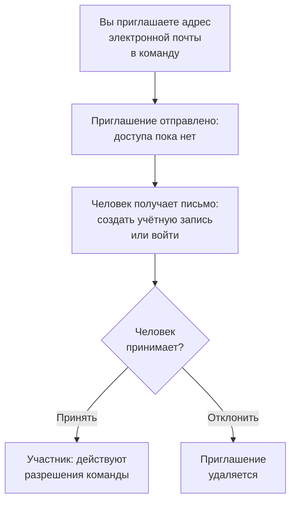

# Приглашение пользователей

Люди попадают в проект по приглашению. Вы приглашаете адрес электронной почты человека в команду, человек принимает приглашение, и с этого момента его возможности определяет команда. На этой странице описано, как приглашать людей, что они видят и как позже изменить или прекратить их доступ.

:::cards
- [Пригласить человека](#пригласить-человека): Адрес электронной почты и команда.
- [Принять приглашение](#принять-приглашение): Что видит и делает приглашённый.
- [Изменить команды человека](#изменить-команды-человека): Дать больше доступа или меньше.
- [Удалить человека](#удалить-человека-из-проекта): Что влечёт за собой уход из проекта.
:::

## Как работает приглашение

- **Что человек может делать, решает его команда.** Ни у кого нет собственных разрешений: человек может делать то, что разрешают команды, в которых он состоит. См. [Пользователи, команды и разрешения](/docs/permissions/index).
- **До принятия ничего не выдаётся.** Ожидающее приглашение отображается как **Приглашение отправлено** и не даёт доступа к проекту.
- **Одно принятие действует на весь проект.** Когда приглашение принято, принимаются и все остальные приглашения этого человека в тот же проект. Участник, которого вы позже добавите в другую команду, сразу оказывается в ней, и принимать ничего не нужно.

## Перед началом

- **Роль, которая может приглашать.** Project Owner, Project Admin или роль с разрешением **Invite New Members**. Приглашать людей можно только в команду, разрешения которой есть у вас самих, потому что приглашение даёт им доступ этой команды. Project Admin без единой блокировки располагает для этого всем, что Project Admin и так умеет: можно приглашать в **Members** и в команду с любой более узкой ролью, но не в команду с Project Owner, разрешением на биллинг, **Delete Project**, **Edit Project**, **Edit Team** или **Invite New Members**.
- **В OneUptime Cloud — место в вашем плане.** Каждый человек в проекте — это место в счёте с того момента, как его пригласили. В плане Free есть место для одного человека. См. [Биллинг и использование](/docs/configuration/billing#ваш-план-и-места).
- **Без SCIM Push Groups.** Пока ваш поставщик удостоверений управляет командами проекта через SCIM Push Groups, вы приглашаете и удаляете людей там, а не в OneUptime.

## Пригласить человека

:::steps
### Откройте список пользователей

Перейдите в **Продукты → Настройки → Пользователи**. Список **Пользователи** показывает всех в проекте, их команды и то, присоединились ли они.

### Нажмите кнопку приглашения

Нажмите **Пригласить пользователя**. Откроется диалог **Пригласить нового пользователя**.

### Введите адрес электронной почты

Введите адрес в поле **Электронная почта**. Если ни одна учётная запись OneUptime его ещё не использует, диалог также запросит **Имя**, с которым будет создана новая учётная запись.

### Выберите команду

В поле **Команда** сначала выбрана команда участников проекта: команда с ролью Project Member на весь проект, а если такой нет — команда с именем Members. Выберите другую команду, чтобы дать больше или меньше доступа. Поле **Команда** остаётся пустым, если в проекте нет такой команды или если вы сами не могли бы в неё пригласить.

### Отправьте приглашение

Нажмите **Пригласить**. OneUptime отправит приглашение по электронной почте и откроет страницу человека. Человек отображается как **Приглашение отправлено**, пока приглашение не будет принято.
:::

> [!TIP]
> Приглашайте людей в самую маленькую команду, которая позволяет им выполнять свою работу. Позже их можно добавить в другие команды, и каждая команда, в которую они вступают, расширяет их возможности.

## Принять приглашение

В письме с приглашением указан проект. Кнопка в нём — **Create Your Account** для того, у кого ещё нет учётной записи OneUptime, и **Sign In to OneUptime** для того, у кого она есть. Войдя в систему, человек принимает приглашение в одном из двух мест:

| Где находится человек | Что он видит | На что нажимает |
| --- | --- | --- |
| Пока ни в одном проекте | Приглашение на странице, которая открывается после входа | **Accept & Join** или **Decline** |
| Уже в другом проекте | Ожидающее приглашение у колокольчика в правом верхнем углу, который открывает **Приглашения в проект** | **Принять** или **Отклонить** |

Приняв приглашение, человек сразу попадает в проект с разрешениями своей команды и настройками уведомлений, с которыми начинает каждый участник: см. [С чем вы начинаете](/docs/notifications/index#с-чем-вы-начинаете). Отклонение удаляет приглашение, поэтому, чтобы присоединиться позже, понадобится новое.

## Кто состоит в проекте

На странице **Пользователи** — одна строка на человека:

| Столбец | Что показывает |
| --- | --- |
| **Пользователь** | Имя и адрес электронной почты. |
| **Команды** | Каждая команда проекта, в которой человек состоит или в которую приглашён. |
| **Статус** | **Участник**, когда человек присоединился, с числом ещё не принятых приглашений в другие команды. До этого — **Приглашение отправлено**. |

Фильтруйте список по полям **Пользователь**, **Статус** или **Команда**. Нажмите на строку, чтобы открыть страницу человека:

| Страница | Для чего она |
| --- | --- |
| **Профиль** | Имя, адрес электронной почты, фото и идентификатор пользователя. |
| **Команды** | Команды, в которых состоит человек. Здесь можно добавить или убрать команду. |
| **Готовность**, **Методы уведомлений**, **Правила дежурства** | Можно ли вызвать человека и как. Видны Project Owners, Project Admins, самому человеку и всем, кому разрешено читать правила уведомлений других людей. См. [Готовность и отчеты](/docs/on-call/readiness). |
| **Пользовательские поля** | Пользовательские поля проекта для людей, если они есть. |
| **Удалить из проекта** | Убрать человека из проекта. |

## Изменить команды человека

:::steps
### Откройте его команды

На странице **Пользователи** нажмите на человека, затем на **Команды**.

### Добавьте его в команду

Нажмите **Пригласить**, выберите команду в поле **Команда** и нажмите **Пригласить** в диалоге. Участник сразу оказывается в новой команде. Тот, кто ещё не присоединился, получает ещё одно приглашение, и принятие любого из них принимает оба.

### Уберите его из команды

Нажмите **Удалить** в строке команды. Если это последняя команда, к которой человек присоединился, удаление убирает его из проекта, и диалог сообщает об этом, прежде чем что-либо изменится.
:::

В команде Owners всегда остаётся хотя бы один присоединившийся участник, поэтому проект никогда не теряет последнего владельца.

## Удалить человека из проекта

На странице **Пользователи** откройте меню строки человека, **⋯**, и нажмите **Удалить из проекта**. Или откройте человека и выберите **Удалить из проекта** в его боковом меню. Чтобы удалить несколько человек сразу, выделите их строки и удалите выбранное: каждый из них удаляется так же.

Удаление убирает человека из всех команд проекта. Он сразу теряет доступ, даже если уже вошёл в систему, исключается из расписаний дежурств и правил эскалации проекта и перестаёт получать его уведомления. Его учётная запись OneUptime не удаляется, и его можно пригласить снова. На странице [Пользователи, команды и разрешения](/docs/permissions/index#пользователи) перечислено всё, что влечёт за собой уход из проекта.

## Другие способы присоединиться

- **Единый вход.** Тот, кто впервые входит через поставщика удостоверений проекта, попадает в команды, которые называет поставщик. См. [Роли и команды для пользователей SSO](/docs/identity/sso#роли-и-команды-для-пользователей-sso).
- **SCIM.** Ваш поставщик удостоверений создаёт людей и добавляет их в команды подключения по умолчанию. См. [SCIM](/docs/identity/scim#как-предоставляется-доступ-пользователю-проекта).
- **Admin Dashboard.** В самостоятельно размещённой установке главный администратор может добавить человека в проект и принять приглашение за него. См. [Пользователи, команды и разрешения](/docs/permissions/index#пользователи).

## Устранение неполадок

:::details "This user has already been invited to this team"
Человек уже в этой команде — как участник или с непринятым приглашением. Откройте его на странице **Пользователи**, чтобы увидеть его команды, или пригласите его в другую команду.
:::

:::details "You have reached the user limit for the free plan"
В OneUptime Cloud у проекта на плане Free есть место для одного человека. Смените план, затем пригласите снова. См. [Сменить план](/docs/configuration/billing#сменить-план).
:::

:::details "Too many invitations were sent to this email address in the last hour"
На один адрес можно отправить 10 приглашений в час, в проекты и на приватные страницы статуса вместе, кто бы их ни отправлял. Подождите час, затем пригласите человека снова.
:::

:::details Письмо с приглашением не пришло, или срок действия ссылки истёк
Приглашение не зависит от письма. Попросите человека зарегистрироваться с адресом, на который вы его пригласили: OneUptime отправит на этот адрес новую ссылку, чтобы завершить создание учётной записи. Тот, у кого учётная запись уже есть, входит в систему и находит ожидающее приглашение.
:::

:::details Кнопка Пригласить пользователя сообщает, что пользователями управляют SCIM Push Groups
Ваш поставщик удостоверений управляет командами проекта. Приглашайте или удаляйте людей у поставщика удостоверений или отключите Push Groups в разделе **Настройки проекта → Безопасность → SCIM**, чтобы управлять ими здесь.
:::

## Дальнейшие шаги

:::cards
- [Пользователи, команды и разрешения](/docs/permissions/index): Решите, что может делать каждая команда.
- [Настройки проекта](/docs/configuration/project-settings): Всё, что относится ко всему проекту.
- [Ваша учётная запись](/docs/introduction/your-account): Вход, профиль и проекты, в которых вы состоите.
- [SCIM](/docs/identity/scim): Пусть поставщик удостоверений управляет людьми и командами.
:::
