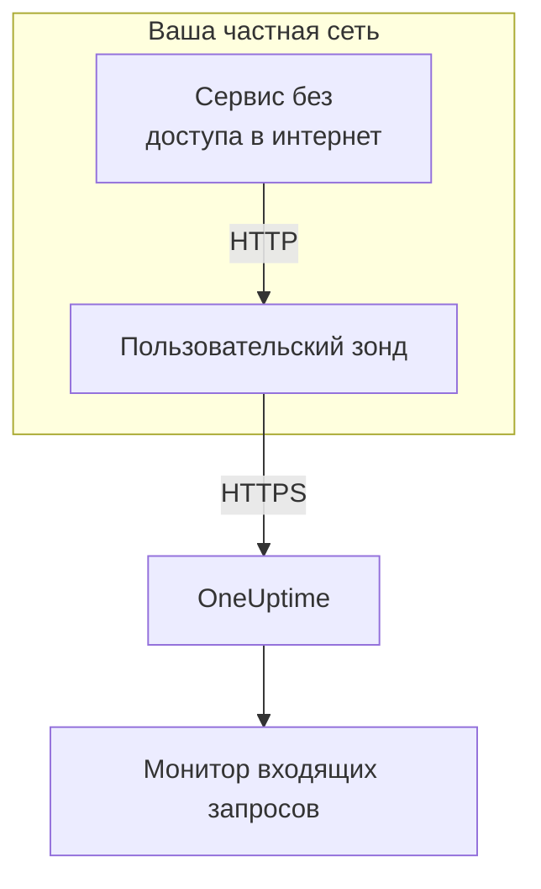

# Ingress для входящих запросов

Сервис без доступа в интернет всё равно может отправлять heartbeat в [монитор входящих запросов](/docs/monitor/incoming-request-monitor). Он отправляет их [пользовательскому зонду](/docs/probe/custom-probe) в своей сети, а зонд передаёт их в OneUptime.

:::cards
- [Как это работает](#как-это-работает): От вашего сервиса через зонд к монитору.
- [Включение слушателя](#включение-слушателя): Одна настройка на зонде, для Docker, Docker Compose или Kubernetes.
- [Отправка запросов на зонд](#отправка-запросов-на-зонд): Поменяйте URL, на который отправляет ваш сервис, и больше ничего.
- [Устранение неполадок](#устранение-неполадок): Что зонд пишет в журнал, когда запрос не проходит.
:::

## Как это работает



1. **Ваш сервис отправляет запрос на зонд.** Тот же `GET` или `POST` с тем же секретным ключом, что он отправил бы в OneUptime, на порт, который слушает зонд.
2. **Зонд отвечает сразу.** Он отвечает `200` до того, как передаст запрос дальше, поэтому ваш сервис никогда не ждёт OneUptime.
3. **Зонд пересылает его.** Он отправляет запрос в OneUptime с методом, заголовками и телом и добавляет заголовок `OneUptime-Probe-Id`, который называет зонд.
4. **OneUptime читает его как обычно.** Критерии монитора видят запрос так, будто сервис отправил его напрямую.

Слушатель работает на собственном порту, отдельно от проверок работоспособности зонда, поэтому его можно открыть для частной сети, не открывая ничего другого.

## Когда это нужно

Используйте слушатель, когда:

- Ваши сервисы работают в изолированном сегменте сети без исходящего доступа по HTTPS
- Весь трафик мониторинга должен оставаться внутри вашего VPC или локальной сети
- Вам нужна одна точка выхода — зонд, — которой разрешено обращаться к OneUptime
- У вас уже развёрнут [пользовательский зонд](/docs/probe/custom-probe), и вы хотите использовать его и для входящих heartbeat

Если ваши сервисы уже могут напрямую обращаться к `https://oneuptime.com` (или к вашему самостоятельно размещённому адресу), эта функция вам **не** нужна: вызывайте адрес heartbeat прямо из сервиса.

## Перед началом

- **Работающий пользовательский зонд.** Его **Статус** показывает **Подключено**. Как установить зонд, см. [Пользовательские probes](/docs/probe/custom-probe).
- **Монитор входящих запросов.** Его адрес heartbeat содержит секретный ключ, который отправляет ваш сервис: см. [Мониторинг входящих запросов](/docs/monitor/incoming-request-monitor).
- **Порт на хосте зонда, доступный вашим сервисам.** В примерах используется `3875`.

## Включение слушателя

Задайте в `PROBE_INGRESS_PORT` порт, который должен использовать слушатель. Любое значение больше `0` включает его; если переменная не задана или равна `0`, он выключен.

:::tabs
@tab Docker
```bash
docker run --name oneuptime-probe --network host \
  -e PROBE_KEY=<probe-key> \
  -e PROBE_ID=<probe-id> \
  -e ONEUPTIME_URL=https://oneuptime.com \
  -e PROBE_INGRESS_PORT=3875 \
  -d oneuptime/probe:release
```

Без `--network host` опубликуйте порт с помощью `-p 3875:3875`.
@tab Docker Compose
```yaml title="docker-compose.yml"
services:
  oneuptime-probe:
    image: oneuptime/probe:release
    container_name: oneuptime-probe
    environment:
      - PROBE_KEY=<probe-key>
      - PROBE_ID=<probe-id>
      - ONEUPTIME_URL=https://oneuptime.com
      - PROBE_INGRESS_PORT=3875
    network_mode: host
    restart: always
```

Без `network_mode: host` опубликуйте порт в `ports:` как `"3875:3875"`.
@tab Kubernetes
```yaml title="oneuptime-probe.yaml"
apiVersion: apps/v1
kind: Deployment
metadata:
  name: oneuptime-probe
spec:
  selector:
    matchLabels:
      app: oneuptime-probe
  template:
    metadata:
      labels:
        app: oneuptime-probe
    spec:
      containers:
        - name: oneuptime-probe
          image: oneuptime/probe:release
          env:
            - name: PROBE_KEY
              value: "<probe-key>"
            - name: PROBE_ID
              value: "<probe-id>"
            - name: ONEUPTIME_URL
              value: "https://oneuptime.com"
            - name: PROBE_INGRESS_PORT
              value: "3875"
          ports:
            - name: ingress
              containerPort: 3875
---
apiVersion: v1
kind: Service
metadata:
  name: oneuptime-probe-ingress
spec:
  selector:
    app: oneuptime-probe
  ports:
    - name: ingress
      port: 3875
      targetPort: 3875
  type: ClusterIP
```

Сервисы в кластере затем отправляют на `http://oneuptime-probe-ingress.<namespace>.svc.cluster.local:3875/heartbeat/<secret-key>`.
:::

Когда слушатель запущен, в журнале зонда есть строка `Probe ingress listener started on port 3875 (heartbeat / incoming-request endpoints)`.

## Отправка запросов на зонд

Ваш сервис отправляет запросы на зонд вместо OneUptime. Замените публичный адрес heartbeat:

```text
https://oneuptime.com/heartbeat/<secret-key>
```

на адрес ingress зонда:

```text
http://<probe-host>:<PROBE_INGRESS_PORT>/heartbeat/<secret-key>
```

Путь, метод, тело и заголовки в остальном те же, поэтому в существующем клиентском коде нужно поменять только базовый URL. Зонд также принимает `/incoming-request/<secret-key>`, который работает так же.

```bash
# GET heartbeat
curl http://probe.internal:3875/heartbeat/YOUR_SECRET_KEY

# POST heartbeat with JSON body
curl -X POST http://probe.internal:3875/heartbeat/YOUR_SECRET_KEY \
  -H "Content-Type: application/json" \
  -d '{"status": "healthy", "version": "1.2.3"}'

# Cron job
*/5 * * * * curl -s http://probe.internal:3875/heartbeat/YOUR_SECRET_KEY > /dev/null
```

## Как пересылаются запросы

| Что | Как это обрабатывает зонд |
| --- | --- |
| Ответ | `200` с пустым объектом JSON (`{}`), отправляется до пересылки запроса. Как и в OneUptime, он отправляется, что бы ни случилось дальше: его получает и запрос с неверным секретным ключом. |
| Методы | `POST` пересылается как `POST`. `GET` и `HEAD` пересылаются как `GET`. На остальные методы зонд отвечает `404`. |
| Заголовки | Все, кроме hop-by-hop заголовков (`Host`, `Connection`, `Content-Length`, `Transfer-Encoding`, `Keep-Alive`, `Proxy-Authenticate`, `Proxy-Authorization`, `TE`, `Trailer`, `Upgrade`). Зонд добавляет `OneUptime-Probe-Id`. |
| Тело | Тела JSON и форм размером до 50 МБ, как при отправке напрямую в OneUptime. Как и там, любое другое тело приходит в монитор пустым. |
| Повторы | Если пересылка не удалась, зонд повторяет её до `PROBE_INGRESS_FORWARD_RETRY_LIMIT` раз, ожидая 2 с, затем 4 с, затем 8 с, и никогда не дольше 15 с. Потом он записывает ошибку и отбрасывает запрос. |
| Прокси | Пересылка идёт через прокси зонда, когда задана `HTTP_PROXY_URL` или `HTTPS_PROXY_URL`. |
| Куда она идёт | `ONEUPTIME_URL`, за которым следует `/incoming-request-ingest/incoming-request/<secret-key>`. |

## Переменные окружения

| Переменная | По умолчанию | Что она делает |
| --- | --- | --- |
| `PROBE_INGRESS_PORT` | не задана (выключено) | Порт, который использует слушатель. Любое значение больше `0` включает его. |
| `PROBE_INGRESS_FORWARD_TIMEOUT_MS` | `10000` | Сколько может длиться каждая пересылка в OneUptime, в миллисекундах. Значение меньше `1000` заменяется значением по умолчанию. |
| `PROBE_INGRESS_FORWARD_RETRY_LIMIT` | `3` | Сколько раз повторяется неудавшаяся пересылка. `0` отключает повторы. |

Обычные переменные зонда (`PROBE_KEY`, `PROBE_ID`, `ONEUPTIME_URL` и переменные прокси) тоже действуют: полный список см. в [Пользовательские probes](/docs/probe/custom-probe).

## Вопросы безопасности

- **Точка доступа намеренно работает без аутентификации**: секретный ключ в пути URL *и есть* аутентификация, точно так же, как в публичной точке доступа `oneuptime.com`. Обращайтесь с секретным ключом как с паролем.
- **Держите слушатель в своей частной сети.** Он не должен быть доступен из интернета. Ограничьте доступ к нему сетевой политикой, правилом межсетевого экрана или сервисом `ClusterIP`.
- **Поставьте перед ним TLS, если вам нужно шифрование в вашей сети.** Слушатель работает по обычному HTTP. Разместите его за внутренним балансировщиком нагрузки или ingress-контроллером, чтобы получить TLS на этом участке. Пересылка от зонда в OneUptime использует HTTPS, когда `ONEUPTIME_URL` начинается с `https://`.
- **Сами ограничьте размер тела, если 50 МБ — это слишком много.** Поставьте перед слушателем обратный прокси с меньшим пределом.

## Устранение неполадок

:::details Журнал зонда так и не сообщает, что слушатель запущен
`PROBE_INGRESS_PORT` не задана, равна `0` или не является числом. Задайте номер порта и перезапустите зонд. Строка журнала выглядит так: `Probe ingress listener started on port <port> (heartbeat / incoming-request endpoints)`.
:::

:::details Зонд пишет в журнал `Probe ingress: failed to forward to <url> after N attempts`
Зонд не смог достучаться до OneUptime даже после повторов. Проверьте исходящее подключение зонда, его настройки прокси и значение `ONEUPTIME_URL`. Если зонд к тому же показывает **Отключено**, см. [Пользовательские probes](/docs/probe/custom-probe), чтобы найти, где останавливаются его запросы.
:::

:::details Зонд пишет в журнал `Probe ingress: probe ID not available, forwarding without it`
Зонд ещё не закончил подключаться к OneUptime, поэтому пересылает запрос без заголовка `OneUptime-Probe-Id`. Запрос всё равно доходит до монитора.
:::

:::details Монитор получает запросы, но не через зонд
Ваш сервис всё ещё отправляет на публичный адрес. Проверьте, что он отправляет на `http://<probe-host>:<port>/...`: обычная причина — DNS-имя или запись в `/etc/hosts`, которые указывают в другое место.
:::

:::details Монитор ничего не получает, и зонд ничего не пишет в журнал
Запрос так и не дошёл до зонда. Проверьте, что сервис может обратиться к хосту зонда на этот порт: мешать может правило межсетевого экрана, неопубликованный порт или Service в Kubernetes, который не выбирает под зонда.
:::

## Дальнейшие шаги

:::cards
- [Мониторинг входящих запросов](/docs/monitor/incoming-request-monitor): Решите, что считается исправным heartbeat.
- [Пользовательские probes](/docs/probe/custom-probe): Установите зонд и посмотрите все его настройки.
:::
