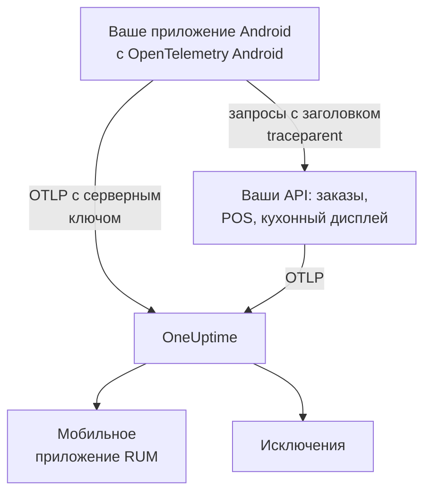

# Настройка для Android

Инструментируйте нативное приложение для Android с помощью OpenTelemetry Android, чтобы оно отправляло данные в OneUptime как мобильное приложение RUM: его сбои и ANR, медленные и зависшие кадры, запуски, экраны, сеансы и сетевые запросы с трассировкой вплоть до вашего бэкенда.

:::cards
- [Добавление OpenTelemetry Android](#добавление-opentelemetry-android): Одна зависимость Gradle и несколько строк при запуске приложения.
- [Что сообщает агент](#что-сообщает-агент): Сбои, ANR, зависшие кадры, запуски и сеансы, и куда попадает каждый из них.
- [Трассировка запросов к бэкенду](#трассировка-запросов-к-бэкенду): Спан для каждого вызова OkHttp и `traceparent` в нём.
- [Трассировка собственных рабочих процессов](#трассировка-собственных-рабочих-процессов): Заказ от меню до кухни, платёжный терминал, принтер.
- [Киоски и другие ваши устройства](#киоски-и-другие-ваши-устройства): Имя для каждого устройства, настройка из MDM, сохранение данных без сети.
:::

## Как это работает

OpenTelemetry Android работает внутри вашего приложения. Он отправляет трассировки, журналы и метрики в OneUptime по OTLP с ключом приёма типа **Сервер** и добавляет заголовок W3C `traceparent` к запросам вашего приложения, поэтому спаны вашего бэкенда присоединяются к трассировкам приложения.



## Перед началом

- Приложение для Android с `minSdk` 23 или выше, собранное с `compileSdk` 34 или выше. Если `minSdk` ниже 26, включите [десахаризацию основных библиотек](https://developer.android.com/studio/write/java8-support#library-desugaring) с Android Gradle Plugin 8.3.0 или новее и `android.useFullClasspathForDexingTransform=true` в `gradle.properties`.
- Ключ приёма типа **Сервер**, созданный в **Настройки проекта → Телеметрия и APM → Ключи приёма** кнопкой **Создать ключ приёма**. Ключ **Браузер** из приложения отклоняется: он проверяется по заголовку `Origin`, который приложение не отправляет.
- Эти параметры OTLP. Если вы размещаете OneUptime сами, замените `https://oneuptime.com` своим хостом.

| Параметр | Значение |
| --- | --- |
| Адрес OTLP | `https://oneuptime.com/otlp` |
| Заголовок | `x-oneuptime-token: YOUR_TELEMETRY_INGESTION_TOKEN` |

> [!WARNING]
> Ключ поставляется внутри вашего приложения, а приложение можно распаковать, поэтому исходите из того, что кто-то его скопирует. На странице ключа задайте **Закреплённое имя сервиса**, **Requests Per Minute Limit** и дату в поле **Истекает в** и меняйте ключ с каждым выпуском.

## Добавление OpenTelemetry Android

:::steps
### Добавьте зависимость

```kotlin title="app/build.gradle.kts"
dependencies {
    implementation("io.opentelemetry.android:android-agent:1.8.1")
}
```

Агент приносит с собой инструментацию сбоев, ANR, медленной отрисовки, активностей, фрагментов, сети и сеансов. Более новую версию ищите в [его выпусках](https://github.com/open-telemetry/opentelemetry-android/releases).

### Запустите агент при запуске приложения

```kotlin title="KioskApplication.kt"
import android.app.Application
import io.opentelemetry.android.OpenTelemetryRum
import io.opentelemetry.android.agent.OpenTelemetryRumInitializer

class KioskApplication : Application() {
    lateinit var otelRum: OpenTelemetryRum

    override fun onCreate() {
        super.onCreate()

        otelRum = OpenTelemetryRumInitializer.initialize(this) {
            httpExport {
                baseUrl = "https://oneuptime.com/otlp"
                baseHeaders = mapOf("x-oneuptime-token" to BuildConfig.ONEUPTIME_TOKEN)
            }
            resource {
                put("service.name", "kiosk-ordering")
                put("deployment.environment.name", "production")
            }
        }
    }
}
```

`baseUrl` — это адрес без сигнала: агент сам добавляет к нему `/v1/traces`, `/v1/logs` и `/v1/metrics`. Задайте `service.name`, иначе приложение получит имя по своей метке в лаунчере. Это идентичность приложения в OneUptime, поэтому не меняйте его от выпуска к выпуску.

Укажите этот класс в `android:name` элемента `<application>` вашего манифеста. `BuildConfig.ONEUPTIME_TOKEN` обозначает место, где ваша сборка хранит ключ; парк устройств может вместо этого получать его из своей MDM, как показано в разделе [Киоски и другие ваши устройства](#киоски-и-другие-ваши-устройства).

### Запустите приложение и проверьте, что данные приходят

```bash
curl -i https://oneuptime.com/otlp/v1/validate \
  -H "x-oneuptime-token: YOUR_TELEMETRY_INGESTION_TOKEN"
```

`200` с `"valid": true` означает, что ключ принят. Затем запустите приложение и немного им попользуйтесь: оно появится в **Продукты → Ресурсы → Мониторинг реальных пользователей** под именем из своего `service.name`. Агент записывает телеметрию на диск перед отправкой, поэтому первый пакет может прийти только через минуту.
:::

## Что сообщает агент

OpenTelemetry Android записывает всё это сам. Атрибуты устройства, которые он задаёт, — `device.model.identifier`, `device.model.name` и `device.manufacturer` — относят приложение к мобильным приложениям RUM и заполняют его страницу **Клиенты**. Кроме того, он задаёт `os.name`, `os.version` и `app.installation.id` для каждой установки, но не задаёт `device.id`.

| Что | Как агент это отправляет | Где это видно в OneUptime |
| --- | --- | --- |
| Сбои | Событие `app.crash` с типом, сообщением и трассировкой стека исключения | **Исключения**, как необработанные |
| ANR | Событие `device.anr` со стеком главного потока, когда приложение не отвечает около 5 секунд | **Исключения**, как необработанные, с типом `ANR` |
| Медленные и зависшие кадры | Событие `app.jank` с `app.jank.frame_count` — числом кадров медленнее 16 мс (`app.jank.threshold` равен `0.016`) или 700 мс (`0.7`) | **Журналы**, с `@event.name:app.jank` |
| Запуски приложения | Спан `AppStart`, в котором `start.type` равен `cold`, `warm` или `hot` | **Трассировки** |
| Экраны | Спан для каждого этапа жизненного цикла активности или фрагмента и `app.screen.name` на каждом спане и в каждой записи журнала | **Трассировки** |
| Сеансы | `session.id` на каждом спане и в каждой записи журнала, а также события `session.start` и `session.end` | **Трассировки** и **Журналы**, поиск по `@session.id:` |
| Изменения сети | Событие `network.change` и `network.connection.type` на каждом спане и в каждой записи журнала | **Журналы** |

Сбои и ANR попадают в раздел **Исключения** как необработанные, сгруппированные по трассировкам стека, вместе с сеансом, в котором они произошли. Агент сохраняет сбой на диск в момент падения приложения и отправляет его оттуда, поэтому сбой, случившийся без сети, всё равно придёт, как только приложение снова запустится с доступом к сети.

Страница приложения **Обзор** сводит всё это для вас: **Сеансы**, **Сеансы без сбоев**, **Сбои**, **ANR**, **Запуски приложения**, **Холодный запуск (p95)** и **Зависшие кадры**, и каждая плитка открывает исключения, спаны или события, которые считает. Пока приложение не отправляет запуски или кадры, их графики подсказывают, как их включить. А страница **Рекомендации** предлагает мониторы для сбоев, ANR, медленных холодных запусков, зависших кадров, а также для приложения или одного из его устройств, которые перестали присылать данные.

Под **Сеансы без сбоев** строка показывает ту же долю для установок: по `app.installation.id`, который OpenTelemetry Android 1.1 и новее задаёт на каждом спане и в каждой записи журнала. Этот идентификатор сохраняется, пока приложение установлено, поэтому заменяет пользователей приложения. Для приложения с сотнями сеансов в час, где один сбой в день — норма, **App Crash Rate** и **App ANR Rate** оповещают не о каждом сбое, а о доле сеансов за час, завершившихся сбоем или зависанием, выше порогов Android vitals в 1,09% и 0,47%. **Daily Crash Rate** и **Daily ANR Rate** оповещают о доле установок за день, на которых случился сбой или зависание, выше тех же 1,09% и 0,47% при не менее чем 250 установках: это воспринимаемые пользователями показатели, которые оценивает Android vitals и показывает Play Console.

Сеанс заканчивается после 15 минут в фоне или через 4 часа. Приложение, которое никогда не уходит в фон, например киоск, держит один сеанс 4 часа, поэтому трассируйте визит каждого покупателя как отдельный спан, как показано в разделе [Трассировка собственных рабочих процессов](#трассировка-собственных-рабочих-процессов).

Собственные вызовы `android.util.Log` вашего приложения тоже попадают в журналы, если добавить `android-log-library` и `android-log-agent` рядом с модулями OkHttp ниже: тег каждого вызова записывается в `android.log.tag`, а вызов с throwable становится исключением в разделе **Исключения**. OpenTelemetry Android не читает Logcat.

## Трассировка запросов к бэкенду

Добавьте инструментацию OkHttp и плагин ByteBuddy, с которым она собирается:

```kotlin title="app/build.gradle.kts"
plugins {
    // ...the plugins your app already applies, then:
    id("net.bytebuddy.byte-buddy-gradle-plugin") version "1.18.15"
}

dependencies {
    implementation("io.opentelemetry.android:android-agent:1.8.1")
    implementation("io.opentelemetry.android.instrumentation:okhttp3-library:1.8.1-alpha")
    byteBuddy("io.opentelemetry.android.instrumentation:okhttp3-agent:1.8.1-alpha")
}
```

Плагин инструментирует сам класс `OkHttpClient`, поэтому трассируется каждый клиент в приложении, включая те, что создают библиотеки. Каждый запрос становится клиентским спаном с именем по своему методу, с URL, кодом состояния и длительностью, и несёт заголовок W3C `traceparent`. Бэкенд, инструментированный с помощью [OpenTelemetry](/docs/telemetry/open-telemetry), продолжает трассировку из этого заголовка, поэтому API заказов, мост POS и сервис кухонного дисплея добавляют свои спаны в ту же трассировку, что и касание экрана киоска.

- У `HttpURLConnection` есть такая же пара модулей: `httpurlconnection-library` и `httpurlconnection-agent`.
- Без плагина оберните клиент сами: `OkHttpTelemetry.builder(otelRum.openTelemetry).build().createCallFactory(client)` из `io.opentelemetry.instrumentation:opentelemetry-okhttp-3.0`.
- Спан, открытый в вашем коде, как в следующем разделе, становится родителем запросов, сделанных внутри него.

## Трассировка собственных рабочих процессов

Получите трассировщик от агента и создайте один спан для заказа одного покупателя с дочерним спаном для каждого его шага. Тогда у каждого шага будут своя длительность и свои ошибки, а заказ покажет, чем он закончился:

```kotlin title="OrderTrace.kt"
import io.opentelemetry.api.trace.Span
import io.opentelemetry.api.trace.StatusCode
import io.opentelemetry.api.trace.Tracer
import io.opentelemetry.context.Context

class OrderTrace(private val tracer: Tracer) {
    // order.session: from the first tap to the order reaching the kitchen.
    private val order: Span = tracer.spanBuilder("order.session").startSpan()
    private val parent: Context = Context.current().with(order)

    // One step: menu.browse, cart.customize, payment.process, pos.inject.
    fun <T> step(name: String, block: (Span) -> T): T {
        val span = tracer.spanBuilder(name).setParent(parent).startSpan()
        return try {
            span.makeCurrent().use { block(span) }
        } catch (error: Throwable) {
            span.recordException(error)
            span.setStatus(StatusCode.ERROR)
            throw error
        } finally {
            span.end()
        }
    }

    fun complete() = finish("completed")

    fun abandon(reason: String) {
        order.setAttribute("order.abandon_reason", reason)
        finish("abandoned")
    }

    private fun finish(outcome: String) {
        order.setAttribute("order.outcome", outcome)
        order.end()
    }
}
```

```kotlin title="CheckoutFlow.kt"
val order = OrderTrace(otelRum.openTelemetry.getTracer("kiosk.ordering"))

order.step("cart.customize") { span ->
    span.setAttribute("cart.items", cart.size.toLong())
}
order.step("payment.process") { terminal.charge(cart.total) }
order.step("pos.inject") { posApi.submit(cart) } // its OkHttp span is a child
order.complete()
```

Точно так же оборачивайте каждый вызов SDK платёжного терминала, принтера, сканера или NFC-считывателя и указывайте, какое это было устройство, чтобы медленное или неисправное устройство выглядело как медленный или ошибочный спан:

```kotlin title="ReceiptPrinter.kt"
order.step("printer.print") { span ->
    span.setAttribute("peripheral.type", "printer")
    span.setAttribute("peripheral.model", printer.model)
    span.setAttribute("peripheral.connection", "usb")
    printer.print(receipt, timeoutMillis = 10_000)
}
```

Имена атрибутов выбираете вы: делайте их одинаковыми во всех приложениях, чтобы один фильтр находил все принтеры. Задавайте каждому вызову тайм-аут, потому что спан заканчивается, только когда возвращается его вызов. Шаг, охватывающий несколько экранов, например просмотр меню, — это спан, который вы начинаете при открытии экрана и заканчиваете при его закрытии, с тем же родителем. Для факта без длительности, например когда в принтере кончается бумага, отправьте событие: `otelRum.emitEvent("printer.paper_low")`.

В разделе **Трассировки** фильтруйте по имени шага, чтобы увидеть, сколько он длится и как часто завершается ошибкой, и по `@order.outcome:abandoned`, чтобы найти заказы, которые так и не были завершены.

## Киоски и другие ваши устройства

### Дайте имя каждому устройству

OneUptime учитывает мобильное приложение по приложению, а не по устройству, поэтому приложение на тысячах телефонов никогда не выводит список телефонов своих пользователей. Своим устройствам давайте имена в `host.name`. Тогда каждое устройство появится в разделе **Инвентарь** как хост рядом с другими вашими машинами — с производителем, моделью и версией ОС, которые сообщает агент, с тем, что вы добавите ниже, и со временем, когда его видели в последний раз:

```kotlin title="KioskApplication.kt"
resource {
    put("service.name", "kiosk-ordering")
    put("host.name", deviceName)
    put("host.serial_number", serialNumber)
    put("device.type", "kiosk")
    put("device.location", "Store 0412")
}
```

Телеметрия приложения остаётся в его приложении RUM, и устройство не становится хостом в разделе **Хосты**: приложение не сообщает метрик хоста, так что показывать там было бы нечего. Страница устройства в разделе **Инвентарь** показывает его собственные журналы, трассировки и исключения, а `@resource.host.name:` находит их в разделах **Трассировки** и **Журналы**. Устройство, которое ничего не отправляет 30 дней, исчезает из раздела **Инвентарь**. Чтобы видеть само устройство — его память, хранилище и перезагрузки, а также сбои всех приложений на нём, — добавьте [Агент Android](/docs/telemetry/android-agent) и задайте в его `device_name` то же имя: тогда устройство станет ещё и хостом в разделе **Хосты** и по-прежнему будет одним элементом в разделе **Инвентарь**.

### Узнавайте, когда устройство замолкает

Страница приложения **Рекомендации** предлагает **Device Stopped Reporting**: оповещение для каждого устройства, которое час не отправляет спанов, хотя отправляло их за последнюю неделю; устройства различаются по `app.installation.id`, который задаёт агент. Оповещение каждого устройства называет его по `host.name`, который был на его последних спанах, как в разделе [Дайте имя каждому устройству](#дайте-имя-каждому-устройству), и по его модели, а рядом указывает его установку; устройство, которое не отправляет `host.name`, называется только по установке. Переименование устройства меняет только то, что написано в его оповещении: это по-прежнему одно устройство с одним оповещением, которое устраняется, как только устройство снова присылает данные. Когда замолкают сразу все устройства, например когда в магазине пропала сеть, ни одно устройство не оповещает: **App Stopped Reporting** сообщает об этом один раз для всего приложения.

Киоск, оставленный на одном экране, ничего не отправляет, пока им кто-нибудь не воспользуется. Отправляйте спан каждые несколько минут, пока приложение работает, чтобы простаивающий киоск не приняли за замолчавший:

```kotlin title="KioskHeartbeat.kt"
import android.os.Handler
import android.os.Looper
import io.opentelemetry.api.trace.Tracer

class KioskHeartbeat(private val tracer: Tracer) {
    private val handler = Handler(Looper.getMainLooper())

    private val beat = object : Runnable {
        override fun run() {
            tracer.spanBuilder("kiosk.heartbeat").startSpan().end()
            handler.postDelayed(this, 5 * 60 * 1000L)
        }
    }

    fun start() = handler.post(beat)

    fun stop() = handler.removeCallbacks(beat)
}
```

Запустите его после запуска агента: `KioskHeartbeat(otelRum.openTelemetry.getTracer("kiosk.heartbeat")).start()`. Спан каждые пять минут с большим запасом удерживает работающий киоск в пределах часа.

### Настройте парк устройств из MDM

Приложение может читать управляемые конфигурации Android, которые любая служба управления устройствами отправляет на свои устройства. Читайте ключ и имя устройства из них, а не встраивайте их в приложение:

```kotlin title="KioskApplication.kt"
import android.content.RestrictionsManager

val restrictions = (getSystemService(RESTRICTIONS_SERVICE) as RestrictionsManager)
    .applicationRestrictions
val token = restrictions.getString("oneuptime_token").orEmpty()
val deviceName = restrictions.getString("device_name") ?: android.os.Build.MODEL
val serialNumber = restrictions.getString("device_serial").orEmpty()
```

Затем передайте `token` в `baseHeaders` вместо `BuildConfig.ONEUPTIME_TOKEN`, а `deviceName` и `serialNumber` — в ресурс выше. В Esper вставьте приведённую ниже конфигурацию в раздел **Managed Configuration** приложения в шаблоне (blueprint). Esper подставляет значения вместо заполнителей на каждом устройстве с Esper Agent 8.00.0764 или новее:

```json title="Managed configuration"
{
  "oneuptime_token": "YOUR_TELEMETRY_INGESTION_TOKEN",
  "device_name": "${esper.deviceName}",
  "device_serial": "${esper.serialNumber}"
}
```

После изменения выполните для устройств Converge, чтобы они прочитали новые значения. Объявите те же ключи в `app_restrictions.xml`, если ваша MDM требует схему. Esper отклоняет APK без подписи v1, поэтому подписывайте выпуск схемой v1 в дополнение к v2 или v3.

### Импортируйте парк устройств из Esper

Подключите свой тенант Esper к инвентарю, и в списке появится каждое устройство, зарегистрированное в Esper, включая устройства, на которых приложение ни разу не запускалось, — с тем, что знает только Esper: группой, версией Android, уровнем патча безопасности, серийным номером, батареей, хранилищем, установленными приложениями и последним выходом на связь. Устройство, которое перестаёт выходить на связь, отображается как не в сети, с указанием того, как давно оно выходило на связь в последний раз. См. [Импорт устройств из Esper](/docs/inventory/overview#импорт-устройств-из-esper).

Устройство, приложение которого называет его так, как показано выше, — это один элемент вместе с тем, что отправляет приложение: `host.name` — это его имя в Esper. OneUptime находит элемент устройства по `host.name`, затем по `host.serial_number`, поэтому давайте каждому устройству одинаковые имя и серийный номер во всех приложениях, которые с него отчитываются, а также в настройках `device_name` и `device_serial` в Android Agent.

### Сохраняйте данные, записанные без сети

Агент записывает каждый спан, каждую запись журнала и каждую метрику на диск перед отправкой. Пока сети нет, он хранит их там и отправляет, когда она вернётся, — вплоть до 18 часов спустя. Он хранит 10 МБ; увеличьте этот объём для устройства, которое часто бывает без сети:

```kotlin title="KioskApplication.kt"
diskBuffering {
    maxCacheSize = 50 * 1024 * 1024
}
```

## Устранение неполадок

:::details Приложение появилось в разделе Сервисы, а не в Мониторинг реальных пользователей
OpenTelemetry Android задаёт `device.model.identifier` сам, значит, приложение было настроено с другим SDK или его ресурс был заменён через `resource(Resource)`, который отбрасывает собственные атрибуты агента. Используйте блок `resource { }`, который дополняет их. Уже созданный сервис не превратится в приложение RUM, поэтому удалите его в **Продукты → Сервисы**, когда начнёт поступать телеметрия RUM.
:::

:::details Ничего не приходит, или ключ отклоняется
Выполните проверку ключа из раздела [Добавление OpenTelemetry Android](#добавление-opentelemetry-android). `401` означает, что ключ неизвестен, отозван, выключен или истёк. Ключ **Браузер** из приложения отклоняется: используйте ключ **Сервер**. Проверьте, что `baseUrl` оканчивается на `/otlp`, без `/v1/traces`: агент добавляет путь сам.
:::

:::details Сбой или ANR не появляется в разделе Исключения
Сбой сохраняется в момент падения приложения, а ANR — когда главный поток завис примерно на 5 секунд. Оба ждут на диске, пока устройство не сможет их отправить, поэтому проверьте снова, когда приложение поработает минуту с доступом к сети. Запускайте агент в самом начале `onCreate` вашего `Application`, до всего, что может упасть, чтобы его обработчик сбоев был установлен первым.
:::

:::details Устройство не отображается в разделе Инвентарь
В списке есть только устройства, приложение которых задаёт `host.name`. Проверьте значение в атрибутах ресурса спана: пустое значение не даёт имени никакому устройству, а два устройства с одинаковым именем — это одна строка.
:::

## Дальнейшие шаги

:::cards
- [Настройка для мобильных устройств](/docs/rum/mobile-setup): iOS, React Native и другие платформы.
- [Агент Android](/docs/telemetry/android-agent): Отслеживать само устройство: его состояние, перезагрузки, установленные приложения и сбои всех приложений.
- [Исключения](/docs/telemetry/exceptions): Разбирать сбои и ANR, о которых сообщает ваше приложение.
- [Обозреватель трассировок](/docs/telemetry/traces-explorer): Проследить заказ от киоска до кухни.
- [Управление приложениями](/docs/rum/applications): Имена, метки, владельцы и хранение.
:::
