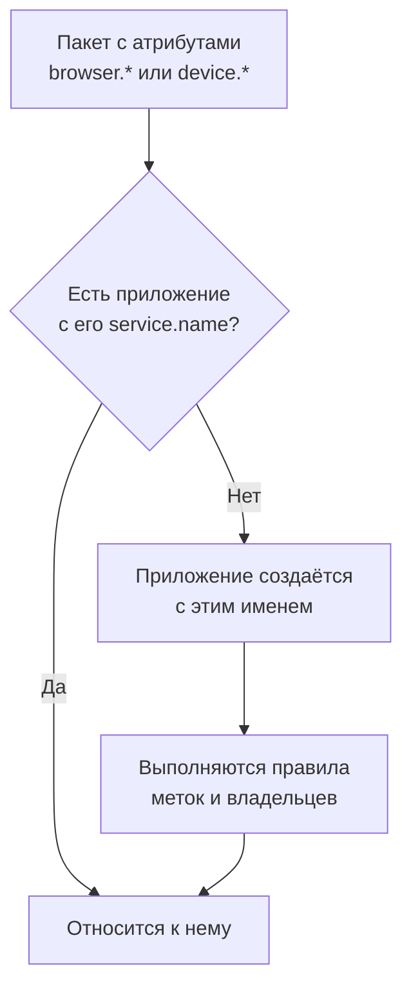

# Управление приложениями

OneUptime создаёт приложение RUM, когда впервые поступает телеметрия вашего приложения. На этой странице описано, чем вы управляете после этого: имя приложения, его метки и владельцы, срок хранения его данных, архивирование, кто может его видеть, и оповещения.

:::cards
- [Как создаётся приложение](#как-создаётся-приложение): Сопоставляется по `service.name` и создаётся с первым пакетом.
- [Метки](#метки): Группируйте приложения и решайте, кому они доступны.
- [Хранение](#хранение): Как долго хранятся телеметрия и записи.
- [Разрешения](#разрешения): Кто может видеть приложения и кто может смотреть записи.
:::

## Как создаётся приложение

Создавать приложение RUM не обязательно. Когда поступает пакет телеметрии с атрибутами браузера или устройства и `service.name`, OneUptime относит его к приложению с этим `service.name` и создаёт приложение, если в проекте такого нет.



- `service.name` — это идентичность приложения, и сравнивается он без учёта регистра: `Storefront-Web` и `storefront-web` — одно приложение.
- Новый `service.name` начинает новое приложение. Старое сохраняет свою историю и переходит в состояние **Отключено**, новое начинается пустым, и они никогда не объединяются.
- Используйте один `service.name` на приложение, а не на окружение. Различайте окружения меткой, например `oneuptime.label.env=production`, чтобы у них было одно приложение и одна история.

### Переименование приложения

**Отображаемое имя** изначально совпадает с `service.name`. Чтобы изменить его, откройте страницу приложения **Настройки** и нажмите **Изменить сведения** на карточке **Сведения о приложении**; там же редактируются описание и метки. Телеметрия сопоставляется по полю **Имя приложения (service.name)**, которое карточка показывает и которое никогда не меняется, поэтому переименование безопасно.

### Добавление приложения вручную

Создайте приложение сами, если хотите, чтобы его метки, владельцы или политика воспроизведения были настроены до прихода первого посетителя.

:::steps
#### Откройте список приложений

Перейдите в **Продукты → Ресурсы → Мониторинг реальных пользователей** и нажмите **Создать: Приложение RUM**.

#### Введите имя приложения

Заполните поле **Имя приложения (service.name)** значением `service.name`, которое будет сообщать ваше приложение, точно в том виде, в каком оно его сообщает.

#### Задайте название и сохраните

Приложение получает название по имени приложения, как и обнаруженное. Чтобы показывать другое название, откройте **Дополнительные поля** и введите **Отображаемое имя**; там же находятся описание и метки. Затем сохраните форму.
:::

Затем автоматически открывается руководство по настройке приложения, в котором имя приложения уже подставлено в `service.name` фрагмента кода. Его последний шаг, **Дождитесь подключения**, сообщает, когда поступят первые данные.

Если в проекте уже есть приложение с этим `service.name` — обнаруженное, добавленное ранее или архивированное, — форма сообщит об этом, а не создаст второе.

## Статус подключения

Приложение показывает **Подключено**, пока поступает телеметрия, и **Отключено** после 15 минут без неё. Учитываются и телеметрия OpenTelemetry, и трафик Session Replay.

**Последняя активность** обновляется раз в несколько минут, а не с каждым пакетом, поэтому может отставать от живого трафика примерно на пять минут, и 15 минут оставляют на это запас. Время, когда сам OneUptime был недоступен или разбирал очередь приёма, в них не засчитывается.

**Отключено** само по себе не ошибка: внутренний инструмент, у которого ночью нет посетителей, действительно отключён. Если приложением пользуются, см. [Устранение неполадок RUM](/docs/rum/troubleshooting).

## Метки

Метки группируют приложения в списках и фильтрах. Они также определяют, что доступно участнику, ограниченному некоторыми метками: такой участник видит только приложения с одной из этих меток. Приложение получает метки тремя способами:

| Как | Где |
| --- | --- |
| Вручную | В форме создания, в разделе **Дополнительные поля**, или позже через **Изменить сведения** на карточке **Сведения о приложении** на странице приложения **Настройки**. Чтобы изменить сразу несколько, выберите их в списке и нажмите **Add Labels** в меню **Массовые действия**. |
| Из телеметрии | Атрибут ресурса с именем `oneuptime.label.<name>` добавляет метку `<name>:<value>`, как показано ниже. |
| Из правила меток | Правило добавляет метки каждому новому приложению, которое ему соответствует. См. [Правила меток и правила владельцев](#правила-меток-и-правила-владельцев). |

Задайте атрибуты на том же ресурсе, что и `service.name`, например в файле `src/telemetry.ts` из раздела [Настройка для браузера](/docs/rum/browser-setup):

```ts
const resource = defaultResource().merge(
  resourceFromAttributes({
    [ATTR_SERVICE_NAME]: "storefront-web",
    "oneuptime.label.team": "payments",
    "oneuptime.label.env": "production",
  }),
);
```

Так добавляются метки `team:payments` и `env:production`, и они создаются в проекте, если их там нет. Имя атрибута входит в метку, поэтому `oneuptime.label.team=prod` и `oneuptime.label.env=prod` не смешиваются. Метка длиннее 100 символов обрезается до 100, а пустое или нестроковое значение ничего не добавляет.

## Правила меток и правила владельцев

Правило добавляет метки или владельцев каждому новому приложению, которое ему соответствует. Откройте **Мониторинг реальных пользователей → Настройки → Правила меток** или **Правила владельца** и создайте правило в два шага:

1. На шаге **Совпадение** вариант **Все приложения RUM**, с которого начинается новое правило, соответствует любому приложению. Чтобы сузить правило, выберите **Только приложения RUM, соответствующие условиям** и добавьте условия на поля **Метки приложения** (есть любая, все или ни одной из выбранных меток), **Имя приложения** или **Описание приложения** (равно, содержит, начинается с, заканчивается на или соответствует шаблону).
2. На шаге **Метки** (или **Владельцы** для правила владельцев) выберите, что добавляет правило. Новое правило должно добавлять хотя бы одну метку или одного владельца. Поле **Имя** заполняется по вашему выбору, например _Add team:payments_ или _Add Payments as owners_, пока вы не введёте собственное. **Описание**, а для правила владельцев ещё и **Уведомить владельцев**, ждут в разделе **Дополнительные поля**.

Правила выполняются при создании приложения, в том числе обнаруженного. Чтобы применить правило к уже существующим приложениям, откройте меню **⋯** в его строке и выберите **Run Now**: см. [Применение правил к существующим ресурсам](/docs/configuration/run-rules-now). Правило, которому после правки нечего добавлять, отмечается в списке как **Ничего не добавляет**. Обе формы подробно описаны в разделе [Правила меток и владельцев](/docs/configuration/label-and-owner-rules).

### Владельцы

Владельцы — это люди и команды, отвечающие за приложение. Правила владельцев добавляют их к новым приложениям. Чтобы добавить или убрать их вручную, выберите приложения в списке и нажмите **Add Owner** или **Remove Owner** в меню **Массовые действия**; API добавляет их через `/rum-application-owner-user` и `/rum-application-owner-team`. Когда включено **Уведомить владельцев** (так по умолчанию), каждый владелец, которого добавляет правило, получает об этом уведомление. Выключите его перед запуском правила на множестве приложений, если никого не нужно уведомлять.

## Хранение

Телеметрия приложения и его записи хранятся разное время:

| Данные | Срок хранения | Где задаётся |
| --- | --- | --- |
| Журналы, метрики, трассировки и профили | Срок хранения проекта, если приложение его не переопределяет | Страница приложения **Настройки** |
| Записи Session Replay | 7 дней по умолчанию или 1, 14, 30 или 90 дней | **Replay Policy**, через **Edit Policy → Limits** |

### Хранение телеметрии

По умолчанию телеметрия приложения хранится в течение срока хранения проекта, который задаётся в **Настройки проекта → Телеметрия и APM → Хранение данных**. Две карточки на странице приложения **Настройки** переопределяют его:

- **Срок хранения данных телеметрии** содержит поле **Хранить данные телеметрии (дней)** — одно значение для всей телеметрии приложения. Оставьте его пустым, чтобы использовать срок хранения проекта.
- **Хранение по типу телеметрии** содержит значение по умолчанию отдельно для журналов, трассировок, метрик и профилей, а также для журналов по уровню важности и трассировок по статусу. Пустое значение заменяется значением приложения, а затем значением проекта.

Переопределения хранения входят в [редакцию Enterprise](/docs/self-hosted/enterprise), а в OneUptime Cloud — в тариф Scale и выше. Без них карточки показывают, что добавляет тариф, а приложение использует срок хранения проекта.

На более низком тарифе Cloud переопределение, оставшееся после пробного периода, продолжает действовать для новой телеметрии. Страница **Настройки** показывает его на карточке **Переопределение хранения** с кнопкой **Удалить переопределение**, которая работает на любом тарифе: после этого приложение использует срок хранения проекта, а уже сохранённые данные сохраняют тот срок, с которым были записаны. Чтобы снова задать переопределение, нужен тариф Scale.

### Хранение воспроизведений сеансов

У записей свой срок хранения, который задаётся на странице приложения **Replay Policy** через **Edit Policy → Limits**: 7 дней по умолчанию или 1, 14, 30 или 90 дней. Он намеренно короткий, потому что запись гораздо чувствительнее спана и гораздо больше его. Карточка **Session Replay Retention** на странице **Настройки** показывает его (_Session replays are kept for 7 days._), а её кнопка **Изменить в Replay Policy** открывает политику.

Более длинный срок хранения телеметрии не продлевает хранение записей. Счётчики, сигналы и устройство сеанса истекают вместе с его записью; только журналы, спаны и исключения сеанса следуют сроку хранения телеметрии. См. [Хранение и удаление](/docs/telemetry/session-replay#хранение-и-удаление).

> [!TIP]
> RUM часто оказывается самой объёмной телеметрией в проекте, потому что растёт вместе с вашими пользователями, а не с серверами. Короткий срок хранения здесь и более длинный для бэкенд-сервисов — распространённая настройка.

## Архивирование и удаление

**Архивировать** скрывает приложение из раздела **Все приложения**, при этом оно продолжает собирать телеметрию. Архивируйте приложение, за которым вы больше не следите, но историю которого хотите сохранить.

- Нажмите **Архивировать** на странице приложения **Настройки** или выберите несколько приложений в списке и архивируйте их вместе.
- Архивированные приложения находятся в **Мониторинг реальных пользователей → Расширенный → Архивировано**. Раздел **Расширенный** в боковом меню изначально свёрнут: нажмите на него, чтобы показать **Архивировано**. Там можно выбрать **Извлечь из архива** для одного приложения или для нескольких сразу.

**Удалить приложение** в разделе **Расширенный** бокового меню приложения удаляет приложение навсегда. Если приложение всё ещё отправляет телеметрию, следующий пакет создаст его заново, без каких-либо настроек, поэтому сначала остановите инструментацию.

Чтобы стереть данные одного человека, а не всё приложение, подайте запрос на стирание: см. [Удаление сеансов](/docs/telemetry/session-replay#удаление-сеансов).

## Разрешения

Любой участник с ролью Viewer проекта может видеть приложения RUM и их телеметрию. Session Replay намеренно не входит в эту роль: просмотр списка записей, просмотр самой записи и чтение того, кто её смотрел, — отдельные разрешения. У владельцев и администраторов проекта есть все. Средства выбора разрешений показывают каждое разрешение по его названию, которое здесь дано курсивом.

| Разрешение | Позволяет участнику |
| --- | --- |
| `ReadRumApplication` (_Read RUM Application_) | Видеть приложения и страницы их телеметрии. |
| `CreateRumApplication`, `EditRumApplication`, `DeleteRumApplication` | Добавлять, изменять и удалять приложения. |
| `ReadRumSessionReplay` (_List Session Replays_) | Просматривать список записанных сеансов и их сведения, не воспроизводя их и не узнавая, кем был пользователь. |
| `ReadRumSessionReplayPayload` (_Watch Session Replays_) | Воспроизводить записи и читать ссылку и признаки идентифицированного пользователя. |
| `ReadRumSessionReplayAudit` (_Read Session Replay Audit_) | Читать **Replay Access Log**: кто какую запись смотрел. |
| `DeleteRumSessionReplay` (_Delete Session Replays_) | Удалять записи. |
| `CreateRumSessionErasureRequest`, `ReadRumSessionErasureRequest` | Подавать запросы на стирание и следить за ними. |
| `ReadRumApplicationLabelRule`, `ReadRumApplicationOwnerRule` (и их Create, Edit и Delete) | Управлять правилами меток и правилами владельцев. |
| `ReadRumApplicationOwnerUser`, `ReadRumApplicationOwnerTeam` (и их Create, Edit и Delete) | Добавлять и удалять владельцев через API. |

Полезное разделение: дайте инженеру поддержки `ReadRumApplication` и `ReadRumSessionReplay`. Он сможет видеть, в каких сеансах были ошибки, не глядя ни на чей экран и не узнавая, кем был пользователь. Давайте `ReadRumSessionReplayPayload` только тем, кому это нужно; участники с `ReadRumSessionReplayAudit` тогда видят каждый просмотр на странице приложения **Replay Access Log**. В разделе [Кто может смотреть запись](/docs/telemetry/session-replay#кто-может-смотреть-запись) показано, что каждое разрешение открывает в списке сеансов и в проигрывателе.

## Оповещения по данным RUM

Телеметрия RUM — это обычные журналы, метрики и трассировки, поэтому отдельного монитора RUM нет: с ней работают обычные мониторы. Быстрее всего начать со страницы приложения **Recommendations**, которая предлагает мониторы, уже ограниченные приложением:

| Группа | Рекомендации |
| --- | --- |
| Core Web Vitals | Poor Largest Contentful Paint, Poor Interaction to Next Paint, Poor Cumulative Layout Shift, Slow First Contentful Paint и Slow Time to First Byte. См. [Core Web Vitals](/docs/rum/web-vitals). |
| Ошибки | Failed User Operations и Unhandled Browser Exceptions. |
| Session Replay | Четыре [оповещения о бюджете хранения](/docs/telemetry/session-replay#оповещения-о-бюджете-хранения), которые предупреждают до того, как будет исчерпан дневной лимит проекта или месячный бюджет приложения. Они предлагаются, как только приложение записало воспроизведение, а месячная пара — когда у него есть ещё и месячный бюджет. |

Чтобы создать собственный монитор, выберите тот, который читает нужный сигнал:

- [Мониторинг метрик](/docs/monitor/metrics-monitor): показатель Core Web Vitals или любая метрика, которую отправляет ваше приложение.
- [Мониторинг трассировок](/docs/monitor/traces-monitor): частота ошибок или задержка на стороне клиента.
- [Мониторинг журналов](/docs/monitor/logs-monitor): шаблон в журналах браузера.
- [Мониторинг исключений](/docs/monitor/exceptions-monitor): новые или резко участившиеся исключения на стороне клиента.

Ограничьте создаваемый монитор приложением, чтобы он не срабатывал на бэкенд-сервис с похожей сигнатурой.

## Дальнейшие шаги

:::cards
- [Воспроизведение сеансов](/docs/telemetry/session-replay): Записывайте то, что видели пользователи, со своей политикой и сроком хранения.
- [Правила меток и владельцев](/docs/configuration/label-and-owner-rules): Обе формы правил, шаг за шагом.
- [Применение правил к существующим ресурсам](/docs/configuration/run-rules-now): Примените новое правило к уже существующим приложениям.
- [Устранение неполадок RUM](/docs/rum/troubleshooting): Когда приложение отсутствует, пусто или в состоянии Отключено.
:::
