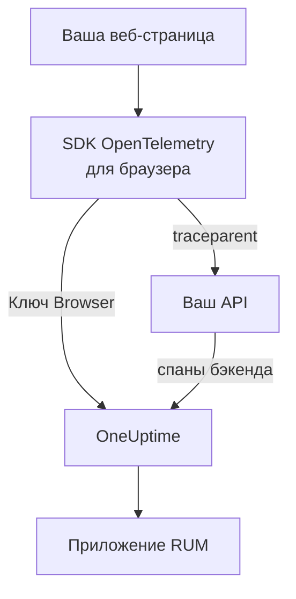

# Настройка для браузера

Инструментируйте веб-приложение с помощью SDK OpenTelemetry для браузера, чтобы оно отправляло данные в OneUptime как приложение RUM. Загрузки страниц и запросы приходят как трассировки, а та же настройка передаёт ваши ошибки, журналы, метрики и Core Web Vitals.

:::cards
- [Настройка](#настройка): Шесть шагов от ключа Browser до первой загрузки страницы.
- [Связь с бэкендом](#связь-с-бэкенд-трассировками): Связать спаны браузера с бэкенд-трассировками, которые они запускают.
- [Отчёты об ошибках](#отчёты-о-необработанных-ошибках): Отправлять необработанные ошибки в раздел исключений.
- [Устранение неполадок](#устранение-неполадок): Что проверить, если ничего не приходит.
:::

## Как это работает

SDK работает в браузерах ваших посетителей. Он записывает спан для каждой загрузки страницы и каждого запроса и экспортирует их напрямую в OneUptime с ключом приёма типа **Браузер**, без вашего собственного коллектора или прокси посередине.



## Перед началом

- Веб-приложение, код которого вы можете менять и заново развёртывать, с зависимостями, установленными через npm.
- Источники, с которых отдаются ваши страницы, например `https://app.example.com`. Ключ Browser принимает запросы только с источников, которые вы в нём укажете.
- Роль, которой разрешено создавать ключи приёма: это могут владельцы и администраторы проекта, а также все, у кого есть разрешение **Create Telemetry Ingestion Key**.

## Настройка

:::steps
### Создайте ключ приёма Browser

1. Перейдите в **Продукты → Настройки проекта**.
2. В боковом меню разверните **Телеметрия и APM** и выберите **Ключи приема**.
3. Нажмите **Создать ключ приёма** и выберите **Браузер** в поле **Тип ключа**.
4. На шаге **Настройки браузера** укажите свои источники в поле **Разрешённые источники** в виде массива JSON, например `["https://app.example.com"]`, и создайте ключ. На бесплатном тарифе OneUptime Cloud последний шаг **Биллинг** сначала показывает цену телеметрии.


Новый ключ откроется на собственной странице. Скопируйте его **Секретный ключ**: это токен, который SDK отправляет как `x-oneuptime-token`.


### Установите пакеты

```bash
npm install @opentelemetry/api \
  @opentelemetry/sdk-trace-web \
  @opentelemetry/resources \
  @opentelemetry/semantic-conventions \
  @opentelemetry/opentelemetry-browser-detector \
  @opentelemetry/exporter-trace-otlp-http \
  @opentelemetry/context-zone \
  @opentelemetry/instrumentation \
  @opentelemetry/instrumentation-document-load \
  @opentelemetry/instrumentation-fetch \
  @opentelemetry/instrumentation-xml-http-request
```

### Создайте файл телеметрии

Создайте `src/telemetry.ts`. `browserDetector` добавляет атрибуты `browser.*`, по которым телеметрия относится к RUM, а `service.name` задаёт имя приложения.

```ts title="src/telemetry.ts"
import {
  WebTracerProvider,
  BatchSpanProcessor,
} from "@opentelemetry/sdk-trace-web";
import { OTLPTraceExporter } from "@opentelemetry/exporter-trace-otlp-http";
import { ZoneContextManager } from "@opentelemetry/context-zone";
import { registerInstrumentations } from "@opentelemetry/instrumentation";
import { DocumentLoadInstrumentation } from "@opentelemetry/instrumentation-document-load";
import { FetchInstrumentation } from "@opentelemetry/instrumentation-fetch";
import { XMLHttpRequestInstrumentation } from "@opentelemetry/instrumentation-xml-http-request";
import {
  defaultResource,
  detectResources,
  resourceFromAttributes,
} from "@opentelemetry/resources";
import { browserDetector } from "@opentelemetry/opentelemetry-browser-detector";
import { ATTR_SERVICE_NAME } from "@opentelemetry/semantic-conventions";

const ONEUPTIME_URL = "https://oneuptime.com";
// Public: it ships in your page. It must be a Browser ingestion key.
const ONEUPTIME_TOKEN = "YOUR_TELEMETRY_INGESTION_TOKEN";

/*
 * browserDetector supplies the browser.* attributes. Without them this
 * telemetry is classified as a backend Service, not a RUM application.
 * The attributes set last win, so service.name here overrides the
 * "unknown_service" that defaultResource() provides.
 */
const resource = defaultResource()
  .merge(detectResources({ detectors: [browserDetector] }))
  .merge(
    resourceFromAttributes({
      [ATTR_SERVICE_NAME]: "storefront-web",
    }),
  );

const provider = new WebTracerProvider({
  resource: resource,
  spanProcessors: [
    new BatchSpanProcessor(
      new OTLPTraceExporter({
        url: `${ONEUPTIME_URL}/otlp/v1/traces`,
        headers: { "x-oneuptime-token": ONEUPTIME_TOKEN },
      }),
    ),
  ],
});

provider.register({
  contextManager: new ZoneContextManager(),
});

registerInstrumentations({
  instrumentations: [
    new DocumentLoadInstrumentation(),
    new FetchInstrumentation({
      // See "Linking to your backend traces" before widening this.
      propagateTraceHeaderCorsUrls: [/^https:\/\/api\.example\.com/],
    }),
    new XMLHttpRequestInstrumentation({
      propagateTraceHeaderCorsUrls: [/^https:\/\/api\.example\.com/],
    }),
  ],
});
```

### Импортируйте его первым

Сделайте его первым импортом приложения. Инструментации подменяют `fetch` и `XMLHttpRequest`, и запрос, сделанный до подмены, не трассируется.

```ts
// src/index.tsx (React), src/main.ts (Vue / Angular), etc.
import "./telemetry";
import React from "react";
// ... the rest of your app
```

### Проверьте ключ

Прежде чем искать причину где-то ещё, спросите OneUptime, принимает ли он ключ:

```bash
curl -i https://oneuptime.com/otlp/v1/validate \
  -H "x-oneuptime-token: YOUR_TELEMETRY_INGESTION_TOKEN"
```

`200` с `"valid": true` означает, что ключ принят; для ключа Browser сообщение добавляет, что он работает только из браузера и только с одного из разрешённых источников. `401` означает, что ключ неизвестен, отозван, выключен или истёк.

### Загрузите страницу

Откройте свой сайт. В течение минуты приложение появится в **Продукты → Ресурсы → Мониторинг реальных пользователей** под именем из своего `service.name`.
:::

## Что разрешает ключ Browser

Всё, что есть во фрагменте кода, попадает к вашим посетителям, поэтому любой может скопировать токен с вашей страницы. Ключ Browser ограничивает, что может сделать такая копия:

| Параметр | Что делает |
| --- | --- |
| **Разрешённые источники** | Запросы принимаются только с этих источников, каждый со своей схемой и портом, если он есть. Хост может начинаться с одного подстановочного знака `*.`: `https://*.example.com` охватывает все поддомены `example.com`, но не сам `example.com`. |
| **Requests Per Minute Limit** | Один потолок для всех посетителей, использующих ключ: 6000 запросов в минуту, если вы не зададите свой. |
| **Закреплённое имя сервиса** | Принудительно задаёт `service.name` для всего, что пишет ключ, чтобы копия не могла выдать свою телеметрию за один из ваших бэкенд-сервисов. |
| **Истекает в** | После этой даты ключ больше не принимается. |
| **Включено** | Выключите, чтобы сразу остановить утёкший ключ. |

Ключ Browser записывает трассировки, журналы и метрики OTLP, а также записи сеансов; все остальные пути приёма его отклоняют. Эти параметры меняются на собственной странице ключа. Тип ключа нельзя изменить после создания ключа.

> [!WARNING]
> Никогда не размещайте на странице ключ типа **Сервер**. Серверный ключ записывает любую телеметрию откуда угодно без проверки источника, поэтому любой, кто прочитает вашу страницу, сможет писать в ваш проект.

## Задание `browser.*` без детектора

`browserDetector` читает [UA Client Hints API](https://wicg.github.io/ua-client-hints/), который есть только в браузерах на Chromium. В Safari и Firefox он задаёт `browser.language` и `user_agent.original`, но не `browser.platform`, `browser.brands` или `browser.mobile`.

Этого всё равно достаточно, чтобы отнести телеметрию к RUM, потому что одного `browser.language` хватает, чтобы пометить пакет как RUM браузера. Однако страница **Клиенты** берёт платформы из `browser.platform`, поэтому посещения из Safari и Firefox не добавляют туда строк.

Чтобы обойтись без детектора или задать платформу каждому браузеру, задайте атрибуты сами:

```ts
const resource = defaultResource().merge(
  resourceFromAttributes({
    [ATTR_SERVICE_NAME]: "storefront-web",
    // browser.language or browser.platform marks the telemetry as browser RUM.
    "browser.language": navigator.language,
    "browser.platform":
      (navigator as any).userAgentData?.platform ?? "unknown",
    "browser.mobile": (navigator as any).userAgentData?.mobile ?? false,
    "user_agent.original": navigator.userAgent,
  }),
);
```

Делайте `browser.platform` обобщённым. Каждое отдельное значение становится строкой на странице **Клиенты**, поэтому полная строка user-agent или значение на каждого пользователя превращают её в бесконечный список, а заодно создают проблему с конфиденциальностью.

## Трассировка смены маршрутов

`DocumentLoadInstrumentation` трассирует только первую загрузку. В одностраничном приложении смены маршрутов остаются невидимыми, пока вы их не запишете, а для этого нужно несколько строк в маршрутизаторе:

```ts
import { trace } from "@opentelemetry/api";

const tracer = trace.getTracer("app-router");

function onRouteChange(to: string): void {
  const span = tracer.startSpan("route-change", {
    attributes: { "app.route": to },
  });
  // End it when the route's data has loaded and the view has painted.
  requestAnimationFrame(() => {
    return span.end();
  });
}
```

Добавьте `@opentelemetry/instrumentation-user-interaction`, чтобы трассировать ещё и клики и другие события DOM. Об INP для каждого маршрута см. [Одностраничные приложения](/docs/rum/web-vitals#одностраничные-приложения).

## Связь с бэкенд-трассировками

`propagateTraceHeaderCorsUrls` определяет, какие межсайтовые запросы получают заголовок W3C `traceparent`, связывающий спан браузера с запущенной им бэкенд-трассировкой. Запросы к собственному источнику страницы получают его без всякой настройки.

> [!WARNING]
> Не задавайте значение `/.*/`. Заголовок превращает простой межсайтовый запрос в запрос с предварительной проверкой, поэтому любой сторонний API, у которого `traceparent` нет в `Access-Control-Allow-Headers`, начнёт отказывать.

Указывайте только источники, которыми вы управляете и которые настроили:

```ts
new FetchInstrumentation({
  propagateTraceHeaderCorsUrls: [
    /^https:\/\/api\.example\.com/,
    /^https:\/\/auth\.example\.com/,
  ],
});
```

Если установлено [Воспроизведение сеансов](/docs/telemetry/session-replay), запросы к вашему собственному источнику несут ещё и идентификатор сеанса записи, который привязывает вашу бэкенд-телеметрию к записи: см. [Связь трассировок с воспроизведением сеансов](#связь-трассировок-с-воспроизведением-сеансов).

## Связь трассировок с воспроизведением сеансов

Если вы также используете [Воспроизведение сеансов](/docs/telemetry/session-replay), телеметрия вашего **бэкенда** присоединяется к записи без кода на этой странице. Пока сеанс выгружается, записывающий скрипт добавляет к запросам страницы к её собственному источнику элемент `tracestate` с идентификатором сеанса и оставляет `traceparent` вашей `FetchInstrumentation` / `XMLHttpRequestInstrumentation`. Спаны вашего бэкенда получают идентификатор сеанса при приёме — в каждом сервисе, который продолжает контекст трассировки W3C, — а его журналы и исключения присоединяются к записи по идентификатору трассировки. Как это работает, что не охватывается и каким переключателем это отключается, см. в разделе [Корреляция с остальной телеметрией](/docs/telemetry/session-replay#связь-с-остальной-телеметрией).

Записывающий скрипт также считывает `traceparent`, который задают ваши инструментации, независимо от того, передаёт ли вызов URL (с объектом init или без него) или объект `Request`, поэтому каждая строка запроса в воспроизведении ссылается на свою бэкенд-трассировку. API на другом источнике укажите выше в `propagateTraceHeaderCorsUrls`; его запросы не несут идентификатора сеанса и присоединяются к записи по идентификатору трассировки. Параметр **Источники для передачи трассировки** в политике воспроизведения приложения делает то же самое для страниц *без* этого SDK.

Чего заголовки не достигают, так это собственных браузерных спанов этого SDK: загрузок документа, смен маршрутов и ошибок, о которых вы сообщаете. Чтобы привязать к записи и их, ставьте `session.id` на каждый спан при его запуске. Записывающий скрипт сообщает идентификатор через `onSessionChange`, который срабатывает сразу, если сеанс уже есть, и затем при каждом изменении идентификатора: когда посетитель возвращается после 30 минут бездействия, при достижении предела в 4 часа, когда `identify()` указывает другого пользователя или когда другая вкладка того же посетителя изменила его раньше.

```ts title="src/replaySession.ts"
import type { Context } from "@opentelemetry/api";
import type {
  ReadableSpan,
  Span,
  SpanProcessor,
} from "@opentelemetry/sdk-trace-web";

declare global {
  interface Window {
    OneUptimeReplayQueue?: Array<Array<unknown>>;
  }
}

let replaySessionId: string | null = null;

// The recorder script loads asynchronously. The queue is applied the
// moment it starts and stays live afterwards, so this works either way.
(window.OneUptimeReplayQueue = window.OneUptimeReplayQueue || []).push([
  "onSessionChange",
  (sessionId: string): void => {
    replaySessionId = sessionId;
  },
]);

export class ReplaySessionSpanProcessor implements SpanProcessor {
  public onStart(span: Span, _parentContext: Context): void {
    if (replaySessionId) {
      span.setAttribute("session.id", replaySessionId);
    }
  }

  public onEnd(_span: ReadableSpan): void {}

  public forceFlush(): Promise<void> {
    return Promise.resolve();
  }

  public shutdown(): Promise<void> {
    return Promise.resolve();
  }
}
```

Затем поставьте его первым среди обработчиков спанов провайдера в `src/telemetry.ts`:

```ts
import { ReplaySessionSpanProcessor } from "./replaySession";

const provider = new WebTracerProvider({
  resource: resource,
  spanProcessors: [
    new ReplaySessionSpanProcessor(),
    new BatchSpanProcessor(
      new OTLPTraceExporter({
        url: `${ONEUPTIME_URL}/otlp/v1/traces`,
        headers: { "x-oneuptime-token": ONEUPTIME_TOKEN },
      }),
    ),
  ],
});
```

Спаны, запущенные после этого, несут идентификатор, вкладка **Трассировки** проигрывателя показывает их на шкале времени записи, а каждый из них в панели управления ведёт обратно к моменту воспроизведения. Обработчик спанов помечает каждый спан идентификатором, который действовал при его запуске; если вместо этого записать идентификатор в `resource.attributes`, перемаркировались бы спаны, ещё ждавшие в пакете экспорта, когда сеанс сменился. Слушатель получает идентификатор, как только запускается записывающий скрипт, ещё до согласия или триггера записи, поэтому, если это важно, помечайте спаны только после того, как страница получит согласие.

## Content Security Policy

Если ваш сайт отправляет Content Security Policy, браузер блокирует запросы экспортёра, пока вы не разрешите OneUptime в `connect-src`. Видимой ошибки не будет: страница просто ничего не отправит.

```text
connect-src 'self' https://oneuptime.com;
```

Добавьте это в существующую директиву `connect-src`. Если вы размещаете OneUptime сами, используйте свой хост.

## Отчёты о необработанных ошибках

SDK OpenTelemetry для браузера не перехватывает необработанные ошибки. Сообщайте о них сами, и они появятся в разделе **Исключения** рядом с ошибками бэкенда:

```ts
import { trace, SpanStatusCode } from "@opentelemetry/api";

const tracer = trace.getTracer("app-errors");

window.addEventListener("error", (event: ErrorEvent) => {
  const span = tracer.startSpan("window.onerror");
  span.recordException(event.error ?? new Error(event.message));
  span.setStatus({ code: SpanStatusCode.ERROR });
  span.end();
});

window.addEventListener("unhandledrejection", (event: PromiseRejectionEvent) => {
  const span = tracer.startSpan("unhandledrejection");
  span.recordException(
    event.reason instanceof Error ? event.reason : new Error(String(event.reason)),
  );
  span.setStatus({ code: SpanStatusCode.ERROR });
  span.end();
});
```

С [Воспроизведением сеансов](/docs/telemetry/session-replay) записывающий скрипт тоже перехватывает необработанные ошибки и отмечает их на шкале времени воспроизведения. Тогда на странице исключения появляется карточка **Watch what the user saw**, которая открывает воспроизведение за десять секунд до ошибки. При политике по умолчанию записывается каждый сеанс, будет в нём ошибка или нет; ошибка лишь определяет, где откроется карточка.

## Добавление журналов и метрик

Трассировок достаточно, чтобы заполнить обзор. Добавьте конвейеры журналов и метрик, если нужны журналы браузера в OneUptime или чтобы отправлять [Core Web Vitals](/docs/rum/web-vitals):

```bash
npm install @opentelemetry/api-logs @opentelemetry/sdk-logs \
  @opentelemetry/exporter-logs-otlp-http \
  @opentelemetry/sdk-metrics @opentelemetry/exporter-metrics-otlp-http
```

```ts
import { LoggerProvider, BatchLogRecordProcessor } from "@opentelemetry/sdk-logs";
import { OTLPLogExporter } from "@opentelemetry/exporter-logs-otlp-http";
import { MeterProvider, PeriodicExportingMetricReader } from "@opentelemetry/sdk-metrics";
import { OTLPMetricExporter } from "@opentelemetry/exporter-metrics-otlp-http";
import { logs } from "@opentelemetry/api-logs";
import { metrics } from "@opentelemetry/api";

const headers = { "x-oneuptime-token": ONEUPTIME_TOKEN };

logs.setGlobalLoggerProvider(
  new LoggerProvider({
    resource: resource,
    processors: [
      new BatchLogRecordProcessor({
        exporter: new OTLPLogExporter({
          url: `${ONEUPTIME_URL}/otlp/v1/logs`,
          headers,
        }),
      }),
    ],
  }),
);

metrics.setGlobalMeterProvider(
  new MeterProvider({
    resource: resource,
    readers: [
      new PeriodicExportingMetricReader({
        exporter: new OTLPMetricExporter({
          url: `${ONEUPTIME_URL}/otlp/v1/metrics`,
          headers,
        }),
        exportIntervalMillis: 30000,
      }),
    ],
  }),
);
```

Создавайте их с тем же объектом `resource`. Конвейер журналов или метрик, ресурс которого не содержит `browser.*`, относится к отдельному бэкенд-сервису.

## Справочник адресов

| Сигнал | Адрес | Заголовок |
| --- | --- | --- |
| Трассировки | `POST {host}/otlp/v1/traces` | `x-oneuptime-token: <token>` |
| Метрики | `POST {host}/otlp/v1/metrics` | `x-oneuptime-token: <token>` |
| Журналы | `POST {host}/otlp/v1/logs` | `x-oneuptime-token: <token>` |

`{host}` — это `https://oneuptime.com` или ваш собственный хост, если вы размещаете OneUptime сами; замените его в URL OTLP и в записи Content Security Policy. OneUptime принимает OTLP/JSON и OTLP/protobuf. Адреса отвечают на межсайтовые запросы с любого источника и разрешают заголовок `x-oneuptime-token`, поэтому браузер экспортирует данные в них напрямую.

## Устранение неполадок

:::details Во вкладке «Сеть» нет запросов к OneUptime
Откройте инструменты разработчика в браузере, перейдите во вкладку «Сеть» и отфильтруйте по `otlp`: вы ищете `POST /otlp/v1/traces`. Если запросов нет вообще, SDK так и не запустился:

- `telemetry.ts` импортируется не первым, или сборщик его выбросил.
- Пакетный обработчик ещё ничего не экспортировал. Он ждёт несколько секунд, чтобы набрать пакет, поэтому подождите или перейдите на другую страницу, прежде чем решить, что ничего не отправляется.
- Переменная окружения сборки оказалась `undefined`, и URL экспортёра сломан. Выведите URL в журнал один раз при запуске.
:::

:::details Браузер блокирует запрос
- Ошибка Content Security Policy в консоли означает, что `connect-src` ещё не разрешает OneUptime: см. [Content Security Policy](#content-security-policy).
- Ошибка CORS почти всегда означает, что запрос так и не дошёл до OneUptime, адреса которого разрешают любой источник: ищите корпоративный прокси, блокировщик рекламы или опечатку в имени хоста.
:::

:::details OneUptime отклоняет запрос
- `422` с `Origin https://app.example.com is not allowed for this browser ingestion key.` означает, что точного источника страницы (схема, хост и порт) нет в **Разрешённые источники** ключа.
- `422` с `This telemetry ingestion key has been disabled.` означает, что кто-то выключил ключ. Включите его снова или используйте другой ключ.
- `401` означает, что ключ неизвестен, отозван или истёк. Выполните проверку ключа из раздела [Настройка](#настройка), затем создайте действующий ключ Browser.
- `404` означает неверный URL. Экспортёру трассировок нужен полный путь `/otlp/v1/traces`.
:::

:::details Приложение появилось в разделе Сервисы, а не в Мониторинг реальных пользователей
У ресурса нет атрибута `browser.*`, поэтому телеметрия отнесена к бэкенд-сервису. Добавьте `browserDetector` или задайте атрибуты, как в разделе [Задание `browser.*` без детектора](#задание-browser-без-детектора).

Проверьте, что вы отправляете, во вкладке «Сеть», в теле запроса: решает список `resourceSpans[0].resource.attributes`. Уже созданный сервис не превратится в приложение RUM, поэтому удалите его в **Продукты → Сервисы**, когда начнёт поступать телеметрия RUM.
:::

:::details Страница Клиенты пуста в Safari или Firefox
Строки клиентов берутся из `browser.platform`, который `browserDetector` задаёт только в браузерах на Chromium. Задайте его сами, чтобы видеть посещения из Safari и Firefox: см. [Задание `browser.*` без детектора](#задание-browser-без-детектора).
:::

## Дальнейшие шаги

:::cards
- [Core Web Vitals](/docs/rum/web-vitals): Отправлять LCP, INP, CLS, FCP и TTFB с той же страницы.
- [Воспроизведение сеансов](/docs/telemetry/session-replay): Записывать то, что видел пользователь, рядом с этими трассировками.
- [Управление приложениями](/docs/rum/applications): Имена, метки, владельцы и хранение.
- [Устранение неполадок RUM](/docs/rum/troubleshooting): Все проверки в том порядке, в каком обычно возникают проблемы.
:::
