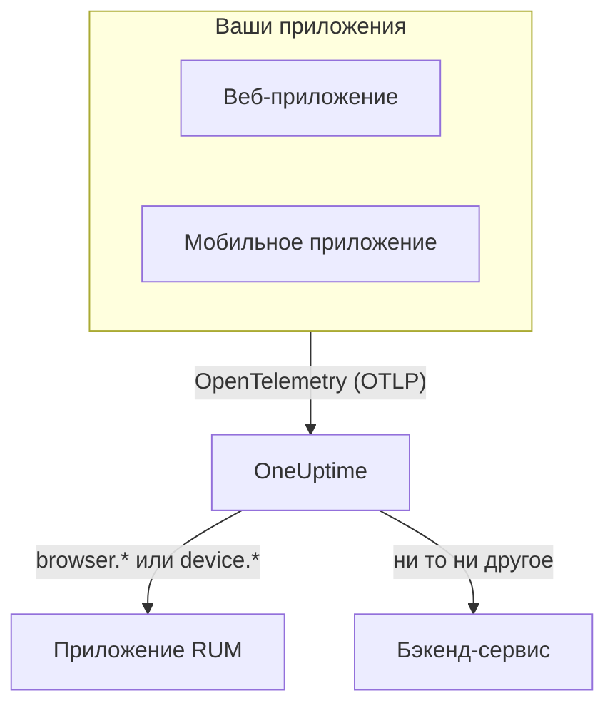

# Обзор RUM

Мониторинг реальных пользователей (RUM) показывает, что видят реальные пользователи в ваших веб- и мобильных приложениях: загрузки страниц, запросы, ошибки и Core Web Vitals, о которых сообщает само приложение, а не проба. OneUptime собирает эту телеметрию в приложение RUM, по которому можно строить графики, искать и настраивать оповещения.

:::cards
- [Как это работает](#как-это-работает): Один конвейер OpenTelemetry, который при поступлении относится к RUM.
- [Как OneUptime распознаёт RUM](#как-oneuptime-распознаёт-rum): Атрибуты ресурса, которые это решают.
- [Что вы получаете](#что-вы-получаете): Обзор, показатели, обозреватели и воспроизведения.
- [С чего начать](#с-чего-начать): От ключа приёма до первой загрузки страницы.
:::

## Как это работает

RUM использует тот же конвейер OpenTelemetry, что и остальной OneUptime. Нет ни агента RUM, ни собственного формата передачи: вы направляете SDK OpenTelemetry для браузера или мобильного устройства на OneUptime, и при поступлении телеметрия относится к RUM.

- **Одно приложение на каждое приложение.** Его идентичность — это `service.name`, который сообщает ваш SDK, и OneUptime создаёт приложение при первом пакете телеметрии.
- **Ничего не считается дважды.** Клиентская телеметрия принадлежит только своему приложению RUM и не появляется ещё и как бэкенд-сервис.
- **Session Replay — отдельный необязательный слой.** У него свой фрагмент кода и свои настройки конфиденциальности: см. [Воспроизведение сеансов](/docs/telemetry/session-replay).

## Где это найти

Откройте **Продукты → Ресурсы → Мониторинг реальных пользователей**. Раздел **Все приложения** показывает ваши приложения с их полями **Тип клиента**, **Статус** и **Последняя активность**. Ещё два раздела бокового меню изначально свёрнуты:

- **Настройки**: **Правила владельца**, **Правила меток** и общий для проекта переключатель **Воспроизведение сеансов**.
- **Расширенный**: **Архивировано** — приложения, которые вы отправили в архив.

Боковое меню самого приложения группирует его страницы так; **Настройки**, **Для разработчиков** и **Расширенный** изначально свёрнуты:

| Раздел | Страницы |
| --- | --- |
| **Базовый** | **Обзор**, **Рекомендации**, **Документация** |
| **Наблюдаемость** | **Метрики**, **Журналы**, **Трассировки**, **Клиенты** |
| **Воспроизведение сеансов** | **Воспроизведение сеансов**, **User Flows**, **Replay Users**, **Состояние**, **Replay Policy**, **Журнал доступа к записям**, **Документация** |
| **Настройки** | **Настройки** |
| **Для разработчиков** | **Terraform**, **API**, **ИИ-ассистенты** |
| **Расширенный** | **Удалить приложение** |

## Как OneUptime распознаёт RUM

Большинство вопросов вида «моё приложение не появляется» заканчиваются здесь. OneUptime решает для каждого пакета телеметрии при поступлении по его **атрибутам ресурса**:

1. Пакет, ресурс которого содержит `browser.platform`, `browser.language` или непустой `browser.brands`, — это RUM **браузера**.
2. Иначе пакет с `device.id` или `device.model.identifier` — это **мобильный** RUM.
3. Иначе пакет с `device.manufacturer` и без идентичности хоста (`host.name`, `host.id` или `k8s.node.name`) — тоже **мобильный** RUM.
4. Всё остальное — бэкенд-сервис.

Бэкенд-SDK никогда не задают `browser.*`, `device.id` или `device.model.identifier`, поэтому это чёткие сигналы. `device.manufacturer` — исключение: инвентаризация хоста тоже сообщает через него производителя машины, поэтому он учитывается только на ресурсе без идентичности хоста. См. [Атрибуты инвентаризации](/docs/telemetry/host-otel-collector#атрибуты-инвентаря-ip-mac-серийный-номер-производитель-модель-прошивка).

| Атрибут | Обязателен | Что делает |
| --- | --- | --- |
| `service.name` | **Да** | Идентичность приложения, например `storefront-web`. Без него приложение RUM не создаётся. |
| `browser.platform`, `browser.language`, `browser.brands` | Один из них, в вебе | Помечает пакет как RUM браузера. `browser.platform` также заполняет страницу **Клиенты**. |
| `device.id`, `device.model.identifier` | Один из них, на мобильных | Помечает пакет как мобильный RUM. `device.model.identifier` также заполняет страницу **Клиенты**. |
| `device.manufacturer` | Нет | Помечает пакет как мобильный RUM, только если у ресурса нет идентичности хоста. |
| `telemetry.sdk.language` | Нет | Показывается в обзоре, например `webjs` или `swift`. |
| `telemetry.sdk.version` | Нет | Показывается как версия SDK; если его нет, читается `oneuptime.agent.version`. |
| `oneuptime.label.<name>` | Нет | Добавляет приложению метку проекта `<name>:<value>`. |

OneUptime находит приложение по `service.name` без учёта регистра и создаёт его, если в проекте такого нет. Новый `service.name` начинает новое приложение, поэтому держите его неизменным, а окружения различайте меткой, а не новым именем. В разделе [Управление приложениями](/docs/rum/applications) описаны имена, метки, владельцы и хранение.

> [!IMPORTANT]
> SDK OpenTelemetry для браузера не добавляет атрибуты `browser.*`, пока вы не подключите детектор ресурсов браузера или не зададите их сами. Только с `service.name` телеметрия становится бэкенд-сервисом, а не приложением RUM. В разделе [Настройка для браузера](/docs/rum/browser-setup) показаны оба способа.

## Что вы получаете

| Где | Что показывает |
| --- | --- |
| **Обзор** | Плитки **Page loads**, **Page load time (p95)**, **События**, **Частота ошибок**, **Event duration (p95)**, **Исключения**, **Клиенты** и **Sessions recorded**, а также графики трендов за выбранный период. |
| **Core Web Vitals** | Карточка в обзоре с LCP, INP, CLS, FCP и TTFB, каждый из которых оценивается по порогам Google, и INP для каждого маршрута одностраничного приложения. См. [Core Web Vitals](/docs/rum/web-vitals) и [Одностраничные приложения](/docs/rum/web-vitals#одностраничные-приложения). |
| **Метрики**, **Журналы**, **Трассировки** | Обозреватели телеметрии, ограниченные этим приложением. |
| **Клиенты** | Платформы браузеров и модели устройств, на которых использовалось приложение: короткий список по платформам, а не строка на каждого пользователя. |
| **Воспроизведение сеансов** | Записи реальных сеансов рядом с их ошибками, трассировками и журналами: см. [Воспроизведение сеансов](/docs/telemetry/session-replay). |
| **Рекомендации** | Готовые мониторы для приложения: плохие Core Web Vitals, неудачные запросы, исключения браузера, а как только начнётся запись — бюджеты Session Replay. |

Подсчёты берутся из спанов, которые отправляет ваша инструментация. **Page loads** считает спан `documentLoad`, который инструментация загрузки страницы записывает при каждой полной загрузке, поэтому смена маршрута внутри одностраничного приложения загрузкой страницы не считается.

Приложение показывает **Подключено**, пока поступает телеметрия, и **Отключено** после 15 минут без неё. Время, когда сам OneUptime был недоступен или разбирал очередь приёма, в эти 15 минут не засчитывается.

## С чего начать

:::steps
### Создайте ключ приёма

Откройте **Настройки проекта → Телеметрия и APM → Ключи приема** и нажмите **Создать ключ приёма**. Веб-приложению нужен ключ **Браузер**, который работает только с указанных вами источников. Мобильному приложению нужен ключ **Сервер**, потому что мобильный SDK не отправляет заголовок `Origin`.

### Инструментируйте приложение

Следуйте разделу [Настройка для браузера](/docs/rum/browser-setup) для веб-приложения или [Настройка для мобильных устройств](/docs/rum/mobile-setup) для Android, iOS, React Native и других платформ.

### Откройте страницу

Загрузите страницу своего сайта или запустите приложение. Приложение появится в **Продукты → Ресурсы → Мониторинг реальных пользователей** с первым пакетом телеметрии под именем из своего `service.name`. Создавать его заранее не нужно.

### Добавьте показатели и воспроизведения

Когда начнут поступать основные данные, отправляйте [Core Web Vitals](/docs/rum/web-vitals) и добавьте [Воспроизведение сеансов](/docs/telemetry/session-replay). И то и другое необязательно.
:::

Если ничего не появляется, раздел [Устранение неполадок RUM](/docs/rum/troubleshooting) разбирает причины в том порядке, в каком они обычно возникают.

## Дальнейшие шаги

:::cards
- [Настройка для браузера](/docs/rum/browser-setup): Инструментировать веб-приложение с помощью SDK OpenTelemetry для браузера.
- [Настройка для мобильных устройств](/docs/rum/mobile-setup): Android, iOS, React Native и любой другой SDK OpenTelemetry.
- [Core Web Vitals](/docs/rum/web-vitals): Отправлять LCP, INP, CLS, FCP и TTFB и смотреть INP по маршрутам.
- [Воспроизведение сеансов](/docs/telemetry/session-replay): Увидеть то, что видел пользователь, рядом с его ошибками и трассировками.
:::
