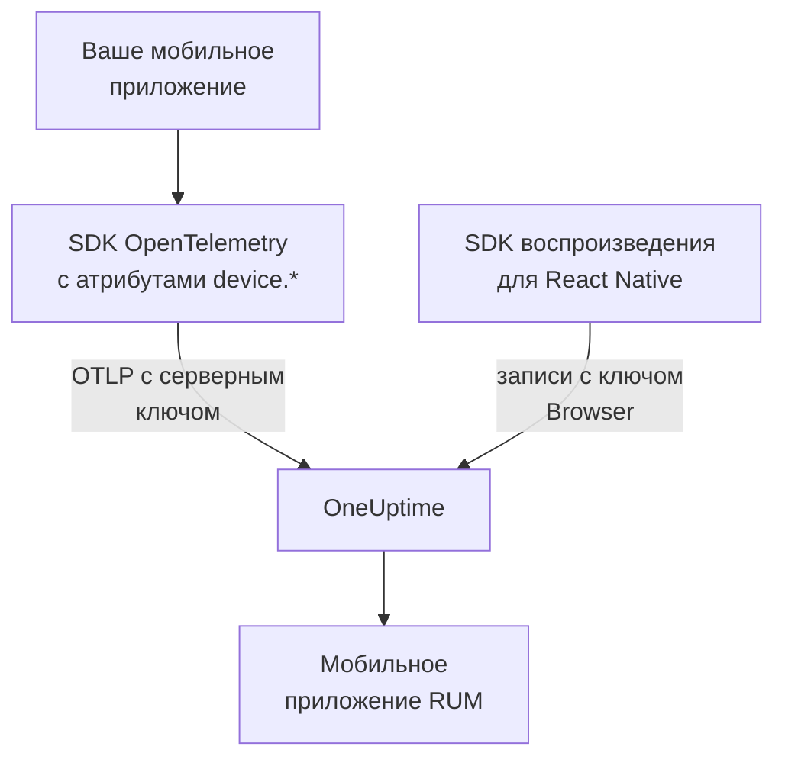

# Настройка для мобильных устройств

Инструментируйте приложение для Android, iOS или React Native с помощью OpenTelemetry, чтобы оно отправляло данные в OneUptime как мобильное приложение RUM. Любая другая платформа с SDK OpenTelemetry работает так же.

:::cards
- [Что нужно OneUptime](#что-нужно-oneuptime): Два атрибута ресурса, отправленные с серверным ключом.
- [Настройка платформы](#настройка-платформы): Android, iOS, React Native и остальные.
- [Проверка поступления данных](#проверка-поступления-данных): Проверить ключ, затем найти приложение.
- [Session Replay на мобильных](#session-replay-на-мобильных): Записи для приложений на React Native.
:::

## Как это работает

Ваше приложение экспортирует OTLP напрямую в OneUptime с ключом приёма типа **Сервер**. Именно атрибуты `device.*` его ресурса относят его к мобильному RUM, а не к бэкенд-сервису.



## Что нужно OneUptime

Два атрибута ресурса в каждом пакете, который экспортирует ваше приложение:

| Атрибут | Что это |
| --- | --- |
| `service.name` | Идентичность приложения, например `storefront-android`. |
| `device.id` или `device.model.identifier` | Помечает телеметрию как мобильный RUM. `device.model.identifier` также заполняет страницу **Клиенты**. |

Без атрибута устройства телеметрия всё равно приходит, и к ней можно делать запросы, но она относится к бэкенд-сервису, а не к приложению RUM.

`device.manufacturer` тоже помечает пакет как мобильный, но только на ресурсе без идентичности хоста, потому что инвентаризация хоста сообщает через него производителя машины. Задайте также `device.id` или `device.model.identifier`, как это делает каждый рецепт ниже, и это никогда не будет иметь значения.

Делайте `device.id` идентификатором установки, а не рекламным идентификатором или чем-то ещё, что указывает на человека. OneUptime читает его только для того, чтобы распознать мобильную телеметрию.

## Перед началом

- Приложение с SDK OpenTelemetry: OpenTelemetry Java SDK или OpenTelemetry Android, opentelemetry-swift или OpenTelemetry JavaScript SDK для React Native.
- Ключ приёма типа **Сервер**, созданный в **Настройки проекта → Телеметрия и APM → Ключи приема** кнопкой **Создать ключ приёма**. Ключ **Браузер** из мобильного приложения отклоняется: он проверяется по заголовку `Origin`, который мобильные SDK не отправляют.
- Эти параметры OTLP. Если вы размещаете OneUptime сами, замените `https://oneuptime.com` своим хостом.

| Параметр | Значение |
| --- | --- |
| Адрес OTLP | `https://oneuptime.com/otlp` |
| Заголовок | `x-oneuptime-token: YOUR_TELEMETRY_INGESTION_TOKEN` |
| Трассировки | `POST https://oneuptime.com/otlp/v1/traces` |
| Метрики | `POST https://oneuptime.com/otlp/v1/metrics` |
| Журналы | `POST https://oneuptime.com/otlp/v1/logs` |

> [!WARNING]
> Ключ поставляется внутри вашего приложения, а приложение можно распаковать, поэтому исходите из того, что кто-то его скопирует. На странице ключа задайте **Закреплённое имя сервиса**, чтобы копия не могла писать под именами ваших бэкенд-сервисов, добавьте **Requests Per Minute Limit** и дату в поле **Истекает в** и меняйте ключ с каждым выпуском.

## Настройка платформы

Фрагменты показывают общий вид настройки. Мобильные SDK OpenTelemetry меняют свои API от версии к версии, поэтому сверяйте имена методов с версией, которую вы закрепили. То, что нужно OneUptime, не меняется никогда: адрес, заголовок, `service.name` и один атрибут `device.*`.

:::tabs
@tab Android
Используйте OpenTelemetry Java SDK и его экспортёр OTLP, которые работают на Android:

```kotlin title="app/build.gradle.kts"
dependencies {
    implementation(platform("io.opentelemetry:opentelemetry-bom:<latest>"))
    implementation("io.opentelemetry:opentelemetry-sdk")
    implementation("io.opentelemetry:opentelemetry-exporter-otlp")
}
```

```kotlin title="StorefrontApplication.kt"
import android.app.Application
import android.os.Build
import io.opentelemetry.exporter.otlp.http.trace.OtlpHttpSpanExporter
import io.opentelemetry.sdk.OpenTelemetrySdk
import io.opentelemetry.sdk.resources.Resource
import io.opentelemetry.sdk.trace.SdkTracerProvider
import io.opentelemetry.sdk.trace.export.BatchSpanProcessor

class StorefrontApplication : Application() {
    override fun onCreate() {
        super.onCreate()

        val resource = Resource.getDefault().toBuilder()
            .put("service.name", "storefront-android")
            .put("device.manufacturer", Build.MANUFACTURER)
            .put("device.model.identifier", Build.MODEL)
            .build()

        val exporter = OtlpHttpSpanExporter.builder()
            .setEndpoint("https://oneuptime.com/otlp/v1/traces")
            .addHeader("x-oneuptime-token", BuildConfig.ONEUPTIME_TOKEN)
            .build()

        OpenTelemetrySdk.builder()
            .setTracerProvider(
                SdkTracerProvider.builder()
                    .setResource(resource)
                    .addSpanProcessor(BatchSpanProcessor.builder(exporter).build())
                    .build()
            )
            .buildAndRegisterGlobal()
    }
}
```

Агент [OpenTelemetry Android](https://github.com/open-telemetry/opentelemetry-android) добавляет поверх автоматическую инструментацию и задаёт атрибуты устройства в собственном ресурсе. Если вы его используете, направьте его экспортёр на тот же адрес с тем же заголовком и проверьте, что `device.model.identifier` попадает в ресурс в вашей версии.
@tab iOS
Используйте [opentelemetry-swift](https://github.com/open-telemetry/opentelemetry-swift) и задавайте атрибуты устройства сами: ресурс, который каждая версия добавляет по умолчанию, менялся от версии к версии.

```swift
let resource = Resource(attributes: [
    "service.name": .string("storefront-ios"),
    "device.model.identifier": .string(UIDevice.current.model),
    "device.manufacturer": .string("Apple"),
    "telemetry.sdk.language": .string("swift"),
])

let exporter = OtlpHttpTraceExporter(
    endpoint: URL(string: "https://oneuptime.com/otlp/v1/traces")!,
    config: OtlpConfiguration(
        headers: [("x-oneuptime-token", oneUptimeToken)]
    )
)

OpenTelemetry.registerTracerProvider(
    tracerProvider: TracerProviderBuilder()
        .with(resource: resource)
        .add(spanProcessor: BatchSpanProcessor(spanExporter: exporter))
        .build()
)
```

`UIDevice.current.model` даёт короткое имя вроде `iPhone`, благодаря чему на странице **Клиенты** остаётся одна строка на каждый тип устройства.
@tab React Native
React Native использует OpenTelemetry JavaScript SDK, поэтому соберите провайдер, экспортёр OTLP и пакетный обработчик, как в разделе [Настройка для браузера](/docs/rum/browser-setup), с тремя изменениями: отправляйте с ключом **Сервер**, уберите `browserDetector` и `DocumentLoadInstrumentation` и задайте атрибуты устройства сами.

```ts
import { Platform } from "react-native";
import * as Device from "expo-device"; // or react-native-device-info
import {
  defaultResource,
  resourceFromAttributes,
} from "@opentelemetry/resources";

const resource = defaultResource().merge(
  resourceFromAttributes({
    "service.name": "storefront-mobile",
    "device.manufacturer": Device.manufacturer ?? Platform.OS,
    "device.model.identifier":
      Device.modelId ?? Device.modelName ?? "unknown",
    "telemetry.sdk.language": "webjs",
  }),
);
```

`Device.modelId` задаётся только на iOS, поэтому на Android используется `Device.modelName`.
@tab Другие платформы
Flutter, Unity, .NET MAUI, встроенный клиент или собственный писатель OTLP подойдут, если ресурс содержит `service.name` и один атрибут `device.*`. SDK, который читает стандартные переменные окружения OpenTelemetry, примет их как есть:

```bash
OTEL_EXPORTER_OTLP_ENDPOINT="https://oneuptime.com/otlp"
OTEL_EXPORTER_OTLP_HEADERS="x-oneuptime-token=YOUR_TELEMETRY_INGESTION_TOKEN"
OTEL_RESOURCE_ATTRIBUTES="service.name=storefront-mobile,device.manufacturer=Acme,device.model.identifier=AC-100"
```

SDK сам добавляет `/v1/traces`, `/v1/metrics` и `/v1/logs` к адресу.
:::

## Проверка поступления данных

:::steps
### Проверьте ключ

Прежде чем разбирать настройки SDK, спросите OneUptime, принимает ли он ключ:

```bash
curl -i https://oneuptime.com/otlp/v1/validate \
  -H "x-oneuptime-token: YOUR_TELEMETRY_INGESTION_TOKEN"
```

`200` с `"valid": true` означает, что ключ принят. Ключ Browser тоже отвечает `200`, но его сообщение говорит, что он работает только из браузера: мобильному приложению нужен серверный ключ. `401` означает, что ключ неизвестен, отозван, выключен или истёк, и никакая настройка SDK этого не исправит.

### Запустите приложение

Запустите приложение и немного им попользуйтесь. Оно появится в **Продукты → Ресурсы → Мониторинг реальных пользователей** с первым пакетом телеметрии под именем из своего `service.name`.

### Откройте страницу Клиенты

Откройте страницу **Клиенты** приложения: у каждой модели устройства из `device.model.identifier` есть строка. Если страница остаётся пустой, пока заполняется раздел **Трассировки**, атрибуты устройства не доходят до ресурса.
:::

## Session Replay на мобильных

Приложения на React Native могут записывать сеансы с помощью `@oneuptime/react-native-replay`. Он записывает нативное дерево представлений как каркас, а не снимки экрана или текст на экране, и его записи открываются в том же проигрывателе, что и веб-записи. Он отправляет данные с ключом **Браузер**, в поле **Разрешённые источники** которого ваше приложение указано как `app://` с идентификатором приложения Android или идентификатором пакета iOS: это отдельный ключ, а не серверный ключ, который использует ваш SDK OpenTelemetry. Пошаговые инструкции — в разделе [Установка в React Native](/docs/telemetry/session-replay#установка-в-react-native).

У нативных приложений для Android и iOS и у других платформ нет записи сеансов: их страница **Воспроизведение сеансов** остаётся пустой, а трассировки, журналы, метрики, исключения и страница **Клиенты** работают как обычно.

## Устранение неполадок

:::details Проверка ключа возвращает 401, или ключ отклоняется
`401` означает, что ключ неизвестен, отозван, выключен или истёк: создайте серверный ключ и пересоберите с ним приложение.

Ключ Browser проходит проверку, но каждый экспорт из мобильного приложения отклоняется с `422` и сообщением `This request did not send an Origin header, so it cannot be checked against the allowed origins of this browser ingestion key. Use a server ingestion key for requests that are not sent by a browser.` Используйте ключ **Сервер**.
:::

:::details Приложение появилось в разделе Сервисы, а не в Мониторинг реальных пользователей
У ресурса нет ни `device.id`, ни `device.model.identifier`, поэтому телеметрия отнесена к бэкенд-сервису. Задайте их, как в разделе [Настройка платформы](#настройка-платформы).

Уже созданный сервис не превратится в приложение RUM, поэтому удалите его в **Продукты → Сервисы**, когда начнёт поступать телеметрия RUM.
:::

:::details Страница Клиенты пуста
Строки клиентов берутся только из `device.model.identifier`. SDK, который задаёт лишь `device.id` или `device.manufacturer`, относит приложение к мобильному RUM, но клиентов не показывает: задайте также `device.model.identifier`.
:::

:::details Статус показывает Отключено, хотя приложением пользуются
Статус меняется на **Отключено** после 15 минут без телеметрии. Если приложением пользуются:

- Возможно, сэмплер отбрасывает всё: проверьте, нет ли сэмплера always-off или очень низкой доли.
- Возможно, приложение отправляет телеметрию только по действиям, которых за это время никто не совершал.
- Возможно, ключ отозван или истёк после выпуска: проверьте его, как в разделе [Проверка поступления данных](#проверка-поступления-данных).
:::

## Дальнейшие шаги

:::cards
- [Воспроизведение сеансов](/docs/telemetry/session-replay): Записывать сеансы React Native рядом с их трассировками.
- [Управление приложениями](/docs/rum/applications): Имена, метки, владельцы и хранение.
- [OpenTelemetry](/docs/telemetry/open-telemetry): Адреса OTLP, ограничения и ошибки подробно.
- [Устранение неполадок RUM](/docs/rum/troubleshooting): Все проверки в том порядке, в каком обычно возникают проблемы.
:::
