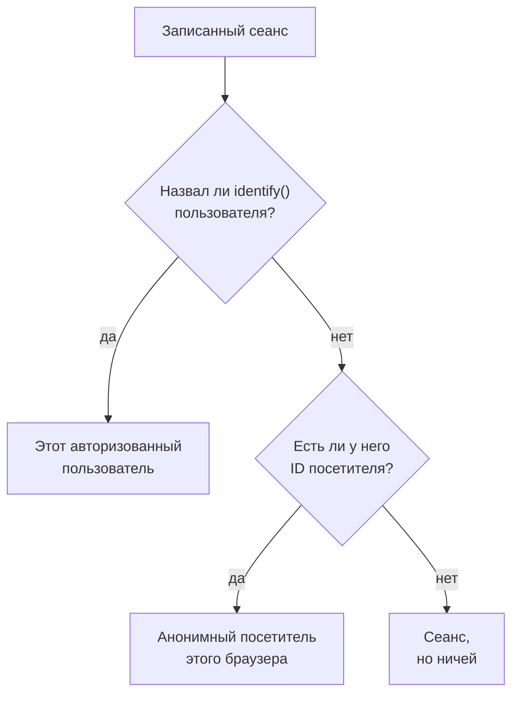

# Продуктовая аналитика

Продуктовая аналитика считает людей, которые пользуются приложением RUM, то, как проходят их сеансы, и то, что они делают: активных, новых, вернувшихся, авторизованных и неактивных пользователей, сеансы по устройствам, браузерам, странам и страницам, а также события, которые отправляет ваше приложение, в виде трендов, воронок и удержания. Она считает сеансы, которые записывает [Воспроизведение сеансов](/docs/telemetry/session-replay), и события, которые отправляет его рекордер, поэтому ей не нужен собственный сниппет, и хранит свои цифры 13 месяцев, долго после того, как записи истекли.

:::cards
- [Пользователи](#пользователи): Активные, новые, вернувшиеся, авторизованные, все и неактивные пользователи.
- [Сеансы](#сеансы): Сколько, как долго, и по устройствам, браузерам, странам и страницам.
- [Отправка событий и метрик](#отправка-событий-и-метрик): Что делают люди и какие числа измеряет ваша страница.
- [События](#события): Как часто что-то происходило, кто это делал и где.
- [Воронки](#воронки): Кто шёл дальше, шаг за шагом, и сколько времени это заняло.
- [Удержание пользователей](#удержание-пользователей): Кто вернулся, когорта за когортой.
:::

## Как считаются люди

В боковом меню приложения есть раздел **Продуктовая аналитика**: **Пользователи**, **Сеансы**, **События**, **Воронки**, **Удержание пользователей**, **Пользовательские сценарии** и **Настройки аналитики**. **Пользователи** и **Сеансы** считают сеансы, которые записывает Воспроизведение сеансов, поэтому они начинают считать, когда начинает работать рекордер приложения, а сеанс, который политика воспроизведения не записывает, не считается. Каждый сеанс считается за одного человека или ни за кого:



- **Авторизованный пользователь считается один раз**, в каждом браузере и на каждом устройстве, которыми он пользуется: его узнают по одностороннему хешу ссылки, которую ваша страница передала в `identify()` (см. [Идентификация пользователей](/docs/telemetry/session-replay#идентификация-пользователей)).
- **Анонимный браузер считается один раз**, по своему [ID анонимного посетителя](/docs/telemetry/session-replay#анонимные-посетители). Два браузера — это два посетителя, а сеансы, которые были у браузера до того, как кто-то в нём вошёл, остаются за его посетителем.
- **Сеанс от старого рекордера**, который не отправлял ID посетителя, считается сеансом, но не человеком.

**События**, **Воронки** и **Удержание пользователей** считают людей так же, по событиям, которые рекордер отправляет из каждого сеанса, записанного или нет (см. [Отправка событий и метрик](#отправка-событий-и-метрик)).

Дни считаются в вашем собственном часовом поясе.

## Пользователи

**Пользователи** считает людей за выбранный вами период:

| Плитка | Что она считает |
| --- | --- |
| **Активные пользователи** | Все, кто приходил за период: каждый авторизованный пользователь один раз и каждый анонимный браузер один раз. |
| **Новые пользователи** | Активные пользователи, чей первый визит пришёлся на период. |
| **Вернувшиеся пользователи** | Активные пользователи, которые приходили и до начала периода. |
| **Авторизованные пользователи** | Активные пользователи, которых ваше приложение авторизовало через `identify()`, и их доля среди всех активных пользователей. |
| **Всего пользователей** | Все, кого приложение видело за последние 13 месяцев. |
| **Неактивные пользователи** | Люди, которые приходили раньше, но не за последние 30 дней или за выбранные вами 7, 14, 60 или 90 дней. |

Первые три также показывают, как они изменились по сравнению с предыдущим периодом. Под плитками **Активные пользователи** строит для каждого дня людей, пришедших в этот день, пришедших за 7 дней до него включительно и пришедших за 30 дней до него включительно, а **Новые и вернувшиеся пользователи** делит людей каждого дня на две части.

**Люди** перечисляет всех, кого считают плитки, по строке на человека, сначала тех, кого видели последними, а его фильтр показывает людей одной плитки, анонимных посетителей или всех. Откройте человека, чтобы увидеть его первый и последний визит и каждый его сеанс за последние 13 месяцев, с **Смотреть** у каждого, запись которого ещё хранится.

## Сеансы

**Сеансы** считает сеансы, начавшиеся за период: **Сеансы**, **Сеансы с авторизацией**, **Медианная длительность сеанса**, **Страниц за сеанс**, **Сеансы с ошибками** и **Сеансы с фрустрацией**. Под плитками:

- **Сеансы по устройствам** строит сеансы каждого дня с компьютеров, телефонов и планшетов. Сеанс мобильного приложения на экране, у которого короткая сторона 600 точек или больше, считается сеансом планшета.
- **Длительность сеансов** раскладывает завершённые сеансы по длительности, от меньше 10 секунд до больше 30 минут. У сеанса, который ещё записывается, длительности пока нет.
- **Разбивка** упорядочивает пользователей и сеансы по типу устройства, браузеру, операционной системе, стране, версии приложения, странице входа или странице, сначала с наибольшим числом пользователей.

## Отправка событий и метрик

События отправляются, пока включён параметр **Отправлять события продуктовой аналитики** на странице **Настройки аналитики** приложения. Для нового приложения он включён с самого начала, а для приложения, созданного до его появления, выключен, так что включите его там. Воспроизведение сеансов тоже должно быть включено для приложения, потому что события отправляет его рекордер; рекордер React Native пока не отправляет ни одного.

Каждый сеанс, в котором работает браузерный рекордер, сам отправляет своё начало и каждую просмотренную страницу, включая смену маршрутов в одностраничном приложении, независимо от того, записывают ли этот сеанс выборка и политика воспроизведения. Собственные события и числа приходят из кода вашей страницы:

```js
OneUptimeReplay.track("Signed up", { plan: "pro" });
OneUptimeReplay.metric("cart.value", 42.5, { currency: "EUR" });
```

| Вызов | Что он отправляет |
| --- | --- |
| `track(name, properties?)` | Событие, которое считают **События**, **Воронки** и **Удержание пользователей**, и отметка на шкале времени воспроизведения, если сеанс записывается. `name` ≤ 64 символов; ≤ 20 свойств со строковыми, числовыми или логическими значениями, ключ ≤ 40 символов, значение ≤ 200 символов. |
| `metric(name, value, attributes?)` | Число, которое измерила ваша страница, как точка одной из метрик приложения (см. [Дашборды и оповещения](#дашборды-и-оповещения)). `name` ≤ 100 символов из букв, цифр, `_`, `.`, `-` и `/`, начинается с буквы и не с `oneuptime.`; `value` — конечное число; `attributes` — как свойства `track()`. |

Пока рекордер не загрузился, помещайте те же вызовы в `window.OneUptimeReplayQueue` как `["track", name, properties]` и `["metric", name, value, attributes]` (см. [API для JavaScript](/docs/telemetry/session-replay#api-для-javascript)).

- **Каждый сеанс, записанный или нет.** Выборка и политика отправки воспроизведения решают, какие сеансы записываются, а не какие считаются. При Do Not Track или Global Privacy Control ничего не отправляется, и ничего не сохраняется из источника, который приложение не разрешает. Если политика требует согласия, события ждут `grantConsent()`, не более 500, а `revokeConsent()` их отбрасывает.
- **Маскируются, как запись.** При _Mask all text_ значения свойств и атрибутов маскируются до того, как покинут страницу. Страница отправляется как её путь, без строки запроса и фрагмента.
- **Небольшими пакетами**, каждые 5 секунд и когда вкладка скрывается. Событие, которое доходит до OneUptime более чем через 3 дня после того, как произошло, отбрасывается, а проект может отправлять 60 000 событий и точек метрик в минуту, все его приложения вместе; сверх этого рекордер ждёт и отправляет их снова.

`metric()` ничего не отправляет, пока события выключены, а `getDiagnostics().productAnalytics` сообщает, включены ли они (см. [`getDiagnostics()`](/docs/telemetry/session-replay#getdiagnostics)).

### Свойства пользователей

Чтобы разбивать и сегментировать события по тому, кто их совершил, перечислите ключи признаков `identify()` в **Свойства пользователей для аналитики** на странице **Настройки аналитики**, например `["plan", "role"]`, не более 20, с точным совпадением написания. Тогда каждое событие несёт эти признаки авторизованного пользователя в том виде, в каком ваша страница передала их в `identify()`. Остальные признаки никогда не покидают страницу, а пока выключен параметр **Записывать личность конечного пользователя**, не покидает ни один. Не перечисляйте признаки, содержащие персональные данные, например адрес электронной почты.

## События

**События** показывает одно событие за раз: самое частое событие вашего приложения, пока вы не выберете другое, или самую просматриваемую страницу, пока приложение не отправляет ни одного. В списке выбора есть также **Сеанс начат** и каждая просмотренная страница, а **Все события** ниже перечисляет все события периода с тем, сколько раз каждое произошло и сколько людей его совершили; выберите одно, чтобы увидеть его выше.

- Плитки считают **События** события со средним числом на человека, его **Пользователи** и его **Сеансы**.
- **События и пользователи** строит для каждого дня, сколько раз произошло событие и сколько людей совершили его в тот день.
- **Разбивка** упорядочивает событие по типу устройства, браузеру, операционной системе, стране, версии приложения, странице, свойству события или свойству пользователя, с событиями, пользователями и долей каждого значения. Выберите значение, чтобы показать только его.

**Сегмент** сужает страницу до событий, у которых поля имеют выбранные вами значения: **Добавить фильтр**, затем поле и значение, с точным совпадением. В сегменте не более 5 фильтров, и событие должно подходить под все. Адрес страницы сохраняет событие, период, сегмент и разбивку, поэтому ссылка открывает то же представление.

## Воронки

**Воронки** прослеживает путь людей по шагам, от 2 до 6, в заданном порядке, и каждый шаг — это событие, как их перечисляет **События**. Из людей, совершивших первый шаг за период, страница считает, сколько затем совершили второй, потом третий, и всё это в пределах времени, которое вы выбираете от их первого шага: **В течение 1 часа**, **В течение 1 дня**, **В течение 7 дней**, **В течение 14 дней** или **В течение 30 дней**. **Добавить шаг** добавляет шаг.

В **Конверсия** указаны доля людей, совершивших все шаги, и для каждого шага — сколько людей до него дошли, какую долю людей первого шага это составляет, сколько отсеялось после предыдущего шага и медианное время, которое им понадобилось от него. Тот, кто пытался больше одного раза, считается один раз, по попытке, которая зашла дальше всех.

Сегмент воронки, как и таблицы удержания, берёт поля, которые есть у каждого события, и свойства пользователей, но не собственные свойства события, поскольку её шаги — разные события.

## Удержание пользователей

**Удержание пользователей** группирует людей по дню, неделе или месяцу периода, в котором они впервые совершили одно событие, **Люди, которые совершили**, и показывает, какая доля каждой группы совершила другое, **И вернулись, чтобы совершить**, в этом интервале и в каждом следующем. Оба — **Сеанс начат**, пока вы не выберете другие.

**Когорты** задаёт интервал: **По дням**, **По неделям** или **По месяцам**. Когда в периоде больше интервалов, чем показывает одна таблица, 32 дня, 26 недель или 13 месяцев, страница удлиняет когорты и сообщает об этом.

Каждая строка — это когорта и число людей в ней, а каждая ячейка — доля тех, кто вернулся в этом интервале, тем темнее, чем больше их было. Интервал, который ещё не начался, остаётся пустым.

**Все когорты** над ними считает когорты как одну: в каждом интервале — люди, которые вернулись, от людей тех когорт, что до него дошли, так что когорта из 200 человек весит вчетверо больше, чем когорта из 50. Строка появляется, как только в двух когортах кто-то есть.

## Сохранённые воронки и таблицы удержания

**Сохранённые воронки** на странице **Воронки** и **Сохранённые таблицы удержания** на странице **Удержание пользователей** перечисляют то, что ваша команда сохранила для приложения, чтобы снова открыть или показать на дашборде. Сохранённая воронка хранит свои шаги, время на их прохождение и сегмент, а сохранённая таблица удержания — два события, интервал и сегмент. Ни одна из них не хранит период: страница хранит свой, а дашборд читает свой.

- **+ Сохранить воронку** или **+ Сохранить таблицу удержания** сохраняет то, что показывает страница, под именем. Приложение хранит не больше 100 каждого вида.
- Выберите одну, чтобы открыть её. Адрес страницы называет её, поэтому ссылка открывает её для всех, кому она видна. Когда вы меняете то, что она показывает, её название говорит об этом, а **Обновить** сохраняет изменение.
- **Редактировать** переименовывает её, а **Удалить** удаляет её для всех. **Сбросить представление** закрывает открытую и оставляет то, что показывает страница.
- Ссылка на удалённую или недоступную вам сообщает об этом, и страница открывается без неё.

## Дашборды и оповещения

Каждое событие также считается, минута за минутой, как метрика приложения, а каждый вызов `metric()` — это точка отдельной метрики с именем, которое он указывает. Стройте по ним графики на странице **Метрики** приложения, добавляйте их на дашборд или настраивайте оповещения по ним с помощью монитора метрик; **Открыть метрики** под **Все события** открывает эту страницу.

| Метрика | Что она считает | По |
| --- | --- | --- |
| `oneuptime.rum.product.events` | Ваши события `track()`, за минуту | `event.name` |
| `oneuptime.rum.product.sessions` | Начавшиеся сеансы, за минуту | `device.type` |
| `oneuptime.rum.product.page.views` | Просмотренные страницы, за минуту | `device.type` |

Эти три не тарифицируются, а `metric()` отклоняет имя, начинающееся с `oneuptime.`, поэтому ничто из отправленного вашей страницей не может выдать себя за них. Ваши точки `metric()` хранятся и тарифицируются так же, как другие метрики приложения.

Сохранённая воронка или таблица удержания попадает и на дашборд: виджеты **Воронка** и **Удержание пользователей** из группы **Продуктовая аналитика** каталога виджетов показывают её во временном диапазоне дашборда, а **Открыть в «Воронках»** или **Открыть в «Удержании пользователей»** открывает её на её странице (см. [Виджеты дашборда](/docs/dashboards/widgets#продуктовая-аналитика)).

## Конфиденциальность и хранение

- **13 месяцев.** Цифры месяца удаляются в первый день 13-го месяца после него, поэтому последние 12 полных месяцев всегда на месте, каким бы ни было собственное хранение записей (по умолчанию 7 дней). События хранятся так же.
- **Имена не хранятся.** Цифры хранят односторонний ключ авторизованного пользователя и ID посетителя браузера, но никогда не ссылку или IP-адрес, а из признаков — только перечисленные вами свойства пользователей. Строка называет авторизованного пользователя, только пока хранится одна из его записей, и только для роли, которой можно читать идентичность; иначе в ней **Авторизованный пользователь** или **Анонимный посетитель** и начало ID.
- **Удаление по запросу.** Запрос на удаление удаляет и соответствующие цифры и события здесь (см. [Удаление сеансов](/docs/telemetry/session-replay#удаление-сеансов)).

## Кто может её видеть

Чтение этих страниц требует того же, что и чтение списка сеансов: `ReadRumSessionReplay` (_List Session Replays_) или `ReadRumSessionReplayPayload` (_Watch Session Replays_), которые есть у владельцев и администраторов проекта. Чтобы видеть, кто такой авторизованный пользователь, и искать людей по имени, нужно разрешение на идентичность, описанное в разделе [Кто может смотреть запись](/docs/telemetry/session-replay#кто-может-смотреть-запись).

Чтобы сохранять, переименовывать и удалять сохранённые воронки и таблицы удержания, нужны те же разрешения, что и для чтения этих страниц, а виджет дашборда показывает их только читателю, у которого они есть.

Чтобы включать и выключать события, нужно `EditRumApplication` (_Edit RUM Application_) или роль владельца, администратора или участника проекта. Чтобы перечислять свойства пользователей, нужно `EditRumApplication` или роль владельца или администратора, поскольку это решает, что хранится об авторизованных людях.

## Дальнейшие шаги

:::cards
- [Воспроизведение сеансов](/docs/telemetry/session-replay): Записывайте сеансы, которые считают эти страницы, и смотрите их.
- [Управление приложениями](/docs/rum/applications): Имена, метки, владельцы и хранение.
- [Обзор RUM](/docs/rum/index): Что ещё показывает приложение RUM.
:::
