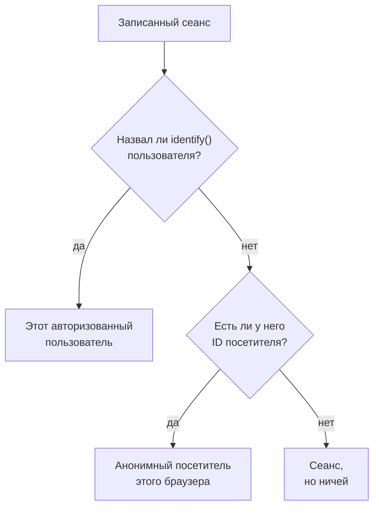

# Продуктовая аналитика

Продуктовая аналитика считает людей, которые пользуются приложением RUM, и то, как проходят их сеансы: активных, новых, вернувшихся, авторизованных и неактивных пользователей, а также сеансы по устройствам, браузерам, странам и страницам. Она считает сеансы, которые записывает [Воспроизведение сеансов](/docs/telemetry/session-replay), поэтому ей не нужен собственный сниппет, и хранит свои цифры 13 месяцев, долго после того, как записи истекли.

:::cards
- [Как считаются люди](#как-считаются-люди): Авторизованный пользователь один раз, анонимный браузер один раз.
- [Пользователи](#пользователи): Активные, новые, вернувшиеся, авторизованные, все и неактивные пользователи.
- [Сеансы](#сеансы): Сколько, как долго, и по устройствам, браузерам, странам и страницам.
- [Конфиденциальность и хранение](#конфиденциальность-и-хранение): 13 месяцев, имена не хранятся, удаление по запросу.
:::

## Как считаются люди

В боковом меню приложения есть раздел **Продуктовая аналитика** с двумя страницами, **Пользователи** и **Сеансы**. Обе считают сеансы, которые записывает Воспроизведение сеансов, поэтому они начинают считать, когда начинает работать рекордер приложения, а сеанс, который политика воспроизведения не записывает, не считается. Каждый сеанс считается за одного человека или ни за кого:

- **Авторизованный пользователь считается один раз**, в каждом браузере и на каждом устройстве, которыми он пользуется: его узнают по одностороннему хешу ссылки, которую ваша страница передала в `identify()` (см. [Идентификация пользователей](/docs/telemetry/session-replay#идентификация-пользователей)).
- **Анонимный браузер считается один раз**, по своему [ID анонимного посетителя](/docs/telemetry/session-replay#анонимные-посетители). Два браузера — это два посетителя, а сеансы, которые были у браузера до того, как кто-то в нём вошёл, остаются за его посетителем.
- **Сеанс от старого рекордера**, который не отправлял ID посетителя, считается сеансом, но не человеком.

Дни считаются в вашем собственном часовом поясе.

## Пользователи

**Пользователи** считает людей за выбранный вами период:

| Плитка | Что она считает |
| --- | --- |
| **Активные пользователи** | Все, кто приходил за период: каждый авторизованный пользователь один раз и каждый анонимный браузер один раз. |
| **Новые пользователи** | Активные пользователи, чей первый визит пришёлся на период. |
| **Вернувшиеся пользователи** | Активные пользователи, которые приходили и до начала периода. |
| **Авторизованные пользователи** | Активные пользователи, которых ваше приложение авторизовало через `identify()`, и их доля среди всех активных пользователей. |
| **Всего пользователей** | Все, кого приложение видело за последние 13 месяцев. |
| **Неактивные пользователи** | Люди, которые приходили раньше, но не за последние 30 дней или за выбранные вами 7, 14, 60 или 90 дней. |

Первые три также показывают, как они изменились по сравнению с предыдущим периодом. Под плитками **Активные пользователи** строит для каждого дня людей, пришедших в этот день, пришедших за 7 дней до него включительно и пришедших за 30 дней до него включительно, а **Новые и вернувшиеся пользователи** делит людей каждого дня на две части.

**Люди** перечисляет всех, кого считают плитки, по строке на человека, сначала тех, кого видели последними, а его фильтр показывает людей одной плитки, анонимных посетителей или всех. Откройте человека, чтобы увидеть его первый и последний визит и каждый его сеанс за последние 13 месяцев, с **Смотреть** у каждого, запись которого ещё хранится.

## Сеансы

**Сеансы** считает сеансы, начавшиеся за период: **Сеансы**, **Сеансы с авторизацией**, **Медианная длительность сеанса**, **Страниц за сеанс**, **Сеансы с ошибками** и **Сеансы с фрустрацией**. Под плитками:

- **Сеансы по устройствам** строит сеансы каждого дня с компьютеров, телефонов и планшетов. Сеанс мобильного приложения на экране, у которого короткая сторона 600 точек или больше, считается сеансом планшета.
- **Длительность сеансов** раскладывает завершённые сеансы по длительности, от меньше 10 секунд до больше 30 минут. У сеанса, который ещё записывается, длительности пока нет.
- **Разбивка** упорядочивает пользователей и сеансы по типу устройства, браузеру, операционной системе, стране, версии приложения, странице входа или странице, сначала с наибольшим числом пользователей.

## Конфиденциальность и хранение

- **13 месяцев.** Цифры месяца удаляются в первый день 13-го месяца после него, поэтому последние 12 полных месяцев всегда на месте, каким бы ни было собственное хранение записей (по умолчанию 7 дней).
- **Имена не хранятся.** Цифры хранят односторонний ключ авторизованного пользователя и ID посетителя браузера, но никогда не ссылку, признаки или IP-адрес. Строка называет авторизованного пользователя, только пока хранится одна из его записей, и только для роли, которой можно читать идентичность; иначе в ней **Авторизованный пользователь** или **Анонимный посетитель** и начало ID.
- **Удаление по запросу.** Запрос на удаление удаляет и соответствующие цифры здесь (см. [Удаление сеансов](/docs/telemetry/session-replay#удаление-сеансов)).

## Кто может её видеть

Чтение двух страниц требует того же, что и чтение списка сеансов: `ReadRumSessionReplay` (_List Session Replays_) или `ReadRumSessionReplayPayload` (_Watch Session Replays_), которые есть у владельцев и администраторов проекта. Чтобы видеть, кто такой авторизованный пользователь, и искать людей по имени, нужно разрешение на идентичность, описанное в разделе [Кто может смотреть запись](/docs/telemetry/session-replay#кто-может-смотреть-запись).

## Дальнейшие шаги

:::cards
- [Воспроизведение сеансов](/docs/telemetry/session-replay): Записывайте сеансы, которые считают эти страницы, и смотрите их.
- [Управление приложениями](/docs/rum/applications): Имена, метки, владельцы и хранение.
- [Обзор RUM](/docs/rum/index): Что ещё показывает приложение RUM.
:::
