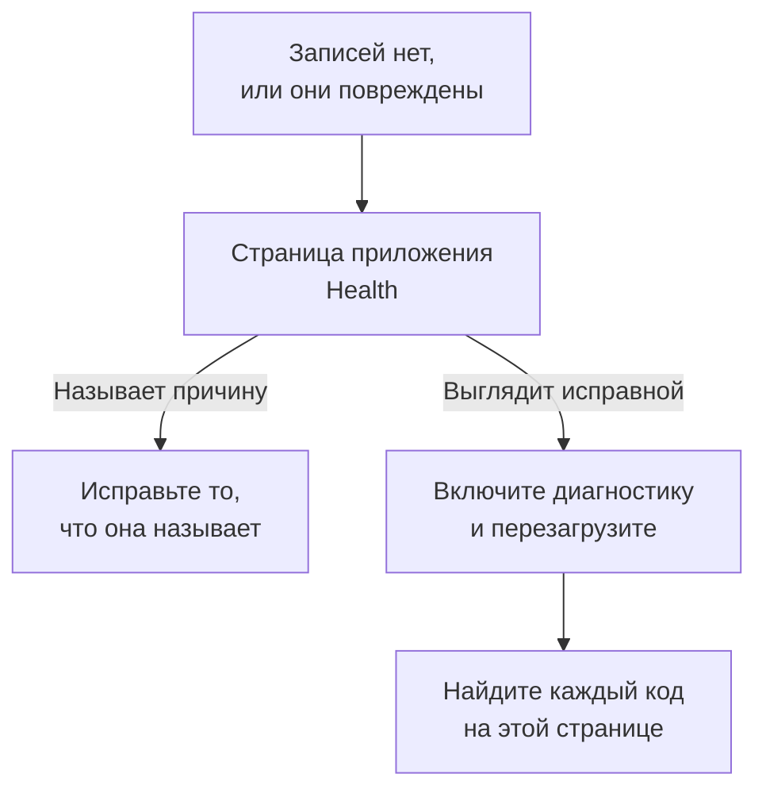

# Устранение неполадок воспроизведения сеансов

Если записи не поступают или поступают повреждёнными, эта страница поможет найти причину. По умолчанию воспроизведение сеансов записывает каждый сеанс и отправляет его по ходу, поэтому исправная страница отправляет фрагмент примерно каждые 15 секунд, пока пользователь что-то делает. Неактивная вкладка не создаёт событий и ничего не отправляет, а после пяти минут без ввода записывающий скрипт полностью приостанавливается (`recording-paused-idle`), поэтому подвигайте мышью или щёлкните, прежде чем судить об установке по вкладке Network. Если и тогда запросов к OneUptime нет совсем, причина — что-то из описанного ниже.

:::cards
- [Включите диагностику](#включите-диагностику): Пусть записывающий скрипт объясняет в консоли каждое решение.
- [Коды](#коды): Каждая строка, которую выводит записывающий скрипт, и что с ней делать.
- [Межсетевой экран перед OneUptime отклоняет фрагменты](#межсетевой-экран-перед-oneuptime-отклоняет-фрагменты): Правила, которые нужно проверить, и исключения, которые нужно добавить.
- [В воспроизведении нет изображений, значков или стилей](#в-воспроизведении-нет-изображений-значков-или-стилей): Записи воспроизводятся, но не так, как их видел пользователь.
:::



Единственная настройка, при которой тишина нормальна, — отправка _On error or frustration_ (`OnErrorOrFrustration`): тогда записывающий скрипт держит в памяти скользящий буфер и отправляет данные, только когда что-то идёт не так, а до срабатывания триггера это выглядит точь-в-точь как сломанная установка. Прежде чем искать что-то ещё, проверьте, какая настройка у вас: её выводит строка `config-accepted`, описанная ниже.

Если можете, начните со стороны сервера. Страница приложения **Состояние** в разделе **Воспроизведение сеансов** его бокового меню называет причину, когда ничего не поступает: записывающий скрипт так и не загрузился; загрузился, но ничего не отправил, и почему; отправки отклоняются и по какой причине; или бюджет исчерпан. См. [Состояние записи](/docs/telemetry/session-replay#состояние-записи). Дальше описана сторона браузера: включите диагностику, перезагрузите страницу один раз и прочитайте консоль.

Записи поступают, но воспроизводятся с битыми изображениями, без значков или с областями без стилей? Это вопрос воспроизведения, ответ на него — в разделе [В воспроизведении нет изображений, значков или стилей](#в-воспроизведении-нет-изображений-значков-или-стилей).

## Включите диагностику

Выберите любой переключатель, до которого можете дотянуться. Все они делают одно и то же.

:::tabs
@tab В браузере
В том браузере, где возникает сбой. Не требует повторного развёртывания, работает в рабочей среде и сохраняется после перезагрузки:

```js
localStorage.setItem("oneuptime.sessionReplay.debug", "true");
// then reload the page
```

Чтобы снова выключить:

```js
localStorage.removeItem("oneuptime.sessionReplay.debug");
```
@tab По ссылке
Для нетехнического пользователя или страницы, на которой нельзя открыть консоль, добавьте `oneuptime_debug=1` в URL. Это работает и во фрагменте URL, который переживает сервер, удаляющий незнакомые ему параметры запроса:

```text
https://your-app.example.com/checkout?oneuptime_debug=1
https://your-app.example.com/checkout#oneuptime_debug=1
```
@tab В теге script
Для тестовой среды, где диагностика нужна всем:

```html
<script
  src="https://oneuptime.com/telemetry/session-replay/v1/recorder.js"
  data-oneuptime-token="YOUR_TELEMETRY_INGESTION_KEY"
  data-oneuptime-app-identifier="YOUR_RUM_APP_IDENTIFIER"
  data-oneuptime-debug="true"
  crossorigin="anonymous"
  async
></script>
```
@tab В глобальном объекте init
Если вы настраиваете записывающий скрипт через глобальный объект init:

```js
window.__ONEUPTIME_SESSION_REPLAY__ = {
  host: "https://oneuptime.com",
  token: "YOUR_TELEMETRY_INGESTION_KEY",
  appIdentifier: "YOUR_RUM_APP_IDENTIFIER",
  debug: true,
};
```
@tab В развёртывании
В развёртывании OneUptime — единственный переключатель, которому не нужен никто у браузера со сбоем. Задайте `SESSION_REPLAY_DEBUG=true` и перезапустите. Тогда каждый записывающий скрипт, который отдаёт этот экземпляр, пишет журнал на каждой странице, где работает, поэтому включите его, соберите одну перезагрузку и выключите. Он не меняет никакую политику: ни сэмплирование, ни маскирование, ни согласие. Другие настройки развёртывания см. в разделе [Заметки о собственном размещении](/docs/telemetry/session-replay#заметки-о-собственном-размещении).
@tab Во время работы
Когда записывающий скрипт загрузился:

```js
OneUptimeReplay.setDebug(true);
```
:::

Вывод выглядит так:

```text
[OneUptime Session Replay] loader-start: Loader running.
[OneUptime Session Replay] init-options-read: Init options read. {host: "https://oneuptime.com", appIdentifier: "checkout-web", …}
[OneUptime Session Replay] config-fetch-start: Requesting the policy. {url: "https://oneuptime.com/telemetry/session-replay/v1/config", …}
[OneUptime Session Replay] config-accepted: Policy accepted. {captureTrigger: "Always", samplePercentage: 100, …}
[OneUptime Session Replay] recording: Recording and uploading …
```

## Получите хронологию, ничего не включая заранее

Записывающий скрипт хранит свои последние 250 решений независимо от того, включена диагностика или нет. Если проблема уже произошла, воспроизводить её с включённым журналированием не нужно — запросите вот это:

```js
copy(JSON.stringify(OneUptimeReplay.getDiagnostics(), null, 2));
```

Вызов возвращает версию записывающего скрипта, идентификатор сеанса, его `state` (`recording`, `uploading`, `not-sampled`, `stopped`…), причину остановки, если она была, `bootstrapDecision`, ответ каждого шлюза в `decisions` (попал ли сеанс в выборку, состояние согласия, разрешены ли отправки и что их блокирует, последняя директива сервера), `capabilities` записывающего скрипта и полный список записей — включая записи загрузчика, который работает ещё до появления артефакта записывающего скрипта и где решается большинство отказов от записи. По своему устройству он не содержит содержимого страницы; см. [Чего диагностика никогда не содержит](#чего-диагностика-никогда-не-содержит). Поля описаны в разделе [`getDiagnostics()`](/docs/telemetry/session-replay#getdiagnostics).

**Если вы получаете `OneUptimeReplay is not defined`**, артефакт записывающего скрипта так и не загрузился — что само по себе ответ для доброй половины кодов ниже и как раз тот случай, когда хронология нужнее всего. Записи всё равно есть — в глобальном объекте, в который загрузчик пишет ещё до появления артефакта:

```js
copy(JSON.stringify(window.__ONEUPTIME_SESSION_REPLAY_DEBUG__.records, null, 2));
```

Вставьте любой из них в обращение в поддержку — или в **Ask the browser** на странице приложения **Состояние**, которая объясняет каждый код в нём. Обычно этого достаточно.

## Когда тишина нормальна: политика с запуском по ошибке

Этот раздел относится к вам, только если `config-accepted` вывел `captureTrigger: "OnErrorOrFrustration"`. С политикой по умолчанию `Always` записывающий скрипт отправляет данные по ходу записи, и тишина на странице, с которой взаимодействует пользователь, означает, что что-то действительно не так, — читайте дальше этого раздела.

Если консоль показывает вот это:

```text
[OneUptime Session Replay] recording: Recording into memory. Nothing uploads until a trigger fires - call OneUptimeReplay.captureSession() to force one.
```

…значит, записывающий скрипт работает. С политикой, запускаемой по ошибке, исправная страница делает ровно один запрос к OneUptime за загрузку страницы (получение конфигурации) и больше ничего не отправляет, пока не произойдёт ошибка, ответ 5xx, сигнал разочарования или превышение бюджета производительности.

Чтобы проверить весь путь от начала до конца, принудительно выполните отправку:

```js
OneUptimeReplay.captureSession("installation test");
```

Вы сразу должны увидеть `POST /telemetry/session-replay/v1/chunk` на вкладке Network и строку `chunk-accepted` в консоли. Если так и есть, установка правильная, и воспроизведение появится в панели управления примерно через минуту, а ваша причина будет отмечена на его шкале времени.

Ищите `202` с `chunk-accepted`. Ответ `204` вместо этого записывает в журнал `chunk-not-recorded`: запрос был корректным, а сервер решил его не сохранять — бюджет превышен, сеанс не попал в выборку или приложение выключено. Это ответ политики, а не ошибка установки, и соседняя строка `server-directive` говорит, что именно.

Чтобы снова записывать каждый сеанс, задайте на странице приложения **Replay Policy** для **Когда выгружать запись** значение _Always_, а для **Процент выборки** — больше 0. Это заводская настройка по умолчанию.

## Коды

Каждая строка несёт стабильный `code`. Найдите свой здесь.

### Запуск

| код | что это значит |
| --- | --- |
| `loader-start` | Скрипт записи выполнился. Если при включённой диагностике вы этого не видите, сам скрипт так и не выполнился — проверьте запрос `<script>` на вкладке Network и `script-src` в вашей CSP. |
| `init-options-read` | Параметры найдены. Проверьте `host` и `appIdentifier` в подробностях: `appIdentifier` должен точно совпадать с приложением RUM, а `host` должен быть вашим источником OneUptime, а не источником вашего приложения. |
| `init-options-incomplete` | Не хватает обязательного параметра. Подробности говорят, какой из `hasHost` / `hasToken` / `hasAppIdentifier` равен false. Если `hasHost` равен false, у тега script нет `src`, из которого можно вывести хост, — добавьте `data-oneuptime-host`. |
| `privacy-signal` | Браузер отправляет Do Not Track или Global Privacy Control, и это соблюдается — страницей (ничто в теге script не говорит иного) или политикой сервера. Ничего не записывается; при `stage: "before-config-fetch"` не выполняется и запрос конфигурации. Это не ошибка. Задавайте `data-oneuptime-respect-do-not-track="false"`, только если ваше правовое основание действительно от этого сигнала не зависит. |
| `init-options-missing` | На странице нечего читать: нет ни тега `script[data-oneuptime-token]`, ни `window.__ONEUPTIME_SESSION_REPLAY__`. Атрибут-маркер написан с ошибкой, фрагмент кода оказался в другом документе или его удалил менеджер тегов. |
| `loader-threw` | Ошибка в самом записывающем скрипте, а не в вашей конфигурации. Сообщите о ней, приложив вывод диагностики. |

### Политика

| код | что это значит |
| --- | --- |
| `config-fetch-start` | Сейчас будет запрошена политика. `url` в подробностях — точный URL; проверьте, что он отвечает из браузера. |
| `config-fetch-rejected` | Конечная точка ответила не 2xx. См. [Статусы получения конфигурации](#статусы-получения-конфигурации) ниже. |
| `config-fetch-failed` | Запрос так и не завершился: `connect-src` в CSP, блокировщик рекламы, DNS, TLS, отсутствие подключения или тайм-аут в 5 секунд. Обычно браузер пишет рядом собственную строку. |
| `config-body-unparseable` | Конечная точка ответила 2xx с телом, которое вообще не является JSON. В отличие от `config-fetch-failed`, запрос *завершился*, значит, вместо OneUptime ответило что-то на пути — прокси, captive portal, промежуточная страница SSO. |
| `config-unparseable` | Тело *было* корректным JSON, но не объектом — `null`, строка, массив. Переписывающий прокси или сервер, отвечающий на другом пути. |
| `config-disabled` | Сервер сообщает, что воспроизведение здесь выключено. Ответ — `disabledReason` в подробностях: см. [disabledReason](#disabledreason) ниже. |
| `config-recorder-version-invalid` | Политика не назвала ровно `latest` строчными буквами, поэтому URL артефакта построить не удалось. Переписывающий прокси или подделанный ответ — развёртывание без сборки вместо этого сообщает `config-disabled` с `recorder-not-built`. |
| `config-accepted` | Политика принята. В подробностях — вся политика: `captureTrigger`, `samplePercentage`, `consentMode`, `maskingMode`. |
| `config-field-defaulted` | Сервер не прислал значение для поля политики (оно названо в подробностях), поэтому этот записывающий скрипт использовал значение продукта по умолчанию. Информационное сообщение: обычно сервер старше записывающего скрипта. Если панель управления показывает для этого поля другое значение, обновите OneUptime. |
| `config-value-unrecognised` | Сервер прислал значение, которого эта сборка записывающего скрипта не знает, поэтому он откатился к самому безопасному — а оно может отличаться от того, что показывает ваша панель управления. Обычно это страница, на которой всё ещё работает записывающий скрипт из предыдущего развёртывания. |
| `directive-stop` | Сервер велел этому записывающему скрипту отказаться от записи. Проверьте состояние записи приложения: бюджет, ограничение частоты или аварийный выключатель. |

#### Статусы получения конфигурации

| статус | действие |
| --- | --- |
| `401` | Токен приёма неверный, отозван, истёк или принадлежит другому проекту. Создайте токен в **Настройки проекта → Телеметрия и APM → Ключи приема** и проверьте его через `GET /session-replay/v1/validate` — отправьте ключ так же, как это делает записывающий скрипт, и добавьте заголовок `x-oneuptime-app-identifier`, тогда ответ будет содержать ещё и `isSessionReplayEnabled` для этого приложения, `sessionReplayDisabledDetail`, называющий выключенный переключатель, если воспроизведение не включено, `isIngestEnabledOnThisInstance` и `keyType`. |
| `400` | Отсутствует `data-oneuptime-app-identifier`. |
| `403` | Источника страницы нет в списке **Разрешённые источники** ключа приёма. Добавьте его или используйте ключ, список разрешённых источников которого охватывает эту страницу. |
| `404` | Путь не найден на источнике OneUptime. Почти всегда это неверный `data-oneuptime-host` — или обратный прокси перед OneUptime, который не пересылает `/telemetry/*`. |
| `5xx` | Ошибка на стороне сервера; проверьте журналы приложения OneUptime. |

#### disabledReason

| значение | что делать |
| --- | --- |
| `not-enabled-for-application` | Воспроизведение сеансов выключено для этого приложения RUM, идентификатор ни с чем не совпадает или проекту не разрешено использовать воспроизведение. `disabledDetail` говорит, что именно: `application-not-enabled` (переключатель этого приложения), `project-not-allowed` (общий для проекта переключатель в **Мониторинг реальных пользователей → Настройки → Воспроизведение сеансов**), `application-unknown` (ни у одного приложения нет такого `appIdentifier` — сверьте написание на странице приложения **Replay Policy**) или `project-killed` (аварийный выключатель оператора в этом развёртывании). |
| `budget-exhausted` | Дневной бюджет байтов проекта или месячный бюджет приложения уже исчерпан, поэтому записывающим скриптам велено не записывать, а не отправлять фрагменты, которые будут отклонены. `disabledDetail` равен `project-daily-budget-exhausted` или `app-monthly-budget-exhausted`, а `budgetResetsAt` говорит, когда бюджет освободится. Увеличьте бюджет на странице **Replay Policy** или дождитесь сброса. |
| `recorder-not-built` | **В развёртывании нет артефакта записывающего скрипта.** На стороне клиента это ничем не исправить. Сборка, которая создаёт `packages/App/FeatureSet/BrowserRecorder/public/dist/manifest.json`, не выполнялась, или её результат так и не попал в работающий образ. Пересоберите и заново разверните приложение OneUptime. Это типичный ответ для собственной установки, на которой воспроизведение никогда не работало. |
| `disabled-by-default` | В этом развёртывании `SESSION_REPLAY_ENABLED_BY_DEFAULT=false`. Задайте `true` — а если вы размещаете OneUptime сами, сначала задайте `SESSION_REPLAY_MAX_BYTES_PER_PROJECT_PER_DAY`, потому что воспроизведение — самая тяжёлая из ваших таблиц. |
| `ingest-disabled` | В этом развёртывании `SESSION_REPLAY_INGEST_ENABLED=false`. |
| `policy-unavailable` | Сервер не смог определить политику — обычно из-за Redis или Postgres. Намеренно отказывает в закрытую сторону. Проверьте журналы приложения OneUptime. |
| `not-reported` | Сервер старше этого поля. Используйте вместо этого панель **Test your installation** в панели управления, на странице **Replay Policy**. |

### Артефакт

| код | что это значит |
| --- | --- |
| `artifact-requested` | Внедряется последний пакет записывающего скрипта. `url` — точный адрес. |
| `artifact-load-failed` | Он не загрузился. В порядке вероятности: `script-src` в CSP, который не разрешает ваш источник OneUptime, несовпадение SRI (прокси, переписывающий пакет) или 404, потому что это развёртывание не собрало записывающий скрипт. |
| `artifact-url-invalid` | Политика не назвала ровно `latest` строчными буквами, поэтому URL не был построен. Подделанный или изменённый прокси ответ конфигурации. |
| `artifact-api-missing` | Пакет загрузился, но не опубликовал `window.OneUptimeReplay` — его перезаписал другой скрипт на странице. |
| `bootstrap` | Артефакт записывающего скрипта запускается. |
| `bootstrap-already-started` | Две копии фрагмента кода на одной странице. Удалите одну. |
| `bootstrap-already-running` | `bootstrap()` вызван снова, когда записывающий скрипт уже работал. Безвредно; обычно это дублированная интеграция. |
| `bootstrap-cancelled` | `revokeConsent()` или `stop()` в очереди `window.OneUptimeReplayQueue` выполнились до запуска записывающего скрипта, поэтому этот сеанс не записывается. Правильно, если ваш баннер уже был отклонён. |
| `start-stopped` | `start()` не получил пригодной политики на пути автономного пакета. Точная причина — в строке `config-*` прямо над этой. |
| `rrweb-did-not-start` | Записывающий модуль DOM отказался запускаться. Сообщите об этом. |
| `rrweb-error` | Записывающий модуль DOM столкнулся с внутренней ошибкой на этой странице (имя ошибки — в подробностях; записывается в журнал один раз). Запись может прыгать или замирать в этом месте, а после трёх таких ошибок сеанс несёт уведомление о точности, которое об этом говорит. Сообщите об этом, указав фреймворк страницы и имя ошибки. |

### Запись и отправка

| код | что это значит |
| --- | --- |
| `not-sampled` | Этот сеанс проиграл в лотерее сэмплирования, поэтому вообще ничего не записывается. Сэмплирование детерминировано по идентификатору сеанса, поэтому перезагрузка этому сеансу не поможет. Увеличьте процент сэмплирования. |
| `recording` | Идёт запись. Прочитайте подробности: `uploading: true` — нормальное состояние с триггером по умолчанию `Always`. `uploading: false` с `captureTrigger: "OnErrorOrFrustration"` — другое исправное состояние, без запросов. |
| `same-origin-propagation` | Записывается в журнал один раз при запуске записывающего скрипта: добавляет ли он контекст трассировки (`traceparent` и `tracestate` с идентификатором сеанса) к запросам к собственному источнику страницы. `enabled: true` с `reason: "on"` — значение по умолчанию. `reason: "policy-off"` означает, что **Передача трассировки в пределах источника** выключен на странице приложения **Replay Policy**; `reason: "opaque-origin"` означает, что у страницы нет собственного источника (изолированный iframe, `about:blank`, `srcdoc` или `file:`), поэтому ничто не считается тем же источником. Даже во включённом состоянии заголовки сопровождают только запросы, сделанные, пока сеанс отправляет данные, и никогда — `POST` на путь, оканчивающийся на `/v1/traces`, `/v1/logs` или `/v1/metrics` (собственные экспорты OpenTelemetry страницы). Записывается в журнал ещё раз, с `reason: "agent-stand-down"` и полем `agent` (`DD_RUM`, `NREUM` или `elasticApm`), когда записывающий скрипт впервые за загрузку страницы уступает `traceparent` запроса к тому же источнику этому агенту, потому что тот настроен трассировать запрос (Datadog RUM — только в сеансе, который он отслеживает); запрос всё равно получает член `tracestate` и связывается, только если агент действительно отправляет `traceparent`, а Datadog делает это только в отслеживаемом сеансе Datadog, попавшем в выборку трассировок. New Relic (`NREUM`) отправляет собственный `tracestate` вместо члена, поэтому его запросы связываются только по идентификатору трассировки (см. [вкладки Logs и Traces пусты](#вкладки-журналы-и-трассировки-в-проигрывателе-пусты)). См. [Связь с остальной телеметрией](/docs/telemetry/session-replay#связь-с-остальной-телеметрией). |
| `same-origin-propagation-tripped` | Запрос, к которому записывающий скрипт добавил контекст трассировки, завершился сбоем на сетевом уровне — обычно это запрос к тому же источнику, перенаправленный на другой источник, который не разрешает `traceparent` и `tracestate`. Записывающий скрипт перестал добавлять их до конца этой загрузки страницы. `retried: true` означает, что это был `fetch` `GET` или `HEAD` без тела и он был отправлен ещё раз в точности так, как его сделала ваша страница; `false` означает, что повторить его было нельзя и он завершился сбоем: повторяется только `fetch` `GET` или `HEAD` без тела (не XHR, не другой метод, не запрос с телом). Собственные прерывания и тайм-ауты вашей страницы его не вызывают, как и сбой, пока браузер сообщает об отсутствии сети; следующая загрузка страницы начинает заново. См. [Загрузки или перенаправления перестают работать после включения Session Replay](#загрузки-или-перенаправления-перестают-работать-после-включения-session-replay). |
| `trigger` | Произошло что-то, что стоит сохранить. `reason` — одно из `error`, `frustration`, `performance`, `sampled` или `manual`. |
| `upload-started` | Предварительная запись из буфера выгружается. Здесь начинаются POST-запросы фрагментов. |
| `upload-blocked-consent` | Триггер сработал, но ничего не было отправлено, потому что согласие так и не было дано. В режиме согласия `RequireExplicit` ваша страница должна вызвать `OneUptimeReplay.grantConsent()`, когда баннер принят. |
| `chunk-discarded-consent` | Та же причина на уровень ниже: готовый фрагмент был отброшен. |
| `chunk-accepted` | Фрагмент дошёл и сохранён. Установка работает. |
| `chunk-not-recorded` | Сервер принял запрос и намеренно решил его не записывать — бюджет превышен, сеанс не попал в выборку, приложение отключено или достигнут лимит фрагментов на сеанс. Причину несёт соседняя строка `server-directive`. Установка правильная; политика или бюджет не такие, как вы ожидаете. |
| `chunk-post-failed` | POST так и не дошёл до сервера, прежде чем эта страница успешно что-либо отправила. `connect-src` в CSP, блокировщик рекламы или CORS на источнике приёма — или страница, потерявшая подключение до первой отправки. Засчитывается в предохранитель. |
| `chunk-held-offline` | Автономный режим: у устройства нет подключения (браузер сообщает об отсутствии сети, или запрос так и не дошёл до сервера, который раньше отвечал). Запись продолжается, а фрагмент ждёт; `queueDepth` — сколько ожидает, а `retryInMs` — когда следующая попытка. Не считается ошибкой, и ничего не теряется. |
| `back-online` | Первый запрос после обрыва дошёл до сервера. Фрагменты из очереди отправляются, от старых к новым. |
| `browser-offline` | Браузер отправил событие `offline`. Запись продолжается; записывающий скрипт открывает своё автономное хранилище, чтобы фрагменты вкладки, закрытой сейчас, сохранились. |
| `browser-online` | Браузер отправил событие `online`, и `queuedChunks` отправляются сейчас, а не по таймеру повторов. |
| `offline-queue-full` | Обрыв длился дольше, чем вмещает очередь отправки (240 фрагментов или 4 МБ): самые старые фрагменты (`dropped`) отброшены, чтобы сохранить самые новые. В сеансе на их месте виден пропуск. |
| `offline-flush-stored` | Страница была скрыта или закрыта без сети, поэтому её последние фрагменты записаны в IndexedDB браузера, а не отправлены. `storeOpen: false` означает, что хранилище не успело открыться, и закрываемая вкладка всё ещё может их потерять. Их отправит следующая страница приложения. |
| `final-flush-deferred` | Последний запрос не смог вместить все фрагменты, и остальные (`kept`) записаны в IndexedDB для следующей страницы, а не отброшены. |
| `offline-chunks-restored` | Эта страница нашла `chunks`, которые предыдущая страница записала без сети и не смогла отправить, и отправляет их раньше своих. |
| `offline-chunk-claimed-elsewhere` | Другая вкладка того же приложения уже отправила фрагмент, который сохранила эта вкладка, поэтому эта вкладка его пропустила. Ничего не потеряно. |
| `chunk-post-server-error` | Сервер ответил 5xx. Записывающий скрипт повторяет попытку; `consecutiveFailures` в сравнении с `maxFlushFailures` в подробностях показывает, насколько он близок к тому, чтобы сдаться. |
| `chunk-retry-scheduled` | Ошибка, допускающая повтор (сеть, 5xx или ограничение со стороны сервера), поставила фрагмент в очередь повторов; `inMs` в подробностях — пауза перед следующей попыткой, а `queueDepth` — сколько фрагментов ждёт. Пока ничего не потеряно. |
| `chunk-retry` | Пауза закончилась, и фрагменты из очереди отправляются снова. |
| `chunk-abandoned` | Фрагмент слишком много раз не удалось отправить, и он отброшен; отправка продолжается со следующего. В сеансе на его месте виден пропуск. Причину смотрите в предыдущей строке `chunk-post-*`. |
| `final-chunk-carried-queue` | Страница была скрыта или закрыта, когда в очереди повторов ещё оставались фрагменты, и они ушли дополнительными кадрами в единственном запросе страницы при скрытии: `frames` — сколько кадров нёс запрос, `bytes` — его общий размер. Ничего не потеряно — о том, что не поместилось, сообщает `final-flush-partial`. |
| `final-flush-truncated` | Когда страница исчезла, в буфере было больше, чем может нести запрос keepalive, поэтому самые старые события последнего фрагмента отброшены, чтобы он поместился; `droppedEvents` говорит, сколько. Сохраняется конец сеанса — та часть, которую обычно и ищут. |
| `final-flush-partial` | Последний запрос не смог вместить все переданные ему фрагменты: `sent` кадров отправлено, а `dropped` — нет. Запечатывающий фрагмент выбирается первым, поэтому теряются более старые фрагменты из очереди, и в сеансе на их месте виден пропуск. |
| `chunk-too-large` | Фрагмент и после сжатия превышал лимит на запрос — неделимый снимок целой страницы с очень большим DOM. Отправляется только его заявленный размер, сервер отвечает 422, и вместо этого снимка сеанс несёт уведомление о точности, а не завершается сбоем. |
| `envelope-trimmed` | JSON-заголовок фрагмента превышал лимит конверта сервера в 8 КБ, поэтому необязательные поля удалялись в таком порядке, пока он не поместился: идентификаторы трассировок, маршруты, признаки, теги, уведомления о точности (`shed` перечисляет удалённое). Запись не затронута; в сеансе может не хватать части данных корреляции или тегов. Обычно это 20 тегов и 20 признаков максимальной длины в одном сеансе. |
| `final-chunk-too-large` | Фрагмент, отправленный при исчезновении страницы, превышал 56 КБ, которые записывающий скрипт позволяет себе при сбросе в момент скрытия страницы, — намеренно меньше общей квоты keepalive браузера в 64 КБ. При `sealed: true` это был последний фрагмент: его события отброшены, поэтому запись заканчивается на несколько секунд раньше, и вместо него отправляется пустой последний фрагмент, чтобы сеанс всё равно завершился вместе с вкладкой, а в последовательности фрагментов не было пропусков. При `sealed: false` это был не последний фрагмент: он отброшен целиком, ничего не запечатано, и сеанс остаётся открытым с пропуском на месте фрагмента. В обоих случаях теряются события фрагмента; о фрагменте из очереди, который не поместился в тот же запрос, отдельно сообщает `final-flush-partial`. |
| `upload-blocked-transport` | Триггер сработал, когда отправка для этой страницы уже была выключена. Почему — говорит строка `transport-disabled` выше. |
| `chunk-rejected-terminal` | Отправка остановлена окончательно. `status: 401` — неверный токен; `status: 403` — источник, которого нет в списке разрешённых источников приложения или ключа; `status: 404` — неверный хост. Исправьте и перезагрузите — сам записывающий скрипт повторять не будет. Сначала прочитайте `answeredBy`: `"not-oneuptime"` означает, что отказ пришёл вовсе не от OneUptime — ответил межсетевой экран веб-приложений, CDN или прокси перед ним, либо хост — не OneUptime. См. [Межсетевой экран перед OneUptime отклоняет фрагменты](#межсетевой-экран-перед-oneuptime-отклоняет-фрагменты). |
| `chunk-refused` | Фрагмент отклонён (слишком большой или нечитаемый), и запись продолжилась без него. |
| `chunk-refused-terminal` | Отправка остановлена, потому что сервер будет отклонять каждый фрагмент этого записывающего скрипта: либо `error` в подробностях — из тех, на которые сервер всегда отвечает одинаково (`unsupported-wire-version` — записывающий скрипт, который сервер больше не принимает; `app-identifier-mismatch` или `missing-app-identifier` — фрагмент называет не то приложение, для которого была получена политика; `malformed-body` / `malformed-envelope` / `missing-envelope` — прокси, переписывающий запрос), либо каждый недавний фрагмент был отклонён как искажённый. Обновите OneUptime, чтобы опубликованный записывающий скрипт соответствовал серверу, и, если проблема сохраняется, сообщите о ней, приложив диагностику. |
| `chunk-throttled` | Ограничение частоты. Отправка приостанавливается и возобновляется сама. |
| `transport-disabled` | Предохранитель сработал после повторяющихся сбоев. `reason` говорит, каких именно. |
| `server-directive` | Сервер изменил то, что должен делать записывающий скрипт, посреди сеанса. `reason` берётся из закрытого словаря — см. [Статусы POST фрагмента](#статусы-post-фрагмента) ниже. |
| `recorder-stopped-by-server` | Сервер велел записывающему скрипту остановиться. Обычно из-за дневного бюджета байтов. |
| `recorder-throttled-by-server` | Сервер попросил записывающий скрипт замедлиться. Отправка возобновится сама; делать ничего не нужно. |
| `recorder-stopped-transport` | Отправка окончательно не удалась, поэтому запись остановлена, а буфер освобождён. `reason` тот же, о котором сообщил `transport-disabled`. |
| `recorder-stopped` | Запись завершена, с итогами сеанса: `droppedEvents`, `droppedChunks`, `flushFailures`. В исправном сеансе все три должны быть равны 0. |
| `session-ended-idle` | На странице ничего не происходило 30 минут, поэтому сеанс завершён — датой последней активности, а не моментом, когда это заметил записывающий скрипт (`idleForMs` говорит, сколько времени прошло). Больше ничего не отправляется, и запросы к вашему собственному источнику не несут идентификатор сеанса, пока пользователь не вернётся; открытая вкладка, перед которой никого нет, не начинает новый сеанс каждые полчаса. |
| `recording-paused-idle` | В течение 5 минут никто не нажимал клавиши, не щёлкал, не двигал мышью, не прокручивал и не касался страницы, поэтому запись приостановлена (`idleForMs` говорит, сколько прошло времени). Ничего не захватывается и не отправляется, и запросы к вашему собственному источнику не несут идентификатор сеанса, пока следующий ввод не возобновит тот же сеанс, — см. [Время бездействия](/docs/telemetry/session-replay#время-бездействия). Нормально для любой вкладки, оставленной без внимания. |
| `recording-resumed` | Пользователь вернулся, пока запись была приостановлена, поэтому она возобновлена в том же сеансе с нового снимка (`pausedForMs` говорит, сколько длилась пауза). Проигрыватель пропускает промежуток между ними. |
| `session-rotated` | Начался новый сеанс (пользователь вернулся после 30 минут бездействия, сеанс достиг 4 часов, `identify()` назвал другого пользователя, чем у сеанса, — `rotationReason: "identity-change"`, — или другая вкладка того же посетителя начала новый сеанс первой — `rotationReason: "adopted"`). Запись продолжается с новым идентификатором, слушатели `onSessionChange` получают уведомление, и с этого момента запросы к вашему собственному источнику несут новый идентификатор. |
| `command-queue-not-an-array` | `window.OneUptimeReplayQueue` — не массив, поэтому все команды в очереди проигнорированы. Это должен быть массив записей `[command, ...arguments]`. |
| `command-queue-unknown-command` | Имя команды в очереди не распознано — сверьте написание с [API для JavaScript](/docs/telemetry/session-replay#api-для-javascript). |
| `command-queue-command-failed` | Команда в очереди выбросила ошибку при применении — `command` и `name` ошибки указаны в подробностях. Остальная очередь всё равно выполнилась. Обычно это аргумент неправильной формы (строка там, где ожидается объект с признаками). |

#### Статусы POST фрагмента

Что конечная точка приёма отвечает на `POST` фрагмента, так, как вы увидите это на вкладке Network. Неправильную установку означают только ответы 4xx, кроме 429.

| статус | что это значит |
| --- | --- |
| `202` | Принят и поставлен в очередь на сохранение. Если он также несёт `directive: "stop"` с причиной `session-chunk-cap`, фрагменты этого запроса, укладывающиеся в лимит на сеанс, дошли, а после них уже ничего не придёт — это вкладка, которая долго была открыта и дошла до предела того, что может вместить сеанс, а не ошибка. |
| `204` | Получен и намеренно не сохранён. У 204 нет тела, поэтому директива передаётся в заголовках: `x-oneuptime-replay-directive` равен `stop`, когда записывающему скрипту следует отказаться от записи (воспроизведение выключено, сеанс не попал в выборку, бюджет превышен, достигнут лимит), или `continue`, когда отклонён только этот запрос, а `x-oneuptime-replay-reason` несёт причину. С `continue` возвращается `consent-required`: режим согласия — _Require explicit_, и страница ещё не вызвала `grantConsent()`, поэтому записывающий скрипт продолжает запись и пробует снова. Словарь причин: `ingest-disabled`, `instance-not-offering-replay`, `policy-unavailable`, `not-enabled`, `origin-not-allowed`, `session-chunk-cap`, `not-sampled`, `rate-limited`, `rate-counter-unavailable`, `budget-exhausted`, `budget-counter-unavailable`, `app-monthly-budget-exhausted` и `consent-required`, и страница **Состояние** считает их по именам. |
| `400` | Кадр не удалось обработать, как не удастся и следующий из той же сборки, поэтому тело несёт `directive: "stop"` и стабильный код `error`: `empty-body`, `missing-envelope`, `envelope-too-large`, `malformed-envelope`, `malformed-body`, `unsupported-wire-version`, `truncated-payload`, `too-many-frames`, `app-identifier-mismatch`, `missing-app-identifier` или `chunk-index-malformed` (`chunkIndex` отсутствует, отрицательный, дробный или неправдоподобный). Шесть из них — `unsupported-wire-version`, `app-identifier-mismatch`, `missing-app-identifier`, `malformed-body`, `malformed-envelope`, `missing-envelope` — останавливают отправку сразу (`chunk-refused-terminal`); любой другой 400 прощается один раз и останавливает отправку после трёх подряд. Почти всегда это прокси, переписывающий запрос, или записывающий скрипт и сервер разных версий. |
| `401` | Ключ приёма неверный, отозван, истёк или принадлежит другому проекту. |
| `403` | Источника страницы нет в списке разрешённых источников ключа приёма или приложения. Окончательно — записывающий скрипт не повторяет попытку. 403, тело которого — HTML-страница или пусто, пришёл не от OneUptime: запрос отклонил межсетевой экран веб-приложений — см. [Межсетевой экран перед OneUptime отклоняет фрагменты](#межсетевой-экран-перед-oneuptime-отклоняет-фрагменты). |
| `413` | Тело превышало лимит на запрос. Записывающий скрипт делит фрагменты гораздо меньше этого лимита, значит, какой-то прокси распаковал сжатое тело. Этот фрагмент отбрасывается; сеанс продолжается. |
| `422` | `snapshot-too-large`: кадр заявил полезную нагрузку больше лимита — неделимый снимок целой страницы, который не помещается. Для отдельного фрагмента и не окончательно: сеанс сохраняется с уведомлением о точности о том, что этого снимка нет, а воспроизведение продолжается со следующего. Облегчите DOM или будьте готовы к пропуску на этой загрузке страницы. |
| `429` | Ограничение частоты. `Retry-After` говорит, на сколько; отправка приостанавливается и возобновляется сама. |
| `503` | Хранилище фрагментов недоступно. Записывающий скрипт повторяет попытку. |

### Вызовы, которые сделала ваша страница

Эти строки фиксируют, о чём ваш собственный код попросил записывающий скрипт. Они нужны, чтобы подтвердить, что баннер согласия или ручная запись действительно дошли до записывающего скрипта, и когда.

| код | что это значит |
| --- | --- |
| `api-capture-session` | Вызван `captureSession()`. `hasReason` говорит, нёс ли вызов причину для шкалы времени. |
| `api-grant-consent` | Вызван `grantConsent()`. |
| `api-revoke-consent` | Вызван `revokeConsent()`. Всё в буфере отброшено, а отправка остановлена; записывающий скрипт продолжает работать только в памяти, поэтому последующий `grantConsent()` продолжает с новым сеансом. |
| `api-stop` | Вызван `stop()`. Последний фрагмент отправлен, и сеанс запечатан; до конца жизни страницы ничего не записывается. |
| `api-no-recorder` | Один из вызовов выше выполнился без активного записывающего скрипта — обычно потому, что выполнился до загрузки артефакта записывающего скрипта. Вместо этого добавляйте записи `[command, ...arguments]` в `window.OneUptimeReplayQueue`, и они применятся, как только он появится. |

## Нет ни одного запроса на вкладке Network

Пройдите по этому списку; он упорядочен по тому, как часто каждая причина оказывается ответом.

1. **Фильтруйте по `session-replay`, а не по идентификатору приложения.** Запрос конфигурации — это `GET`, и это единственный запрос, который делает исправный сеанс без триггера.
2. **Есть ли `GET .../session-replay/v1/config`?**
   - **Нет, и в консоли нет `loader-start`** → скрипт так и не выполнился. Проверьте, что элемент `<script>` есть в DOM, что его запрос прошёл успешно, и `script-src` в вашей CSP.
   - **Нет, но в консоли есть `privacy-signal`** → Do Not Track или GPC. Работает как задумано.
   - **Да, но не 2xx** → см. [Статусы получения конфигурации](#статусы-получения-конфигурации).
3. **Нет `POST` фрагмента?** Сначала повзаимодействуйте со страницей — неактивной вкладке нечего отправлять. Затем прочитайте строку `recording`. С триггером по умолчанию `Always` значение `uploading` должно быть `true`, а фрагменты должны уходить примерно каждые 15 секунд активности; `uploading: false` с `OnErrorOrFrustration` — это нормально: вызовите `OneUptimeReplay.captureSession()`, чтобы принудительно отправить фрагмент и убедиться, что путь работает.
4. **По-прежнему ничего после `captureSession()`?** Ищите `upload-blocked-consent` (вызовите `grantConsent()`), `not-sampled` или `transport-disabled`.

## Межсетевой экран перед OneUptime отклоняет фрагменты

Если записывающий скрипт обращается к OneUptime через ваш собственный периметр — межсетевой экран веб-приложений, например Azure Front Door или Application Gateway, Cloudflare, или прокси ModSecurity или Coraza, — этот межсетевой экран проверяет каждый фрагмент до того, как его увидит OneUptime. Когда он отклоняет фрагмент, вы видите:

- `POST`-запросы фрагментов, на которые приходит ответ `403` (иногда `400` или `406`) с HTML-страницей или пустым телом вместо JSON OneUptime;
- `chunk-rejected-terminal` в консоли с `answeredBy: "not-oneuptime"` и отправку, остановленную до конца жизни страницы;
- в журнале межсетевого экрана идентификатор правила, например `920420` (_Request content type is not allowed by policy_), `921110` (_HTTP Request Smuggling Attack_), а затем `949110` (_Inbound Anomaly Score Exceeded_).

Быстрее всего проверить, куда идут запросы. Если хост записывающего скрипта — ваш собственный домен (например, `https://app.example.com/telemetry/...` с проксированием в OneUptime), ваш межсетевой экран стоит на пути. Если загружать записывающий скрипт напрямую с вашего хоста OneUptime, межсетевой экран полностью уходит с пути.

### Что отправляет записывающий скрипт

Пишите каждое исключение точно под это и не шире:

| Что | Как это выглядит |
| --- | --- |
| Запросы | `GET /telemetry/session-replay/v1/config`, `POST /telemetry/session-replay/v1/chunk` и предварительный CORS-запрос браузера `OPTIONS` для каждого из них. Те же пути без префикса `/telemetry` тоже действуют. |
| `Content-Type` | `application/octet-stream`. Записывающие скрипты, собранные до этого изменения, отправляли `application/vnd.oneuptime.session-replay.v1`, который отклоняет правило 920420. |
| Заголовки | `x-oneuptime-token` и `x-oneuptime-app-identifier` в обоих запросах; `x-oneuptime-user-ref` в запросе конфигурации, когда ваша страница идентифицировала пользователя. Без `Content-Encoding`. |
| Тело | Не JSON, не форма и не XML: один или несколько кадров `<envelope JSON>`, за каждым из которых следует запись, обычно сжатая gzip. Межсетевой экран читает его как непрозрачные байты. |

Помимо этого, записывающий скрипт добавляет заголовки `traceparent` и `tracestate` к запросам вашей страницы к её собственному источнику (см. [Связь с остальной телеметрией](/docs/telemetry/session-replay#связь-с-остальной-телеметрией)). Они идут к вашему бэкенду, а не к OneUptime, поэтому важны здесь, только если межсетевой экран перед вашим собственным сайтом отклоняет или удаляет незнакомые заголовки.

### OWASP Core Rule Set 3.3 и Azure DRS 2.x

Настраивать ничего не нужно. `application/octet-stream` входит в список разрешённых типов содержимого набора правил по умолчанию, поэтому 920420 его пропускает, а тело такого типа никогда не разбирается на аргументы, поэтому правила против инъекций никогда не видят URL страниц или значения атрибутов в нём. Единственное правило, которое читает необработанное тело, 921110, ищет текст в форме строки HTTP-запроса: имя метода, например `get`, пробел, а затем перевод строки или `HTTP/1.1`. Записывающий скрипт пишет каждый фрагмент так, чтобы этот шаблон не мог возникнуть: `%`, `&` и `http/` уходят как экранирование JSON, не оставляя ничего, что декодирование URL и сущностей в межсетевом экране могло бы превратить в перевод строки, а перед собственным переводом строки каждого кадра стоит пробел. OneUptime читает фрагмент так же, как раньше.

DRS 2.1 и 2.2 в Azure Front Door основаны на CRS 3.3.2 и 3.3.4, поэтому всё это относится и к ним.

Если на странице всё ещё работает записывающий скрипт, собранный до этого изменения, — давно открытая вкладка или сборка мобильного приложения, которую не обновили, — его фрагменты несут старый тип содержимого и отклоняются, пока страницу не перезагрузят или приложение не обновят. Чтобы покрыть этот период в Azure Front Door, добавьте пользовательское правило, которое сопоставляет `RequestUri`, содержащий `/session-replay/v1/chunk`, и заголовок запроса `Content-Type`, равный `application/vnd.oneuptime.session-replay.v1`, с действием _Allow_. Удалите его, когда этих клиентов не останется.

### OWASP Core Rule Set 4

CRS 4 убрал `application/octet-stream` из своего списка разрешённых по умолчанию типов, поэтому 920420 отклоняет фрагменты, пока вы не разрешите этот тип — только для пути фрагментов, а не для всего сайта:

```apache
# REQUEST-900-EXCLUSION-RULES-BEFORE-CRS.conf
SecRule REQUEST_FILENAME "@endsWith /session-replay/v1/chunk" \
    "id:1000100,phase:1,pass,nolog,ctl:ruleRemoveById=920420"
```

Телу фрагмента больше ничего не нужно: та же кодировка не даёт сработать 921110 и в CRS 4.

### Ваши запросы OpenTelemetry тоже блокируются

Экспортёр OTLP/HTTP в SDK OpenTelemetry для браузера отправляет `application/json`, который межсетевой экран разбирает, — и тогда каждый атрибут спана становится аргументом для правил против инъекций. Чтобы одно из них сработало, достаточно `http.url` в спане со строкой запроса; строка в журнале межсетевого экрана, где упоминается `JsonValue:resourceSpans.scopeSpans.spans.attributes.value.stringValue`, — как раз этот случай. OneUptime не может изменить то, что отправляет этот SDK, поэтому исправлять нужно в межсетевом экране: исключите значения полезной нагрузки OTLP из проверки только на путях OTLP (`/otlp/v1/traces`, `/otlp/v1/logs`, `/otlp/v1/metrics`). В Azure Front Door привяжите отдельную политику WAF к маршруту, который обслуживает эти пути, и добавьте в ней исключения управляемых правил с переменной сопоставления _Request body JSON arg names_, оператором _Starts with_ и селекторами `resourceSpans`, `resourceLogs` и `resourceMetrics`, ограничив их правилами или группами правил, срабатывание которых показывает ваш журнал.

## Список сеансов показывает «N chunks missing», или проигрыватель рисует пропуски

Запись отправляется как пронумерованная последовательность фрагментов для каждой вкладки. Финализатор сообщает о каждом индексе, который так и не пришёл, как о недостающем фрагменте, список показывает сеанс как **Частично** с числом недостающих секунд, а проигрыватель рисует помеченный пропуск там, где последовательность прерывается, и перескакивает через него — намеренно, потому что иначе пришлось бы воспроизводить мутации поверх дыры и показывать DOM, которого пользователь никогда не видел.

Так что цифра всегда говорит правду. Что она означает, зависит от того, где дыра:

- **Дыра в самом конце** — обычный безвредный случай: браузер закрылся или ушёл на другую страницу посреди сброса. Ищите в консоли `final-flush-partial` или `final-chunk-carried-queue`. `final-chunk-too-large` с `sealed: true` теряет последние секунды, не оставляя пропуска в последовательности фрагментов.
- **Дыра в середине** — это фрагмент, который сервер отклонил или так и не получил. `chunk-refused`, `chunk-abandoned`, `chunk-post-failed`, `chunk-not-recorded` и `final-chunk-too-large` с `sealed: false` в консоли называют каждый свою причину, а соседняя строка `server-directive` несёт причину сервера.
- **Один и тот же пропуск в одном и том же месте каждого сеанса на странице с большим DOM** был ошибкой старых записывающих скриптов, исправленной в записывающем скрипте, который публикует эта версия OneUptime. Те сборки делили снимок rrweb целой страницы, превышающий порог сброса в 256 КБ, на куски с пометкой `snapshotPart`, которые на принимающей стороне никто так и не собирал обратно, поэтому снимок — и каждый индекс фрагмента, который он занимал, — отбрасывался при каждой загрузке страницы, и ничто на стороне клиента не могло этого избежать. Текущий записывающий скрипт никогда не делит снимок. Сервер считает то, что отклоняет, поэтому старый записывающий скрипт виден на странице **Состояние** как отброшенные фрагменты с причиной `snapshot-fragment-unsupported`. Перезагрузите затронутую страницу, чтобы получить `latest` в обход кэша браузера; уже сделанные записи останутся как есть.

Пропуски — не то же самое, что промежутки бездействия: промежуток бездействия — это запись, в которой ничего не происходило, нарисованная серым на шкале времени и пропускаемая при желании; пропуск — это запись, которая так и не дошла, нарисованная янтарным.

## Проигрыватель показывает Buffering, или сегмент не загрузился

Проигрыватель получает запись сегментами по 15 секунд по мере того, как к ним приближается указатель воспроизведения. _Buffering_ означает, что следующий сегмент ещё не пришёл; через восемь секунд проигрыватель предлагает **Повторить**. Сегмент, который не удалось загрузить окончательно, показывает ошибку с кнопками **Повторить** и **Copy diagnostic** — вторая копирует идентификатор сеанса, вкладку, сегмент и поколение, а это как раз то, что нужно поддержке. Сеанс, запись которого истекла, показывает объяснение вместо сцены, а вкладки «Журналы», «Трассировки» и «Ошибки» продолжают работать с вашей телеметрией.

## В воспроизведении нет изображений, значков или стилей

Запись хранит адрес каждого изображения и каждой таблицы стилей, которую записывающий скрипт не смог прочитать, а не сам файл, и проигрыватель загружает их по этим адресам в вашем браузере во время просмотра; см. [Изображения, стили и шрифты при воспроизведении](/docs/telemetry/session-replay#изображения-стили-и-шрифты-при-воспроизведении). Если какой-то из них не загружается, воспроизведение выглядит не так, как видел пользователь:

- значки битых изображений, иногда с замещающим текстом изображения рядом, например «web» или «close»;
- отсутствующий логотип или фото товара;
- области, потерявшие стили: простой текст, сложенные друг на друга макеты, элементы управления в стандартном виде браузера;
- видимый баннер или диалог, который ваш сайт обычно скрывает, потому что правило, которое его скрывает, находится в незагрузившейся таблице стилей. Полоса _You're offline. This is a read only version of the page._ на портале Power Pages — как раз такой случай: она есть на каждой странице портала и скрыта таблицей стилей с `content.powerapps.com`. Это собственный элемент портала, а не [автономный режим](/docs/telemetry/session-replay#автономный-режим) OneUptime, и он ничего не говорит о подключении вашего пользователя;
- текст другим шрифтом, из-за чего могут сдвинуться переносы строк;
- шрифты значков, нарисованные пустыми квадратами или словами, которые они обозначают.

### Сначала проверьте это

1. **Прочитайте заметки о записи под проигрывателем.** Если изображения или таблицы стилей не загрузились в вашем браузере, первая заметка говорит об этом — например, _2 images didn't load in this replay_ — и называет сайты, с которых они были. Она охватывает каждую вкладку, которую проигрыватель воспроизвёл с момента открытия сеанса. **Сведения о сеансе** (`I`) → **Fidelity** → **Missing assets** перечисляет каждый адрес, до первых 200. Веб-шрифтов, фоновых изображений CSS и изображений, созданных вашей страницей в браузере (адреса `blob:`), в этом списке нет; ищите их в DevTools (ниже).
2. **Проверьте режим маскирования.** Сеанс, записанный в режиме _Mask all text_, намеренно не загружает ни изображения, ни веб-шрифты (изображение, которое страница хранила как URL `data:`, входит в запись и по-прежнему видно), а его заметки о записи говорят _Images and web fonts are not loaded_. То же относится к сеансу, режим маскирования которого не был сообщён или не распознаётся панелью управления. Таблицы стилей в обоих случаях всё равно загружаются. **Сведения о сеансе** → **Конфиденциальность** показывает режим, о котором сообщает сеанс, — это режим его последней загрузки страницы.
3. **Проверьте, не случился ли сбой и у пользователя.** Откройте в этот момент вкладку **Ошибки** панели событий: строка _Resource failed to load_ для того же файла означает, что он был сломан и на экране пользователя, и воспроизведение честно это показывает.

### Найдите причину в DevTools

Откройте инструменты разработчика браузера на вкладке панели управления (F12 или Cmd+Option+I на Mac), выберите **Network**, перезагрузите страницу и воспроизведите запись до места, где чего-то не хватает. Отфильтруйте по хосту, который называет заметка о записи, или по типу (**Img**, **CSS**, **Font**) и прочитайте статус файла, который не загрузился; **Console** словами объясняет, почему браузер его отклонил. Ниже приведены строки, которые показывают Chrome и Edge; в Firefox и Safari они сформулированы иначе.

| Что вы видите | Почему файл не загрузился | Что изменить |
| --- | --- | --- |
| `401` или `403` | Файлу нужен вход вашего пользователя, или его сервер отказывает: список разрешённых IP-адресов, правило межсетевого экрана или защита от хотлинков, которая требует `Referer` с вашего собственного сайта. Просроченная подписанная ссылка тоже обычно отвечает `403`. | Отдавайте статические файлы, такие как логотипы, значки и таблицы стилей, без входа и разрешите защите от хотлинков принимать запросы без `Referer` и запросы, у которых `Referer` — ваш источник OneUptime: запросы из CSS, например за фоновыми изображениями и шрифтами, отправляют его в Chrome и Edge. Файл, который может получить только вошедший пользователь, в воспроизведении показать нельзя. |
| `404` или `410` | Файла больше нет: развёртывание изменило его хешированное имя, или его удалили. Воспроизведение запрашивает файл таким, какой он сейчас, а не каким он был, когда его видел пользователь. | Держите файлы предыдущих развёртываний доступными, пока храните записи. Уже исчезнувший файл вернуть нельзя. |
| _CORS error_, а в консоли _No 'Access-Control-Allow-Origin' header is present on the requested resource_ | Веб-шрифт или изображение, которое ваша страница загружает с `crossorigin`. Браузер использует их на другом сайте только с разрешения сервера, а воспроизведение работает на источнике OneUptime. | Отправляйте с этими файлами `Access-Control-Allow-Origin: *` или ваш источник OneUptime. |
| `ERR_BLOCKED_BY_RESPONSE.NotSameOrigin` или `ERR_BLOCKED_BY_RESPONSE.NotSameSite` в консоли и `(blocked:CORP not "same-origin")` или `(blocked:CORP not "same-site")` на панели Network | Сервер отправляет `Cross-Origin-Resource-Policy: same-origin` или `same-site`, что запрещает файл любому другому сайту. | Отправляйте `Cross-Origin-Resource-Policy: cross-origin` для статических файлов или не отправляйте этот заголовок. |
| `(blocked:mixed-content)` и ошибка консоли, заканчивающаяся на _This request has been blocked; the content must be served over HTTPS_ | Таблица стилей, шрифт, кандидат `srcset` или изображение внутри `<picture>` по `http://` на панели управления по `https`. Другие изображения по `http://` (обычный ``, постер видео, фон CSS) вместо этого повышаются до `https://` с предупреждением _Mixed Content_ и не загружаются, если у хоста нет `https`. | Отдавайте файлы по `https`. |
| `(blocked:csp)` и строка консоли о том, что файл _violates the following Content Security Policy directive_ | Строка называет директиву, которая его отклонила. `img-src data: blob:` или `font-src data:` — собственная политика воспроизведения для сеанса, воспроизводимого без изображений и веб-шрифтов (_Mask all text_ или режим маскирования, который не был сообщён или не распознан), а `object-src 'none'` или `media-src 'none'` — её политика для встраиваемых объектов, видео и аудио в каждой записи: и то и другое сделано намеренно. Любая другая директива приходит из `Content-Security-Policy` на самой панели управления OneUptime, которая действует и внутри воспроизведения; при собственной установке её обычно добавляет обратный прокси. | Для собственной политики воспроизведения — ничего. Для политики панели управления разрешите `https:` или хосты, которые используют ваши страницы, в её `img-src`, `style-src` и `font-src`. |
| Сетевая ошибка, например `ERR_NAME_NOT_RESOLVED` или `ERR_CONNECTION_TIMED_OUT` | Ваш браузер не может связаться с хостом: имя в интрасети, хост, доступный только через VPN, список разрешённых IP-адресов, в который вы не входите. | Смотрите воспроизведение из сети, из которой хост доступен. |
| `ERR_BLOCKED_BY_CLIENT` в консоли и `(blocked:other)` на панели Network | Расширение вашего браузера, например блокировщик рекламы или трекеров, отклонило файл. Пользователь вполне мог его видеть; заметка о записи тоже называет эту причину. | Разрешите сайт в этом расширении или смотрите воспроизведение в профиле браузера без него. На вашем сайте ничего менять не нужно. |
| `(blocked:origin)` для файла спрайта, который имеет тип **Other**, поэтому фильтр **Img** его скрывает, а в консоли _Unsafe attempt to load URL … Domains, protocols and ports must match._ | Значок рисуется из файла SVG-спрайта (`<use href="/icons.svg#close">`). Браузеры позволяют `<use>` ссылаться только на файл на собственном источнике страницы, а воспроизведение работает на источнике OneUptime, поэтому такие значки никогда не отображаются, даже с вашего собственного домена. | Встройте спрайт в страницу (`<use href="#close">`) или рисуйте значок с помощью `` или встроенного `<svg>`. |
| `(blocked:other)` для адреса `blob:`, а в консоли _Not allowed to load local resource: blob:…_ | Изображение, которое ваша страница создала в браузере с помощью `URL.createObjectURL`: предпросмотр загрузки или изображение, полученное с токеном. Адрес `blob:` имеет смысл только внутри вкладки, которая его создала, поэтому такие изображения никогда не загружаются в воспроизведении, и заметки о записи их не перечисляют. | Ничего: воспроизведение не может их показать. |

### Порталы Power Pages

- Таблица стилей полосы автономного режима и её значки `web.png` и `close.png` загружаются с `content.powerapps.com`, который отдаёт их любому сайту, поэтому проигрыватель их загружает, и полоса остаётся скрытой, как и у вашего пользователя. Если она всё же видна, заметки о записи называют таблицу стилей с `content.powerapps.com`, которая не загрузилась в вашем браузере. Проверьте, что ваша сеть или политика на панели управления собственной установки позволяет обращаться к этому хосту; `404` означает, что эта версия файла больше не отдаётся.
- Шрифты значков, которые портал отдаёт со своего домена, например Glyphicons (`/fonts/glyphicons-halflings-regular.woff2`), загружаются, только если портал разрешает ваш источник OneUptime через CORS. Добавьте его (например, `https://oneuptime.com`) в параметр сайта `HTTP/Access-Control-Allow-Origin` в приложении Portal Management или в разделе **Security** → **Advanced settings** → **CORS** студии дизайна Power Pages.
- Страницы, веб-файлы и изображения, для которых нужен вход на портал, — за разрешениями страниц или таблиц или на частном сайте — остаются сломанными в воспроизведении, потому что у вашего браузера нет сеанса портала вашего пользователя.

Записи портала, сделанные до того, как OneUptime стал загружать эти файлы при воспроизведении, — те, в которых полоса автономного режима показывалась при каждом воспроизведении, — теперь тоже воспроизводятся со скрытой полосой, пока таблица стилей, которую они называют, всё ещё отдаётся: в записи ничего менять не нужно.

## Приложение RUM показывает «Отключено»

Индикатор статуса и **Последняя активность** на странице приложения сообщают, когда для этого приложения в последний раз поступала телеметрия. Воспроизведение сеансов учитывается: их обновляет и записывающий скрипт, получающий свою политику, и принятый фрагмент, поэтому приложение, в которое встроен только фрагмент кода воспроизведения, остаётся в состоянии «Подключено». В старых версиях это делала только телеметрия RUM из OpenTelemetry, поэтому приложение только с воспроизведением показывало «Отключено» с последней активностью многодневной давности, хотя его записывающие скрипты прекрасно работали.

Поэтому «Подключено» означает, что *что-то* сообщает о себе, — а не что сообщает всё. Просмотры страниц, частота ошибок, длительность p95 и клиенты берутся из SDK OpenTelemetry для браузера, который устанавливается отдельно; когда эти показатели равны нулю, а записи поступают, страница приложения «Обзор» прямо об этом говорит.

## Телеметрия RUM — отдельный конвейер

Воспроизведение сеансов и трассировки RUM — два независимых конвейера с двумя независимыми видами сбоев. Работающий записывающий скрипт не означает, что поступает телеметрия RUM, а работающее приложение RUM не является условием загрузки записывающего скрипта.

Если на вкладке Network нет ваших запросов OTLP, дело в SDK OpenTelemetry для браузера на вашей странице, а не в этом записывающем скрипте, — см. [Устранение неполадок RUM](/docs/rum/troubleshooting), где причины на стороне SDK разобраны по порядку.

## Вкладки «Журналы» и «Трассировки» в проигрывателе пусты

Эти вкладки показывают телеметрию вашего бэкенда, связанную с записью, без кода с вашей стороны: спаны, помеченные идентификатором сеанса при приёме по `tracestate`, который записывающий скрипт добавляет к запросам вашей страницы к её собственному источнику, а также журналы и исключения из тех же трассировок, объединённые по идентификатору трассировки. См. [Связь с остальной телеметрией](/docs/telemetry/session-replay#связь-с-остальной-телеметрией). Если они остаются пустыми, пройдите по этому списку:

1. **Добавил ли записывающий скрипт заголовки?** При включённой диагностике `same-origin-propagation` должен показывать `enabled: true`. `reason: "policy-off"` означает, что **Передача трассировки в пределах источника** выключен для приложения; `"opaque-origin"` означает, что у страницы нет собственного источника. Строка `same-origin-propagation-tripped` означает, что запрос завершился сбоем и записывающий скрипт перестал добавлять заголовки до конца загрузки страницы (см. [ниже](#загрузки-или-перенаправления-перестают-работать-после-включения-session-replay)). В DevTools `fetch` к тому же источнику, сделанный во время отправки сеанса, несёт `tracestate: oneuptime=sid:…`. Ничего не добавляется до согласия в режиме _Require explicit_ или до срабатывания триггера в режиме _On error or frustration_.
2. **Есть `tracestate`, но нет `traceparent`?** Запрос к тому же источнику, у которого в DevTools виден `tracestate: oneuptime=…`, но нет `traceparent`, означает, что другой агент трассировки на странице заставил записывающий скрипт уступить, а затем сам не добавил `traceparent`. Ваш бэкенд отбрасывает `tracestate`, пришедший без такого заголовка, поэтому ничего не связывается. При включённой диагностике ищите `same-origin-propagation` с `reason: "agent-stand-down"`: его `agent` называет Datadog RUM (`DD_RUM`) или Elastic APM (`elasticApm`). С Datadog это обычно сеанс, который Datadog не включает в выборку трассировок: при `traceSampleRate` меньше 100 и значении по умолчанию `traceContextInjection: "sampled"` он не отправляет `traceparent` в остальных своих сеансах. Задайте `traceSampleRate: 100`, чтобы связывать каждый отслеживаемый им сеанс; `traceContextInjection: "all"` отправляет `traceparent` и в тех сеансах, но с пометкой «не в выборке», поэтому сэмплер вашего бэкенда по умолчанию `ParentBased` всё равно отбрасывает их трассировки. С Elastic APM проверьте, что его `disableInstrumentations` не содержит `fetch` или `xmlhttprequest`. В остальных случаях настройте этот агент так, чтобы он передавал W3C `traceparent` на ваш собственный источник. С SDK OpenTelemetry для браузера проверьте, что URL нет в `ignoreUrls` его инструментации. New Relic (`NREUM`) даёт другой симптом, описанный в шаге 5.
3. **Ваш API на другом источнике?** Его запросы ничего не получают, если источника нет в **Источники для передачи трассировки**, а если он там есть — только `traceparent`, который сопоставляется по идентификатору трассировки. Если у строки запроса на вкладке Network тоже нет ссылки на трассировку, источника нет в списке, и ваша страница сама не задаёт `traceparent`.
4. **Продолжает ли ваш бэкенд контекст трассировки W3C?** Его пропагаторы OpenTelemetry должны включать `tracecontext` (SDK для Go ничего не передаёт до вызова `otel.SetTextMapPropagator(propagation.TraceContext{})`), и никакой прокси или CDN перед ним не должен удалять `traceparent` и `tracestate`. Бэкенд-трассировка, идентификатор которой совпадает с идентификатором трассировки в строке Network, но спанов которой нет на вкладке, указывает сюда.
5. **Нёс ли запрос уже `tracestate`?** Datadog RUM, Elastic RUM и некоторые конфигурации OpenTelemetry отправляют собственный. Записывающий скрипт не пишет в заголовок другого поставщика, поэтому такие спаны не помечаются и связываются только по идентификатору трассировки. New Relic с включённой распределённой трассировкой (`agent-stand-down` называет `NREUM`) отправляет собственный `tracestate` с каждым добавленным им `traceparent` вместо члена: DevTools показывает `traceparent` и `tracestate` без записи `oneuptime=`. Его вызовы `XMLHttpRequest` и вызовы `fetch` с объектом `Request` связываются по идентификатору трассировки; `fetch`, вызванный с URL, вообще не связывается, если New Relic загружается первым, потому что New Relic отправляет копию параметров запроса, которую записывающий скрипт никогда не видит. Никакая настройка New Relic не возвращает член; это делает только отключение его распределённой трассировки, и тогда записывающий скрипт сам создаёт `traceparent`.
6. **Трассировки есть, а журналы пусты?** Журналы объединяются по идентификатору трассировки, поэтому ваш бэкенд должен писать их внутри спана запроса, с журналированием OpenTelemetry, которое записывает идентификатор активной трассировки.
7. **Отброшено сэмплированием?** Трассировка, которую отбрасывает ваш бэкенд, никогда не доходит до OneUptime; см. [Сэмплирование трассировок, начатых в браузере](/docs/telemetry/session-replay#сэмплирование-трассировок-начатых-в-браузере).

Заблокированная вкладка, которая называет разрешение, означает, что ваша роль не может читать журналы или трассировки. Записи React Native сами ничего не связывают: SDK не инструментирует сеть, поэтому добавляйте `session.id` сами из `onSessionChange()`.

## Загрузки или перенаправления перестают работать после включения Session Replay

Запрос к вашему собственному источнику, который сервер перенаправляет на другой источник (загрузка, отправленная на предварительно подписанный URL в S3, GCS или Azure Blob, аватар, отдаваемый с CDN), несёт с собой заголовки `traceparent` и `tracestate`, добавленные записывающим скриптом. Тогда браузер должен спросить у другого источника разрешение предварительным запросом CORS, и если этот источник не разрешает эти заголовки, запрос завершается ошибкой CORS в консоли.

Записывающий скрипт срабатывает как предохранитель при первом таком сбое. Он записывает в журнал `same-origin-propagation-tripped`, перестаёт добавлять заголовки до конца загрузки страницы и один раз повторяет `fetch` `GET` или `HEAD` без тела в точности так, как его сделала ваша страница (`retried: true` в подробностях), поэтому ваша страница получает результат повтора. Ничего, кроме `fetch` `GET` или `HEAD` без тела (не `XMLHttpRequest`, не другой метод, не запрос с телом), не повторяется, поэтому такой запрос продолжает завершаться сбоем, а следующая загрузка страницы снова добавляет заголовки. Чтобы исправить это навсегда, сделайте одно из двух:

- разрешите `traceparent` и `tracestate` в конфигурации CORS другого источника (в S3 — в `AllowedHeaders` настроек CORS бакета) или
- выключите **Передача трассировки в пределах источника** на странице приложения **Replay Policy** и удалите собственный источник из **Источники для передачи трассировки**, если вы его туда добавили, иначе его запросы продолжат получать `traceparent`. Тогда бэкенд-телеметрия будет связываться только для источников из **Источники для передачи трассировки** и для запросов, которые ваша страница трассирует сама.

См. [Перенаправления на другой источник](/docs/telemetry/session-replay#перенаправления-на-другой-источник).

## Каждый сеанс в списке показывает Anonymous или Visitor

Записывающий скрипт не знает, кто ваш пользователь, пока ваша страница ему не скажет. Вызовите `OneUptimeReplay.identify(userRef, traits)`, как только вы это узнаете, или поставьте вызов в очередь `window.OneUptimeReplayQueue` до загрузки скрипта — см. [Идентификация пользователей](/docs/telemetry/session-replay#идентификация-пользователей). До тех пор список группирует сеансы одного браузера под _Visitor a1b2c3_ — случайным [идентификатором посетителя](/docs/telemetry/session-replay#анонимные-посетители), который записывающий скрипт создаёт для каждого браузера, который следует за браузером и никогда — за человеком на разных устройствах; страница **Replay Users** и меню других сеансов в проигрывателе работают с ним, а поиск `user:` — нет.

Пять вещей, которые говорят строки:

- **_Visitor_ в каждой строке** — записывающий скрипт актуален, а ваша страница не вызывает `identify()` или вызывает его только после завершения сеанса. `hasTraits` в `getDiagnostics()` равен `true`, как только вызов `identify()` с признаками дошёл до записывающего скрипта.
- **_Anonymous_ вместо _Visitor_** — эти сеансы пришли от записывающего скрипта, собранного до появления идентификаторов посетителей. Проверьте, есть ли `visitor-id` в `getDiagnostics().capabilities`; если нет, перезагрузите страницу, чтобы получить актуальный записывающий скрипт `latest`.
- **Новый идентификатор _Visitor_ при каждой загрузке страницы из одного и того же браузера** — записывающий скрипт не смог записать в `localStorage` (приватный просмотр, заблокированные данные сайтов), поэтому создавал новый идентификатор при каждой загрузке. Запись по-прежнему работает; теряется только группировка между визитами.
- **_Visitor_, хотя ваша страница вызывает `identify()`** — проверьте, что **Записывать личность конечного пользователя** включён для приложения. Если он выключен, ссылка никогда не покидает браузер — намеренно, — и сеанс остаётся сеансом посетителя. Строка с _Hidden_ — это другое: страница кого-то идентифицировала, а вашей роли не разрешено читать, кого именно.
- **Одни сеансы вошедшего пользователя показывают _Visitor_, а другие называют пользователя** — сеанс получает имя пользователя, как только любая из его страниц вызывает `identify()`, и после этого каждая страница и вкладка этого сеанса несёт пользователя, даже страницы, которые сами его не вызывают (см. [Идентификация пользователей](/docs/telemetry/session-replay#идентификация-пользователей)). Строка _Visitor_ — это сеанс, в котором ни одна страница никого не идентифицировала: обычно оставленная открытой страница входа, визит, закончившийся до входа пользователя, или новый сеанс — после 30 минут бездействия или по достижении лимита в 4 часа — на странице, которая сама не вызывала `identify()`. Последний случай покрывает вызов `identify()` при каждой загрузке страницы, где ваше приложение знает пользователя, а не только сразу после входа. Пользователь, который выходит, и другой, который входит в том же браузере, получают каждый свой сеанс: `identify()` с другой ссылкой завершает текущий сеанс и начинает новый.

## Чего диагностика никогда не содержит

Диагностика не несёт содержимого страницы, и это обеспечено принудительно, а не просто обещано:

- Подробности каждой записи на уровне типов ограничены строками, числами, логическими значениями и null. Узел DOM, Response или любой другой объект, переданный из нетипизированного JavaScript, заменяется на `<object omitted>` до того, как запись создаётся, а не только перед выводом.
- Строковые значения обрезаются.
- URL в записях — это либо собственные конечные точки OneUptime, либо URL, у которых тем же очистителем, что использует сама запись, уже удалены строки запроса и фрагменты.

Поэтому вывод `getDiagnostics()` можно безопасно вставлять в обращение в поддержку. Плохая идея — оставлять диагностику включённой для каждого посетителя рабочего сайта: не из соображений конфиденциальности, а потому что это шум в консолях ваших конечных пользователей.

## Всё ещё не получается?

Соберите это, прежде чем обращаться за помощью:

- Вывод `OneUptimeReplay.getDiagnostics()`.
- Статус запроса `session-replay/v1/config`.
- Что говорят страница приложения **Состояние** и панель **Test your installation** на **Replay Policy**. Они отвечают со стороны сервера — той половины, которую браузер не видит.
- Для отсутствующих изображений, значков или стилей: адрес одного файла, который не загрузился (их перечисляет **Missing assets**), и строку, которую для него вывела консоль браузера.

Затем напишите на support@oneuptime.com или откройте issue на [GitHub](https://github.com/OneUptime/oneuptime).

## Дальнейшие шаги

:::cards
- [Воспроизведение сеансов](/docs/telemetry/session-replay): Установка, политика и каждая настройка, которую упоминает эта страница.
- [Устранение неполадок RUM](/docs/rum/troubleshooting): Когда не хватает телеметрии OpenTelemetry, а не записей.
- [Настройка для браузера](/docs/rum/browser-setup): Ключи приёма, разрешённые источники и Content Security Policy.
:::
