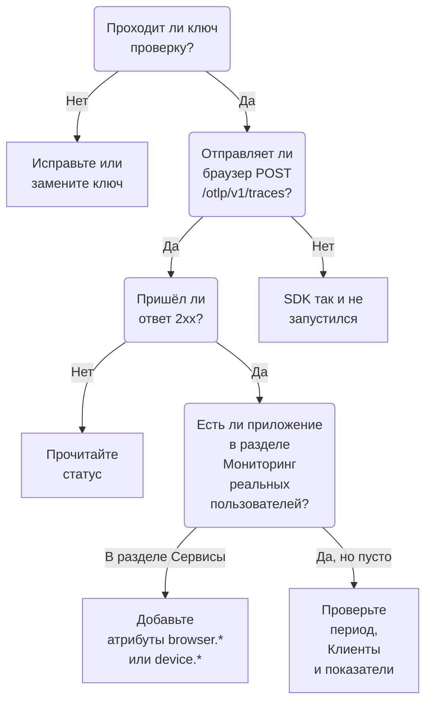

# Устранение неполадок RUM

Если приложение RUM отсутствует, пусто или находится в состоянии **Отключено**, пройдите эту страницу по порядку. Каждая проверка исключает один участок пути от вашего приложения до OneUptime, в том порядке, в котором обычно возникают эти проблемы.

:::cards
- [Проверьте ключ](#проверьте-ключ): Самая быстрая проверка, и от неё зависит всё остальное.
- [Проверьте, что уходит из браузера](#проверьте-что-уходит-из-браузера): Запрос экспорта в инструментах разработчика браузера.
- [Проверьте, куда попадает телеметрия](#проверьте-куда-попадает-телеметрия): В приложение RUM или в бэкенд-сервис.
- [Проблемы с Session Replay](#проблемы-с-session-replay): Отдельный конвейер со своей страницей.
:::

## Где останавливается телеметрия RUM

По пути к приложению RUM телеметрия проходит три проверки. Найдите первую, которая не пройдена:



## Проверьте ключ

Сначала проверьте ключ. Это самая быстрая проверка, и ничто после неё не работает без ключа, который принимает OneUptime:

```bash
curl -i https://oneuptime.com/otlp/v1/validate \
  -H "x-oneuptime-token: YOUR_TELEMETRY_INGESTION_TOKEN"
```

| Ответ | Что это значит |
| --- | --- |
| `200` с `"valid": true` | OneUptime принимает ключ. Ответ также сообщает его `keyType` и `projectId`. Переходите к следующей проверке. |
| `401` с `"valid": false` | Ключ отсутствует, неизвестен, отозван, отключён или истёк, и `message` говорит, что именно. Создайте действующий ключ в **Настройки проекта → Телеметрия и APM → Ключи приема**. |

Веб-приложению нужен ключ **Браузер**, а мобильному — ключ **Сервер**: см. [Настройка для браузера](/docs/rum/browser-setup) и [Настройка для мобильных устройств](/docs/rum/mobile-setup). Конечные точки экспорта тоже отклоняют неверный ключ с `401`, как требует спецификация OTLP, поэтому корректный SDK записывает отказ в журнал, а не повторяет попытку. Эту строку легко пропустить в консоли браузера, а эта проверка отвечает сразу.

## Проверьте, что уходит из браузера

Откройте инструменты разработчика браузера на странице приложения, выберите вкладку Network и отфильтруйте по `otlp`. Вы ищете `POST /otlp/v1/traces` с ответом в статусе `2xx`.

### Запроса нет вовсе

SDK так и не запустился. Почти всегда причина одна из этих:

- `telemetry.ts` — не первый импорт вашего приложения, или сборщик его выбросил. Инструментации подменяют `fetch` и `XMLHttpRequest`, поэтому запрос, сделанный до подмены, не трассируется, а файл, который сборщик удалил, вообще ничего не выполняет.
- Пакетный обработчик ещё не выполнил экспорт. `BatchSpanProcessor` несколько секунд ждёт, пока наберётся пакет, поэтому подождите или перейдите на другую страницу, прежде чем решить, что ничего не отправляется.
- Переменная окружения времени сборки оказалась `undefined`, и URL экспортёра сломан. Один раз выведите URL в журнал при запуске.

### Браузер блокирует запрос

- **Ошибка Content Security Policy в консоли.** Политика вашей страницы пока не разрешает OneUptime. Добавьте его в существующую директиву `connect-src` или укажите свой хост, если вы размещаете OneUptime сами:

  ```text
  connect-src 'self' https://oneuptime.com;
  ```

- **Ошибка CORS.** Конечные точки OTLP принимают запросы с любого источника и разрешают заголовок `x-oneuptime-token`, поэтому настоящая ошибка CORS почти всегда означает, что запрос так и не дошёл до OneUptime: ищите корпоративный прокси, блокировщик рекламы или опечатку в хосте. Проверьте URL запроса на вкладке Network.

### Запрос получает статус ошибки

**`401`.** Ключ неизвестен, отозван или истёк. Выполните [проверку ключа](#проверьте-ключ), а затем используйте действующий ключ.

**`404`.** URL неверен. Экспортёру трассировок нужен полный путь, `/otlp/v1/traces`. Частая ошибка — передать базовый адрес (`https://oneuptime.com/otlp`) экспортёру, который ожидает полный URL, или полный URL экспортёру, который сам добавляет путь и в итоге обращается к `/otlp/v1/traces/v1/traces`.

**`413`.** Пакет оказался больше, чем разрешает прокси. Собственный ingress OneUptime принимает до 4 MB на `/otlp`, но прокси, который вы ставите перед OneUptime, может быть строже — ingress-nginx, например, по умолчанию задаёт `proxy-body-size` равным 1 MB — поэтому, если он у вас есть, поднимите и его лимит для `/otlp`. В любом случае меньший `maxExportBatchSize` у `BatchSpanProcessor` уменьшает каждый экспорт:

```ts
new BatchSpanProcessor(exporter, { maxExportBatchSize: 100 });
```

Браузер редко отправляет такие большие пакеты, если только спаны не несут крупные атрибуты, например целую трассировку стека или тело ответа. Лучше сократить их.

**`422`.** OneUptime отклонил ключ здесь, и сообщение объясняет почему. `Origin https://app.example.com is not allowed for this browser ingestion key.` означает, что точного источника страницы, со схемой и портом, если он есть, нет в списке **Разрешённые источники** ключа. `This telemetry ingestion key has been disabled.` означает, что кто-то отключил ключ.

**`429`.** Лимит ключа **Requests Per Minute Limit** исчерпан: `Too many telemetry requests for this ingestion key. Please retry later.` Ключ Browser разрешает 6000 запросов в минуту на всех ваших посетителей вместе, если вы не зададите для ключа собственный лимит.

**`403` с HTML-страницей или пустым телом.** OneUptime отвечает на любой отказ в формате JSON, значит, этот ответ пришёл от чего-то, что стоит перед ним, обычно от межсетевого экрана веб-приложений на вашем собственном домене, если вы проксируете OneUptime через него. Межсетевой экран разбирает OTLP/JSON и проверяет каждый атрибут спана по своим правилам против инъекций, поэтому URL со строкой запроса в спане достаточно для блокировки, а журнал межсетевого экрана называет правило. Исключите полезную нагрузку OTLP из проверки только на путях OTLP: в разделе [Ваши запросы OpenTelemetry тоже блокируются](/docs/rum/session-replay-troubleshooting#ваши-запросы-opentelemetry-тоже-блокируются) показано, как это сделать, и описан записывающий скрипт воспроизведения за тем же межсетевым экраном.

## Проверьте, куда попадает телеметрия

Запрос проходит успешно, но приложение появляется в **Продукты → Сервисы**, а не в **Продукты → Ресурсы → Мониторинг реальных пользователей**. Это самая частая жалоба, и причина почти всегда в ресурсе без клиентских атрибутов. OneUptime относит пакет к RUM, только если его ресурс содержит один из этих атрибутов:

| Тип | Атрибуты |
| --- | --- |
| Браузер | `browser.platform`, `browser.language` или непустой `browser.brands` |
| Мобильное устройство | `device.id` или `device.model.identifier`, либо `device.manufacturer` на ресурсе без идентичности хоста (`host.name`, `host.id` или `k8s.node.name`) |

Один только `service.name` создаёт бэкенд-сервис. SDK OpenTelemetry для браузера не добавляет атрибуты `browser.*`, пока вы не подключите детектор ресурсов браузера или не зададите их сами: см. [Настройка для браузера](/docs/rum/browser-setup).

Чтобы увидеть, что вы на самом деле отправляете, откройте запрос OTLP на вкладке Network и посмотрите на его полезную нагрузку: решает список `resourceSpans[0].resource.attributes`. Если атрибута `browser.*` там нет, SDK его не добавляет, что бы ни говорила его документация.

Добавьте атрибуты, и следующий пакет создаст приложение RUM. Сервис, созданный первым, не превращается в приложение RUM, потому что это отдельные записи, поэтому удалите его в **Продукты → Сервисы**, когда начнёт поступать телеметрия RUM.

> [!NOTE]
> Ресурс, единственный клиентский атрибут которого — `device.manufacturer` и у которого есть ещё и идентичность хоста, считается машиной, а не телефоном, потому что инвентаризация хоста сообщает производителя тем же атрибутом. Добавьте `device.id` или `device.model.identifier`, и пакет будет отнесён к мобильному RUM, что бы он ещё ни содержал.

## Приложение пусто

Приложение существует, но его страницы ничего не показывают.

- **Проверьте период.** Обзор по умолчанию показывает последний час, поэтому тестовый пакет, отправленный утром, в него не попадает.
- **Подождите несколько минут.** Приём идёт через очередь, а **Последняя активность** обновляется раз в несколько минут, а не с каждым пакетом.
- **Проверьте проект.** Ключ пишет в свой собственный проект, поэтому телеметрия, отправленная с ключом другого проекта, находится там, а не здесь.

## Страница «Клиенты» пуста

Страница **Клиенты** перечисляет `browser.platform` в вебе и `device.model.identifier` на мобильных устройствах. Две причины, по которым она остаётся пустой, хотя всё остальное работает:

- **Safari и Firefox.** `browserDetector` читает API UA Client Hints, который есть только в браузерах на Chromium. В остальных он задаёт `browser.language`, чего достаточно, чтобы отнести телеметрию к RUM, но не `browser.platform`. Задайте `browser.platform` сами, чтобы эти клиенты попали в список.
- **Мобильный SDK, который задаёт только `device.manufacturer`.** Телеметрия относится к мобильному RUM, но странице **Клиенты** нужен `device.model.identifier`.

## Core Web Vitals показывают «No web vitals reported yet»

Карточка заполняется только из метрик, которые отправляет ваше приложение, поэтому одни трассировки её никогда не заполнят. Проверьте, что вы вообще экспортируете метрики, что их имена входят в число тех, которые читает OneUptime, и что они видны на странице приложения **Метрики**. Раздел [Карточка показывает «No web vitals reported yet»](/docs/rum/web-vitals#устранение-неполадок) проходит по каждой проверке, включая значения, которые теряются, когда посетитель закрывает вкладку до следующего экспорта.

## Статус «Отключено», хотя приложением пользуются

Приложение переходит в состояние **Отключено** после 15 минут без телеметрии. Если приложением пользуются:

- **Возможно, сэмплер отбрасывает всё.** Проверьте, что вы не задали сэмплер, который всегда выключен, или очень низкую долю.
- **Возможно, приложение отправляет телеметрию только при некоторых действиях**, а за это время ими никто не воспользовался.
- **Возможно, ключ отозвали или отключили** после развёртывания: снова выполните [проверку ключа](#проверьте-ключ).

Внутреннее приложение или приложение с небольшим трафиком, у которого ночью нет посетителей, действительно отключено. Это не неисправность.

## Проблемы с Session Replay

Session Replay — отдельный конвейер со своими проблемами: скрипт записи, списки разрешённых источников, согласие, Content Security Policy и маскирование. Они описаны в разделе [Устранение неполадок воспроизведения сеансов](/docs/rum/session-replay-troubleshooting). Начните оттуда, и начните с включения диагностики записывающего скрипта, потому что большинство его сбоев намеренно происходят без сообщений:

```js
localStorage.setItem("oneuptime.sessionReplay.debug", "true");
// then reload the page
```

Страница приложения **Состояние** в его разделе **Воспроизведение сеансов** и панель **Test your installation** на **Replay Policy** проверяют ключ, списки разрешённых источников и политику со стороны сервера и сообщают, почему ничего не поступает. Консоль браузера показывает ту половину, которую не видит сервер.

С политикой по умолчанию записывающий скрипт отправляет фрагмент примерно каждые 15 секунд, пока пользователь взаимодействует со страницей. Неактивной вкладке нечего отправлять, поэтому сначала щёлкните или подвигайте мышью; если после этого нет ни одного запроса с фрагментом, что-то не так. Если приложение отправляет записи только _On error or frustration_, тишина ожидаема, пока что-нибудь не пойдёт не так. Вызовите `OneUptimeReplay.captureSession()`, чтобы принудительно выполнить отправку и всё равно проверить путь.

Эти два конвейера независимы. Чтобы записывающий скрипт загрузился, работающее приложение RUM не нужно, а работающий записывающий скрипт не означает, что поступает телеметрия RUM: каждый может отказать сам по себе.

## Всё ещё не получается?

Соберите это, прежде чем обращаться за помощью. Это избавит от лишнего обмена сообщениями:

- Список `resource.attributes` из полезной нагрузки настоящего запроса OTLP.
- HTTP-статус этого запроса.
- Точный `service.name`, который вы отправляете, и есть ли в проекте приложение или сервис с таким именем.
- Отвечает ли `/otlp/v1/validate` статусом `200` для ключа в развёрнутой сборке.

Затем напишите на support@oneuptime.com или откройте issue на [GitHub](https://github.com/OneUptime/oneuptime).

## Дальнейшие шаги

:::cards
- [Настройка для браузера](/docs/rum/browser-setup): Настройка, на которую опираются эти проверки, шаг за шагом.
- [Настройка для мобильных устройств](/docs/rum/mobile-setup): Ключ и атрибуты, которые нужны мобильному приложению.
- [Управление приложениями](/docs/rum/applications): Имена, метки, хранение и статус.
- [Устранение неполадок воспроизведения сеансов](/docs/rum/session-replay-troubleshooting): Каждый код записывающего скрипта и что с ним делать.
:::
