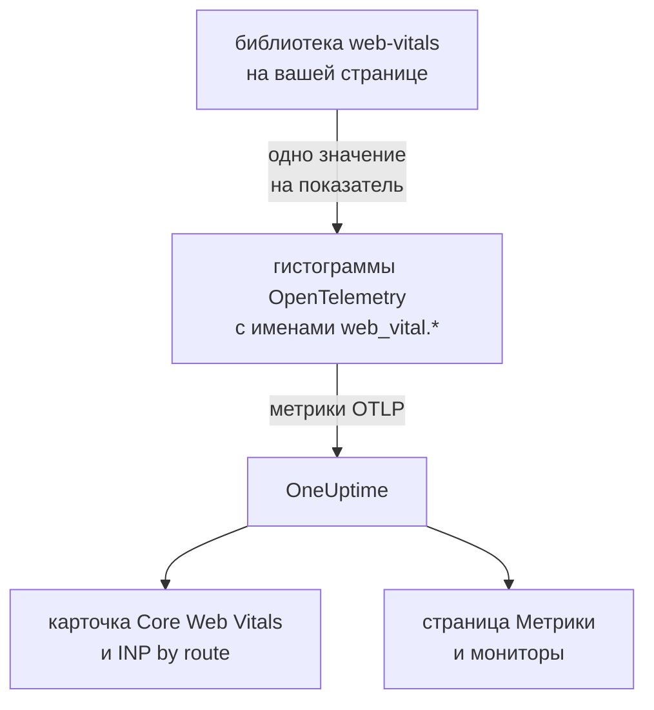
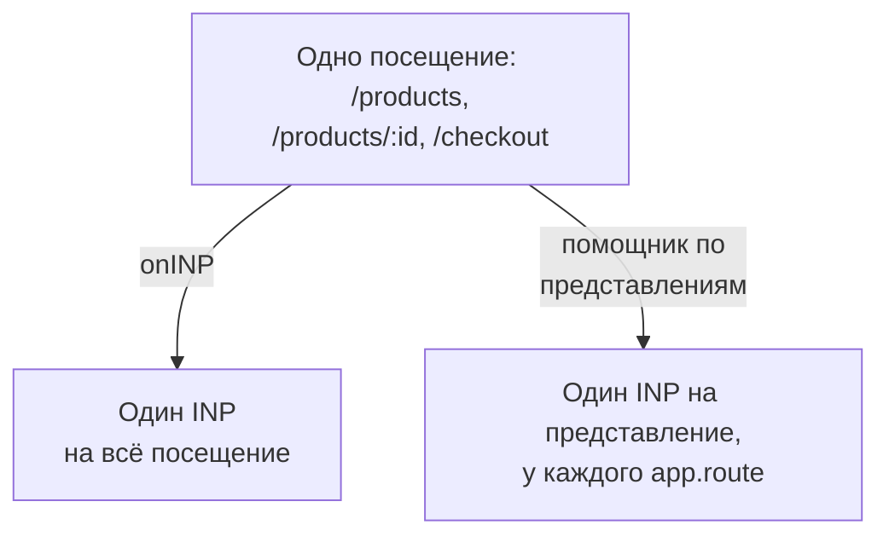

# Core Web Vitals

Карточка **Core Web Vitals** в обзоре приложения RUM показывает LCP, INP, CLS, FCP и TTFB, каждый из которых оценивается по порогам Google. OneUptime сам ничего из этого не измеряет: карточка заполняется только метриками, которые сообщает ваша браузерная инструментация, а эта страница показывает, как их отправлять.

:::cards
- [Отправка](#отправка-из-приложения): Передавать значения библиотеки web-vitals как метрики OpenTelemetry.
- [Имена, которые читает OneUptime](#имена-метрик-которые-распознаёт-oneuptime): Имена метрик, под которыми может прийти каждый показатель.
- [Одностраничные приложения](#одностраничные-приложения): INP для каждого представления, а не одно значение на загрузку страницы.
- [Оповещения по показателю](#оповещения-по-показателю): Готовые мониторы для плохих показателей.
:::

## Как это работает

Библиотека [`web-vitals`](https://github.com/GoogleChrome/web-vitals) измеряет каждый показатель на странице; это та же библиотека, которой пользуются инструменты самого Chrome. Ваш код записывает каждое значение в гистограмму OpenTelemetry, а конвейер метрик браузера экспортирует его в OneUptime.



В OpenTelemetry пока нет окончательного соглашения об именах для web vitals, поэтому OneUptime ищет каждый показатель под несколькими именами и берёт первое, по которому есть данные. Для новой инструментации используйте имена `web_vital.*`.

## Перед началом

- Веб-приложение, настроенное как в разделе [Настройка для браузера](/docs/rum/browser-setup), с конвейером метрик: эти значения экспортирует `MeterProvider` из раздела [Добавление журналов и метрик](/docs/rum/browser-setup#добавление-журналов-и-метрик).

## Отправка из приложения

:::steps
### Установите библиотеку

```bash
npm install web-vitals
```

### Записывайте каждый показатель в гистограмму

Создайте `src/web-vitals.ts`. Каждый показатель — это гистограмма, чтобы страница **Метрики** могла позже вычислять перцентили; границы корзин совпадают с порогами Google для хорошего и плохого значения.

```ts title="src/web-vitals.ts"
// Import after ./telemetry
import { metrics } from "@opentelemetry/api";
import { onCLS, onFCP, onINP, onLCP, onTTFB, type Metric } from "web-vitals";

const meter = metrics.getMeter("web-vitals");

// Histograms, so the Metrics tab can compute percentiles later. The bucket
// edges sit on each vital's good / poor limits: a percentile is read from
// the buckets, and the defaults are far too coarse for these ranges.
const buckets = (...edges: number[]) => ({ advice: { explicitBucketBoundaries: edges } });

const lcp = meter.createHistogram("web_vital.lcp", { unit: "ms", ...buckets(0, 1000, 1500, 2000, 2500, 3000, 3500, 4000, 5000, 7500, 10000) });
const inp = meter.createHistogram("web_vital.inp", { unit: "ms", ...buckets(0, 50, 100, 150, 200, 250, 300, 400, 500, 750, 1000, 2000) });
const fcp = meter.createHistogram("web_vital.fcp", { unit: "ms", ...buckets(0, 600, 1200, 1800, 2400, 3000, 4000, 6000, 10000) });
const ttfb = meter.createHistogram("web_vital.ttfb", { unit: "ms", ...buckets(0, 200, 400, 600, 800, 1200, 1800, 2500, 4000) });
const cls = meter.createHistogram("web_vital.cls", { unit: "1", ...buckets(0, 0.025, 0.05, 0.1, 0.15, 0.2, 0.25, 0.4, 0.6, 1) });

function record(
  histogram: { record: (v: number, a?: Record<string, string>) => void },
) {
  return (metric: Metric): void => {
    histogram.record(metric.value, {
      // Keep attributes low-cardinality. Never put a full URL or a user id here.
      "web_vital.rating": metric.rating,
    });
  };
}

onLCP(record(lcp));
onINP(record(inp));
onCLS(record(cls));
onFCP(record(fcp));
onTTFB(record(ttfb));
```

### Импортируйте его после настройки телеметрии

```ts
import "./telemetry";
import "./web-vitals";
```

### Проверьте страницу Метрики

Загрузите несколько страниц, затем найдите `web_vital.lcp` на странице **Метрики** приложения. Когда метрики там появятся, карточка **Core Web Vitals** заполнится для выбранного периода.
:::

## Отправка последних значений до закрытия страницы

`onINP` и `onCLS` сообщают значения, когда страница скрывается, а не во время посещения. С интервалом экспорта в 30 секунд из раздела [Настройка для браузера](/docs/rum/browser-setup) посетитель, закрывший вкладку сразу после последнего значения, может уйти до его экспорта. Если важна полнота, сократите `exportIntervalMillis` или сохраните `MeterProvider`, созданный в `telemetry.ts`, и сбрасывайте его, когда страница скрывается:

```ts
// In telemetry.ts, export the provider you created:
export const meterProvider = new MeterProvider({ /* ... */ });

// Anywhere after setup:
import { meterProvider } from "./telemetry";

document.addEventListener("visibilitychange", () => {
  if (document.visibilityState === "hidden") {
    void meterProvider.forceFlush();
  }
});
```

## Имена метрик, которые распознаёт OneUptime

OneUptime перебирает имена в этом порядке, и выигрывает первое, по которому есть данные за выбранный период.

| Показатель | Имена метрик, любое из них | Единица |
| --- | --- | --- |
| LCP: Largest Contentful Paint | `web_vital.lcp`, `browser.largest_contentful_paint`, `largest_contentful_paint`, `web.vitals.lcp` | мс |
| INP: Interaction to Next Paint | `web_vital.inp`, `browser.interaction_to_next_paint`, `interaction_to_next_paint`, `web.vitals.inp` | мс |
| CLS: Cumulative Layout Shift | `web_vital.cls`, `browser.cumulative_layout_shift`, `cumulative_layout_shift`, `web.vitals.cls` | оценка |
| FCP: First Contentful Paint | `web_vital.fcp`, `browser.first_contentful_paint`, `first_contentful_paint`, `web.vitals.fcp` | мс |
| TTFB: Time to First Byte | `web_vital.ttfb`, `browser.time_to_first_byte`, `time_to_first_byte`, `web.vitals.ttfb` | мс |

Остальные имена существуют для того, чтобы приложение, которое уже отправляет данные по соглашению сообщества, появилось без изменений.

## Пороги оценки

Карточка оценивает каждое значение по опубликованным Google порогам Core Web Vitals:

| Показатель | **Good** | **Needs work** | **Poor** |
| --- | --- | --- | --- |
| LCP | меньше 2500 мс | от 2500 до 4000 мс | 4000 мс и больше |
| INP | меньше 200 мс | от 200 до 500 мс | 500 мс и больше |
| CLS | меньше 0,1 | от 0,1 до 0,25 | 0,25 и больше |
| FCP | меньше 1800 мс | от 1800 до 3000 мс | 3000 мс и больше |
| TTFB | меньше 800 мс | от 800 до 1800 мс | 1800 мс и больше |

Карточка показывает **среднее** за выбранный период, а не 75-й перцентиль, который сообщают полевые инструменты Google. Так задумано: OneUptime вычисляет перцентили гистограммы по её корзинам, поэтому перцентиль точен ровно настолько, насколько точны корзины, а среднее берётся из точных суммы и количества гистограммы. С корзинами OpenTelemetry по умолчанию (`0, 5, 10, 25, 50, …`) каждое значение CLS попадает в первую корзину, и 75-й перцентиль показал бы 2,5 для страницы, которая почти не сдвигается.

> [!TIP]
> Воспринимайте карточку как тренд. Для 75-го перцентиля записывайте значения с указанными выше границами корзин, а затем стройте метрику на странице **Метрики** с агрегацией **P75**. Монитор метрик предлагает тот же выбор.

## Одностраничные приложения

`onINP` измеряет INP так, как его определяет браузер: **одно значение на загрузку страницы**. Одностраничное приложение загружается один раз, а затем меняет маршрут через `history.pushState`, поэтому посещение `/products`, `/products/42` и `/checkout` даёт один INP на всё посещение. Взаимодействия всех представлений соревнуются за это единственное число, а атрибут маршрута на нём указывает страницу, которая была на экране в момент отправки, а не ту, что тормозила.



Чтобы видеть INP по представлениям, измеряйте его по представлениям: каждая смена маршрута завершает текущее представление и начинает новое, и каждое представление сообщает свой INP. Помощник ниже делает это через API Event Timing браузера — те же данные, что использует `onINP`, — и решает часть, в которой легко ошибиться: клик, который **вызвал** переход, доставляется уже после смены маршрута, но относится к странице, на которой по нему кликнули.

```ts title="src/inp-per-route.ts"
// INP for each view of a single-page app.
type Report = (inpMs: number, route: string) => void;

interface View {
  route: string;
  path: string; // the URL path it was opened for
  start: number; // performance.now() when the view began
  latencies: Map<number, number>; // interactionId -> its slowest entry
}

// Long enough for the click that navigated to be delivered: its entry
// arrives after the next paint, i.e. after the route has changed.
const SETTLE_MS = 1000;

let views: Array<View> = [];
let report: Report = () => {};

// The path, plus the hash when a hash router keeps the route there.
const currentPath = (): string =>
  location.pathname + (location.hash.startsWith("#/") ? location.hash : "");

function close(view: View): void {
  if (!views.includes(view)) return; // already reported
  views = views.filter((v) => v !== view);

  const sorted = [...view.latencies.values()].sort((a, b) => b - a);
  if (sorted.length === 0) return; // nobody interacted: no INP, not 0

  // web-vitals' p98: skip one outlier for every 50 interactions.
  report(sorted[Math.min(sorted.length - 1, Math.floor(sorted.length / 50))]!, view.route);
}

function record(entries: PerformanceEntryList): void {
  for (const entry of entries as Array<PerformanceEventTiming & { interactionId?: number }>) {
    if (!entry.interactionId) continue; // hovers, scrolls: not interactions

    // The view the interaction STARTED in, so the click that navigated
    // counts towards the page it was clicked on.
    const view = [...views].reverse().find((v) => entry.startTime >= v.start);
    if (!view) continue;

    const slowest = view.latencies.get(entry.interactionId) ?? 0;
    view.latencies.set(entry.interactionId, Math.max(slowest, entry.duration));
  }
}

export function observeInpPerRoute(route: string, onReport: Report): void {
  if (typeof PerformanceObserver === "undefined" || !PerformanceObserver.supportedEntryTypes?.includes("event")) return;

  report = onReport;
  views = [{ route, path: currentPath(), start: 0, latencies: new Map() }];

  const observer = new PerformanceObserver((list) => record(list.getEntries()));
  observer.observe({ type: "event", durationThreshold: 40, buffered: true } as PerformanceObserverInit);

  // The tab may never come back: report every view now, then keep
  // measuring the current route as a fresh view.
  document.addEventListener("visibilitychange", () => {
    if (document.visibilityState !== "hidden") return;
    record(observer.takeRecords());
    const current = views[views.length - 1]?.route ?? route;
    [...views].forEach(close);
    views = [{ route: current, path: currentPath(), start: performance.now(), latencies: new Map() }];
  });
}

// Call after every navigation, with the route PATTERN ("/products/:id").
// Safe to call when nothing changed (a router's initial navigation, a
// query-string update): the view only ends when the path does.
export function startView(route: string): void {
  const closing = views[views.length - 1];
  if (!closing || closing.path === currentPath()) return;

  views.push({ route, path: currentPath(), start: performance.now(), latencies: new Map() });
  setTimeout(() => close(closing), SETTLE_MS);
}
```

Обе функции принимают **шаблон** маршрута, а не URL: `/products/42` и `/products/7` должны быть одним маршрутом, иначе каждый товар станет отдельным рядом. Используйте шаблон маршрутизатора, если он есть; иначе сводите идентификаторы сами:

```ts
// "/products/42" -> "/products/:id", also for UUIDs.
export const toRoutePattern = (path: string): string =>
  path.replace(/\/(\d+|[0-9a-f]{8}-[0-9a-f-]{27})(?=\/|$)/gi, "/:id");
```

Записывайте то, что сообщает помощник, в ту же гистограмму `web_vital.inp` с маршрутом в `app.route` и **удалите `onINP`** из фрагмента выше: если оставить оба, каждое взаимодействие будет посчитано дважды.

```ts
// src/web-vitals.ts, in place of onINP(record(inp))
import { observeInpPerRoute } from "./inp-per-route";

observeInpPerRoute(toRoutePattern(location.pathname), (inpMs, route) => {
  inp.record(inpMs, {
    "app.route": route,
    "web_vital.rating": inpMs <= 200 ? "good" : inpMs <= 500 ? "needs-improvement" : "poor",
  });
});
```

Затем вызывайте `startView` везде, где маршрутизатор сообщает о завершённом переходе. Вызов игнорируется, если путь URL не изменился, поэтому маршрутизатор, который сообщает и о первой загрузке, и об изменении строки запроса, не разделит представление:

:::tabs
@tab Vue Router
```ts
router.afterEach((to) => startView(to.matched[to.matched.length - 1]?.path ?? toRoutePattern(to.path)));
```
@tab React Router
```tsx
// In a component that stays mounted inside the router
const { pathname } = useLocation();
useEffect(() => startView(toRoutePattern(pathname)), [pathname]);
```
:::

Что вы получаете:

- **INP by route** в обзоре, от самых медленных, по атрибуту `app.route`; OneUptime также читает атрибут OpenTelemetry `url.template`.
- Фильтр маршрута для оповещений: отфильтруйте монитор метрик по `web_vital.inp` и `app.route`, чтобы отдельно следить за одним сценарием, например `/checkout`.
- Общий INP приложения в карточке **Core Web Vitals** продолжает работать: это та же метрика, теперь с одним значением на представление вместо одного на загрузку страницы.

Браузеры на Chromium сообщают нужные для этого идентификаторы взаимодействий. Safari их не сообщает, и поэтому `onINP` там тоже ничего не отправляет. Экспериментальный API Soft Navigations в Chrome должен делать это сам, но он пока не общедоступен; этот помощник работает уже сегодня.

> [!NOTE]
> Записывающий скрипт [Воспроизведения сеансов](/docs/telemetry/session-replay) уже измеряет INP по представлениям без всякого кода: в каждой записи есть строка INP для каждого маршрута, на котором пользователь взаимодействовал со страницей, с медленным элементом и разбивкой времени на задержку ввода, обработку и отрисовку.

## Контроль кардинальности

Атрибуты метрик перемножаются. У `web_vital.rating` три возможных значения, и это нормально, а атрибут маршрута или типа страницы обычно того стоит:

```ts
histogram.record(metric.value, {
  "web_vital.rating": metric.rating,
  "app.route": routePattern, // "/product/:id" — the PATTERN, not "/product/8842"
});
```

Запись конкретного URL вместо шаблона маршрута создаёт отдельный временной ряд для каждой страницы товара, из-за чего страница **Метрики** тормозит, а счёт за хранение растёт. То же относится к идентификаторам пользователей, идентификаторам сеансов и размерам экрана.

## Оповещения по показателю

Страница **Рекомендации** приложения предлагает готовый монитор для каждого показателя. Каждый из них читает среднее за пять минут по своей метрике и срабатывает, когда оно достигает порога Google для плохого значения:

| Рекомендация | Метрика | Срабатывает при | Важность |
| --- | --- | --- | --- |
| **Poor Largest Contentful Paint** | `web_vital.lcp` | 4000 мс | **Критический** |
| **Poor Interaction to Next Paint** | `web_vital.inp` | 500 мс | **Критический** |
| **Poor Cumulative Layout Shift** | `web_vital.cls` | 0,25 | **Критический** |
| **Slow First Contentful Paint** | `web_vital.fcp` | 3000 мс | **Warning** |
| **Slow Time to First Byte** | `web_vital.ttfb` | 1800 мс | **Warning** |

Эти мониторы читают только имена `web_vital.*`. Если ваше приложение отправляет показатель под другим именем, измените метрику созданного монитора. Чтобы получать оповещения по одному маршруту, добавьте в монитор фильтр `app.route`. Можно также собрать собственный монитор по любой из этих метрик: см. [Мониторинг метрик](/docs/monitor/metrics-monitor).

## Устранение неполадок

:::details Карточка пишет «No web vitals reported yet»
Карточка заполняется только метриками, которые отправляет ваше приложение. Проверьте по порядку:

1. Есть ли у вас вообще конвейер метрик: одних трассировок для этой карточки никогда не хватает.
2. Входят ли имена метрик в те, что читает OneUptime: см. [Имена метрик, которые распознаёт OneUptime](#имена-метрик-которые-распознаёт-oneuptime).
3. Есть ли метрики на странице **Метрики** приложения. Если есть, экспорт работает, а проблема в имени или в периоде.
4. INP и CLS сообщаются, когда страница скрывается, поэтому короткое посещение может закончиться до следующего экспорта: см. [Отправка последних значений до закрытия страницы](#отправка-последних-значений-до-закрытия-страницы).

Если ничего из этого не помогло, раздел [Устранение неполадок RUM](/docs/rum/troubleshooting) проверяет весь конвейер.
:::

:::details INP приходит, но не по маршрутам
Карточке **INP by route** нужен атрибут `app.route` или `url.template` на `web_vital.inp`. Записывайте шаблон маршрута с каждым значением, как в разделе [Одностраничные приложения](#одностраничные-приложения).
:::

:::details Значения расходятся с отчётом Google
Карточка показывает среднее за выбранный вами период, а Google сообщает 75-й перцентиль своих посетителей. Постройте **P75** на странице **Метрики**, чтобы сравнивать сопоставимое.
:::

## Дальнейшие шаги

:::cards
- [Настройка для браузера](/docs/rum/browser-setup): Конвейер трассировок, журналов и метрик, по которому идут эти показатели.
- [Мониторинг метрик](/docs/monitor/metrics-monitor): Оповещения по любому показателю для всего приложения или одного маршрута.
- [Воспроизведение сеансов](/docs/telemetry/session-replay): Смотреть INP по представлениям в записях без кода.
- [Устранение неполадок RUM](/docs/rum/troubleshooting): Все проверки в том порядке, в каком обычно возникают проблемы.
:::
