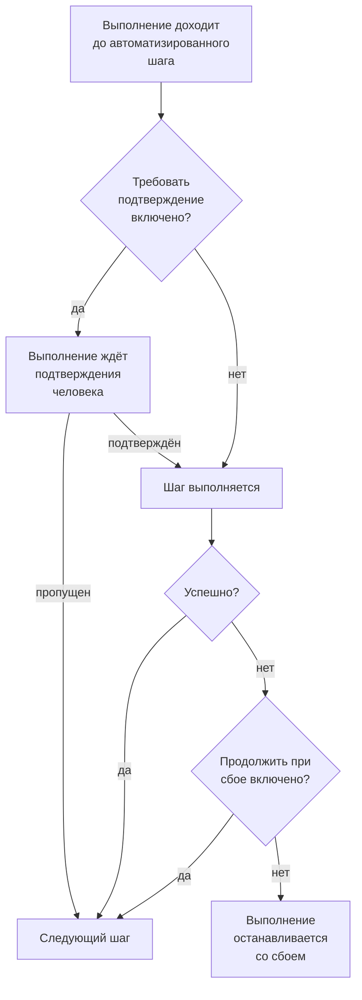

# Написание runbook-а

Runbook пишется как упорядоченный список шагов на его странице **Шаги**. Здесь показано, как создать runbook, как настроить каждый из семи типов шагов и как сбои и подтверждения меняют ход выполнения.

:::cards
- [Создание runbook-а](#создание-runbook-а): От пустого runbook-а до сохранённых шагов.
- [Типы шагов](#типы-шагов): Manual, JavaScript, HTTP request, Bash, SSH, kubectl и AI.
- [Обработка сбоев и подтверждения](#обработка-сбоев-и-подтверждения): Что происходит, когда шаг завершается сбоем или ждёт подтверждения.
- [Разбор примера](#разбор-примера): Переключение базы данных за пять шагов.
:::

## Прежде чем начать

- **Роль, которая пишет runbook-и.** Project Owner, Project Admin и Runbook Admin создают runbook-и и сохраняют их шаги. При детальных разрешениях вам нужны **Create Runbook** и **Edit Runbook**. См. [Разрешения](/docs/runbooks/configuration#разрешения).
- **Runner для шагов Bash, SSH и kubectl.** Эти шаги выполняются на [Runner-е](/docs/runbooks/agents) в вашей собственной инфраструктуре, никогда на OneUptime Worker. Сначала установите его. Шаг, который не выбирает Runner, выполняется на [Runner-е проекта по умолчанию](/docs/runbooks/agents#runner-проекта-по-умолчанию), если вы его задали; иначе шаг JavaScript выполняется на [глобальном Runner-е](/docs/runbooks/agents#глобальные-runner-ы).
- **Секретная переменная для шагов SSH и kubectl.** Ключ, пароль или kubeconfig, с которым шаг входит, — это секретная [переменная runbook-а](/docs/runbooks/variables). Project Owner и Project Admin создают переменные, а Runbook Admin выбирает их в шагах, которые пишет. Шаг kubectl может вместо этого использовать собственный доступ Runner-а.
- **LLM-провайдер для AI-шагов.** См. [Провайдеры LLM](/docs/ai/llm-provider).

## Создание runbook-а

:::steps
### Откройте runbook-и

Откройте **Продукты → Сборники инструкций**. Runbook-и находятся в группе **Дашборды и автоматизация**.

### Создайте runbook

Нажмите **Создать: Сценарий**, введите **Имя** и при желании **Описание** назначения runbook-а. В **Дополнительные поля** находятся переключатель **Включено**, по умолчанию включённый, и **Метки**. Новый runbook откроется на своей странице **Шаги**.

### Добавьте шаги

В **Начните свой сценарий** выберите тип первого шага; под последним шагом **Добавить ещё шаг** предлагает те же семь типов. Каждый шаг открывается с полем **Заголовок** и тем, что нужно его типу; остальное, например **Описание** и тайм-ауты, свёрнуто в **Дополнительные поля**. Когда в runbook-е уже есть шаг, **Добавить шаг** вверху карточки добавляет Manual-шаг.

### Расставьте шаги по порядку

Шаги выполняются **по порядку**. Чтобы изменить порядок, перетащите шаг за маркер слева в его заголовке; с клавиатуры наведите фокус на маркер, нажмите пробел, переместите шаг клавишами со стрелками и снова нажмите пробел.

### Сохраните шаги

Нажмите **Сохранить шаги**. До этого редактор показывает **Несохранённые изменения**. После сохранения вы увидите **Сохранено**, и runbook готов к [выполнению](/docs/runbooks/running).
:::

## Устройство шага

У каждого шага есть такие поля. Автоматический шаг показывает поле **Заголовок** и настройки своего типа, а остальное сворачивает в **Дополнительные поля**, где видно, что из этого задано:

| Поле | Назначение |
| --- | --- |
| **Заголовок** | Короткая подпись, которая показывается в списке шагов и в каждом выполнении. |
| **Описание** | Необязательный контекст для реагирующего, в Markdown, в **Дополнительные поля**. Для Manual-шага это **Инструкции**, которые человек читает и выполняет, показанные под заголовком. |
| **Продолжить при сбое** | Только для автоматизированных шагов. Если включено, сбой шага не останавливает выполнение: следующий шаг всё равно выполняется. |
| **Требовать подтверждение** | Только для автоматизированных шагов. Если включено, выполнение останавливается перед этим шагом, пока кто-нибудь его не подтвердит, и только тогда выполняет его. Переключатель называется **Требовать подтверждение перед выполнением этого шага**, а в заголовке шага написано **Нужно подтверждение**. |
| Настройки типа | Скрипт, URL, Runner, секретная переменная или промпт. См. [Типы шагов](#типы-шагов). |

## Типы шагов

| Тип | Где выполняется | Что нужно |
| --- | --- | --- |
| [Manual](#manual) | Человек | Ничего |
| [JavaScript](#javascript) | Runner | Runner |
| [HTTP request](#http-request) | OneUptime Worker | Ничего |
| [Bash](#bash) | Runner | Runner |
| [SSH](#ssh) | Runner | Runner и секретная переменная для входа |
| [kubectl](#kubectl) | Runner | Runner и переменная с kubeconfig или собственный доступ Runner-а |
| [AI](#ai) | OneUptime Worker | LLM-провайдер |

В каждом автоматизированном шаге ниже в **Дополнительные поля** шага сначала находится его **Runner**, если шаг выполняется на Runner-е, потом **Требовать подтверждение** и **Продолжить при сбое**, затем собственные настройки шага — заголовки HTTP-вызова, порт и парольная фраза ключа SSH-шага, поставщик и переключатели контекста шага ИИ, — и в конце **Описание** и тайм-ауты. В свёрнутом виде раздел называет Runner шага, так что видно, где выполняется шаг, не открывая его.

### Manual

Пункт чек-листа для человека: его **Инструкции** говорят, что сделать или проверить. Дойдя до Manual-шага, выполнение приостанавливается и остаётся в `WaitingForManualStep` (**Ожидает вас**), пока кто-нибудь не нажмёт **Отметить готовым** или **Пропустить**. Выполнение, ожидающее человека, никогда не истекает по времени. У Manual-шага нет переключателя подтверждения: он и так останавливает выполнение ради человека.

Используйте его для того, что может проверить или сделать только человек: «Убедитесь в панели балансировщика нагрузки, что трафик переключился на резервный регион».

### JavaScript

Фрагмент JavaScript, который выполняется в песочнице `isolated-vm` на [агенте runbook-ов](/docs/runbooks/agents), а не на OneUptime Worker: на одном из ваших или на [глобальном Runner-е](/docs/runbooks/agents#глобальные-runner-ы), когда шаг не выбирает ни одного.

| Поле | Что делает | По умолчанию |
| --- | --- | --- |
| **Runner** | В **Дополнительные поля**. Runner, который выполняет шаг: **Глобальный Runner** или один из ваших. Забрать задание может только выбранный вами Runner; шаг на **Глобальный Runner** может забрать любой глобальный Runner. | [Runner проекта по умолчанию](/docs/runbooks/agents#runner-проекта-по-умолчанию), если вы его задали; иначе **Глобальный Runner**, если он есть |
| **Скрипт** | JavaScript для выполнения. Верните значение через `return`, чтобы записать его; каждая строка `console.log` тоже записывается. Выброшенная ошибка приводит к сбою шага. | — |
| **Тайм-аут выполнения** | Сколько Runner даёт фрагменту выполняться, прежде чем уничтожить песочницу. Глобальный Runner даёт ему выполняться не дольше 5 минут. | 30 секунд |
| **Тайм-аут получения** | Сколько Worker ждёт, пока Runner заберёт задание. | 2 минуты |

```javascript
const start = Date.now();
// ... your logic ...
console.log("replica lag checked");
return { durationMs: Date.now() - start };
```

У песочницы 128 МБ памяти и нет доступа к файловой системе и процессам. Она может отправлять HTTP-запросы через `axios`, но только на публичные адреса: запрос в частную сеть, к собственному хосту Runner-а или к облачной конечной точке метаданных отклоняется. Чтобы обратиться к сервису в своей сети, используйте шаг [Bash](#bash) с `curl`.

### HTTP request

Исходящий HTTP-вызов, который делает OneUptime Worker. Runner не нужен.

| Поле | Что делает | По умолчанию |
| --- | --- | --- |
| **Метод** | `GET`, `POST`, `PUT`, `PATCH`, `DELETE` или `HEAD`. | `GET` |
| **URL** | Вызываемая конечная точка. | Пусто |
| **Заголовки (JSON)** | В **Дополнительные поля**. JSON-объект, например `{ "Authorization": "Bearer ..." }`. Заголовки, которые не являются корректным JSON, приводят к сбою шага. | Нет |
| **Тело** | Показывается для `POST`, `PUT`, `PATCH` и `DELETE`. Отправляется как JSON, если разбирается как JSON, иначе как текст. | Нет |
| **Тайм-аут запроса** | Сколько ждать ответа конечной точки, прежде чем шаг завершится сбоем. | 30 секунд |

Шаг завершается успешно при ответе `2xx` или `3xx` и сбоем при любом другом, с ошибкой `HTTP <status>`. Перенаправления не выполняются. Статус ответа, заголовки и тело записываются, до 50 КБ.

> [!NOTE]
> Worker никогда не обращается к адресам loopback и link-local, например к облачной конечной точке метаданных. В OneUptime Cloud он обращается только к публичным адресам. Самостоятельно размещённый OneUptime достаёт и до частных сетей, если только `DATA_SOURCE_BLOCK_PRIVATE_ADDRESSES` не равно `true`. Чтобы вызвать сервис в своей сети из OneUptime Cloud, используйте шаг [Bash](#bash) с `curl`.

Полезно, чтобы: открыть инцидент в PagerDuty, отправить сообщение в вебхук Slack, вызвать API облачного провайдера или свой публичный API.

> [!TIP]
> Не храните токены в шаге. Сохраните их как секретные [переменные runbook-а](/docs/runbooks/variables) и пишите `{{global.variables.NAME}}` там, где нужно значение, в URL, заголовках или теле. OneUptime отправляет запрос сам, поэтому подставляет и секреты, а в ответе, который записывает шаг, на их месте стоит `[REDACTED]`. В заголовках или теле в формате JSON значение попадает внутрь своей строки, поэтому кавычка или перевод строки в нём не ломают JSON.

### Bash

Bash-скрипт, который выполняется через `bash -c <script>` на [агенте runbook-ов](/docs/runbooks/agents) в вашей собственной инфраструктуре. Bash никогда не выполняется на OneUptime Worker.

| Поле | Что делает | По умолчанию |
| --- | --- | --- |
| **Runner** | В **Дополнительные поля**. Runner, который выполняет шаг. Забрать задание может только этот Runner. Глобальные Runner-ы выполняют только шаги JavaScript. | Runner проекта по умолчанию, если вы его задали |
| **Bash-скрипт** | Скрипт. Вывод (stdout и stderr) записывается до 50 КБ, а ненулевой код выхода приводит к сбою шага. | — |
| **Тайм-аут выполнения** | Сколько Runner даёт скрипту выполняться, прежде чем завершить его через `SIGKILL`. Увеличьте его для шагов, которым по делу нужны минуты. | 30 секунд |
| **Тайм-аут получения** | Сколько Worker ждёт, пока Runner заберёт задание. | 2 минуты |

Скрипт выполняется в контейнере Runner-а с инструментами, которые есть в его образе, такими как `curl`, `wget` и клиент `ssh`, и с сетевым доступом хоста, на котором он работает. Например, чтобы проверить сервис, доступный только из вашей сети:

```bash
set -euo pipefail
HTTP_CODE=$(curl -s -o /tmp/resp.txt -w "%{http_code}" "http://payments.internal:8080/health")
echo "HTTP $HTTP_CODE"
cat /tmp/resp.txt
if [[ "$HTTP_CODE" != "200" ]]; then
  echo "Health check failed"
  exit 1
fi
```

Если выбранный Runner не в сети, когда выполнение доходит до этого шага, шаг ждёт до **claim timeout** (по умолчанию 2 минуты), а затем завершается сбоем по тайм-ауту. Добавьте агента в **Сборники инструкций → Агенты runbook-ов**, прежде чем полагаться на Bash-шаг.

> [!TIP]
> Не храните пароли и токены в скрипте. Сохраните их как секретные [переменные runbook-а](/docs/runbooks/variables) и пишите `{{global.variables.NAME}}` там, где нужно значение: Runner получает скрипт с подставленным значением, а в выводе шага на его месте стоит `[REDACTED]`.

### SSH

Войти на машину по SSH и выполнить там bash-скрипт. Соединение открывает Runner, поэтому машина должна быть доступна только с Runner-а, а ключ или пароль, с которым шаг входит, — это секретная [переменная runbook-а](/docs/runbooks/variables), которая никогда не записывается в шаг.

| Поле | Что делает |
| --- | --- |
| **Runner** | В **Дополнительные поля**. Runner, который открывает соединение. Он должен иметь сетевой доступ к машине. Шаг, который не выбирает ни одного, выполняется на Runner-е проекта по умолчанию. |
| **SSH к** | Пользователь и машина, как вы написали бы их после `ssh`: `deploy@10.0.4.21`. |
| **Способ входа** | Секретная переменная с закрытым ключом или паролем; значение показывает, что это. Предлагаются только секретные переменные, а шаг сообщает, если его Runner не может использовать выбранную. |
| **Bash-скрипт** | Выполняется через `bash` на машине от имени пользователя, под которым шаг входит. Вывод сохраняется до 50 КБ, а ненулевой код выхода приводит к сбою шага. |
| **Порт** | В **Дополнительные поля**. 22, если оставить пустым. |
| **Парольная фраза ключа** | В **Дополнительные поля**. Секретная переменная с парольной фразой ключа, у которого она есть. |
| **Тайм-аут выполнения** | Охватывает подключение, вход и выполнение скрипта вместе, чтобы зависший скрипт не держал шаг открытым. По умолчанию 30 секунд. |
| **Тайм-аут получения** | Сколько Worker ждёт, пока Runner заберёт задание. По умолчанию 2 минуты. |

Например, чтобы перезапустить сервис и показать, что он снова работает:

```bash
sudo systemctl restart nginx
systemctl status nginx --no-pager
```

### kubectl

Выполнять команды kubectl для кластера. Скрипт выполняется через bash на Runner-е, в который входит `kubectl`, а `KUBECONFIG` указывает на кластер: работает любая команда kubectl и любой bash вокруг неё.

| Поле | Что делает |
| --- | --- |
| **Runner** | В **Дополнительные поля**. Runner, который выполняет kubectl. Он должен иметь доступ к API-серверу кластера. Шаг, который не выбирает ни одного, выполняется на Runner-е проекта по умолчанию. |
| **Kubeconfig** | Секретная переменная с kubeconfig кластера или **Собственный доступ Runner-а**: собственный kubeconfig Runner-а или его сервисный аккаунт, когда Runner работает в кластере. Runner записывает kubeconfig в файл, который может прочитать только он, и удаляет его, когда скрипт завершается. |
| **Скрипт** | Команды kubectl. Вывод сохраняется до 50 КБ, а ненулевой код выхода приводит к сбою шага. |
| **Тайм-аут выполнения** | Сколько Runner даёт скрипту работать, прежде чем остановить его через `SIGKILL`. По умолчанию 30 секунд. |
| **Тайм-аут получения** | Сколько Worker ждёт, пока Runner заберёт задание. По умолчанию 2 минуты. |

Например, чтобы перезапустить deployment и дождаться готовности его новых подов:

```bash
kubectl rollout restart deployment/checkout-api --namespace checkout
kubectl rollout status deployment/checkout-api --namespace checkout --timeout=120s
```

**Примеры — нажмите, чтобы вставить** под каждым скриптом подставляет распространённые скрипты вроде этих. Дайте пользователю kubeconfig только то, что делают ваши скрипты: Role в тех namespace, где они действуют, с теми глаголами, которые они используют. Если API-сервер отклоняет команду, собственное сообщение kubectl есть в выводе шага, так что ошибка доступа подскажет, какой role binding расширить.

### AI

Попросите ИИ проанализировать, обобщить или решить что-то посреди выполнения. Ответ становится выводом шага в выполнении. AI-шаги выполняются на OneUptime Worker; Runner не нужен.

| Поле | Что делает |
| --- | --- |
| **Промпт** | Что должен сделать ИИ. Например: «Изучи вывод предыдущих шагов и скажи, безопасно ли продолжать устранение». |
| **Поставщик LLM** | Необязательно. Вариант **По умолчанию для проекта** использует провайдера проекта по умолчанию. Закрепите провайдера, когда шагу нужна определённая модель, например самостоятельно размещённая модель для данных, которые не должны покидать вашу сеть. См. [Провайдеры LLM](/docs/ai/llm-provider). |
| **Включать контекст предыдущего шага** | Если включено, ИИ видит всё о шагах, выполненных до этого: заголовок, тип, статус, вывод и сообщения об ошибках. Он получает до 4 000 символов вывода каждого шага. |
| **Включать контекст триггера** | Если включено, ИИ видит, что запустило выполнение: связанный инцидент, оповещение или событие планового обслуживания (описание, серьёзность, текущее состояние, затронутые мониторы, первопричину, хронологию состояний и публичные заметки) или того, кто запустил runbook вручную. |

Чтобы человек оставался в контуре, включите **Требовать подтверждение** на шаге после AI-шага: ИИ анализирует, человек читает его ответ, а исправляющий шаг выполняется, только когда человек его подтвердит.

**Что ИИ никогда не видит.** Ответ AI-шага сохраняется как вывод шага в выполнении, а выполнения может читать любой, у кого есть право чтения runbook-ов, — более широкая аудитория, чем у инцидента. Поэтому контекст триггера не включает **приватные внутренние заметки** и **сообщения каналов Slack и Microsoft Teams**. Вывод предыдущих шагов проверяется на секреты (токены, ключи, учётные данные), которые маскируются до отправки модели. Встроенные изображения и длинные закодированные данные, например скриншот, вставленный в описание инцидента, тоже не включаются, а на их месте остаётся короткая пометка.

AI-шаги учитываются и тарифицируются, как любая другая функция ИИ. Шаг завершается сбоем с сообщением о причине, если у него нет промпта, если функции ИИ отключены для проекта, если нет доступного LLM-провайдера или если закреплённый провайдер больше не доступен проекту. Включите **Продолжить при сбое**, если остальная часть runbook-а всё равно должна выполниться.

## Обработка сбоев и подтверждения



По умолчанию сбой шага останавливает выполнение и помечает его как `Failed`, с ошибкой шага в качестве причины. Если включено **Продолжить при сбое**, сбой записывается и выполняется следующий шаг — это подходит для runbook-ов вида «попробуй эти три вещи, потом сообщи».

**Требовать подтверждение** действует до того, как шаг выполнится, что бы ни случилось перед ним: выполнение ждёт, пока кто-нибудь не нажмёт **Подтвердить и выполнить** — и шаг выполнится — или **Пропустить** — и он не выполнится никогда. Включайте его для шага, который что-то меняет, — перезапуска, переключения на резерв, уменьшения масштаба, — чтобы человек сначала посмотрел, что нашли предыдущие шаги. Подтверждение принадлежит шагу, поэтому при перемещении шага оно перемещается вместе с ним.

:::note
В API и Terraform переключатель — это поле шага `requireApprovalBeforeRunning`. Поле шага `requireApproval`, которое runbook-и записывали до того, как подтверждения переехали на шаг, который они охраняют, по-прежнему работает и означает то же, что и раньше: подтверждение после этого шага. OneUptime читает его как подтверждение перед следующим шагом, а после последнего шага — как Manual-шаг в конце с заголовком **Approve the result**.
:::

## Сохранение и редактирование

Изменения шагов вступают в силу, когда вы нажимаете **Сохранить шаги**. Каждое выполнение работает со снимком, сделанным при его запуске, поэтому идущие выполнения сохраняют шаги, с которыми начались, а редактирование никогда не переписывает историю прошлых запусков.

## Разбор примера

Runbook для «DB primary unreachable»:

| # | Тип | Что делает |
| --- | --- | --- |
| 1 | JavaScript | Получить текущий primary-хост из вашего сервиса конфигурации и записать его в лог. |
| 2 | Manual | «Убедитесь, что задержка репликации на secondary меньше 5 секунд.» |
| 3 | HTTP request | `POST` в API вашего оркестратора переключения. |
| 4 | Manual | «Проверьте, что запись теперь идёт в новый primary.» |
| 5 | HTTP request | `POST` сообщения об отбое тревоги в вебхук Slack. |

Реагирующий видит, как выполняется шаг 1, отмечает шаг 2, видит выполнение шага 3, отмечает шаг 4, и выполнение завершается шагом 5. Вывод каждого шага записывается для постмортема.

## Дальнейшие шаги

:::cards
- [Выполнение runbook-а](/docs/runbooks/running): Запустите выполнение и завершите, подтвердите или пропустите его шаги.
- [Правила runbook-ов](/docs/runbooks/rules): Запускайте этот runbook автоматически на подходящих инцидентах.
- [Агенты runbook-ов](/docs/runbooks/agents): Установите Runner, который нужен вашим шагам со скриптами.
- [Переменные runbook-ов](/docs/runbooks/variables): Не держите хосты, ключи, пароли и kubeconfig в своих шагах.
:::
