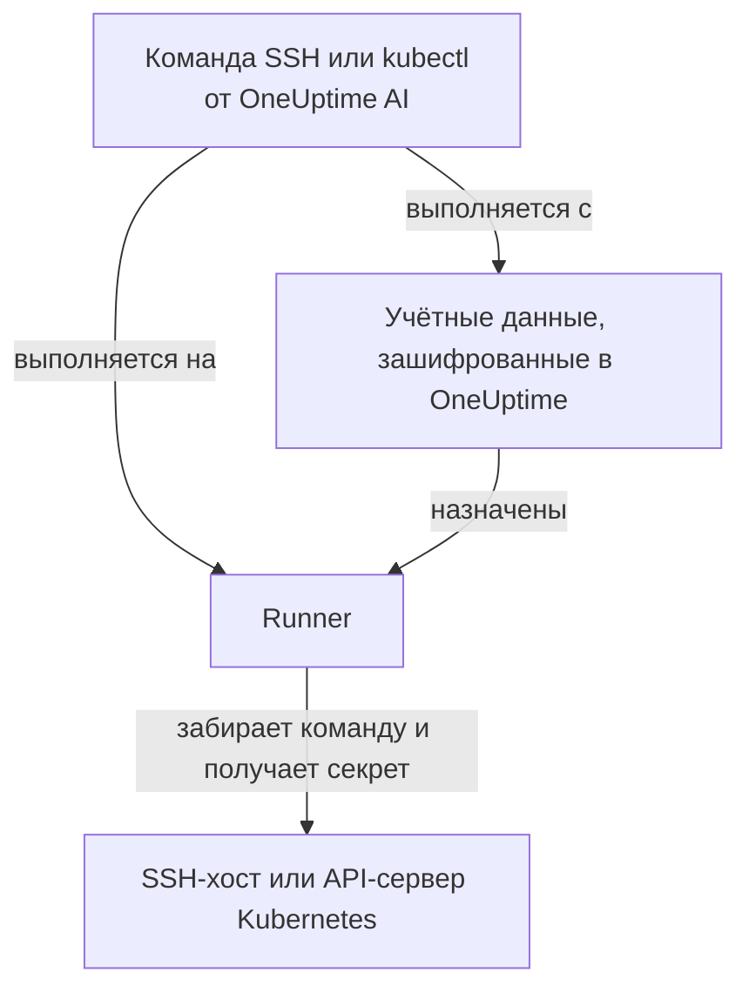

# Доступ ИИ

Доступ ИИ — это то, как собственные команды OneUptime AI добираются до того, что **не** является хостом самого Runner-а: до сервера по SSH или до API-сервера кластера Kubernetes, в котором не запущен чарт агента Kubernetes. Каждый доступ — это учётные данные: такой доступ в виде управляемого объекта, зашифрованного при хранении, назначенного определённым Runner-ам и выбираемого OneUptime AI, а не записанного в команду. Шаги runbook-ов их не используют: шаг SSH или kubectl входит с секретной [переменной runbook-а](/docs/runbooks/variables). Исключение — Runner старше этого выпуска: он выполняет шаг Kubernetes, перенесённый из действия, с учётными данными, которые называл шаг, пока не изменятся скрипт или kubeconfig шага.

Управляйте ими в **Сборники инструкций → Агенты runbook-ов → Доступ ИИ**.

:::cards
- [Создание учётных данных](#создание-учётных-данных): Их доступ и Runner-ы, которым разрешено их использовать.
- [Минимальные привилегии на другой стороне](#минимальные-привилегии-на-другой-стороне): Ограничьте, что может делать ключ или токен.
- [Runner-ы, выполняющие команды OneUptime AI](#runner-ы-выполняющие-команды-oneuptime-ai): Кто может дать такому Runner-у учётные данные SSH.
:::

## Как используются учётные данные

OneUptime AI выполняет команду SSH с одними из учётных данных SSH, назначенных Runner-у, на котором она выполняется, а команду kubectl для кластера, где не запущен чарт агента Kubernetes, — с учётными данными Kubernetes, привязанными к этому кластеру, как показано в [ИИ SRE](/docs/ai/ai-sre). Когда Runner забирает команду, OneUptime проверяет, что учётные данные назначены ему, расшифровывает секрет и передаёт его только в ответе на этот запрос. Секрет никогда не хранится в задании и никогда не читается через API.

## Прежде чем начать

- **Роль, которая управляет учётными данными.** Project Owner и Project Admin или любой, у кого есть разрешение **Create Runbook Credential**. Роль Runbook Admin его не включает. Чтобы назначить учётные данные SSH Runner-у, который выполняет команды OneUptime AI, нужно ещё и **Read Runbook Credential**; см. [Runner-ы, выполняющие команды OneUptime AI](#runner-ы-выполняющие-команды-oneuptime-ai).
- **Тариф, который их включает.** В OneUptime Cloud учётные данные runbook-ов требуют тарифа **Growth** или выше.
- **[Runner](/docs/runbooks/agents)**, который имеет сетевой доступ к хосту или к API-серверу кластера.

## Создание учётных данных

:::steps
### Откройте доступ ИИ

Откройте **Сборники инструкций → Агенты runbook-ов → Доступ ИИ** и нажмите **Создать: Credential**.

### Назовите их и выберите тип

На шаге **Credential** введите **Имя**, например `prod-cluster`, необязательное **Описание** и **Тип**: **SSH** или **Kubernetes**. Тип нельзя изменить позже; вместо этого создайте новые учётные данные.

### Введите доступ

:::tabs
@tab SSH
В **SSH-хост** введите **Имя хоста**, **Порт** (22, если поле пустое) и **Имя пользователя**. В **Аутентификация SSH** выберите в поле **Способ входа**: **Закрытый ключ** — лучший выбор, когда он возможен, — и вставьте **Private Key (PEM)** с его **Private Key Passphrase**, если она есть; или **Пароль** для хоста без доступа по ключу, и введите **Пароль**.
@tab Kubernetes
В **Kubernetes** введите **API Server URL**, например `https://10.0.0.1:6443`, **Service Account Token** и **CA Certificate (PEM)**, чтобы Runner мог проверить API-сервер. Оставляйте CA пустым, только если API-сервер предъявляет сертификат, которому Runner уже доверяет.
:::

### Назначьте их Runner-ам

На шаге **Агенты runbook-ов** выберите Runner-ы, которым разрешено использовать эти учётные данные, затем нажмите **Создать: Credential**. Учётные данные, не назначенные ни одному Runner-у, не может использовать ни одна команда.

### Разрешите OneUptime AI их использовать

OneUptime AI выполняет свои команды SSH на Runner-е, у которого включено **Выполняет ИИ-команды устранения**, с одними из назначенных ему учётных данных SSH. Учётные данные Kubernetes используются, как только они вместе с одним из своих Runner-ов привязаны к кластеру: см. [ИИ SRE](/docs/ai/ai-sre).
:::

## Что хранится

| Тип | Поля |
| --- | --- |
| SSH | Имя хоста, порт (по умолчанию 22), имя пользователя и либо закрытый ключ PEM (с необязательной парольной фразой), либо пароль. |
| Kubernetes | URL API-сервера, токен сервисного аккаунта и сертификат CA кластера. |

## Секретные значения только для записи

Закрытые ключи, парольные фразы, пароли и токены сервисных аккаунтов зашифрованы при хранении, и API **никогда их не возвращает**: ни панели, ни рабочему процессу, ни экспорту. Таблица может показать, *что представляют собой* учётные данные, никогда не показывая, что в них содержится.

Поэтому у секретного значения нет «показать», есть только «заменить»: повторный ввод значения — это и есть способ его сменить. Если вы потеряли оригинал, выпустите новый ключ в целевой системе и обновите учётные данные.

## Назначение учётных данных Runner-ам

Учётные данные могут использовать только те Runner-ы, которым вы их назначили. Команда, которая ссылается на учётные данные, не назначенные её Runner-у, **завершается ошибкой, а не выполняется** — Runner, который молча ничего не делает, выглядит точно так же, как тот, что сработал.

Назначение — это граница доступа, поэтому держите его узким: Runner, который только перезапускает один кластер, не нуждается в SSH-ключе от ваших хостов баз данных.

### Runner-ы, выполняющие команды OneUptime AI

На Runner-е с включённым **Выполняет ИИ-команды устранения** OneUptime AI выбирает среди назначенных Runner-у учётных данных SSH для команд, которые он там выполняет. Поэтому учётные данные SSH попадают на такой Runner только через человека, которому разрешено читать учётные данные runbook-ов (**Read Runbook Credential** либо Project Owner или Project Admin), независимо от того, что сохраняется первым:

- **Назначение учётных данных.** Чтобы создать учётные данные SSH с таким Runner-ом или добавить такой Runner к ним, нужно это разрешение. Без него сохранение отклоняется с указанием Runner-а: назначьте учётные данные Runner-ам, которые не выполняют ИИ-команды устранения, или попросите назначить их того, у кого есть это разрешение.
- **Включение переключателя.** Чтобы включить **Выполняет ИИ-команды устранения** для Runner-а с учётными данными SSH, нужно то же разрешение.

Удаление Runner-ов из учётных данных, сохранение учётных данных с уже назначенными им Runner-ами и учётные данные Kubernetes ничего больше не требуют: команды kubectl от OneUptime AI выполняются с учётными данными, привязанными к их кластеру. Назначения учётных данных и включения переключателя, сделанные без этого разрешения, сохраняются в проекте по одному, чтобы два таких сохранения не могли пройти проверки вместе; сохранение, пришедшее во время другого, ждёт его, а если это занимает слишком долго, отклоняется с *Try again in a moment*. Сохраните снова.

Шаг рабочего процесса действует как Project Admin, но не заимствует у Project Admin право чтения учётных данных runbook-ов: у шага оно есть, только если оно есть у человека, который последним сохранил шаги рабочего процесса. См. [Что могут делать шаги рабочего процесса](/docs/workflows/configuration#что-могут-делать-шаги-рабочего-процесса).

## Минимальные привилегии на другой стороне

OneUptime не может ограничить, что ваши учётные данные могут делать в целевой системе: это задача самой целевой системы, и её стоит решить:

- **SSH** — предпочитайте ключ паролю, давайте пользователю только нужные ему команды (принудительную команду или ограниченную оболочку, где это практично) и не используйте повторно личный ключ администратора.
- **Kubernetes** — привяжите сервисный аккаунт к Role, которая разрешает только то, что вы позволяете делать OneUptime AI, в тех namespace, где он может действовать. Сервисный аккаунт, который может только читать, позволяет OneUptime AI расследовать и отклоняет любое исправление.

## Кто их видит

Создание, изменение и удаление учётных данных требуют разрешений на учётные данные runbook-ов (или Project Owner/Admin). Чтение учётных данных показывает только их несекретные поля.

Обратите внимание, что **ключ агента** Runner-а равноценен назначенным этому Runner-у учётным данным: всё, у чего есть ключ, может забирать работу как этот Runner и получать учётные данные. Поэтому ключи агентов могут читать только Project Owner, Project Admin и Runbook Admin: обращайтесь с ними так же, как с самими учётными данными.

## Дальнейшие шаги

:::cards
- [Переменные runbook-ов](/docs/runbooks/variables): Секреты, с которыми входят шаги SSH и kubectl.
- [Агенты runbook-ов](/docs/runbooks/agents): Установите Runner, которому назначаются учётные данные.
- [Конфигурация и безопасность runbook-ов](/docs/runbooks/configuration): Разрешения и защита всего стека runbook-ов.
:::
