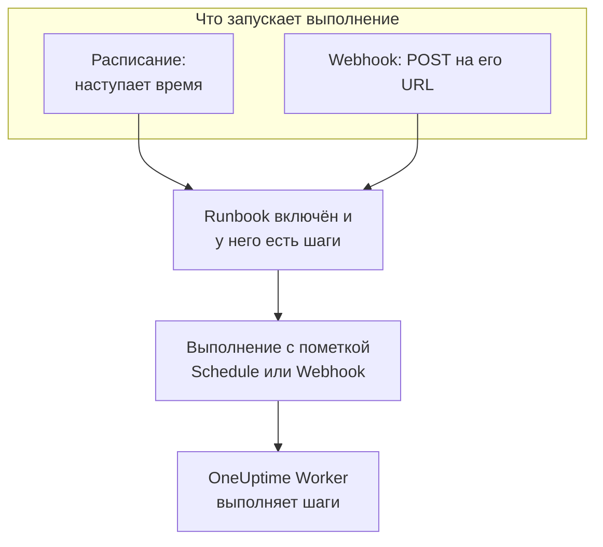

# Триггеры runbook-а

Runbook может запускаться сам: по расписанию или когда другой инструмент вызывает его URL webhook. Расписание подходит для регулярной работы, например ночной очистки или еженедельной проверки сертификатов, а webhook — чтобы запускать runbook из системы оповещений, CI-конвейера или скрипта. Оба настраиваются на странице **Триггеры** runbook-а.

:::cards
- [Запуск по расписанию](#запуск-по-расписанию): Раз в несколько минут, каждый день, по дням недели или по cron-выражению.
- [Вызов webhook](#вызов-webhook): Запуск выполнения POST-запросом на URL runbook-а.
- [Значения, которые отправляет вызов webhook](#значения-которые-отправляет-вызов-webhook): Как шаги читают JSON, который отправляет вызывающая сторона.
- [Устранение неполадок](#устранение-неполадок): Расписание, которое не срабатывает, отклонённый вызов.
:::

## Как триггер запускает выполнение



Триггер запускает выполнение так же, как **Запустить сейчас**: выполнение проходит по текущим шагам runbook-а и не привязано ни к инциденту, ни к оповещению, ни к плановому обслуживанию. Каждое выполнение записывает, что его запустило. **Выполнения** runbook-а и **Сборники инструкций → Выполнения** показывают это в столбце **Запущено** — со временем, на которое было назначено плановое выполнение, или с адресом, который вызвал webhook, — и оба списка можно отфильтровать по нему.

## Перед началом

- Runbook хотя бы с одним шагом и с включённым переключателем **Запускать этот сценарий** на его странице **Настройки**.
- Право изменять runbook и запускать его. См. [Кто может настраивать триггеры](#кто-может-настраивать-триггеры).

## Запуск по расписанию

:::steps
### Откройте страницу триггеров runbook-а
Откройте runbook в разделе **Сборники инструкций** и нажмите **Настройки → Триггеры** в его боковом меню. Раздел **Настройки** изначально свёрнут: нажмите на него, чтобы показать **Триггеры**.

### Настройте расписание
Нажмите **Настроить расписание**. В блоке **Когда запускается** выберите вариант в поле **Повтор** и то, что ему нужно. Диалог описывает расписание одной фразой, например «Запускается каждый будний день в 09:00», и показывает ближайшие запуски, пока вы его меняете.

### Проверьте часовой пояс
**Часовой пояс** изначально ваш. Время в расписании отсчитывается по часам этого пояса.

### Сохраните
Нажмите **Сохранить расписание**. Расписание включается, и карточка показывает его одной фразой вместе с блоком **Следующие запуски**.
:::

| **Повтор** | Что вы выбираете | Например |
| --- | --- | --- |
| **Раз в несколько минут** | **Каждые**: 1, 2, 3, 4, 5, 6, 10, 12, 15, 20 или 30 минут | Каждые 15 минут |
| **Раз в несколько часов** | **Каждые**: 1, 2, 3, 4, 6, 8 или 12 часов, и **Минуты после начала часа** | Раз в 2 часа в :30 |
| **Каждый день** | **Время суток** | Каждый день в 09:00 |
| **По дням недели** | **В эти дни** с ярлыками **Будни** и **Каждый день**, и **Время суток** | Каждый будний день в 09:00 |
| **Своё (cron-выражение)** | **Cron-выражение** | `0 2 1 * *`: в 02:00 первого числа каждого месяца |

У cron-выражения пять полей: минута, час, день месяца, месяц и день недели. Runbook-и запускаются не чаще раза в минуту, поэтому поля секунд нет. Диалог объясняет, что не так с выражением, которое он не может прочитать или которое никогда не сработает, например `0 0 31 2 *`, и ничего не сохраняет, пока оно не сможет сработать.

Затем карточка показывает расписание, три ближайших запуска по часам пояса, что оно делает, если запуск ещё идёт или время было пропущено, и **Последний запуск по расписанию** со ссылкой **Открыть запуск**. **Изменить расписание** открывает тот же диалог, а переключатель **Запускать по этому расписанию** приостанавливает расписание, не теряя его.

### Если запуск ещё идёт

Запуск считается незавершённым, пока он в очереди, выполняется или ждёт, когда кто-то выполнит или одобрит шаг, — как бы он ни был начат. Настройка расписания **Если запуск ещё идёт**, свёрнутая в диалоге в блоке **Дополнительные поля**, решает, что делает время, которое наступает в этот момент:

| Настройка | Что происходит |
| --- | --- |
| **Пропустить это время** (по умолчанию) | Ничего не запускается. Расписание ждёт следующего времени. |
| **Запустить после его завершения** | Один запуск ждёт и стартует, когда текущий завершится. Остальные моменты, наступившие тем временем, ничего не запускают. |

### Если OneUptime пропустил время

Если OneUptime не работал или обновлялся в запланированное время, время считается пропущенным, как только опоздание превышает 5 минут. **Если OneUptime пропустил время** решает, что происходит, когда OneUptime снова работает:

| Настройка | Что происходит |
| --- | --- |
| **Запустить один раз, когда OneUptime снова заработает** (по умолчанию) | Запускается одно выполнение, сколько бы времени ни было пропущено, с пометкой «Запущен один раз, чтобы наверстать время, пропущенное OneUptime». |
| **Пропустить пропущенное время** | Ничего не запускается до следующего времени. |

Время, прошедшее, пока расписание или runbook были выключены, не считается пропущенным: после повторного включения отсчёт идёт со следующего времени.

### Часовые пояса и летнее время

Время круглый год отсчитывается по часам пояса. Расписание на 09:00 в Europe/London срабатывает в 09:00 по лондонскому времени и зимой, и летом. В ночь, когда часы переводят вперёд, время, которого в эту ночь нет, срабатывает на час позже по часам. Когда часы переводят назад и час наступает дважды, расписание, которое срабатывает каждый час, срабатывает в обоих, а любое другое — один раз, в первом.

## Вызов webhook

:::steps
### Включите webhook
На странице **Триггеры** runbook-а включите **Запускать при вызове этого URL**. Runbook получает собственный URL.

### Скопируйте URL
**URL webhook** скрыт: нажмите **Показать**, чтобы увидеть его, или **Скопировать URL**, чтобы скопировать целиком. В блоке **Попробуйте** есть команда `curl`, с которой можно начать.

### Вызовите его из своего инструмента
Отправьте `POST`-запрос на URL с JSON-объектом в теле или без тела:

```bash
curl -X POST "https://oneuptime.com/runbook/webhook/RUNBOOK_ID/SECRET_KEY" \
  -H "Content-Type: application/json" \
  -d '{"host": "web-1", "reason": "Disk almost full"}'
```

### Проверьте выполнение
Ответ называет запущенное выполнение: `{"runbookExecutionId": "...", "status": "Scheduled"}`. Выполнение появляется в **Выполнения** runbook-а, где **Запущено** показывает **Вебхук**, а на его странице в блоке **Входные данные** видно, что отправил вызов.
:::

**Отправить тестовый запрос** отправляет на URL `POST` с телом, которое вы пишете, как это сделал бы другой инструмент, и даёт ссылку на запущенное выполнение. Это настоящий запуск runbook-а.

### Чем отвечают на вызов

| Ответ | Когда |
| --- | --- |
| `200` | Выполнение запущено. Тело ответа называет его. |
| `400` | Тело не является JSON-объектом, вложено глубже 32 уровней или содержит символ NUL, либо у runbook-а нет шагов. |
| `403` | Webhook или runbook выключен. |
| `404` | По этому URL не отвечает ни один webhook runbook-а: неверен ID runbook-а или ключ, либо URL был сброшен. |
| `405` | Запрос — это `GET`. `GET` никогда не запускает выполнение, поэтому предпросмотр ссылки в чате не запустит его случайно. |
| `413` | Тело больше 64 КБ. |
| `429` | Webhook запустил 30 выполнений за последнюю минуту, 10 его выполнений ещё идут, или один адрес сделал больше 120 вызовов webhook-ов runbook-ов за минуту, или адреса одной IPv6-сети /64 вместе — больше 1200. Заголовок `Retry-After` подсказывает, когда повторить попытку, если это возможно. |
| `503` | OneUptime сейчас не может посчитать вызовы. Повторите попытку через минуту. |

Отклонённый вызов ничего не запускает, а его тело объясняет причину одной фразой, например "This runbook is turned off, so it was not started. Turn it on with Run this runbook, under the runbook's Settings."

### Храните URL в секрете

URL содержит секретный ключ runbook-а: любой, у кого он есть, может запустить runbook. Ключ состоит из 43 случайных символов, сравнивается за постоянное время, а на неверный ключ отвечают так же, как если бы такого runbook-а не было.

Если URL утёк, нажмите **Сбросить URL**. Runbook получит новый URL, а старый сразу перестанет работать, поэтому передайте новый каждому инструменту, который его вызывает. Если выключить и снова включить webhook, URL останется прежним.

## Значения, которые отправляет вызов webhook

Значения верхнего уровня из тела становятся входными данными выполнения. Они попадают в шаги как данные, а не как текст, вставленный в скрипт или команду:

| Тип шага | Как он читает входные данные |
| --- | --- |
| Bash и kubectl | Переменные окружения: по одной `ONEUPTIME_INPUT_<NAME>` на каждое значение верхнего уровня, `ONEUPTIME_INPUTS` со всем объектом в JSON и `ONEUPTIME_TRIGGER` с тем, что запустило выполнение, например `Webhook` или `Schedule`. |
| JavaScript | `args.inputs` — объект в том виде, в каком он был отправлен, и `args.trigger`. |
| AI | В своём промпте, с пометкой, что это данные извне OneUptime, если включено **Включать контекст триггера**. |
| HTTP request и SSH | Никак. Их URL, скрипт и цель такие, как записано в runbook-е, и ничто из отправленного вызывающей стороной их не меняет. |

Имя переменной — это имя значения заглавными буквами, где каждый символ, кроме буквы или цифры, записан как `_`: `host-name` становится `ONEUPTIME_INPUT_HOST_NAME`. Текст передаётся как есть, числа и `true` или `false` — как записаны, а объекты и списки — в JSON. Шаг получает не больше 100 таких переменных, а имя длиннее 100 символов не становится переменной; каждое значение всё равно есть в `ONEUPTIME_INPUTS`. Каждое имя начинается с `ONEUPTIME_`, поэтому вызывающая сторона не может задать ни `PATH`, ни другую переменную, которую читает Runner.

Эти значения задаёт вызывающая сторона, поэтому проверяйте их, прежде чем действовать:

```bash
set -euo pipefail
case "$ONEUPTIME_INPUT_HOST" in
  web-1|web-2|web-3) ;;
  *) echo "Unknown host: $ONEUPTIME_INPUT_HOST"; exit 1 ;;
esac
curl -fsS -X POST "http://$ONEUPTIME_INPUT_HOST.internal:8080/restart"
```

```javascript
const host = args.inputs.host;
if (!["web-1", "web-2", "web-3"].includes(host)) {
  throw new Error(`Unknown host: ${host}`);
}
console.log(`Started by ${args.trigger} for ${host}`);
return { host };
```

## Кто может настраивать триггеры

Расписание или webhook запускают выполнения без участия человека, поэтому для их настройки нужно право изменять runbook и запускать его: Project Owner, Project Admin или Runbook Admin, либо **Edit Runbook** вместе с Project Member, Runbook Member или **Create Runbook Execution**. Метки, которыми ограничена роль, учитываются так же, как для **Запустить сейчас**. Чтобы видеть или сбрасывать URL webhook, нужно то же самое.

Выключение расписания или webhook ничего не запускает, поэтому для него нужно только право изменять runbook. Тот, кто может изменять runbook, но не запускать его, видит страницу **Триггеры** с заблокированной кнопкой **Настроить расписание** и узнаёт, кто может видеть URL webhook.

## Устранение неполадок

:::details По расписанию ничего не запускается
Runbook выключен или у него нет шагов: карточка говорит, что именно. Включите **Запускать этот сценарий** на странице **Настройки** runbook-а или добавьте шаги на его странице **Шаги**. Если карточка говорит, что расписание приостановлено, включите **Запускать по этому расписанию**.
:::

:::details Запланированное время ничего не запустило
Ещё шёл запуск, а расписание пропускает такое время, или OneUptime пропустил время, а расписание пропускает пропущенное время. См. [Если запуск ещё идёт](#если-запуск-ещё-идёт) и [Если OneUptime пропустил время](#если-oneuptime-пропустил-время).
:::

:::details Сохранение расписания завершается ошибкой "You do not have permission to set up this runbook's schedule or webhook."
Чтобы настроить триггер, нужно право запускать runbook, а не только изменять его. Запросите Runbook Admin или Runbook Member либо **Create Runbook Execution** в дополнение к **Edit Runbook**.
:::

:::details На вызов приходит ответ "No runbook webhook answers at this URL."
URL был сброшен или скопирован с ошибкой. Скопируйте его заново со страницы **Триггеры** runbook-а.
:::

:::details На вызов приходит ответ "This runbook's webhook is turned off, so the runbook was not started."
Включите **Запускать при вызове этого URL** на странице **Триггеры** runbook-а. URL остаётся прежним.
:::

## Дальнейшие шаги

:::cards
- [Выполнение runbook-а](/docs/runbooks/running): Что показывает выполнение и как его продвигать.
- [Написание runbook-а](/docs/runbooks/authoring): Напишите шаги, которые выполняет триггер.
- [Конфигурация и безопасность runbook-ов](/docs/runbooks/configuration): Ограничения, права и защита.
:::
