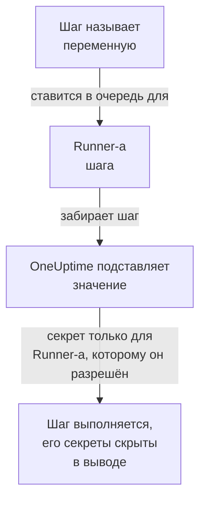

# Переменные runbook-ов

Переменная runbook-а — это значение, которое ваши шаги используют по имени, а не хранят сами: хост, namespace или URL, либо секрет, например ключ SSH, пароль, kubeconfig или токен API. Измените значение один раз, и каждый шаг, который его называет, при следующем запуске использует новое. Секрет зашифрован, больше никогда не показывается и скрывается в том, что выводят шаги.

:::cards
- [Создать переменную](#создать-переменную): Обычное значение, либо секрет и Runner-ы, которым можно его использовать.
- [Использовать переменную в шаге](#использовать-переменную-в-шаге): В скрипте или HTTP-запросе, либо как вход шага SSH и kubeconfig шага kubectl.
- [Кто получает секрет](#кто-получает-секрет): Ваши Runner-ы, глобальные Runner-ы, если вы им разрешите, и сам OneUptime для шага HTTP-запроса.
:::

## Как переменная попадает в шаг



Шаг хранит имя переменной, но никогда её значение. Когда Runner шага забирает его, OneUptime подставляет значение — в скрипт, в машину и вход шага SSH или в kubeconfig шага kubectl — и передаёт его только этому Runner-у. Шаг, который называет переменную, недоступную ему, завершается ошибкой с указанием причины, а не выполняется с именем на месте значения.

Шаги Bash, JavaScript, SSH, kubectl и HTTP-запроса используют переменные. Шаги ИИ их не подставляют. Шаг HTTP-запроса OneUptime отправляет сам, без Runner-а, поэтому шаг получает каждую переменную, которую называет, и секреты тоже, и скрывает их в ответе, который записывает.

## Глобальные переменные и переменные runbook-а

| | Глобальные переменные | Собственные переменные runbook-а |
| --- | --- | --- |
| Где управлять | **Сборники инструкций → Настройки → Глобальные переменные** | **Настройки → Переменные** runbook-а |
| Кто использует | Каждый runbook проекта | Только шаги этого runbook-а |
| Как писать в шаге | `{{global.variables.NAME}}` | `{{local.variables.NAME}}` |

Имя используется один раз, без учёта регистра, среди глобальных переменных проекта и один раз среди собственных переменных runbook-а. Переменная runbook-а может иметь то же имя, что и глобальная: каждая пишется по-своему.

## Прежде чем начать

- **Роль, которая управляет переменными.** Project Owner и Project Admin или разрешение **Create Runbook Variable**. Runbook Admin читает переменные, чтобы выбирать их в шагах, которые пишет, но не изменяет их.
- **Тариф, который их включает.** В OneUptime Cloud переменным runbook-ов нужен тариф **Growth** или выше.

## Создать переменную

:::steps
### Откройте переменные

Откройте **Сборники инструкций → Настройки → Глобальные переменные** или **Настройки → Переменные** runbook-а и нажмите **Создать: Переменная**.

### Назовите её и введите значение

На шаге **Переменная** введите **Имя**: буквы, цифры, дефисы и подчёркивания, до 100 символов, например `PROD_DB_SSH_KEY`. **Секрет** вначале включён: вставьте ключ, пароль, токен или kubeconfig в **Значение секрета** и нажмите **Далее**. Для значения, которое может читать любой, например хоста, выключите **Секрет**, введите его в **Значение** и нажмите **Создать: Переменная**. Необязательное **Описание** находится в разделе **Дополнительные поля**.

### Выберите, кто может использовать секрет

На шаге **Кто может использовать** выберите свои Runner-ы в **Ваши Runner-ы, которые могут его использовать**. На сервере с [глобальными Runner-ами](/docs/runbooks/agents#глобальные-runner-ы) переключатель **Глобальные Runner-ы могут его использовать** также позволяет использовать секрет шагам этого проекта, выполняемым на глобальном Runner-е: вначале он включён, пока проект использует глобальные Runner-ы. Секрету нужно одно или другое. Нажмите **Создать: Переменная**.
:::

Является ли переменная секретом, позже изменить нельзя. Вместо этого удалите её и создайте заново с тем же именем: шаги называют переменные по имени, поэтому продолжат работать. Runner внутри кластера, который устанавливает чарт агента Kubernetes, никогда не получает секрет.

## Значения секретов доступны только для записи

Значение секрета хранится в зашифрованном виде, и API **никогда его не возвращает**: ни панели, ни рабочему процессу, ни экспорту. Список показывает **Секрет** там, где обычная переменная показывает своё значение, а его столбец **Агенты runbook-ов** показывает, какие Runner-ы получают каждый секрет. Чтобы изменить значение, нажмите **Заменить значение** в его строке: новое значение шифруется, старое исчезает навсегда, а шаги получают новое при следующем запуске.

Когда шаг выводит полученный секрет, Runner заменяет его на `[REDACTED]` до того, как вывод покинет его хост, а OneUptime делает это ещё раз перед сохранением вывода. Строка закрытого ключа или токен в kubeconfig тоже скрываются. Секрет короче 4 символов не ищется.

## Использовать переменную в шаге

:::tabs
@tab В скрипте
Напишите ссылку там, где должно быть значение, в скрипте Bash, JavaScript, SSH или kubectl:

```bash
curl -s -X POST \
  -H "Authorization: Bearer {{global.variables.CDN_API_TOKEN}}" \
  "https://api.cdn.example.com/v1/purge"
```
@tab В HTTP-запросе
Напишите ссылку в URL, заголовках или теле [шага HTTP-запроса](/docs/runbooks/authoring#http-request):

```json
{ "Authorization": "Bearer {{global.variables.API_TOKEN}}" }
```
@tab Вход по SSH
[Шаг SSH](/docs/runbooks/authoring#ssh) выбирает в **Способ входа** секретную переменную с закрытым ключом или паролем, а в **Дополнительные поля → Парольная фраза ключа** — парольную фразу ключа. Значение показывает, ключ это или пароль.
@tab Kubeconfig
[Шаг kubectl](/docs/runbooks/authoring#kubectl) выбирает в **Kubeconfig** секретную переменную с kubeconfig кластера или **Собственный доступ Runner-а**, чтобы использовать доступ Runner-а.
:::

На странице **Шаги** runbook-а каждый скрипт и каждый HTTP-запрос перечисляют в **Переменные — нажмите, чтобы скопировать** переменные, которые может использовать их шаг, а редактор сообщает, когда шаг называет переменную, которой нет, или секрет, который его Runner использовать не может.

## Кто получает секрет

| Кто выполняет шаг | Обычная переменная | Секрет |
| --- | --- | --- |
| Один из ваших Runner-ов | Всегда | Когда секрет указывает его в **Ваши Runner-ы, которые могут его использовать** |
| Глобальный Runner | Всегда | Когда включено **Глобальные Runner-ы могут его использовать**, для шага из собственного проекта секрета |
| Сам OneUptime, для шага HTTP-запроса | Всегда | Всегда |

Шаг, который называет секрет, недоступный его Runner-у, завершается ошибкой, называя секрет и то, что нужно изменить, и ничего не передаётся.

## Секреты и учётные данные runbook-ов стали переменными

Переменные runbook-ов заняли место секретов runbook-ов и учётных данных, которые называли шаги SSH и Kubernetes. При обновлении OneUptime то, что было у каждого проекта, перенесено один раз, поэтому каждый runbook работает как прежде:

- каждый секрет runbook-а стал секретной глобальной переменной с тем же именем, тем же значением, теми же Runner-ами и тем же переключателем для глобальных Runner-ов;
- `{{runbookSecrets.NAME}}` в скрипте переписан как `{{global.variables.NAME}}`, а старая запись по-прежнему читает глобальную переменную `NAME`;
- все учётные данные, которые называл шаг, стали секретными глобальными переменными с теми же Runner-ами и именами по их названию: `<name>-ssh-key` (и `<name>-ssh-key-passphrase` для ключа с парольной фразой), `<name>-ssh-password` или `<name>-kubeconfig`;
- каждый шаг SSH, который называл учётные данные, входит на свою машину с ними и выполняет свою команду как скрипт, а каждый шаг Kubernetes стал шагом kubectl, который выполняет тот `kubectl patch`, что делало его действие, и которому не нужно больше доступа, чем было у шага.

Runner старше этого выпуска (14.0.79) не может выполнить скрипт kubectl: он завершает шаг kubectl ошибкой и сообщает, что Runner нужно обновить. Каждый так перенесённый шаг Kubernetes сначала сохранил рядом со скриптом свои учётные данные и своё действие — для такого Runner; они ушли вместе с учётными данными runbook-ов, так что каждому шагу kubectl нужен Runner версии 14.0.79 или новее.

Учётные данные runbook-ов с тех пор удалены, а шаг, который ещё называл их, был сначала перенесён тем же способом. Шаг, который называет учётные данные, больше не выполняется, а его страница шагов предлагает **Превратить в шаг со скриптом**; сохранение через API или Terraform, которое даёт их шагу, отклоняется. См. [Учётные данные runbook-ов удалены](/docs/installation/upgrading#учётные-данные-runbook-ов-удалены).

## Дальнейшие шаги

:::cards
- [Создание runbook-а](/docs/runbooks/authoring): Напишите шаги SSH и kubectl, которые используют переменную.
- [Агенты runbook-ов](/docs/runbooks/agents): Установите Runner, которому передаётся секрет.
- [Настройка и безопасность runbook-ов](/docs/runbooks/configuration): Разрешения и защита для всего стека runbook-ов.
:::
