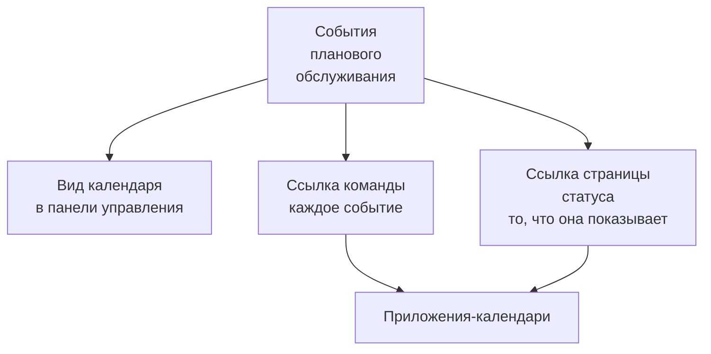

# Календарь обслуживания

Календарь обслуживания показывает ваше плановое обслуживание по датам: на отдельной странице в панели управления, в собственных приложениях-календарях вашей команды по секретной ссылке и в календарях людей, которые следят за вашими страницами статуса. На его странице рядом с вашими событиями можно показать календари извне проекта, например праздники или запрет на изменения. На этой странице объясняются страница календаря, внешние календари, ссылка на календарь команды, календарь страницы статуса и то, что содержит каждое событие календаря.

:::cards
- [Страница календаря](#страница-календаря): Каждое событие на месяце, неделе или дне, в цвете его состояния.
- [Внешние календари](#внешние-календари): Праздники, запреты на изменения или обслуживание другой команды рядом с вашими событиями.
- [Ссылка на календарь команды](#ссылка-на-календарь-команды): Каждое событие проекта в Google Календаре, Outlook или Календаре Apple.
- [Календарь страницы статуса](#календарь-страницы-статуса): То, что показывает страница статуса, в календарях её посетителей.
- [Что содержит событие календаря](#что-содержит-событие-календаря): Название, окно, состояние и ссылка обратно.
:::



## Страница календаря

Откройте **Плановое обслуживание → Календарь обслуживания** в разделе **Календарь** бокового меню. **Все события** показывает те же события списком.

- Календарь открывается на текущем месяце, сегодняшний день отмечен. **Месяц**, **Неделя** и **День** меняют, сколько он показывает; перемещайтесь стрелками и возвращайтесь кнопкой **Сегодня**. Время показано в вашем часовом поясе.
- Каждое событие — блок в цвете его состояния, а цвета состояний подписаны под календарём. Нажмите на событие, чтобы открыть его.
- Фильтры над календарём работают так же, как в списке: выберите состояние, метку или владельца, чтобы видеть только эти события.
- День, который ещё не наступил, показывает **+**, когда вы наводите указатель на его неделю. Он открывает **Создать событие планового обслуживания** с **Начинается** в этот день, в тот час, который форма выбрала бы сегодня. Вы видите его, только если можете создавать события.
- Один вид показывает до 500 событий. Более загруженный месяц сообщает об этом: сузьте его фильтрами или посмотрите неделю.

Раньше на странице **Все события** можно было переключаться между списком и календарём. Если браузер в последний раз оставил её на календаре, **Все события** один раз откроет **Календарь обслуживания**, а дальше будет списком.

## Внешние календари

Страница календаря может показывать и события календарей извне проекта: праздники, запрет на изменения, который ваша компания ведёт в другом календаре, или обслуживание другой команды. OneUptime читает каждый из них по ссылке iCalendar (`.ics`) и рисует его события рядом с вашими, светлее и в собственном цвете календаря. Они доступны только для чтения: никогда не становятся событиями обслуживания, никого о них не уведомляют, и они никогда не попадают в собственные ссылки на календарь проекта.

:::steps
### Добавьте календарь

Выберите **Добавить внешний календарь** в меню **⋯** календаря или откройте **Плановое обслуживание → Настройки календаря** в разделе **Настройки** бокового меню и нажмите **Добавить внешний календарь**. Заполните поле **Имя** и вставьте ссылку в поле **Ссылка на календарь**. В разделе **Дополнительные поля** находятся **Цвет** и **Обновить** — как часто он читается: **Каждый час**, если не выбрать другое.

### Убедитесь, что он прочитан

OneUptime читает новый календарь сразу. Его **Статус** показывает **Работает**, как только он прочитан, а **Последнее чтение** — когда и сколько событий он сохранил. Неудачное чтение показывает **Не работает** с причиной и тем, что делать.

### Покажите или скройте его

У каждого внешнего календаря под календарём есть переключатель с его названием. Скрытый календарь скрыт только для вас; браузер запоминает выбор для проекта.
:::

Скопируйте ссылку из настроек общего доступа самого календаря: в Google Календаре — его секретный адрес в формате iCal, в Outlook — ссылку ICS опубликованного календаря, в любом другом приложении — его ссылку `.ics` или `webcal://`. Ссылка может быть закрытой: OneUptime хранит её в зашифрованном виде, больше никогда не показывает, а **Изменить ссылку** её заменяет.

| Действие | Что происходит |
| --- | --- |
| **Прочитать сейчас** | Читает календарь сейчас, а не при следующем чтении. |
| **Изменить ссылку** | Заменяет его ссылку. События старой ссылки забываются, а новая читается сразу. |
| **Выключить** | Перестаёт его читать и скрывает его события от всех до **Включить**. |

Каждый календарь хранит свои события от 90 дней назад до года вперёд, до 2000 штук, начиная с ближайших к сегодняшнему дню. Календарь больше 5 МБ не читается. Повторяющиеся события, их исключения и часовые пояса читаются так, как их записало приложение календаря, а событие на весь день остаётся на своей дате в любом часовом поясе. В проекте может быть до 20 внешних календарей, а один вид календаря рисует до 500 их событий.

Роли, которые создают, редактируют и удаляют события планового обслуживания, добавляют, изменяют и удаляют внешние календари, а каждый, кто может читать события, видит их в календаре. OneUptime никогда не читает адрес на собственном сервере или адрес облачных метаданных, а OneUptime Cloud отклоняет адреса в частной сети. Сервер на собственном хостинге может читать календарь в вашей собственной сети, если только `DATA_SOURCE_BLOCK_PRIVATE_ADDRESSES` не равен `true`.

## Ссылка на календарь команды

**Подписаться на календарь** под календарём открывает ссылку на календарь проекта: одну секретную ссылку iCalendar (`.ics`), которая добавляет каждое событие планового обслуживания проекта в Google Календарь, Outlook, Календарь Apple или любое приложение, которое подписывается на календарь по URL.

:::steps
### Опубликуйте ссылку

Нажмите **Опубликовать ссылку**. У проекта одна ссылка для всей команды, поэтому это нужно сделать только один раз.

### Добавьте её в своё приложение-календарь

**Google Календарь** открывает Google Календарь, который спрашивает, добавить ли календарь. **Календарь Apple / Outlook** открывает ссылку в приложении-календаре вашего компьютера или телефона. **Скопировать ссылку** копирует её для любого другого приложения.

### Проверьте, что всё работает

Панель **Статус** показывает, когда приложение-календарь в последний раз прочитало ссылку и какое именно. Новая ссылка показывает **Ожидает первой синхронизации**, пока её не прочитает приложение.
:::

Ссылка выглядит так:

```text
https://<your host>/api/scheduled-maintenance-calendar/project/<token>/maintenance.ics
```

> [!WARNING]
> Любой, у кого есть ссылка, видит каждое событие планового обслуживания проекта без входа в систему. Обращайтесь с ней как с паролем и создайте её заново, если она попала не в те руки.

### Кто может видеть ссылку

Ссылка показывает каждое событие проекта, поэтому диалог показывает её только тем, кто может читать каждое событие. Тот, чья роль ограничивает его некоторыми событиями, по метке или событиями, которыми он владеет, вместо этого узнаёт причину.

| Действие | Кто может это сделать |
| --- | --- |
| Скопировать ссылку | Любой, кто может читать каждое событие планового обслуживания проекта |
| **Опубликовать ссылку** | Любой, кто также может создавать события планового обслуживания |
| **Создать ссылку заново**, **Отключить ссылку** | Любой, кто также может изменять события планового обслуживания |

### Управление ссылкой

**Создать ссылку заново** и **Отключить ссылку** находятся в меню **⋯** в верхней части диалога.

| Действие | Что происходит |
| --- | --- |
| **Создать ссылку заново** | Создаёт новую ссылку. 30 дней старая отдаёт пустой календарь, чтобы приложения, у которых она есть, очистили свою копию; после этого она не находится. Подпишитесь снова по новой ссылке. |
| **Отключить ссылку** | Оставляет ссылку, но она отдаёт пустой календарь до **Включить ссылку**. |

Календарь содержит каждое событие от 90 дней назад до года вперёд, до 1000 событий.

## Календарь страницы статуса

Люди, которые следят за страницей статуса, могут добавить её плановое обслуживание в свой календарь. На странице плановых событий страницы статуса кнопка **Подписаться на календарь** предлагает Google Календарь, приложение-календарь их устройства или ссылку для копирования. Ссылка — это адрес страницы, за которым следует `/maintenance.ics`, например `https://status.example.com/maintenance.ics`.

- **Что в нём.** Ровно то, что показывает страница: события в пределах окна истории страницы, каждое ещё не начавшееся событие и каждое идущее, пока включено **Видно на странице статуса**, и начиная с его **Время публикации**, если вы его выбрали. То, что затрагивает каждое событие, называется так, как страница называет свои ресурсы, а не собственными именами ваших мониторов.
- **Закрытая страница.** Приложение-календарь не может войти в систему, поэтому закрытая страница не предлагает **Подписаться на календарь**, а её ссылка отдаёт пустой календарь с пояснением, что страница закрытая.
- **Одно событие.** **Добавить в календарь** на странице события добавляет только это событие: Google Календарь открывается с уже заполненным событием, или оно скачивается файлом, который открывает приложение-календарь устройства. Это работает и на закрытой странице для вошедшего посетителя и не предлагается, когда событие закончилось.

## Что содержит событие календаря

Каждый календарь, и командный, и календарь страницы статуса, записывает событие одинаково.

| Часть | Что в ней |
| --- | --- |
| Название | Название события |
| Начало и конец | Его запланированное окно, в UTC; приложение-календарь показывает его в вашем часовом поясе |
| Описание | Его описание обычным текстом, его состояние, что оно затрагивает, и ссылка на событие; командная ссылка также называет его страницы статуса |
| Статус | Отменено, если событие отменили: завершено, так ни разу и не побывав в работе |
| Свободен или занят | Свободен, чтобы окно обслуживания никогда не блокировало вашу доступность |
| Категории | Его метки; календарь страницы статуса показывает их, только когда страница показывает метки |

Событие, изменённое в OneUptime, обновляется на месте в каждом календаре, где оно есть, а удалённое или снятое со страницы статуса пропадает из календаря при следующем обновлении.

## Как часто обновляются календари

Приложения-календари читают ссылку подписки по своему расписанию. Google Календарь делает это раз в несколько часов, иногда только раз в день; Календарь Apple и Outlook обычно каждый час. OneUptime хранит календарь не дольше пяти минут, так что ожидание, которое вы видите, — это ожидание приложения-календаря. Шаги для каждого приложения описаны в разделе [Календарные ленты](/docs/on-call/calendar-feeds#подписка-в-приложении-календаре), которые для дежурных смен работают так же.

## Устранение неполадок

:::details Приложение-календарь перестало показывать новые события
Ссылку создали заново или отключили: откройте **Подписаться на календарь**, чтобы увидеть её статус. На заново созданную ссылку нужно подписаться снова; отключённая ссылка возвращается кнопкой **Включить ссылку**.
:::

:::details Google Календарь не может добавить ссылку
Google Календарь читает ссылку со своих серверов, поэтому сервер OneUptime должен быть доступен из интернета. Для собственной установки см. [Календарные ленты](/docs/on-call/calendar-feeds#устранение-неполадок).
:::

:::details В календаре страницы статуса нет события
Календарь страницы содержит то, что показывает страница. Проверьте, что событие указывает эту страницу, что **Видно на странице статуса** включено в его **Настройки**, что его **Время публикации**, если оно задано, наступило, и что оно началось в пределах окна истории страницы.
:::

:::details Внешний календарь показывает «Не работает»
Причина указана под **Не работает** в столбце **Статус**: по ссылке нет календаря, ссылка требует входа или больше не открыта, его сервер ответил ошибкой, календарь больше 5 МБ или повторяет события слишком часто, чтобы его обработать. Исправьте ссылку через **Изменить ссылку** или нажмите **Прочитать сейчас**, когда календарь снова станет доступен. До тех пор календарь показывает события из последнего успешного чтения.
:::

## Дальнейшие шаги

:::cards
- [Создание событий обслуживания](/docs/scheduled-maintenance/creating-events): Форма, поле за полем, и что происходит дальше.
- [Подписчики и объявления](/docs/status-pages/subscribers#плановые-работы): Что подписчики страницы статуса узнают об обслуживании.
- [Календарные ленты](/docs/on-call/calendar-feeds): Такая же ссылка для дежурных смен.
:::
