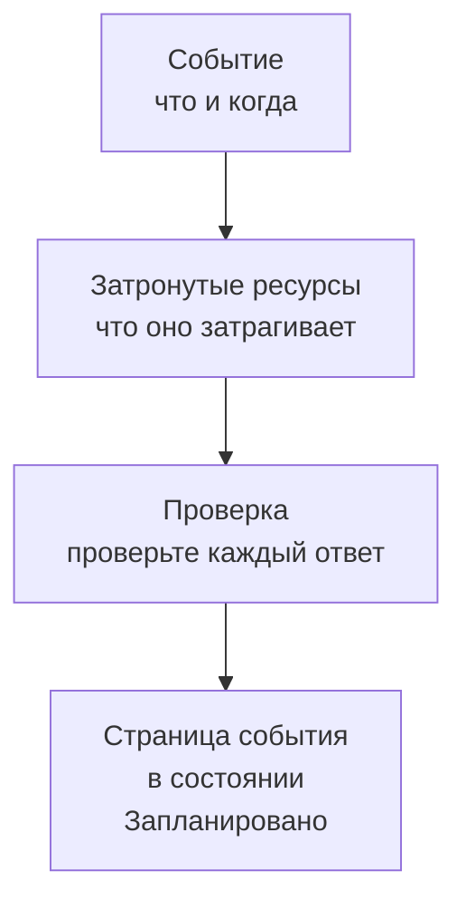

# Создание событий обслуживания

Запланируйте обслуживание за два коротких шага: скажите, что происходит и когда, а затем — что это затрагивает и кто должен об этом узнать. Ввести нужно только заголовок; всё остальное начинается с разумного значения по умолчанию. На этой странице разобраны форма, то, что происходит в момент создания события, как изменить его позже и как создавать события из кода.

:::cards
- [Создайте событие](#создайте-событие): Два шага и проверка.
- [Что происходит при создании](#что-происходит-при-создании): Его номер, правила, владельцы и первые сообщения.
- [Измените событие позже](#измените-событие-позже): Его окно, ресурсы, страницы статуса и заметки.
- [Создавайте события из кода](#создавайте-события-из-кода): API, Terraform, рабочие процессы и чат.
:::

## Как это работает

Форма задаёт два вопроса, по одному на шаг, а затем показывает всё на странице проверки, прежде чем создать событие. Событие начинается в вашем запланированном состоянии, и открывается его страница.



## Перед началом

- **Ваша роль.** Для создания события нужна роль **Владелец проекта**, **Администратор проекта**, **Участник проекта**, **Администратор планового обслуживания** или **Участник планового обслуживания** либо пользовательская роль с разрешением **Create Scheduled Maintenance**.
- **Ваши страницы статуса.** Чтобы сообщить клиентам, нужна страница статуса, которая показывает события планового обслуживания. См. [Обзор страниц статуса](/docs/status-pages/index).

## Создайте событие

:::steps
### Откройте форму

Перейдите в **Плановое обслуживание → Все события** и нажмите **Создать событие планового обслуживания**. Форма откроется на первом шаге, **Событие**.

### Скажите, что происходит и когда

Введите **Заголовок** и добавьте **Описание**, если это поможет: оно в формате Markdown и показывается на ваших страницах статуса. **Начинается** уже равно следующему целому часу по вашим часам, а **Заканчивается** — на час позже; меняйте их, только если они неверны. Если сдвинуть **Начинается**, **Заканчивается** сдвинется вместе с ним, и окно сохранит свою длину. **Владельцы** и **Метки** ждут в свёрнутом блоке **Дополнительные поля**.

### Выберите, что затрагивается

Нажмите **Далее**, чтобы перейти к шагу **Затронутые ресурсы**. Выберите **Мониторы**, которые затрагивают работы. Как только вы выберете хотя бы один, под ними появится **Изменить статус монитора на**: статус, в который мониторы переходят, когда событие начинается. Затем выберите **Другие затронутые ресурсы**, если они есть, например хосты, кластеры, базы данных, сетевые площадки или сервисы.

### Выберите, кто об этом узнает

Выберите страницы статуса в поле **Показывать событие на этих страницах статуса**. Свёрнутый блок **Уведомления подписчиков** одной строкой говорит, кто и когда получит уведомление; раскройте его, чтобы изменить **Когда событие запланировано**, **Когда событие начинается**, **Когда событие заканчивается** или **Напоминания перед событием**.

### Создайте его

Нажмите **Далее**, чтобы увидеть проверку, просмотрите её и нажмите **Создать событие планового обслуживания**. Откроется собственная страница события.
:::

Ничего не отправляется, пока вы не выберете страницу статуса: событие, которое не показывается ни на одной странице статуса, не уведомляет ни одного подписчика.

## Поля формы

| Поле                                 | Шаг                | Начальное значение              | Что оно делает                                                                   |
| ------------------------------------ | ------------------ | ------------------------------- | -------------------------------------------------------------------------------- |
| **Заголовок**                        | **Событие**        | Пусто, обязательное             | Называет событие везде, в том числе на ваших страницах статуса.                  |
| **Описание**                         | **Событие**        | Пусто                           | Объясняет работы вашим клиентам, в формате Markdown.                             |
| **Начинается**                       | **Событие**        | Следующий целый час             | Когда событие начинается само.                                                   |
| **Заканчивается**                    | **Событие**        | Через час после **Начинается**  | Когда событие заканчивается само. Должно быть позже **Начинается**.              |
| **Владельцы**                        | **Событие**        | Никого                          | Люди и команды, которые владеют событием и получают уведомления о нём.           |
| **Метки**                            | **Событие**        | Нет                             | Метки, по которым могут срабатывать правила и фильтры.                           |
| **Мониторы**                         | **Затронутые ресурсы** | Нет                         | Мониторы, которые не проверяются, пока идёт событие.                             |
| **Изменить статус монитора на**      | **Затронутые ресурсы** | Без изменений               | Статус, который эти мониторы показывают во время события. Спрашивается, как только выбран монитор. |
| **Другие затронутые ресурсы**        | **Затронутые ресурсы** | Нет                         | Хосты, кластеры, базы данных, сетевые площадки, сервисы и не только.             |
| **Показывать событие на этих страницах статуса** | **Затронутые ресурсы** | Нет             | Страницы статуса, которые показывают событие и уведомляют своих подписчиков.     |
| **Уведомления подписчиков**          | **Затронутые ресурсы** | Все три момента включены, напоминаний нет | Когда подписчики этих страниц получают уведомления.      |

Две вещи заполняют форму за вас по ходу дела:

- **Связанные ресурсы.** Когда вы выбираете монитор, связанные с ним хосты, кластеры, сервисы и другие ресурсы добавляются в поле **Другие затронутые ресурсы**, а строка под полем называет их. Удалите те, что вам не нужны. Облачные ресурсы не добавляются: событие обслуживания их не содержит.
- **Предложенные страницы статуса.** В поле **Показывать событие на этих страницах статуса** предлагаются страницы, которые показывают ваши мониторы: нажмите на название страницы, чтобы добавить её, или на **Добавить все**. Ничего не выбирается за вас. См. [Плановые работы](/docs/status-pages/subscribers#плановые-работы).

## Начните с ресурса или шаблона

На вкладке **Плановое обслуживание** хоста, кластера Kubernetes, Proxmox, Ceph или Docker Swarm, хоста Docker или Podman, vCenter, системы хранения, парка IoT-устройств, базы данных, сервиса или сетевой площадки кнопка **Создать событие планового обслуживания** открывает ту же форму, где этот ресурс уже выбран в поле **Другие затронутые ресурсы**, а сама вкладка перечисляет события, которые его затрагивают. Вкладка элемента инвентаря выбирает хост, сервис или кластер Kubernetes, на который указывает элемент.

**Создать из шаблона**, рядом с кнопкой создания, просит **Выберите шаблон планового обслуживания**, а затем открывает форму, заполненную по шаблону. См. [Шаблоны и повторяющиеся события](/docs/scheduled-maintenance/templates).

## Что происходит при создании

В момент, когда вы нажимаете **Создать событие планового обслуживания**, OneUptime выполняет следующие шаги в таком порядке:

1. **Событие получает номер и состояние.** Номер берётся из счётчика проекта и показывается с вашим префиксом (`SM-42`). Событие начинается в вашем запланированном состоянии, какое бы состояние ни указал запрос.
2. **Ваши чаты узнают о нём.** Правила Slack и Microsoft Teams в разделе **Рабочее пространство** публикуют его в своих каналах, а правило может создать для события отдельный канал. Его лента записывает, что оно создано.
3. **Начинается его хронология состояний.** Первая строка его **Хронология состояний** — ваше запланированное состояние.
4. **Добавляются владельцы и метки**: выбранные вами, а затем — из подходящих правил владельцев и меток.
5. **Правила runbook-ов запускают** runbook-и, подходящие к событию.
6. **Планируются напоминания** для его владельцев, когда подходит правило напоминаний.

В течение минуты подписчики его страниц статуса получают уведомление о том, что оно запланировано, если вы не выключили **Когда событие запланировано**. Триггер рабочего процесса **On Create Scheduled Maintenance Event** запускает все рабочие процессы, построенные на нём, а его владельцы узнают о нём, если включили это уведомление: см. [Настройки уведомлений](/docs/notifications/notification-settings).

## Измените событие позже

Всё, что есть в форме, можно изменить на собственных страницах события, кроме трёх моментов уведомления подписчиков: они задаются один раз, при создании события.

| Что изменить                                | Где                                                                            |
| ------------------------------------------- | ------------------------------------------------------------------------------ |
| Заголовок, окно или метки                   | **Редактировать** на карточке **Maintenance Details** его страницы **Обзор**, шаг **Событие** |
| Страницы статуса или напоминания            | То же **Редактировать**, шаг **Страницы состояния**                             |
| Мониторы, их статус или другие ресурсы      | **Редактировать** на карточке **Затронутые ресурсы**                           |
| Описание                                    | **Описание** в его боковом меню                                                |
| Владельцев                                  | **Владельцы** в его боковом меню                                               |

**Изменить статус монитора на** можно менять, пока событие не началось. После этого карточка показывает значение только для чтения, потому что мониторы уже находятся в этом статусе. Правка добавляет в **Запланированный Обслуживание Лента** запись о том, что изменилось; сохранение без изменений ничего не добавляет.

## Публикуйте заметки по ходу работ

- **Публичные заметки** — новости для ваших клиентов: они показываются на страницах статуса события, и каждая может уведомить их подписчиков с помощью **Notify status page subscribers**.
- **Приватные заметки** — только для вашей команды.

Напишите заметку на странице события **Публичные заметки** или **Приватные заметки** либо из меню **Действия** в **Запланированный Обслуживание Лента** с помощью **Add Public Note** или **Добавить личную заметку**. Это же меню запускает runbook с помощью **Execute Runbook**. Шаблон заметки подставляет текст, который ваша команда пишет часто: см. [Правила и настройки обслуживания](/docs/scheduled-maintenance/settings#шаблоны-заметок).

## Создавайте события из кода

У модели события стандартный API, поэтому `POST /api/scheduled-maintenance` создаёт событие. Аутентифицируйтесь ключом API из **Настройки проекта → Расширенный → Ключи API**, переданным в заголовке `apikey`; ключ определяет проект.

```bash
curl -X POST https://oneuptime.com/api/scheduled-maintenance \
  -H "apikey: $ONEUPTIME_API_KEY" \
  -H "Content-Type: application/json" \
  -d '{
    "data": {
      "title": "Database upgrade",
      "description": "Writes pause for a few minutes while the primary restarts.",
      "startsAt": "2030-06-01T02:00:00Z",
      "endsAt": "2030-06-01T04:00:00Z"
    }
  }'
```

| Поле                                                  | Примечания                                                                                |
| ----------------------------------------------------- | ----------------------------------------------------------------------------------------- |
| `title`, `startsAt`, `endsAt`                          | Обязательны, как и в форме.                                                               |
| `monitors`, `statusPages`, `labels`                   | Мониторы, страницы статуса и метки события, все из проекта ключа API.                     |
| `changeMonitorStatusToId`                             | Статус монитора, в который переходят его мониторы, когда оно начинается.                  |
| `currentScheduledMaintenanceStateId`                  | Игнорируется: каждое событие начинается в вашем запланированном состоянии.                |
| `shouldStatusPageSubscribersBeNotifiedOnEventCreated` | Переключатель **Когда событие запланировано**. У двух других моментов свои поля.          |

То же событие в виде кода — это ресурс Terraform `oneuptime_scheduled_maintenance_event`: см. [Примеры](/docs/terraform/examples#плановое-обслуживание). Рабочий процесс создаёт событие своим шагом **Create One Scheduled Maintenance Event**, а `/oneuptime maintenance` открывает форму в Slack: см. [Slack](/docs/workspace-connections/slack#создание-инцидентов-и-обслуживания-из-slack).

## Устранение неполадок

:::details Заканчивается сообщает, что должно быть позже Начинается
Окно должно идти по порядку: событие заканчивается после того, как началось. Сначала сдвиньте **Начинается**, так как **Заканчивается** следует за ним, а затем задайте **Заканчивается**.
:::

:::details В форме нет поля Изменить статус монитора на
Оно спрашивается, только когда у события есть монитор. Выберите монитор в поле **Мониторы**, и поле появится прямо под ними.
:::

:::details Изменить статус монитора на больше нельзя изменить
Событие уже началось, и его мониторы уже находятся в этом статусе. Статус действует с момента начала события до его окончания.
:::

## Дальнейшие шаги

:::cards
- [Состояния обслуживания](/docs/scheduled-maintenance/states): Что начинает и заканчивает событие и как перевести его вручную.
- [Шаблоны и повторяющиеся события](/docs/scheduled-maintenance/templates): Сохраните ответы формы на следующий раз.
- [Подписчики и объявления](/docs/status-pages/subscribers#плановые-работы): Кто именно получает уведомления и когда.
- [Правила и настройки обслуживания](/docs/scheduled-maintenance/settings): Автоматически добавляйте владельцев, метки и напоминания.
:::
