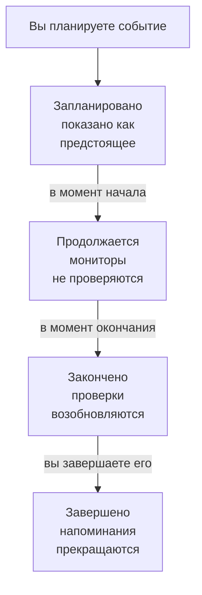

# Обзор планового обслуживания

Событие планового обслуживания заранее сообщает всем о запланированных работах: обновлении базы данных, изменении сети, переезде на новые серверы. OneUptime начинает и заканчивает событие вовремя, перестаёт проверять затронутые мониторы, пока идут работы, и показывает событие на ваших страницах статуса, чтобы запланированный простой никогда не выглядел как сбой. На этой странице объясняется, как проходит событие, где всё находится в панели управления и что событие меняет в остальном OneUptime.

:::cards
- [Как проходит событие](#как-проходит-событие): От запланированного до завершённого, в основном само по себе.
- [Откуда берутся события](#откуда-берутся-события): Форма, шаблоны, расписание, формы, чат и код.
- [На что влияет событие](#на-что-влияет-событие): Мониторы, страницы статуса, подписчики и оповещения.
- [Собственные страницы события](#собственные-страницы-события): Его обзор, хронология, заметки и настройки.
:::

## Как проходит событие

У каждого события есть запланированное окно, его **Начинается** и **Заканчивается**, и оно движется вниз по вашему списку состояний обслуживания. Задание, которое запускается каждую минуту, переводит его дальше на обеих границах окна, так что вы планируете работы один раз, а OneUptime делает остальное.

Новое событие начинается в состоянии **Запланировано**. В момент **Начинается** оно переходит в **Продолжается**: OneUptime перестаёт проверять его мониторы и, если вы выбрали для них статус, показывает их в этом статусе. В момент **Заканчивается** оно переходит в **Закончено**: проверки возобновляются, и каждый монитор возвращается в рабочее состояние. **Завершено** — последний шаг, и само событие туда не переходит: человек, кнопка в чате или API отмечают работы как принятые, что также прекращает напоминания владельцам.

Вы можете начать или закончить событие досрочно либо добавить собственные состояния между этими четырьмя. См. [Состояния обслуживания](/docs/scheduled-maintenance/states).

## Обслуживание и объявления

И то и другое сообщает что-то посетителям ваших страниц статуса. Используйте событие обслуживания для работ с началом и концом, а объявление — для всего остального, что им стоит прочитать.

|                              | Плановое обслуживание                                                   | Объявление                                     |
| ---------------------------- | ----------------------------------------------------------------------- | ---------------------------------------------- |
| **Что это**                  | Запланированные работы с окном                                          | Сообщение для посетителей ваших страниц статуса |
| **Его мониторы**             | Не проверяются, пока оно идёт, и показываются в выбранном вами статусе  | Не меняются                                    |
| **Как оно продвигается**     | По вашим состояниям обслуживания, вовремя                               | Показывается от времени начала до времени окончания, если оно задано |
| **Когда уведомляют подписчиков** | Когда оно запланировано, начинается и заканчивается, а также перед началом, если вы попросите | Один раз, когда оно начинает показываться |
| **Номера в новом проекте**   | `SM-42`                                                                 | Нет                                            |

Объявления описаны на странице [Подписчики и объявления](/docs/status-pages/subscribers#объявления).

## Откуда берутся события

- **Форма создания.** Нажмите **Создать событие планового обслуживания** в списке событий или на вкладке **Плановое обслуживание** хоста, кластера, сервиса, сетевой площадки или другого ресурса — тогда этот ресурс будет выбран за вас. См. [Создание событий обслуживания](/docs/scheduled-maintenance/creating-events).
- **Шаблон.** **Создать из шаблона** заполняет форму по шаблону, сохранённому для работ, которые вы проводите часто. См. [Шаблоны и повторяющиеся события](/docs/scheduled-maintenance/templates).
- **Расписание.** Повторяющийся шаблон создаёт новое событие по расписанию, например каждую неделю или каждый месяц, и никому не нужно открывать форму.
- **Форма заявки.** Форма, отправки которой создают события обслуживания, превращает запрос на изменение в событие. См. [Что создаёт отправка](/docs/forms/on-submit#как-отправка-становится-событием-планового-обслуживания).
- **Чат.** `/oneuptime maintenance` в Slack или `maintenance`, отправленное боту OneUptime в Microsoft Teams, открывает форму прямо в вашем чате. См. [Slack](/docs/workspace-connections/slack#создание-инцидентов-и-обслуживания-из-slack).
- **Код.** API по адресу `/api/scheduled-maintenance`, ресурс Terraform `oneuptime_scheduled_maintenance_event` и шаг рабочего процесса **Create One Scheduled Maintenance Event**.

## Где обслуживание находится в панели управления

Откройте **Плановое обслуживание** из меню **Продукты** на верхней панели. Список событий находится по адресу `/dashboard/{projectId}/scheduled-maintenance-events`, а его боковое меню содержит всё, что касается обслуживания:

| Раздел        | Что вы там делаете                                                                                                         |
| ------------- | -------------------------------------------------------------------------------------------------------------------------- |
| **Обзор**     | **Все события** и **Текущие события**; значок второго пункта показывает число событий, идущих прямо сейчас.                 |
| **Календарь** | **Календарь обслуживания**: каждое событие на месяце, неделе или дне рядом с добавленными вами календарями извне проекта. |
| **Рабочее пространство** | **Slack** и **Microsoft Teams** — те, что подключены в проекте, — или **Подключить Slack или Teams**, если не подключено ни то, ни другое. |
| **Правила**   | **Правила владельца**, **Правила runbook-ов**, **Правила меток**, **Reminder Rules**.                                       |
| **Настройки** | **Состояние события**, **Шаблоны событий**, **Шаблоны заметок**, **Пользовательские поля**, **Измерения**, **Настройки календаря**, **Нумерация**. |

Разделы **Обзор** и **Календарь** открыты; **Рабочее пространство**, **Правила**, **Настройки** и **Для разработчиков** сначала свёрнуты, а раздел раскрывается сам, когда вы находитесь на одной из его страниц. **Для разработчиков** содержит **Terraform**, **API** и **ИИ-ассистенты** для управления обслуживанием из кода. Всё, что касается обслуживания, находится здесь, а не в разделе **Настройки проекта**.

Список показывает **Номер планового обслуживания**, **Заголовок**, **Текущее состояние**, **Затронутые ресурсы**, **Отображается на странице статуса**, **Начинается**, **Длительность**, **Заканчивается**, **Метки** и **Владельцы**. Выберите события, чтобы действовать сразу с несколькими: **Отметить как «{{state}}»**, **Изменить состояние**, **Назначить мне**, **Add Owner**, **Remove Owner**, **Add Labels**, **Remove Labels** или **Удалить**. Меню **⋯** в конце строки каждого события делает то же самое для одного этого события: шаги **Отметить как «{{state}}»**, пока событие может их сделать, **Изменить состояние**, **Назначить мне**, пока вы не стали его владельцем, и **Add Owner**.

**Календарь обслуживания** в разделе **Календарь** показывает те же события на месяце, неделе или дне и может показывать рядом календари извне проекта. См. [Календарь обслуживания](/docs/scheduled-maintenance/calendar).

## На что влияет событие

Пока событие идёт, OneUptime считает запланированный им сбой ожидаемым:

- **Его мониторы не проверяются.** Каждый монитор в поле **Мониторы** перестаёт проверяться, а на его страницах написано **Этот монитор отключён**. Если вы выбрали **Изменить статус монитора на**, мониторы показывают этот статус, в том числе на ваших страницах статуса. Когда событие заканчивается или удаляется, проверки возобновляются, и каждый монитор возвращается в рабочее состояние, если его не удерживает другое идущее событие.
- **Его другие ресурсы молчат.** Телеметрический монитор, который следит за множеством хостов, кластеров, баз данных или сервисов, по одному ряду на каждый, не создаёт ни инцидента, ни оповещения для ряда, ресурс которого покрывает событие, а остальные ряды продолжают оповещать.
- **Сетевые площадки и SLO сдерживаются.** Сетевая площадка, которую покрывает событие, перестаёт засчитывать свой плановый простой площадкам над ней, а правила скорости расхода бюджета SLO ничего не создают, пока какой-либо из его мониторов находится на обслуживании. См. [Сетевые площадки](/docs/monitor/network-sites#плановое-обслуживание-для-сетевых-площадок) и [Оповещения и инциденты по скорости расхода бюджета](/docs/slo/burn-rate-alerts#плановое-обслуживание).
- **Ваши страницы статуса показывают его.** Событие появляется на выбранных вами страницах статуса — сначала как предстоящее, затем как идущее, затем как прошедшее, — пока на его странице **Настройки** включено **Видно на странице статуса**.
- **Подписчики узнают о нём.** По умолчанию подписчики этих страниц получают уведомление, когда событие запланировано, когда оно начинается и когда заканчивается, а также напоминание перед началом, если вы настроили напоминания. См. [Плановые работы](/docs/status-pages/subscribers#плановые-работы).
- **Ваша команда узнаёт о нём.** Его владельцы получают уведомления согласно своим [настройкам уведомлений](/docs/notifications/notification-settings), а правила Slack и Microsoft Teams в разделе **Рабочее пространство** публикуют его в ваших каналах.

## Собственные страницы события

Откройте событие из списка, чтобы увидеть его страницы. Его боковое меню содержит:

| Раздел бокового меню | Страницы                                                                                   |
| ----------------- | --------------------------------------------------------------------------------------------- |
| **Обзор** | **Обзор**, **Хронология состояний**, **Описание**, **Сборники инструкций** |
| **Команда** | **Владельцы** |
| **Уведомления**       | **Журналы уведомлений** и **Журналы ИИ**: каждое сообщение, отправленное о событии, и что ИИ сделал для него |
| **Заметки**       | **Приватные заметки** и **Публичные заметки**                                                  |
| **Для разработчиков** | **Terraform**, **API** и **ИИ-ассистенты**: событие под управлением кода                  |
| **Расширенный**   | **Пользовательские поля**, **Настройки**, **Журналы аудита**, **Удалить событие**             |

Разделы **Обзор**, **Команда** и **Заметки** открыты; остальные разделы свёрнуты, пока вы их не нажмёте.

- **Обзор** — заголовок показывает номер, название и состояние события, сколько осталось до начала или сколько оно уже идёт, кому оно принадлежит, на каких страницах статуса оно показано и кто его создал, и кнопки, которые переводят его дальше. Под ним **Начинается**, **Заканчивается** и **Длительность** показывают запланированное окно в вашем часовом поясе. **Запланированный Обслуживание Лента** записывает всё, что происходило с событием, рядом с карточками **Maintenance Details** и **Затронутые ресурсы**, а также карточками **Измерения** и **Пользовательские поля**, если они есть в вашем проекте.
- **Хронология состояний** — каждое состояние, в котором было событие, когда и как долго. См. [Состояния обслуживания](/docs/scheduled-maintenance/states#хронология-состояний).
- **Публичные заметки** — новости для ваших страниц статуса и их подписчиков. **Приватные заметки** — только для вашей команды.
- **Настройки** — **Видно на странице статуса**, что показывает или скрывает событие на его страницах статуса, и **Отправлять напоминания**, что напоминает о нём владельцам, пока оно не будет завершено. Каждый переключатель сохраняется в тот момент, когда вы его переключаете.

## Устранение неполадок

:::details Событие не началось в момент Начинается
Задание, которое начинает события, запускается каждую минуту, поэтому подождите минуту. Если в заголовке написано **Начало задерживается**, событие пропустило начало больше чем на две минуты: начните его кнопкой в заголовке, которая делает всё, что делает задание, и откройте его страницу **Хронология состояний**, чтобы увидеть, где оно находилось.
:::

:::details Монитор всё равно проверялся во время обслуживания
Перестают проверяться только мониторы, которые событие называет в поле **Мониторы**, и только пока событие идёт. Монитор хоста или сервиса, который событие называет в поле **Другие затронутые ресурсы**, по-прежнему проверяется. Отредактируйте карточку события **Затронутые ресурсы**, чтобы добавить монитор.
:::

:::details Событие не отображается на моей странице статуса
Проверьте, что событие называет страницу в поле **Показывать событие на этих страницах статуса** и что на странице события **Настройки** включено **Видно на странице статуса**. Затем проверьте саму страницу статуса: она должна показывать события планового обслуживания, а событие, начавшееся раньше окна истории страницы, 14 дней, если вы его не меняли, больше не отображается.
:::

## Дальнейшие шаги

:::cards
- [Создание событий обслуживания](/docs/scheduled-maintenance/creating-events): Форма, поле за полем, и что происходит дальше.
- [Состояния обслуживания](/docs/scheduled-maintenance/states): Что начинает и заканчивает событие, и собственные состояния.
- [Шаблоны и повторяющиеся события](/docs/scheduled-maintenance/templates): Используйте событие повторно или планируйте его каждую неделю.
- [Правила и настройки обслуживания](/docs/scheduled-maintenance/settings): Владельцы, метки, runbook-и и напоминания — автоматически.
:::
