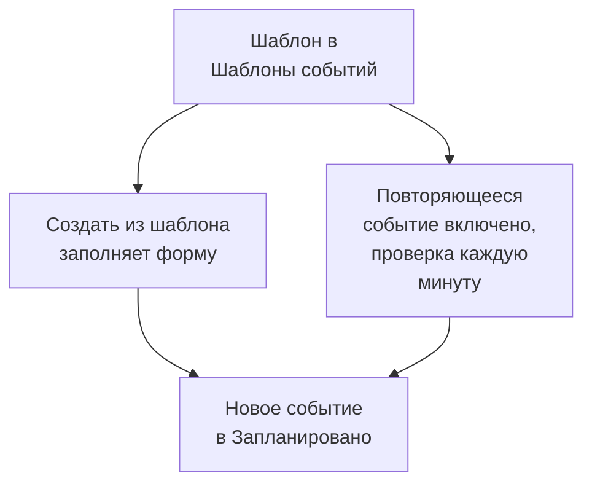

# Шаблоны и повторяющиеся события

Шаблон планового обслуживания сохраняет событие, которое вы часто планируете: его заголовок и описание, мониторы, которые оно приостанавливает, страницы статуса, на которых оно показывается, и тех, кто получает уведомления. Используйте шаблон, чтобы заполнить форму одним нажатием, или сделайте его повторяющимся, чтобы OneUptime сам планировал событие каждую неделю, каждый месяц или с любым выбранным вами интервалом.

:::cards
- [Создайте шаблон](#создайте-шаблон): Шаги формы, с названием в начале и расписанием в конце.
- [Используйте шаблон](#используйте-шаблон): Заполните по нему новое событие.
- [Повторяющиеся события](#повторяющиеся-события): Пусть OneUptime сам планирует событие.
- [Измените или остановите шаблон](#измените-или-остановите-шаблон): Отредактируйте его, приостановите расписание или удалите.
:::

## Как это работает

Шаблон — это отправная точка. Событие, созданное по нему, — копия со своими значениями: если позже изменить шаблон, изменятся только события, созданные после этого.

## Перед началом

- **Ваш тариф.** В OneUptime Cloud для шаблонов нужен тариф **Growth** или выше.
- **Ваша роль.** Для создания шаблона нужна роль **Владелец проекта**, **Администратор проекта**, **Участник проекта**, **Администратор планового обслуживания** или **Участник планового обслуживания** либо пользовательская роль, которой разрешено создавать шаблоны планового обслуживания.

## Создайте шаблон

:::steps
### Откройте шаблоны

Перейдите в **Плановое обслуживание → Настройки → Шаблоны событий**. Раздел **Настройки** в боковом меню сначала свёрнут: сначала раскройте его. Нажмите **Создать: Запланированный Обслуживание Шаблон**.

### Назовите шаблон

На шаге **Информация о шаблоне** задайте **Название шаблона** и **Описание шаблона**, чтобы ваша команда знала, когда его использовать. Оба поля обязательны.

### Опишите событие

На шаге **Событие** заполните **Заголовок** и **Описание**, с которых начинается каждое событие по шаблону. **Владельцы** и **Метки** ждут в блоке **Дополнительные поля**.

### Выберите, что затрагивается

На шаге **Затронутые ресурсы** выберите **Мониторы**, **Изменить статус монитора на** для них, **Другие затронутые ресурсы**, если они есть, страницы статуса в поле **Показывать событие на этих страницах статуса** и **Уведомления подписчиков**.

### Решите, повторяется ли событие

На шаге **Повторяющееся** оставьте **Повторяющееся событие** выключенным для шаблона, который вы используете вручную, или включите его и заполните расписание. Нажмите **Далее**, чтобы просмотреть проверку, а затем создайте шаблон.
:::

Шаблон спрашивает **Изменить статус монитора на**, даже если в нём нет мониторов: статус также применяется к мониторам, которые вы добавите, когда запланируете событие по нему. В поле **Другие затронутые ресурсы** шаблон принимает хосты, кластеры Kubernetes, хосты Docker, хосты Podman и сервисы.

## Что заполняет шаблон

| Часть события                                     | Создать из шаблона                   | Повторяющееся событие           |
| ------------------------------------------------- | ------------------------------------ | ------------------------------- |
| **Заголовок** и **Описание**                      | Заполнены, и их можно изменить       | Скопированы                     |
| **Мониторы** и **Изменить статус монитора на**    | Заполнены                            | Скопированы                     |
| **Другие затронутые ресурсы**                     | Заполнены                            | Скопированы                     |
| Страницы статуса и **Уведомления подписчиков**    | Заполнены                            | Скопированы                     |
| **Владельцы** и **Метки**                         | Заполнены                            | Скопированы                     |
| **Начинается** и **Заканчивается**                | Следующий целый час, на один час     | Рассчитаны по расписанию        |

## Используйте шаблон

:::steps
### Выберите шаблон

На странице **Плановое обслуживание → Все события** нажмите **Создать из шаблона** и выберите шаблон в окне **Выберите шаблон планового обслуживания**.

### Проверьте форму

Нажмите **Создать из шаблона**. Форма создания откроется с уже заполненными ответами шаблона. Задайте окно и измените всё, что нужно этому событию.

### Создайте событие

Пройдите шаги с помощью **Далее**, а затем нажмите **Создать событие планового обслуживания** на странице проверки.
:::

Если в проекте ещё нет шаблонов, **Создать из шаблона** сообщает об этом и даёт ссылку на **Шаблоны событий**.

## Повторяющиеся события

Повторяющийся шаблон создаёт событие по расписанию. Вы задаёте, когда создаётся первое событие, когда оно начинается и когда заканчивается; каждое следующее событие сохраняет те же промежутки, на один интервал позже.

| Поле                                                     | Что оно означает                                                                                   |
| -------------------------------------------------------- | -------------------------------------------------------------------------------------------------- |
| **Повторяющееся событие**                                | Включает расписание.                                                                               |
| **Первое событие запланировано на**                      | Когда OneUptime создаёт первое событие, то есть когда его подписчики узнают, что оно запланировано. |
| **Первое событие начинается в**                          | Когда начинается первое событие.                                                                   |
| **Первое событие заканчивается в**                       | Когда заканчивается первое событие.                                                                |
| **Как часто вы хотите, чтобы это событие повторялось?**  | Число и единица: часы, дни, недели, месяцы или годы.                                               |

Например, еженедельное окно, где первое событие создаётся в понедельник на ближайшую субботу:

| Событие      | Создано            | Начинается         | Заканчивается      |
| ------------ | ------------------ | ------------------ | ------------------ |
| Первое       | `2030-06-03 09:00` | `2030-06-08 02:00` | `2030-06-08 04:00` |
| Второе       | `2030-06-10 09:00` | `2030-06-15 02:00` | `2030-06-15 04:00` |

Задайте **Первое событие запланировано на** настолько раньше начала, насколько заранее ваши клиенты должны узнать о работах. При создании шаблона все три времени должны быть в будущем, событие должно создаваться до начала и окончания, а начинаться — до окончания; форма сообщает, какое правило нарушает время.

Задание проверяет повторяющиеся шаблоны каждую минуту. Когда наступает следующее время шаблона, оно сдвигает это время на один интервал и создаёт событие. Список шаблонов показывает это время в столбце **Повторяющееся событие**, а для шаблона, который не повторяется, — **Нет**. Событие, созданное по расписанию, ничем не отличается от других: его правила выполняются, его владельцы добавляются, а его подписчики узнают, что оно запланировано.

## Измените или остановите шаблон

Откройте шаблон из списка, чтобы увидеть его страницу:

- **Сведения о шаблоне планового обслуживания** показывает, с чего начинаются новые события. Его **Редактировать** проходит шаги **Информация о шаблоне**, **Событие**, **Страницы состояния** и **Повторяющееся**.
- **Затронутые ресурсы** содержит его **Мониторы**, их **Изменить статус монитора на** и его **Другие затронутые ресурсы**, со своим **Редактировать**.
- **Владельцы** перечисляет людей и команды, которые владеют каждым событием, запланированным по шаблону.

Изменения применяются к событиям, созданным после их сохранения; уже созданные события сохраняют свои значения. Чтобы остановить расписание, выключите **Повторяющееся событие** в **Редактировать** или удалите шаблон. Выключенный шаблон сохраняет своё расписание: включите его снова, и он продолжит со следующего времени расписания, пропустив время, пока был выключен. При удалении шаблона созданные им события остаются.

## Устранение неполадок

:::details При создании повторяющегося шаблона сказано, что время должно быть в будущем
Все три первых времени при создании шаблона должны быть позже текущего момента. Сдвиньте их вперёд: затем расписание продолжится от первого события.
:::

:::details Повторяющийся шаблон не создал событие
Проверьте, что **Повторяющееся событие** всё ещё включено, и посмотрите на время в столбце списка **Повторяющееся событие**: событие создаётся в это время, а не в момент своего начала. Задание запускается каждую минуту, поэтому подождите минуту.
:::

:::details У события из шаблона нет выбранного мной ресурса
В поле **Другие затронутые ресурсы** шаблон принимает хосты, кластеры Kubernetes, хосты Docker, хосты Podman и сервисы. Другие виды ресурсов добавьте к самому событию с помощью **Редактировать** на его карточке **Затронутые ресурсы**.
:::

## Дальнейшие шаги

:::cards
- [Создание событий обслуживания](/docs/scheduled-maintenance/creating-events): Форма, которую заполняет шаблон.
- [Состояния обслуживания](/docs/scheduled-maintenance/states): Как каждое событие движется дальше после создания.
- [Правила и настройки обслуживания](/docs/scheduled-maintenance/settings): Автоматически добавляйте владельцев и метки к каждому новому событию.
- [Обзор планового обслуживания](/docs/scheduled-maintenance/index): Место шаблонов среди остальных возможностей обслуживания.
:::
