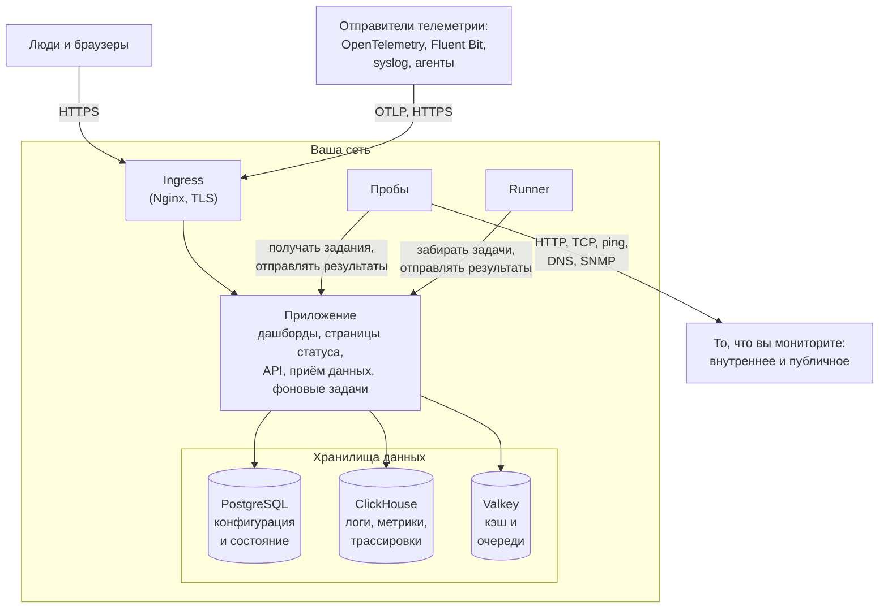

# Архитектура

Самостоятельно размещённая установка OneUptime — это несколько контейнеров: один ingress, через который входит каждый запрос, один образ приложения, который делает всю работу, пробы, выполняющие проверки ваших мониторов, и три хранилища данных. Эта страница показывает, как они связаны, что делает каждый компонент и какие соединения пересекают границу вашей сети.

## Что здесь показано

- Люди попадают в OneUptime через **ingress**, который завершает TLS и направляет каждый запрос в приложение: Dashboard, страницы статуса, API и все эндпоинты приёма, на которые отправляется телеметрия.
- **Приложение** читает и записывает своё состояние в PostgreSQL, хранит телеметрию в ClickHouse и использует Valkey (форк Redis 7.2 под лицензией BSD) как кэш и для очередей, которые обрабатывают его фоновые задачи.
- **Пробы** могут работать внутри вашего кластера (рекомендуется) и/или в другом месте вашей сети. Они могут мониторить:
  - Внутренние/частные сервисы за вашим межсетевым экраном.
  - Внешние/публичные ресурсы в интернете.
- Результаты проб отправляются в приложение, ставятся в очередь в Valkey и обрабатываются фоновыми задачами в ваши хранилища данных. Проба в другом месте вашей сети обращается к приложению через ingress, по вашему URL OneUptime.
- Телеметрию (метрики, трассировки, логи и другое) принимает то же приложение, а хранится она в ClickHouse.

> [!NOTE]
> Если вместо встроенных вы используете внешние PostgreSQL, Valkey (или Redis) либо ClickHouse, приложение подключается к вашим внешним эндпоинтам. Логическая схема остаётся прежней.

## Компоненты

| Компонент | Сервис Docker Compose | Чарт Helm | Что делает |
| --- | --- | --- | --- |
| Ingress | `ingress` | `nginx` | Завершает TLS, обслуживает ваше имя хоста и домены страниц статуса и направляет каждый запрос в приложение. |
| Приложение | `app` | `app` | Dashboard, страницы статуса, эндпоинты API и приёма данных и, если вы их не вынесли отдельно, фоновые задачи. |
| Worker | Часть `app` | `worker` (по умолчанию выключен) | Фоновые задачи в собственных подах, чтобы тяжёлая обработка очередей никогда не конкурировала с запросами к API. |
| Telemetry writer | Часть `app` | `telemetryWriter` (по умолчанию выключен) | Слой фиксированного размера, который выполняет каждую вставку в ClickHouse, чтобы число вставок оставалось ограниченным, как бы ни масштабировались воркеры. |
| Проба | `probe-1` | `probes` | Выполняет проверки мониторов и отправляет результаты обратно. Каждая встроенная проба — глобальная проба, которой могут пользоваться все проекты. |
| Runner | `runner` | `runner` | Собственный Runner экземпляра, который может выполнять исправления кода с помощью ИИ для любого проекта. Шаги runbook-ов выполняются на [Runner'ах](/docs/runbooks/agents), которые вы устанавливаете там, где они должны работать. |
| PostgreSQL | `postgres` | `postgresql` или `postgresOperator.cnpg` | Проекты, мониторы, инциденты, пользователи и все прочие настройки и состояния. |
| ClickHouse | `clickhouse` | `clickhouse` или `clickhouseOperator.altinity` | Логи, метрики, трассировки, исключения, профили и логи мониторов. |
| Valkey | `valkey` | `valkey` | Кэш, очереди задач и краткоживущее состояние, например ожидающие квитанции push. |

Все роли приложения — один и тот же образ: Docker Compose запускает их в одном контейнере `app`, а чарт Helm может запускать worker и telemetry writer как отдельные развёртывания. О том, как подобрать размер каждого слоя, см. [Подбор размеров и планирование мощностей](/docs/installation/sizing).

## Соединения за пределы вашей сети

Приложение выходит наружу только ради того, что вы включили. Каждое из этих соединений необязательно, и для каждого есть страница с точными адресами, которые нужно разрешить:

| Исходящее соединение | Для чего | Подробнее |
| --- | --- | --- |
| Почта (SMTP или API SendGrid) | Уведомления и приглашения | [SMTP](/docs/emails/smtp) |
| Twilio | SMS и телефонные звонки | [Интеграция с Twilio](/docs/self-hosted/twilio-integration) |
| Push-ретранслятор OneUptime или Expo | Мобильные push-уведомления | [Push-уведомления](/docs/self-hosted/push-notifications) |
| Slack и Microsoft Teams | Уведомления и действия в рабочем пространстве | [Интеграция со Slack](/docs/self-hosted/slack-integration) |
| Поставщик LLM, например OpenAI, Anthropic, Microsoft Foundry или модель, которую вы запускаете сами | OneUptime AI | [Поставщики LLM](/docs/ai/llm-provider) |
| `oneuptime.com` | Онлайн-активация лицензии Enterprise | [Редакция Enterprise](/docs/self-hosted/enterprise) |

Соединениям в обратную сторону — SendGrid доставляет входящую почту, Slack и Microsoft Teams делают обратные вызовы — нужно, чтобы ingress был доступен из интернета. Какие частные адреса могут достигать приложение и пробы, решаете вы: см. [Доступ к частной сети](/docs/self-hosted/private-network-access).

## Дальнейшие шаги

:::cards
- [Docker Compose](/docs/installation/docker-compose): Установите все компоненты на одну машину.
- [Подбор размеров и планирование мощностей](/docs/installation/sizing): Сколько CPU, памяти и диска нужно каждому слою.
- [Собственные пробы](/docs/probe/custom-probe): Запустите пробу внутри другой сети.
- [Редакция Enterprise](/docs/self-hosted/enterprise): Что добавляют образы Enterprise и как устроено лицензирование.
:::
