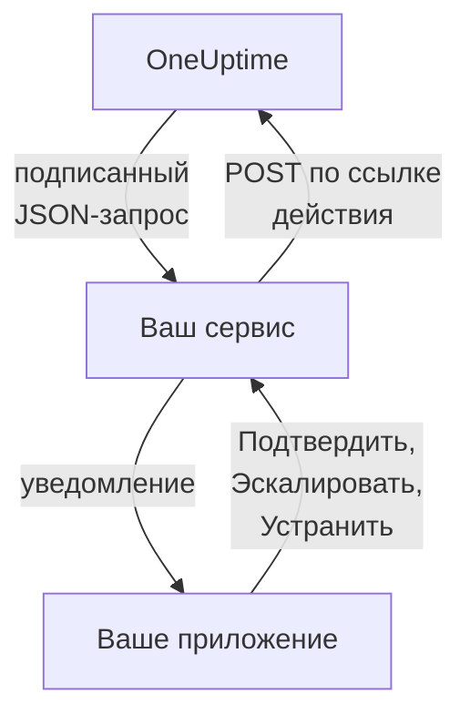

# Пользовательские каналы уведомлений

Пользовательский канал отправляет вызовы дежурных в сервис, который работает у вас: собственное приложение вашей компании, пейджинговую систему или шлюз, который проверяет всё, что покидает вашу сеть. Вы добавляете его один раз для всего сервера, и через него можно вызывать любого, ничего не настраивая. В Admin Dashboard они называются **Custom Channels**.

> [!NOTE]
> Пользовательские каналы входят в [OneUptime Enterprise Edition](/docs/self-hosted/enterprise) и требуют лицензии Enterprise, которая их включает. В Community Edition нет страницы **Custom Channels**, и она ничего не отправляет в каналы. См. [Без лицензии](#без-лицензии).

:::cards
- [Добавление канала](#добавление-канала): Имя, URL и секрет подписи.
- [Что получает ваш сервис](#что-получает-ваш-сервис): Один подписанный JSON-запрос на человека и вызов.
- [Действия с вызовом](#действия-с-вызовом): Подтверждайте, эскалируйте или устраняйте прямо из своего приложения.
- [Доставка и повторы](#доставка-и-повторы): Что происходит, когда ваш сервис недоступен.
- [Другие уведомления](#другие-уведомления): Уведомления владельцам, о заметках и сменах, для тех, кому они нужны.
- [Без лицензии](#без-лицензии): Что останавливается и что сохраняется.
:::

## Как это работает



Когда политика дежурства вызывает человека, а его правило дежурства использует канал, OneUptime отправляет запрос на URL канала. В нём сказано, кому адресован вызов (имя и электронная почта) и чего он касается, а также есть ссылки, которые ваш сервис вызывает, когда человек подтверждает, эскалирует или устраняет его в вашем приложении.

## Добавление канала

1. В Admin Dashboard откройте **Настройки**, затем **Custom Channels**, и выберите **Add**.
2. На шаге **Channel** заполните:
   - **Имя**: то, что люди видят в своих методах уведомлений и правилах дежурства, например `CorpoApp`.
   - **Webhook URL**: куда OneUptime отправляет каждый вызов. Он может находиться в вашей частной сети.
   - **Signing Secret**: OneUptime создаёт его за вас. Скопируйте его в свой сервис, который проверяет им каждый запрос. Его можно снова увидеть, открыв канал на редактирование.
3. На шаге **Delivery** сохраните, а затем выберите **Send test**, чтобы отправить вашему сервису [тестовый запрос](#тестовые-запросы).

На шаге **Delivery** включено **Page everyone through this channel**. Тогда OneUptime добавляет канал в правила дежурства всех людей в каждом проекте, а также в правила всех, кто присоединится к проекту позже, и через него связывается с дежурным, у которого нет правила для сработавшего события. Выключите это, чтобы люди сами добавляли канал в свои правила.

Люди видят канал в разделе **Настройки пользователя**, затем **Методы уведомлений**, затем **Custom Channels**, с кнопкой **Send test**, и выбирают его в своих правилах дежурства как `Custom Channel: CorpoApp`. Им ничего не нужно настраивать: ваш сервис узнаёт, кому адресован каждый вызов.

Чтобы прекратить отправку, не меняя ничьих правил, откройте канал на редактирование и выключите **Включено**. Вызовы, которые ушли бы в него, записываются в журнал дежурств как неотправленные. Удаление канала удаляет все правила дежурства, которые его используют.

## Что получает ваш сервис

Каждый вызов — это запрос `POST` с телом в формате JSON:

| Заголовок | Что в нём |
| --- | --- |
| `Content-Type` | `application/json` |
| `X-OneUptime-Event` | Событие, например `on-call.incident.created` |
| `X-OneUptime-Signature` | `sha256=` и шестнадцатеричный HMAC-SHA256 необработанного тела, вычисленный с секретом подписи канала |

```json title="An incident page"
{
  "version": 1,
  "event": "on-call.incident.created",
  "notificationId": "5f2c8a1e-6b1d-4c3a-9e7f-2a4b6c8d0e1f",
  "sentAt": "2026-10-27T03:14:15.000Z",
  "channel": { "id": "0b7e…", "name": "CorpoApp" },
  "title": "New Incident INC-42: API latency high",
  "message": "A new incident has been created: INC-42 (API latency high) in Agency A. Click to view details.",
  "project": { "id": "8d1f…", "name": "Agency A" },
  "team": { "id": "2c9a…", "name": "SRE" },
  "user": { "id": "4e6b…", "name": "Jane Tan", "email": "jane@example.com" },
  "recordType": "incident",
  "record": {
    "id": "9a3c…",
    "number": "INC-42",
    "title": "API latency high",
    "description": "p95 latency above 2 seconds for 5 minutes.",
    "severity": "Critical",
    "state": "Created",
    "url": "https://oneuptime.example.com/dashboard/8d1f…/incidents/9a3c…"
  },
  "onCallPolicy": { "id": "1d4e…", "name": "Primary" },
  "escalationRule": { "id": "7b2f…", "name": "Level 1" },
  "isPageAgain": false,
  "actions": {
    "acknowledge": "https://oneuptime.example.com/api/custom-notification-channel/page/5f2c…/acknowledge?token=…",
    "escalate": "https://oneuptime.example.com/api/custom-notification-channel/page/5f2c…/escalate?token=…",
    "resolve": "https://oneuptime.example.com/api/custom-notification-channel/page/5f2c…/resolve?token=…"
  }
}
```

| Поле | Что это |
| --- | --- |
| `version` | `1`. В эту версию поля только добавляются. |
| `event` | `on-call.incident.created`, `on-call.alert.created`, `on-call.incidentEpisode.created`, `on-call.alertEpisode.created`, `notification` для [других уведомлений](#другие-уведомления) или `test` |
| `notificationId` | Один на человека и вызов. Используйте его, чтобы отбросить запрос, который вы уже обработали. |
| `title`, `message` | Готовы к показу — так, как их показало бы push-уведомление |
| `user` | Кому адресован вызов. Найдите его учётную запись в своём приложении по `email` или `id`. |
| `team` | Команда, через которую человека вызвали, или `null`, если его вызвали напрямую |
| `recordType`, `record` | Чего касается вызов: `incident`, `alert`, `incidentEpisode` или `alertEpisode` |
| `onCallPolicy`, `escalationRule` | Политика и уровень, которые вызвали человека |
| `isPageAgain` | `true`, если запись была подтверждена некоторое время назад и всё ещё не устранена |
| `actions` | Ссылки, которые ваш сервис вызывает, чтобы [выполнить действие с вызовом](#действия-с-вызовом) |

Вызов нескольких человек — это отдельный запрос на каждого, у каждого свои ссылки, чтобы OneUptime знал, кто ответил. Заголовок, сообщение и описание вместе ограничены 16 384 символами; более длинное описание обрезается и заканчивается на «… (truncated — see OneUptime for the full text)».

### Проверка подписи

Вычислите HMAC необработанного тела запроса до его разбора и сравните его с заголовком:

```javascript title="Node.js"
const crypto = require("crypto");

function isFromOneUptime(rawBody, signatureHeader, secret) {
  const expected =
    "sha256=" + crypto.createHmac("sha256", secret).update(rawBody).digest("hex");
  const received = String(signatureHeader || "");

  return (
    received.length === expected.length &&
    crypto.timingSafeEqual(Buffer.from(received), Buffer.from(expected))
  );
}
```

## Действия с вызовом

Когда человек нажимает кнопку в вашем приложении, ваш сервис отправляет запрос `POST` по соответствующей ссылке из `actions`. Ключ API не нужен: каждая ссылка несёт токен для одного этого вызова, действительный 7 дней, а действие записывается как выполненное вызванным человеком.

| Действие | Что оно делает |
| --- | --- |
| `acknowledge` | Подтверждает вызов этого человека, а вместе с ним инцидент, оповещение или эпизод |
| `escalate` | Человек не может взяться: сразу вызывает следующий уровень политики дежурства и перестаёт вызывать его |
| `resolve` | Устраняет инцидент, оповещение или эпизод, если собственные разрешения человека это позволяют |

```bash title="Acknowledge a page"
curl -X POST "https://oneuptime.example.com/api/custom-notification-channel/page/5f2c…/acknowledge?token=…"
```

Ответ сообщает, что произошло, словами, которые ваше приложение может показать как есть:

```json title="The answer"
{
  "action": "acknowledge",
  "result": "acknowledged",
  "message": "Acknowledged."
}
```

`result` принимает одно из значений `acknowledged`, `alreadyAcknowledged`, `escalated`, `notEscalated`, `resolved` и `alreadyResolved`. Просроченная или неверная ссылка отклоняется со статусом 4xx и сообщением.

## Другие уведомления

Вызовы — не единственные уведомления, которые получают люди: OneUptime также сообщает им, когда инцидент, которым они владеют, меняет состояние, когда публикуется заметка, когда начинается их дежурная смена, и о многом другом. Каждый сам выбирает, куда уходит каждое из них, в разделе **Настройки пользователя > Настройки уведомлений**, где есть столбец **Custom Channels**, пока включён хотя бы один канал. Он выключен у всех, пока человек сам его не включит.

Уведомление уходит в каждый включённый канал, одним запросом на канал, с `event`, равным `notification`:

```json title="A notification"
{
  "version": 1,
  "event": "notification",
  "notificationId": null,
  "sentAt": "2026-10-27T03:20:00.000Z",
  "channel": { "id": "0b7e…", "name": "CorpoApp" },
  "title": "Incident INC-42 acknowledged",
  "message": "Incident INC-42 (API latency high) was acknowledged in Agency A.",
  "project": { "id": "8d1f…", "name": "Agency A" },
  "team": null,
  "user": { "id": "4e6b…", "name": "Jane Tan", "email": "jane@example.com" },
  "recordType": null,
  "record": null,
  "onCallPolicy": null,
  "escalationRule": null,
  "isPageAgain": false,
  "actions": null,
  "notificationType": "Send incident state changed notification when I am the owner of the incident",
  "url": "https://oneuptime.example.com/dashboard/8d1f…/incidents/9a3c…"
}
```

`title` и `message` — это то, что сказало бы push-уведомление человека. `notificationType` называет настройку, по которой оно отправлено, а `url` ведёт к тому, чего оно касается, или равен `null`. Выполнять здесь нечего, поэтому `actions` равен `null`.

## Доставка и повторы

Запрос считается доставленным, когда ваш сервис отвечает статусом 2xx в течение 10 секунд. Запрос, на который он не ответил или ответил статусом 408, 429 или 5xx, отправляется снова через 1 секунду и ещё через 4 секунды: всего три попытки. При любом другом статусе 4xx повторной отправки нет.

Результат каждой попытки есть в журнале дежурств человека — с названием канала и статусом, которым ответил ваш сервис, но никогда с URL. Недоставленный вызов не останавливает политику дежурства: если никто не подтвердит, она эскалирует как обычно. Оставьте правило с электронной почтой или SMS дальше в своих правилах, если ваш сервис — единственный способ связаться с людьми.

## Тестовые запросы

**Send test** на странице Admin Dashboard или в методах уведомлений человека отправляет запрос с `event`, равным `test`, с нажавшим кнопку человеком в `user` и с `notificationId`, `record` и `actions`, равными `null`. Используйте его, чтобы проверить свой сервис до того, как придёт настоящий вызов.

## Без лицензии

Пользовательские каналы работают в течение 14-дневного пробного периода Enterprise Edition и 30-дневного льготного периода после истечения лицензии. После этого или с лицензией, которая их не включает:

- **В пользовательские каналы ничего не отправляется.** Вызов, который ушёл бы в канал, записывается в журнал дежурств человека как неотправленный, как и тест.
- **Каналы больше не предлагаются.** Они исчезают из методов уведомлений, правил дежурства и настроек уведомлений людей, а готовность и резервная доставка перестают их учитывать.
- **Страница доступна только для чтения.** Каналы можно просматривать и удалять, но не добавлять и не изменять, и никто не может направить на канал правило или настройку уведомлений.
- **Ничего не удаляется.** Каналы, а также правила дежурства и настройки, которые их используют, сохраняются.

Всё возобновляется, как только активирована лицензия, без перезапуска. Те, кто присоединился к проекту, пока пользовательские каналы были остановлены, не получают в своих правилах канала, который вызывает всех: они могут добавить его сами.
