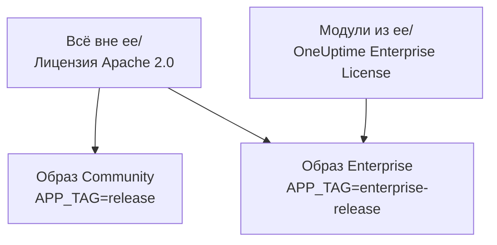
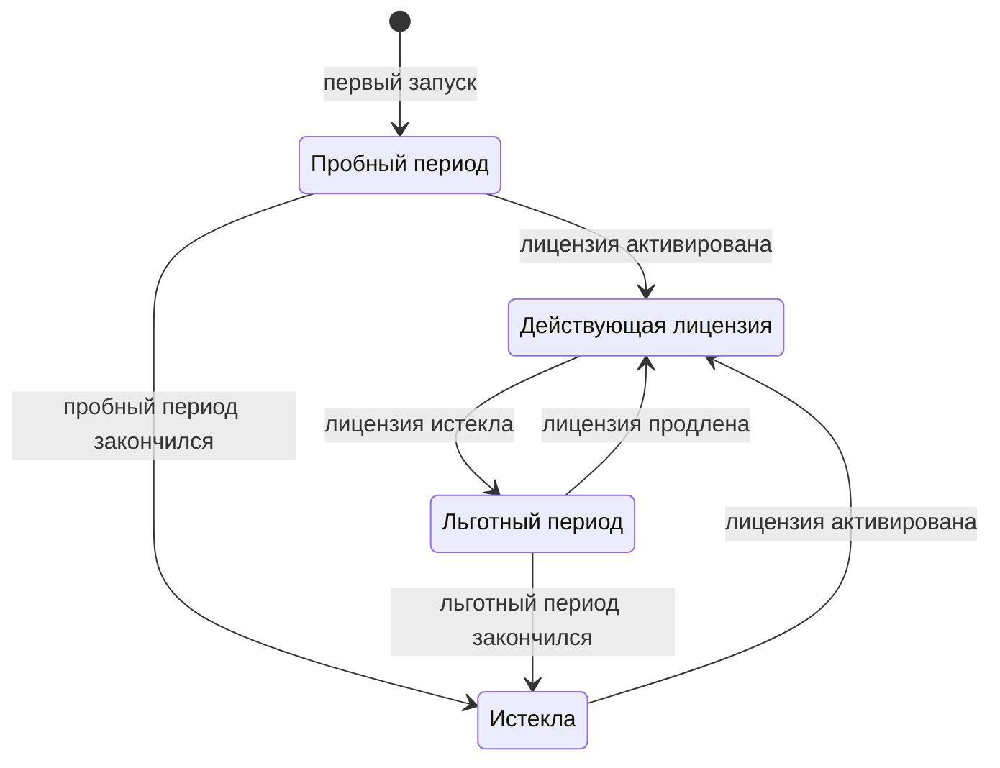

# Редакция Enterprise

OneUptime собирается из одного репозитория и поставляется в двух редакциях:

- **Community Edition**: вся платформа мониторинга, инцидентов и наблюдаемости, включая единый вход через SAML и OpenID Connect, с открытым исходным кодом под лицензией Apache 2.0 и бесплатная для самостоятельного размещения в любом масштабе.
- **Enterprise Edition**: Community Edition плюс корпоративные модули из каталога [`ee/`](https://github.com/OneUptime/oneuptime/tree/master/ee) репозитория. Эти модули добавляют подготовку учётных записей через SCIM, а также функции управления и администрирования экземпляра. Они распространяются по [OneUptime Enterprise License](https://github.com/OneUptime/oneuptime/blob/master/ee/LICENSE), и для использования в продакшене нужна лицензия Enterprise на ваше число пользователей.

Две редакции — это отдельные образы контейнеров. Образ Community не содержит кода из `ee/`. OneUptime Cloud работает на Enterprise Edition, и в облаке ваш тариф решает, какие из этих функций вы получаете.



> [!NOTE]
> **Единый вход есть в каждой редакции.** Вход через SAML и OIDC в проекты и на страницы статуса, глобальный SSO и «Require SSO for login» входят в Community Edition, и никакое состояние лицензии их не отключает.

На этой странице описано, что входит в каждую редакцию, как запустить Enterprise Edition, как устроено лицензирование и что происходит при смене редакции.

:::cards
- [Сравнить редакции](#что-входит-в-каждую-редакцию): Что добавляет Enterprise Edition.
- [Запустить образ Enterprise](#запуск-enterprise-edition): Одна настройка, в Kubernetes или Docker Compose.
- [Активировать лицензию](#лицензирование): Онлайн с ключом или без подключения к сети с подписанным токеном.
- [Когда лицензия истекает](#когда-лицензия-истекла-или-отсутствует): Что останавливается, что не останавливается никогда и как всё возвращается.
:::

## Что входит в каждую редакцию

| Функция | Community | Enterprise | OneUptime Cloud |
| --- | --- | --- | --- |
| Мониторинг, оповещения, инциденты, дежурства, страницы статуса, логи, метрики, трассировки, исключения, дашборды, рабочие процессы, функции ИИ, API и Terraform | Да | Да | Любой тариф |
| Вход по паролю, двухфакторная аутентификация, команды, роли и ключи API | Да | Да | Любой тариф |
| [SAML SSO и OpenID Connect](/docs/identity/sso) для входа в проекты | Да | Да | Тариф Scale и выше |
| SAML SSO и OpenID Connect для входа на частные страницы статуса | Да | Да | Тариф Scale и выше |
| [Глобальный SSO и OIDC (для всего экземпляра)](/docs/identity/global-sso) | Да | Да | Неприменимо |
| [Подготовка учётных записей через SCIM](/docs/identity/scim) для проектов и страниц статуса | Нет | Да | Тариф Scale и выше |
| Настройки соответствия команд | Нет | Да | Тариф Scale и выше |
| Журналы аудита | Нет | Да | Тариф Enterprise |
| Переопределения хранения: срок хранения по типу телеметрии (логи, трассировки, метрики, профили, с правилами по уровню важности лога и статусу трассировки), а также срок хранения для каждого сервиса и каждого ресурса | Нет | Да | Тариф Scale и выше |
| Дашборды **Health** в администрировании: обзор экземпляра, фоновые очереди, логи экземпляра, PostgreSQL, Valkey, кластер ClickHouse, диагностические логи и приём телеметрии | Нет | Да | Неприменимо |
| **Query Console** в администрировании | Нет | Да | Недоступно |
| Оповещения о состоянии PostgreSQL и Valkey (Redis) | Нет | Да | Неприменимо |
| Обзор ёмкости ClickHouse, оповещения о ёмкости и автоматическая очистка диска | Да | Да | Неприменимо |
| Статус миграций, пакет поддержки и глобальные пробы в панели администратора | Да | Да | Неприменимо |
| Управление лицензией Enterprise, местами и экземплярами | Нет | Да | Неприменимо |

Единый вход включает «Require SSO for login» для проектов, частных страниц статуса и всего экземпляра, в обеих редакциях.

В каждой редакции есть срок хранения телеметрии проекта по умолчанию, в разделе **Настройки проекта > Телеметрия и APM > Хранение данных**. Переопределения хранения — это то, что Enterprise Edition добавляет поверх него.

В OneUptime Cloud платную функцию всегда можно отключить, на любом тарифе. Переопределение хранения, которое осталось заданным после пробного периода (или перехода на более низкий тариф), продолжает применяться к новой телеметрии, поэтому ниже тарифа Scale страницы хранения показывают его под карточкой перехода на другой тариф с кнопкой **Удалить переопределение**. Удаление работает на любом тарифе; чтобы задать переопределение снова, нужен тариф Scale. Уже сохранённая телеметрия сохраняет тот срок хранения, с которым была сохранена. Точно так же раздел **Настройки проекта > Безопасность > SSO** показывает переключатель **Требовать SSO для входа** под своей карточкой перехода на другой тариф, пока проект ещё требует SSO, чтобы его можно было выключить.

Строки «Неприменимо» — это функции администрирования экземпляра. В OneUptime Cloud экземпляр обслуживает за вас OneUptime.

## Запуск Enterprise Edition

Обе редакции используют одну и ту же конфигурацию, одни и те же базы данных и одни и те же данные. Смена редакции меняет образ, который вы запускаете, и больше ничего. Миграция не нужна ни в одном направлении.

:::tabs
@tab Kubernetes
Задайте тип образа в своём `values.yaml`:

```yaml title="values.yaml"
image:
  type: enterprise-edition
```

Затем выполните обновление как обычно:

```bash
helm upgrade my-oneuptime oneuptime/oneuptime -f values.yaml
```

После этого чарт загружает вариант `enterprise-` каждого тега образа, например `oneuptime/app:enterprise-release`, или `enterprise-<version>`, если вы закрепляете `image.tag`. Задайте `image.type: community-edition` (значение по умолчанию), чтобы запустить Community Edition.
@tab Docker Compose
Задайте `APP_TAG` в своём `config.env`:

```bash title="config.env"
APP_TAG=enterprise-release
```

Чтобы закрепить релиз, используйте `enterprise-<version>`. Затем загрузите образы и перезапустите:

```bash
npm run update
```

Чтобы вернуться к Community Edition, задайте `APP_TAG=release` **и** `IS_ENTERPRISE_EDITION=false`. Пока задано `IS_ENTERPRISE_EDITION=true`, `npm run update` возвращает `APP_TAG` к `enterprise-release`, а образ Community отказывается запускаться.
:::

### `IS_ENTERPRISE_EDITION` устарела

Редакцию определяет образ, который вы запускаете. `IS_ENTERPRISE_EDITION` больше не включает корпоративные функции и будет удалена в одном из будущих релизов. Её можно не задавать.

Если задать `IS_ENTERPRISE_EDITION=true` в образе Community, корпоративные функции **не** включатся. Вместо этого приложение **отказывается запускаться**, чтобы обновление, оказавшееся на образе Community, никогда не могло незаметно остановить подготовку учётных записей через SCIM (включая отзыв учётных записей) и журналирование аудита. Ошибка подскажет, что задать: `APP_TAG=enterprise-<version>`, чтобы сохранить Enterprise Edition, или `IS_ENTERPRISE_EDITION=false`, чтобы запустить Community Edition. С Helm такого не случится: чарт выводит переменную из `image.type`.

`ONEUPTIME_EDITION=community` заставляет образ Enterprise работать как Community Edition. Это удобно, чтобы попробовать переход на младшую редакцию перед тем, как его выполнить. Образ Enterprise сам задаёт `ONEUPTIME_EDITION=enterprise`; не переопределяйте его ничем, кроме `community`.

## Лицензирование

Файл [`LICENSE`](https://github.com/OneUptime/oneuptime/blob/master/LICENSE) в корне репозитория определяет, какая лицензия что охватывает: всё в каталоге `ee/` распространяется по [OneUptime Enterprise License](https://github.com/OneUptime/oneuptime/blob/master/ee/LICENSE), сторонние компоненты сохраняют лицензии, под которыми их предоставляют владельцы, а всё остальное распространяется по лицензии Apache 2.0.

Новая установка Enterprise Edition работает в режиме **пробного периода 14 дней**, отсчитываемого с первого запуска Enterprise Edition этой установкой. Пробный период предназначен для оценки: для использования Enterprise Edition в продакшене нужна подписка по OneUptime Enterprise License. Активируйте лицензию до окончания пробного периода: после него SCIM, журналирование аудита и переопределения хранения останавливаются, а корпоративная конфигурация становится доступной только для чтения (см. [Когда лицензия истекла или отсутствует](#когда-лицензия-истекла-или-отсутствует)). Чтобы получить лицензию, напишите на [sales@oneuptime.com](mailto:sales@oneuptime.com).

Лицензией управляют через **метку редакции**, которую главные администраторы видят в шапке панели администратора и в подвале Dashboard. Она показывает статус лицензии, использование мест и, для главных администраторов, ID экземпляра.

### Онлайн-активация (лицензионный ключ)

:::steps
1. Войдите как главный администратор и откройте метку редакции.
2. Введите лицензионный ключ и проверьте его.
:::

Установка проверяет ключ в OneUptime и сохраняет полученную лицензию. После этого она поддерживает лицензию в актуальном состоянии с помощью ежедневной синхронизации. Используйте **Refresh license** в метке редакции, чтобы сразу получить изменения, например дополнительные места или продление.

Для онлайн-активации нужен исходящий HTTPS с сервера OneUptime на `https://oneuptime.com`. Если сервер выходит в интернет только через ретранслятор, задайте в `ENTERPRISE_LICENSE_SERVER_URL` адрес ретранслятора `https://`. Ретранслятор должен пересылать `/api/enterprise-license/` на oneuptime.com.

### Активация без подключения к сети (изолированные установки)

Установка без маршрута в интернет может использовать **подписанный лицензионный токен** вместо ключа:

:::steps
1. Войдите как главный администратор, откройте метку редакции и запишите **ID экземпляра**.
2. Запросите у OneUptime ([sales@oneuptime.com](mailto:sales@oneuptime.com)) автономный лицензионный токен для этого ID экземпляра.
3. Вставьте токен в поле токена метки редакции и активируйте его.
:::

Установка сама проверяет токен по ключам подписи OneUptime, встроенным в ваш релиз. Она никогда не обращается к OneUptime. Токен, выданный для одного ID экземпляра, отклоняется любой другой установкой, а токен, выданный без ID экземпляра (например, токен, который получает установка, активированная онлайн), тоже отклоняется. Чтобы продлить лицензию или добавить места, активируйте новый токен до истечения текущего.

> [!IMPORTANT]
> **Для активации без подключения к сети нужен релиз, который доверяет ключу подписи лицензий OneUptime.** Если ваш релиз ещё не содержит этот ключ, активация завершается ошибкой «this build does not trust the key that signed this token». В этом случае активируйте лицензию онлайн или обновитесь до релиза, который содержит ключ.

### Что отправляет ежедневная синхронизация лицензии

Установка, активированная онлайн, отправляет в OneUptime один отчёт в день. Он содержит:

- лицензионный ключ;
- ID экземпляра (случайный идентификатор, который генерирует установка) и имя хоста, с которым настроена установка (`HOST`);
- версию OneUptime, на которой работает установка;
- число пользователей установки;
- **хеш SHA-256** адреса электронной почты каждого пользователя в нижнем регистре. OneUptime использует хеши, чтобы считать одним местом человека, у которого есть учётные записи в нескольких ваших установках. Адреса электронной почты обычных пользователей никогда не отправляются в открытом виде;
- адреса электронной почты **главных администраторов** установки, чтобы OneUptime мог связаться с вами по поводу продлений и лимитов мест.

Ответ содержит лицензию в том виде, в каком OneUptime знает её в этот день: название компании, срок действия, лимит мест, общее число пользователей во всех ваших установках и установки, зарегистрированные на эту лицензию. Другие реплики установки подхватывают изменение примерно за минуту.

Когда вы активируете или обновляете лицензию, установка отправляет только лицензионный ключ, ID экземпляра, имя хоста и версию.

Больше ничего не отправляется. Никакие данные мониторинга, телеметрия, логи или конфигурация не покидают установку. Community Edition ничего из этого не отправляет, как и установка, активированная без подключения к сети.

### Когда лицензия истекла или отсутствует

Все корпоративные функции работают в течение пробного периода 14 дней и в течение 30 дней после истечения лицензии (льготный период). Метка редакции предупреждает перед окончанием каждого из них. После этого **SCIM, журналирование аудита и переопределения хранения останавливаются** до активации лицензии, как в Community Edition, а корпоративная конфигурация становится доступной только для чтения. Единый вход не является корпоративной функцией: вход через SAML и OIDC, глобальный SSO и «Require SSO for login» работают одинаково при любом состоянии лицензии.



| Состояние | Что происходит |
| --- | --- |
| **Действующая лицензия** | Все корпоративные функции работают. Новых пользователей нельзя добавить сверх лицензированного числа мест. Существующие пользователи никогда не удаляются. |
| **Пробный или льготный период** (первые 14 дней установки без лицензии или 30 дней после истечения лицензии), а также установка с лицензией, срок действия которой так и не был записан | Все корпоративные функции работают, а метка редакции показывает предупреждение. В льготный период после истечения лимит мест по-прежнему действует. Установка с лицензией без записанного срока действия проходит тот же пробный период 14 дней, что и установка без лицензии, а лимит мест не применяется, потому что хранящаяся у неё запись о лицензии уже неполна. |
| **После пробного или льготного периода** (лицензия истекла, отсутствует или недействительна либо не включает функцию) | Подготовка учётных записей через SCIM, журналирование аудита и переопределения хранения **останавливаются** (см. ниже). Корпоративная конфигурация становится **доступной только для чтения**: её можно просматривать и удалять, но нельзя создавать или изменять. Одно изменение работает всегда, чтобы вы могли отреагировать на инцидент: замена bearer-токена SCIM. Страницы настроек SCIM предлагают его, пока всё остальное доступно только для чтения: **Сбросить Bearer-токен** в конфигурации SCIM, что показывает новый токен один раз. Через API отправьте только `bearerToken` (не менее 32 символов). Журналирование аудита нельзя включить или расширить. Корпоративные дашборды Health и Query Console заблокированы. Лимит мест больше не применяется. |

Что останавливается, когда лицензия истекает:

- **Подготовка учётных записей через SCIM останавливается.** SCIM-запросы вашего поставщика удостоверений отклоняются, включая отзыв учётных записей, а блокировки команд SCIM снимаются, так что команды, которыми управляют push-группы SCIM, можно редактировать вручную.
- **Журналирование аудита перестаёт записывать.** Уже записанные журналы аудита сохраняются.
- **Переопределения хранения перестают применяться.** Новая телеметрия хранится в течение срока хранения проекта по умолчанию. Уже сохранённая телеметрия сохраняет тот срок хранения, с которым была записана. Через API переопределение по-прежнему можно удалить, но нельзя задать.

Что **не** останавливается:

- **Единый вход.** Вход через SAML и OIDC в проекты, на частные страницы статуса, во весь экземпляр (глобальный SSO) и в мобильные приложения, а также «Require SSO for login» входят в каждую редакцию. Истёкшая лицензия ничего из этого не меняет, а конфигурацию единого входа по-прежнему можно редактировать.
- **Основной мониторинг никогда не затрагивается**: мониторы, оповещения, инциденты, дежурства, страницы статуса и телеметрия продолжают работать.
- **Главные администраторы всегда могут войти со своим паролем.**
- **Ничего не удаляется.** Конфигурация SCIM, журналы аудита и переопределения хранения остаются как есть.

**Всё возобновляется, как только лицензия активирована**, без перезапуска: подготовка учётных записей через SCIM, журналирование аудита и переопределения хранения возвращаются с вашей текущей конфигурацией. OneUptime отключает их, только когда знает, что лицензия истекла. Пока он не может прочитать состояние лицензии, например на мгновение при запуске сервера, SCIM, журналирование аудита и переопределения хранения остаются включёнными.

> [!WARNING]
> **Если ваш поставщик удостоверений отзывает учётные записи пользователей через SCIM, активируйте лицензию до окончания пробного или льготного периода.** После этого SCIM больше не отзывает учётные записи людей, которых вы удаляете у поставщика удостоверений: их учётные записи OneUptime остаются, и если на них не распространяется «Require SSO for login», любой, у кого всё ещё есть доступ к почтовому ящику такой учётной записи, может задать пароль и войти. Если вы позволите лицензии истечь, удалите этих пользователей в OneUptime сами.

## Переход с Enterprise на Community

Ваша конфигурация остаётся в базе данных. Возврат на образ Enterprise восстанавливает всё как было, если у установки есть действующая лицензия или она ещё в пробном или льготном периоде. Единый вход не меняется: вход через SAML и OIDC, глобальный SSO и «Require SSO for login» работают одинаково на обоих образах. На образе Community:

- **SCIM останавливается.** Его эндпоинты подготовки учётных записей больше не существуют, поэтому SCIM-вызовы со стороны IdP завершаются ошибкой. Это касается и отзыва учётных записей через SCIM.
- **Блокировки команд SCIM снимаются**, так что команды, которыми управляли push-группы SCIM, можно редактировать вручную. При запуске сервер записывает в лог, в каких проектах были сняты блокировки команд SCIM.
- **Журналирование аудита останавливается.** Уже записанные журналы аудита сохраняются, но страницы журналов аудита показывают предложение перейти на другой тариф.
- **Переопределения хранения перестают применяться.** Новая телеметрия хранится в течение срока хранения проекта по умолчанию, а карточки хранения в разделе **Настройки проекта > Телеметрия и APM > Хранение данных** и на странице настроек каждого сервиса и каждого ресурса показывают предложение перейти на другой тариф. Переопределения остаются в базе данных и снова применяются, когда вы возвращаетесь.
- **Страницы корпоративных настроек показывают предложение перейти на другой тариф.** Через API по-прежнему можно читать и удалять корпоративную конфигурацию и сбрасывать bearer-токен SCIM, но нельзя создавать или изменять что-либо ещё. Журналирование аудита нельзя включить.
- **Корпоративные дашборды Health, Query Console и оповещения о состоянии PostgreSQL и Valkey останавливаются.** Мониторинг ёмкости и очистка ClickHouse, статус миграций и пакет поддержки продолжают работать.

> [!CAUTION]
> **Прежде чем переводить на образ Community установку, чей поставщик удостоверений отзывает учётные записи пользователей через SCIM, проверьте, у кого есть доступ.** Без SCIM люди, которых вы удаляете у поставщика удостоверений, сохраняют свои учётные записи OneUptime, и если на них не распространяется «Require SSO for login», любой, у кого всё ещё есть доступ к почтовому ящику такой учётной записи, может задать пароль и войти. Сначала удалите этих пользователей.

## Устранение неполадок

:::details Приложение отказывается запускаться после обновления
В образе Community задано `IS_ENTERPRISE_EDITION=true`. Задайте `APP_TAG=enterprise-<version>`, чтобы сохранить Enterprise Edition, или `IS_ENTERPRISE_EDITION=false`, чтобы запустить Community Edition, а затем снова выполните `npm run update`.
:::

:::details Активация без подключения к сети завершается ошибкой «this build does not trust the key that signed this token»
Ваш релиз был собран до того, как начал доверять ключу подписи лицензий OneUptime. Активируйте лицензию онлайн или обновитесь до релиза, который содержит ключ.
:::

:::details SCIM-запросы вашего поставщика удостоверений отклоняются
На образе Enterprise лицензия истекла: активируйте лицензию, и подготовка учётных записей возобновится без перезапуска. На образе Community эндпоинтов SCIM нет вовсе.
:::

## Дальнейшие шаги

:::cards
- [Обновление](/docs/installation/upgrading): Переход на новый релиз и между образами редакций.
- [SSO](/docs/identity/sso): Единый вход, в каждой редакции.
- [Глобальный SSO](/docs/identity/global-sso): Один поставщик удостоверений для всего экземпляра.
- [SCIM](/docs/identity/scim): Подготавливайте пользователей и команды из своего поставщика удостоверений.
:::
