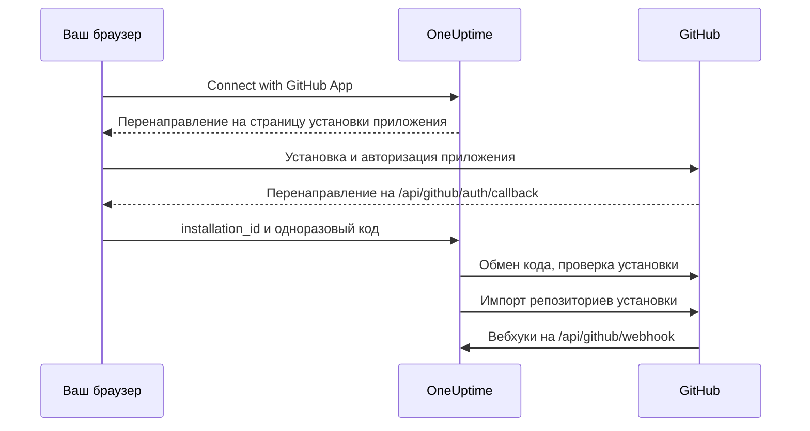

# Интеграция с GitHub

Подключите свой самостоятельно размещённый OneUptime к GitHub через собственное GitHub App. Когда приложение установлено из OneUptime, репозитории установки импортируются в ваш проект и поддерживаются в синхронизированном состоянии, задачи исправления с ИИ открывают pull requests, а команда может поручать приложению работу прямо в GitHub, упоминая его.

Эта страница для тех, кто администрирует сервер OneUptime: вы создаёте приложение один раз, а затем каждый проект подключает его в разделе **Репозитории кода**.

:::cards
- [Создание GitHub App](#создание-github-app): Зарегистрируйте приложение с нужными URL, разрешениями и событиями.
- [Настройка OneUptime](#настройка-oneuptime): Передайте серверу шесть значений приложения.
- [Подключение репозиториев](#подключение-репозиториев): Установите приложение из OneUptime.
- [Устранение неполадок](#устранение-неполадок): Что означают сообщения в разделе «Репозитории кода».
:::

## Как это работает

Установка начинается в OneUptime, а не на GitHub: именно ссылка, с которой OneUptime отправляет вас на GitHub, связывает установку с вашим проектом.



- Перенаправление в браузере несёт установку и одноразовый код OAuth. OneUptime обменивает код, чтобы убедиться, что учётная запись GitHub, установившая приложение, администрирует эту установку, а затем импортирует её репозитории.
- Вебхуки поддерживают список репозиториев в актуальном состоянии и передают приложению работу: упоминания, назначения, метки-триггеры и запросы на ревью. GitHub подписывает каждый вебхук секретом вебхука, а OneUptime отклоняет те, которые не может проверить.

## Перед началом

- Учётная запись GitHub, которая может создавать GitHub Apps для организации или пользователя, где будет установлено приложение. Чтобы установить его в организацию, вы должны быть её владельцем или получить одобрение запроса от владельца.
- Публичное имя хоста HTTPS для OneUptime, доступное для вебхуков GitHub. См. [Сетевой доступ](#сетевой-доступ-для-самостоятельно-размещённых-установок).
- Доступ к конфигурации сервера: `config.env` для Docker Compose или ваши values Helm для Kubernetes.

## Создание GitHub App

:::steps
### Откройте настройки GitHub Apps

- **Для организации:** `https://github.com/organizations/YOUR_ORG/settings/apps`
- **Для личной учётной записи:** `https://github.com/settings/apps`

Выберите **New GitHub App**.

### Заполните форму регистрации

| Поле | Значение |
| --- | --- |
| **GitHub App name** | Любое уникальное имя, например `OneUptime`. Запишите его точно: это `GITHUB_APP_NAME`. |
| **Homepage URL** | `https://your-oneuptime-domain.com` |
| **Callback URL** | `https://your-oneuptime-domain.com/api/github/auth/callback` |
| **Request user authorization (OAuth) during installation** | Включено. **Это обязательно**: см. примечание ниже. |
| **Setup URL** | `https://your-oneuptime-domain.com/api/github/auth/callback`, если GitHub позволяет его указать (см. ниже). |
| **Redirect on update** | Необязательно. После того как кто-то изменит установку на GitHub, OneUptime перенаправит его в **Репозитории кода**. |
| **Webhook URL** | `https://your-oneuptime-domain.com/api/github/webhook`, с вебхуком в состоянии **Active**. |
| **Webhook secret** | Длинная случайная строка. Запишите её: это `GITHUB_APP_WEBHOOK_SECRET`. **Обязательно**: OneUptime отклоняет неподписанные вебхуки, поэтому если `GITHUB_APP_WEBHOOK_SECRET` не задан, синхронизация репозиториев останавливается, а не принимает непроверенные данные. |

Согласно документации GitHub, при включённом **Request user authorization (OAuth) during installation** [указать Setup URL нельзя](https://docs.github.com/en/apps/creating-github-apps/registering-a-github-app/about-the-setup-url): после установки приложения пользователей вместо этого отправляют на Callback URL. Оба указывают на один и тот же адрес OneUptime, так что перенаправление в любом случае приходит куда нужно.

> [!IMPORTANT]
> **Почему «Request user authorization (OAuth) during installation» обязательно.** После установки GitHub перенаправляет обратно с `installation_id` в URL. Само по себе это число ничего не доказывает о том, кому принадлежит установка — любой может ввести другое. С этим параметром GitHub также возвращает одноразовый OAuth-`code`, привязанный к учётной записи GitHub, выполнившей установку, и OneUptime обменивает его, чтобы убедиться, что эта учётная запись действительно администрирует установку, прежде чем подключить её к вашему проекту.
>
> Без него OneUptime отказывается подключать установку, а панель показывает ошибку с просьбой включить этот параметр. Так задумано: принять ID установки без проверки значило бы позволить одному проекту OneUptime присвоить репозитории другой организации.

### Задайте разрешения

В разделе **Permissions & events** задайте эти **Repository permissions**:

| Разрешение | Доступ | Для чего его использует OneUptime |
| --- | --- | --- |
| Contents | Read and write | Читать файлы репозитория и отправлять ветки pull requests с исправлениями от ИИ |
| Pull requests | Read and write | Открывать и обновлять pull requests и публиковать ревью |
| Issues | Read and write | Публиковать комментарии приложения — **в том числе в pull requests**, обсуждение которых GitHub проводит через API issues |
| Checks | Read-only | Необязательно. Читать результат CI для pull requests с исправлениями. Без него их статус CI остаётся непроверенным |
| Metadata | Read-only | Базовые метаданные репозитория (требуется GitHub) |

**Именно Issues: Read and write делает приложение интерактивным.** Без него упоминания принимаются, а затем молча проваливаются, когда приложение пытается ответить: GitHub отдаёт комментарии из обсуждений pull requests через API issues, так что это одно разрешение решает судьбу каждого ответа приложения. См. [Работа с OneUptime из GitHub](/docs/ai/github-app).

OneUptime не нужны разрешения уровня организации или учётной записи.

### Подпишитесь на события вебхуков

OneUptime использует две группы событий, и у них разные задачи.

**Синхронизация репозиториев** — `installation` и `installation_repositories`. GitHub Apps получают их автоматически; они поддерживают набор подключённых репозиториев в соответствии с тем, где установлено приложение.

**Интерактивное приложение** — на эти события нужно подписаться явно, и каждое включает определённый способ поручить приложению работу:

| Событие | Что оно включает |
| --- | --- |
| **Issue comment** | команды `@mention` в issues **и** в pull requests |
| **Issues** | назначение issue приложению и метку-триггер репозитория |
| **Pull request** | запрос ревью у приложения |
| **Pull request review** | упоминание в тексте отправленного ревью |
| **Pull request review comment** | упоминание во встроенном комментарии к diff |

Если ни на одно из них нет подписки, GitHub App всё равно подключает репозитории и всё равно открывает pull requests с исправлениями из OneUptime — просто никогда не отвечает на то, что пишут в GitHub. Это самая частая причина жалоб «бот меня игнорирует». См. [Работа с OneUptime из GitHub](/docs/ai/github-app), какие есть команды и кто может их давать.

Другие события (**Push**, **Workflow run**) подтверждаются и игнорируются; подписка на них не включает уведомления или автоматизацию CI/CD.

### Выберите, где можно устанавливать приложение

В разделе **Where can this GitHub App be installed?** выберите:

- **Only on this account** - Для частного/внутреннего использования
- **Any account** - Если вы хотите, чтобы другие устанавливали ваше приложение

### Создайте приложение и запишите его идентификаторы

Выберите **Create GitHub App**. GitHub откроет страницу настроек приложения. Запишите **App ID** в верхней части страницы и **Client ID** в разделе **About**.

### Сгенерируйте client secret

В разделе **Client secrets** выберите **Generate a new client secret**. Сразу скопируйте его: GitHub показывает его только один раз.

### Сгенерируйте закрытый ключ

В разделе **Private keys** выберите **Generate a private key**. GitHub скачает файл `.pem`. Храните его в надёжном месте: с ним OneUptime проходит аутентификацию как приложение.
:::

## Настройка OneUptime

:::tabs
@tab Docker Compose
`config.env` хранит одно значение на строку, поэтому укажите закрытый ключ в кодировке base64 в одну строку. OneUptime его декодирует:

```bash
base64 < private-key.pem | tr -d '\n'
```

```bash title="config.env"
GITHUB_APP_ID=YOUR_APP_ID
GITHUB_APP_NAME=YOUR_APP_NAME
GITHUB_APP_CLIENT_ID=YOUR_CLIENT_ID
GITHUB_APP_CLIENT_SECRET=YOUR_CLIENT_SECRET
GITHUB_APP_PRIVATE_KEY=YOUR_BASE64_ENCODED_PRIVATE_KEY
GITHUB_APP_WEBHOOK_SECRET=YOUR_WEBHOOK_SECRET
```

Примените изменение командой `npm run start`, которая пересоздаёт контейнеры. `docker compose restart` не перечитывает `config.env`.
@tab Kubernetes
```yaml title="values.yaml"
gitHubApp:
  id: "YOUR_APP_ID"
  name: "YOUR_APP_NAME" # The exact name of your GitHub App
  clientId: "YOUR_CLIENT_ID"
  clientSecret: "YOUR_CLIENT_SECRET"
  privateKey: "<BASE64_ENCODED_PRIVATE_KEY_CONTENT>"
  webhookSecret: "YOUR_WEBHOOK_SECRET"
```

`privateKey` принимает и сам PEM в виде многострочного блока (`privateKey: |`). Примените изменение командой `helm upgrade`.
:::

Когда OneUptime снова запустится, раздел **Репозитории кода** покажет **Connect with GitHub App** вместо **GitHub App is not configured on this server**.

### Справочник переменных окружения

| Docker Compose (`config.env`) | Helm (`values.yaml`) | Значение |
| --- | --- | --- |
| `GITHUB_APP_ID` | `gitHubApp.id` | **App ID**. Используется для аутентификации от имени приложения. |
| `GITHUB_APP_NAME` | `gitHubApp.name` | Точное имя приложения. Из него строятся ссылка для установки и handle `@mention` приложения (в нижнем регистре, с дефисами вместо пробелов). Без него раздел **Репозитории кода** не может подключиться. |
| `GITHUB_APP_CLIENT_ID` | `gitHubApp.clientId` | **Client ID**. Нужен, чтобы проверить, кто установил приложение. |
| `GITHUB_APP_CLIENT_SECRET` | `gitHubApp.clientSecret` | Сгенерированный вами client secret. Нужен вместе с client ID. |
| `GITHUB_APP_PRIVATE_KEY` | `gitHubApp.privateKey` | Закрытый ключ: PEM или PEM в кодировке base64. |
| `GITHUB_APP_WEBHOOK_SECRET` | `gitHubApp.webhookSecret` | Секрет вебхука. Каждый вебхук проверяется с его помощью, и без него ни один не принимается. |

Обязательны все шесть.

## Подключение репозиториев

Начинайте подключение в OneUptime, а не на странице приложения в GitHub: именно ссылка, с которой OneUptime отправляет вас на GitHub, связывает установку с вашим проектом.

:::steps
1. Войдите в свою панель OneUptime
2. Перейдите в **Продукты** > **Задачи** > **Репозитории кода**
3. Нажмите **Connect with GitHub App**. OneUptime отправит вас на GitHub
4. Выберите организацию или учётную запись, куда установить приложение, и выберите, к каким репозиториям у него будет доступ: **All repositories** (все текущие и будущие репозитории) или **Only select repositories**
5. Нажмите **Install** (или **Save**, если приложение там уже установлено)
6. GitHub вернёт вас в **Репозитории кода**, и все репозитории установки будут импортированы. Репозитории, которые позже добавят в установку или удалят из неё, синхронизируются автоматически.
:::

**Кто может подключать.** Подключение импортирует репозитории установки в проект, поэтому требует разрешения добавлять репозитории кода: **Project Owner**, **Project Admin**, **Project Member**, **Settings Admin**, **Settings Member** или команда с **Create Code Repository**. Команда, блокирующая это разрешение, отнимает его. В OneUptime Cloud для репозиториев кода нужен тариф Growth или выше. Для всех остальных карточка заблокирована и говорит, что для неё нужно.

**Завершите за 15 минут в том же браузере.** Ссылка срабатывает один раз, в течение 15 минут, в том браузере, где её открыли. Когда GitHub возвращает вас, OneUptime снова проверяет разрешение, прежде чем что-либо импортировать.

## Сетевой доступ для самостоятельно размещённых установок

### Направление трафика и конечные точки

| Трафик | Необходимый доступ |
| --- | --- |
| От OneUptime к GitHub | DNS и исходящий HTTPS по TCP 443 к `api.github.com` для токенов GitHub App и вызовов API репозиториев и к `github.com` для обмена токена OAuth и операций Git по HTTPS |
| От GitHub к OneUptime | Публичный HTTPS по TCP 443 к `POST /api/github/webhook` для синхронизации установок и доступа к репозиториям, а также для интерактивного приложения |
| От браузера пользователя к OneUptime | Доступ к панели и `GET /api/github/auth/callback` для перенаправлений при установке и авторизации; они могут оставаться доступными через VPN пользователя |

Callback — это [перенаправление в браузере](https://docs.github.com/en/apps/creating-github-apps/registering-a-github-app/about-the-user-authorization-callback-url), а вебхук — запрос с серверов GitHub. VPN-подключение пользователя не даёт GitHub доступа к вебхуку. Указанные выше домены покрывают основные запросы интеграции; дополнительным инструментам для репозиториев, загрузкам, LFS или пакетам могут понадобиться другие адресаты. Эти настройки описывают GitHub.com; изменение межсетевого экрана не настраивает поддержку имени хоста GitHub Enterprise Server.

### Частные установки и безопасность обратных вызовов

Откройте `/api/github/webhook` через публичный шлюз с публичным DNS, публично доверенным сертификатом HTTPS с полной цепочкой и частным маршрутом к ingress OneUptime. Разрешите входящий TCP 443 к шлюзу и ограничьте публичное перенаправление этим маршрутом POST. Оставьте панель и callback браузера на частном ingress, если пользователи заходят через VPN; раздельный DNS может обслуживать одно и то же имя хоста внутри и снаружи.

Задайте `HOST=oneuptime.example.com` и `HTTP_PROTOCOL=https` в `config.env` или `host: oneuptime.example.com` и `httpProtocol: https` в Helm. Примените конфигурацию и дождитесь перезапуска OneUptime. Эти значения генерируют URL; они не создают DNS, TLS или сетевой доступ. Если имя хоста меняется, обновите URL вебхука, callback, setup и домашней страницы в GitHub App.

Сохраняйте метод, исходный путь, строку запроса, тело, `Content-Type`, `X-Hub-Signature-256`, `X-GitHub-Event` и `X-GitHub-Delivery`. Сохраняйте публичный хост и схему HTTPS через доверенные заголовки прокси. Исключите вебхук из браузерного SSO, CAPTCHA и страниц входа прокси. Оставьте включённой проверку SSL в GitHub и задайте одинаковый `GITHUB_APP_WEBHOOK_SECRET` в обеих системах: OneUptime отклоняет неподписанные запросы и не может проверять вебхуки без этого секрета. См. [рекомендации GitHub по проверке вебхуков](https://docs.github.com/en/webhooks/using-webhooks/validating-webhook-deliveries).

Если вы также ограничиваете исходные IP вебхуков, используйте актуальные диапазоны `hooks` из Meta API GitHub и регулярно обновляйте их; не подменяйте их диапазонами раннеров GitHub Actions и не отказывайтесь от проверки подписи. GitHub предупреждает, что [его адреса меняются, а опубликованный список неполон](https://docs.github.com/en/authentication/keeping-your-account-and-data-secure/about-githubs-ip-addresses).

### Проверка доступа и ограничения

:::steps
1. Подключите установку в разделе **Репозитории кода**.
2. В настройках GitHub App откройте **Advanced** и посмотрите **Recent Deliveries**. Повторите доставку и убедитесь, что шлюз её пересылает, а OneUptime принимает.
3. Добавьте в установку тестовый репозиторий или удалите его и проверьте, что список репозиториев в OneUptime меняется следом.
:::

GitHub документирует [диагностику доставок](https://docs.github.com/en/webhooks/testing-and-troubleshooting-webhooks/viewing-webhook-deliveries) и требует [подтверждения 2xx в течение десяти секунд](https://docs.github.com/en/webhooks/using-webhooks/best-practices-for-using-webhooks). GET из браузера к вебхуку не проверяет подписанный POST.

> [!WARNING]
> Без входящего доступа авторизация в браузере и исходящие операции API и Git могут работать, но вебхуки не доходят до OneUptime: удалённые установки и изменения доступа к репозиториям не синхронизируются, а приложение никогда не отвечает на упоминания, назначения или запросы на ревью.

[Настройка доступа к частной сети](/docs/self-hosted/private-network-access) управляет исходящими запросами к частным адресатам и не делает вебхук доступным для GitHub.

## Устранение неполадок

### Подключение не завершилось

Когда GitHub возвращает вас, а установка не подключилась, раздел **Репозитории кода** показывает **GitHub не подключён** и одно предложение на вашем языке с причиной. Остальная часть страницы загружается как обычно, так что можно сразу подключиться заново. Ответ самого GitHub она никогда не показывает: он вместе с причиной записан в лог сервера OneUptime.

| На странице написано | Что делать |
| --- | --- |
| **"Эта ссылка для подключения недействительна, устарела или уже использована. Начните заново."** | Ссылка срабатывает один раз, в течение 15 минут, в том браузере, где её открыли. Начните заново в разделе **Репозитории кода** и завершите на GitHub в течение 15 минут в том же браузере. Установка приложения с его страницы на GitHub не подключает его ни к какому проекту. |
| **"У вас нет разрешения добавлять репозитории кода в этот проект."** | Для подключения нужно разрешение добавлять репозитории кода (см. [Подключение репозиториев](#подключение-репозиториев)). Попросите администратора проекта выдать его. Оно проверяется снова, когда GitHub возвращает вас, поэтому разрешение, отозванное за это время, тоже прерывает подключение здесь. |
| **"Чтобы подключить GitHub, нужен тариф ...."** | В OneUptime Cloud для репозиториев кода нужен тариф, указанный в предложении. Переведите проект на этот тариф и подключитесь снова. |
| **"GitHub не подтвердил, кто установил приложение, поэтому установку не удалось проверить."** | Включите **Request user authorization (OAuth) during installation** в настройках GitHub App (см. [Создание GitHub App](#создание-github-app)) и подключитесь снова. |
| **"OneUptime не удалось подтвердить, что ваша учётная запись GitHub может управлять этой установкой."** | Учётная запись GitHub, завершившая установку, её не администрирует. Установите приложение с учётной записью, которой принадлежит организация или пользователь, где оно устанавливается, или попросите об этом владельца. |
| **"GitHub не вернул установку."** | Когда участник организации запрашивает приложение вместо установки, владелец организации должен сначала одобрить запрос. Подключитесь снова после этого. |
| **"GitHub App не настроено на этом сервере OneUptime."** | Задайте и `GITHUB_APP_CLIENT_ID`, и `GITHUB_APP_CLIENT_SECRET` (см. [Настройка OneUptime](#настройка-oneuptime)) и перезапустите OneUptime. |
| **"OneUptime не удалось завершить подключение. Попробуйте ещё раз."** | GitHub ответил ошибкой, или при завершении не удался запрос либо запись. Какой именно, сказано в логе сервера OneUptime. Попробуйте ещё раз; если ошибка повторяется, проверьте лог и настройки GitHub App. |

### Другие проблемы

:::details Раздел «Репозитории кода» пишет "GitHub App is not configured on this server"
`GITHUB_APP_NAME` не задан. Задайте в нём точное имя приложения вместе с остальными пятью значениями и перезапустите OneUptime.
:::

:::details После установки приложения меня не возвращает в OneUptime
Проверьте, что **Callback URL** приложения — `https://your-oneuptime-domain.com/api/github/auth/callback`, и то же для **Setup URL**, если он задан. Оба должны указывать на одну конечную точку `/api/github/auth/callback` на имени хоста из `HOST`.
:::

:::details Recent Deliveries в GitHub показывают "Invalid webhook signature"
Секрет вебхука в GitHub App и `GITHUB_APP_WEBHOOK_SECRET` различаются, `GITHUB_APP_WEBHOOK_SECRET` не задан, или прокси изменил тело запроса. Задайте один и тот же секрет в обоих местах, перезапустите OneUptime и убедитесь, что шлюз пересылает тело без изменений.
:::

:::details События вебхуков не приходят
Проверьте, что URL вебхука публично доступен по HTTPS, затем посмотрите в настройках GitHub App раздел **Advanced > Recent Deliveries**, где видна каждая попытка и ответ на неё. Вебхуки отклоняются, пока `GITHUB_APP_WEBHOOK_SECRET` не задан.
:::

:::details Репозитории или задачи исправления завершаются ошибкой аутентификации
OneUptime проходит аутентификацию как приложение с помощью `GITHUB_APP_ID` и `GITHUB_APP_PRIVATE_KEY`. Проверьте, что App ID верен, а ключ — полный PEM, включая строки `BEGIN` и `END`, или этот PEM в кодировке base64. Если приложение удалили из GitHub, подключите его снова в разделе **Репозитории кода**.
:::

:::details После установки не хватает репозиториев
Проверьте в настройках установки на GitHub, к каким репозиториям у неё есть доступ. Добавленные там репозитории импортируются автоматически, пока вебхуки доходят до OneUptime.
:::

:::details Приложение игнорирует упоминания в GitHub
Дайте приложению **Issues: Read and write** и подпишите его на интерактивные события из раздела [Подпишитесь на события вебхуков](#подпишитесь-на-события-вебхуков). Кроме того, упоминания совпадают только с handle, построенным из `GITHUB_APP_NAME`, поэтому задайте в нём настоящее имя приложения.
:::

## Рекомендации по безопасности

- **Регулярно меняйте секреты.** Периодически генерируйте новые client secrets и закрытые ключи.
- **Не оставляйте секрет вебхука пустым.** OneUptime отклоняет вебхуки, которые не может проверить.
- **Ограничьте доступ к репозиториям.** Давайте установке только те репозитории, которые нужно подключить.
- **Следите за доставками вебхуков.** Регулярно проверяйте неудачные доставки и подозрительную активность.
- **Не храните закрытые ключи в системе контроля версий.**

## Следующие шаги

:::cards
- [Работа с OneUptime из GitHub](/docs/ai/github-app): Команды, которые можно давать приложению, и кто может их давать.
- [Задачи исправления](/docs/ai/ai-agent): Как агент ИИ открывает pull requests с исправлениями.
- [Доступ к частной сети](/docs/self-hosted/private-network-access): Позвольте рабочим процессам и вебхукам обращаться к внутренним инструментам.
:::
