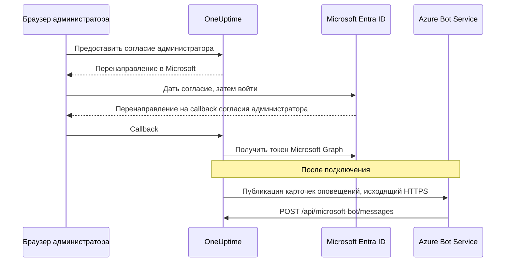

# Интеграция с Microsoft Teams

Подключите свой самостоятельно размещённый OneUptime к Microsoft Teams. Вы регистрируете приложение в Microsoft Entra ID, создаёте для него Azure Bot, передаёте OneUptime учётные данные приложения и устанавливаете пакет приложения Teams, который генерирует ваш сервер. После этого OneUptime публикует оповещения и инциденты в ваших каналах и чатах, а ваша команда работает с ними прямо в Teams.

Эта страница для тех, кто обслуживает сервер OneUptime. Когда Teams подключён, правила уведомлений настраиваются для каждого проекта: см. [Microsoft Teams](/docs/workspace-connections/microsoft-teams).

:::cards
- [Настройка интеграции](#настройка-интеграции): Девять шагов, от портала Azure до вашей первой команды.
- [Переменные окружения](#переменные-окружения): Три значения, которые OneUptime берёт из регистрации приложения.
- [Сетевой доступ](#сетевой-доступ): Конечная точка бота, до которой должна дотягиваться Microsoft.
- [Устранение неполадок](#устранение-неполадок): Недоступные конечные точки, отсутствующие установки и неудавшиеся подключения.
:::

## Как это работает

OneUptime использует Azure Bot для интеграции с Teams. Трафик идёт в обе стороны, и эти два направления независимы: OneUptime обращается к Microsoft, чтобы публиковать сообщения, а Azure Bot Service обращается к вашему серверу, когда кто-то нажимает кнопку, пишет боту или добавляет его в чат.



Incoming Webhook или URL рабочего процесса Teams не заменяют конечную точку сообщений этого бота.

Видеозвонки (встреча Teams для инцидента) не используют этого бота: им нужна собственная регистрация приложения, описанная в разделе [Видеозвонки](/docs/workspace-connections/video-calls#подключение-одним-нажатием-на-собственном-сервере).

## Перед началом

- Подписка Azure для ресурса Azure Bot.
- Учётная запись, которая может создавать регистрации приложений в Microsoft Entra ID, и администратор Microsoft 365, который предоставит согласие администратора.
- Публичное HTTPS-имя хоста для OneUptime, доступное для Azure Bot Service. См. [Сетевой доступ](#сетевой-доступ).
- Доступ к конфигурации сервера: `config.env` в Docker Compose или ваши values Helm в Kubernetes.
- Чтобы подключить проект, нужна роль **Project Owner**, **Project Admin** или **Project Member** в нём.

## Настройка интеграции

:::steps
### Шаг 1. Создайте регистрацию приложения Azure

На [портале Azure](https://portal.azure.com) откройте **App registrations** и выберите **New registration**. Заполните форму:

- **Name:** oneuptime
- **Supported account types:** Accounts in this organizational directory only (Single tenant)
- **Redirect URI:** Web - `https://your-oneuptime-domain.com/api/microsoft-teams/auth`

Выберите **Register**, затем добавьте второй URI перенаправления типа Web: `https://your-oneuptime-domain.com/api/microsoft-teams/admin-consent/callback`. Запишите **Application (client) ID** и **Directory (tenant) ID**: оба понадобятся позже.

> [!NOTE]
> **Почему один клиент (tenant):** самостоятельно размещённый OneUptime обслуживает одну организацию, и его бот зарегистрирован для единственного клиента, который вы задаёте в `MICROSOFT_TEAMS_APP_TENANT_ID` (шаг 6). Регистрация приложения как мультиклиентского этого не расширяет, но добавляет способ сломаться: гостевые пользователи / пользователи B2B, чей домашний клиент Microsoft отличается от вашего, приходят к боту со своим идентификатором клиента, который OneUptime не может сопоставить с вашим проектом. Если вы уже зарегистрировали мультиклиентское приложение, оно продолжит работать; просто убедитесь, что `MICROSOFT_TEAMS_APP_TENANT_ID` указывает на ваш собственный клиент, и учтите, что гостевым учётным записям для работы с ботом понадобится учётная запись в вашем клиенте.

### Шаг 2. Настройте разрешения приложения

В регистрации приложения откройте **API permissions**, выберите **Add a permission** и выберите **Microsoft Graph**.

**Добавьте делегированные разрешения** (когда приложение действует от имени вошедшего пользователя):

- **User.Read** - Нужно, чтобы во время OAuth-потока получить сведения профиля прошедшего проверку пользователя (отображаемое имя, электронную почту)
- **Team.ReadBasic.All** - Нужно, чтобы перечислить команды, в которых состоит пользователь, когда он выбирает, какую команду подключить
- **Channel.ReadBasic.All** - Нужно, чтобы читать сведения о каналах и перечислять каналы команд для доставки уведомлений
- **ChannelMessage.Send** - Нужно, чтобы отправлять уведомления об оповещениях и инцидентах в каналы Teams

**Добавьте разрешения приложения** (когда приложение действует от своего имени, без вошедшего пользователя):

- **Team.ReadBasic.All** - Нужно, чтобы перечислить все команды организации после предоставления согласия администратора
- **Channel.ReadBasic.All** - Нужно, чтобы проверять, что каналы существуют, и получать их сведения
- **TeamsAppInstallation.ReadForTeam.All** - Нужно для диагностики. Позволяет OneUptime прочитать, какой пакет приложения на самом деле установлен в команде, и сравнить его с идентификатором клиента этого развёртывания, чтобы неудачная отправка могла сказать вам, *какая* из возможных причин сработала. Без него OneUptime не может отличить «не установлено» от «установлено, но это чужой пакет» и лишь передаёт то, что сказала Microsoft, — главная причина, по которой отладка этой интеграции занимает дни, а не минуты. Предоставьте его.
- **Chat.ReadBasic.WhereInstalled** - Необязательно. Позволяет OneUptime читать название каждого чата, в котором есть приложение OneUptime. Без него каждый чат предоставляет это через разрешение манифеста **ChatSettings.Read.Chat** (ниже), которое у чата, добавленного со старым манифестом, появляется только после обновления приложения в нём.

`ChannelMessage.Send` бывает только делегированным; варианта в виде разрешения приложения в [справочнике разрешений Microsoft Graph](https://learn.microsoft.com/en-us/graph/permissions-reference#channelmessagesend) нет. Оставьте его в списке делегированных разрешений выше.

Затем выберите **Grant admin consent** для своей организации.

Сам бот использует разрешения согласия для конкретного ресурса (RSC), определённые в манифесте приложения Teams. Они предоставляются, когда приложение устанавливается или обновляется в команде или чате, а не в Entra ID:

- **ChannelMessage.Send.Group** - Позволяет боту отправлять сообщения в каналы команд
- **ChannelMessage.Read.Group** - Позволяет боту читать сообщения каналов для интерактивных команд
- **Channel.Create.Group** - Позволяет боту создавать каналы при необходимости
- **ChatMessage.Read.Chat** - Позволяет боту читать сообщения в чатах, в которые его добавили (для интерактивных команд)
- **ChatMember.Read.Chat** - Позволяет боту читать участников чатов, в которые его добавили (чтобы называть чаты в OneUptime)
- **ChatSettings.Read.Chat** - Позволяет OneUptime читать название групповых чатов, в которые добавлено приложение. Teams ненадёжно передаёт боту название группового чата, поэтому без этого разрешения групповой чат с названием показывается именами его участников
- **TeamsAppInstallation.Read.Group** - Позволяет OneUptime убедиться, что приложение установлено в команде, в которую он собирается публиковать

Если вы загрузили манифест приложения до появления этих разрешений, скачайте его заново в **Настройки проекта > Рабочее пространство > Microsoft Teams** и загрузите в Teams как обновление приложения OneUptime. Teams предоставляет разрешения команды и чата, когда приложение устанавливается или обновляется в этой команде или этом чате, поэтому примите обновление в каждой команде и каждом чате, где приложение уже есть. О чатах см. [Групповой чат показывается именами участников](#групповой-чат-показывается-именами-участников).

### Шаг 3. Создайте секрет клиента

В регистрации приложения откройте **Certificates & secrets** и выберите **New client secret**. Добавьте описание, выберите срок действия (24 месяца — разумный выбор) и выберите **Add**. Сразу скопируйте значение секрета: Azure показывает его только один раз.

> [!IMPORTANT]
> Скопируйте **Value** секрета, а не его **Secret ID**. Значение — более длинная строка.

### Шаг 4. Создайте Bot Service

На портале Azure создайте ресурс **Azure Bot**:

- **Bot handle:** oneuptime-bot
- **Subscription** и **Resource group:** ваши собственные
- **Pricing tier:** для тестов достаточно F0 (Free)
- **Type of App:** Single Tenant, с существующей регистрацией приложения: её **Application (client) ID** и **Directory (tenant) ID** из шага 1

Выберите **Review + create**, затем **Create**. Когда бот будет развёрнут, откройте его страницу **Configuration**, задайте **Messaging endpoint** равным `https://your-oneuptime-domain.com/api/microsoft-bot/messages` и сохраните.

**Проверьте конечную точку, прежде чем двигаться дальше.** Azure Bot Service обращается к этому URL из публичного интернета, поэтому проверяйте его откуда-нибудь за пределами своей сети: не изнутри кластера и не через VPN, который видит хост, когда Azure его не видит:

```bash
curl -sS -i https://your-oneuptime-domain.com/api/microsoft-bot/messages
```

Используйте `-i`, а не смотрите только на код состояния: при 404 **тело ответа — единственное, что говорит, кто его сформировал**, и в этом различии вся диагностика.

- **405** — правильный ответ, и он значит, что вы закончили. Конечная точка принимает только POST, поэтому GET получает `405 Method Not Allowed` с `Allow: POST` и описанием конечной точки. Дотянуться до неё — ровно то, что проверяется.
- **404 с JSON-телом `{"message":"Page not found - /api/microsoft-bot/messages"}`** приходит от OneUptime, значит, запрос *дошёл*. Либо это развёртывание старше ответа 405 выше (старые версии обслуживали этот маршрут только для POST, поэтому GET попадал в общий обработчик «not found»), либо что-то перед OneUptime переписывает путь и убирает префикс `/api` до того, как его увидит приложение (обычный виновник — ingress Kubernetes с `rewrite-target: /`).
- **404 с HTML-страницей ошибки** от nginx, вашего ingress или балансировщика нагрузки означает обратное: запрос так и не дошёл до OneUptime, а то, что стоит перед ним, не направляет `/api` в приложение.
- **Ошибка TLS, тайм-аут или отказ в соединении** означают, что Azure тоже не дотянется. См. [раздел об устранении неполадок конечной точки сообщений](#кнопки-карточек-пишут-unable-to-reach-app-а-чаты-так-и-не-появляются) ниже.

### Шаг 5. Добавьте боту канал Microsoft Teams

В ресурсе Azure Bot откройте **Channels** и добавьте **Microsoft Teams**. Оставьте параметры обмена сообщениями по умолчанию, если у вас нет особых требований, и сохраните. Без этого канала бот никогда не подготавливается в беседах Teams.

### Шаг 6. Задайте переменные окружения OneUptime

Передайте OneUptime учётные данные приложения:

:::tabs
@tab Docker Compose
```bash title="config.env"
MICROSOFT_TEAMS_APP_CLIENT_ID=YOUR_TEAMS_APP_CLIENT_ID
MICROSOFT_TEAMS_APP_CLIENT_SECRET=YOUR_TEAMS_APP_CLIENT_SECRET
MICROSOFT_TEAMS_APP_TENANT_ID=YOUR_MICROSOFT_TENANT_ID
```

Примените изменение командой `npm run start`, которая пересоздаёт контейнеры. `docker compose restart` не перечитывает `config.env`.
@tab Kubernetes
```yaml title="values.yaml"
microsoftTeamsApp:
  clientId: YOUR_TEAMS_APP_CLIENT_ID
  clientSecret: YOUR_TEAMS_APP_CLIENT_SECRET
  tenantId: YOUR_MICROSOFT_TENANT_ID
```

Чтобы хранить значения в Secret Kubernetes, которым вы управляете сами, задайте вместо этого `microsoftTeamsApp.existingSecret`: его `name` и ключи `clientIdKey`, `clientSecretKey` и `tenantIdKey`. Примените изменение командой `helm upgrade`.
:::

Когда OneUptime снова запустится, **Настройки проекта > Рабочее пространство > Microsoft Teams** покажет карточку **Предоставить согласие администратора** вместо руководства по настройке.

### Шаг 7. Предоставьте согласие администратора в OneUptime

Откройте **Настройки проекта > Рабочее пространство > Microsoft Teams** и выберите **Предоставить согласие администратора**. Войдите в Microsoft как администратор Microsoft 365 и примите разрешения. Microsoft вернёт вас на ту же страницу, и карточка покажет **Admin Consent Completed**: теперь проект подключён к вашему клиенту.

Затем выберите **Connect my account with Microsoft Teams**, чтобы связать свою учётную запись. Другие участники проекта делают то же самое в **Настройки пользователя > Рабочее пространство > Microsoft Teams**.

### Шаг 8. Загрузите манифест приложения Teams

После согласия администратора **Настройки проекта > Рабочее пространство > Microsoft Teams** показывает карточку **Action Required: Install This Deployment's App on Microsoft Teams**. Выберите **Скачать ZIP-архив манифеста приложения**: пакет содержит идентификатор бота этого развёртывания.

В Microsoft Teams откройте **Apps > Manage your apps**, выберите **Upload an app**, затем **Upload a custom app** и выберите скачанный zip-файл.

> [!WARNING]
> Не устанавливайте «OneUptime» из магазина Microsoft Teams для самостоятельно размещённого развёртывания. Приложение из магазина указывает на бота OneUptime Cloud, поэтому Teams принимает его, а затем отклоняет каждое сообщение, которое отправляет это развёртывание.

### Шаг 9. Добавьте OneUptime в каждую команду (обязательно)

Загрузка манифеста устанавливает приложение для **вас**. Она **не** даёт боту доступа к каналам ни одной команды. Microsoft принимает сообщения только в команде, в которую добавлено приложение, поэтому это нужно сделать в каждой команде, где вам нужны уведомления:

1. В Microsoft Teams нажмите «...» рядом с **названием команды** (не канала)
2. Выберите **Manage team** > **Apps** > **More apps**
3. Найдите **OneUptime** и нажмите **Add**

Примечания:

- Установка OneUptime для себя или добавление его в чат — это **другая** установка. Ни та, ни другая не позволяют ему публиковать в каналах команды.
- **Частным каналам** нужно приложение, установленное в самом канале: откройте канал > «...» > **Manage channel** > **Apps** > **Add an app**. Установка на уровне команды не распространяется на частные каналы.
- **Общие каналы** вообще не могут получать уведомления: Microsoft Teams не поддерживает ботов в общих каналах. OneUptime скрывает их в средстве выбора каналов.
- Если **Manage team > Apps > More apps** пуст или неактивен, ваша политика настройки приложений Teams блокирует пользовательские приложения. Исправьте это в центре администрирования Teams, в разделах **Teams apps > Manage apps** и **Setup policies**.
:::

## Переменные окружения

| Docker Compose (`config.env`) | Helm (`values.yaml`) | Значение |
| --- | --- | --- |
| `MICROSOFT_TEAMS_APP_CLIENT_ID` | `microsoftTeamsApp.clientId` | **Application (client) ID**. Это также идентификатор бота в пакете приложения Teams, поэтому он должен быть GUID. |
| `MICROSOFT_TEAMS_APP_CLIENT_SECRET` | `microsoftTeamsApp.clientSecret` | **Value** секрета клиента, а не его идентификатор. |
| `MICROSOFT_TEAMS_APP_TENANT_ID` | `microsoftTeamsApp.tenantId` | **Directory (tenant) ID**. Бот проходит проверку подлинности как одноклиентское приложение в этом клиенте. |
| `HOST` | `host` | Ваше публичное имя хоста. Из него строятся URI перенаправления, конечная точка сообщений и пакет приложения Teams. |
| `HTTP_PROTOCOL` | `httpProtocol` | `https`. Azure Bot Service обращается только к конечным точкам HTTPS. |

Все три значения `MICROSOFT_TEAMS_APP_*` обязательны:

- Без идентификатора клиента страница Microsoft Teams показывает руководство по настройке вместо **Предоставить согласие администратора**.
- Без идентификатора клиента или секрета подключение заканчивается сообщением **"Microsoft Teams не настроен на этом сервере OneUptime."**
- Без идентификатора клиента (tenant) бот не может пройти проверку подлинности, поэтому не работают ни публикация, ни конечная точка бота.

## Сетевой доступ

Microsoft требует [публично доступную конечную точку HTTPS для самостоятельно размещённого бота](https://learn.microsoft.com/en-us/azure/bot-service/bot-service-resources-faq-security?view=azure-bot-service-4.0). Частный IP-адрес, внутреннее DNS-имя или VPN-подключение сотрудника не дают Azure Bot Service доступа к OneUptime.

| Направление | Назначение | Цель |
| --- | --- | --- |
| Из OneUptime в Microsoft | HTTPS по TCP 443 к Microsoft Graph, службам удостоверений Microsoft и Bot Framework | Обмен токенами, поиск команд и каналов, доставка уведомлений |
| Из Microsoft в OneUptime | `POST /api/microsoft-bot/messages` | Сообщения бота, события установки в беседах и действия карточек |
| Из браузера пользователя в OneUptime | `/api/microsoft-teams/auth` и `/api/microsoft-teams/admin-consent/callback` | Перенаправления входа и согласия администратора |

Перенаправления регистрации приложения на `/api/microsoft-teams/auth` и `/api/microsoft-teams/admin-consent/callback` возвращаются через браузер пользователя. Этот браузер должен дотягиваться до OneUptime, например через корпоративную сеть или VPN. Сообщения бота и действия карточек приходят с серверов Microsoft, и им нужен собственный доступный ingress. Одна лишь исходящая доставка оповещений не подтверждает входящую связность.

### Публикация конечной точки бота из частного развёртывания

```mermaid title="Публикация конечной точки бота из частного развёртывания"
flowchart LR
    Azure["Azure Bot Service"] -->|HTTPS 443| GW["Публичный шлюз"]
    GW -->|"POST /api/microsoft-bot/messages"| ING["Ingress OneUptime"]
    Users["Сотрудники в VPN"] --> ING
    ING --> App["Приложение OneUptime"]
```

:::steps
1. Направьте публичную DNS-запись имени хоста OneUptime на обратный прокси или балансировщик нагрузки, обращённый в интернет. Разрешите входящий TCP 443 и отдавайте публично доверенный TLS-сертификат с полной цепочкой.
2. Подключите шлюз к частному ingress OneUptime напрямую или через собственный VPN между площадками / частный канал и разрешите служебный порт источника. Службе Kubernetes `ClusterIP` нужен доступный ingress или другой маршрут от шлюза. Базы данных и другие внутренние службы оставьте частными.
3. Опубликуйте `/api/microsoft-bot/messages` через этот шлюз и задайте **Messaging endpoint** Azure Bot из шага 4 равным полному публичному URL HTTPS. Сохраните метод, префикс `/api`, строку запроса, тело и заголовок `Authorization`. Сохраните публичный `Host` и задайте доверенные заголовки пересылки для публичного хоста и схемы HTTPS. Не добавляйте на этот маршрут перенаправления, браузерный SSO, CAPTCHA или вход в прокси; адаптер Bot Framework в OneUptime должен получить запрос и проверить его подлинность.
4. При необходимости оставьте остальные маршруты частными. С раздельным DNS сотрудники могут разрешать то же имя хоста в частный ingress через корпоративную сеть или VPN. Этот ingress тоже должен отдавать HTTPS с сертификатом, действительным для имени хоста, и пропускать браузерные перенаправления из таблицы выше. Ограничьте доступ к источнику шлюзом и авторизованными внутренними клиентами.
5. Задайте `HOST=oneuptime.example.com` и `HTTP_PROTOCOL=https` в `config.env` Docker Compose или `host: oneuptime.example.com` и `httpProtocol: https` в values Helm. Замените пример своим доменом, примените обновление развёртывания и дождитесь перезапуска приложения. Эти значения формируют URL; они не настраивают DNS, TLS или сетевой доступ. Если имя хоста меняется, обновите конечную точку Azure Bot и перенаправления регистрации приложения, а затем заново скачайте и загрузите манифест Teams.
:::

[Настройки доступа к частной сети](/docs/self-hosted/private-network-access) в OneUptime управляют исходящими запросами к внутренним службам. Включение `ALLOW_PRIVATE_NETWORK_WEBHOOKS` не делает конечную точку бота доступной для Microsoft.

### Исходящий доступ и ограничения по IP

Разрешите разрешение DNS-имён и исходящий HTTPS из приложения OneUptime. Используйте `graph.microsoft.com`, `login.microsoftonline.com`, конечные точки проверки подлинности и каналов Bot Framework, а также URL службы соединителя, переданный для беседы. Резервный соединитель коммерческого облака — `https://smba.trafficmanager.net/teams/`; URL служб бесед могут отличаться. Следуйте [рекомендациям Microsoft по брандмауэру](https://learn.microsoft.com/en-us/azure/bot-service/bot-service-resources-faq-security?view=azure-bot-service-4.0) и проверяйте заблокированный трафик во время тестирования; это не исчерпывающий список имён хостов.

Microsoft не поддерживает фиксированные списки разрешённых IP для входящего трафика Bot Framework, потому что его исходные адреса меняются. Диапазоны IP-адресов мультимедиа клиентов Teams не описывают источники веб-хуков ботов. Не отключайте проверку подлинности Bot Framework и не считайте исходный IP доказательством подлинности.

### Тестирование и развёртывания без входящего доступа

С помощью шага 4 проверьте публичный DNS, TLS и маршрутизацию извне своей сети и VPN. Затем подключите Teams, отправьте тестовое уведомление, напишите боту и нажмите кнопку на карточке. Подтвердите действие в OneUptime и сопоставьте диагностику доставки Microsoft с журналами шлюза и приложения. Доступный маршрут GET или доставленное уведомление сами по себе не подтверждают прошедший проверку входящий POST от бота.

Для разработки [руководство Microsoft по локальному тестированию ботов Teams](https://learn.microsoft.com/en-us/microsoftteams/platform/bots/how-to/authentication/add-authentication#testing-the-bot-locally-in-teams) описывает, как открыть локальную службу через туннель. Направляйте трафик в прокси, который пропускает конечную точку бота, и используйте `/api/microsoft-bot/messages` вместо примера пути Microsoft `/api/messages`. Обновляйте настроенное имя хоста и конечную точку Azure Bot при каждой смене публичного URL туннеля, останавливайте туннель после тестирования и используйте стабильный ingress в рабочей среде. Туннель тоже открывает входящий доступ.

> [!WARNING]
> Если политика запрещает входящую связность, полная интеграция бота Teams работать не может: команды, действия карточек и обнаружение бесед зависят от того, что Microsoft дотягивается до OneUptime. Azure Bot Private Endpoint не снимает это требование. [Инструкции Microsoft по сетевой изоляции](https://learn.microsoft.com/en-us/azure/bot-service/dl-network-isolation-how-to?view=azure-bot-service-4.0) описывают изоляцию Direct Line и указывают, что отключение доступа из публичной сети нарушает конфигурацию каналов Teams. Полностью отключённая от сети установка не может использовать Teams.

## Устранение неполадок

Начните с этих проверок:

- У регистрации приложения есть разрешения, перечисленные выше, и согласие администратора предоставлено.
- URI перенаправления совпадают в точности (замените `your-oneuptime-domain.com` своим настоящим доменом).
- Переменные окружения заданы, и OneUptime перезапущен после их задания.
- Конечная точка сообщений бота доступна из интернета, и у бота есть канал Microsoft Teams.
- Загруженный вами пакет приложения Teams — тот, что скачан из этого развёртывания.

### Кнопки карточек пишут "Unable to reach app", а чаты так и не появляются

Обычно эти симптомы означают, что **Azure Bot Service не может доставить прошедшие проверку действия (activities) на вашу конечную точку сообщений**. Проверьте маршрутизацию, проверку подлинности бота и конфигурацию проекта.

Сбивает с толку то, что карточки оповещений по-прежнему приходят в Teams, и из-за этого интеграция выглядит почти исправной. Это не так: два направления независимы, и работает только одно из них:

| Направление | Как идёт | Нужно ли Azure дотянуться до вас? |
| --- | --- | --- |
| OneUptime публикует карточку оповещения в канале | OneUptime обращается к Microsoft и проходит проверку подлинности с вашим секретом клиента | **Нет** |
| Вы нажимаете кнопку на этой карточке | Azure Bot Service отправляет POST на `/api/microsoft-bot/messages` | **Да** |
| Вы пишете боту `help` | Azure Bot Service отправляет POST на `/api/microsoft-bot/messages` | **Да** |
| Чат регистрируется в **Microsoft Teams Chats** | Azure Bot Service отправляет действие бота POST-запросом на `/api/microsoft-bot/messages` | **Да** |

Значит, дошедшее оповещение подтверждает только эту исходящую отправку; оно не подтверждает ни каждое разрешение Graph, ни входящую конечную точку бота. Интерактивным функциям нужно, чтобы входящие действия бота успешно обрабатывались.

OneUptime регистрирует чаты по действиям бота, например по установке приложения, добавлению бота в беседу или сообщению боту в этом чате. Все они приходят через одну и ту же входящую конечную точку. Пустой список **Microsoft Teams Chats** после того, как вы добавили приложение и написали ему, означает, что для этого проекта не зарегистрирован ни один чат; проверьте входящие запросы, ошибки проверки подлинности и сопоставление клиента с проектом. Нажатие **Refresh Chats** заново читает чаты, сохранённые в OneUptime, и заново читает из Microsoft название каждого сохранённого группового чата.

**Диагностируйте в таком порядке:**

1. **Ищите POST, а не 404.** Именно здесь большинство расследований сворачивает не туда:

   ```bash
   grep 'POST /api/microsoft-bot/messages' <your access log>
   ```

   Если строк с POST нет, убедитесь, что запросы записывает нужный журнал доступа, а затем проверьте конечную точку, настроенную в Azure, и сетевой путь. Если POST-запросы приходят, изучите ответы на них и ошибки OneUptime в проверке подлинности или сопоставлении проекта. Строки `GET`, возвращающие 404, — отдельная проверка; см. примечание ниже.

2. **Обратитесь к конечной точке извне своей сети,** как на шаге 4, с `curl -i`, чтобы увидеть тело ответа. Ответ `405` доказывает, что маршрут работает и доступен оттуда, где вы запустили команду. Ошибка TLS, тайм-аут или отказ в соединении — это и есть ваш ответ.

3. **Проверьте цепочку сертификатов.** Azure требует HTTPS с публично доверенным сертификатом, отдаваемым вместе с полной цепочкой. Самозаверенный сертификат, внутренний ЦС или отсутствующий промежуточный сертификат обрывают TLS-рукопожатие до того, как OneUptime увидит запрос, поэтому журнал доступа остаётся пустым и кажется, что Azure даже не пытался:

   ```bash
   openssl s_client -connect your-oneuptime-domain.com:443 -servername your-oneuptime-domain.com -verify_return_error </dev/null
   ```

4. **Проверьте, что имя хоста разрешается публично.** Частное DNS-имя, запись split-horizon или только внутренний ingress доступны вам и вашему VPN, но остаются невидимыми для Azure. Разрешите имя из сети, у которой нет доступа к вашей.

5. **Подтвердите конечную точку в ресурсе Azure Bot**: она должна в точности совпадать с этим развёртыванием, включая схему и путь: `https://your-oneuptime-domain.com/api/microsoft-bot/messages`.

**404 на `GET /api/microsoft-bot/messages` — это не сбой и не доказательство того, что Azure не может до вас дотянуться.** Конечная точка всегда принимала только POST, поэтому в версиях до этой GET из браузера попадал в общий обработчик «not found» OneUptime и возвращался как `{"message":"Page not found - /api/microsoft-bot/messages"}`. Это выглядит как отсутствующий маршрут и не одного администратора отправляло на поиски несуществующей регрессии; но посмотрите, что это на самом деле доказывает: ответ сформировал OneUptime, значит, запрос дошёл до приложения. Его длина — 58 байт, поэтому в журнале доступа он выглядит как `"GET /api/microsoft-bot/messages HTTP/1.1" 404 58`.

Эта версия отвечает на GET кодом `405 Method Not Allowed` и описанием самой себя, так что различие больше не требует объяснений. Если вы всё ещё на более старой версии, судите о 404 по телу ответа: JSON от OneUptime значит, что запрос дошёл; HTML-страница ошибки от вашего прокси — что не дошёл.

### Групповой чат показывается именами участников

Teams ненадёжно передаёт боту название группового чата, поэтому OneUptime читает его из Microsoft Graph. Для этого нужно разрешение манифеста **ChatSettings.Read.Chat**, которое каждый чат предоставляет, когда в нём устанавливается или обновляется приложение OneUptime. У чатов, в которые приложение добавили со старым манифестом, его нет, и **Refresh Chats** их отмечает. Исправьте это одним из двух способов:

1. Скачайте манифест заново в **Настройки проекта > Рабочее пространство > Microsoft Teams**, загрузите его в Teams как обновление приложения OneUptime, примите обновление в каждом из этих чатов, затем нажмите **Refresh Chats**.
   - Teams принимает загрузку как обновление, только если её версия выше установленной. Образы релизов задают её из `APP_VERSION`. Сборка без `APP_VERSION` использует фиксированное резервное значение, которое меняется только тогда, когда OneUptime меняет манифест; если Teams сообщает, что пакет не новее, увеличьте `version` манифеста перед загрузкой.
   - Если ваш клиент разрешает разрешения чатов только предварительно одобренным приложениям, сначала добавьте **ChatSettings.Read.Chat** в политику предварительного одобрения OneUptime (например, `Update-MgBetaTeamAppPreapproval -TeamsAppId <app id> -ResourceSpecificApplicationPermissionsAllowedForChats @('ChatMember.Read.Chat','ChatMessage.Read.Chat','ChatSettings.Read.Chat')`), иначе обновлённое приложение нельзя будет добавить в чаты.
2. Или предоставьте регистрации приложения разрешение приложения **Chat.ReadBasic.WhereInstalled** (шаг 2) с согласием администратора, затем нажмите **Refresh Chats**. Это сразу охватывает каждый чат, где есть приложение, без обновления в каждом чате по отдельности. OneUptime продолжает использовать текущий токен Microsoft Graph до истечения его срока, поэтому только что предоставленное разрешение может начать действовать в течение часа.

Групповой чат без названия в Teams показывается именами участников, и так задумано. Чат, переименованный в Teams, получает новое название, когда кто-нибудь в следующий раз нажмёт **Refresh Chats**.

### Проверка конфигурации бота этого развёртывания

```bash
curl -sS https://your-oneuptime-domain.com/api/microsoft-bot/test | jq
```

Этот запрос сообщает, что OneUptime видит локально: заданы ли `MICROSOFT_TEAMS_APP_CLIENT_ID` и `MICROSOFT_TEAMS_APP_CLIENT_SECRET`, какую конечную точку сообщений ожидает это развёртывание и, что полезнее всего, какой **идентификатор бота** должен содержать ваш пакет приложения Teams.

Он читает переменные окружения и ничего больше. Он не обращается к Azure, поэтому не может сказать, существует ли ресурс Azure Bot, указывает ли его конечная точка сообщений сюда, включён ли канал Teams, действителен ли ещё секрет и может ли Azure до вас дотянуться. Ответ говорит об этом сам, перечисляя, что он проверил, а что нет, чтобы его никогда не принимали за зелёный свет.

Единственная решающая проверка, которую он позволяет: сравните возвращённый `botId` с идентификатором бота приложения OneUptime, установленного в Teams. Если они различаются, этот пакет не может получать сообщения от этого развёртывания; см. шаг 8.

### "The OneUptime app is not installed in the Microsoft Teams team ..."

OneUptime проверил это через Microsoft Graph, и приложения действительно нет в этой команде (или, для частного канала, в этом канале). Выполните **шаг 9** выше. С разрешениями приложения Graph OneUptime может перечислить каждый канал вашего клиента, но *публиковать* может только в командах, участником которых является приложение.

### "Microsoft Teams refused the message ... because the OneUptime bot is not a member of that conversation"

Microsoft отклонила публикацию (по её собственным словам, `BotNotInConversationRoster`), а OneUptime **не** смог подтвердить, что приложения нет, так что не исходите из этого. Пройдите по причинам в порядке ниже; первые две со стороны Teams выглядят точно так же, как правильная настройка.

1. **Приложение в команде — другой пакет.** Увидеть значок с названием «OneUptime» в **Manage team > Apps** недостаточно: важно, совпадает ли идентификатор бота этого пакета с `MICROSOFT_TEAMS_APP_CLIENT_ID` *этого* развёртывания. Публичное приложение OneUptime из магазина Teams указывает на бота OneUptime Cloud и никогда не примет публикации от вашего самостоятельно размещённого развёртывания. Для вашего развёртывания сделан только манифест, скачанный в **Настройки проекта > Рабочее пространство > Microsoft Teams** (шаг 8). Если сомневаетесь, удалите приложение из команды, заново загрузите собственный манифест и добавьте его.
2. **У Azure Bot нет канала Microsoft Teams.** Выполните **шаг 5**. Без него бот никогда не подготавливается в беседах Teams, поэтому его нет в списке участников ни одного канала, даже если приложение устанавливается без ошибок и список приложений выглядит правильно.
3. **Приложение установлено для вас или в чате, но не в команде.** Выполните **шаг 9**.
4. **Канал частный.** Установка на уровне команды не распространяется на частные каналы; см. примечания к шагу 9.

Предоставьте **TeamsAppInstallation.ReadForTeam.All** (шаг 2), чтобы OneUptime говорил, какая из этих причин сработала, а не перечислял их.

### Уведомления работают в одной команде, но не в другой

Установка выполняется для каждой команды. Добавление OneUptime в одну команду ничего не даёт другой, как и подключение интеграции: оно предоставляет доступ Graph на *чтение* во всём клиенте, поэтому средство выбора каналов может показывать каналы команд, в которых бот публиковать не может. Выполните **шаг 9** в каждой команде, где вам нужны уведомления.

### "Тестовое правило" работает, но настоящие уведомления не приходят

Проверьте, какие назначения правило на самом деле включает. Правило проверяет только то, на что оно настроено: с включённым **Create Microsoft Teams Channel** тест создаёт канал и публикует в нём, что доказывает, что бот может публиковать *в команде, где был создан этот канал*, и ничего не говорит о других командах. **Настройки проекта > Уведомления > Журналы уведомлений** записывают каждую тестовую отправку, включая точную ошибку Microsoft, если она не удалась.

### "Sorry, I couldn't find your project configuration"

Клиент Microsoft, из которого пришло действие бота, не подключён ни к одному проекту OneUptime. Найдите идентификатор клиента в журналах сервера:

```bash
grep "Project auth not found for tenant ID" <your app logs>
```

Сравните его с клиентом, сохранённым для проекта:

```sql
SELECT "projectId", "workspaceProjectId"
FROM "WorkspaceProjectAuthToken"
WHERE "workspaceType" = 'MicrosoftTeams';
```

Если они не совпадают, пользователь, который пишет боту, вошёл в другой клиент Microsoft (часто это гостевая учётная запись / учётная запись B2B, домашний клиент которой не ваш). Попросите его использовать учётную запись из подключённого клиента или упомянуть бота через @ в канале подключённой команды, а не в личном чате 1:1.

### "This Microsoft 365 organization is connected to more than one OneUptime project"

Два или больше проектов OneUptime подключили один и тот же клиент Microsoft. Сообщение бота содержит только идентификатор клиента, поэтому OneUptime не может понять, какой проект вы имеете в виду, и отказывает, а не угадывает. Отключите Microsoft Teams от всех проектов, кроме одного.

### "Microsoft Teams App Client ID must be a valid GUID"

**Скачать ZIP-архив манифеста приложения** отказывается собирать пакет, когда `MICROSOFT_TEAMS_APP_CLIENT_ID` не является GUID, потому что Teams требует GUID для идентификатора приложения и бота. Скопируйте **Application (client) ID** заново со страницы обзора регистрации приложения, задайте его и примените конфигурацию.

### Подключение не завершилось

Когда Microsoft возвращает вас, а подключение не состоялось (при предоставлении согласия администратора или при входе через Microsoft), страница Microsoft Teams, с которой вы начинали (**Настройки проекта > Рабочее пространство > Microsoft Teams** или ваши собственные **Настройки пользователя > Рабочее пространство > Microsoft Teams**, если вы подключали свою учётную запись), показывает **Microsoft Teams не подключён** и фразу на вашем языке, объясняющую причину. Остальная часть страницы загружается как обычно, поэтому повторить попытку можно прямо там. Она никогда не показывает, что ответила сама Microsoft (например, код `AADSTS`): это есть в журнале сервера OneUptime вместе с причиной.

| Страница сообщает | Что делать |
| --- | --- |
| **"Эта ссылка для подключения недействительна, устарела или уже использована. Начните заново."** | Ссылка срабатывает один раз, в течение 15 минут, в браузере, который её открыл. Начните заново со страницы Microsoft Teams и закончите в течение 15 минут в том же браузере. |
| **"У вас нет разрешения подключать этот проект к Microsoft Teams."** | Для предоставления согласия администратора для проекта нужна роль **Project Owner**, **Project Admin** или **Project Member**. Она проверяется повторно, когда Microsoft возвращает вас. |
| **"Вы больше не участник этого проекта."** | Чтобы подключить свою учётную запись Microsoft, вы должны быть участником проекта в момент, когда Microsoft возвращает вас. |
| **"Вы вошли в другую организацию Microsoft 365, а не в ту, для которой предназначено это подключение."** | Войдите с учётной записью из организации Microsoft 365, которая предоставила согласие администратора или к которой подключён проект. |
| **"В вашей организации Microsoft 365 пока нет команд."** | Создайте команду в Microsoft Teams, затем снова предоставьте согласие администратора. |
| **"Подключение отменено, поэтому ничего не изменилось."** | Согласие в Microsoft не было предоставлено. Начните заново и примите его. |
| **"Microsoft Teams не настроен на этом сервере OneUptime."** | Задайте идентификатор клиента и секрет приложения Microsoft Teams (см. [шаг 6](#шаг-6-задайте-переменные-окружения-oneuptime)) и перезапустите OneUptime. |
| **"OneUptime не удалось завершить подключение. Попробуйте ещё раз."** | Microsoft ответила ошибкой, или при завершении не удался запрос либо запись. В журнале сервера OneUptime сказано, что именно. Попробуйте ещё раз; если ошибка повторяется, проверьте журнал и настройки регистрации приложения. |

Мы хотим улучшить эту интеграцию, поэтому будем рады вашим отзывам на [hello@oneuptime.com](mailto:hello@oneuptime.com).

## Что дальше

:::cards
- [Microsoft Teams](/docs/workspace-connections/microsoft-teams): Создайте правила уведомлений и сводки для проекта.
- [Интеграция со Slack](/docs/self-hosted/slack-integration): Настройте на своём сервере и приложение Slack.
- [Доступ к частной сети](/docs/self-hosted/private-network-access): Позвольте рабочим процессам и веб-хукам дотягиваться до внутренних инструментов.
:::
