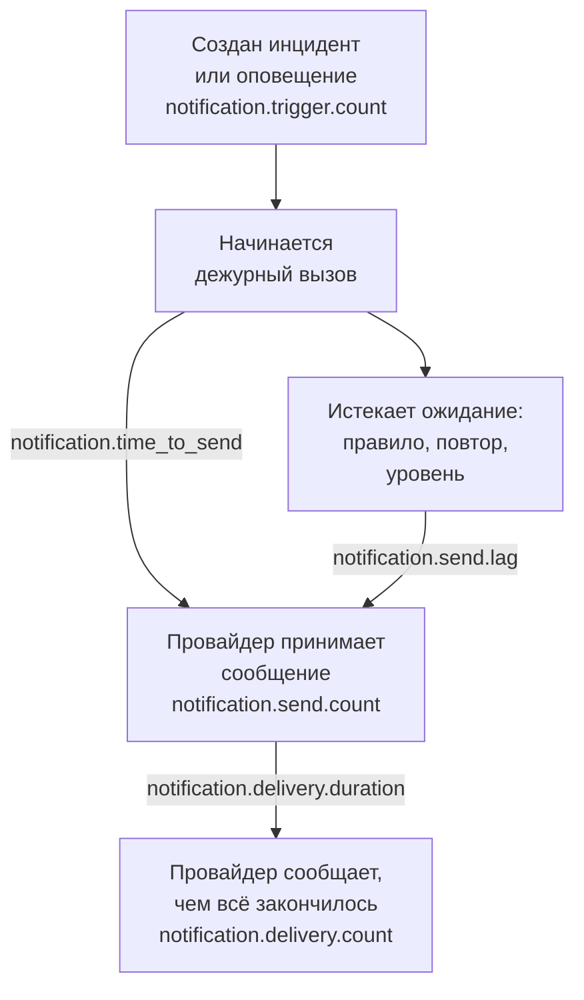

# Метрики доставки уведомлений

OneUptime записывает, как проходят отправляемые им уведомления: сколько инцидентов и оповещений их требуют, дошло ли каждое сообщение до своего провайдера, сколько времени ушло на отправку дежурного вызова и дошёл ли он до телефона. Отправляйте собственную телеметрию OneUptime в проект OneUptime или в любой бэкенд OpenTelemetry, чтобы задать цели доставки для людей, которых обслуживает ваша установка, и проверять, что вы их выполняете.

:::cards
- [Включите их](#включите-их): Две настройки, и без них ничего не записывается.
- [Метрики](#метрики): Семь метрик, от триггера до телефона.
- [Как измеряется время вызова](#как-измеряется-время-вызова): От чего отсчитываются время до отправки и задержка отправки.
- [SLO для начала](#slo-для-начала): Четыре цели, запрос за запросом.
:::

## Как это работает



Каждое сообщение учитывается в `notification.send.count`, на каждом канале, а не только дежурные вызовы. Два времени, `notification.time_to_send` и `notification.send.lag`, относятся только к дежурным вызовам.

## Включите их

Ничего не записывается, пока у OneUptime нет экспортёра OpenTelemetry: без него метрики ничего не стоят и нигде не хранятся. Направьте его в проект OneUptime с серверным [ключом приёма](/docs/telemetry/ingestion-keys) этого проекта или в любой бэкенд, который принимает OTLP по HTTP.

:::tabs
@tab Kubernetes
```yaml
openTelemetryExporter:
  endpoint: https://oneuptime.example.com/otlp
  headers: x-oneuptime-token=YOUR_INGESTION_KEY
```
Их отправляют развёртывания `app` и `worker`: оставьте `app.disableTelemetryCollection` и `worker.disableTelemetryCollection` равными `false`, значению по умолчанию.
@tab Docker Compose
```bash
OPENTELEMETRY_EXPORTER_OTLP_ENDPOINT=https://oneuptime.example.com/otlp
OPENTELEMETRY_EXPORTER_OTLP_HEADERS=x-oneuptime-token=YOUR_INGESTION_KEY
DISABLE_TELEMETRY_FOR_APP=false
```
Задайте их в `config.env`, затем выполните `npm start`. `DISABLE_TELEMETRY_FOR_APP` по умолчанию равен `true`, и тогда ничего не отправляется.
:::

OneUptime нужны и конечная точка, и заголовки: без заголовка он ничего не отправляет. Записывайте каждый заголовок как `name=value`, а несколько заголовков разделяйте символом `;`. Значение может содержать `=`. OneUptime сам добавляет `/v1/metrics` к конечной точке, и те же настройки отправляют также его собственные трассировки и журналы. Каждая метрика появляется, как только OneUptime впервые её записывает: `notification.send.count` — с первым отправленным сообщением.

### Отправляйте дельты в проект OneUptime

OneUptime отправляет счётчики и гистограммы так, как OpenTelemetry делает по умолчанию: каждая точка содержит нарастающий итог с момента запуска этого серверного процесса. Обозреватель метрик складывает точки в каждом шаге графика, поэтому он точно читает количества и перцентили за диапазон времени только из дельт — точек, которые содержат то, что произошло после предыдущей. Когда метрики идут в проект OneUptime, отправляйте дельты:

:::tabs
@tab Kubernetes
```yaml
extraEnv:
  - name: OTEL_EXPORTER_OTLP_METRICS_TEMPORALITY_PREFERENCE
    value: delta
```
Собственный список сервиса заменяет общий для чарта: если вы задаёте `app.extraEnv` или `worker.extraEnv`, добавьте её и туда.
@tab Docker Compose
```yaml title="docker-compose.override.yml"
services:
  app:
    environment:
      OTEL_EXPORTER_OTLP_METRICS_TEMPORALITY_PREFERENCE: delta
```
Создайте его рядом с `docker-compose.yml` или добавьте это в уже имеющийся, затем выполните `npm start`.
:::

Это касается каждой метрики, которую OneUptime отправляет о себе. Бэкенду, который сам читает нарастающие итоги, например Prometheus, ничего менять не нужно.

## Метрики

| Метрика | Тип | Единица | На что отвечает |
| --- | --- | --- | --- |
| `notification.trigger.count` | Счётчик | `1` | Сколько записей потребовали уведомлений |
| `notification.send.count` | Счётчик | `1` | Как прошло каждое сообщение, переданное провайдеру |
| `notification.send.duration` | Гистограмма | `ms` | Сколько времени провайдер принимал его |
| `notification.time_to_send` | Гистограмма | `ms` | Через сколько после своего триггера вызов дошёл до своего провайдера |
| `notification.send.lag` | Гистограмма | `ms` | Через сколько после срока уведомление, отправленное позже, дошло до своего провайдера |
| `notification.delivery.count` | Счётчик | `1` | Чем закончились сообщения, принятые провайдерами |
| `notification.delivery.duration` | Гистограмма | `ms` | Через сколько после принятия провайдером сообщение завершилось |

Каждый атрибут содержит одно из немногих фиксированных значений, никогда не проект, человека, номер телефона или запись. Единственное исключение — ID и имя пользовательского канала: в установке их немного, и различать их — в этом и смысл.

### Записи, которые уведомляют людей

`notification.trigger.count` учитывает каждый инцидент, оповещение, эпизод инцидента и эпизод оповещения при их создании.

| Атрибут | Значения |
| --- | --- |
| `notification.trigger.type` | `incident`, `alert`, `incident_episode`, `alert_episode` |
| `notification.trigger.source` | `automatic`, когда его создал OneUptime, по монитору или правилу; `manual`, когда это сделал человек или API |
| `monitor.type` | Тип монитора, создавшего инцидент или оповещение, например `Incoming Request`, `Logs` или `Metrics`; не указывается, если монитор его не создавал |

### Сообщения, переданные провайдеру

`notification.send.count` учитывает каждое сообщение, переданное провайдеру, а `notification.send.duration` измеряет время обращения к провайдеру. Обе несут эти атрибуты:

| Атрибут | Значения |
| --- | --- |
| `notification.channel` | `email`, `sms`, `call`, `whatsapp`, `telegram`, `push`, `webhook`, `slack`, `microsoft_teams`, `mattermost`, `custom_channel` |
| `notification.provider` | `twilio`, `sms_and_call_gateway`, `smtp`, `sendgrid`, `amazon_ses`, `mailgun`, `postmark`, `resend`, `microsoft_graph`, `expo`, `push_relay`, `web_push`, `meta_whatsapp`, `telegram_bot_api`, `slack`, `microsoft_teams`, `mattermost`, `webhook`, `custom_channel` или `none`, когда ничего никому не передано |
| `notification.provider.config` | `global` для собственной учётной записи и настроек установки; `project` для собственной учётной записи Twilio, SMTP-сервера, вебхука или подключения рабочего пространства проекта, чьи сбои проекту и исправлять |
| `notification.on_call_page` | `true` для уведомления дежурного вызова, иначе `false` |
| `outcome` | `success`, `failure` или `not_sent`, как ниже |
| `notification.destination` | Slack, Microsoft Teams и Mattermost: `direct_message` одному человеку, `channel` для публикации в канал или групповой чат Teams, `incoming_webhook` для входящего вебхука, например подписчика страницы статуса. Вебхуки: `status_page_subscriber` для собственного вебхука подписчика страницы статуса. Отсутствует у вебхука человека и у всех остальных каналов |
| `notification.custom_channel.id`, `notification.custom_channel.name` | Только пользовательские каналы: ID канала и его имя, обрезанное до 100 символов |

- `success`: провайдер принял сообщение.
- `failure`: провайдер отклонил его или был недоступен, либо отправка не удалась. Чат-канал, который не удалось найти, — это сбой без длительности.
- `not_sent`: намеренно не отправлено. Проект отключил канал, у него слишком мало средств на балансе или он заблокирован, push отключены на этом сервере, либо пользовательский канал отключён, удалён или не покрыт лицензией. Доля успешных их не учитывает: это работают настройки, а не сбоит платформа.

Сообщение на собственный вебхук подписчика страницы статуса считается один раз, сколько бы попыток ни было: `success`, когда конечная точка ответила статусом 2xx, и `failure`, когда она ответила другим статусом, была недоступна или её адрес не разрешён.

### Что дошло до телефона

`notification.delivery.count` учитывает, чем закончилось каждое сообщение, принятое провайдером, по более позднему отчёту провайдера, один раз на сообщение. `notification.delivery.duration` измеряет, сколько прошло после того, как провайдер его принял. Обе несут `notification.channel`, `notification.provider`, `notification.provider.config`, `notification.on_call_page` и `outcome`, итоговый статус:

| Канал | Провайдер | `outcome` | Длительность |
| --- | --- | --- | --- |
| `sms` | `twilio` | `delivered`, `undelivered`, `failed` | Пока Twilio не сообщит статус |
| `call` | `twilio` | `answered`, `not_answered`, `failed` | Пока на звонок не ответили, а иначе пока он не завершился |
| `push` | `expo`, `push_relay` | `delivered`, `undelivered`, `failed` | Не измеряется: квитанция говорит, принял ли push Apple или Google, но не когда |
| `whatsapp` | `meta_whatsapp` | `delivered`, `failed` | Пока Meta не сообщит статус |

Звонок, который прозвонил без ответа, был занят или отклонён, — это `not_answered`. Push в приложение, которого больше нет, — это `undelivered`, а прочитанное сообщение WhatsApp считается доставленным. `notification.provider.config` равен `project` только для SMS и звонков через собственную учётную запись Twilio проекта.

Статусы приходят только там, где провайдер может о них сообщить:

- SMS и звонки: через Twilio, когда Twilio может достучаться до вашего сервера по его `HOST` (см. [Интеграция с Twilio](/docs/self-hosted/twilio-integration#3-настройте-сетевой-доступ)). Шлюз SMS и звонков их не сообщает.
- WhatsApp: когда вебхук Meta настроен для вашей установки.
- Push: из квитанций Expo, которые OneUptime читает примерно через 15 минут после push, в том числе через push-ретранслятор. Его учитывает установка, отправившая push.
- Email, Telegram, вебхуки, чаты и пользовательские каналы не сообщают итоговый статус.

## Как измеряется время вызова

### Время до отправки

`notification.time_to_send` идёт от триггера вызова до принятия уведомления провайдером. Оно измеряет только уведомления, положенные в момент начала вызова: людей первого правила эскалации, по их дежурным правилам, которые ничего не ждут, и любой уровень, на который вызов сразу переходит, потому что никого не застал. Ожидания, которые задаёт дежурная конфигурация, — это не задержка платформы, поэтому они не учитываются: они входят в [задержку отправки](#задержка-отправки). Измеряются только уведомления, которые принял провайдер; сбой виден в `notification.send.count`.

| Атрибут | Значения |
| --- | --- |
| `notification.channel` | Как у `notification.send.count` |
| `notification.page.start` | От чего идёт время, как ниже |
| `notification.trigger.type` | Запись, к которой относится вызов: `incident`, `alert`, `incident_episode`, `alert_episode` |
| `notification.custom_channel.id`, `notification.custom_channel.name` | Только пользовательские каналы |

| `notification.page.start` | Время идёт от |
| --- | --- |
| `monitor_data_received` | Когда OneUptime получил данные, которые сработали в мониторе: входящий запрос, отчёт серверного агента, входящее письмо, проверку пробы, SNMP-трап или опрос сетевого устройства. Сюда входит время, которое данные ждали в очереди на оценку. |
| `record_created` | Когда был создан инцидент, оповещение или эпизод: монитором телеметрии, правилом или человеком, а также при проверке отсутствия, например остановившегося heartbeat. |
| `page_started` | Когда вызов начался позже: его запустил человек, рабочий процесс или правило, которое теперь совпадает, или это прямой вызов. Для вызова, который удерживало его дежурное правило или OneUptime AI, — когда удержание истекло или когда он начался, если это было раньше. Для повторного вызова — когда истёк тайм-аут после подтверждения. Так воркер, опоздавший к любому из них, виден во времени. |

Для входящего запроса время идёт от последнего запроса, полученного конечной точкой, поэтому оно может оказаться немного меньше.

### Задержка отправки

`notification.send.lag` идёт от момента, когда уведомление, отправленное позже, стало положено, до принятия его провайдером. Их отправляют два воркера, каждый раз в минуту, поэтому воркер, работающий вовремя, показывает примерно до минуты, а отставший показывает, на сколько.

| `notification.schedule` | Положено, когда |
| --- | --- |
| `rule_wait` | Дежурное правило человека, которое ждёт, например «позвони мне через 10 минут»: через столько после вызова человека. Никогда не раньше, чем воркер в последний раз прошёл по его правилам, поэтому правило, добавленное или изменённое позже, положено с того момента. |
| `repeat` | Push, повторяемый, пока кто-нибудь не подтвердит: каждый раз, когда истекает его интервал. |
| `escalation` | Более поздний уровень эскалации: когда уровень перед ним закончил своё ожидание, или сразу, когда человек передаёт вызов дальше. |
| `policy_repeat` | Политика, начинающаяся заново с первого уровня: когда истекло ожидание её последнего уровня. |

Она также несёт `notification.channel`, `notification.trigger.type` и, для пользовательских каналов, `notification.custom_channel.id` и `notification.custom_channel.name`. Уведомление, положенное в момент начала его вызова, в неё никогда не попадает, даже когда воркер начал вызов с опозданием, после удержания или как повторный вызов: оно во времени до отправки.

### Корзины гистограмм

У каждой гистограммы свои границы корзин, в миллисекундах, выбранные так, чтобы цель можно было прочитать на границе:

| Гистограмма | Границы корзин, в миллисекундах |
| --- | --- |
| `notification.send.duration` | `5, 10, 25, 50, 100, 250, 500, 1000, 2500, 5000, 10000, 30000, 60000, 120000` |
| `notification.time_to_send` | `250, 500, 1000, 2000, 5000, 10000, 15000, 30000, 60000, 120000, 300000, 600000, 1800000, 3600000` |
| `notification.send.lag` | `1000, 5000, 10000, 15000, 30000, 45000, 60000, 75000, 90000, 120000, 180000, 300000, 600000, 1800000, 3600000` |
| `notification.delivery.duration` | `500, 1000, 2000, 5000, 10000, 15000, 30000, 60000, 120000, 300000, 600000, 1800000, 3600000, 14400000, 86400000` |

Перцентиль вычисляется по корзинам и рисуется как середина корзины, в которую он попадает. Поэтому сравнивайте его с границей корзины: P95 для `notification.time_to_send` на уровне 30000 или ниже означает, что 95% вызовов заняли 30 секунд или меньше.

## SLO для начала

Четыре цели, которые может пообещать большинство установок, каждая построена из одного или двух запросов в обозревателе метрик проекта, который получает метрики. Они точно читают диапазон времени, когда метрики приходят как дельты: см. [Отправляйте дельты в проект OneUptime](#отправляйте-дельты-в-проект-oneuptime).

### Постройте цель в обозревателе метрик

:::steps
1. Откройте [Обозреватель метрик](/docs/telemetry/metrics-explorer) проекта и нажмите первую метрику цели. Её запрос — `a`.
2. Выберите её агрегацию в **Aggregate by**. Затем откройте **Filters & grouping** и добавьте каждое из её условий в **Filter by attributes**.
3. Для второго запроса нажмите **Добавить метрику** и настройте `b` так же.
4. Для формулы нажмите **Добавить формулу** и введите её в **Формула**.
5. Чтобы узнавать, когда цель не выполнена, нажмите **Действия → Создать монитор из этого представления** и оповещайте, когда значение выходит за цель: см. [Мониторинг метрик](/docs/monitor/metrics-monitor).
:::

Чтобы следить за целью в течение 30 дней с бюджетом ошибок, привяжите этот монитор к [SLO](/docs/slo/introduction): он считает время, когда цель не выполнялась.

### Дежурные SMS доходят до Twilio

Не более 1% дежурных SMS, отправленных через собственную учётную запись Twilio установки, завершаются сбоем, то есть 99% принимаются.

| Запрос | Метрика | Агрегация | Условия |
| --- | --- | --- | --- |
| `a` | `notification.send.count` | **Сумма** | `notification.channel = sms`, `notification.on_call_page = true`, `notification.provider.config = global`, `outcome != not_sent` |
| `b` | `notification.send.count` | **Сумма** | То же, с `outcome = failure` |

Формула `$b / $a * 100` — это доля сбоев, и цель выполняется, пока она остаётся на уровне 1 или ниже. Шаг без сбоев не рисует точку, так как у `b` её нет. `outcome != not_sent` исключает то, что придержали собственные настройки проектов, а `global` — собственные учётные записи Twilio проектов. В установке, которая отправляет SMS через свой шлюз SMS и звонков, те же запросы измеряют шлюз. Для другого канала замените `sms`: `call`, `push` или `email`.

### Вызовы уходят в течение 30 секунд

95% дежурных вызовов доходят до своего провайдера в течение 30 секунд после своего триггера.

| Запрос | Метрика | Агрегация | Условия |
| --- | --- | --- | --- |
| `a` | `notification.time_to_send` | **P95** | `notification.page.start != page_started` |

Цель выполняется, пока `a` остаётся на уровне 30000 или ниже. Вызовы, начатые позже, измеряются от момента их начала или срока, а не от триггера, поэтому они не учитываются. Группируйте по `notification.page.start`, чтобы видеть очередь мониторов (`monitor_data_received`) отдельно от остального, или по `notification.channel`, чтобы найти медленный канал.

### Уведомления, отправленные позже, уходят в течение 90 секунд

99% уведомлений, отправленных после ожидания, доходят до своего провайдера в течение 90 секунд после срока.

| Запрос | Метрика | Агрегация | Условия |
| --- | --- | --- | --- |
| `a` | `notification.send.lag` | **P99** | — |

Цель выполняется, пока `a` остаётся на уровне 90000 или ниже. Группируйте по `notification.schedule`, чтобы видеть, какой воркер отстал: `rule_wait` и `repeat` относятся к одному воркеру, `escalation` и `policy_repeat` — к другому.

### Дежурные SMS доходят до телефона

Не более 5% дежурных SMS, которые Twilio принял для собственной учётной записи установки, остаются недоставленными.

| Запрос | Метрика | Агрегация | Условия |
| --- | --- | --- | --- |
| `a` | `notification.delivery.count` | **Сумма** | `notification.channel = sms`, `notification.on_call_page = true`, `notification.provider.config = global` |
| `b` | `notification.delivery.count` | **Сумма** | То же, с `outcome != delivered` |

Формула `$b / $a * 100` — это доля недоставленных. Часть её определяют операторы связи и выключенные телефоны, поэтому задайте цель по тому, что вы видите за несколько недель. Для звонков используйте `call` и `outcome != answered`. Twilio должен иметь возможность достучаться до вашего сервера: см. [Что дошло до телефона](#что-дошло-до-телефона).

## Устранение неполадок

:::details Метрики уведомлений не приходят
Проверьте, что заданы и `OPENTELEMETRY_EXPORTER_OTLP_ENDPOINT`, и `OPENTELEMETRY_EXPORTER_OTLP_HEADERS`, а в Docker Compose — что `DISABLE_TELEMETRY_FOR_APP` равен `false`, затем перезапустите OneUptime. При запуске OneUptime записывает в журнал предупреждение, если не может прочитать заголовок или если ничего не отправляет. Метрика появляется только после того, как что-то записано, поэтому сначала отправьте уведомление.
:::

:::details Количество только растёт, или перцентиль почти не меняется
Метрики приходят как нарастающие итоги. Отправляйте дельты: см. [Отправляйте дельты в проект OneUptime](#отправляйте-дельты-в-проект-oneuptime).
:::

:::details Итоговые статусы не приходят
Итоговые статусы приходят от провайдеров, позже, и только там, где они могут о них сообщить: см. [Что дошло до телефона](#что-дошло-до-телефона). В установке, до которой Twilio не может достучаться, SMS и звонки учитываются как отправленные, но никогда как доставленные.
:::

## Следующие шаги

:::cards
- [Обозреватель метрик](/docs/telemetry/metrics-explorer): Стройте графики, объединяйте и сравнивайте любые метрики.
- [Мониторинг метрик](/docs/monitor/metrics-monitor): Оповещайте, когда цель не выполнена.
- [Интеграция с Twilio](/docs/self-hosted/twilio-integration): Пусть Twilio сообщает, что дошло до телефона.
- [Правила эскалации](/docs/on-call/escalation-rules): Ожидания, от которых отсчитывается задержка отправки.
:::
