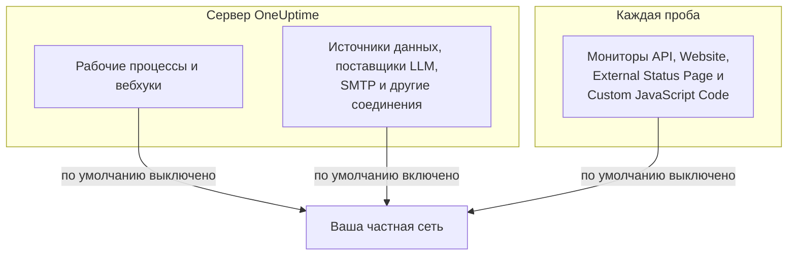

# Доступ к частной сети

OneUptime отказывается отправлять некоторые исходящие запросы на хосты, которые разрешаются в частный диапазон, диапазон loopback или link-local. Если вы пробовали направить рабочий процесс на внутренний инструмент, вы видели сообщение:

> Webhook URL resolves to a private, loopback, or link-local address and is not allowed

Для облачного продукта такое поведение по умолчанию правильно: там зарегистрироваться может кто угодно, а цель вебхука — недоверенный ввод. В самостоятельно размещённом экземпляре оно мешает самому обычному делу: отправить оповещение в самостоятельно размещённый Mattermost, Jira или систему заявок, которая существует только в вашей собственной сети.

Эта страница объясняет, как разрешить это — осознанно и узко. Решают три переключателя, каждый для своего вида соединений, и настраиваются они на разных машинах:

| Что вы хотите достигать внутри сети | Где находится настройка | По умолчанию при самостоятельном размещении |
| --- | --- | --- |
| Рабочие процессы, вебхуки проекта, пользовательские вебхуки дежурств | Окружение **API-сервера** | Частные адреса запрещены |
| Источники данных, поставщики LLM, SMTP-серверы, обнаружение OIDC и другие соединения | Окружение **API-сервера** | Частные адреса разрешены |
| **Мониторы** API, Website, External Status Page и Custom JavaScript Code | Собственное окружение **пробы** | Частные адреса запрещены |



Сетевые типы мониторов, такие как Ping, Port, SSL-сертификат, DNS, DNSSEC, SNMP / Сетевое устройство, SQL-запрос, Состояние базы данных, Synthetic и Network Path, используют собственные транспорты. Настройка на этой странице управляет HTTP-транспортами, которые возвращают проекту произвольное содержимое ответа: мониторами API, Website, External Status Page и Custom JavaScript Code.

:::cards
- [Вебхуки и рабочие процессы](#вебхуки-и-рабочие-процессы): Разрешите вебхуку отправлять запросы в вашу сеть.
- [Другие исходящие соединения](#другие-исходящие-соединения): Источники данных, поставщики LLM и почтовые серверы.
- [Пробы и мониторы](#пробы-и-мониторы): Позвольте пробе проверять частные сайты.
- [Проверка работы](#проверка-работы): Прочитайте, какой переключатель называет отказ.
:::

## Что заблокировано и что можно разблокировать

Заблокированные цели делятся на два уровня.

| Уровень | Диапазоны | Можно ли разрешить? |
| --- | --- | --- |
| **Частный** | RFC-1918 (`10.0.0.0/8`, `172.16.0.0/12`, `192.168.0.0/16`), CGNAT (`100.64.0.0/10`), IPv6 unique-local (`fc00::/7`) и site-local (`fec0::/10`) | Да |
| **Запрещённый** | Loopback (`127.0.0.0/8`, `::1`), неуказанный адрес, link-local (`169.254.0.0/16`, `fe80::/10`), multicast, зарезервированные, broadcast, а также имена `localhost` и `metadata.google.internal` | Только если указать точный хост или CIDR в списке разрешённых для вебхуков. Для мониторов — никогда. |

Эндпоинт облачных метаданных `169.254.169.254` находится на запрещённом уровне не случайно. На облачной виртуальной машине он выдаёт IAM-учётные данные экземпляра всему, что может выполнить HTTP-запрос с этой машины, поэтому никакая общая настройка его никогда не откроет.

Записи IPv6, внутри которых содержится цель IPv4, — IPv4-mapped (`::ffff:10.0.0.5`), NAT64, 6to4, Teredo, — классифицируются по адресу IPv4, к которому они ведут, поэтому с их помощью нельзя протащить запрещённый адрес через разрешение для частного уровня.

## Вебхуки и рабочие процессы

Эти назначения охвачены, потому что цель — URL, который написал аутентифицированный участник вашего проекта:

- Компоненты **API** в рабочих процессах (GET / POST / PUT / PATCH / DELETE)
- HTTP-запросы, которые выполняет компонент рабочего процесса **Custom JavaScript**
- Уведомления вебхуков проекта (инциденты, оповещения, мониторы, дежурства, плановое обслуживание, события страниц статуса)
- **Пользовательские вебхуки** дежурств

**Не** охвачены и никогда не будут: **вебхуки подписчиков страниц статуса**. Любой посетитель публичной страницы статуса может зарегистрировать такой вебхук, поэтому ослабление этого назначения позволило бы кому угодно в интернете заставить ваш сервер отправлять POST-запросы в вашу частную сеть. Это не настраивается.

Исходящие соединения, которые не являются вебхуками, — внешние источники данных, поставщики LLM, SMTP-серверы (настройки SMTP проекта и компонент рабочего процесса **Email**), эндпоинты токенов SMTP OAuth, обнаружение OIDC и HTTP-шаги runbook-ов, — управляются отдельно, через `DATA_SOURCE_BLOCK_PRIVATE_ADDRESSES`, и при самостоятельном размещении уже разрешают частные диапазоны. См. [Другие исходящие соединения](#другие-исходящие-соединения).

### Настройка API-сервера

Задайте одну или обе переменные на API-сервере и перезапустите его. По умолчанию они выключены, поэтому экземпляр, где не задана ни одна из них, ведёт себя ровно так же, как раньше.

| Переменная | Значение Helm | Что разрешает |
| --- | --- | --- |
| `ALLOW_PRIVATE_NETWORK_WEBHOOKS` | `webhooks.allowPrivateNetwork` | Весь частный уровень, если задано `true`. |
| `PRIVATE_NETWORK_WEBHOOK_ALLOWLIST` | `webhooks.privateNetworkAllowlist` | Перечисленные в ней хосты и CIDR, на каком бы уровне они ни были. |

:::tabs
@tab Docker Compose
```bash title="config.env"
ALLOW_PRIVATE_NETWORK_WEBHOOKS=true
PRIVATE_NETWORK_WEBHOOK_ALLOWLIST=mattermost.internal,*.svc.cluster.local,10.20.0.0/16
```
@tab Kubernetes
```yaml title="values.yaml"
webhooks:
  allowPrivateNetwork: true
  privateNetworkAllowlist: "mattermost.internal,10.20.0.0/16"
```
:::

В Docker Compose в `config.env` есть строка `ALLOW_PRIVATE_NETWORK_WEBHOOKS=false`: измените её, а не добавляйте вторую, затем выполните `npm run start`. В Kubernetes обновите релиз.

Записи списка разрешённых можно разделять запятыми, пробелами или переводами строк, и каждая может быть:

- именем хоста — `mattermost.internal`
- шаблоном — `*.svc.cluster.local` (совпадает с поддоменами, но не с самим суффиксом)
- адресом IPv4 или IPv6 — `10.20.30.40`, `fd00::1`
- CIDR — `10.20.0.0/16`, `fd12:3456::/32`

Схема, порт, путь или данные пользователя в записи отбрасываются, поэтому можно просто вставить URL вебхука, который у вас уже есть.

Имени хоста из списка разрешённых доверяют **без проверки DNS** — в этом и смысл его указания, ведь ожидается, что оно разрешится в то, что список блокировки отклонил бы. Запись с адресом сравнивается с литералом в URL и с каждым адресом, который для него возвращает DNS.

> [!CAUTION]
> **Никогда не добавляйте в список разрешённых `169.254.169.254` или любой диапазон, который его содержит.** На облачной виртуальной машине это даёт каждому участнику проекта IAM-учётные данные вашего экземпляра.

## Другие исходящие соединения

Вторая защита охватывает исходящие соединения, цель которых выбирает участник проекта, но которые не являются вебхуками:

- внешние источники данных (соединения PostgreSQL, MySQL, SQL Server, ClickHouse, Elasticsearch и REST API), соединения событий безопасности, например Splunk, и потоки threat intel
- поставщики LLM, в том числе самостоятельно размещённые Ollama или vLLM
- SMTP-серверы — настройки SMTP проекта и компонент рабочего процесса **Email**, — а также URL токенов OAuth для SMTP и рабочих процессов
- обнаружение OIDC для единого входа
- проверка собственных доменов страниц статуса и дашбордов
- HTTP-шаги runbook-ов
- URL API Grafana OnCall, из которого читает импорт (**Настройки проекта** > **Базовый** > **Импорт из другого инструмента**)

Эта защита работает наоборот по сравнению с настройками вебхуков. При самостоятельном размещении она по умолчанию **разрешает** частный уровень, потому что база данных, почтовый сервер или сервер моделей, к которым подключаются эти соединения, обычно находятся в вашей собственной сети. Запрещённый уровень — loopback, link-local и эндпоинт облачных метаданных — запрещён в любом случае, и списка разрешённых для него нет.

`DATA_SOURCE_BLOCK_PRIVATE_ADDRESSES` делает её строже. Задайте `true`, чтобы запретить частный уровень и для этих соединений, например когда проекты в вашем экземпляре принадлежат людям, которые не должны достигать вашей внутренней сети:

:::tabs
@tab Docker Compose
```bash title="config.env"
DATA_SOURCE_BLOCK_PRIVATE_ADDRESSES=true
```
@tab Kubernetes
```yaml title="values.yaml"
outboundConnections:
  blockPrivateNetwork: true
```
:::

Эта настройка не применяется к глобальному поставщику LLM, которого настраивает администратор, а не проект (переменными `GLOBAL_LLM_PROVIDER_*`, значением `vllm.globalProvider` в чарте Helm или в приложении «Панель администратора» в разделе **Настройки** > **Глобальные LLM-провайдеры**): такой поставщик по-прежнему может достигать частных адресов, хотя loopback и link-local для него тоже остаются запрещёнными.

Включает её только точное значение `true`. В экземпляре с `BILLING_ENABLED=true` она включена всегда, что бы вы ни задали. Она не меняет, какие цели разрешают настройки вебхуков выше или настройка проб ниже; каждый барьер настраивается сам по себе. Зато она меняет формулировку отказов, в том числе для вебхуков и запросов рабочих процессов: когда она включена, о запрещённом имени хоста сообщается без указания того, во что оно разрешилось (см. [Проверка работы](#проверка-работы)).

В Docker Compose в `config.env` есть строка `DATA_SOURCE_BLOCK_PRIVATE_ADDRESSES=false` (добавьте её, если ваш `config.env` старше). Измените эту строку на `true`, а не добавляйте вторую, затем выполните `npm run start`, чтобы контейнеры пересоздались с новым значением; `docker compose restart` не перечитывает `config.env`. В Kubernetes задайте её в файле values и обновите релиз; чарт передаёт её подам приложения и воркера.

Когда она включена, о запрещённом имени хоста сообщается без указания того, во что оно разрешилось, например _"LLM provider host ollama.internal could not be reached."_ Имя, которое не разрешается вовсе, получает то же сообщение, поэтому участники проекта не могут с помощью этих полей выяснить, какие внутренние имена существуют. Адрес, введённый как IP, по-прежнему называется вместе с причиной, например _"LLM provider host 10.0.4.12 is not allowed: private network address."_ При `LOG_LEVEL=DEBUG` приложение записывает в лог адрес, в который разрешилось каждое запрещённое имя.

## Пробы и мониторы

Затронуты четыре типа мониторов: **API**, **Веб-сайт**, **External Status Page** и **Custom JavaScript Code**. На стандартной пробе они могут достигать публичных HTTP(S)-целей, но отклоняют частное адресное пространство. Мониторы API, Website и External Status Page проверяют и закрепляют результаты DNS для каждого соединения и заново проверяют каждое перенаправление; Custom JavaScript Code применяет ту же политику адресов в мосте своей песочницы.

Переключатель читает **процесс пробы из собственного окружения**, а не из окружения API-сервера, и его читает каждая проба: поставляемые с Docker Compose, развёртываемые чартом Helm и любая [собственная проба](/docs/probe/custom-probe), которую вы запускаете сами. Тот, кто развёртывает пробу, управляет её окружением и знает, какую сеть эта проба видит: собственная проба — обычно другая машина, часто под управлением другого человека, и она никогда не читает конфигурацию API-сервера.

:::tabs
@tab Docker Compose
В `config.env` уже есть строка `PROBE_ALLOW_PRIVATE_NETWORK_MONITORS=false`: измените эту строку на `true`, а не добавляйте вторую, потому что, когда переменная встречается дважды, побеждает более поздняя строка. Затем выполните `npm run start`, который пересоздаёт контейнеры с новым значением; `docker compose restart` не перечитывает `config.env`. Эту одну строку читает каждая поставляемая проба, поэтому она относится к `probe-1` и, если ваш стек запускает вторую пробу, к `probe-2`.

```bash title="config.env"
PROBE_ALLOW_PRIVATE_NETWORK_MONITORS=true
```
@tab Kubernetes
Задайте его для каждой пробы в файле values и обновите релиз. Каждая запись в `probes:` — отдельная проба, поэтому задайте его на каждой, которая должна достигать частных адресов:

```yaml title="values.yaml"
probes:
  one:
    allowPrivateNetworkMonitors: true
```
:::

На собственной пробе задайте `PROBE_ALLOW_PRIVATE_NETWORK_MONITORS=true` в собственном окружении этой пробы и перезапустите её. Значение должно быть ровно `true`; любое другое, например `TRUE` или `1`, оставляет переключатель выключенным, и проба сообщает об этом предупреждением при запуске, какое бы значение ни имел `LOG_LEVEL`.

Поставляемые пробы — **глобальные пробы**: они регистрируются с `REGISTER_PROBE_KEY` экземпляра, и их может выбрать любой проект экземпляра. Поэтому включение переключателя на поставляемой пробе позволяет мониторам **каждого проекта экземпляра** достигать через неё частных адресов. Обычно именно этого и хочет установка для одной команды. Там, где проекты не должны делить такой доступ, — отдельные команды или клиенты, которых вы размещаете, — оставьте его выключенным на поставляемых пробах и вместо этого разверните частную (собственную) пробу внутри каждой сети, включённую только там.

Есть одно исключение. Проба, которая регистрируется с `REGISTER_PROBE_KEY` и имеет `BILLING_ENABLED=true` в собственном окружении, — глобальная проба облачного продукта с открытой регистрацией, где зарегистрироваться может кто угодно и все проекты делят глобальные пробы, — остаётся только публичной даже с включённым переключателем и при запуске пишет в лог предупреждение, что не учитывает его. Пробы, поставляемые с Docker Compose и чартом Helm, получают `BILLING_ENABLED` экземпляра автоматически; передайте его и любой другой пробе с `REGISTER_PROBE_KEY`, которую вы запускаете для такого экземпляра. Иначе проба не может узнать, что она глобальная, поэтому глобальная проба, созданная в приложении «Панель администратора» и запущенная с `PROBE_ID` и `PROBE_KEY`, учитывает переключатель как частная: не включайте его там, если проекты не должны делить сеть этой пробы. Частная проба учитывает переключатель в любом экземпляре.

Каждая проба при запуске пишет в лог свою действующую политику частных сетей: включён ли мониторинг частных сетей или выключен, и почему. Значение, которое не учитывается, и глобальная проба, которую переключатель открывает для всех проектов, записываются как предупреждения на любом `LOG_LEVEL`. Обычная строка «включено» или «выключено» и JSON «Probe environment», который фиксирует то же решение в `privateNetworkMonitors`, записываются при `LOG_LEVEL=INFO` — значении по умолчанию в чарте Helm; Docker Compose поставляется с `LOG_LEVEL=ERROR`, поэтому, чтобы увидеть их там, задайте `LOG_LEVEL=INFO`. Сначала проверьте этот лог, если монитор на только что изменённой пробе по-прежнему отклоняется.

Включение **не** открывает loopback, link-local и эндпоинт облачных метаданных. Они остаются запрещёнными на каждой пробе, что важнее всего для проб, работающих в сети, которая не принадлежит автору монитора.

> [!WARNING]
> Оставьте его выключенным на пробах, которые вы обслуживаете от имени других людей.

## Проверка работы

Запустите рабочий процесс или монитор снова. Если он по-прежнему отклоняется, сообщение об ошибке называет, какой барьер закрыт:

- _"...points to a private network address and is not allowed. Self-hosted instances can allow this by setting `ALLOW_PRIVATE_NETWORK_WEBHOOKS`..."_ — не задана настройка API-сервера.
- _"...private network address... Set PROBE_ALLOW_PRIVATE_NETWORK_MONITORS=true on the probe running this monitor to allow it."_ — монитор запустила частная (собственная) проба, и её переключатель выключен. Обратите внимание: он задаётся на пробе, а не на API-сервере.
- _"...private network address... Set PROBE_ALLOW_PRIVATE_NETWORK_MONITORS=true on the probe running this monitor to allow it (probes.<name>.allowPrivateNetworkMonitors in the Helm chart). This is a global probe, so that allows it for every project on this instance; otherwise, select a private probe deployed on that network."_ — монитор запустила поставляемая (глобальная) проба, и её переключатель выключен. Включите его для этой пробы, как описано выше, если каждому проекту экземпляра можно достигать этой сети; иначе выберите для монитора частную пробу.
- _"...Global probes cannot monitor private network addresses. Deploy and select a private probe for this target."_ — монитор запустила глобальная проба с `BILLING_ENABLED=true` в окружении. Автоматически зарегистрированные глобальные пробы остаются там только публичными, что бы ни говорил их переключатель; разверните частную пробу внутри сети цели и выберите её для монитора.
- _"Monitor target host ... could not be reached."_ — монитор API, Website или External Status Page, цель которого — **имя хоста**, сообщает это и когда имя разрешается в запрещённый адрес, и когда не срабатывает DNS, чтобы с помощью монитора нельзя было выяснить, какие внутренние имена существуют. Подробности ошибки, показанные вместе с ним, в обоих случаях упоминают `PROBE_ALLOW_PRIVATE_NETWORK_MONITORS`; какой случай произошёл, они не говорят. Если имя указывает на частный адрес, проверьте в стартовом логе пробы её политику частных сетей; если она выключена, решение то же, что и для сообщений выше. При `LOG_LEVEL=DEBUG` проба также пишет в лог точную причину для каждого запрещённого имени.
- _"Request URL could not be reached."_ — то же правило для монитора **Custom JavaScript Code**: скрипт, который обращается к **имени хоста**, получает это и когда имя разрешается в запрещённый адрес, и когда не срабатывает DNS. При `LOG_LEVEL=DEBUG` проба пишет в лог точную причину.
- _"Webhook URL could not be reached."_ или, из рабочего процесса, _"Request URL could not be reached."_ — экземпляр работает с `DATA_SOURCE_BLOCK_PRIVATE_ADDRESSES=true` (или `BILLING_ENABLED=true`), поэтому запрещённое **имя хоста** не объясняется: оно либо разрешилось в запрещённый адрес, либо не разрешилось вовсе. При `LOG_LEVEL=DEBUG` приложение или воркер пишут в лог, что именно, и адрес.
- _"...points to a private, loopback, or link-local address and is not allowed."_ — цель находится на запрещённом уровне. Для вебхука укажите точный хост или CIDR в `PRIVATE_NETWORK_WEBHOOK_ALLOWLIST`, если это действительно нужно. Для монитора исключений нет.
- _"...hostname could not be resolved via DNS."_ — контейнер не может разрешить имя. Проверьте, что он находится в одной сети с целью.

## Заметки о безопасности

Открытие этого доступа действительно меняет то, к чему можно заставить обращаться ваш экземпляр OneUptime, поэтому стоит подходить к нему осознанно:

- **Предпочитайте список разрешённых общему переключателю.** Указать `mattermost.internal` — гораздо меньшее разрешение, чем открыть все адреса RFC-1918.
- **Любой, кто может создать рабочий процесс или монитор API, Website, External Status Page или Custom JavaScript Code, может достичь всего, что вы разрешили.** Относитесь к членству в этих проектах соответственно.
- **Тело ответа возвращается.** Компонент API в рабочем процессе возвращает статус, заголовки и тело в лог рабочего процесса, поэтому разрешённый хост можно читать, а не только отправлять на него данные.
- **Перенаправления никогда не выполняются** для запросов вебхуков, поэтому разрешённый публичный хост не может перебросить сервер на внутренний хост вторым прыжком.
- **По возможности ограничивайте доступ отдельными пробами, а не всем экземпляром.** Проба, развёрнутая внутри одной сети, — более узкое разрешение, чем открытие исходящего трафика API-сервера.

## Дальнейшие шаги

:::cards
- [Собственные пробы](/docs/probe/custom-probe): Запустите пробу внутри сети, которую она должна проверять.
- [Настройка рабочих процессов](/docs/workflows/configuration): Что могут достигать и делать шаги рабочих процессов.
- [Поставщики LLM](/docs/ai/llm-provider): Подключите OneUptime AI к модели в вашей сети.
- [Архитектура](/docs/self-hosted/architecture): Какая часть самостоятельно размещённой установки устанавливает каждое соединение.
:::
