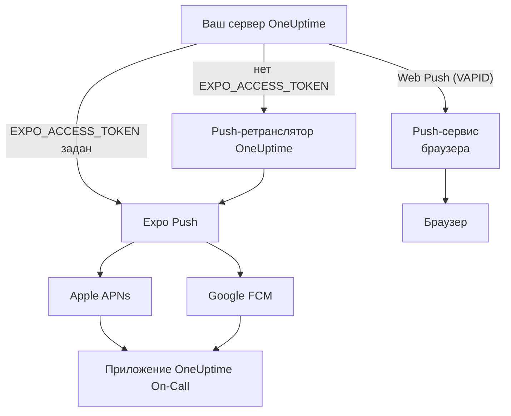
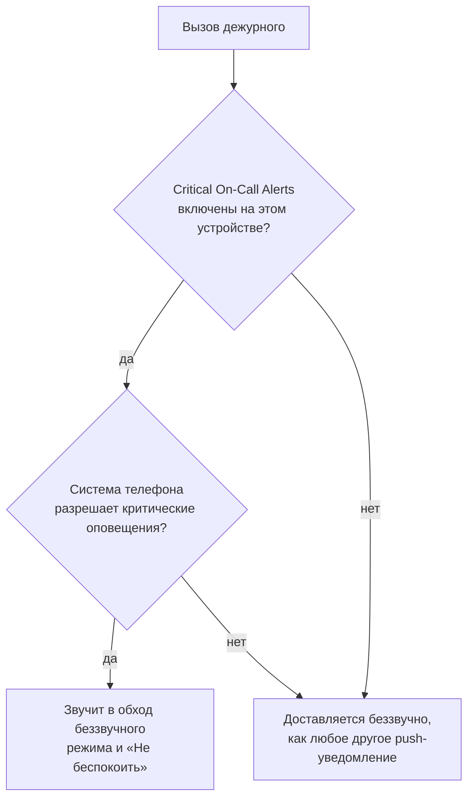

# Push-уведомления

OneUptime вызывает людей на телефоне через мобильное приложение **OneUptime On-Call**, а в браузере — через Web Push. Мобильные push-уведомления работают через **Expo Push**: самостоятельно размещённый экземпляр по умолчанию отправляет их через push-ретранслятор OneUptime, поэтому ему нужен исходящий сетевой доступ к ретранслятору и не нужны собственные учётные данные Expo, Apple или Google.

:::cards
- [Выберите способ отправки](#настройка-при-самостоятельном-размещении): Push-ретранслятор или ваш собственный токен доступа Expo.
- [Откройте межсетевой экран](#сетевой-доступ): Адреса, к которым обращаются ваш сервер и устройства ваших сотрудников.
- [Звонок сквозь беззвучный режим](#критические-вызовы-дежурных-в-обход-беззвучного-режима): Пусть вызовы дежурных звучат на телефоне без звука.
- [Исправьте push-уведомления, которые не доходят](#устранение-неполадок): Что означает каждая ошибка Expo.
:::

## Как это работает



Мобильное приложение OneUptime регистрирует на бэкенде токен Expo Push. Бэкенд отправляет уведомления через push-ретранслятор OneUptime или напрямую в Expo, когда настроен `EXPO_ACCESS_TOKEN`. Expo передаёт сообщения в Apple APNs или Google FCM для доставки на устройство.

Уведомления Web Push по-прежнему используют ключи VAPID и протокол Web Push.

## Настройка при самостоятельном размещении

С официальным мобильным приложением и ретранслятором по умолчанию серверу не нужны учётные данные Expo. Для прямой доставки через Expo настройте `EXPO_ACCESS_TOKEN` с учётными данными, подходящими для Expo-проекта вашего приложения. Для Web Push нужны `VAPID_PUBLIC_KEY`, `VAPID_PRIVATE_KEY` и `VAPID_SUBJECT`.

| Переменная | Значение Helm | По умолчанию | Что делает |
| --- | --- | --- | --- |
| `PUSH_NOTIFICATION_RELAY_URL` | `pushNotification.relayUrl` | `https://oneuptime.com/api/notification/push-relay/send` | Куда идут мобильные push-уведомления, пока `EXPO_ACCESS_TOKEN` не задан. |
| `EXPO_ACCESS_TOKEN` | `expo.accessToken` | Пусто | Отправляет мобильные push-уведомления напрямую в Expo с токеном вашего Expo-проекта. |
| `VAPID_PUBLIC_KEY` | `vapid.publicKey` | Пусто | Открытая половина пары ключей, с которой подписываются браузеры. |
| `VAPID_PRIVATE_KEY` | `vapid.privateKey` | Пусто | Закрытая половина, которая подписывает каждое уведомление Web Push. |
| `VAPID_SUBJECT` | `vapid.subject` | `mailto:support@oneuptime.com` | Контактный адрес, по которому push-сервисы браузеров могут связаться с вами. |

Сгенерируйте пару ключей VAPID один раз с помощью `npx web-push generate-vapid-keys` и сохраните её: браузеры, подписавшиеся с одной парой ключей, перестают получать push-уведомления, когда она меняется.

:::tabs
@tab Docker Compose
```bash title="config.env"
VAPID_PUBLIC_KEY=your-public-key
VAPID_PRIVATE_KEY=your-private-key
VAPID_SUBJECT=mailto:oncall@example.com
# Leave unset to send mobile pushes through the push relay.
EXPO_ACCESS_TOKEN=
```
@tab Kubernetes
```yaml title="values.yaml"
vapid:
  publicKey: your-public-key
  privateKey: your-private-key
  subject: mailto:oncall@example.com
# Leave empty to send mobile pushes through the push relay.
expo:
  accessToken:
```
:::

## Сетевой доступ

| Направление | Назначение | Протокол / порт | Когда нужно |
| --- | --- | --- | --- |
| OneUptime → push-ретранслятор по умолчанию | `https://oneuptime.com/api/notification/push-relay/send`, `https://oneuptime.com/api/notification/push-relay/receipts` | HTTPS / TCP 443 | Мобильный push, когда `EXPO_ACCESS_TOKEN` не задан. |
| OneUptime → Expo | `https://exp.host/--/api/v2/push/send`, `https://exp.host/--/api/v2/push/getReceipts` | HTTPS / TCP 443 | Прямой мобильный push, когда `EXPO_ACCESS_TOKEN` задан. |
| OneUptime → push-сервис браузера | Эндпоинт HTTPS, сохранённый в push-подписке браузера | HTTPS / обычно TCP 443 | Web Push. |
| Мобильное приложение или браузер → OneUptime | Ваше имя хоста OneUptime | HTTPS / TCP 443 | Вход, регистрация устройства и открытие ссылок из уведомлений. |

Если вы меняете `PUSH_NOTIFICATION_RELAY_URL`, разрешите его целевое имя хоста и настроенный порт. Собственный ретранслятор должен реализовывать API ретранслятора OneUptime. Эти значения по умолчанию и переключение между ретранслятором и прямой доставкой определены в [конфигурации OneUptime](https://github.com/OneUptime/oneuptime/blob/master/config.example.env) и в [push-сервисе](https://github.com/OneUptime/oneuptime/blob/master/packages/Common/Server/Services/PushNotificationService.ts). Прямые запросы к Expo используют эндпоинт, описанный в [руководстве Expo по отправке](https://docs.expo.dev/push-notifications/sending-notifications/). OneUptime читает квитанции о доставке у ретранслятора по тому же адресу, с `/receipts` вместо `/send`. Ретранслятор без этого маршрута всё равно доставляет push-уведомления; устройство, с которого удалили приложение, тогда обнаруживается только тогда, когда следующее push-уведомление на него отклоняется.

Для Web Push разрешите реальные хосты эндпоинтов подписки для браузеров, которыми пользуется ваша команда. OneUptime принимает `fcm.googleapis.com`, `android.googleapis.com`, `push.services.mozilla.com`, `notify.windows.com` и `push.apple.com`, включая их поддомены. Типичные примеры — `updates.push.services.mozilla.com` и `web.push.apple.com`. Назначение задаёт [push-подписка браузера](https://developer.mozilla.org/en-US/docs/Web/API/PushSubscription); если разрешить только Expo или ретранслятор OneUptime, Web Push работать не будет.

Разрешите разрешение DNS и исходящий TLS из процесса OneUptime, который отправляет уведомления. Его хранилище доверенных сертификатов должно проверять сертификат назначения, а прокси должны пропускать запросы к API без интерактивной аутентификации. Push-провайдеры не вызывают вебхук на вашем сервере OneUptime, поэтому сервер может оставаться частным, если устройства пользователей обращаются к нему через VPN или другое частное соединение. Сервер без доступа к своему ретранслятору или внешним push-сервисам не может доставлять эти уведомления.

Связь устройств — отдельное требование. Устройствам iOS нужен доступ к APNs, обычно TCP 5223 с резервным TCP 443; диапазоны назначения см. в [актуальных сетевых требованиях Apple](https://support.apple.com/en-us/102266). Устройствам Android нужен доступ к FCM по TCP 5228–5230 и 443; используйте [актуальные рекомендации Google по хостам и межсетевым экранам](https://firebase.google.com/docs/cloud-messaging/network-configuration). Эти порты устройств не нужно открывать на OneUptime для входящих соединений, а серверная часть мобильной доставки использует ретранслятор или Expo, а не подключается напрямую к APNs/FCM.

:::steps
1. Проверьте DNS и HTTPS из контейнера или пода, который отправляет уведомления, до назначения вашего способа доставки: ретранслятора, Expo или push-сервиса браузера.
2. Отправьте тест из **Настройки пользователя > Методы уведомлений > Push Notifications** кнопкой **Тестовое уведомление** и убедитесь, что он пришёл на зарегистрированное устройство. Для Web Push проверьте каждый браузер отдельно.
3. Проверьте ошибки ретранслятора, Expo или Web Push в логах OneUptime; успешная отправка в API сама по себе не подтверждает доставку на устройство.
:::

Для мобильных push-уведомлений OneUptime также читает квитанцию Expo о доставке примерно через 15 минут после каждого уведомления: уведомление, которое так и не дошло до устройства, затем отображается как недоставленное в журнале push и, для вызова дежурного, в хронологии дежурства.

## Критические вызовы дежурных (в обход беззвучного режима)

По умолчанию push-уведомление подчиняется телефону: телефон в беззвучном режиме остаётся беззвучным, а режим «Не беспокоить» задерживает уведомление. Для дежурного в 3 часа ночи это неправильное поведение, поэтому мобильное приложение предлагает настройку для каждого устройства — **Settings > Notifications > Critical On-Call Alerts**, — которая позволяет *только вызовам дежурных* звучать в обход обоих режимов.

Охват намеренно узкий. Подходят только вызовы, которые создаёт правило уведомлений дежурства. Подписки владельцев, сообщения о новых заметках, обновления о смене состояния и уведомления мониторов никогда не повышаются, что бы ни говорила эта настройка.



Чтобы вызов обошёл беззвучный режим, должны выполняться все три условия. Если не выполнено хотя бы одно, вызов всё равно доставляется — просто беззвучно.

1. **Дежурный включил это на этом устройстве.** Хранится для каждого устройства, по умолчанию выключено, в `UserPush.isCriticalAlertEnabled`. Телефон и планшет одного человека — отдельные решения.
2. **Сервер помечает вызов как критический.** Он отправляет критическую звуковую нагрузку APNs плюс `interruptionLevel: critical` для iOS и использует канал уведомлений `oncall_critical` для Android.
3. **Операционная система это разрешает**, и здесь две платформы различаются.

:::tabs
@tab iOS
Для критических оповещений на iOS нужно право `com.apple.developer.usernotifications.critical-alerts`, которое Apple по запросу выдаёт для каждой учётной записи разработчика приложениям, оповещающим людей о срочных событиях. Запросите его через [форму запроса Critical Alerts от Apple](https://developer.apple.com/contact/request/notifications-critical-alerts-entitlement/).

Официальное приложение **OneUptime On-Call** в App Store имеет это право начиная с **версии 1.5.0**. У более ранних версий его нет, и iOS никогда не предлагает им критические оповещения, поэтому обновите приложение, прежде чем включать настройку.

Если вы собираете приложение сами, право подключается по желанию. Профиль подготовки не может содержать право, не выданное команде, а сборка, объявляющая право, которое она не может содержать, **не подписывается**. Его включает только профиль `production` в `packages/MobileApp/eas.json`, потому что Apple выдала его команде, публикующей официальное приложение. Форк, который подписывается своей командой Apple, должен удалить эту запись `env`, пока Apple не выдаст право и этой команде. После этого включите его при сборке:

```bash
EXPO_IOS_CRITICAL_ALERTS_ENTITLEMENT=true npx expo prebuild
```

или добавьте `EXPO_IOS_CRITICAL_ALERTS_ENTITLEMENT: "true"` в блок `env` профиля сборки в `packages/MobileApp/eas.json`.

На устройстве включите в приложении **Settings > Notifications > Critical On-Call Alerts** и разрешите критические оповещения, когда iOS спросит. iOS добавляет переключатель **Critical Alerts** для приложения в разделе **Settings > Notifications > OneUptime On-Call** настроек iOS только после того, как приложение запросило разрешение, поэтому до включения настройки в приложении этого переключателя нет. Если вы отклоните запрос, критические оповещения можно разрешить позже этим переключателем в настройках iOS.

В сборке без этого права iOS не показывает ни запроса, ни переключателя, а экран настроек приложения сообщает, что эта версия приложения не может получать критические оповещения. Он не отправляет дежурного искать переключатель, которого iOS не показывает.
@tab Android
На Android нет этапа одобрения у поставщика, но обход режима «Не беспокоить» пользователь разрешает на системном экране, а не через запрос в приложении. Когда дежурный включает настройку, приложение открывает для него **Settings > Notifications > Do Not Disturb access** и проверяет снова, когда он возвращается.

Работают два механизма, и они покрывают разные случаи:

- Канал уведомлений `oncall_critical` запрашивает `bypassDnd`, что покрывает режим «Не беспокоить» и требует описанного выше доступа.
- Тот же канал использует аудиопоток **будильника**, который слышен на телефоне, у которого просто выключен звонок. Этой половине вообще не нужны разрешения.

Android фиксирует настройки канала при его первом создании, поэтому их нельзя изменить обновлением приложения — только выпустив канал с новым id.
:::

Чтобы проверить, что всё работает, отправьте тестовое уведомление на устройство из **Настройки пользователя > Методы уведомлений > Push Notifications**. Если на устройстве включены критические оповещения, тест тоже отправляется как критическое оповещение — поэтому сначала выключите звук на телефоне, и вы услышите, дошёл бы до вас настоящий вызов.

## Устранение неполадок

### Push-уведомления не приходят

- Убедитесь, что мобильное приложение собрано с помощью EAS Build (Expo Go не поддерживает push-уведомления)
- Проверьте, что устройство зарегистрировано в таблице `UserPush` вашей базы данных
- Проверьте логи сервера OneUptime на ошибки Expo Push API
- Убедитесь, что у устройства есть активное подключение к интернету и включены разрешения на уведомления
- Проверьте **Настройки пользователя > Методы уведомлений > Push Notifications**: устройство с отметкой **Уведомления не приходят** перестало их получать и должно быть зарегистрировано заново (см. ниже)

### В настройках iOS нет переключателя Critical Alerts

- Обновите OneUptime On-Call из App Store. Версии до 1.5.0 собраны без права Apple на критические оповещения, и iOS вообще не показывает для них переключатель Critical Alerts
- Включите в приложении **Settings > Notifications > Critical On-Call Alerts**. iOS добавляет переключатель в собственные настройки только после того, как приложение запросило разрешение, а приложение запрашивает его при включении этой настройки
- Удаление и повторное добавление правил уведомлений дежурства или push-устройств этого не меняет. Настройка принадлежит приложению на устройстве, а не правилу

### Критические оповещения не обходят беззвучный режим

- Проверьте, что переключатель включён на **этом** устройстве — настройка задаётся для каждого устройства, а переустановка или новый телефон, настроенный с нуля, создаёт новую регистрацию устройства (телефон, восстановленный из резервной копии старого, перенимает регистрацию старого телефона, как только тот перестаёт получать уведомления, вместе с настройкой, которая была в приложении)
- **iOS**: убедитесь, что сборка содержит право Apple на критические оповещения (см. выше) и что Critical Alerts разрешены в iOS Settings > Notifications > OneUptime On-Call
- **Android**: убедитесь, что у приложения есть доступ к режиму «Не беспокоить» в Settings > Notifications > Do Not Disturb access
- Экран настроек сообщает, чего из этого не хватает; он считывает текущее состояние из операционной системы, а не полагается на то, что приложение запросило в последний раз

### Push-уведомления с отметкой «не доставлено»

То, что Expo принял push-уведомление, не значит, что оно дошло до устройства: Apple или Google ещё могут его отклонить. OneUptime читает квитанцию о доставке каждого мобильного push-уведомления примерно через 15 минут после отправки, через push-ретранслятор, если `EXPO_ACCESS_TOKEN` не задан. Когда квитанция сообщает об ошибке, журнал push и хронология дежурства для вызова меняются с «отправлено» на **Push notification not delivered** с кодом ошибки Expo:

- `DeviceNotRegistered`: мобильное приложение удалено с устройства, или его push-токен больше не действителен. См. следующий раздел.
- `MessageRateExceeded`: на устройство за короткое время отправлено слишком много уведомлений. Следующие push-уведомления на него отправляются как обычно.
- `MessageTooBig`: уведомление было больше, чем принимают push-сервисы. OneUptime сокращает уведомления, чтобы они помещались, так что этого не должно случаться; сообщите нам, если случится.
- `InvalidCredentials` или `MismatchSenderId`: push-учётные данные Expo-проекта, отправившего уведомление, недействительны. С `EXPO_ACCESS_TOKEN` проверьте push-учётные данные вашего Expo-проекта; с ретранслятором по умолчанию обратитесь в поддержку OneUptime.

Когда Expo сразу отклоняет push-уведомление, журнал push сразу показывает причину. Через push-ретранслятор это тоже работает: ретранслятор передаёт код ошибки Expo, а не отвечает ошибкой сервера.

### Ошибки «DeviceNotRegistered» в логах

Expo сообщает `DeviceNotRegistered`, когда мобильное приложение удалено с устройства или push-токен устройства больше не действителен. Обычно это указано в квитанции о доставке, которую OneUptime читает примерно через 15 минут после уведомления, а иногда Expo сразу отклоняет уведомление. В обоих случаях OneUptime перестаёт отправлять на это устройство. Оно помечается как не получающее уведомления, а не удаляется, поэтому его правила уведомлений сохраняются, а журнал push и хронология дежурства недошедшего вызова объясняют причину. **Настройки пользователя > Методы уведомлений > Push Notifications** показывает его как **Уведомления не приходят**. Другие устройства и способы уведомления его владельца по-прежнему получают вызовы.

Чтобы вернуть устройство, откройте на нём мобильное приложение, войдя в систему. Приложение регистрируется заново, что обновляет его push-токен в Expo, и устройство снова получает уведомления по своим правилам. Если приложение было удалено, установите его снова и войдите. Квитанция по уведомлению, отправленному до повторной регистрации приложения, не помечает устройство. Когда актуальное мобильное приложение настраивается на новом телефоне из резервной копии старого, оно сообщает OneUptime push-токен, который был у него раньше; если устройство старого телефона больше не получает уведомления, новый телефон перенимает его вместе с правилами.

Через push-ретранслятор (без `EXPO_ACCESS_TOKEN`) всё работает так же: ретранслятор сообщает `DeviceNotRegistered` при отправке уведомления и читает квитанции о доставке, которые запрашивает ваш экземпляр.

Если ничего из этого не помогает, напишите нам на [hello@oneuptime.com](mailto:hello@oneuptime.com) и приложите ошибки из логов OneUptime.

## Дальнейшие шаги

:::cards
- [Мобильные приложения](/docs/mobile-desktop-apps/index): Установите приложение OneUptime On-Call и войдите.
- [Устранение неполадок мобильного приложения](/docs/mobile-desktop-apps/faq-troubleshooting): Решите проблемы со входом и уведомлениями на телефоне.
- [Правила эскалации](/docs/on-call/escalation-rules): Решите, кого и когда вызывать.
- [Доступ к частной сети](/docs/self-hosted/private-network-access): Что ваш сервер может достигать в вашей собственной сети.
:::
