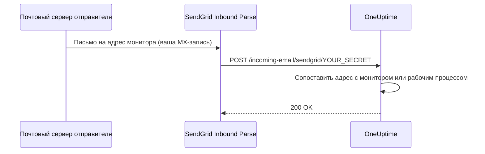

# Входящие письма SendGrid

**Incoming Email Monitor** в OneUptime позволяет создавать и закрывать оповещения на основе писем, отправленных на уникальные адреса, привязанные к каждому монитору. Это удобно для интеграции с устаревшими системами, инструментами оповещения или любым сервисом, который умеет отправлять письма.

Та же настройка позволяет рабочим процессам получать почту: рабочий процесс с триггером **Incoming Email** получает собственный адрес на том же домене, и каждое письмо на этот адрес запускает рабочий процесс. См. [Триггеры](/docs/workflows/triggers#incoming-email).

В этом руководстве описано, как настроить SendGrid Inbound Parse, чтобы входящие письма пересылались в ваш самостоятельно размещённый экземпляр OneUptime. В OneUptime Cloud ничего из этого не нужно: адреса там работают сразу.

:::cards
- [Перед началом](#предварительные-требования): Учётная запись SendGrid, домен и публичный адрес HTTPS.
- [Настройка](#инструкции-по-настройке): Семь шагов — от MX-записи до тестового письма.
- [Переменные окружения](#справочник-переменных-окружения): Три настройки и их значения по умолчанию.
- [Устранение неполадок](#устранение-неполадок): Письма, которые не доходят, и вебхуки, которые завершаются ошибкой.
:::

## Как это работает



1. Вы создаёте в OneUptime **Incoming Email Monitor**
2. OneUptime генерирует для этого монитора уникальный адрес электронной почты (например, `monitor-abc123@inbound.yourdomain.com`)
3. Когда на этот адрес отправляют письмо, SendGrid получает его и пересылает в OneUptime через вебхук
4. OneUptime проверяет письмо по настроенным вами критериям, чтобы создать или закрыть оповещения

## Предварительные требования

- Учётная запись SendGrid с доступом к Inbound Parse
- Домен, которым вы управляете, с доступом к настройкам DNS
- Публичный эндпоинт HTTPS, который пересылает вебхуки SendGrid в ваш экземпляр OneUptime

## Сетевой доступ

При Inbound Parse соединение с OneUptime открывает SendGrid. Разрешить OneUptime только исходящий доступ в интернет недостаточно.

| Направление | Назначение | Протокол / порт | Цель |
| --- | --- | --- | --- |
| SendGrid → OneUptime | `https://your-oneuptime-domain.com/incoming-email/sendgrid/YOUR_SECRET` | HTTPS / TCP 443 | Доставить разобранное письмо как multipart POST. |
| Почтовые серверы отправителей → SendGrid | `mx.sendgrid.net`, выбранный по публичной MX-записи вашего входящего домена | SMTP / TCP 25 | Принять письмо в SendGrid; это соединение не идёт к вашему серверу OneUptime. |
| OneUptime → SendGrid, только если отдельно настроена отправка почты через провайдера SendGrid | `api.sendgrid.com` | HTTPS / TCP 443 | Отправлять письма-уведомления через Mail Send API. |

Опубликуйте DNS для имени хоста вебхука и отдавайте сертификат, которому доверяют публичные клиенты. Частное развёртывание OneUptime может открыть наружу только путь вебхука — через публичный обратный прокси или шлюз, который достаёт до OneUptime изнутри. Сохраняйте путь, секрет, тип содержимого и multipart-тело запроса и пропускайте POST без интерактивного входа и проверок браузера. Серверу OneUptime не нужен входящий SMTP-слушатель. См. [настройку Inbound Parse в SendGrid](https://www.twilio.com/docs/sendgrid/for-developers/parsing-email/setting-up-the-inbound-parse-webhook).

Задайте для `INBOUND_EMAIL_WEBHOOK_SECRET` надёжное случайное значение и замените им `YOUR_SECRET` в URL. Маршрут требует последний сегмент пути. OneUptime проверяет его значение, когда секрет настроен; пустая переменная отключает эту проверку. Держите в тайне полный URL и адреса мониторов, в том числе в логах прокси. Сейчас OneUptime не проверяет подписанные заголовки Inbound Parse от SendGrid и токены OAuth. Если вам нужны эти механизмы, настройте шлюз, который проверяет их перед пересылкой в OneUptime, следуя [документации SendGrid по безопасности вебхуков](https://www.twilio.com/docs/sendgrid/for-developers/parsing-email/securing-your-parse-webhooks).

SendGrid не предоставляет надёжного списка статических исходных IP-адресов для Inbound Parse. IP-адреса, с которых SendGrid отправляет почту, и адреса, в которые разрешается `mx.sendgrid.net`, не являются списком разрешённых для вебхука. Следуйте [рекомендациям SendGrid по межсетевым экранам](https://support.sendgrid.com/hc/en-us/articles/44375457225371-How-to-Configure-Firewall-Settings-for-SendGrid-Webhook-and-Inbound-Parse-IPs), а не закрепляйте текущий результат DNS.

Inbound Parse не связан с отправкой исходящей почты. Чтобы принимать письма мониторов, OneUptime не нужно обращаться к API SendGrid. Если вы также выбираете SendGrid для отправки уведомлений, разрешите разрешение DNS и исходящий HTTPS к `api.sendgrid.com`; [Mail Send](https://www.twilio.com/docs/sendgrid/api-reference/mail-send/mail-send) не нужен входящий обратный вызов для отправки. Если вместо этого вы используете SMTP, разрешите SMTP-сервер и порт, настроенные в OneUptime.

## Инструкции по настройке

:::steps
### Выберите домен для входящей почты

Выберите поддомен, предназначенный только для приёма почты для OneUptime, например `inbound.yourdomain.com`, `email.yourdomain.com` или `monitor.yourdomain.com`. Он используется только для писем мониторам и рабочим процессам OneUptime, поэтому ваших почтовых ящиков на нём нет.

### Направьте его MX-запись на SendGrid

Добавьте MX-запись, которая направляет почту поддомена в SendGrid:

| Тип | Хост/Имя | Приоритет | Значение |
| --- | --- | --- | --- |
| MX | inbound | 10 | mx.sendgrid.net |

Если ваш домен — `example.com`, а вы используете `inbound.example.com`, запись выглядит так:

```text
inbound.example.com.  IN  MX  10  mx.sendgrid.net.
```

Распространение изменений DNS может занять до 48 часов, но обычно завершается за несколько часов.

### Подтвердите домен в SendGrid

Принимающий домен должен входить в один из ваших [подтверждённых доменов в SendGrid](https://www.twilio.com/docs/sendgrid/ui/account-and-settings/inbound-parse). В [панели SendGrid](https://app.sendgrid.com) перейдите в **Settings** > **Sender Authentication**, нажмите **Authenticate Your Domain** и добавьте запрошенные записи DNS (CNAME-записи для DKIM).

### Добавьте вебхук Inbound Parse

В панели SendGrid перейдите в **Settings** > **Inbound Parse** и нажмите **Add Host & URL**. Заполните форму, как показано ниже, а затем нажмите **Add**:

| Поле | Значение |
| --- | --- |
| **Receiving Domain** | Ваш поддомен для входящей почты (например, `inbound.yourdomain.com`) |
| **Destination URL** | `https://your-oneuptime-domain.com/incoming-email/sendgrid/YOUR_SECRET` |
| **Check incoming emails for spam** | Необязательно — включите при желании |
| **Send raw, full MIME message** | Оставьте неотмеченным (не требуется) |
| **POST the raw, full MIME message** | Оставьте неотмеченным (не требуется) |

### Настройте OneUptime

Задайте переменные входящей почты с тем же секретом, что и в Destination URL:

:::tabs
@tab Docker Compose
```bash title="config.env"
INBOUND_EMAIL_PROVIDER=SendGrid
INBOUND_EMAIL_DOMAIN=inbound.yourdomain.com
INBOUND_EMAIL_WEBHOOK_SECRET=replace-with-a-strong-random-secret
```
@tab Kubernetes
```yaml title="values.yaml"
inboundEmail:
  provider: "SendGrid"
  domain: "inbound.yourdomain.com"
  webhookSecret: "replace-with-a-strong-random-secret"
```
:::

Затем примените их: в Docker Compose выполните `npm run start`, что пересоздаст контейнеры с новыми значениями, а в Kubernetes обновите релиз Helm.

### Создайте монитор Incoming Email

[Создайте монитор Incoming Email](/docs/monitor/incoming-email-monitor#создание-монитора-входящих-писем). Его страница **Обзор** показывает его адрес, например `monitor-abc123def456@inbound.yourdomain.com`, а его критерии решают, какие письма создают оповещение, а какие его закрывают.

Рабочие процессы используют тот же домен. Добавьте в рабочий процесс триггер **Incoming Email** и нажмите на него: его адрес (`workflow-…@inbound.yourdomain.com`) указан в верхней части его настроек. Пока переменные входящей почты выше не заданы, триггер сообщает, что сервер не настроен на приём почты.

### Отправьте тестовое письмо

Отправьте письмо на адрес монитора с темой, соответствующей его критериям. Сводка монитора показывает письмо, а когда критерии совпадают, создаётся оповещение.
:::

## Справочник переменных окружения

| Переменная | Значение Helm | Описание | Обязательна | По умолчанию |
| --- | --- | --- | --- | --- |
| `INBOUND_EMAIL_PROVIDER` | `inboundEmail.provider` | Провайдер входящей почты. SendGrid — единственный. | Нет | `SendGrid` |
| `INBOUND_EMAIL_DOMAIN` | `inboundEmail.domain` | Поддомен, настроенный для входящей почты. Пока он не задан, входящая почта выключена. | Да | Пусто |
| `INBOUND_EMAIL_WEBHOOK_SECRET` | `inboundEmail.webhookSecret` | Секрет, который сравнивается с последним сегментом URL вебхука: `/incoming-email/sendgrid/YOUR_SECRET`. Настройте его для публичных эндпоинтов; пустое значение отключает проверку. | Рекомендуется | Пусто |

По чему может проверять письма монитор Incoming Email — теме, отправителю, телу, получателю и тому, пришло ли письмо вовремя, — описано в разделе [Доступные типы фильтров](/docs/monitor/incoming-email-monitor#доступные-типы-фильтров).

## Устранение неполадок

:::details Письма не приходят
1. **Проверьте распространение DNS:** `dig MX inbound.yourdomain.com` должен вернуть `mx.sendgrid.net`.
2. **Проверьте настройки Inbound Parse в SendGrid:** в панели SendGrid, в разделе **Settings** > **Inbound Parse**, проверьте ваш домен и URL вебхука.
3. **Проверьте логи OneUptime:** найдите запросы вебхука входящей почты и любые ошибки в логах сервиса OneUptime `app`. SendGrid не хранит подробных логов Inbound Parse, поэтому именно эти логи показывают, что пришло.
:::

:::details Вебхуки завершаются ошибкой
1. **Проверьте публичный маршрут вебхука:** полный URL вместе с секретом должен доходить до OneUptime из интернета. URL без последнего сегмента с секретом не совпадает с маршрутом.
2. **Проверьте правила межсетевого экрана:** разрешите HTTPS POST-запросы к пути вебхука без перенаправлений на вход и проверок браузера и не используйте IP-адреса отправки почты SendGrid как список разрешённых источников вебхука.
3. **Проверьте SSL-сертификат:** используйте для имени хоста вебхука действительный сертификат с публичным доверием и включите его цепочку сертификатов.
:::

:::details Монитор не создаёт оповещения
1. **Проверьте критерии:** убедитесь, что критерии создания оповещений соответствуют содержимому письма, и сначала проверяйте на точных строках, прежде чем использовать шаблоны.
2. **Проверьте монитор:** убедитесь, что он не отключён и что его тип — Incoming Email.
3. **Посмотрите сводку монитора:** проверьте, было ли письмо получено и обработано, и прочитайте логи оценки, чтобы увидеть, как сработали критерии.
:::

:::details Триггер сообщает, что сервер не настроен на приём почты
`INBOUND_EMAIL_DOMAIN` на сервере пуста. Задайте её, примените изменение и снова откройте триггер рабочего процесса.
:::

## Рекомендации по безопасности

1. **Используйте HTTPS:** всегда используйте HTTPS для эндпоинта вебхука
2. **Секрет вебхука:** настройте `INBOUND_EMAIL_WEBHOOK_SECRET` и включите его в URL вебхука (например, `/incoming-email/sendgrid/your-secret`) для дополнительной проверки
3. **Подтверждение домена:** подтвердите свой домен в SendGrid для лучшей безопасности почты
4. **Ограничьте доступ:** создавайте мониторы только для доверенных источников писем
5. **Следите за логами:** регулярно просматривайте логи входящей почты на предмет подозрительной активности

## Дальнейшие шаги

:::cards
- [Incoming Email Monitor](/docs/monitor/incoming-email-monitor): Критерии, форматы адресов и примеры.
- [Триггеры рабочих процессов](/docs/workflows/triggers): Запуск рабочего процесса по письму.
- [Доступ к частной сети](/docs/self-hosted/private-network-access): Что ваш сервер может достигать в вашей собственной сети.
- [Архитектура](/docs/self-hosted/architecture): Куда приходит вебхук в самостоятельно размещённой установке.
:::
