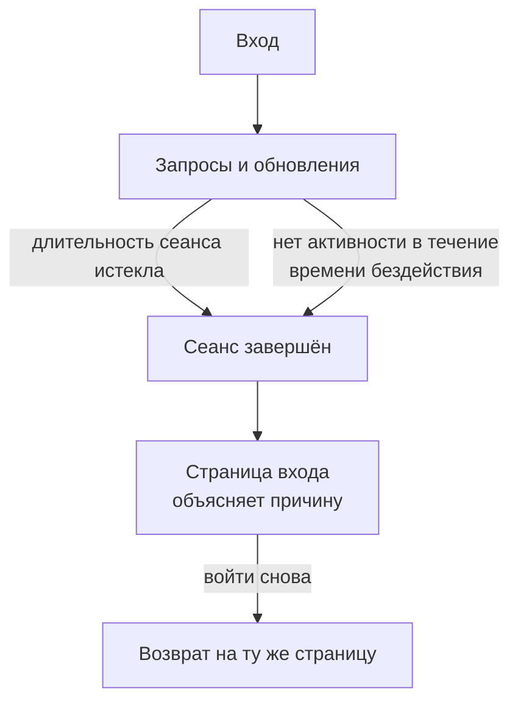

# Длительность сеанса

Выберите, как долго пользователи остаются в OneUptime, прежде чем войти снова: заданное время после входа, время без работы или и то и другое. Это относится к каждому входу в панель управления, Admin Dashboard и мобильное приложение — с паролем, ключом доступа, входом через Microsoft или единым входом. Для входов через SSO можно задать отдельную длительность.

> [!NOTE]
> Длительность сеанса входит в [OneUptime Enterprise Edition](/docs/self-hosted/enterprise). В Community Edition нет страницы **Длительность сеанса**, и каждый вход длится так, как описано в разделе [Без ограничений](#без-ограничений).

:::cards
- [Задать длительность сеанса](#задать-длительность-сеанса): Две настройки в Admin Dashboard.
- [Как заканчивается сеанс](#как-заканчивается-сеанс): Что считает сервер и когда.
- [Входы через SSO](#входы-через-sso): Отдельная длительность для единого входа.
- [Что не является входом](#что-не-является-входом): Ключи API, подключения MCP и читатели страниц статуса.
:::

## Без ограничений

Пока вы не зададите длительность, у входа её нет. Его токен доступа действует 15 минут и обновляется в фоне с помощью токена обновления, который действует 30 дней и отсчитывается заново при каждом использовании. Тот, кто открывает OneUptime хотя бы раз в 30 дней, остаётся в системе; тот, кто не открывает, входит снова.

## Задать длительность сеанса

:::steps
### Откройте «Длительность сеанса»
В Admin Dashboard откройте **Настройки**, затем **Длительность сеанса** в боковом меню.

### Выберите длительность
- **Завершать сеанс через**: сколько длится вход с момента входа, как бы активно ни работал пользователь.
- **Завершать сеанс после бездействия в течение**: сколько времени можно не нажимать, не печатать и не прокручивать в OneUptime.

Каждый выбор сохраняется сразу, как только вы его делаете.

### Подтвердите, чьи сеансы завершатся
Более короткая длительность действует для всех, кто сейчас в системе. Если она сразу завершает чьи-то сеансы, OneUptime сначала сообщает, сколько их, и входите ли вы в их число. Выберите **Сохранить и завершить сеансы**, чтобы продолжить.
:::

| Настройка | Варианты | По умолчанию |
| --- | --- | --- |
| **Завершать сеанс через** | От 1 часа до 90 дней | **Без ограничений** |
| **Завершать сеанс после бездействия в течение** | От 15 минут до 14 дней | 30 дней, больше нельзя |

Через API `sessionLengthInMinutes` принимает любое целое число минут от 15 до 525600 (год), а `sessionIdleTimeoutInMinutes` — от 15 до 43200 (30 дней), в глобальной конфигурации сервера. Пустое значение — значение по умолчанию.

## Как заканчивается сеанс

- Сервер отсчитывает обе длительности по самому сеансу: когда был выполнен вход и когда пользователь был активен в последний раз. Он проверяет их при каждом запросе, каждом обновлении и каждом обновлении в реальном времени и никогда не оставляет завершение сеанса браузеру.
- Время бездействия отсчитывается от последнего щелчка, нажатия клавиши или прокрутки в любой вкладке панели управления или Admin Dashboard. Открытая вкладка не поддерживает сеанс.
- Мобильное приложение считается активным каждый раз, когда им пользуются.
- Когда сеанс заканчивается, браузер переходит на страницу входа, которая объясняет причину. После повторного входа пользователь возвращается на ту страницу, где был.

| Изменение | Что происходит с теми, кто сейчас в системе |
| --- | --- |
| Более короткая длительность сеанса или время бездействия | Сеансы всех, кто его превысил, завершаются сразу, остальных — когда они его достигнут |
| Более длинное значение или никакого | Ничьи сеансы не завершаются, а сеансы длятся дольше начиная со следующего обновления |

## Входы через SSO

Входы через единый вход подчиняются тем же двум настройкам. Чтобы задать им отдельную длительность, откройте **Дополнительные настройки** на странице **Длительность сеанса** и включите **Отдельная длительность для входов через SSO**. Тогда две настройки под ним действуют для входов через поставщика SAML или OpenID Connect проекта либо через собственный [глобальный SSO](/docs/identity/global-sso) сервера, а две вверху страницы — для всех остальных входов.

Кроме того, проект, требующий SSO, пускает сеанс только пока длится его вход через SSO, а он никогда не длиннее длительности, которой подчиняются входы через SSO.

Через API переключатель — `useSeparateSsoSessionLengths`, а длительность входов через SSO — `ssoSessionLengthInMinutes` и `ssoSessionIdleTimeoutInMinutes`, с теми же диапазонами.

## Что не является входом

- **Ключи API** сохраняют срок действия, который вы им задали.
- **Подключения MCP**, то есть ИИ-ассистенты, подключённые через OAuth, сохраняют собственный срок действия. В проекте, требующем SSO, подключение никогда не действует дольше входа через SSO, с которым его одобрили.
- **Приватные страницы статуса** имеют собственную длительность для своих читателей: см. [Приватные пользователи](/docs/status-pages/index#приватные-пользователи).

## Без лицензии

После пробного или льготного периода, без действующей лицензии или с лицензией, которая не включает длительность сеансов, длительность нельзя задать или изменить. Уже заданная длительность по-прежнему завершает сеансы, и её по-прежнему можно удалить. С образом Community Edition никакая длительность не действует: значения остаются в базе данных и снова действуют, когда вы переключитесь обратно.

## Дальнейшие шаги

:::cards
- [SSO](/docs/identity/sso): Вход пользователей через вашего поставщика удостоверений.
- [Глобальный SSO](/docs/identity/global-sso): Один поставщик удостоверений для всего сервера.
- [Enterprise Edition](/docs/self-hosted/enterprise): Что добавляет Enterprise Edition, и её лицензия.
:::
