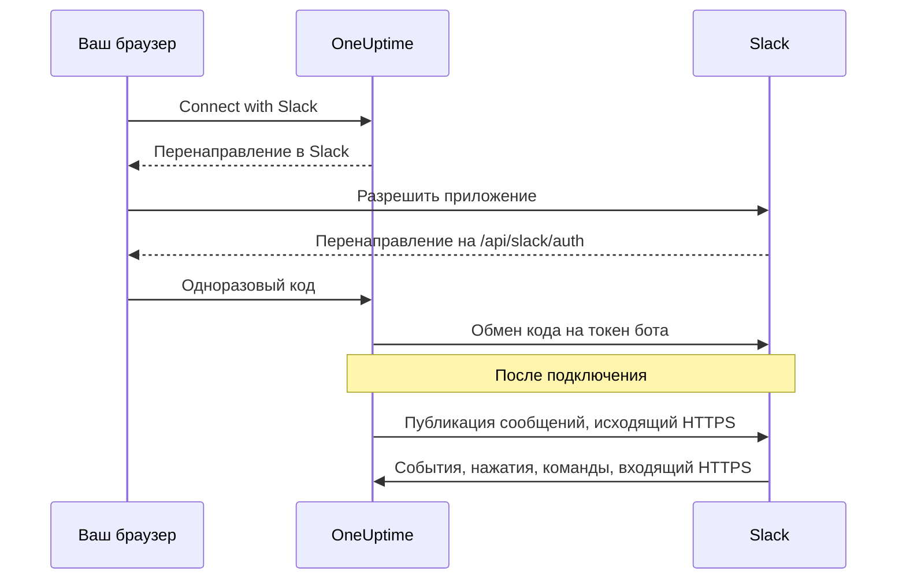
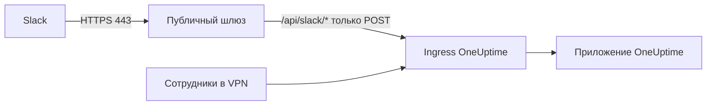

# Интеграция со Slack

Подключите свой самостоятельно размещённый OneUptime к Slack. Вы создаёте приложение Slack из манифеста, который генерирует ваш сервер, передаёте OneUptime учётные данные приложения и подключаете каждый проект к рабочему пространству. После этого OneUptime публикует инциденты, оповещения и плановое обслуживание в ваших каналах, а команда работает с ними прямо в Slack.

Эта страница для тех, кто администрирует сервер OneUptime. Когда Slack подключён, правила уведомлений настраиваются для каждого проекта: см. [Slack](/docs/workspace-connections/slack).

:::cards
- [Настройка приложения Slack](#настройка-приложения-slack): Создайте приложение из своего манифеста и подключите проект.
- [Переменные окружения](#переменные-окружения): Три значения, которые OneUptime нужны от приложения.
- [Сетевой доступ](#сетевой-доступ-для-самостоятельно-размещённых-установок): Обратные вызовы, до которых Slack должен дотягиваться.
- [Устранение неполадок](#устранение-неполадок): Что означают сообщения на странице Slack и что делать.
:::

## Как это работает

Приложение Slack принадлежит вам: оно установлено в вашем рабочем пространстве и общается только с вашим сервером. Трафик идёт в обе стороны, и каждому направлению нужен свой сетевой доступ.



- **Исходящий трафик**: OneUptime вызывает Web API Slack, чтобы публиковать сообщения, создавать каналы и загружать изображения.
- **Входящий трафик**: Slack вызывает четыре маршрута на вашем сервере для событий, нажатий кнопок, меню и slash-команд. Каждый запрос подписан signing secret приложения. OneUptime отклоняет запрос, подпись которого не совпадает или метка времени которого старше пяти минут.

## Перед началом

- Рабочее пространство Slack, в котором вы можете создавать и устанавливать приложения.
- Публичное имя хоста HTTPS для OneUptime, доступное для Slack. См. [Сетевой доступ](#сетевой-доступ-для-самостоятельно-размещённых-установок).
- Доступ к конфигурации сервера: `config.env` для Docker Compose или ваши values Helm для Kubernetes.
- Чтобы подключить проект, роль **Project Owner**, **Project Admin** или **Project Member** в нём.

## Настройка приложения Slack

:::steps
### Задайте публичный URL

OneUptime строит манифест приложения и каждый URL обратного вызова из `HOST` и `HTTP_PROTOCOL`. Укажите в них имя хоста, по которому Slack будет обращаться, по HTTPS:

:::tabs
@tab Docker Compose
```bash title="config.env"
HOST=oneuptime.example.com
HTTP_PROTOCOL=https
```
@tab Kubernetes
```yaml title="values.yaml"
host: oneuptime.example.com
httpProtocol: https
```
:::

Эти значения только генерируют URL. Они не создают записи DNS, сертификаты или правила межсетевого экрана.

### Скопируйте манифест приложения

Откройте **Настройки проекта > Рабочее пространство > Slack**. Пока Slack не настроен на сервере, страница показывает **Integrating Slack with your OneUptime Project** с манифестом, сгенерированным для вашего имени хоста. Он также доступен по адресу `https://oneuptime.example.com/api/slack/app-manifest`.

Убедитесь, что каждый URL в манифесте начинается с вашего публичного имени хоста. Если нет, сначала исправьте `HOST` и `HTTP_PROTOCOL` и примените изменение.

### Создайте приложение Slack

На [api.slack.com/apps](https://api.slack.com/apps) создайте новое приложение из манифеста, выберите своё рабочее пространство и вставьте манифест. Всегда используйте манифест, который генерирует ваш собственный сервер, чтобы его URL совпадали с вашим именем хоста.

### Скопируйте учётные данные приложения

На странице приложения **Basic Information** в разделе **App Credentials** скопируйте **Client ID**, **Client Secret** и **Signing Secret**.

### Добавьте учётные данные в OneUptime

:::tabs
@tab Docker Compose
```bash title="config.env"
SLACK_APP_CLIENT_ID=YOUR_SLACK_APP_CLIENT_ID
SLACK_APP_CLIENT_SECRET=YOUR_SLACK_APP_CLIENT_SECRET
SLACK_APP_SIGNING_SECRET=YOUR_SLACK_APP_SIGNING_SECRET
```
@tab Kubernetes
```yaml title="values.yaml"
slackApp:
  clientId: "YOUR_SLACK_APP_CLIENT_ID"
  clientSecret: "YOUR_SLACK_APP_CLIENT_SECRET"
  signingSecret: "YOUR_SLACK_APP_SIGNING_SECRET"
```

Чтобы хранить значения в Secret Kubernetes, которым вы управляете сами, задайте вместо этого `slackApp.existingSecret`: его `name` и ключи `clientIdKey`, `clientSecretKey` и `signingSecretKey`.
:::

### Примените конфигурацию

:::tabs
@tab Docker Compose
```bash
npm run start
```

Это пересоздаёт контейнеры с новым `config.env`. `docker compose restart` не перечитывает его.
@tab Kubernetes
```bash
helm upgrade my-oneuptime oneuptime/oneuptime -f values.yaml
```
:::

Когда OneUptime снова запустится, страница **Настройки проекта > Рабочее пространство > Slack** покажет кнопку **Connect with Slack** вместо манифеста.

### Подтвердите URL запросов для событий

В разделе **Event Subscriptions** приложения Slack подтвердите URL запросов. OneUptime отвечает на challenge Slack только после того, как задан signing secret, поэтому повторите проверку, если она не прошла, пока вы создавали приложение.

### Подключите проект

В **Настройки проекта > Рабочее пространство > Slack** выберите **Connect with Slack** и разрешите приложение в Slack. Slack вернёт вас на ту же страницу, где теперь указано ваше рабочее пространство.

### Подключите свою учётную запись Slack

Кнопки, формы и команды действуют от имени пользователя OneUptime, связанного с учётной записью Slack, которая ими пользуется. Каждый открывает **Настройки пользователя > Рабочее пространство > Slack** и выбирает **Connect my account with Slack**. Тот, кто не подключил учётную запись, получает от приложения личное сообщение с просьбой сделать это.
:::

## Переменные окружения

| Docker Compose (`config.env`) | Helm (`values.yaml`) | Обязательно | Значение |
| --- | --- | --- | --- |
| `SLACK_APP_CLIENT_ID` | `slackApp.clientId` | Да | **Client ID** приложения. Без него страница Slack показывает руководство по настройке вместо **Connect with Slack**. |
| `SLACK_APP_CLIENT_SECRET` | `slackApp.clientSecret` | Да | **Client Secret** приложения, с помощью которого код, возвращаемый Slack, обменивается на токен. |
| `SLACK_APP_SIGNING_SECRET` | `slackApp.signingSecret` | Да | **Signing Secret** приложения. Каждый запрос от Slack проверяется с его помощью. |
| `HOST` | `host` | Да | Ваше публичное имя хоста, без схемы. |
| `HTTP_PROTOCOL` | `httpProtocol` | Да | `https`. Slack обращается только к URL с HTTPS. |

## Что умеет приложение

Манифест настраивает эти функции. Каждая обращается к вашему серверу по указанному маршруту, поэтому работает, только когда Slack может достучаться до этого маршрута.

| Функция | Что она делает | Маршрут |
| --- | --- | --- |
| `/incident` и ярлык **Create New Incident** | Объявить инцидент из Slack | `POST /api/slack/interactive` |
| `/maintenance` и ярлык **Create Scheduled Event** | Запланировать обслуживание из Slack | `POST /api/slack/interactive` |
| `/oneuptime` | Спросить OneUptime AI о ваших логах, трассировках, метриках, инцидентах и мониторах | `POST /api/slack/command` |
| Кнопки и формы в сообщениях OneUptime | Подтвердить, решить, добавить заметку, изменить состояние, запустить политику дежурств | `POST /api/slack/interactive` и `POST /api/slack/options-load` |
| События | Упоминания, сообщения, реакции и закрепления, например чтобы сохранить сообщение как заметку | `POST /api/slack/events` |

### Изображения в сообщениях

Описания инцидентов и оповещений могут содержать снимки экрана, например от синтетического монитора (см. [Синтетические мониторы](/docs/monitor/incident-alert-templating#синтетические-мониторы)). OneUptime показывает их в сообщениях Slack, загружая каждый в ваше рабочее пространство как частный файл, для чего нужен scope бота `files:write`. Сгенерированный манифест его включает.

Если вы создали приложение Slack из более старого манифеста, добавьте `files:write` в **OAuth & Permissions > Bot Token Scopes** (или обновите приложение из текущего манифеста). Затем снова выберите **Connect with Slack** в **Настройки проекта > Рабочее пространство > Slack**, чтобы новый scope был предоставлен. До тех пор каждый снимок экрана показывается своим альтернативным текстом.

## Сетевой доступ для самостоятельно размещённых установок

### Направление трафика и конечные точки

| Трафик | Необходимый доступ |
| --- | --- |
| От OneUptime к Slack | DNS и исходящий HTTPS по TCP 443 к `slack.com` для вызовов Web API и обмена токена OAuth; `hooks.slack.com` для URL ответов на команды и уведомлений через входящие вебхуки, если они используются |
| От Slack к OneUptime | Публичный HTTPS по TCP 443 к четырём маршрутам POST ниже, для полной интеграции |
| От браузера пользователя к OneUptime | Доступ к панели и перенаправления OAuth на `/api/slack/auth/:projectId/:userId` и `/api/slack/auth/:projectId/:userId/user`; они могут оставаться доступными через VPN пользователя |

Исходящие домены описывают интеграцию OneUptime со Slack, а не исчерпывающий список разрешённых адресов для клиентов Slack или всех функций Slack. *Входящий вебхук* Slack размещает сам Slack: OneUptime отправляет в него сообщения, поэтому это не входящая конечная точка на вашем сервере. См. [руководство по входящим вебхукам](https://docs.slack.dev/messaging/sending-messages-using-incoming-webhooks/) Slack.

Перенаправляйте эти обратные вызовы в OneUptime через его ingress:

| Метод и путь | Назначение |
| --- | --- |
| `POST /api/slack/events` | Проверка Events API, реакции, закрепления, упоминания и сообщения |
| `POST /api/slack/interactive` | Кнопки, ярлыки, отправка модальных окон, `/incident` и `/maintenance` |
| `POST /api/slack/options-load` | Запросы вариантов интерактивных меню |
| `POST /api/slack/command` | Команда `/oneuptime` |

OAuth — это [перенаправление в браузере, за которым следует обмен токена на сервере](https://docs.slack.dev/authentication/installing-with-oauth/). Манифест регистрирует `/api/slack/auth` как префикс URL перенаправления, а OneUptime добавляет пути проекта и пользователя, когда начинает авторизацию. Одного доступа из браузера недостаточно, чтобы Slack доставлял события или нажатия кнопок.

### Частные установки и безопасность обратных вызовов



Используйте публичный DNS и шлюз с публично доверенным сертификатом HTTPS, полной цепочкой сертификатов и частным маршрутом к вашему ingress OneUptime. Разрешите входящий TCP 443 к шлюзу и перенаправляйте только четыре маршрута обратных вызовов выше. Частный `ClusterIP`, внутреннее имя DNS или VPN-подключение сотрудника недоступны для Slack. Раздельный DNS позволяет оставить панель и маршруты OAuth частными под тем же именем хоста.

После смены имени хоста заново сгенерируйте манифест и обновите приложение Slack.

На шлюзе сохраняйте:

- метод, путь, строку запроса и исходное тело;
- `Content-Type`, `X-Slack-Signature` и `X-Slack-Request-Timestamp`;
- публичный хост и схему HTTPS, через доверенные заголовки прокси.

Исключите маршруты обратных вызовов из браузерного SSO, CAPTCHA и страниц входа прокси и сохраните проверки signing secret и метки времени в OneUptime. Синхронизируйте часы сервера: запрос, расходящийся по времени больше чем на пять минут, отклоняется. Slack документирует [проверку подписи запросов](https://docs.slack.dev/authentication/verifying-requests-from-slack/); проверка исходного IP её не заменяет.

### Проверка доступа и ограничения

:::steps
1. В разделе **Event Subscriptions** приложения Slack подтвердите URL запросов. Slack отправляет [POST-challenge и проверяет TLS](https://docs.slack.dev/apis/events-api/using-http-request-urls/).
2. Отправьте тестовое уведомление, выполните slash-команду, нажмите кнопку в сообщении об инциденте и вызовите событие, на которое есть подписка.
3. Проверьте логи шлюза и OneUptime на неудачные доставки, не записывая секреты в логи.
:::

Slack ожидает быстрых подтверждений, в том числе [ответа в течение трёх секунд на взаимодействия](https://docs.slack.dev/interactivity/handling-user-interaction/). GET из браузера или успешно отправленное исходящее сообщение не проверяют эти POST-обратные вызовы.

> [!WARNING]
> Если любое входящее подключение запрещено, уже авторизованное приложение по-прежнему может отправлять сообщения через исходящий HTTPS, но события, кнопки, ярлыки и команды работать не будут. Манифест OneUptime использует HTTP-обратные вызовы и отключает Socket Mode; включение Socket Mode в Slack не является поддерживаемой заменой этих маршрутов.

[Настройки доступа к частной сети](/docs/self-hosted/private-network-access) управляют исходящими запросами к частным адресатам. Они не открывают обратные вызовы для Slack.

## Устранение неполадок

### Подключение не завершилось

Когда Slack возвращает вас, а подключение не состоялось, страница Slack, с которой вы начали (**Настройки проекта > Рабочее пространство > Slack** или ваши собственные **Настройки пользователя > Рабочее пространство > Slack**, если вы подключали свою учётную запись), показывает **Slack не подключён** и одно предложение на вашем языке с причиной. Остальная часть страницы загружается как обычно, так что можно сразу подключиться заново. Ответ самого Slack она никогда не показывает: он вместе с причиной записан в лог сервера OneUptime.

| На странице написано | Что делать |
| --- | --- |
| **"Эта ссылка для подключения недействительна, устарела или уже использована. Начните заново."** | Ссылка срабатывает один раз, в течение 15 минут, в том браузере, где её открыли. Начните заново со страницы Slack и завершите в Slack в течение 15 минут в том же браузере. |
| **"У вас нет разрешения подключать этот проект к Slack."** | Для установки OneUptime в Slack нужна роль **Project Owner**, **Project Admin** или **Project Member**. Она проверяется снова, когда Slack возвращает вас, поэтому роль, отозванная за это время, тоже прерывает подключение здесь. |
| **"Вы больше не участник этого проекта."** | Чтобы подключить свою учётную запись Slack, нужно быть участником проекта в момент, когда Slack вас возвращает. |
| **"Этот проект ещё не подключён к рабочему пространству Slack."** | Сначала установите OneUptime в Slack на странице **Настройки проекта > Рабочее пространство > Slack**, затем подключите свою учётную запись. |
| **"Вы вошли в другое рабочее пространство Slack, а не в то, к которому подключён этот проект."** | Подключайте учётную запись, войдя в то рабочее пространство Slack, где установлен проект. |
| **"Подключение отменено, поэтому ничего не изменилось."** | Запрос не был разрешён в Slack. Начните заново и разрешите его. |
| **"Slack не настроен на этом сервере OneUptime."** | Задайте `SLACK_APP_CLIENT_ID` и `SLACK_APP_CLIENT_SECRET` (см. [Переменные окружения](#переменные-окружения)) и перезапустите OneUptime. |
| **"OneUptime не удалось завершить подключение. Попробуйте ещё раз."** | Slack ответил ошибкой, или при завершении не удался запрос либо запись. Какой именно, сказано в логе сервера OneUptime. Попробуйте ещё раз; если ошибка повторяется, проверьте лог и настройки приложения Slack. |

### Другие проблемы

:::details Slack не может подтвердить URL запросов для событий
OneUptime отвечает на challenge Slack, только когда задан `SLACK_APP_SIGNING_SECRET` и запрос до него доходит. Задайте signing secret, примените конфигурацию и повторите проверку. Если она по-прежнему не проходит, убедитесь, что `POST /api/slack/events` доступен из интернета с публично доверенным сертификатом.
:::

:::details Кнопки и slash-команды ничего не делают, но уведомления приходят
Уведомления исходящие, поэтому работают без входящего доступа. Кнопки, ярлыки и команды входящие: убедитесь, что Slack может достучаться до `POST /api/slack/interactive` и `POST /api/slack/command`, а шлюз сохраняет тело и заголовки `X-Slack-Signature` и `X-Slack-Request-Timestamp`.
:::

:::details Приложение пишет, что моя учётная запись Slack не подключена к OneUptime
Кнопкам, формам и командам нужна ваша учётная запись Slack, связанная с вашим пользователем OneUptime. Откройте **Настройки пользователя > Рабочее пространство > Slack** и выберите **Connect my account with Slack**. Если вас удалили из проекта, приложение сообщит об этом, а действия из Slack будут отклоняться.
:::

:::details Снимки экрана отображаются как текст
У приложения Slack нет scope `files:write`. См. [Изображения в сообщениях](#изображения-в-сообщениях).
:::

## Следующие шаги

:::cards
- [Slack](/docs/workspace-connections/slack): Создайте правила уведомлений и сводки для проекта.
- [Интеграция с Microsoft Teams](/docs/self-hosted/microsoft-teams-integration): Настройте на своём сервере и бота Teams.
- [Доступ к частной сети](/docs/self-hosted/private-network-access): Позвольте рабочим процессам и вебхукам обращаться к внутренним инструментам.
:::
