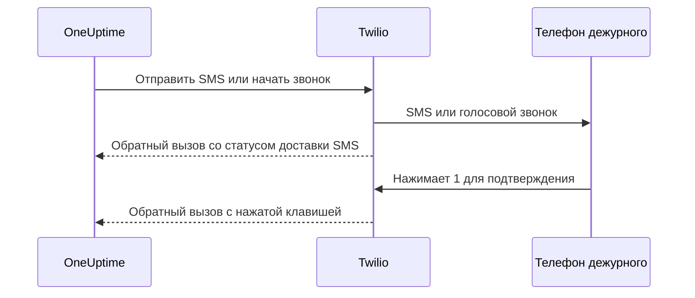

# Интеграция с Twilio

Самостоятельно размещённый OneUptime отправляет SMS и голосовые оповещения через вашу собственную учётную запись Twilio, а платите вы Twilio напрямую. Учётные данные Twilio сохраняются в панели OneUptime, а не в переменных окружения: отправка уведомлений читает сохранённую конфигурацию, а в Helm-чарте нет значений для учётных данных Twilio.

> [!NOTE]
> Старая миграция импортировала `TWILIO_ACCOUNT_SID`, `TWILIO_AUTH_TOKEN` и `TWILIO_PHONE_NUMBER`; изменение этих переменных не обновляет учётные данные существующей установки.

:::cards
- [Подготовьте учётную запись Twilio](#1-подготовьте-учётную-запись-twilio): Учётные данные, номер телефона и ограничения учётной записи.
- [Сохраните учётные данные](#2-сохраните-учётные-данные-в-oneuptime): Для одного проекта или для всей установки.
- [Настройте сетевой доступ](#3-настройте-сетевой-доступ): Что Twilio должен достигать на вашем сервере и когда.
- [Подтверждение номеров телефонов](#5-подтверждение-номеров-телефонов-участников-команды): Как подтверждаются номера участников команды.
:::

## 1. Подготовьте учётную запись Twilio

:::steps
### Скопируйте учётные данные

Откройте [Twilio Console](https://console.twilio.com/) и скопируйте **Account SID** и **Auth Token**.

### Получите номер телефона

Получите номер телефона Twilio с нужными возможностями SMS и/или голосовых вызовов. Для номеров отправителя и получателя используйте формат E.164 с кодом страны.

### Проверьте ограничения учётной записи

Проверьте баланс учётной записи, разрешения для стран назначения и действующие требования к регистрации отправителей. У пробных учётных записей есть ограничения по получателям, географии и другие, из-за которых настоящие оповещения OneUptime могут не работать; перед проверкой прочитайте [документацию Twilio об учётных записях и пробном периоде](https://www.twilio.com/docs/usage/tutorials/how-to-use-your-free-trial-account). В продакшене используйте платную учётную запись.
:::

## 2. Сохраните учётные данные в OneUptime

Сохраните учётные данные для одного проекта или один раз для всей установки:

| | Конфигурация проекта | Конфигурация всей установки |
| --- | --- | --- |
| Где | Карточка **Конфигурация Twilio** в разделе **Настройки проекта > Уведомления > Настройки уведомлений** | **Admin Dashboard > Настройки > Звонок и SMS** |
| Кто может её задать | **Project Owner**, **Project Admin** или **Create Call and SMS** в пользовательской роли | Мастер-администратор |
| Используется для | SMS и звонков участникам проекта, пока она используется по умолчанию в проекте, страниц статуса, которым она назначена, и политик входящих звонков, которые её используют | SMS и звонков участникам любого проекта, в котором нет конфигурации по умолчанию |

Чтобы добавить конфигурацию проекта:

:::steps
1. Перейдите в **Настройки проекта > Уведомления > Настройки уведомлений**.
2. В карточке **Конфигурация Twilio** выберите **Создать: Конфигурация Twilio**.
3. Введите название, **Twilio Account SID**, **Twilio Auth Token** и **Основной номер телефона Twilio**. При необходимости введите через запятую **Дополнительные номера телефонов Twilio** для других стран.
4. **Установить по умолчанию для проекта** включено для первой конфигурации проекта, поэтому SMS и звонки участникам проекта, включая уведомления дежурным, идут через неё сразу после сохранения. Выключите переключатель, если эта учётная запись нужна только для страниц статуса или входящих звонков. Следующая конфигурация создаётся с выключенным переключателем: включите его или выберите **Установить по умолчанию для проекта** в меню строки конфигурации, чтобы перенести эти сообщения на неё. Запрос к API без `isProjectDefault` обрабатывается так же.
5. Сохраните. Конфигурацией по умолчанию в проекте может быть только одна. Страницы статуса используют конфигурацию, явно назначенную каждой из них.

> [!IMPORTANT]
> **SMS** и **Телефонные звонки** в каждом проекте сначала выключены, и пока они не включены, никто в проекте не может добавить для них номер телефона. Их включает владелец проекта, **Billing Admin** или человек с правом **Manage Billing** в карточке **Каналы уведомлений** на той же странице.
:::

Чтобы задать конфигурацию по умолчанию для всей установки, администратор может вместо этого открыть **Admin Dashboard > Настройки > Звонок и SMS**, изменить учётные данные и номера телефонов Twilio и сохранить. Уведомления участникам используют эту глобальную конфигурацию, когда в их проекте нет конфигурации по умолчанию. Держите Auth Token в секрете.

## 3. Настройте сетевой доступ

Для отправки достаточно исходящего доступа. Для обновлений о доставке, подтверждения кнопкой на клавиатуре телефона и входящих звонков Twilio должен достигать вашего сервера.

Частной установке нужны разрешение DNS и исходящий HTTPS по TCP 443 к Twilio, чтобы отправлять SMS и звонки. Twilio рекомендует разрешить исходящий HTTPS к `*.twilio.com`, потому что адреса его API динамические; см. [IP-адреса Twilio](https://help.twilio.com/articles/115015934048-All-About-Twilio-IP-Addresses). Примените это к исходящему трафику рабочей нагрузки приложения OneUptime, включая NetworkPolicy в Kubernetes и внешние брандмауэры.

Входящий доступ зависит от функции:

| Функция | Должен ли Twilio достигать OneUptime? |
| --- | --- |
| Отправка SMS | Нет. Но для обновлений статуса доставки нужен обратный вызов. |
| Простой тестовый голосовой звонок | Нет. OneUptime передаёт голосовые инструкции в исходящем запросе к API. |
| Нажатие 1 для подтверждения оповещения дежурному | Да. Twilio отправляет нажатую клавишу в OneUptime. |
| Политики входящих звонков | Да. Twilio запрашивает инструкции для звонка и сообщает результаты набора. |

Это внешние пути через шлюз Nginx в OneUptime. Подставляемые значения меняются для каждого уведомления:

| Метод | Путь | Назначение |
| --- | --- | --- |
| POST | `/notification/sms/status-callback/:smsLogId/:token` | Статус доставки SMS |
| POST | `/api/user-notification-log-timeline/call/gather-input/:itemId?token=...` | Подтверждение клавишей |
| POST | `/notification/incoming-call/voice` | Необязательные инструкции для входящих звонков |
| POST | `/notification/incoming-call/dial-status/:callLogId/:callLogItemId` | Необязательные результаты маршрутизации входящих звонков |

OneUptime сам формирует URL для SMS и подтверждения. Не заменяйте их токены статическим URL вебхука. Для входящих звонков следуйте [политикам входящих звонков](/docs/on-call/incoming-call-policy): там вебхук номера настраивается при его подключении.

Twilio требует [общедоступные URL вебхуков](https://www.twilio.com/docs/usage/webhooks/webhooks-overview). Используйте общедоверенный сертификат TLS и сохраняйте через прокси исходный хост, протокол, путь, параметры запроса, тело и заголовок `X-Twilio-Signature`. Обработчики входящих звонков проверяют подписи Twilio; доставка SMS использует токен в URL для каждого сообщения, а подтверждение клавишей — подписанный токен в запросе. Не показывайте токены в общих журналах или на снимках экрана. См. [безопасность вебхуков Twilio](https://www.twilio.com/docs/usage/webhooks/webhooks-security).

### Публикация обратных вызовов из частной установки

:::steps
1. Опубликуйте DNS для имени хоста OneUptime, например `oneuptime.example.com`, указывающий на обратный прокси или балансировщик нагрузки, доступный из интернета. Разрешите входящий TCP 443 и настройте общедоверенный сертификат с полной цепочкой. Частный IP, только внутренний DNS или VPN-подключение администратора не дают Twilio связи.
2. Дайте этому шлюзу сетевой маршрут к частному ingress OneUptime — напрямую или через собственный межсайтовый VPN или частный канал. Разрешите порт вышестоящего сервиса. Сервису Kubernetes типа `ClusterIP` нужен доступный ingress или другой маршрут от шлюза. Держите базы данных и другие внутренние сервисы закрытыми.
3. Публикуйте только те пути обратных вызовов из таблицы выше, которые используете. Пересылайте их через шлюз Nginx в OneUptime, который сопоставляет внешний префикс `/notification` с приложением. Сохраняйте `/api` на маршруте подтверждения клавишей. Сохраняйте метод HTTP и данные запроса; не перенаправляйте на другой URL. Сохраняйте публичный `Host` и задайте на прокси доверенные заголовки пересылки для публичного хоста и схемы HTTPS.
4. Исключите эти маршруты из браузерного SSO, CAPTCHA и страниц входа прокси. Оставьте включённой проверку подлинности обратных вызовов OneUptime. Ограничьте доступ к частному источнику шлюзом и авторизованными внутренними клиентами.
5. Задайте `HOST=oneuptime.example.com` и `HTTP_PROTOCOL=https` в `config.env` для Docker Compose или `host: oneuptime.example.com` и `httpProtocol: https` в значениях Helm. Примените изменение установки и дождитесь перезапуска приложения. Эти параметры формируют URL; они не создают DNS, сертификаты и правила брандмауэра. В OneUptime нет отдельного параметра имени хоста для обратных вызовов Twilio. Если имя хоста изменится, обновите и вебхук существующих номеров телефонов Twilio.
:::

Панель может оставаться на частном ingress: с раздельным DNS сотрудники разрешают то же имя хоста в этот ingress через корпоративную сеть или VPN, а Twilio — в шлюз. Обслуживайте на обоих путях сертификат, действительный для этого имени хоста. [Настройки доступа к частным сетям](/docs/self-hosted/private-network-access) в OneUptime управляют исходящими запросами к внутренним сервисам; `ALLOW_PRIVATE_NETWORK_WEBHOOKS` не публикует входящую конечную точку.

### Ограничения по IP и установки без входящего доступа

Обычные адреса источников вебхуков Twilio меняются, поэтому не используйте диапазоны IP для SIP или медиа как список разрешённых адресов для обратных вызовов. Подходящие редакции Twilio предлагают [Static Proxy for Webhooks](https://www.twilio.com/docs/iam/twilio-editions/twilio-static-proxy). Убедитесь, что ваша редакция подходит и какие продукты поддерживаются, и настройте брандмауэр по текущим опубликованным диапазонам Twilio; продолжайте проверять обратные вызовы и при его использовании.

> [!WARNING]
> Если политика запрещает входящие подключения, отправка SMS и простое встроенное воспроизведение голоса могут работать через исходящий HTTPS. Обновления о доставке SMS, подтверждение клавишей и маршрутизация входящих звонков без доступных обратных вызовов работать не могут. Полностью изолированная установка не может использовать Twilio.

Для разработки [руководство по тестированию вебхуков](https://www.twilio.com/docs/usage/webhooks/webhook-testing) Twilio описывает использование публичного туннеля: направьте его на прокси, разрешающий только нужные маршруты, настройте полученное имя хоста, как описано выше, и остановите туннель после проверки. Туннель всё равно открывает входящий доступ.

## 4. Проверяйте доставку и обратные вызовы отдельно

:::steps
1. Извне корпоративной сети и VPN проверьте, что имя хоста обратных вызовов разрешается в публичный шлюз и отдаёт действительный сертификат TLS. GET из браузера не проверяет эти обратные вызовы POST.
2. Используйте **Отправить тестовое SMS** и **Отправить тестовый звонок** в конфигурации Twilio проекта. Убедитесь, что сообщение дошло до телефона назначения. Для обоих нужно право добавлять конфигурации Twilio: **Project Owner**, **Project Admin** или **Create Call and SMS** и **Read Call and SMS** в пользовательской роли.
3. Настройте подтверждённый контакт пользователя для SMS или звонков и правила уведомлений, затем вызовите контролируемое оповещение дежурному. Нажмите 1 и убедитесь, что подтверждение появилось в OneUptime. Если вы используете политики входящих звонков, позвоните на настроенный номер и проверьте его маршрутизацию и журнал звонков.
4. Проверьте статус доставки SMS в OneUptime и в журналах сообщений Twilio. Принятая отправка не доказывает доставку; [Twilio сообщает о последующих изменениях статуса через обратные вызовы](https://www.twilio.com/docs/messaging/guides/track-outbound-message-status).
:::

| Признак | Где смотреть |
| --- | --- |
| Ничего не отправляется | Учётные данные, возможности номера, ограничения учётной записи и исходящее подключение. |
| SMS или звонок приходит, но статус или подтверждение не обновляются | URL обратного вызова и журналы публичного ingress. [Руководство Twilio по ошибкам получения HTTP](https://www.twilio.com/docs/api/errors/11200) помогает разобраться с недоступными обратными вызовами, проблемами TLS и ошибками HTTP. |

Успешный тестовый звонок сам по себе не доказывает, что обратные вызовы доступны.

## 5. Подтверждение номеров телефонов участников команды

Когда вы добавляете номер телефона для SMS или звонков, код подтверждения отправляется сразу, и открывается диалог подтверждения. Он показывает, когда код был отправлен и до какого времени он действует, а по запросу отправляет новый код, но не чаще раза в минуту. Перед подтверждением ничего отправлять повторно не нужно.

Если код отправить нельзя, диалог объясняет почему, а не утверждает, что код отправлен: например, что учётная запись Twilio не настроена, пока нет ни конфигурации проекта по умолчанию, ни конфигурации всей установки, описанной выше. Номер, первый код для которого отправить не удалось, не добавляется, а форма показывает причину, например что Twilio отклоняет страну назначения.

Номер, подтверждённый для SMS, подтверждён и для звонков, без второго кода. Подтверждение звонком не подтверждает SMS, потому что номер, принимающий звонки, например стационарный, не всегда может получать текстовые сообщения. Если Twilio принимает код, который так и не приходит, его статус доставки показан в журнале SMS проекта.

## Дальнейшие шаги

:::cards
- [Политика входящих звонков](/docs/on-call/incoming-call-policy): Позвольте звонящим связаться с вашими дежурными инженерами через номер Twilio.
- [Правила эскалации](/docs/on-call/escalation-rules): Определите, кого оповещать на каждом уровне, по SMS, звонком или другим способом.
- [SMTP](/docs/emails/smtp): Отправляйте и почту через собственный почтовый сервер.
- [Доступ к частным сетям](/docs/self-hosted/private-network-access): Дайте рабочим процессам и вебхукам доступ к внутренним инструментам.
:::
