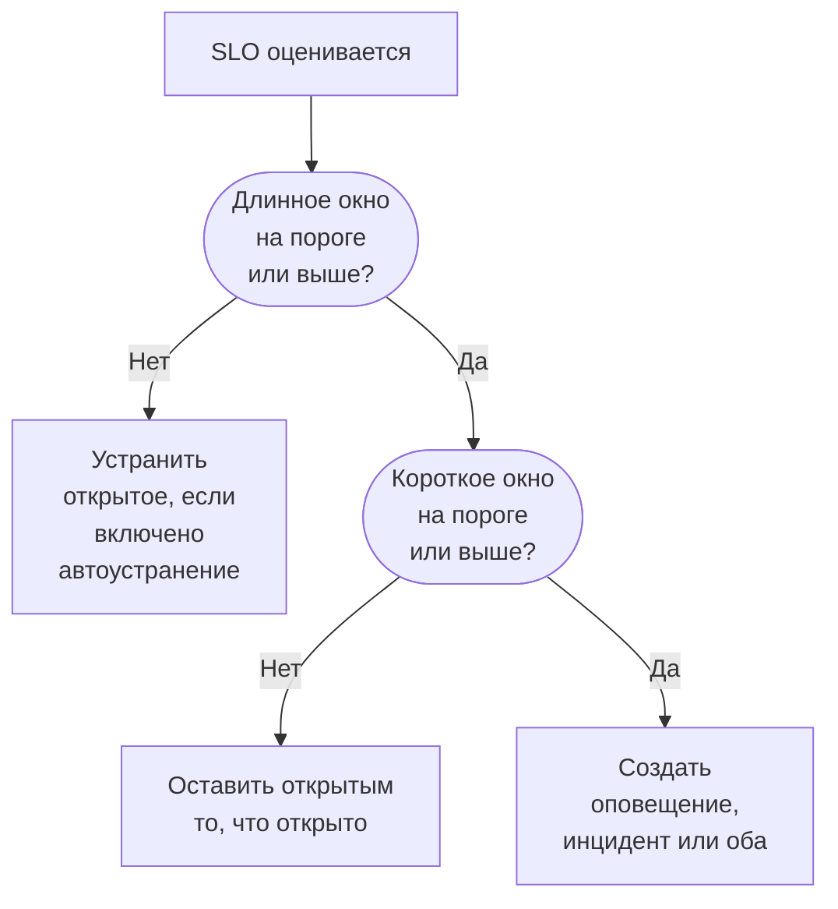

# Оповещения и инциденты по скорости расхода бюджета

Бюджеты ошибок показывают, где вы находитесь; правила скорости расхода говорят, когда пора вставать с постели. Когда SLO тратит свой бюджет ошибок достаточно быстро, чтобы это имело значение, правило скорости расхода создаёт оповещение, объявляет инцидент или делает и то и другое — с вашими собственными заголовком и описанием, серьёзностью, владельцами, метками, эскалацией на дежурных и уведомлениями в рабочем пространстве.

:::cards
- [Как правило принимает решение](#как-правило-решает-сработать): Два окна, оба выше порога.
- [Правила по умолчанию](#правила-по-умолчанию): Fast burn, Slow burn и Slow leak, подогнанные под окно SLO.
- [Создание правила](#создание-и-редактирование-правила): Пять шагов на странице Burn Rate Rules этого SLO.
- [Переменные шаблона](#что-сообщает-каждое-оповещение-и-инцидент): Пишите собственные заголовки и описания.
:::

## Что означает скорость расхода

Скорость расхода показывает, насколько быстро вы тратите бюджет ошибок по сравнению с равномерным темпом:

```text
burn rate = (share of time that was bad) ÷ (share of time the target allows to be bad)
```

При скорости расхода 1 вы тратите бюджет ровно за окно и достигаете цели, ничего не оставив. Более высокие значения исчерпывают его раньше. Для SLO с целью 99,9 % за 30 дней:

| Скорость расхода, если она сохранится | Бюджет закончится через |
| --- | --- |
| 1 | 30 дней |
| 2 | 15 дней |
| 6 | 5 дней |
| 14.4 | около 2 дней (50 часов) |

Скорость расхода не зависит от того, сколько бюджета осталось. Она отвечает на вопрос «насколько всё плохо прямо сейчас?», а именно это нужно знать, чтобы решить, будить ли кого-то.

Чтобы вместо этого действовать по тому, сколько бюджета осталось, например выпускать только работу над надёжностью, когда осталась четверть, задайте SLO [политику бюджета ошибок](/docs/slo/error-budget-policy).

## Как правило решает сработать

OneUptime проверяет каждое включённое правило скорости расхода при каждой оценке SLO, каждые 5 минут. Каждое правило измеряет скорость расхода в двух окнах и срабатывает, только когда обе скорости на его пороге или выше:

- **Длинное окно** (например, 1 час) показывает, что расход устойчивый и существенный, а не одна неудачная проверка.
- **Короткое окно** (например, 5 минут) показывает, что это всё ещё происходит. Без него всплеск часовой давности продолжал бы вызывать оповещения ещё долго после восстановления.

Это схема с несколькими окнами и несколькими скоростями расхода из Google SRE Workbook, и именно её OneUptime настраивает за вас.



Правило не может сработать, пока у SLO нет полного длинного окна истории наблюдения: иначе самая первая неудачная проверка монитора, поделённая на несколько минут истории, дала бы огромную скорость расхода. Поэтому новый SLO не может вызвать срабатывание своего правила **Fast burn** в первый час, своего правила **Slow burn** — в первые шесть, а своего правила **Slow leak** — в первые три дня. Если позже у SLO больше нет такой истории, например после замены его мониторов новыми, правило устраняет то, что открыло, а не оставляет его висеть. Правило также не срабатывает, пока любой из мониторов SLO находится на плановом обслуживании: см. [Плановое обслуживание](#плановое-обслуживание).

## Правила по умолчанию

Каждый новый SLO получает три правила скорости расхода. Для окна в 30 дней:

| Правило | Порог | Длинное окно | Короткое окно | Срабатывает, когда |
| --- | --- | --- | --- | --- |
| **Fast burn** | 14.4× | 1 час | 5 минут | Около 2 % бюджета расходуется за час: он закончился бы примерно за 2 дня. |
| **Slow burn** | 6× | 6 часов | 30 минут | Около 5 % бюджета расходуется за шесть часов: он закончился бы примерно за 5 дней. |
| **Slow leak** | 1× | 3 дня | 6 часов | Около 10 % бюджета расходуется за три дня: он закончился бы к концу окна. |

Fast burn и Slow burn — это вызовы дежурных: они создают оповещение с самой высокой серьёзностью оповещений проекта. Slow leak — это тикет: это правило создаёт своё оповещение с самой низкой серьёзностью оповещений проекта. Оно ловит равномерный расход, слишком медленный для двух других правил: при 3× бюджет SLO с целью 99,9 % заканчивается за 10 дней, но срабатывает только Slow leak. После устранения своего оповещения оно ждёт 24 часа, а не своё длинное окно в 3 дня, прежде чем создать следующее.

Пороги рассчитаны на 30-дневный бюджет, поэтому OneUptime подгоняет их под окно вашего SLO. Fast burn и Slow burn всегда означают «2 % бюджета за 1 час» и «5 % бюджета за 6 часов»:

| Окно SLO | Порог Fast burn | Порог Slow burn |
| --- | --- | --- |
| 7 дней | 3.36× | 1.4× |
| 28 дней | 13.44× | 5.6× |
| 30 дней | 14.4× | 6× |
| 90 дней | 43.2× | 18× |

Slow leak всегда означает «10 % бюджета за его длинное окно». Для окна в 30 дней и больше его окна всегда равны 3 дням и 6 часам, а порог растёт вместе с окном. Для более короткого окна его длинное окно составляет десятую часть окна SLO, а короткое — двенадцатую часть длинного, поэтому порог остаётся равным 1×. Если бы длинное окно оставалось равным 3 дням, порог опустился бы ниже 1× и правило срабатывало бы для SLO, который идёт к выполнению своей цели.

| Окно SLO | Порог Slow leak | Длинное окно | Короткое окно |
| --- | --- | --- | --- |
| 7 дней | 1× | 16,8 часа | 84 минуты |
| 28 дней | 1× | 2,8 дня | 5,6 часа |
| 30 дней | 1× | 3 дня | 6 часов |
| 90 дней | 3× | 3 дня | 6 часов |

SLO с календарным месяцем получают значения для 30 дней. Правила используют стандартные заголовок и описание, устраняют свои оповещения автоматически и не добавляют владельцев или метки. Ни одно из них не объявляет инцидент, поэтому обновление OneUptime никогда не начнёт объявлять инциденты за вас. Редактируйте их, удаляйте или добавляйте свои.

### Добавление рекомендуемых правил в существующий SLO

У SLO, созданных до появления Slow leak, есть только Fast burn и Slow burn: обновление OneUptime никогда не добавляет правило, которое само начало бы создавать оповещения. Пока у SLO нет одного из трёх правил по умолчанию, его страница **Правила скорости расхода** называет их в заметке над таблицей. Нажмите в заметке кнопку **Добавить рекомендуемые правила**, чтобы увидеть, какие именно правила она добавит, подогнанные под окно SLO, и подтвердите. Она добавляет только недостающие правила, а повторное нажатие ничего не добавляет.

Правило считается уже имеющимся, если у SLO есть правило с тем же именем или с тем же длинным окном, включённое или выключенное. Поэтому правило по умолчанию, которое вы переименовали или настроили, никогда не добавляется дважды. Чтобы заметка перестала предлагать ненужное вам правило по умолчанию, оставьте это правило и отключите его, а не удаляйте. Вам нужно разрешение на создание правил скорости расхода SLO. Каждое правило, которое она добавляет, публикуется в ленте SLO и записывается в его журналы аудита, так же как и созданные вами правила.

### Добавление сразу во многие SLO

Чтобы добавить рекомендуемые правила во многие SLO, начните со списка SLO, а не со страницы каждого SLO.

:::steps
#### Выберите SLO

Откройте **SLOs** и выберите SLO, которые нужно обновить. Чтобы взять все SLO, которые показывает фильтр, выберите всю страницу, а затем все совпадения, которые предлагает список.

#### Выберите «Добавить рекомендуемые правила»

Откройте **Массовые действия** и выберите **Добавить рекомендуемые правила**.

#### Проверьте, что будет добавлено, и подтвердите

Прежде чем что-либо будет добавлено, диалог подтверждения показывает, сколько из выбранных SLO получат каждое правило, подогнанное под их собственные окна. Если SLO с разными окнами получают правило в разном виде, например Slow leak для SLO с окном в 7 дней и для SLO с окном в 30 дней, он перечисляет каждый вариант с его порогом, его окнами и SLO, которые его получат. Он также сообщает, у скольких SLO уже есть все рекомендуемые правила и сколько SLO не удалось прочитать. Нажмите **Добавить рекомендуемые правила**, чтобы добавить их.
:::

Каждый SLO получает только недостающие ему правила, ровно так, как их добавила бы его собственная страница **Правила скорости расхода**: с той же проверкой того, что считается уже имеющимся, и с записью в ленте и записью в журналах аудита для каждого правила. Результат показывает для каждого SLO, были ли добавлены правила, были ли у него уже все рекомендуемые правила или он остался без изменений и почему, например потому что это SLO, который вам нельзя изменять. Один SLO, оставшийся без изменений, никогда не останавливает остальные, а повторный запуск для тех же SLO ничего не добавляет. Архивированных SLO нет в списке, и эти правила им никогда не предлагаются, потому что они не оцениваются: сначала извлеките SLO из архива.

Скрипты могут делать то же самое через API с [ключом API](/docs/api-reference/api-reference) проекта. Запросы для одного SLO принимают `{ "serviceLevelObjectiveId": "..." }` и возвращают правила в `rules`. Массовые запросы принимают `{ "serviceLevelObjectiveIds": ["..."] }`, не более 100 SLO на запрос, и возвращают в `results` по одной записи для каждого SLO в том порядке, в котором они были запрошены:

| Запрос | Что делает |
| --- | --- |
| `POST /api/service-level-objective-burn-rate-rule/recommended-rules` | Перечисляет рекомендуемые правила, которых не хватает SLO. Ничего не записывает. |
| `POST /api/service-level-objective-burn-rate-rule/recommended-rules/add` | Добавляет их и перечисляет добавленное. Повторный запрос ничего не добавляет. |
| `POST /api/service-level-objective-burn-rate-rule/recommended-rules/bulk` | Сообщает, чего не хватает каждому SLO: `Missing` с правилами, `NothingMissing` или `Refused` для SLO, который вам нельзя читать. Ничего не записывает. |
| `POST /api/service-level-objective-burn-rate-rule/recommended-rules/bulk/add` | Добавляет то, чего не хватает каждому SLO, по одному SLO за раз: `Added` с правилами, `NothingMissing`, `Refused` или `Failed` с правилами, добавленными до сбоя. Повторный запрос добавляет только то, чего всё ещё не хватает. |

## Создание и редактирование правила

Вам нужно разрешение на создание правил скорости расхода SLO.

:::steps
### Откройте Burn Rate Rules

Откройте SLO, перейдите на страницу **Правила скорости расхода** в разделе **Правила** его бокового меню и нажмите **Создать: Правило скорости расхода SLO** или отредактируйте одно из правил по умолчанию.

### Задайте имя правила

В разделе **Правило** введите **Имя**, например «Fast burn». Новое правило включено; чтобы позже оно перестало срабатывать, выключите **Включено** в форме его изменения.

### Задайте окно расхода

В разделе **Окно расхода** задайте **Порог скорости расхода** (например, `14.4`), **Длинное окно (минуты)** и **Короткое окно (минуты)**, а при желании и **Подавление повторного срабатывания (минуты)**.

### Выберите, что оно объявляет

В разделе **Что объявляет** ответьте на **При срабатывании**: **Создать оповещение** (по умолчанию), **Объявить инцидент** или **Оба**. **Добавить владельцев SLO как владельцев** также делает владельцев SLO владельцами всего, что создаёт правило.

### Опишите оповещение и инцидент

Шаги **Оповещение** и **Инцидент** появляются только для того, что объявляет правило. У каждого есть заголовок и серьёзность, а также свёрнутые разделы: **Описание**, **Владение и метки**, **Дежурство** и **Дополнительные поля**, где находятся автоустранение, приватность и заметки об устранении. Новые правила начинают со стандартных заголовка и описания, готовых к правке. На последнем шаге нажмите **Создать: Правило скорости расхода SLO**.
:::

OneUptime проверяет числа правила при сохранении:

| Параметр | Должен быть |
| --- | --- |
| **Порог скорости расхода** | Больше 0. |
| **Короткое окно (минуты)** | Больше 0. |
| **Длинное окно (минуты)** | Длиннее короткого окна. |
| **Подавление повторного срабатывания (минуты)** | 0 или больше. Пустое значение означает длину длинного окна. |

Любой ответ на **При срабатывании** что-то открывает. API отклоняет правило, которое не создавало бы оповещения и не объявляло бы инцидента, потому что оно проверялось бы при каждой оценке, ничего не объявляя.

Таблица правил показывает для каждого правила порог, окна и подавление, что оно объявляет (и устраняется ли оповещение или инцидент только вручную или является приватным), уровни серьёзности, политики дежурств, владельцев и метки.

> [!TIP]
> Хорошее начало: оставьте три правила по умолчанию, направьте правило быстрого расхода в политику дежурств, которая будит людей, с высокой серьёзностью, пусть правило медленного расхода создаёт оповещение с более низкой серьёзностью для рабочего времени, а правило медленной утечки остаётся тикетом для команды-владельца. Если ваша команда работает через инциденты, выберите **Объявить инцидент** для правила быстрого расхода или **Оба**, чтобы получать ещё и оповещение.

## Что объявляет правило

|  | **Оповещение** | **Инцидент** |
| --- | --- | --- |
| Открывается ответом | **Создать оповещение** (по умолчанию) или **Оба** | **Объявить инцидент** или **Оба** |
| Что это | Лёгкий сигнал: попадает в список оповещений. | Тяжёлый сигнал: получает номер инцидента и запускает весь процесс реагирования. |
| Заголовок и описание | Собственные или стандартный текст | Собственные или стандартный текст |
| Серьёзность | **Серьёзность оповещения**: если пусто, самая высокая в проекте | **Серьёзность инцидента**: если пусто, самая высокая в проекте |
| Эскалация | **Политики дежурства для оповещения** | **Политики дежурства для инцидента** |
| Владельцы и метки | **Владельцы оповещения** и **Метки оповещений** | **Владельцы инцидента** и **Метки инцидента** |
| Приватно | Выключено | Выключено |
| Автоустранение | Включено | Включено |
| Страницы статуса | Никогда не публикуется | Никогда не публикуется |

Поскольку каждое из них настраивается отдельно, можно отправить короткое оповещение в график дежурств команды-владельца, а подробный инцидент — в график дежурств по крупным инцидентам. Они и живут отдельно: каждое дедуплицируется, устраняется и подавляется само по себе, поэтому устранение инцидента не сбрасывает подавление оповещения, и наоборот.

### SLO — затронутый ресурс

Каждое оповещение и инцидент, созданные правилом скорости расхода, указывают свой SLO в разделе **Затронутые ресурсы** и ссылаются на него. Фильтр **Затронутые ресурсы** в списках оповещений и инцидентов ограничивает их одним SLO, а страницы **Оповещения** и **Инциденты** этого SLO перечисляют их, и значки в боковом меню считают открытые. OneUptime создаёт эту связь сам, и редактирование оповещения или инцидента никогда её не удаляет.

### Инциденты по скорости расхода остаются внутренними

Быстро расходуемый бюджет ошибок — это сигнал для инженеров, а не объявленный сбой. Инцидент по скорости расхода никогда не показывается на страницах статуса и никогда не уведомляет подписчиков страниц статуса. Он также не связывается ни с какими мониторами, потому что иначе его устранение переписало бы ту самую историю статусов мониторов, по которой измеряется SLO.

Если вы устраните такой инцидент вручную, ничто не объявит его снова, пока расход не восстановится и правило действительно не сработает заново, так что вам никогда не придётся бороться с правилом, пока вы работаете над инцидентом.

## Что сообщает каждое оповещение и инцидент

Новые правила начинают со стандартных заголовка и описания — и у оповещения, и у инцидента. Очистите заголовок или описание, чтобы вернуться к стандартному тексту. Стандартный заголовок:

```text
SLO burn rate: {{sloName}} — {{ruleName}}
```

Стандартное описание называет правило, указывает скорость расхода в обоих окнах относительно порога и оставшийся бюджет ошибок.

Чтобы написать собственный текст, используйте переменные шаблона в заголовке, описании и заметках об устранении. Каждое из этих полей показывает их в разделе **Переменные шаблона**: нажмите переменную, чтобы вставить её в позицию курсора, или введите `{{` в поле и выберите переменную. У описания и заметок об устранении на панели инструментов есть также **Вставить переменную**. Переменные заполняются, когда правило срабатывает:

| Переменная | Что содержит | Пример |
| --- | --- | --- |
| `{{sloName}}` | Имя SLO. | `Checkout availability` |
| `{{sloId}}` | ID SLO. | `b7f4c2d8-1f3e-4a5b-9c6d-7e8f9a0b1c2d` |
| `{{sloLink}}` | Ссылка на SLO в панели OneUptime. | `https://oneuptime.com/dashboard/project-id/slos/slo-id` |
| `{{sloStatus}}` | Статус SLO после этой оценки. | `At Risk` |
| `{{ruleName}}` | Имя сработавшего правила скорости расхода. | `Fast burn` |
| `{{burnRateThreshold}}` | Порог скорости расхода правила (кратное устойчивого темпа). | `14.4` |
| `{{longWindowBurnRate}}` | Скорость расхода, измеренная в длинном окне правила. | `21.5` |
| `{{shortWindowBurnRate}}` | Скорость расхода, измеренная в коротком окне правила. | `36` |
| `{{longWindowInMinutes}}` | Длина длинного окна правила в минутах. | `60` |
| `{{shortWindowInMinutes}}` | Длина короткого окна правила в минутах. | `5` |
| `{{targetPercentage}}` | Цель SLO в процентах. | `99.9` |
| `{{currentSliPercentage}}` | SLI, измеренный в окне соответствия SLO, в процентах. | `99.87` |
| `{{errorBudgetRemainingPercentage}}` | Доля ещё доступного бюджета ошибок в процентах. Отрицательная, когда бюджет превышен. | `42.5` |
| `{{errorBudgetRemaining}}` | Ещё доступный бюджет ошибок в виде длительности. Начинается со знака минус, когда бюджет превышен. | `18m 22s` |
| `{{errorBudgetRemainingMinutes}}` | Ещё доступный бюджет ошибок в минутах. | `18.37` |
| `{{windowDescription}}` | Окно соответствия SLO словами. | `rolling 30-day window` |
| `{{policyTier}}` | Название уровня политики бюджета ошибок, на котором находится SLO после этой оценки. «None», когда он не находится ни на одном уровне. | `Reliability first` |
| `{{policyTierThresholdPercentage}}` | Порог оставшегося бюджета этого уровня, в процентах. Пусто, когда SLO не находится ни на одном уровне. | `25` |
| `{{policyTierWhatWeDo}}` | Что команда договорилась делать на этом уровне, как записано в уровне. Пусто, когда SLO не находится ни на одном уровне. | `Only reliability work and critical fixes ship.` |

Например, заголовок `{{ruleName}}: {{sloName}} is burning {{longWindowBurnRate}}x` превращается в `Fast burn: Checkout availability is burning 21.5x`.

:::details Как заполняются переменные
- Числа округляются до двух знаков после запятой.
- Пробелы внутри фигурных скобок допустимы: `{{ sloName }}` работает.
- Переменная с опечаткой остаётся как есть, чтобы ошибка была видна в оповещении, а не пропала незаметно.
- Заголовки могут быть длиной до 500 символов, а описания и заметки об устранении — до 50 000. Заголовок, который после подстановки переменных длиннее 500 символов, сводится в одну строку и укорачивается с многоточием, чтобы оповещение или инцидент всё равно были созданы.
- Если ссылку на SLO нельзя построить в момент срабатывания правила, `{{sloLink}}` остаётся пустой, а оповещение или инцидент всё равно создаются.
:::

## Владельцы, метки и приватность

- **Владельцы оповещения** и **Владельцы инцидента** — это люди и команды, выбранные из одного списка с помощью **Добавить владельца**. Они добавляются в оповещение или инцидент сразу при его создании и получают уведомление. Люди должны быть участниками проекта.
- **Добавить владельцев SLO как владельцев** также добавляет владельцев SLO — его пользователей-владельцев и участников его команд-владельцев — во всё, что создаёт правило. Владельцы SLO и так узнают об изменениях статуса самого SLO, поэтому так они могут получить уведомление дважды. По умолчанию выключено.
- Каждый владелец добавляется один раз: пользователь, который уже является владельцем оповещения или инцидента, например через правила владельцев проекта, или входит в добавленную команду-владельца, повторно не добавляется.
- **Метки оповещений** и **Метки инцидента** добавляются в оповещение или инцидент, чтобы по ним могли срабатывать фильтры, правила владельцев и правила уведомлений рабочего пространства.
- Приватное оповещение или инцидент видят только его владельцы, администраторы проекта и владельцы проекта.

Метки, команды-владельцы и политики дежурств должны принадлежать проекту SLO.

## Устранение и подавление повторных срабатываний

- **Устранение следует за длинным окном.** При включённом автоустранении (по умолчанию) OneUptime устраняет оповещение и инцидент правила, как только скорость расхода в длинном окне опускается ниже порога. Устранение по короткому окну давало бы дребезг: перемежающийся сбой устранялся бы после пяти спокойных минут и будил бы людей снова всю ночь.
- **Автоустранение выключено.** Выключите **Автоустранение оповещения** или **Автоустранение инцидента**, и запись останется открытой, пока её кто-нибудь не устранит, даже после восстановления расхода. Правило не открывает поверх неё новую, а после ручного устранения, когда длинное окно ниже порога, правило может сработать снова по истечении подавления.
- **Подавление повторных срабатываний.** После устранения записи правило не объявляет такую запись снова в течение периода подавления — по умолчанию это длина длинного окна. Так восстанавливающаяся система получает время прийти в себя, не будя людей из-за остаточного шума. Slow leak создаётся с подавлением на 24 часа вместо своего длинного окна в 3 дня, поэтому о вернувшейся утечке снова сообщается уже на следующий день.

Некоторые изменения всегда устраняют то, что открыло правило, независимо от его настроек автоустранения, чтобы ничего не продолжало эскалироваться из-за правила, которое уже не может этого обосновать:

- изменение **При срабатывании** так, что оповещение или инцидент больше не открываются, закрывает то, что открыл этот выход;
- выключение или удаление правила;
- выключение оценки SLO, архивирование SLO или его удаление;
- переход SLO в статус **Приостановлено** или **Неправильно настроен**, потому что тогда он ничего не измеряет;
- потеря правилом порога или окон, а также отсутствие у SLO полного длинного окна истории.

## Плановое обслуживание

Пока монитор SLO входит в текущее событие обслуживания, правила скорости расхода этого SLO не создают оповещений и не объявляют инцидентов: запланированные работы не должны никого будить. То, что правила уже открыли, по-прежнему устраняется как обычно. Время всё равно учитывается в бюджете ошибок согласно статусам простоя SLO.

## Лента SLO

Лента **Лента** SLO публикует каждое оповещение, созданное правилом, и каждый объявленный им инцидент со ссылкой и скоростями расхода, которые их объясняют, а также момент устранения каждого — автоматического или ручного. Запись, которую правило подхватывает снова, потому что она ещё открыта, не публикуется дважды. Создание, изменение и удаление правила тоже публикуются и записываются в **Журналы аудита** SLO. См. [Лента и журналы аудита SLO](/docs/slo/feed-and-audit-logs).

## Устранение неполадок

:::details Правило не сработало сразу после создания SLO
Правило срабатывает, только когда у SLO есть полное длинное окно истории наблюдения: час для правила быстрого расхода по умолчанию, шесть часов для правила медленного расхода и три дня для правила медленной утечки, или десятая часть окна SLO, если оно короче 30 дней.
:::

:::details Оповещение устранилось, пока сбой ещё продолжался
Автоустранение следует за длинным окном: как только скорость расхода в длинном окне опускается ниже порога, оповещение устраняется. Задайте правилу более длинное длинное окно или выключите **Автоустранение оповещения** и устраняйте оповещение вручную.
:::

:::details Во время события обслуживания ничего не сработало
Правила скорости расхода молчат, пока любой из мониторов SLO входит в текущее событие обслуживания. Простой всё равно учитывается в бюджете.
:::

:::details Есть ли минимальное число замеров?
Не для SLO, которые измеряются по доступности мониторов. Доступность измеряется в секундах, поэтому каждая секунда окна — это замер, и защищаться от случая низкого трафика не нужно. Минимальное число замеров имеет значение только для SLI на основе событий, которых пока нет.
:::

## Дальнейшие шаги

:::cards
- [Бюджеты ошибок](/docs/slo/error-budget): Что такое бюджет и на сколько его хватает.
- [Политика бюджета ошибок](/docs/slo/error-budget-policy): Действуйте по тому, сколько бюджета осталось, уровень за уровнем.
- [Правила эскалации](/docs/on-call/escalation-rules): Кого вызывают и в каком порядке.
- [Лента и журналы аудита SLO](/docs/slo/feed-and-audit-logs): Каждое оповещение и инцидент, созданные правилом.
:::
